# Mark Schemes — Using Calculators for Graphs, Equations & Inequalities
**Coordinate Geometry & Graphs** · Cambridge (CIE) IGCSE maths (0607)

## Exam Questions (15 questions)

### Q1
> *This is a reciprocal graph of the form *$y=\frac{a}{x}$* where *$a=\frac{1}{2}=0.5$

> *Reciprocal graphs of this form always have two asymptotes: the *$x$*-axis and the *$y$*-axis*

> *Write these asymptotes as equations*

$x=0\mathrm{and}y=0$

**[B1 B1]**
> *Start a new graph on your calculator and enter *$\mathrm{f} ( x ) = 4 x^{2} - x^{4}$*to generate*

> *Select the option to 'analyze' the graph (this may be labelled G-Solv)*

> *Find the *$x$*-intercepts of the graph using the 'roots' or 'zeros' option*

*(-2, 0) and (2, 0)*

> *The *$y$*-intercept can be found using the *$y$*-intercept option (or by substituting  *$x=0$* into *$y=4x^{2}-x^{4}$*)*

*(0, 0)*

> $( 0 , 0 )$* is also the minimum point (you can check on your calculator using the option to find the 'minimum')*

> *Use the 'maximum' option to find the coordinates of the two maximum points (to 3 s.f. where necessary)*

*(-1.41, 4) and (1.41, 4)*

> **[exam-tip]**
> You may need to zoom in or out on your calculator to find the maximum points.

> *Sketch the graph and include all the features above*

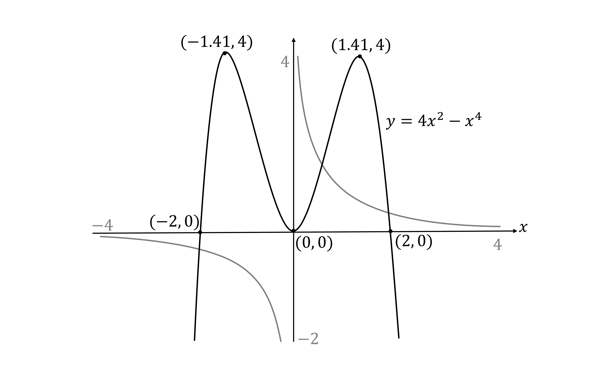

**[B1 B1 B1 B1 B1]**

> **[mark-scheme]**
> **B1:** For the M-shape (even if position is incorrect).
> 
> **B1: **For the correct non-zero $x$-intercepts of $\pm2$.
> 
> **B1:** For the correct maximum points, $( \pm 1.41 , 4 )$.
> 
> **B1:** For the correct minimum point at $( 0 , 0 )$.
> 
> **B1: **For the sketch fully correct.
> *The inequality is asking to find where the graph of *$y=4x^{2}-x^{4}$* is above the graph of *$y=\frac{1}{2x}$* *

> *We are only interested in regions to the right of the *$y$*-axis, as it says *$x>0$* in the question*

> *The region shaded is where the inequality is satisfied*

**[M1]**

> *Add a new graph to your sketch in part (a) of *$\mathrm{f}_{2} ( x ) = \frac{1}{2 x}$

> *Use the 'intersections' option on your calculator to find the *$x$*-coordinates of the two points of intersection*

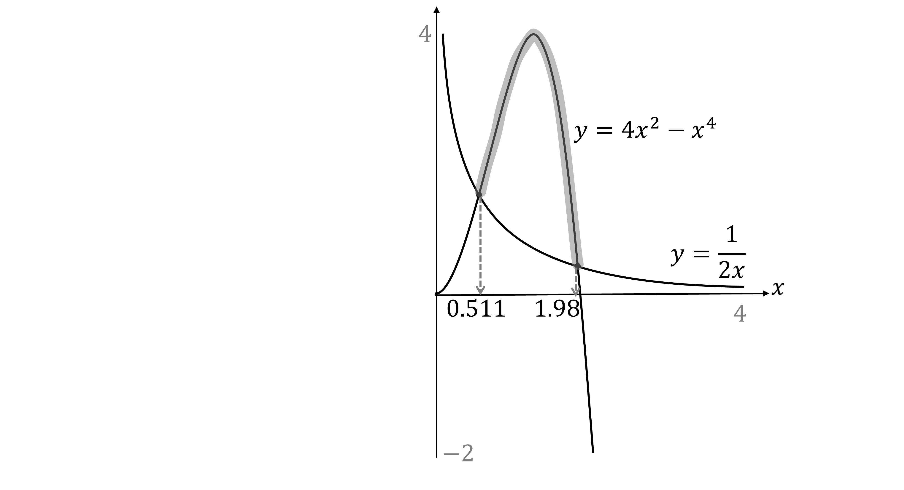

> **[exam-tip]**
> There is a third point of intersection in the region $x<0$ which is not required, so ignore any negative $x$-value shown on your calculator.

> *State this range of *$x$* values to 2 decimal places*

$0.51<x<1.98$

**[A1 A1]**

> **[mark-scheme]**
> **M1:** For identifying the correct region.
> 
> **A1:** For the correct end points, 0.51 and 1.98.
> 
> **A1:** For the correct inequality, $0.51<x<1.98$.

### Q2
> *Start a new graph on your calculator and enter *$\mathrm{f} ( x ) = 1 + 2^{x}$

> *The *$y$*-intercept can be found using the *$y$*-intercept option (or by substituting  *$x=0$* into *$y=1+2^{x}$*)*

*(0, 2)*

> *Add on the horizontal asymptote with equation *$y=1$* using a dotted / dashed line*

> *Sketch the curve and make it get closer and closer to the asymptote (but not touch or cross it)*

**[B1 B1 B1]**

> **[mark-scheme]**
> **B1:** For the correct exponential shape settling towards a horizontal asymptote (the position may be incorrect).
> 
> **B1: **For at least one out of the correct $y$-intercept or the correct asymptote shown.
> 
> **B1: **For the sketch fully correct.
> *The solutions the equation *$1+2^{x}=x+3$* are the *$x$*-coordinates of the points of intersection of the straight line *$y=x+3$* and the curve *$y=1+2^{x}$

> *Add a new graph on your calculator of *$\mathrm{f}_{2} ( x ) = x + 3$* to the existing graph from part (a)*

> *Use the 'intersections' option on your calculator to find the coordinates of the two points of intersection*

* (-1.68, 1.31) or (2, 5)*

**[M1]**

> **[exam-tip]**
> You may need to zoom in or out on your calculator to find both points of intersection.

> *The solutions to the equation *$1+2^{x}=x+3$* are the *$x$*-coordinates of the points of intersection*

$x=-1.69\mathrm{or}x=2$

**[A1 A1]**

> **[mark-scheme]**
> **M1: **For attempting to find the points of intersection of the straight line $y=x+3$ and the curve $y=1+2^{x}$.
> 
> **A1:** For at least one correct solution.
> 
> **A1:** For both solutions correct.
> *The inequality is asking to find where the graph of *$y=1+2^{x}$* is above the graph of *$y=x+3$* *

> *The regions are shaded below on the sketch from part (b)*

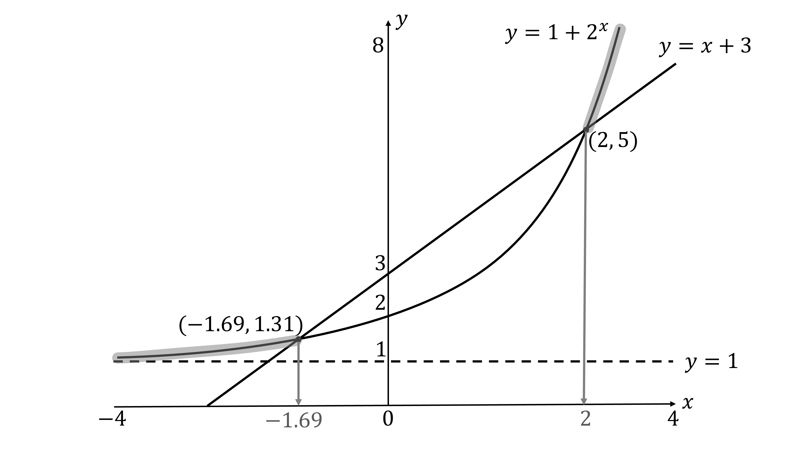

> *State the two separate ranges of *$x$* values*

$x<-1.69\mathrm{or}x>2$

**[B1]**
**Method 1**

> *The solutions to part (b) satisfy the equation*

$1+2^{x}=x+3$

> *Rearrange this equation to make the *$x$* in *$2^{x}$* the subject*

$\begin{gathered} 2^{x} & = x + 3 - 1 \\ 2^{x} & = x + 2 \end{gathered}$

> *To make *$x$*the subject, use the relationship that *$a^{x}=y$* can be rewritten as *$\mathrm{log}_{a}y=x$

$x = log_{2} ( x + 2 )$

> *This is now in the form *$x = log_{p} ( x + q )$

$p=2\mathrm{and}q=2$

**[B1 B1]**

**Method 2**

> *Start from the given equation *$x = log_{p} ( x + q )$* and use that *$\mathrm{log}_{a}y=x$* can be rewritten as *$a^{x}=y$

$p^{x}=x+q$

> *Compare this to *$1+2^{x}=x+3$* from part (b) to spot the values of *$p$* and *$q$

> *It helps to add 1 to both sides of the equation*

$1+p^{x}=x+q+1$

> *Now compare this to *$1+2^{x}=x+3$

> *The *$p$* must be a 2 *

$p=2$

> *and the *$q+1$* must equal 3*

$q+1=3$

> *Solve this equation for *$q$

$q=2$

> *Present both answers*

$p=2\mathrm{and}q=2$

**[B1 B1]**

### Q3
> *Use your graphical display calculator to plot both the graphs*

> *It may be easier to plot one at a time*

> *Note approximately where the intersections with the axes are*

> **[exam-tip]**
> Although it is not an accurate plot, a sketch must still show the correct features in the correct quadrants.

> *Sketch the first function, *$y=\frac{1}{x^{2}+1}$

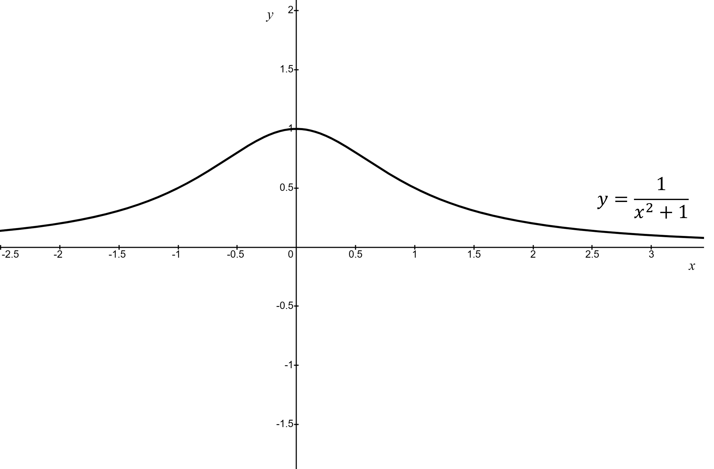

**[B1 B1]**

> *Sketch the second function *$y=x^{3}-2x$

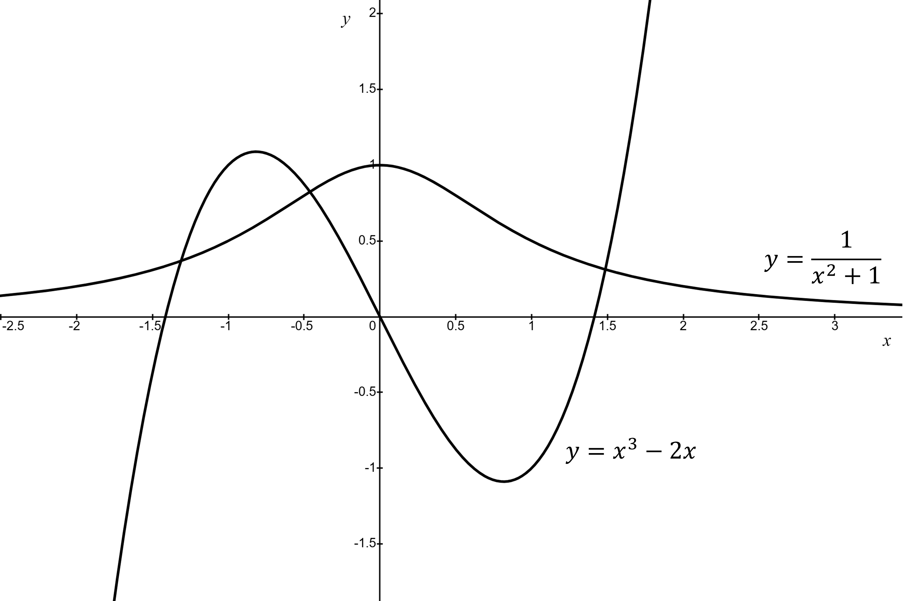

**[B1 B1]**

> **[mark-scheme]**
> **B1**: Correct overall shape of $y=\frac{1}{x^{2}+1}$.
> 
> **B1**: Graph of $y=\frac{1}{x^{2}+1}$ is entirely above the $x$-axis and has one $y$-intercept at a positive value.
> 
> **B1**: Correct overall shape of $y=x^{3}-2x$. Must have a local maximum and local minimum shown (their coordinates are not needed).
> 
> **B1**: One $x$-axis intercept at a negative value, one at a positive value, and one at zero.
> *Solving *$\begin{gathered} \frac{1}{x^{2} + 1} & = x^{3} - 2 x \end{gathered}$* is equivalent to finding the *$x$* values of the points of intersection of the graphs of *$\begin{gathered} y = \frac{1}{x^{2} + 1} \end{gathered}$*  and  *$\begin{gathered} y = x^{3} - 2 x \end{gathered}$

> *You have just sketched these on your calculator; note that there are 3 points of intersection*

> *Use the "intersections" feature of your calculator to find the points of intersection and use the arrow buttons to move between the different points of intersection*

> *Round the *$x$* values of the coordinates to 3 significant figures*

$x=-1.31$

**[B1]**

$x=-0.461$

**[B1]**

$x=1.49$

**[B1]**

> **[mark-scheme]**
> Each mark is awarded for correct answers written to 3 significant figures, or more accurate. E.g. $x=-1.31133$.
> *This is asking where the graph of *$y=x^{3}-2x$* is larger than (higher up the *$y$*-axis) than the graph of *$y=\frac{1}{x^{2}+1}$

> *Identify these regions on the graph*

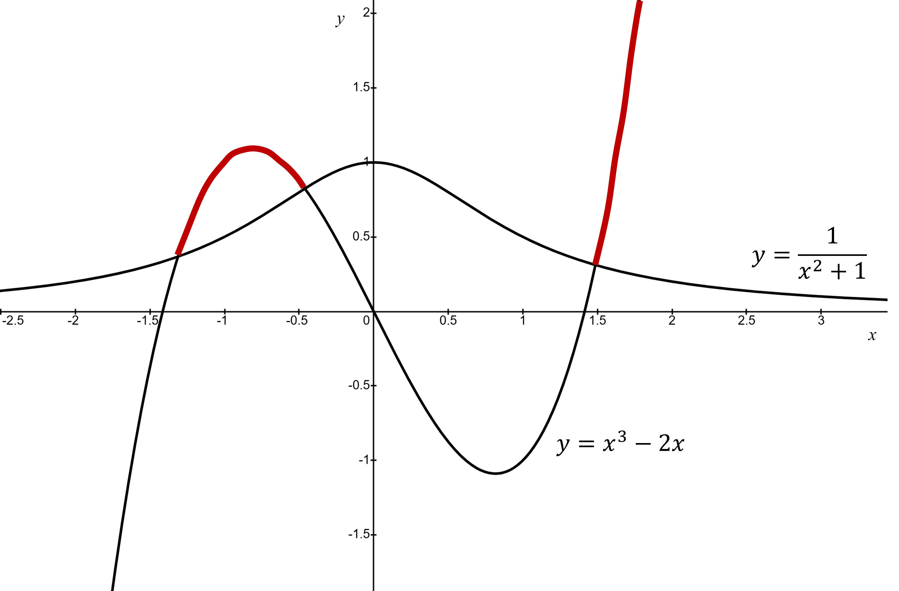

> *The first region is between the first and second points of intersection*

$-1.31<x<-0.461$

**[B1]**

> *The second region is everything to the right of the third point of intersection*

$x>1.49$

**[B1]**

> **[mark-scheme]**
> Each mark is awarded for correct answers written to 3 significant figures, or more accurate. E.g. $x>1.48647$.
> *Identify the point the question is asking about on your sketch or on the plot on your calculator*

> *It is the lowest point on the cubic graph, with a positive *$x$*-value*

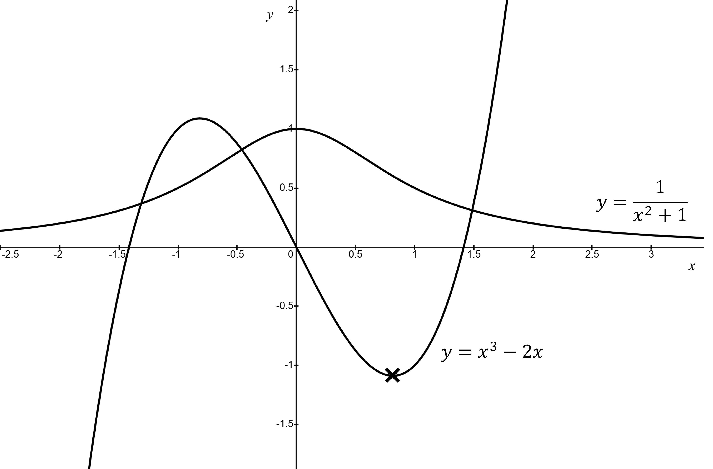

> *With the graph plotted, use the "MIN" function on your calculator to find the coordinates of this point*

> *Round the coordinates to 3 significant figures*

**Final answer:** **(0.817, -1.09)**

**[B1]**

> **[mark-scheme]**
> Mark is awarded for correct answers written to 3 significant figures, or more accurate. E.g. (0.8165, -1.08866).

### Q4
> *We need to manipulate "*$x^{2}-7x+5=0$*" to get "*$x^{2}-2x+1$*" on the left hand side*

> *Start by adding *$5x$* to both sides*

$\begin{gathered} x^{2} - 7 x + 5 & = 0 \\ x^{2} - 2 x + 5 & = 5 x \end{gathered}$

> *Now subtract 4 from both sides*

$\begin{gathered} x^{2} - 2 x + 1 & = 5 x - 4 \end{gathered}$

$y=5x-4$* ***[1]**

### Q5
> *Navigate to the graphing software on your calculator and enter *$\mathrm{f} ( x ) = x + \frac{5}{( x - 2 ) ( x + 3 )}$* carefully*

> *Set the *$x$*-axis on your calculator to *$-5\leqx\leq5$* and the *$y$*-axis to  *$-9\leqx\leq8$

> *Navigate to some of the coordinates on your calculator and use them to help you to copy the graph carefully onto the diagram*

> *Plotting the offset maximum and minimum points and approximations of where the graph intersects the axis will help*

**Each outside branch correct [2]**
**Middle branch in correct position [1]**
**Offset maximum on middle branch in correct position [1]**
> *The *$y$*-axis is vertical so we are looking for the vertical asymptotes*

> *To the left of the *$y$*-axis the branches get closer to but never touch the line *$x=-3$
*To the right of the *$y$*-axis the branches get closer to but never touch the line *$x=2$

$x=-3$** ****[1]**
$x=2$ **[1]**
(i)*  The local maximum point is the point at the uppermost point of the offset upside down U shape underneath the *$x$*-axis *

> *Choose analyse graph and navigate to this maximum point*

> *Round each  coordinate to 3 significant figures*

$( 1.03 , - 0.249 )$** ****[2]**
**1 mark for each correct coordinate**
**Unrounded answers accepted**

(ii)*  The local minimum point is at the lowest point of the offset L shape in the first quadrant*

> *Choose analyse graph and navigate to this minimum point*

> *Round each  coordinate to 3 significant figures*

$( 2.99 , 3.83 )$** ****[2]**
**1 mark for each correct coordinate**
**Unrounded answers accepted**

(ii)*  *$\mathrm{f} ( x ) = k$* has exactly one solution at any point on the graph where a graph in the form *$y=k$* would intersect *$\mathrm{f} ( x )$* exactly once*

> *This occurs only between the local minimum and the local maximum point*

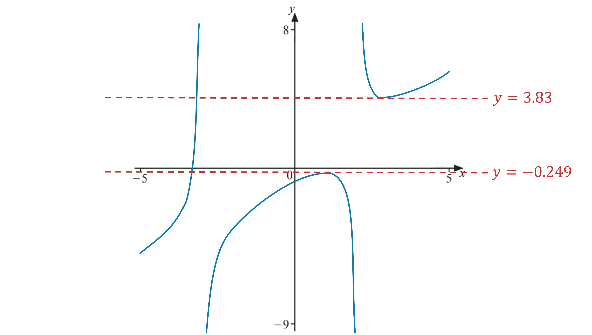

> *Write your answer as an inequality where *$k$* is greater than but not equal to the *$y$* value of the maximum point and less than but not equal to the *$y$* value of the minimum point *

$-0.249<k<3.83$** ****[2]**
**1 mark for each correct value**
**Incorrect answers followed through from (i) and (ii) accepted**
(i)  *On your calculator, add a second graph  *$\mathrm{f}_{2} ( x ) = - 4 - x$

> *Copy the sketch onto the diagram, checking that it is a straight line with a gradient of -1 and a *$y$*-intercept of -4*

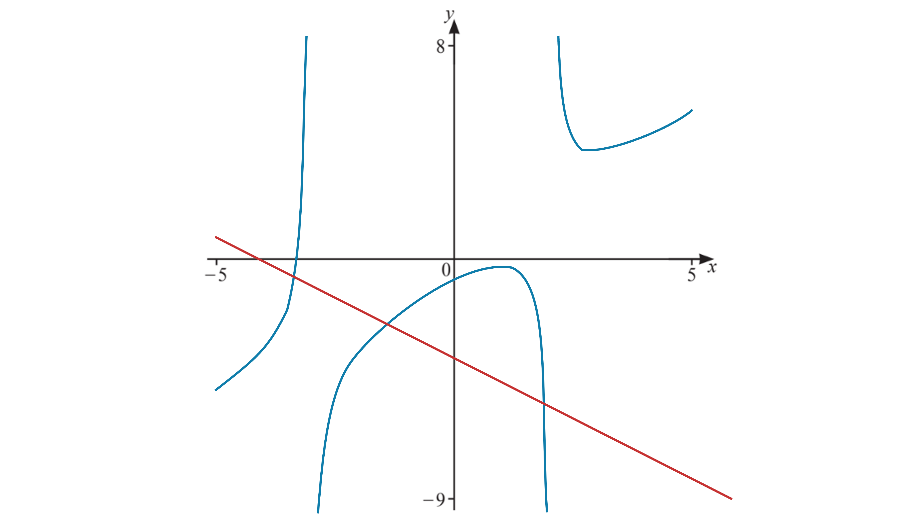

**[1]**

> *Select analyse graph and navigate to each of the three points of intersection of the graph with the straight line*

> *The solutions are the *$x$*-coordinates of the points of intersection*

> *Round your answers to 3 significant figures*

$-3.35$** ****[1]**
$-1.52$ **[1]**
** **$1.87$** ****[1]**
**Unrounded answers accepted**

(ii) *The answers to part (i) give you the solutions to *$\mathrm{f} ( x ) = \mathrm{g} ( x )$
*The solutions of *$\mathrm{f} ( x ) > \mathrm{g} ( x )$* are the ranges of values for the regions where the curve is above the straight line *

> *The areas where the straight line is below the curve are *

- *between the first point of intersection and the asymptote at *$x=-3$
- *between the second and the third points of intersection*
- *after the asymptote at *$x=2$* *

> *Use your answers from part (i) for the points of intersection and part (b) for the asymptotes to help you write the regions as inequalities*

$-3.35<x<-3$** ****[1]**
$-1.52<x<1.87$ **[1]**
** **$x>2$** ****[1]**
**Answers following on from (i) and (b) accepted**

### Q6
> *Start a new graph on your calculator and enter *$\mathrm{f}_{1} ( x ) = x^{3} - 2 x$* and *$\mathrm{f}_{2} ( x ) = 1$* to generate the two graphs*

> *It is likely you could sketch these graphs without your calculator but it is worth putting them in at this point as you will need both for the next questions*

> *Select the option to analyse the graph (this may be labelled as G-Solv) and check the *$x$*-** and *$y$*-intercepts*

> *Sketch the graphs onto the diagram, making sure to label each one correctly*

**Positive cubic shape graph [1]**
**Correct position [1]**
**Correct straight line graph [1]**
> *Rearrange *$x^{3}-2x-1=0$* to make *$\mathrm{f} ( x )$* the subject by subtracting 1 from each side*

$x^{3}-2x=1$

> *This is *$\mathrm{f} ( x ) = \mathrm{g} ( x )$* which can be solved by finding the *$x$*-coordinates of the points of intersection of the two graphs*

> *Choose the option to analyse the graph and select "intersection"*

> *Give your answers correct to 3 significant figures*

$x=-1$** [1]**
$x=-0.618$** [1]**
$x=1.62$** [1]**
**Unrounded answers accepted**
> *The region where *$x^{3}-2x>1$* is where the graph of *$y=x^{3}-2x$* is above the graph of *$y=1$

> *On the diagram this is between the two negative points of intersection and after the positive point of intersection*

> *Give your answers as region using inequality signs*

$-1<x<-0.618$** ****[1]**
$x>0.62$** ****[1]**
**Answers correctly following on from (b) accepted**

### Q7
> *Open graph mode on your calculator and enter *$f(x)=x^{3}-5x+3$* *
*Changing the axis to *$-3\leqx\leq3$* and *$-10\leqy\leq20$* will help*

> *Copy the graph onto the diagram  carefully*

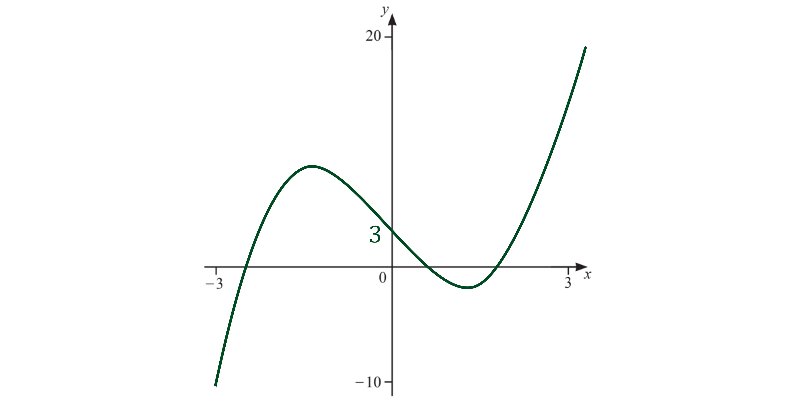

**Cubic shape [1]**
**Correct position [1]**
> *Select the option to analyse the graph and select maximum point*

> *A local maximum is the turning point where the gradient of the graph changes from positive to negative*

> *Check that your answer looks correct, the maximum point is the highest point on the upside down U shape part of the graph*

$(-1.29,7.30)$** ****[2]**
**1 mark for each correct coordinate**
**Unrounded answers accepted**
> *The 'zeros' means the points at which the graph crosses the *$x$*-axis*

> *On your calculator navigate to the *$x$*-intersections of the graph, where the *$y$*-coordinates are 0*

> *Round your answers to 3 significant figures*

**-2.49** **[1]**
**0.657** **[1]**
**1.83** **[1]**
**Unrounded answers accepted**

### Q8
> *Use your calculator to sketch the graph of *$f(x)=\frac{600-x}{4}+\sqrt{70000+x^{2}}$

> *Restrict the *$x$*-axis to *`0 less-than or slanted equal to x less-than or slanted equal to 400`* and the *$y$*-axis to *`400 less-than or slanted equal to x less-than or slanted equal to 600`

> *Copy the graph carefully onto your diagram*

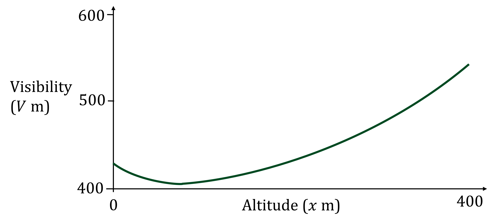

**U-shaped curve [1]**
$V$**-axis intercept just above 400 [1]**
**Minimum near the **$x$**and **$V$**axis [1]**
(i) *Select the option to analyse the graph and select minimum point*
*(This may be called local minima)*

*minimum point:*$(68.313...,406.173...)$

> *Visibility is on the *$y$*-axis so the minimum visibility will be the *$y$*-coordinate of the minimum point*

> *Round 406.173... to the nearest metre*

$406$** metres ****[1]**

(ii)  *Altitude is on the *$x$*-axis so the altitude for this minimum point will be the *$x$*-coordinate of the minimum point*

> *Round 68.313... to the nearest metre*

$68$** metres ****[1]**
> *Give an answer in the context of the question,  the model would assume clear conditions *

> *Any **one** correct answer from the following *

- **Weather changes such as fog, rain or snow could reduce visibility**
- **Terrain and obstacles such as buildings, trees and mountains may block signal**
- **Equipment limitations such as battery drainage or hardware breakdown over time** **Other correct answers possible [1]**

### Q9
> *Sketch the graph *$\mathrm{f}_{1} ( x ) = ( \cos x )^{2}$* on your calculator and then copy it carefully onto the diagram on your exam paper*

> *You should make sure the axis is in degrees by checking the menu/mode of your calculator*
*You may then be able to set the range of the *$x$*-axis to *$0\leqx\leq360$

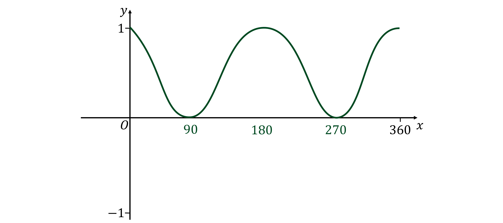

**Correct shape of graph [1]**
**Graph in correct position [1]**
> *Sketch the graph *$\mathrm{f}_{2} ( x ) = 0.5 - 0.001 x$* on your calculator and then copy it carefully onto the same diagram on your exam paper*

> *From the equation you should see that your graph should be a straight line with a *$y$*-intercept of 0.5 and a negative gradient*

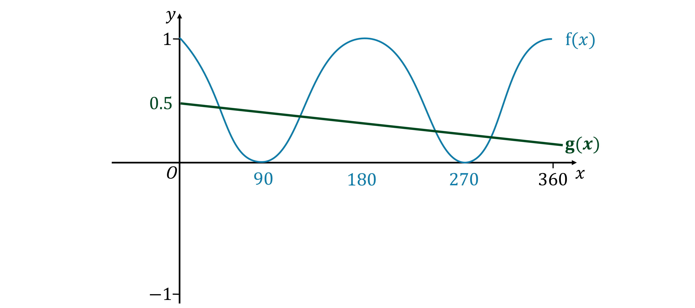

**Straight line in correct position [1]**
**Intersects first graph four times [1]**
> *On your calculator, select analyse graph and navigate to each of the four points of intersection of the two graphs*

> *The solutions are the *$x$*-coordinates of the points of intersection*

$x_{1}=47.7394...\,x_{2}=127.606...\,x_{3}=239.296...\,x_{4}=296.794...$

> *The solutions are angles in degrees so it is best to give them rounded to 1 decimal place*

$47.7^{\circ}$** ****[1]**
$127.6^{\circ}$ **[1]**
** **$239.3^{\circ}$** ****[1]**
$296.8^{\circ}$** ****[1]**
**Unrounded answers accepted**
> *The answers to part (c) give you the solutions to *$\mathrm{f} ( x ) = g ( x )$
*The solutions of *$\mathrm{f} ( x ) < \mathrm{g} ( x )$* are the ranges of values for the regions where the  straight line is above the curve *

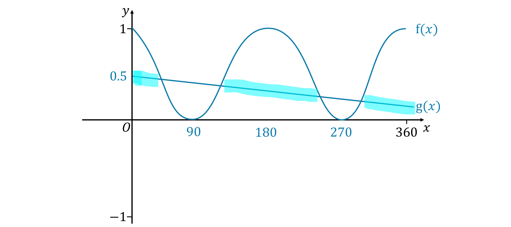

> *The areas where the straight line is below the curve are between the *$y$*-axis and the first point of intersection, the second and the third point of intersection and after the fourth point of intersection*

> *Use your answers from part (c) for the points of intersection to help you write the regions as inequalities*

$0<x<47.7$** ****[1]**
$127.6<x<239.3$ **[1]**
** **$x>296.8$** ****[1]**
**Answers following on from (c) accepted**

### Q10
> *Start a new graph on your calculator and enter *$\mathrm{f} ( x ) = \frac{x^{2} + 3 x}{( x - 2 ) ( x + 1 )}$* to generate the graph*
*Copy the graph carefully onto the diagram*

**1 mark for each correct branch [3]**
> *The *$y$*-axis is vertical so we are looking for the vertical asymptotes*

> *To the left of the *$y$*-axis the branches get closer to but never touch the line *$x=-1$
*To the right of the *$y$*-axis the branches get closer to but never touch the line *$x=2$

$x=-1$** ****[1]**
$x=2$ **[1]**
> *The zeros, or roots, are the points at which the graph crosses the *$x$*-axis*

> *Select analyse graph and navigate to the points of intersection with the *$x$*-**axis *

$0$** ****[1]**
$-3$ **[1]**
(i) *On your calculator, add a second graph  *$\mathrm{f}_{2} ( x ) = x - 3$

> *Copy the sketch onto the diagram, checking that it is a straight line with a gradient of 1 and a *$y$*-intercept of -3*

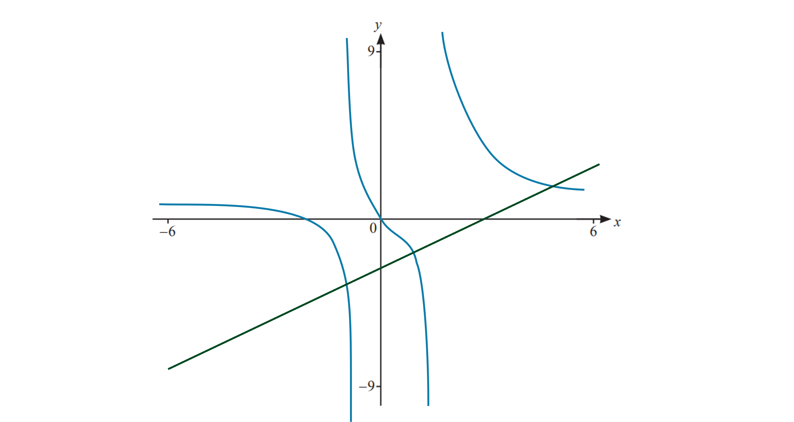

**[1]**

(ii) *On your calculator, select analyse graph and navigate to each of the three points of intersection of the graph with the straight line*

> *The solutions are the *$x$*-coordinates of the points of intersection*

$-1.16$** ****[1]**
$1$ **[1]**
** **$5.16$** ****[1]**
**Unrounded answers accepted**

(iii) *The answers to part (ii) give you the solutions to *$\mathrm{g} ( x ) = \mathrm{f} ( x )$
*The solutions of *$\mathrm{g} ( x ) > \mathrm{f} ( x )$* are the ranges of *$x$* values for the regions where the  straight line is above the curve *

> *The areas where the straight line is above the curve are *

- *between the first point of intersection and the asymptote at *$x=-1$
- *between the second point of intersection and the asymptote at *$x=2$* *
- *after the third point of intersection*

> *Use your answers from part (ii) for the points of intersection and part (b) for the asymptotes to help you write the regions as inequalities*

$-1.16<x<-1$** ****[1]**
$1<x<2$ **[1]**
** **$x>5.16$** ****[1]**
**Answers following on from (ii) and (b) accepted**

### Q11
> *This can be solved in two ways, either by using your calculator or by changing the base *

> *Method 1*

> *Start a new graph on your graphic display calculator and choose the option to sketch more than one graph on the same axes*

> *Sketch *$\mathrm{f}_{1} ( x ) = 2^{3 x + 1}$* and *$\mathrm{f}_{2} ( x ) = 8^{2 - x}$* on the same axes on your graphic display calculator*

> *Sketch both graphs onto the exam paper on a single set of coordinate axes*

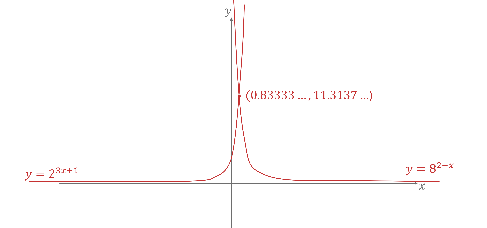

**Graphs sketched with correct shapes [1]**
**Graphs intersecting [1]**

> *The answer is the *$x$*-coordinate of the point of intersection*

$x=\frac{5}{6}$** ****[1]**
**Equivalent answers (0.833) accepted**

> *Method 2*

> *Rewrite the RHS of the equation so that it has a base of *$2$* using *$8=2^{3}$* *

$2^{3 x + 1} = ( 2^{3} )^{2 - x}$

> *Apply the rule *$( a^{m )^{n} = a^{m} n}$

$2^{3 x + 1} = 2^{3 ( 2 - x )}$

**[1]**

> *As both sides are equal, and the bases are the same, the powers must be equal*

$\begin{gathered} 3 x + 1 & = 3 ( 2 - x ) \end{gathered}$

**[1]**

> *Solve the equation by first expanding the brackets*

$\begin{gathered} 3 x + 1 & = 6 - 3 x \end{gathered}$

> *Bring the *$x$* terms to the same side and the constant terms to the other*

$\begin{gathered} 6 x & = 5 \end{gathered}$

> *Divide both sides by *$6$* *

$x=\frac{5}{6}$** ****[1]**
**0.833 accepted**

### Q12
> *Start a new graph on your graphic display calculator and enter *$\mathrm{f} ( x ) = ( x - 2 )^{2} - 5 x + 12$* to generate the graph*
*Changing the values of the **x-**axis to a value less than -1 and greater than 4, and the values of the **y-**axis to be from -10 to 10 will help  *

> *Select the option to analyse the graph (this may be labelled as G-Solv) and check the **x-** and **y**-intercepts*

> *Sketch the graph onto the paper making sure that the graph is a cubic through the points (0, 4) and (4, 0), with a maximum point between *$x=0$* and *$x=1$* and a minimum point between *$x=3$* and *$x=4$

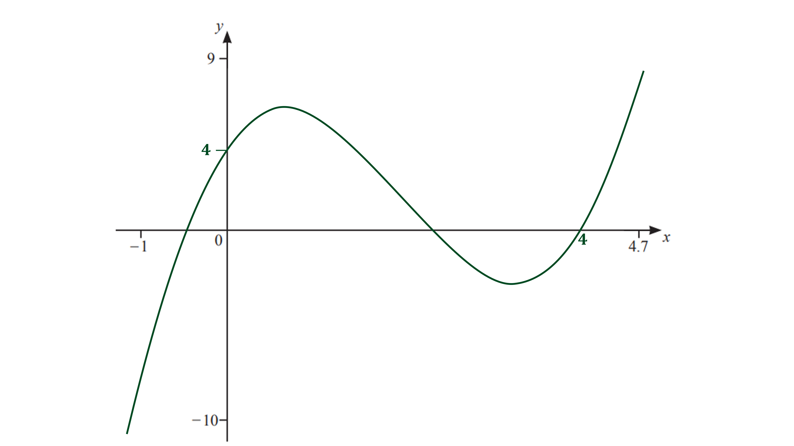

**Positive cubic curve [1]**
**Curve in correct position [1]**
> *Select the option to analyse the graph and navigate to the maximum point*

> *Your calculator should give you the values *$x=0.709005...$* and *$y=6.30331...$

> *Round these values to 3 significant figures*

$(0.709,6.30)$** ****[2]**
**1 mark for each correct coordinate**
> *The value of *$k$* must be at a point on the graph where a horizontal line would intersect with the graph exactly 2 times*

> *This can only happen at the maximum and minimum point on the graph*

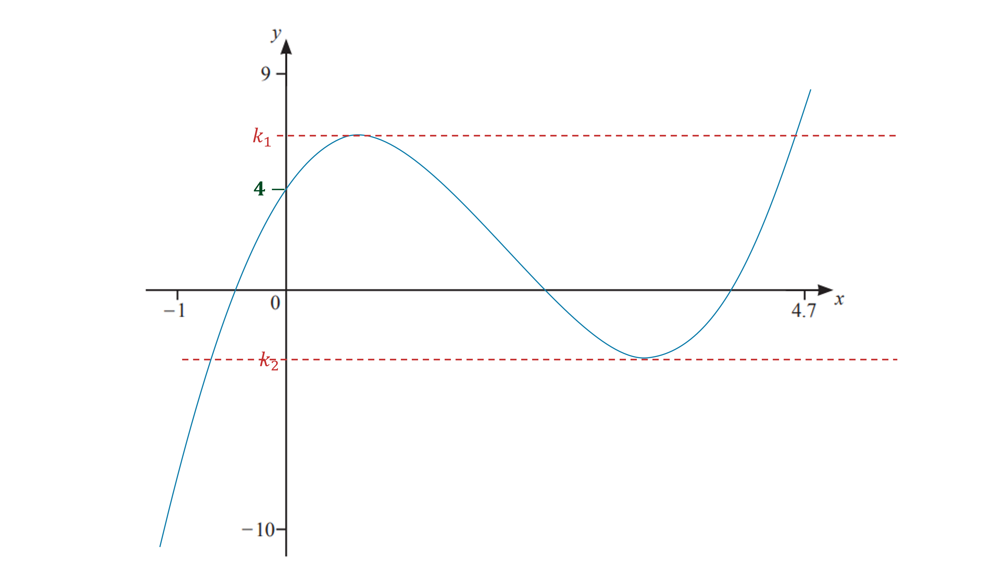

> *The values of *$k$* will be the *$y$* coordinates of the maximum and minimum points*

$k_{1}=6.30$** [1]**
$k_{2}=-2.30$** ****[1]**
> *Using the same axis on your calculator, plot the graph of *$g(x)$

> *Sketch the graph onto your answer for part (a)*

> *Select analyse graph and navigate to the points of intersection with the **x-** and **y-**axis to help you sketch the graph*

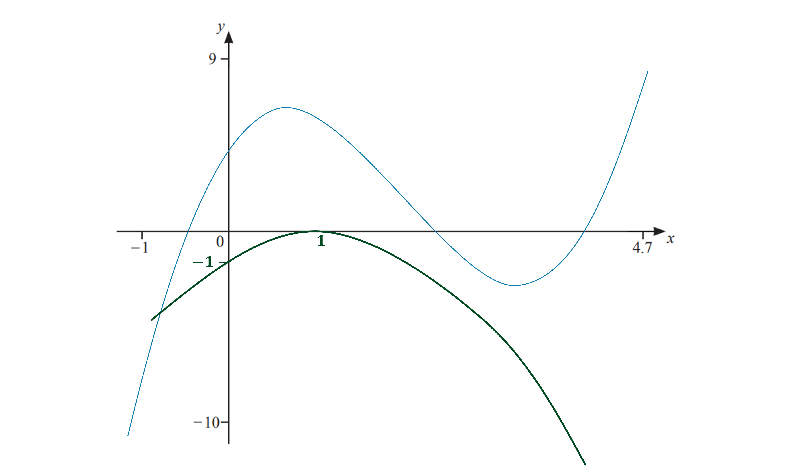

**Negative quadratic curve [1]**
**Correct position [1]**
> *On your graphic display calculator with both graphs on one set of axes navigate to the point of intersection and read off the *$x$*value*

$x=-0.599$** ****[1]**
**Unrounded answer accepted**

### Q13
> *Start a new graph on your graphic display calculator and enter *$\mathrm{f} ( x ) = \frac{1}{\sin x}$* to generate the graph*

> *Copy the graph carefully onto the axes given on the paper*

> *Label the *$x$* axis with at least the value *$180$* and clearly show that there is a small gap at this point*

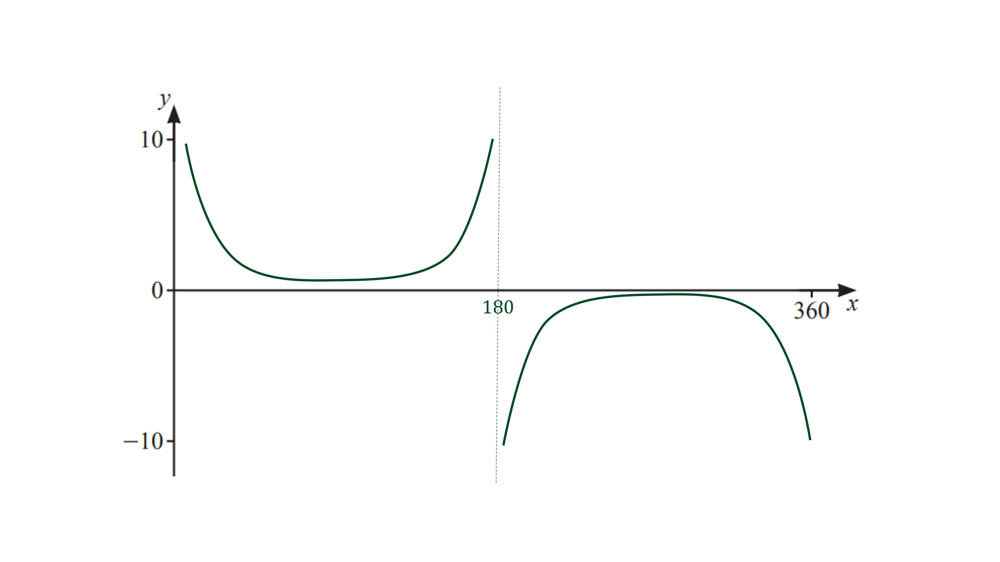

**[3]**
> *Select the option to analyse the graph and select minimum point*
*(This may be called local minima)*

> *Check that your answer looks correct, the minimum point is the lowest part on the U shape part of the graph*

$(90,1)$** ****[1]**
The asymptotes are the vertical lines that each branch of the curve gets close to but cannot touch

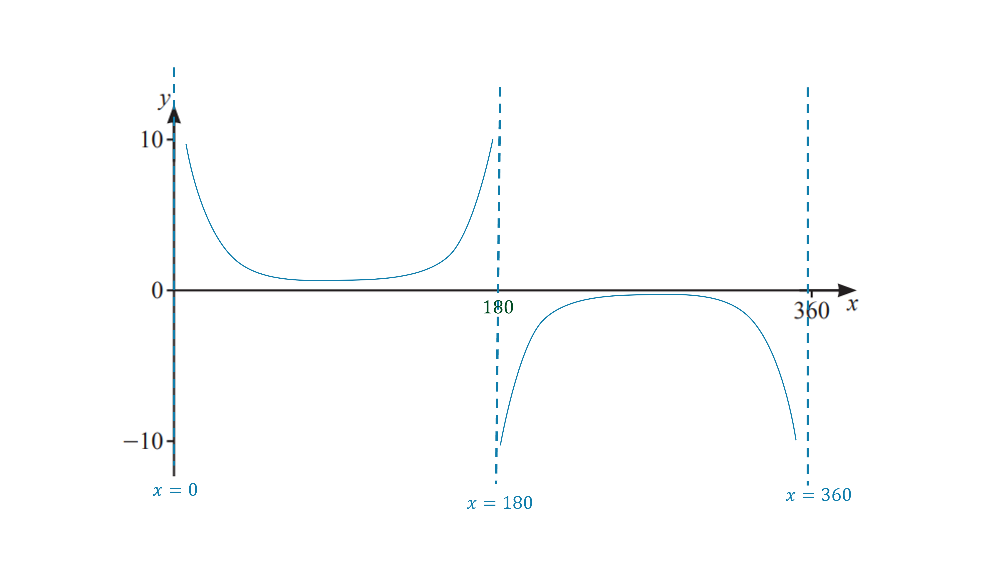

$x=180$** ****[1]**
$x=0$** ****and **$x=360$**[1]**
> *The graph of *$\mathrm{f} ( x ) = k$* will be a horizontal line through the *$y$*axis at the point *$k$

> *This has no solutions between the minimum point at *$x=90$*, where *$y=1$*, and the maximum point at *$x=270$*, where *$y=-1$

$-1<k<1$** [2]**
> *On the same axis on your calculator, sketch the graph of *$\mathrm{f}_{2} ( x ) = 5 \sin ( \frac{x}{2} )$

> *Copy this graph onto your answer for part (a), it should be a smooth curve through the points (0,0), (180,5) and (360,0)*

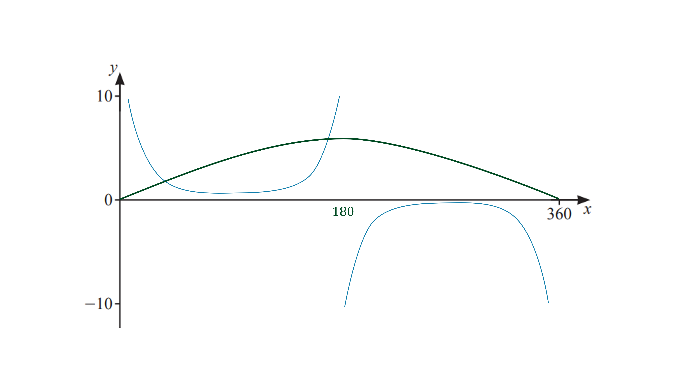

**[1]**

> *Select the option to analyse the graph on your calculator and choose intersection*

> *The answers are the **x** coordinates of the two points of intersection*

$x=38.0$** ****[1]**
$x=168$** ****[1]**
**Unrounded answers accepted**

### Q14
> *Start a new graph on your graphic display calculator and choose the option to sketch more than one graph on the same axes*

> *Sketch *$\mathrm{f}_{1} ( x ) = 2^{x} + x$* and *$\mathrm{f}_{2} ( x ) = 5$* on the same axes on your graphic display calculator*

> *Sketch both graphs onto the exam paper on a single set of coordinate axes*

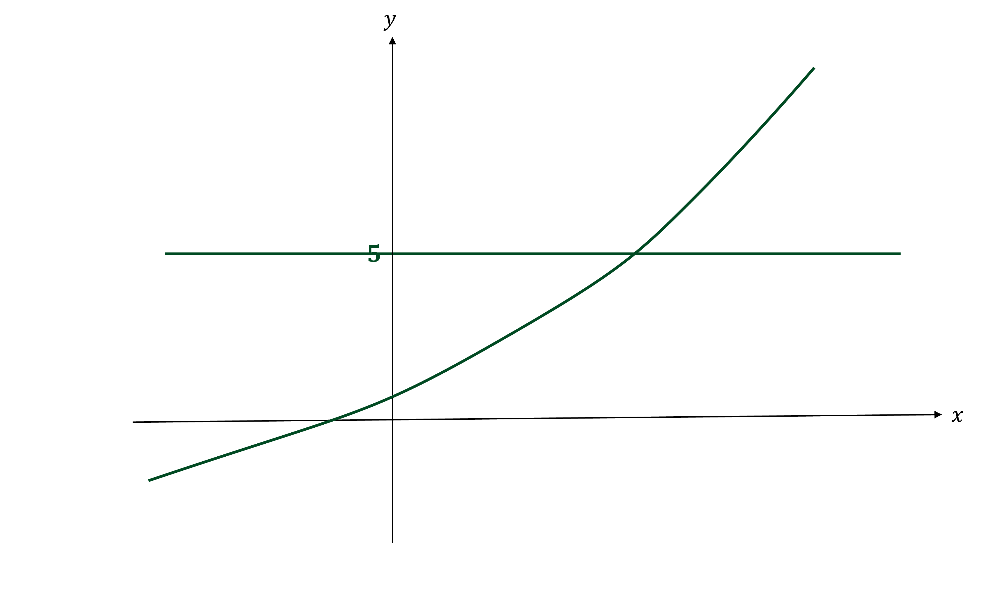

**One graph drawn correctly [1]**
**Both graphs shown intersecting [1]**

> *The region where *$2^{x}+x>5$* is where the graph of *$y=2^{x}+x$* is above the graph of *$y=5$

> *Select the option to analyse the graph and select "intersection"*

> *Your calculator will give you an intersection of *$x=1.72$*, but you must give your final answer as a region using the inequality sign >*

$x>1.72$** ****[1]**
**Answers not rounded to 3 s.f. between 1.715 and 1.716 accepted**

### Q15
> *Start a new graph on your calculator and enter *$\mathrm{f} ( x ) = 5 - 1.25 x$*to generate the graph*

> *Select the option to analyse the graph (this may be labelled as G-Solv) and check the **x-** and **y**-intercepts*

> *Sketch the graph onto the paper making sure that the graph is a straight line through the points (0, 5) and (4, 0)*

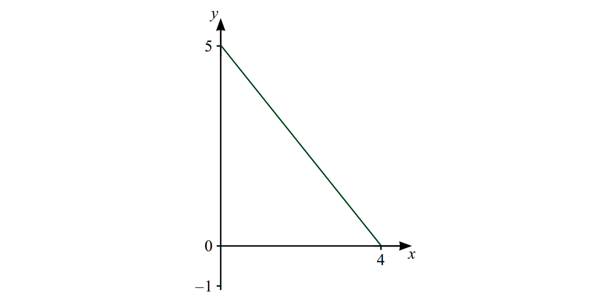

**Straight line through (0,5) [1]**
**Straight line with negative gradient [1]**
> *Start a new graph on your calculator and enter *$\mathrm{f} ( x ) = 1.5 x - 1$* to generate the graph*

> *Select the option to analyse the graph (this may be labelled as G-Solv) and check the *$x$*-** and *$y$*-intercepts*

> *Sketch the graph onto the paper making sure that the graph is a straight line with a positive gradient through the point (0, -1) and (4, 5)*

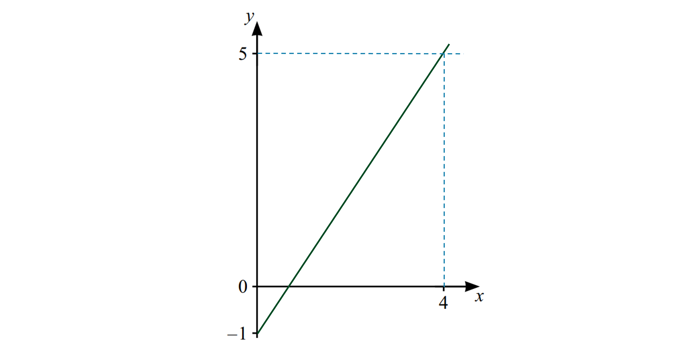

**Straight line through (0,-1) [1]**
**Straight line with positive gradient [1]**
> * Sketch *$\mathrm{f}_{1} ( x ) = 5 - 1.25 x$* and *$\mathrm{f}_{2} ( x ) = 1.5 x - 1$* on the same axes on your graphic display calculator *

> *Choose the option to analyse the graph and select "intersection"*

> *The answer is the *$x$*-coordinate of the intersection*

$x=2.18$** [1]**
**Answers between 2.181 and 2.182 accepted**
