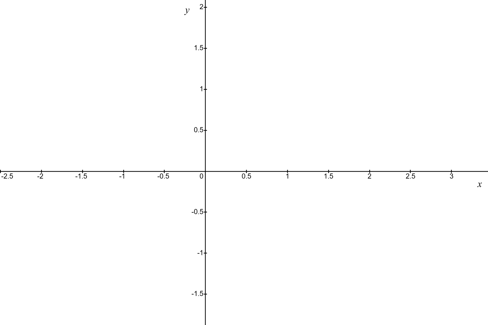
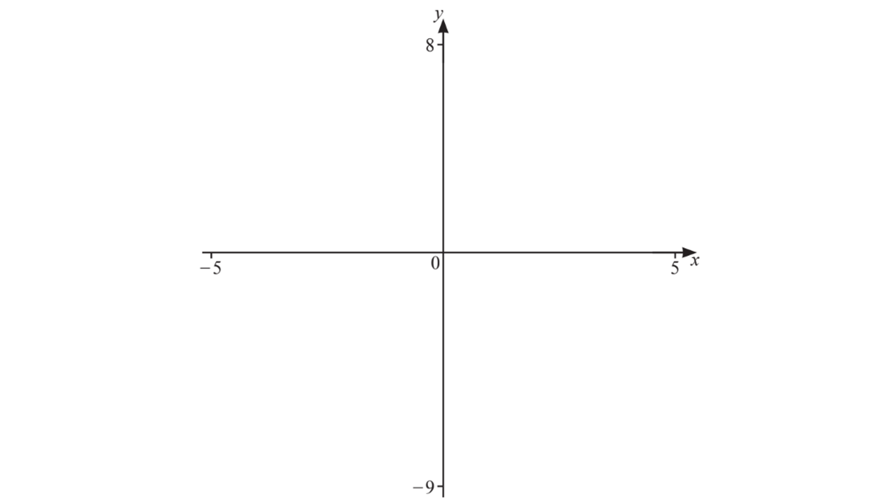
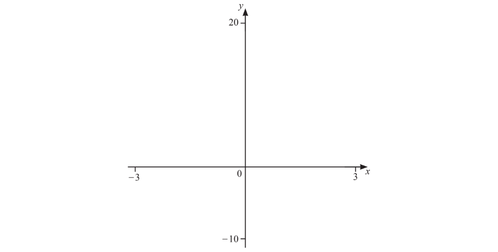
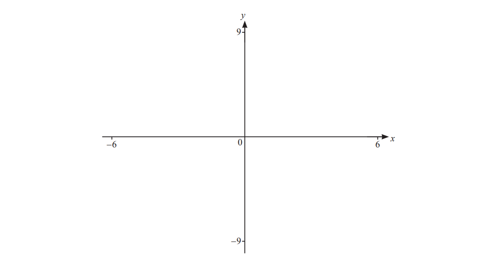
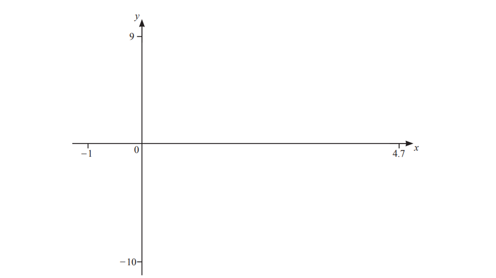
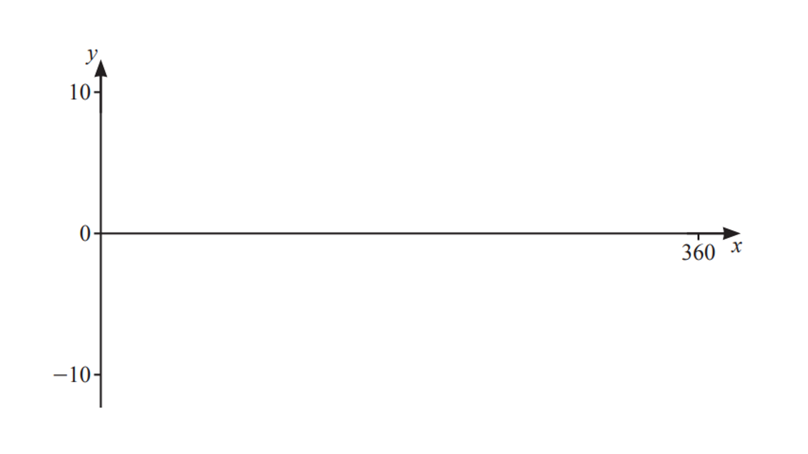
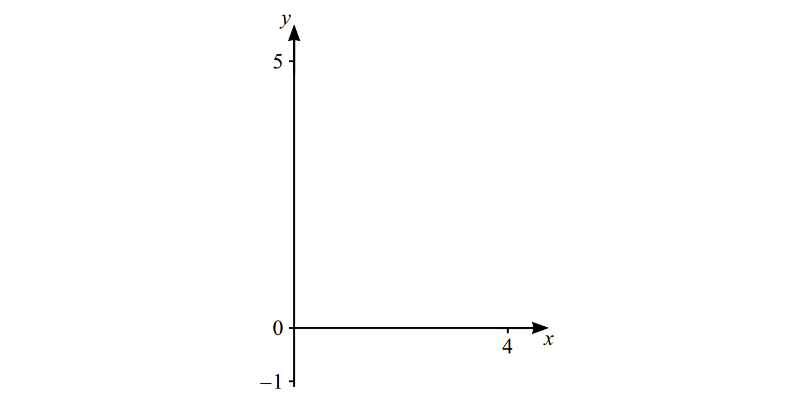

# Exam Questions — Using Calculators for Graphs, Equations & Inequalities
**Coordinate Geometry & Graphs** · Cambridge (CIE) IGCSE maths (0607)
> Source: [https://www.savemyexams.com/igcse/maths/cie/international-maths/23/extended/topic-questions/](https://www.savemyexams.com/igcse/maths/cie/international-maths/23/extended/topic-questions/) · 15 questions across 1 sets

## Exam Questions (15 questions)

### Q1 — very_hard — 10 marks

**Q1** [2 marks]

The graph of $y=\frac{1}{2x}$ is shown below.

Write down the equations of any asymptotes.

**Q1** [5 marks]

On the same diagram, sketch the graph of $y=4x^{2}-x^{4}$.

Label clearly the coordinates of any turning points and any intercepts with the coordinate axes.

**Q1** [3 marks]

If $x>0$, solve the following inequality.

$4x^{2}-x^{4}>\frac{1}{2x}$

Give your answer to 2 decimal places.

### Q2 — hard — 9 marks

**Q2** [3 marks]

The graph of $y=1+2^{x}$ has one asymptote. The equation of the asymptote is $y=1$.

Draw the graph of $y=1+2^{x}$ on your calculator. Use this to sketch the graph of $y=1+2^{x}$ on the axes provided.

Label clearly the $y$-intercept and the asymptote.

**Q2** [3 marks]

Solve the following equation.

$1+2^{x}=x+3$

Give your answers to 2 decimal places where appropriate.

**Q2** [1 mark]

Solve the following inequality.

$1+2^{x}>x+3$

**Q2** [2 marks]

The solutions in part (b) are also solutions to the equation below, where $p$ and $q$ are positive integers.

`x equals log subscript p open parentheses x plus q close parentheses`

Find $p$ and $q$.

### Q3 — hard — 10 marks

**Q3** [4 marks]

On the diagram, sketch the graphs of  `table row y equals cell fraction numerator 1 over denominator x squared plus 1 end fraction end cell end table`  and  `table row y equals cell x cubed minus 2 x end cell end table`.

**Q3** [3 marks]

Solve.

`table row cell fraction numerator 1 over denominator x squared plus 1 end fraction end cell equals cell x cubed minus 2 x end cell end table`

**Q3** [2 marks]

Solve.

`table row cell fraction numerator 1 over denominator x squared plus 1 end fraction space end cell less than cell space x cubed minus 2 x end cell end table`

**Q3** [1 mark]

Find the coordinates of the minimum point of $y=x^{3}-2x$ where $x>0$.

### Q4 — hard — 1 marks

**Q4** [1 mark]

The curve  $y=x^{2}-2x+1$  is drawn on a grid.

A line is drawn on the same grid.

The points of intersection of the line and the curve are used to solve the equation  $x^{2}-7x+5=0.$

Find the equation of the line in the form  $y=mx+c.$

$y=$ ..................................................

*Source: 2020	May/June 0580/21 Q20*

### Q5 — very_hard — 18 marks

**Q5** [4 marks]

`space straight f open parentheses x close parentheses equals x plus fraction numerator 5 over denominator open parentheses x minus 2 close parentheses open parentheses x plus 3 close parentheses end fraction`

Sketch the graph of `space y equals straight f open parentheses x close parentheses` for values of $x$ between $-5$ and $5$.

*Source: Nov 22 0607/42 Q11A*

**Q5** [2 marks]

**Extract:**

f(x) = x + 5/[(x-2)(x+3)]

Write down the equations of the asymptotes parallel to the $y$-axis.

*Source: Nov 22 0607/42 Q11B*

**Q5** [6 marks]

**Extract:**

f(x) = x + \frac{5}{(x-2)(x+3)}

(i) Find the coordinates of the local maximum.

(............ , ............) [2]

(ii) Find the coordinates of the local minimum.

(............ , ............) [2]

(iii) Write down the range of values of $k$ for which `straight f open parentheses x close parentheses equals k` has exactly one solution.

[2]

*Source: Nov 22 0607/42 Q11C*

**Q5** [6 marks]

**Extract:**

f(x) = x + 5/[(x-2)(x+3)]
g(x) = -4 - x

`straight g open parentheses x close parentheses equals negative 4 minus x`

(i) Solve the equation `straight f open parentheses x close parentheses equals straight g open parentheses x close parentheses.`

[3]

(ii) Find the solutions to the inequality `straight f open parentheses x close parentheses greater than straight g open parentheses x close parentheses.`

[3]

*Source: Nov 22 0607/42 Q11D*

### Q6 — medium — 8 marks

**Q6** [3 marks]

$f(x)=x^{3}-2x$                                           $g(x)=1$

On the diagram, sketch the graphs of $y=f(x)$ and $y=g(x)$ for  $-2\leqx\leq2.$

**Q6** [3 marks]

**Extract:**

straight f left parenthesis x right parenthesis equals x cubed minus 2 x
straight g left parenthesis x right parenthesis equals 1
On the diagram, sketch the graphs of y = f(x) and y = g(x) for -2 ≤ x ≤ 2.

Use your graphs to solve $x^{3}-2x-1=0$.

**Q6** [2 marks]

**Extract:**

straight f left parenthesis x right parenthesis equals x cubed minus 2 x
straight g left parenthesis x right parenthesis equals 1
On the diagram, sketch the graphs of y = f(x) and y = g(x) for negative 2 less or equal than x less or equal than 2.

Use your graphs to solve $x^{3}-2x>1$.

### Q7 — medium — 7 marks

**Q7** [2 marks]

$f(x)=x^{3}-5x+3$  for  $-3\leqx\leq3$

On the diagram, sketch the graph of `y equals straight f open parentheses x close parentheses`.

*Source: June 2022 0607/43 Q5A*

**Q7** [2 marks]

**Extract:**

f(x) = x^3 - 5x + 3 for -3 ≤ x ≤ 3

Find the coordinates of the local maximum.

( ...................... , ......................)

*Source: June 22 0607/43 Q5B*

**Q7** [3 marks]

**Extract:**

f(x) = x^3 - 5x + 3 for -3 ≤ x ≤ 3

Find the zeros of the graph of $y=f(x).$

*Source: June 22 0607/43 Q5D*

### Q8 — hard — 7 marks

**Q8** [4 marks]

A medicine delivery company uses drones to deliver medications to remote mountain villages.

A radar system is used to control the drones, as long as the controller is within a certain distance from the drone, called the radar visibility, $V$ metres,

A model for the radar visibility, $V$ metres, at different altitudes, $x$ metres up a particular mountain is

$V=\frac{600-x}{4}+\sqrt{70000+x^{2}}$

On the diagram, sketch the graph of $V$ against $x$.

**Q8** [2 marks]

**Extract:**

A model for the radar visibility, V metres, at different altitudes, x metres up a particular mountain is

V = (600 - x)/4 + sqrt(70000 + x^2)

Find, correct to the nearest metre,

(i)  the  minimum visibility,

[1]

(i)  the altitude for which the visibility is at its minimum.

[1]

**Q8** [1 mark]

**Extract:**

A model for the radar visibility, V metres, at different altitudes, x metres up a particular mountain is

V = (600 - x)/4 + sqrt(70000 + x^2)

Write down a reason why the visibility given by the model might be different to the actual visibility.

### Q9 — very_hard — 11 marks

**Q9** [2 marks]

`straight f open parentheses x close parentheses equals open parentheses cos space x degree close parentheses squared`                   `straight g open parentheses x close parentheses equals 0.5 minus 0.001 x`

On the diagram, sketch the graph of `space y equals straight f open parentheses x close parentheses` for  $0\leqx\leq360.$

**Q9** [2 marks]

**Extract:**

f(x) = (cos x°)^2    g(x) = 0.5 - 0.001x
Graph with a horizontal x-axis from 0 to 360 and a vertical y-axis from -1 to 1. Both axes are labelled x and y respectively.

On the same diagram, sketch the graph of $y=g(x)$ for  $0\leqx\leq360.$

**Q9** [4 marks]

**Extract:**

f(x) = (cos x°)^2
g(x) = 0.5 - 0.001x

Solve `straight f open parentheses x close parentheses equals straight g open parentheses x close parentheses`  for  $0\leqx\leq360.$

**Q9** [3 marks]

**Extract:**

f(x) = (cos x°)^2
g(x) = 0.5 - 0.001x
for 0 ≤ x ≤ 360

Solve `straight f open parentheses x close parentheses less than straight g open parentheses x close parentheses`  for  $0\leqx\leq360.$

### Q10 — very_hard — 14 marks

**Q10** [3 marks]

`straight f open parentheses x close parentheses equals fraction numerator x squared plus 3 x over denominator open parentheses x minus 2 close parentheses open parentheses x plus 1 close parentheses end fraction`

On the diagram sketch the graph of  `y equals straight f open parentheses x close parentheses`  for values of $x$ between $-6$ and $6.$

*Source: June 2023 0607/42 Q6A*

**Q10** [2 marks]

**Extract:**

f(x) = (x^2 + 3x)/[(x-2)(x+1)]

Write down the equations of the asymptotes parallel to the $y$‑axis.

*Source: June 2023 0607/42 Q6B*

**Q10** [2 marks]

**Extract:**

f(x) = (x^2 + 3x)/[(x - 2)(x + 1)]

Find the zeros of the graph of `y equals straight f open parentheses x close parentheses`.

*Source: June 2023 0607/42 Q6C*

**Q10** [7 marks]

**Extract:**

f(x) = (x^2 + 3x)/[(x - 2)(x + 1)]
On the diagram sketch the graph of y = f(x) for values of x between -6 and 6.

`straight g open parentheses x close parentheses equals x minus 3`

(i)   On the diagram, sketch the graph of  `y equals straight g open parentheses x close parentheses`  for  $-6\leqx\leq6.$

[1]

(ii)  Use your graphs to solve  `straight f open parentheses x close parentheses equals straight g open parentheses x close parentheses`.

[3]

(iii) Solve  `straight g open parentheses x close parentheses greater than straight f open parentheses x close parentheses`.

[3]

*Source: June 2023 0607/42 Q6D*

### Q11 — medium — 3 marks

**Q11** [3 marks]

$2^{3x+1}=8^{2-x}$

Find the value of $x$

$x=$.......................

*Source: 2025 Specimen 4 Q13*

### Q12 — hard — 9 marks

**Q12** [2 marks]

`straight f left parenthesis x right parenthesis equals open parentheses x minus 2 close parentheses cubed minus 5 x plus 12`  for  $-1\leqx\leq4.7$

On the diagram, sketch the graph of `y equals straight f open parentheses x close parentheses`.

*Source: Nov 2023 0607/42 Q5B(I)*

**Q12** [2 marks]

Write down the coordinates of the local maximum.

*Source: Nov 2023 0607/42 Q5B(II)*

**Q12** [2 marks]

**Extract:**

f(x) = (x - 2)^3 - 5x + 12

The equation `open parentheses x minus 2 close parentheses cubed minus 5 x plus 12 equals k` has exactly 2 solutions.

Find the values of $k$.

*Source: Nov 2023 0607/42 Q5B(III)*

**Q12** [2 marks]

`straight g left parenthesis x right parenthesis equals negative open parentheses x minus 1 close parentheses squared`  for  $-1\leqx\leq4.7$

On the diagram, sketch the graph of `y equals straight g open parentheses x close parentheses`.

*Source: Nov 2023 0607/42 Q5B(IV)*

**Q12** [1 mark]

**Extract:**

f(x) = (x - 2)^3 - 5x + 12 for -1 ≤ x ≤ 4.7
g(x) = -(x - 1)^2 for -1 ≤ x ≤ 4.7

Solve `straight f left parenthesis x right parenthesis equals straight g open parentheses x close parentheses`.

*Source: Nov 2023 0607/42 Q5B(V)*

### Q13 — hard — 11 marks

**Q13** [3 marks]

`straight f open parentheses x close parentheses equals fraction numerator 1 over denominator sin x degree end fraction` for $0\leqx\leq360$

On the diagram, sketch the graph of `y equals straight f open parentheses x close parentheses`.

*Source: November  2023 0607/41 Q2A*

**Q13** [1 mark]

**Extract:**

f(x) = 1/sin(x°) for 0 ≤ x ≤ 360

Find the coordinates of the local minimum point.

*Source: November  2023 0607/41 Q2B*

**Q13** [2 marks]

**Extract:**

f(x) = 1 / sin x for 0 ≤ x ≤ 360

Write down the equations of the three asymptotes of the graph of $y=f(x)$.

*Source: November 2023 0607/41 Q2C*

**Q13** [2 marks]

**Extract:**

f(x) = 1/sin(x°) for 0 ≤ x ≤ 360

The equation `straight f open parentheses x close parentheses equals k` has no solutions.

Write down the range of values of $k$.

*Source: November 2023 0607/41 Q2D*

**Q13** [3 marks]

**Extract:**

Graph with x-axis labeled from 0 to 360 and y-axis labeled from -10 to 10. Both axes have arrows indicating positive direction.
y = f(x) = 1/sin(x) for 0 ≤ x ≤ 360
On the diagram, sketch the graph of y = f(x).

By sketching another graph on the diagram, solve the equation `fraction numerator 1 over denominator sin space x degree end fraction equals 5 sin open parentheses x over 2 close parentheses degree` for $0\leqx\leq360^{\circ}$.

*Source: November 2023 0607/41 Q2E*

### Q14 — medium — 3 marks

**Q14** [3 marks]

Use a graphical method to solve the inequality.

Show a sketch of the graph.

$2^{x}+x>5$

*Source: 2025 Specimen Q17*

### Q15 — medium — 5 marks

**Q15** [2 marks]

`straight f open parentheses x close parentheses equals 5 minus 1.25 x space space space space space space space space space space space space space space space space space space space space space space space space space space space space space space straight g open parentheses x close parentheses space equals 1.5 x minus 1`

On the diagram, sketch the graph of `y equals straight f open parentheses x close parentheses`  for  $0\leqx\leq4.$

*Source: 2025 Specimen Q2A*

**Q15** [2 marks]

**Extract:**

g(x) = 1.5 x - 1

On the diagram, sketch the graph of `y equals straight g open parentheses x close parentheses` for $0\leqx\leq4.$

*Source: 2025 Specimen Q2B*

**Q15** [1 mark]

**Extract:**

straight f open parentheses x close parentheses equals 5 minus 1.25 x space space space space space space space space space space space space space space space space space space space space space space space space space space space space space space straight g open parentheses x close parentheses space equals 1.5 x minus 1

Find $x$ when $f(x)=g(x).$

*Source: 2025 Specimen Q2C*

