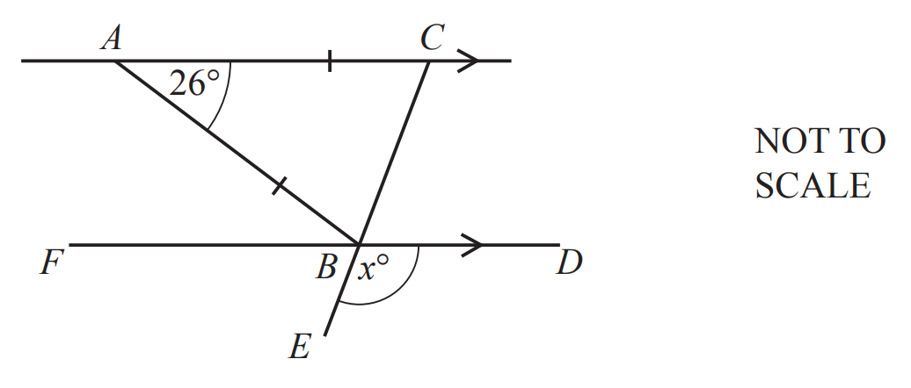
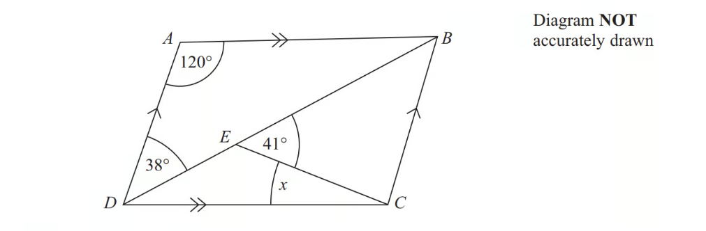
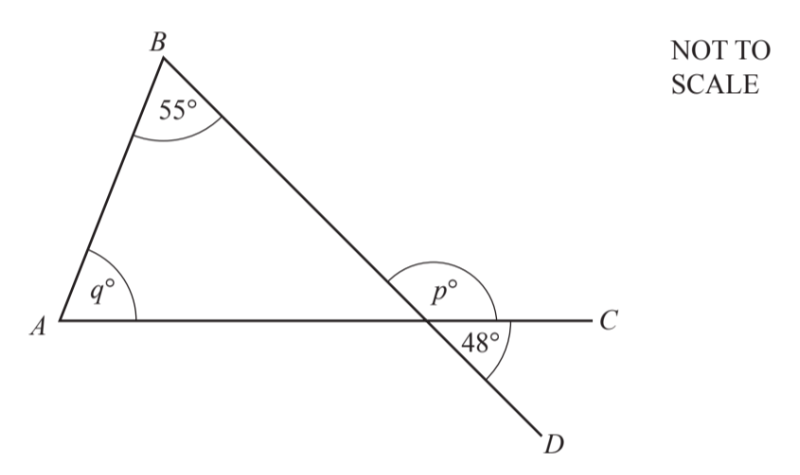
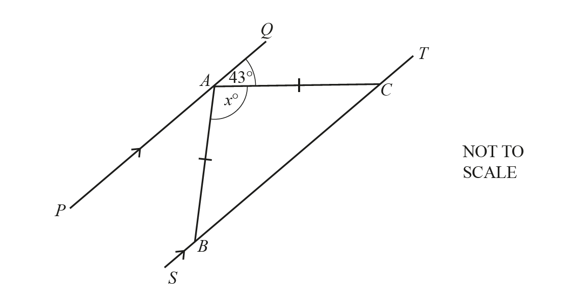
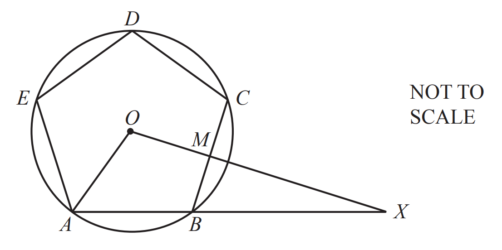
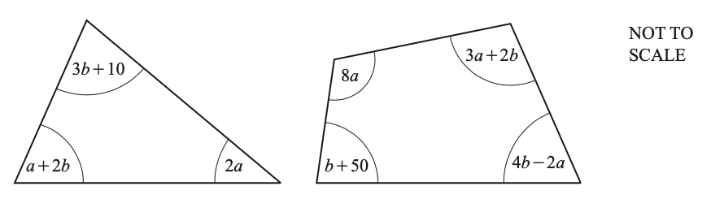
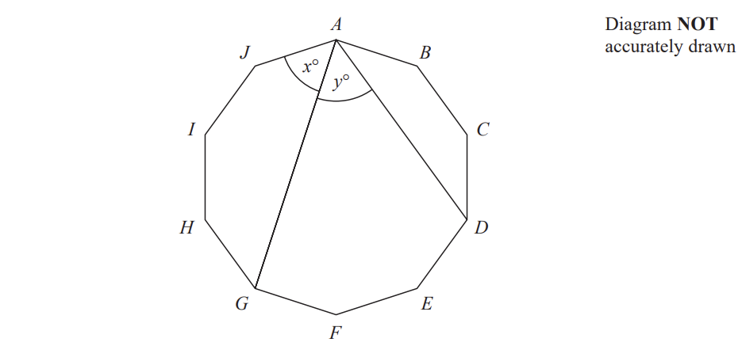
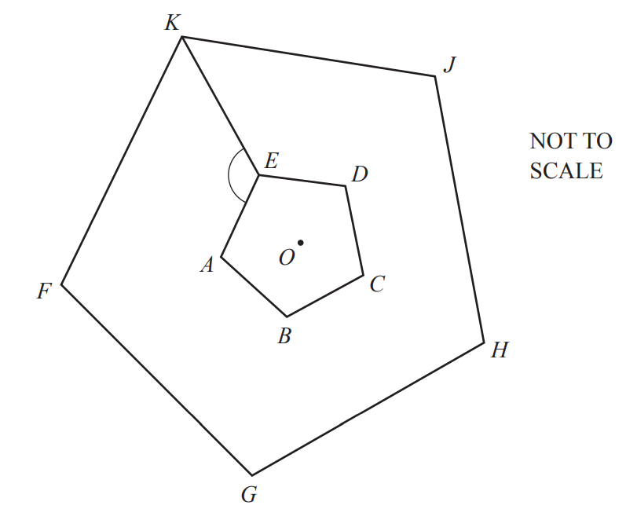

# Exam Questions — Angles in Polygons & Parallel Lines
**Geometry** · Cambridge (CIE) IGCSE maths (0607)
> Source: [https://www.savemyexams.com/igcse/maths/cie/international-maths/23/extended/topic-questions/](https://www.savemyexams.com/igcse/maths/cie/international-maths/23/extended/topic-questions/) · 13 questions across 1 sets

## Calculator Questions (13 questions)

### Q1 — easy — 2 marks

**Q1** [2 marks]

Calculate the size of one interior angle of a regular polygon with 40 sides.

*Source: 2020 Oct/Nov 0580/22 Q8*

### Q2 — hard — 3 marks

**Q2** [3 marks]

$AC$ is parallel to $FBD$, $ABC$ is an isosceles triangle and $CBE$ is a straight line.

Find the value of $x$.

$x$ = ..............................................

*Source: 2019	May/June 0580/42 Q2A*

### Q3 — hard — 5 marks

**Q3** [5 marks]

In a regular polygon, the interior angle is 11 times the exterior angle.

i) Work out the number of sides of this polygon.

[3]

ii) Find the sum of the interior angles of this polygon.

[2]

*Source: 2018	May/June 0580/42 Q9B*

### Q4 — hard — 4 marks

**Q4** [4 marks]

$ABCD$ is a parallelogram.

Angle $ADB=38^{\circ}$. 
Angle $BEC=41^{\circ}$. 
Angle $DAB=120^{\circ}$.

Calculate the size of angle $x$. 
You must give reasons for your answer.

*Source: November 2012 1MA0/2H Q6*

### Q5 — medium — 2 marks

**Q5** [2 marks]

The interior angle of a regular polygon with $n$ sides is 150°.

Calculate the value of $n$.

$n=$................................................

*Source: 2020 May/June 0580/43 Q8A*

### Q6 — easy — 3 marks

**Q6** [3 marks]

In the diagram, *AC* and *BD* are straight lines.

Find the value of $p$ and the value of $q$.

$p$ = ...................................................

$q$ = ...................................................

*Source: 2019	Oct/Nov 0580/41 Q1A*

### Q7 — medium — 2 marks

**Q7** [2 marks]

The diagram shows two parallel lines *PAQ* and *SBCT*.

*AB* = *AC* and angle *QAC* = 43°.

Find the value of $x$*.*

$x=$.......................................

*Source: 2018	May/June 0580/21 Q5*

### Q8 — easy — 2 marks

**Q8** [2 marks]

Find the interior angle of a regular polygon with 24 sides.

*Source: 2020 March 0580/22 Q4*

### Q9 — medium — 3 marks

**Q9** [3 marks]

A regular polygon has 72 sides.

Find the size of an interior angle.

*Source: 2019	Oct/Nov 0580/41 Q1C*

### Q10 — very_hard — 11 marks

**Q10** [2 marks]

Show that each interior angle of a regular pentagon is $108^{\circ}$.

*Source: 2019	May/June 0580/42 Q7A*

**Q10** [9 marks]

The diagram shows a regular pentagon $ABCDE$. 
The vertices of the pentagon lie on a circle, centre $O$, radius $12\text{cm}$. 
$M$ is the midpoint of $BC$.

i) Find $BM$.

$BM$ = ........................................ cm [3]

$OMX$ and $ABX$ are straight lines.

iia) Find $BX$.

$BX$ = ........................................ cm [3]

iib) Calculate the area of triangle $AOX$.

........................................ cm2 [3]

*Source: 2019	May/June 0580/42 Q7B*

### Q11 — very_hard — 6 marks

**Q11** [6 marks]

The diagram shows a triangle and a quadrilateral. All angles are in degrees.

i) For the triangle, show that  $3a+5b=170$.

[1]

ii) For the quadrilateral, show that  $9a+7b=310$.

[1]

iii) Solve these simultaneous equations.
Show all your working.

$a$ = ...................................................

$b$ = ................................................... [3]

iv) Find the size of the smallest angle in the triangle.

[1]

*Source: 2019	Oct/Nov 0580/43 Q2A*

### Q12 — very_hard — 4 marks

**Q12** [4 marks]

The diagram shows a regular 10-sided polygon, $ABCDEFGHIJ$

Show that $x=y$.

*Source: Jan 2022 4MA1/2H Q11*

### Q13 — hard — 6 marks

**Q13** [4 marks]

The diagram shows two regular pentagons. 
Pentagon $FGHJK$ is an enlargement of pentagon $ABCDE$, centre $O$.

Find angle $AEK$.

Angle $AEK$ = ....................................................

*Source: 2019	May/June 0580/23 Q25A*

**Q13** [2 marks]

The area of pentagon $FGHJK$ is $73.5\text{cm}^{2}$. 
The area of pentagon $ABCDE$ is $6\text{cm}^{2}$.

Find the ratio    perimeter of pentagon $FGHJK$ : perimeter of pentagon $ABCDE$    in its simplest form.

......................... : .........................

*Source: 2019	May/June 0580/23 Q25B*

