# Mark Schemes — Bearings
**Geometry** · Cambridge (CIE) IGCSE maths (0607)

## Exam Questions (23 questions)

### Q1
> *The difference between the bearing from A to B and the bearing from B to A is 180°. Use this to form an equation.*

$6b^{\circ}-b^{\circ}=180^{\circ}$

**[1]**

> *Simplify the equation and then solve it.*

`table attributes columnalign right center left columnspacing 0px end attributes row cell 5 b end cell equals 180 row b equals cell 180 over 5 end cell row b equals 36 end table`

**[1]**

> *The bearing of Amton from Bisham is 6b°. Substitute the value of b into the expression for the bearing.*

$6b=6\times36=216$

**[1]**

**Bearing is 216°** **[1]**

### Q2
> *Before starting, mark the bearing of **J** from **K** on the diagram so that you are clear which angle you are trying to find:*

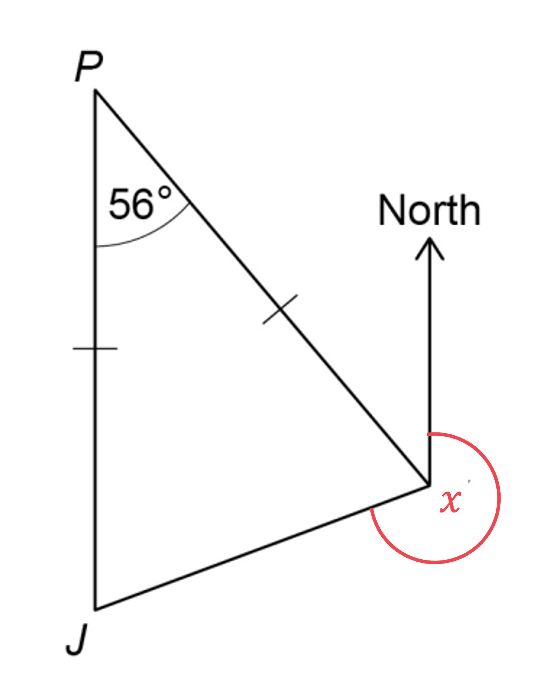

> *Triangle** JKP **is isosceles so you can calculate the size of angles **PJK** and **PKJ.*

$\mathrm{angle}PJK=\mathrm{angle}PKJ=\frac{180-56}{2}=62$

**[1]**

> *Mark this result on the diagram.*
*If you extend the North line southwards, you can see that angle **PJK** and the angle marked **y** are **alternate angles**. (We are told that **J** is due South of **P**; so **PJ** and the North/ South line are parallel lines).*

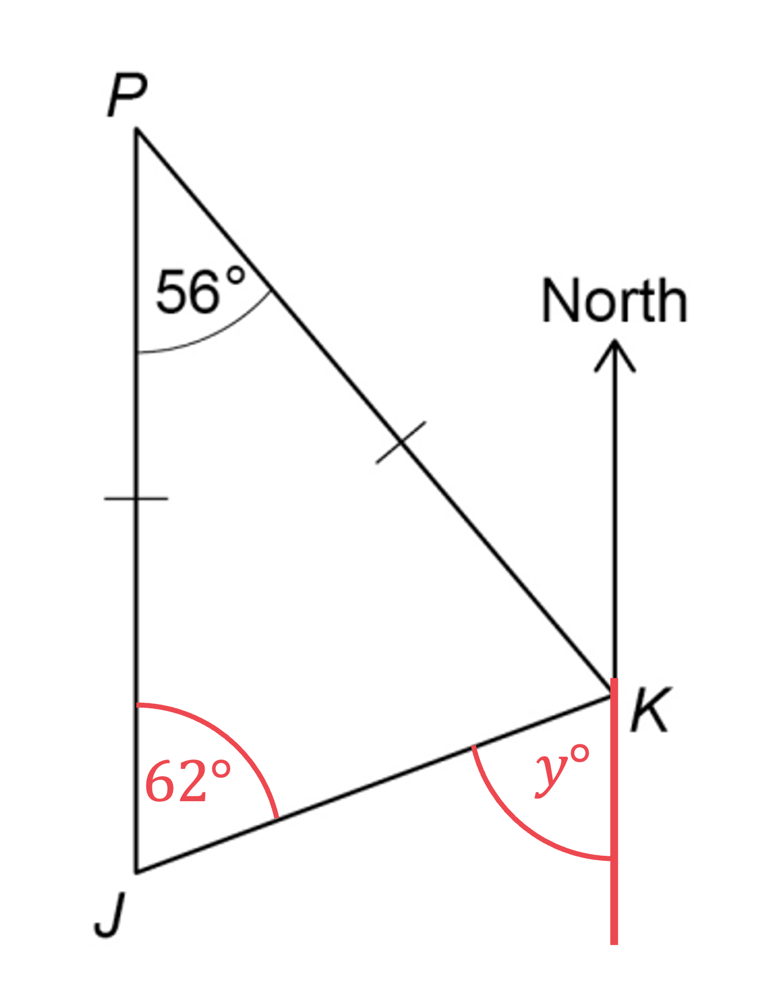

$y=62$

**[1]**

> *The bearing (marked as **x **above) is 180° plus 62°.*

$x=180+62$

**Answer = 242° ****[1]**

### Q3
> *The north lines are parallel*

> *Find one of the angles at *$B$* by subtracting 37° from 180°*

> *Draw a line between Acton and Chorlton and label the required bearing*

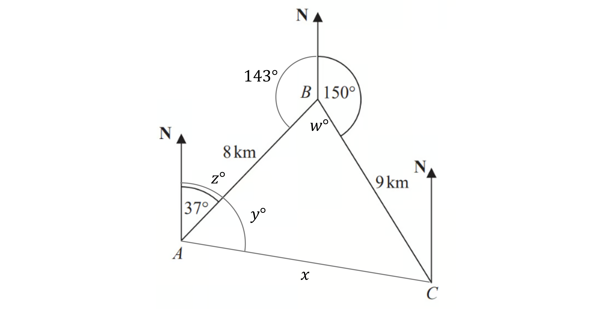

> *Find the interior angle of the triangle at *$B$* by subtracting the other angles around the point from 360°*

$w=360-150-143=67$

**[1]**

> *You have the lengths of two sides and the angle between them*

> *You can use the cosine rule *$b^{2}=a^{2}+c^{2}-2ac\mathrm{cos}B$* to find *$x$

`table row cell x squared end cell equals cell 9 squared plus 8 squared plus 2 cross times 9 cross times 8 cross times cos open parentheses 67 close parentheses end cell row cell x squared end cell equals cell 88.734... end cell row x equals cell 9.419... end cell end table`

**[1]**

> *You now have the length of a side and the angle opposite it*

> *You can use the sine rule *$\frac{\mathrm{sin}A}{a}=\frac{\mathrm{sin}B}{b}$* to find *$y$

`table row cell fraction numerator sin y over denominator 9 end fraction end cell equals cell fraction numerator sin open parentheses 67 close parentheses over denominator 9.419... end fraction end cell row cell sin y end cell equals cell 9 cross times fraction numerator sin open parentheses 67 close parentheses over denominator 9.419... end fraction end cell row cell sin y end cell equals cell 0.8794... end cell row y equals cell sin to the power of negative 1 end exponent open parentheses 0.8794... close parentheses end cell row y equals cell 61.57... end cell end table`

**Correct use of the sine rule [1]**

**Correct angle [1]**

> *Add this to 37 to get the bearing*

$z=37+61.57...=98.57...$

> *Round to 1 decimal place and write as a bearing*

**098.6° (1dp)** **[1]**

### Q4
> *Sketch the information given.*
*A bearing is the angle going clockwise from the north line. We're given the bearing "from **B**", so draw a north line on **B **and mark the angle between **BN** and **BA** as 140°.*

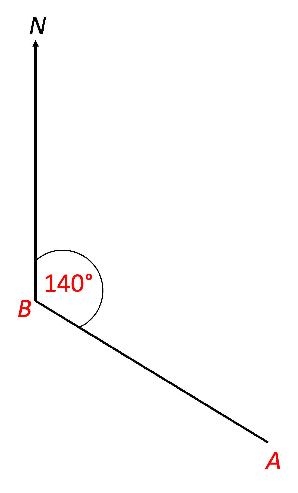

> *Identify the angle that is being asked for on your diagram. Draw a new north line from **A **. Draw an angle **clockwise** **from the new north line to **AB** and mark this as the bearing.*

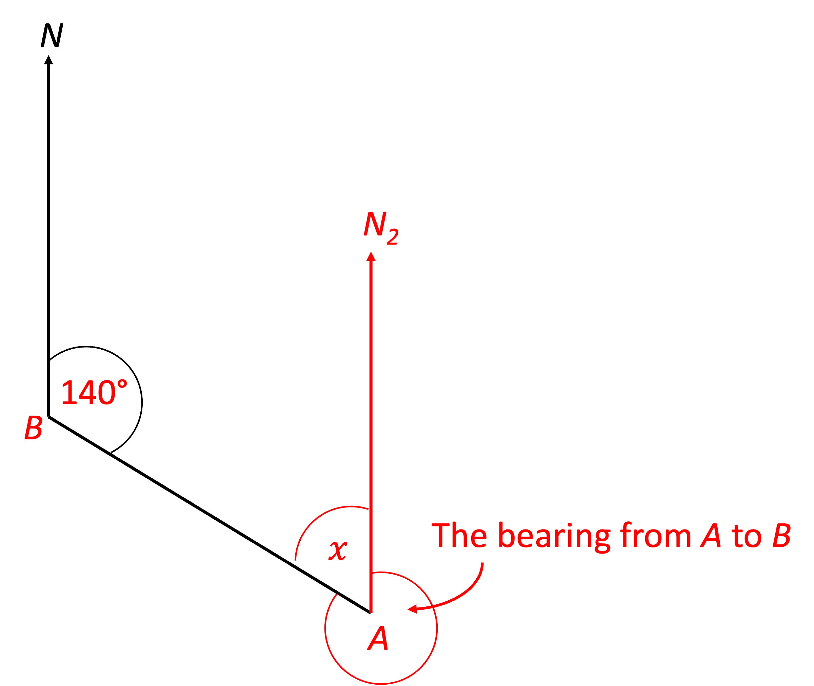

> *As the two North lines are parallel, we can use supplementary angles to identify the angle marked *$x$* on the diagram.*

$x=180-140=40^{\circ}$

> *Now we can calculate the bearing by using the the rule that angles around a point sum to 360°.*

`table row cell bearing space from space A space to space B end cell equals cell 360 degree minus 40 degree end cell end table`

**[1]**

$320^{\circ}$** [1]**

### Q5
> *Find the bearing of **P** from **Q** by adding 180° to the reverse bearing (**Q** from **P**).*

$80+180=260$

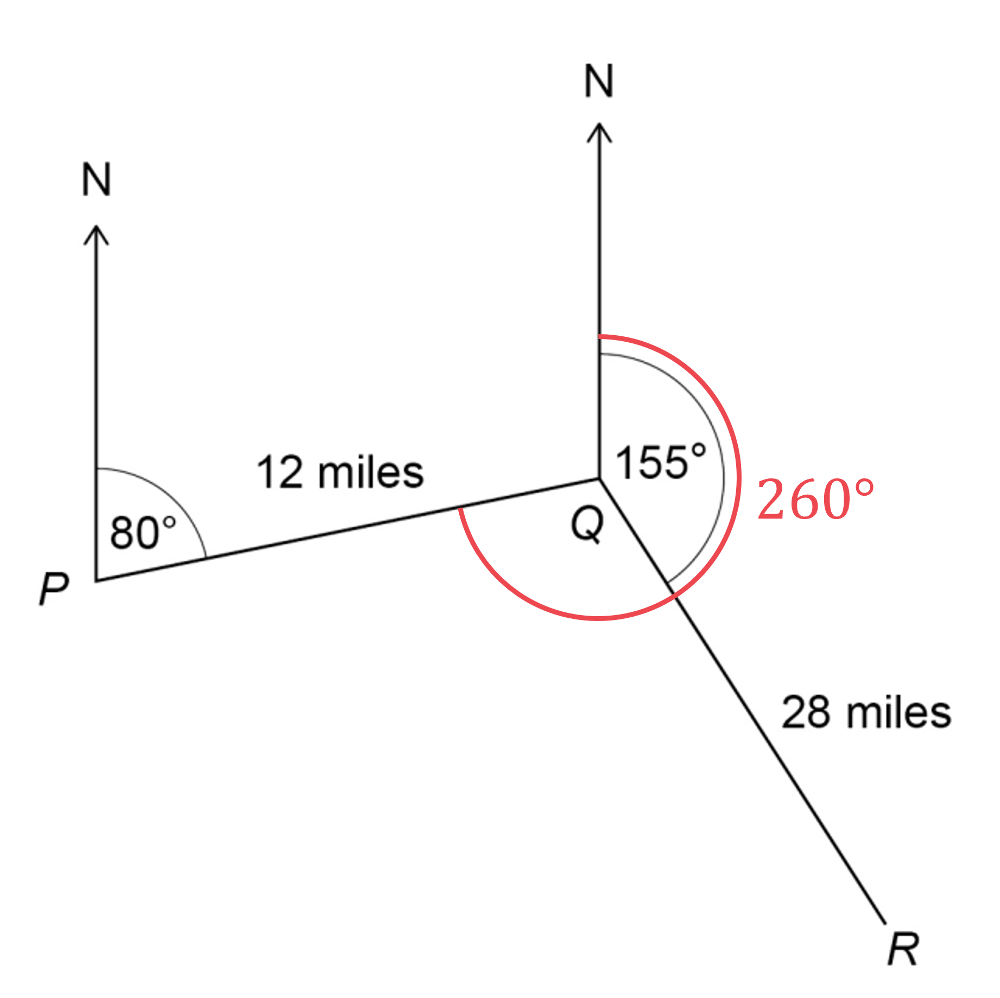

> *Form a triangle by joining **P** to **R**. Find the angle **PQR** by subtracting the two bearings that start at **Q**.*

$260-155=105$

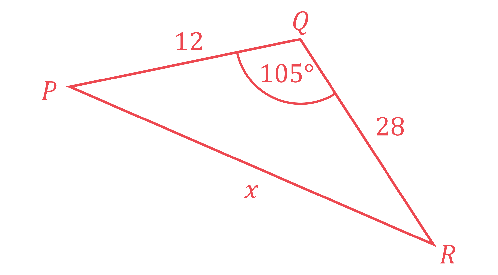

**[1]**

> *You have the lengths of two sides and the angle between them, therefore you can use the cosine rule to find the third side. The formula for the cosine rule is *$a^{2}=b^{2}+c^{2}-2bc\mathrm{cos}A$*where **a, b **and **c **are the lengths of the three sides and **A** is the angle between the the sides **b** and **c**.*

> *Substitute **a** = **x**, **b **= 12, **c** = 28 and **A** = 105 into the formula.*

`table row cell x squared end cell equals cell 12 squared plus 28 squared minus 2 open parentheses 12 close parentheses open parentheses 28 close parentheses cos open parentheses 105 close parentheses end cell row blank equals cell 1101.926... end cell end table`

**[1]**

> *Take the positive square root. Use the answer button on your calculator.*

`table row x equals cell square root of 1101.926... end root end cell row blank equals cell 33.1952... end cell end table`

**[1]**

> *Round your answer appropriately. 2 or 3 significant figures is appropriate.*

$33.2\mathrm{miles}(3\mathrm{sf})$ **[1]** 
**An answer of 33 or answers in the range 33.19 to 33.2 are accepted**

### Q6
> *i) Find the bearing of **B** from **A** by subtracting the angle **BAC** from the bearing of **C** from **A**.*

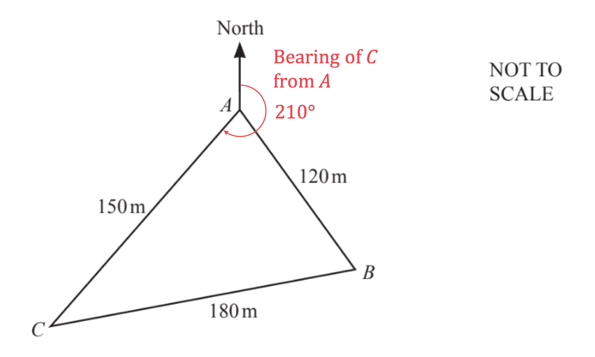

$210-82.8=127.2$

$127.2^{\circ}$ **[1]**

> *ii) The bearing of **A** from **B** is 180**o** more than the bearing of **B** from **A**.*

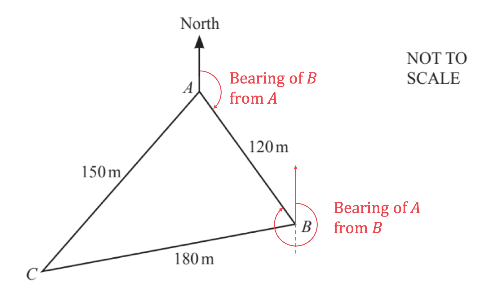

$127.2+180$

* ***Adding 180****o**** to your value from part i)**** [1]**
**307.2****o** **[1]**
**Answers of 307 and between 307.1 to 307.2 will be accepted.**

### Q7
> *Measure the line **AB** with a ruler. On the original exam paper, this line measures 11 cm*

> *The scale is 1 cm to 3 km so multiply by 3 and convert the units from cm to km*

**33 km**
* **32.7 to 33.3** ***[1]**

### Q8
> *The angle between North and South is 180**o**. *
*The bearing of **P** from **B** and the angle between the South at **P** to the line connecting **B** and **P** are alternate angles.*

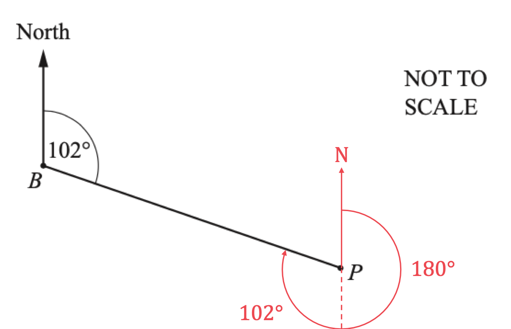

> *Add 180**o** to the bearing of **B** from **P** .*

$180+102$

**[1]**

$282^{\circ}$** [1]**

### Q9
> *To find the bearing of **C** from **B**, you first need to work out the angle **ABC**. *
*However you currently do not have enough information to work that out.*

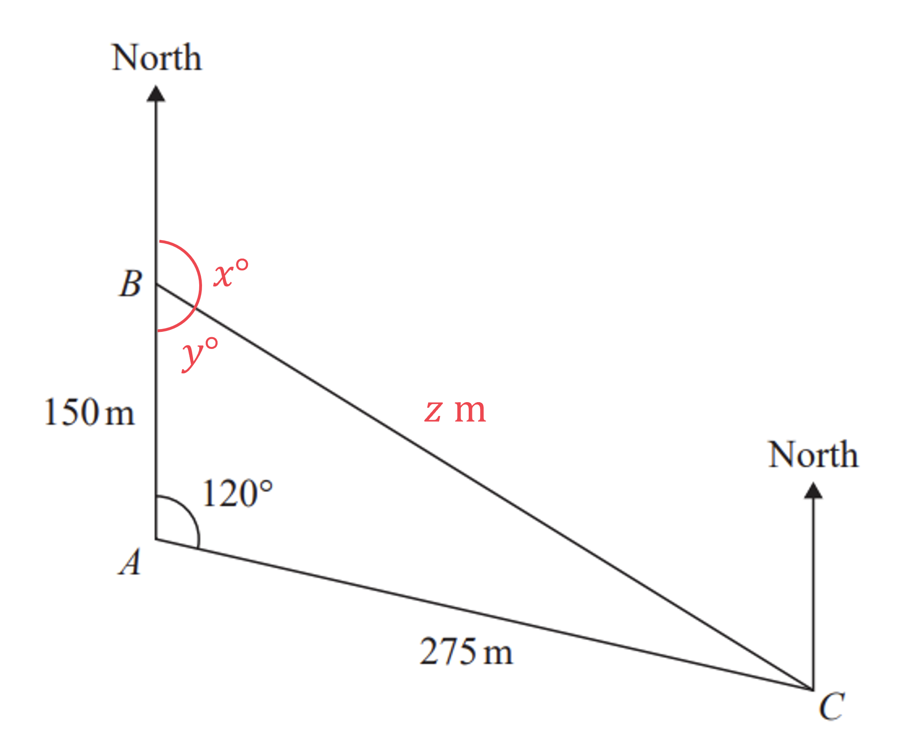

> *You know the lengths of two sides and the angle between them. Therefore you can use the cosine rule to find the length of the third side.*

> *The formula for the cosine rule is *$a^{2}=b^{2}+c^{2}-2bc\mathrm{cos}A$*, where **b** and **c** are the lengths of the two sides that form angle **A** and **a** is the length of the side opposite **A**. *
*Substitute **a** = **z**, **b** = 275, **c** = 150 and **A** = 120 into the formula.*

`z squared equals 275 squared plus 150 squared minus 2 open parentheses 275 close parentheses open parentheses 150 close parentheses cos open parentheses 120 close parentheses`

**[1]**

> *Type the expression into your calculator altogether as one line. If you do it separately you need to remember the order of operations (multiplication before addition). Take the positive square root and leave as an exact answer or store in your calculator.*

`table attributes columnalign right center left columnspacing 0px end attributes row cell z squared end cell equals 139375 row z equals cell square root of 139375 end cell row blank equals cell 373.329613... end cell end table`

**[1]**

> *You can now find the angle at **B** by using either the sine rule or the cosine rule.*

> *Method 1 - Using the sine rule*

> *The formula for the sine rule is *$\frac{\mathrm{sin}A}{a}=\frac{\mathrm{sin}B}{b}$*, where **a** and **b** are the lengths of the two sides that are opposite the angles **A **and **B **respectively. *
*Substitute **A** = **y**, **B** = 120, **a** = 275 and **b** = √139375 into the formula.*

`fraction numerator sin y over denominator 275 end fraction equals fraction numerator sin open parentheses 120 close parentheses over denominator square root of 139375 end fraction`

**[1]**

> *Multiply both sides by 275 and then use the inverse sin function on your calculator.*

`table row y equals cell sin to the power of negative 1 end exponent open parentheses fraction numerator sin open parentheses 120 close parentheses over denominator square root of 139375 end fraction cross times 275 close parentheses end cell row blank equals cell 39.637403... end cell end table`

**[1]**

> *Find the bearing by subtracting from 180.*

`table attributes columnalign right center left columnspacing 0px end attributes row x equals cell 180 minus 39.637403... end cell row blank equals cell 140.362596... end cell end table`

> *Round to the nearest degree.140*

$140^{\circ}(\mathrm{nearest} \mathrm{degree})$** [1]**

> *Method 2 - Using the cosine rule*

> *The formula for the cosine rule is *$\mathrm{cos}A=\frac{b^{2}+c^{2}-a^{2}}{2bc}$*, where **a** and **b** are the lengths of the two sides that form the angle **A **and **a** is the length of the side opposite **A**. *
*Substitute **A** = **y**, **a** = 275, **b** = 150 and **c** = √139375 into the formula.*

`cos y equals fraction numerator 150 squared plus open parentheses square root of 139375 close parentheses squared minus 275 squared over denominator 2 cross times 150 cross times square root of 139375 end fraction`

**[1]**

> *Use the inverse cos function on your calculator.*

`table row y equals cell cos to the power of negative 1 end exponent open parentheses fraction numerator 150 squared plus open parentheses square root of 139375 close parentheses squared minus 275 squared over denominator 2 cross times 150 cross times square root of 139375 end fraction close parentheses end cell row blank equals cell 39.637403... end cell end table`

**[1]**

> *Find the bearing by subtracting from 180.*

`table attributes columnalign right center left columnspacing 0px end attributes row x equals cell 180 minus 39.637403... end cell row blank equals cell 140.362596... end cell end table`

> *Round to the nearest degree.140*

$140^{\circ}(\mathrm{nearest} \mathrm{degree})$** [1]**

### Q10
> *Method 1*

*Draw a sketch showing the bearing from Paris to Alexandria.* *Start from the North line and measure clockwise.*

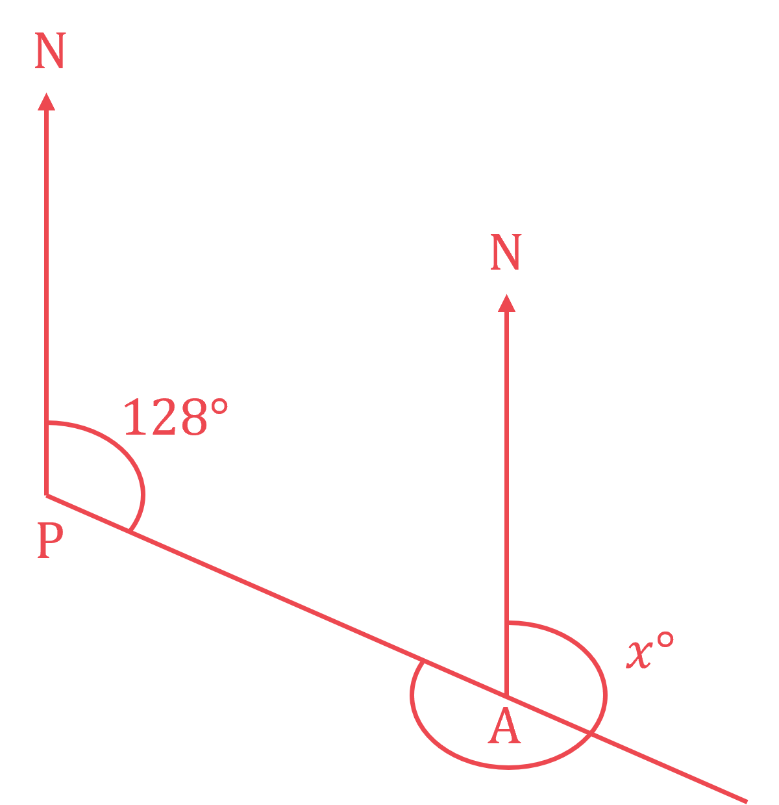

> *The angle *$x^{\circ}$* is corresponding to angle 128°.*

$x=128$

> *The bearing from Alexandria to Paris is 128° added to a half turn (180°).*

*128° + 180°*

**[1]**

**308°** **[1]**

> *Method 2*

*Draw a sketch showing the bearing from Paris to Alexandria.* *Start from the North line and measure clockwise.*

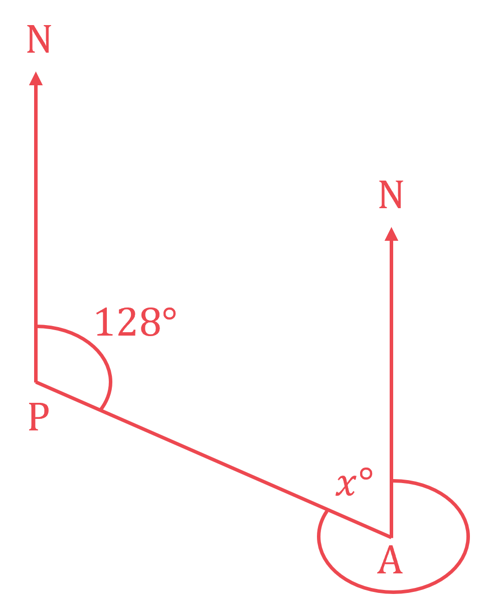

> *The angles *$x^{\circ}$* and 128° are co-interior angles between parallel lines so add to 180°.*

`table attributes columnalign right center left columnspacing 0px end attributes row x equals cell 180 minus 128 end cell row blank equals 52 end table`

**[1]**

> *The bearing from Alexandria to Paris is 52° subtracted from a full turn (360°).*

*360° - 52°*

**308°** **[1]**

### Q11
> *To find a reverse bearing, either add or subtract 180° (whichever will give an answer between 0° and 360°).*

$50+180$

**[1]**

**230°****  [1]**

### Q12
i) *Bearings are always taken from the north in the clockwise direction.*

> * *

> * *

> *The bearing of **C**  from **B ** is a full turn minus (106 - 38)°.*

* **360° - (106 - 38)° = 292°  *

**292° ****[1]**

ii) *Due east means at a bearing of 090°.*

* **Angle ***ABD *** =  90° - 38° = 52°*

> *Add the information you have to the diagram.*

> * *

**[1]**

> * *

> *Angle **ABD ** is opposite a known side and one other side is known so the sine rule can be used to find the other angles.*

> *Sine Rule:  *$\frac{\mathrm{sin}A}{a}=\frac{\mathrm{sin}B}{b}=\frac{\mathrm{sin}C}{c}$*.*

`table row cell fraction numerator space sin space A B D over denominator A D end fraction end cell equals cell space fraction numerator space sin space B A D over denominator B D end fraction end cell row cell fraction numerator space sin space 52 over denominator 205.8 end fraction end cell equals cell space fraction numerator sin space B A D over denominator 168 end fraction end cell end table`

**[1]**

> *Rearrange the equation to make sin**BAD **the subject.*

`table row cell fraction numerator space 168 space sin space 52 over denominator 205.8 end fraction space end cell equals cell space sin space B A D end cell end table`

** ****[1]**

> *Use the *$\mathrm{sin}^{-1}$* button on your calculator to find angle **BAD**.*

`table row cell space B A D degree space end cell equals cell sin to the power of negative 1 end exponent space open parentheses fraction numerator space 168 space sin space 52 over denominator 205.8 end fraction close parentheses end cell row blank equals cell space 40.03639... degree end cell end table`

** ****[1]**

> *The bearing of **D **from **A **is 270° + angle **BAD.*

*270 + 40.03639... = 310.0363....*

**The bearing of ****D ****from ****A ****= 310.0° (1 d.p.) ****[1] **
**Unrounded answers in the range 310.03 to 210.04 accepted.**

### Q13
> *Sketching a diagram may help you to see what's going on.*

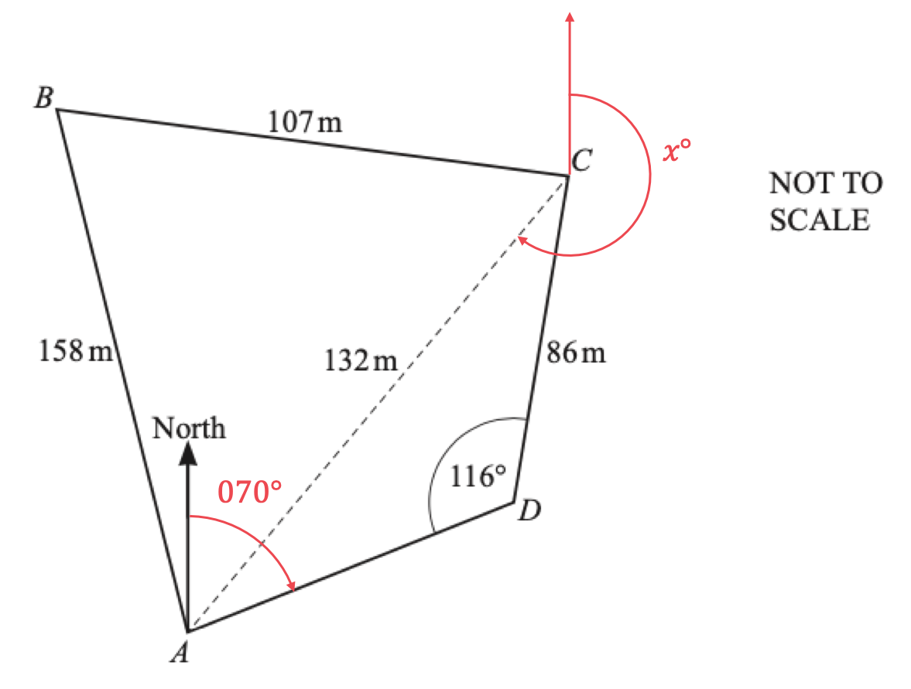

> *Work out the bearing of **C** from **A** by subtracting the angle **CAD** from the bearing of **D** from **A**.*

$70-35.8=34.2$

> *Work out the bearing of **A** from **C** by adding the 180**o** to the bearing of **C** from **A**.*

$180+34.2=214.2$

**[1]**

**214.2****o**** ****[1]**

### Q14
> *Identify the angle that will make the bearing of **D** from **B**. Draw a north line at **B** and a line from **B** to **D**. The required angle is the angle that is formed by starting at the north line and measuring clockwise. This angle is equal to angle **BDC** as they are alternate angles since the north line is parallel to the line **CD**.*

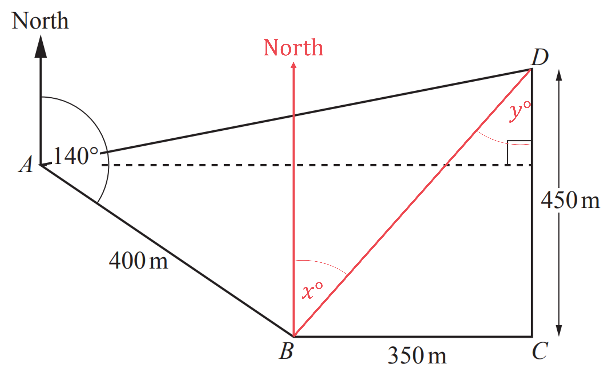

> *The triangle formed by the points **BCD** is right angled. You know the lengths of the sides opposite and adjacent to the required angle so you can use the trig ratio: *`tan open parentheses B C D close parentheses equals Opposite over Adjacent.`

`tan open parentheses B C D close parentheses equals 350 over 450`

**[1]**

> *Use inverse tan on your calculate to find the angle.*

`B C D equals tan to the power of negative 1 end exponent open parentheses 350 over 450 close parentheses equals 37.8749...`

> *Bearings are written as 3 digit numbers so round to the nearest integer and put a zero at the front.*

**Bearing of ****D**** from B is 038** **[1]**

### Q15
> *Pay attention to the words **of** and **from**. You are looking for the bearing **from **A ** **to **B *
*Measure the angle from the North line at A, to the line **AB**, as marked below*

**119°**** **
**119 ± 1 ****[****1]**
> *Pay attention to the wording. **Calculate** and **show your working** mean you can't do this my measuring; you **must **show the process of using your answer from part (b) to get the answer here*

> *First identify the angle that is the bearing of **A** **from **B**, which is the angle from the North line at **B**, clockwise to the line **AB**, marked as "*$β$*" below*

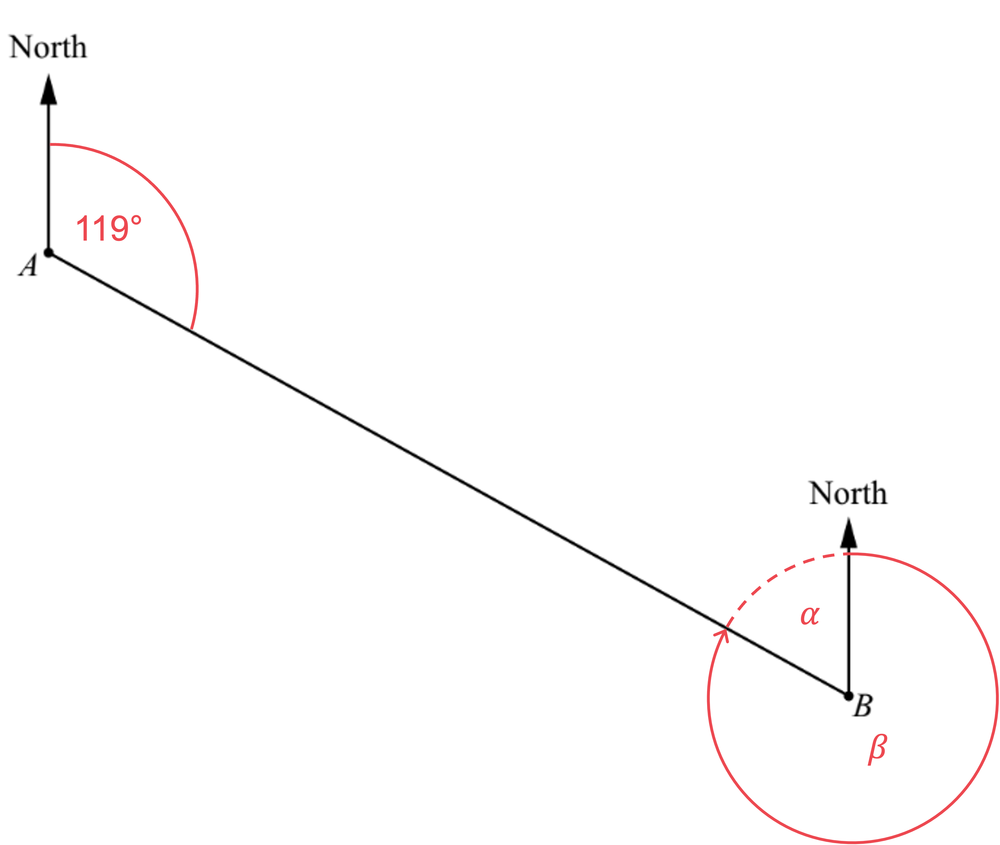

> *We can find the angle marked as *$α$* is co-interior with your answer from part (b). Therefore*

> $α=180-119=61^{\circ}$* *

> *Now find *$β$* which by subtracting *$α$* from 360°*

$β=360-61$

**the above method or "180 + [answer to (b)]"**** [1]**
**299°**** ****[1]**
** ****Both marks follow through from your answer to part (b)**

### Q16
> *To find a reverse bearing, either add or subtract 180° (whichever will give an answer between 0° and 360°).*

$65+180$

**[1]**

**245°****  [1]**

### Q17
*All bearings are 3-digit angles measured clockwise from a North arrow* 
*Draw the bearing of** A **from **B** on the diagram*

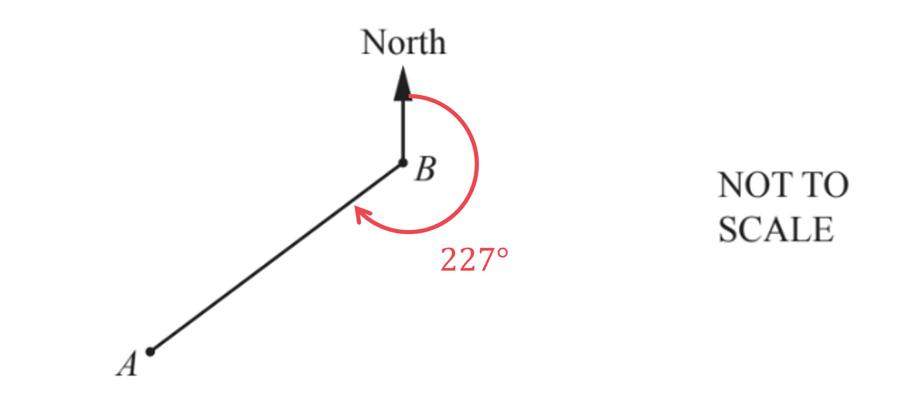

*Method 1 *
*Draw a North arrow at **A** to make two parallel lines* 
*Work out the other angle needed to complete 360° (360° - 227°)*

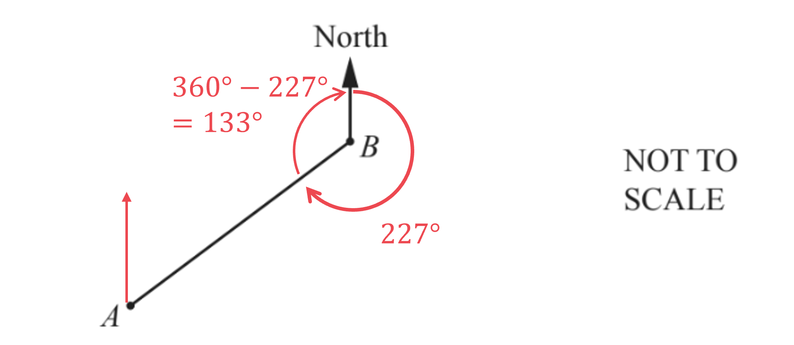

**133° seen**** [1]**

> *Co-interior angles in parallel lines add up to 180° *
*Work out the other co-interior angle (180° - 133°)*

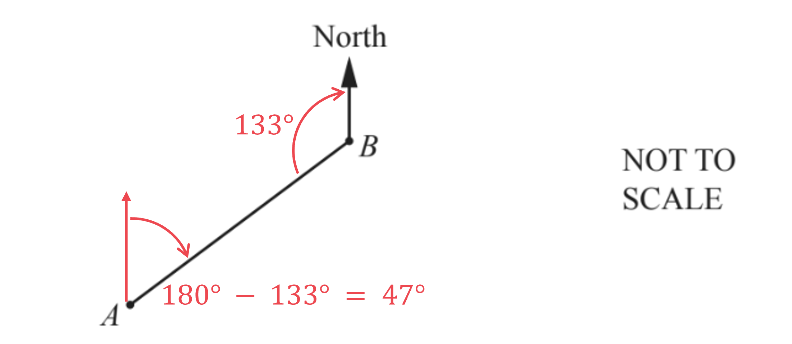

> *The bearing of **B** from **A** has an angle of 47° which should be written with 3 digits*

**047°** **[1]**
**Alternate angles in parallel lines can also be used**

> *Method 2 *
*Take a back bearing by subtracting 180° from 227°*

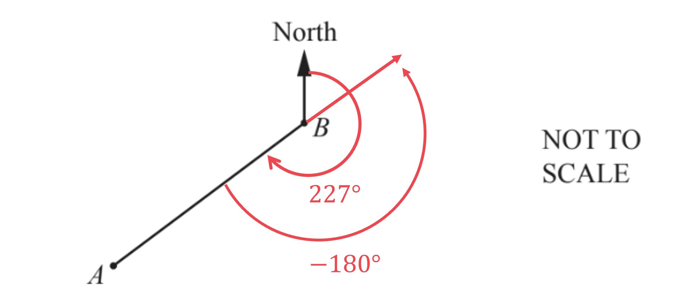

**Subtracting 180°**** ****[1]**** **
**047°*** ***[1]**

### Q18
> *Draw a triangle using A, B and C. As B is East of A and C is North of A, the triangle will be a right angled triangle. The distance from A to C is equal to the distance from A to B. Therefore it is an isosceles triangles. The missing two angles must be equal and add up to 90 so therefore must be 45°.*

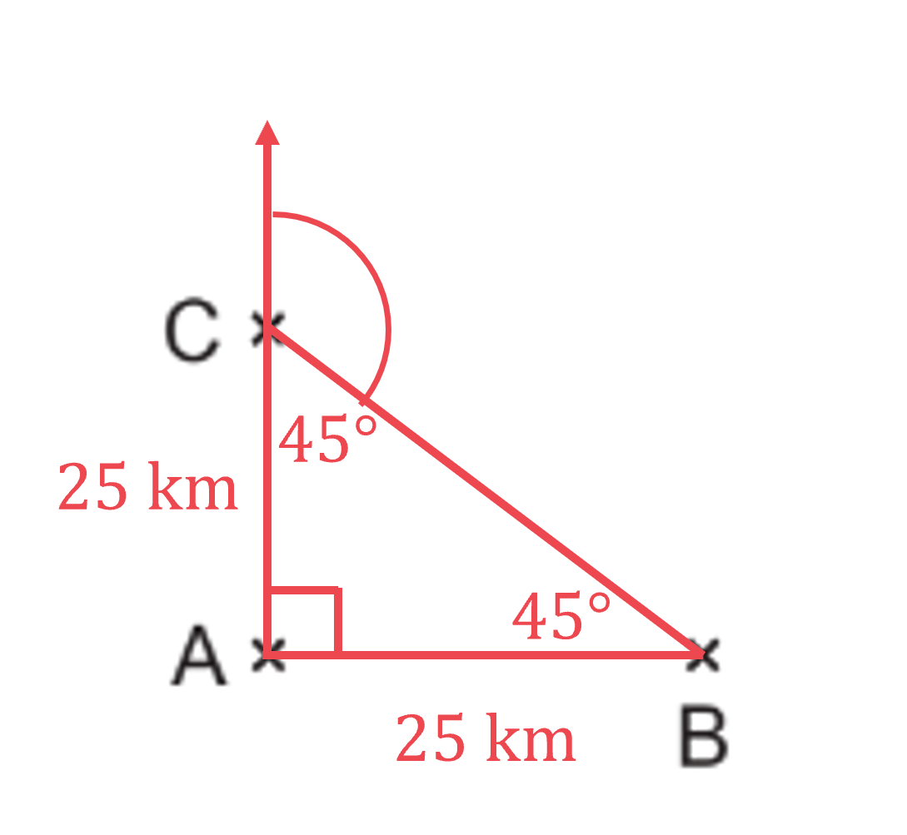

*Identifying an angle as 45°** ***[1]**

> *To finding the bearing of B from C you need to subtract 45° from half a turn.*

$180-45=135$

**Bearing of B from C is 135°** **[1]**
> *Draw a right angle triangle using the points A, B and D. Label the known lengths. To find the bearing of D from B it would be helpful to first find the interior angle of the triangle at B.*

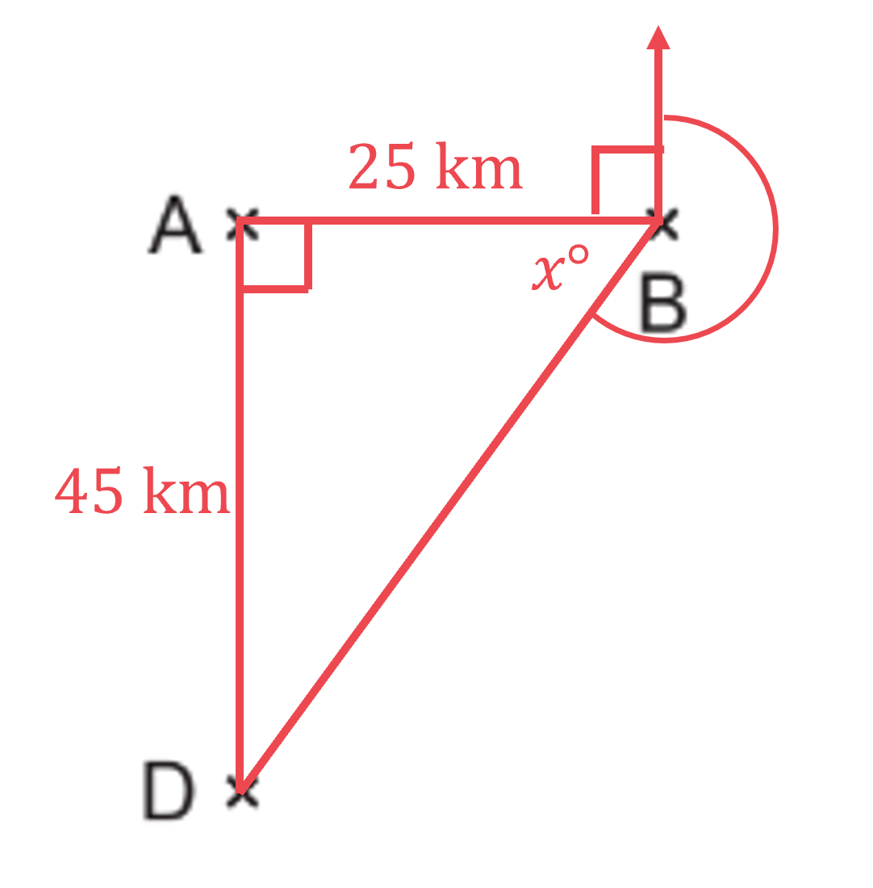

> *You know the lengths of the sides that are opposite and adjacent to the required angle. *

> *Therefore you can use the formula *$\mathrm{tan}θ=\frac{\mathrm{Opposite}}{\mathrm{Adjacent}}.$

$\mathrm{tan}x=\frac{45}{25}$

**[1]**

> *Use the inverse tan function on your calculator.*

`table attributes columnalign right center left columnspacing 0px end attributes row x equals cell tan to the power of negative 1 end exponent open parentheses 45 over 25 close parentheses end cell row blank equals cell 60.9453... end cell end table`

**[1]**

> *To find the bearing subtract this from a three quarter turn.*

$270-60.9453...=209.0546...$

**[1]**

> *Round appropriately. 3 significant figures or nearest whole number would be appropriate.*

**Bearing of D from B is 209° (3sf)** **[1]**

### Q19
*Label the bearing from **A** to **B** on the diagram.* 
*Because **AB** = **BC**, triangle **ABC** is an isosceles triangle.*

*Angle ***CAB*** = Angle ***ACB*** = 65**o*

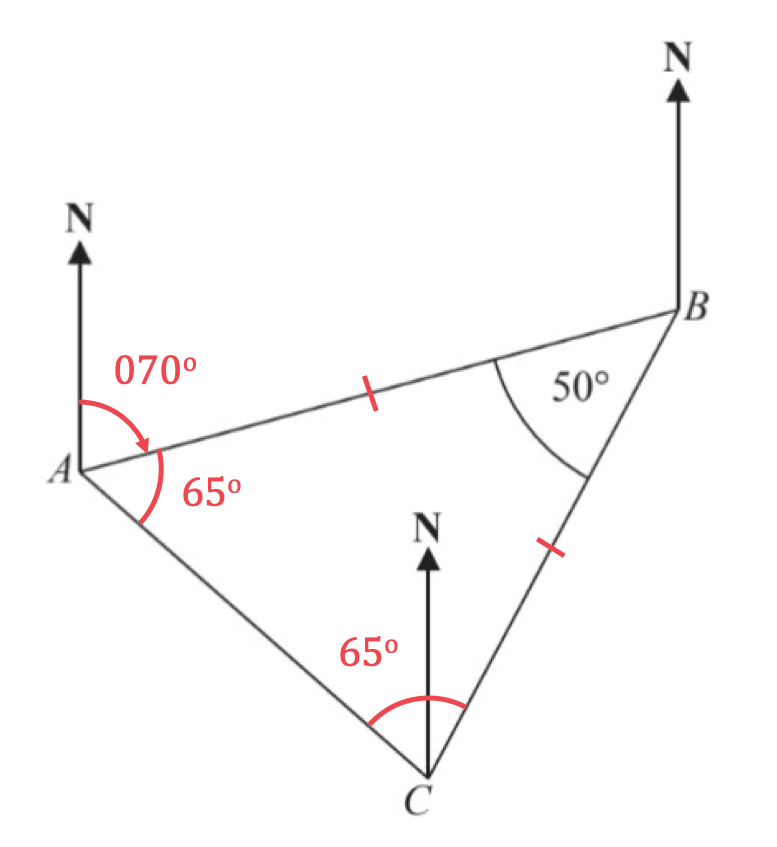

*Showing 070**o** on the diagram** ***[1]**
*Angle BAC*** ****[1]**

> *Work out the bearing of **C** from **A **by adding together the bearing of **B** from **A** to angle **CAB**.*

*70 + 65*

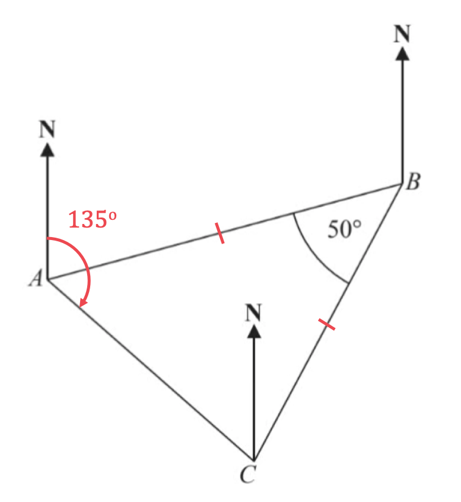

**135****o**** ****[1]**

### Q20
> *Method 1*

> *Extend the line between **A** and **B** so it passes **B. **This splits the bearing from **B** to **A** into two angles.*

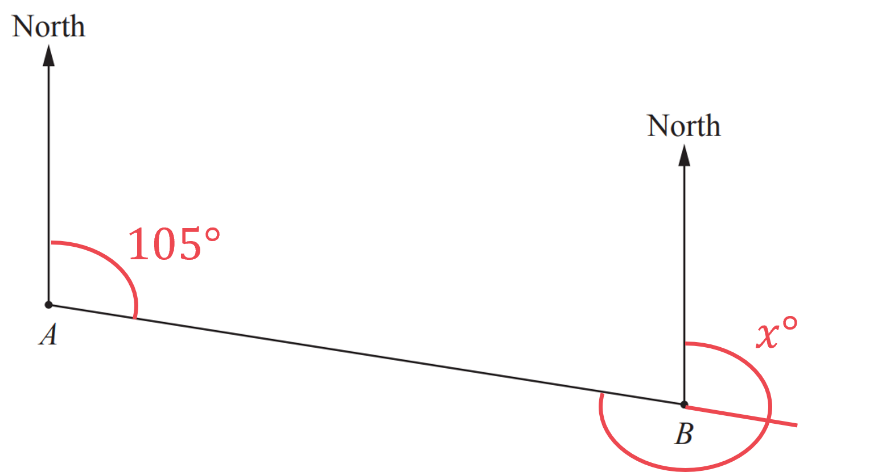

> *The angle *$x^{\circ}$* is corresponding to angle 105°.*

$x=105$

> *The bearing from **B** to **A** is 105° added to a half turn (180°).*

*105° + 180°*

**[1]**

**285°** **[1]**

> *Method 2*

> *Identify the required angle on the diagram.*

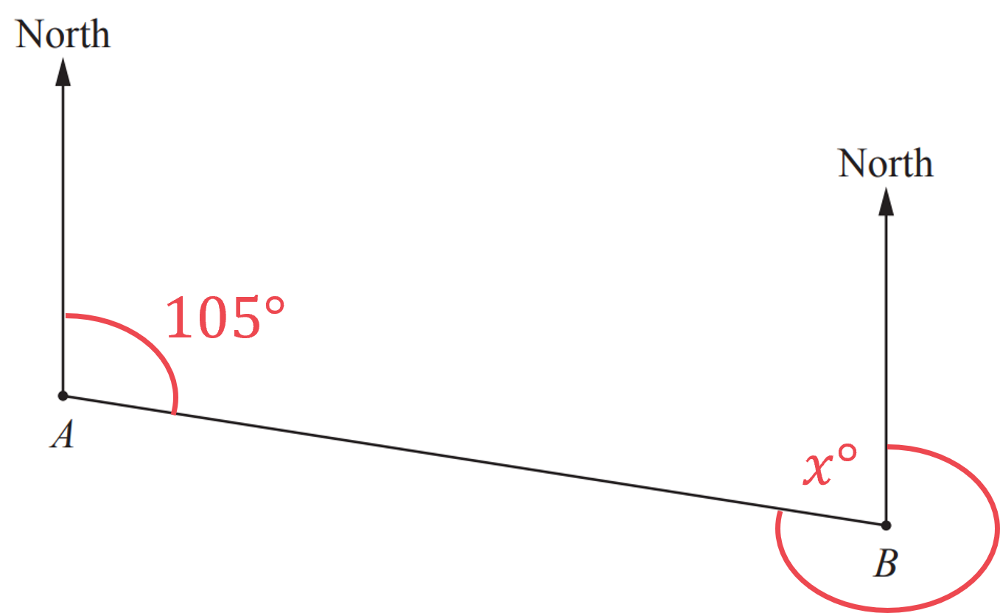

> *The angles *$x^{\circ}$* and 105° are co-interior angles between parallel lines so add to 180°.*

`table row x equals cell 180 minus 105 end cell row blank equals 75 end table`

**[1]**

> *The bearing from **B** to **A** is 75° subtracted from a full turn (360°).*

*360° - 75°*

**285°** **[1]**

### Q21
*We have two sides, the angle between them and are asked to show the length of the third side.* 
*This is cosine rule, *$"a^{2}=b^{2}+c^{2}-2bc\mathrm{cos}A"$ 
*It may help to label the diagram.*

`open parentheses B C close parentheses squared equals 115 squared plus 80 squared minus 2 cross times 115 cross times 80 cross times cos space 72 degree`

**[1]**

> *Avoid rounding before your final answer - store the exact value in your calculator's memory.*

`open parentheses B C close parentheses squared equals 13 space 939.087 space...` 
$BC=118.063911...$

> *Final answer is to be shown to **one decimal place.*

$BC=118.1$** cm (1 d.p.)** **[1]**
> *We now know side **BC**.*

*For angle **ABC**, we know it's opposite side and a another side-angle pair. This is sine rule, * $"\frac{sinA}{a}=\frac{sinB}{b}"$*.*

$\frac{\mathrm{sin}72^{\circ}}{118.063...}=\frac{\mathrm{sin}ABC}{115}$

**[1]**

> *Do not work out or round any values until your final answer. *
*Use the exact answer for side **BC** stored in your calculator from part a. Rearrange the equation.*

$\mathrm{sin}ABC=\frac{115\mathrm{sin}72^{\circ}}{118.063...}$

**[1]**

> *Use inverse sine (sin**-1**) to find angle **ABC**.*

`table row cell A B C end cell equals cell sin to the power of negative 1 end exponent open parentheses fraction numerator 115 sin space 72 degree over denominator 118.063 space... end fraction close parentheses end cell row cell A B C end cell equals cell 67.876 space 670 space... end cell end table`

**Angle ****ABC**** = 67.9° (1 d.p.)*** ***[1]**
> *Add the information to the diagram and mark the bearings required for both parts of the question.*

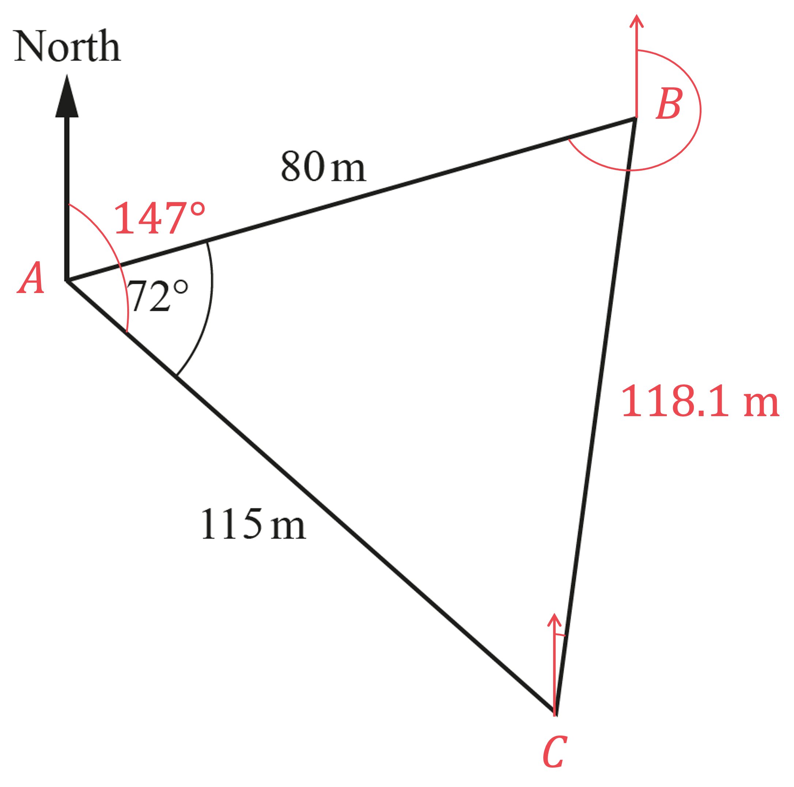

i) *First find the bearing of **B** from **A**.*

$147^{\circ}-72^{\circ}=75^{\circ}$

**[1]**

> *We can now work out the bearing of **A** from **B** using alternate angles.*

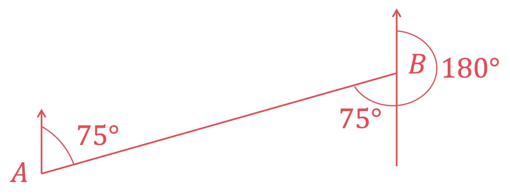

$180^{\circ}+75^{\circ}=255^{\circ}$

**[1]**

**The bearing of ****A**** from ****B**** is 255°** **[1]**

ii) *We can work out the bearing of **B** from **C** using alternate angles and the result from part b.*

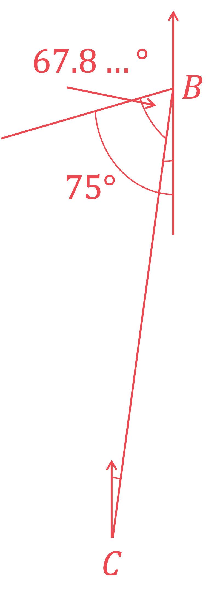

> *For angle **ABC** use the value stored in your calculator's memory.*

$75-67.876670...=7.123329...$

**[1]**

**The bearing of ****B**** from ****C**** is 7.1° (1 d.p.)**** [1]**
**If three-figure bearings are used the answer can be expressed as 007° or 007.1°.**

### Q22
*Bearings are angles measured clockwise from a north arrow, written as three digits* 
*Draw the bearing of **B** from **H** (133°) on the diagram at **H** and again at **B  *

> * *

*Find the bearing of **H** from **B** (by adding 180°)*

*133° + 180°*

**[1]**

**313°**** ****[1]**

### Q23
> *Draw a sketch, it should form a triangle.*

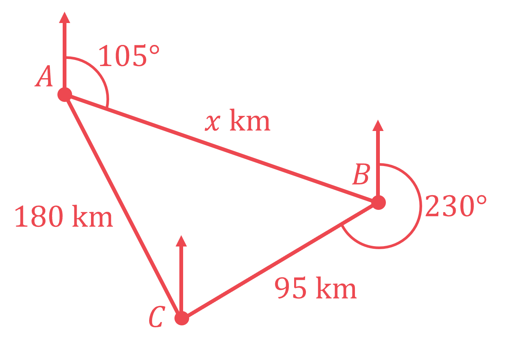

> *Find the bearing of **A** from **B** by adding 180° to the bearing of **B** from **A**.*

$105+180=285$

> *Find the angle in the triangle at **B** by subtracting the two bearings.*

$285-230=55$

**[1]**

> *To find the distance between **A **and **C **you need to know the angle opposite it in the triangle. You know an angle and the length of the side opposite to it, you also know another length so you can therefore find the angle opposite it by using the sine rule.*

> *The formula for the sine rule is *$\frac{\mathrm{sin}A}{a}=\frac{\mathrm{sin}B}{b}$*, where **a** and **b** are the lengths of the two sides that are opposite the angles **A **and **B **respectively. *

> *Substitute **a** = 95, **b** = 180, **A** = **y** and **B** = 55 into the formula.*

`fraction numerator sin open parentheses y close parentheses over denominator 95 end fraction equals fraction numerator sin open parentheses 55 close parentheses over denominator 180 end fraction`

**[1]**

> *Multiply both sides by 95 and then find the angle by using the inverse sin function.*

`table row cell sin open parentheses y close parentheses end cell equals cell fraction numerator sin open parentheses 55 close parentheses over denominator 180 end fraction cross times 95 end cell row y equals cell sin to the power of negative 1 end exponent open parentheses fraction numerator sin open parentheses 55 close parentheses over denominator 180 end fraction cross times 95 close parentheses end cell row y equals cell 25.615534... end cell end table`

**[1]**

> *The interior angles of the triangle should add up to 180°. Use the answer button on your calculator to find the third angle.*

`table row cell Angle space A C B end cell equals cell 180 minus 55 minus 25.615534... end cell row blank equals cell 99.384465... end cell end table`

> *You now have enough information to find the side **LN** using either the sine rule or the cosine rule.*

> *Method 1 - Using the sine rule*

> *The formula for the sine rule is *$\frac{a}{\mathrm{sin}A}=\frac{b}{\mathrm{sin}B}$*, where **a** and **b** are the lengths of the two sides that are opposite the angles **A **and **B **respectively. *
*Substitute **a** = **x**, **b** = 180, **A** = 99.384465... (using the answer button) and **B** = 55 into the formula.*

`table row cell fraction numerator x over denominator sin open parentheses 99.384465... close parentheses end fraction end cell equals cell fraction numerator 180 over denominator sin open parentheses 55 close parentheses end fraction end cell row x equals cell fraction numerator 180 over denominator sin open parentheses 55 close parentheses end fraction cross times sin open parentheses 99.384465... close parentheses end cell row x equals cell 216.798523... end cell end table`

**[1]**

> *Round to 3 significant figures.*

$217\mathrm{km}(3\mathrm{sf})$** [1]**

> *Method 2 - Using the cosine rule*

> *The formula for the cosine rule is *$a^{2}=b^{2}+c^{2}-2bc\mathrm{cos}A$*, where **b** and **c** are the lengths of the two sides that form angle **A** and **a** is the length of the side opposite **A**. *
*Substitute **a** = **x**, **b** = 95, **c** = 180 and **A** = 99.384465... (using the answer button) into the formula.*

`x squared equals 95 squared plus 180 squared minus 2 open parentheses 95 close parentheses open parentheses 180 close parentheses cos open parentheses 99.384465... close parentheses
x equals square root of 95 squared plus 180 squared minus 2 open parentheses 95 close parentheses open parentheses 180 close parentheses cos open parentheses 99.384465... close parentheses end root
x equals 216.798523...`

**[1]**

> *Round to 3 significant figures. *

$217\mathrm{km}(3\mathrm{sf})$** [1]**
