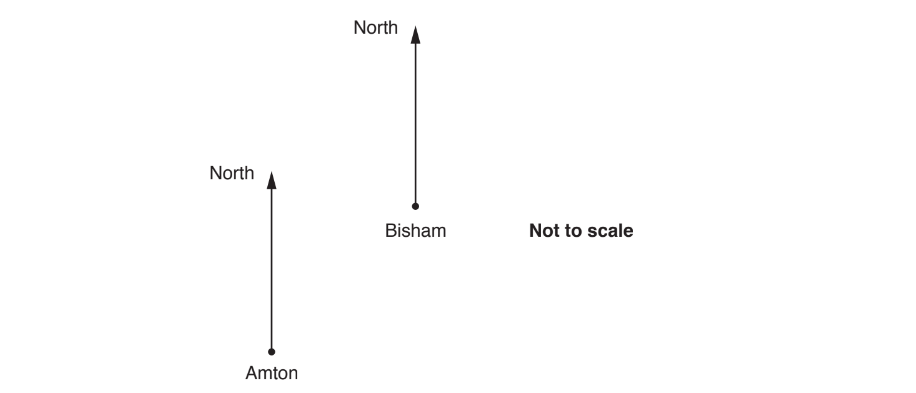
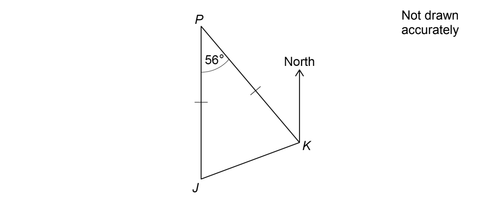
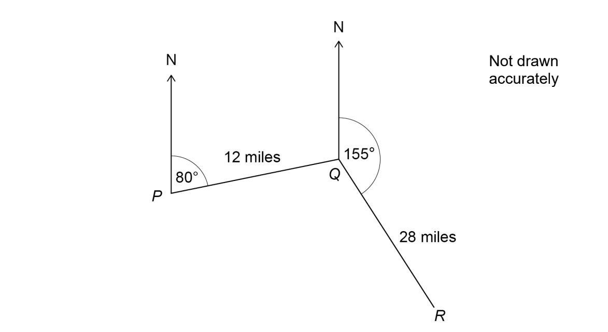
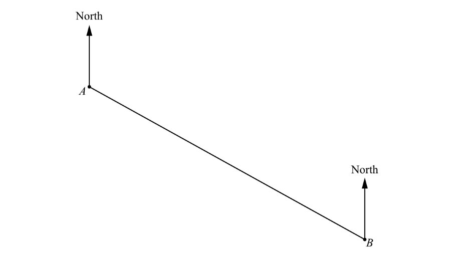
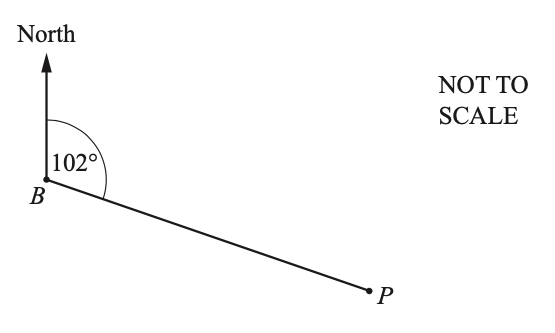
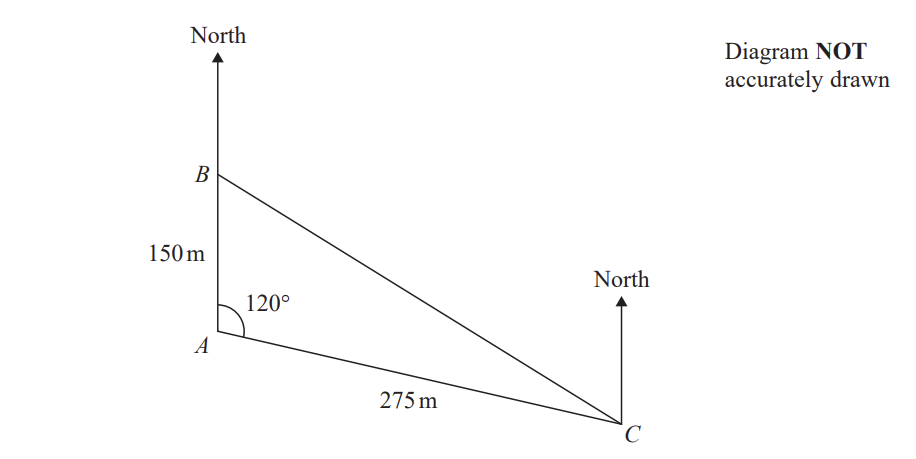
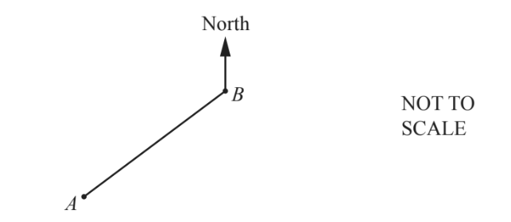
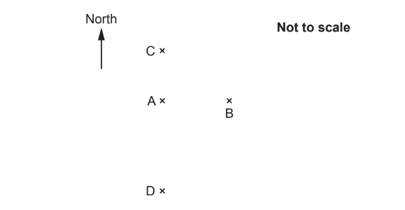
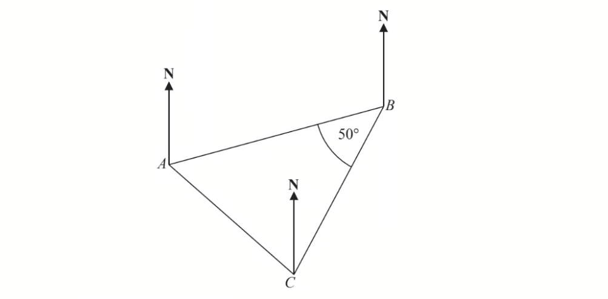
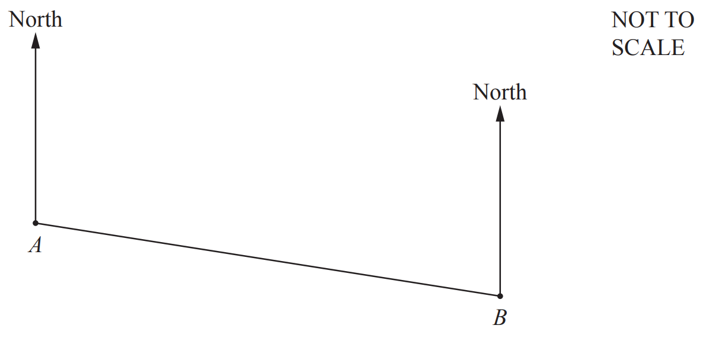

# Exam Questions — Bearings
**Geometry** · Cambridge (CIE) IGCSE maths (0607)
> Source: [https://www.savemyexams.com/igcse/maths/cie/international-maths/23/extended/topic-questions/](https://www.savemyexams.com/igcse/maths/cie/international-maths/23/extended/topic-questions/) · 23 questions across 1 sets

## Exam Questions (23 questions)

### Q1 — hard — 4 marks

**Q1** [4 marks]

The diagram shows the positions of two towns, Amton and Bisham.

The bearing of Bisham from Amton is* b*°. 
The bearing of Amton from Bisham is 6*b*°.

Calculate the 3-figure bearing of Amton from Bisham.

*Source: Nov 2017 J560/06 Q9*

### Q2 — hard — 3 marks

**Q2** [3 marks]

$J$ and $K$ are ships.

$P$ is a port.

$J$ is due South of $P$. 
Angle $JPK=56^{\circ}$ 
$JP=KP$

Work out the bearing of $J$ from $K$.

*Source: Nov 2019 8300/2H Q9*

### Q3 — hard — 5 marks

**Q3** [5 marks]

The diagram shows the positions of three towns, Acton ($A$), Barston ($B$) and Chorlton ($C$).

Barston is 8 km from Acton on a bearing of $037^{\circ}$. Chorlton is 9km from Barston on a bearing of $150^{\circ}$.

Find the bearing of Chorlton from Acton. 
Give your answer correct to 1 decimal place. 
You must show all your working.

*Source: June 2019 1MA1/3H Q23*

### Q4 — medium — 2 marks

**Q4** [2 marks]

*A *and *B* are two towns on a map.
The bearing of *A* from *B* is 140°.

Work out the bearing of *B* from *A*.

*Source: 2018	May/June 0580/22 Q7*

### Q5 — hard — 4 marks

**Q5** [4 marks]

A ship sails from $P$ to $Q$ and then from $Q$ to $R$.

$Q$ is 12 miles from $P$, on a bearing of 080°

$R$ is 28 miles from $Q$, on a bearing of 155°

Work out the direct distance from $P$ to $R$.

*Source: Nov 2021 8300/2H Q23*

### Q6 — medium — 3 marks

**Q6** [3 marks]

The diagram shows a triangular field, *ABC*, on horizontal ground.

The angle *BAC *is equal to 82.8°.

The bearing of *C* from *A* is 210°.

i) Find the bearing of *B* from *A*.

[1]

ii) Find the bearing of *A* from *B*.

[2]

*Source: 2019	Oct/Nov 0580/41 Q5C*

### Q7 — easy — 1 marks

**Q7** [1 mark]

Two towns, *A* and *B*, are shown on a map.
The scale of the map is 1 cm to 3 km.

Find the actual distance between *A* and *B*.

.......................................... km

*Source: Specimen 2025 0580/04 Q5A*

### Q8 — easy — 2 marks

**Q8** [2 marks]

The bearing of *P* from *B* is 102°.

Find the bearing of *B* from *P*.

*Source: 2019	Oct/Nov 0580/22 Q8-*

### Q9 — hard — 5 marks

**Q9** [5 marks]

The diagram shows the positions of three ships, $A,B$ and $C$.

Ship $B$ is due north of ship $A$.

The bearing of ship $C$from ship $A$ is 120°

Calculate the bearing of ship $C$ from ship $B$. 
Give your answer correct to the nearest degree.

*Source: Jan 2021 4MA1/1H Q16*

### Q10 — medium — 2 marks

**Q10** [2 marks]

The bearing of Alexandria from Paris is 128°.

Calculate the bearing of Paris from Alexandria.

*Source: 2019 March 0580/22 Q7*

### Q11 — easy — 2 marks

**Q11** [2 marks]

The bearing of a ship from a lighthouse is 050°

Work out the bearing of the lighthouse from the ship.

*Source: 2012	November 1MA0/1H Q14*

### Q12 — hard — 6 marks

**Q12** [6 marks]

The diagram shows a field, *ABCD*, on horizontal ground. *BC *= 192 m, *CD *= 287.9 m, *BD *= 168 m and *AD *= 205.8 m.

Angle *CBD *= 106°.

i) The bearing of *D* from* B* is 038°.

Find the bearing of *C  *from *B*.

[1]

ii) *A* is **due east** of *B*.

Calculate the bearing of *D  *from *A*.

[5]

*Source: 2020 Oct/Nov 0580/41 Q6A*

### Q13 — medium — 2 marks

**Q13** [2 marks]

The diagram shows a field, *ABCD*, on horizontal ground.

The angle *CAD *is 35.8° and the bearing of *D* from *A* is 070°.

Find the bearing of *A* from *C*.

*Source: 2019	Oct/Nov 0580/43 Q4E*

### Q14 — hard — 2 marks

**Q14** [2 marks]

The diagram shows a field *ABCD*. 
The bearing of *B* from *A* is 140°.  
*C* is due east of *B* and *D* is due north of *C*.
 *AB* = 400m, *BC* = 350m and *CD* = 450m.

Find the bearing of *D* from *B*.

*Source: 2020 May/June 0580/42 Q5A*

### Q15 — medium — 3 marks

**Q15** [1 mark]

Two towns, *A* and *B*, are shown on a map.

Measure the bearing of *B* from *A*.

*Source: Specimen 2025 0580/04 Q5B*

**Q15** [2 marks]

Calculate the bearing of *A* from *B*. 
You must show all your working.

*Source: Specimen 2025 0580/04 Q5C*

### Q16 — easy — 2 marks

**Q16** [2 marks]

Martin and Janet are in an orienteering race.

Martin runs from checkpoint $A$ to checkpoint $B$, on a bearing of $065^{\circ}$. Janet is going to run from checkpoint $B$ to checkpoint $A$.

Work out the bearing of $A$ from $B$.

*Source: 2015	June 1MA0/2H Q13*

### Q17 — medium — 2 marks

**Q17** [2 marks]

The bearing of *A* from *B* is 227°.

Find the bearing of *B* from *A*.

*Source: 2018	Oct/Nov 0580/21 Q6*

### Q18 — hard — 6 marks

**Q18** [2 marks]

A, B, C and D are four towns.

B is 25 kilometres due East of A.
C is 25 kilometres due North of A. 
D is 45 kilometres due South of A.

Work out the bearing of B from C.

*Source: June 2017 J560/04 Q7*

**Q18** [4 marks]

**Extract:**

A, B, C and D are four towns.

B is 25 kilometres due East of A.

C is 25 kilometres due North of A. 

D is 45 kilometres due South of A.

Calculate the bearing of D from B.

*Source: June 2017 J560/04 Q7B*

### Q19 — medium — 3 marks

**Q19** [3 marks]

The diagram shows the positions of three points, $A,B$ and $C,$ on a map.

The bearing of $B$ from $A$ is $070^{\circ}$.

Angle $ABC$ is $50^{\circ}$. 
$AB=CB$

Work out the bearing of $C$ from $A$.

*Source: 2015	Spec1 1MA1/2H Q9*

### Q20 — medium — 2 marks

**Q20** [2 marks]

The bearing of *B* from *A* is 105°.

Find the bearing of *A* from *B*.

*Source: 2020 May/June 0580/22 Q9*

### Q21 — hard — 11 marks

**Q21** [3 marks]

The diagram shows the positions of three points $A$, $B$ and $C$ in a field.

Show that $BC$ is 118.1 m, correct to 1 decimal place.

*Source: 2020	May/June 0580/41 Q7A*

**Q21** [3 marks]

**Extract:**

The diagram shows the positions of three points A, B and C in a field.

Calculate angle $ABC$.

Angle $ABC=$ ...............................................

*Source: 2020	May/June 0580/41 Q7B*

**Q21** [5 marks]

The bearing of $C$ from $A$ is 147°. Find the bearing of

i) $A$ from $B$,

[3]

ii) $B$ from $C$.

[2]

*Source: 2020	May/June 0580/41 Q7C*

### Q22 — easy — 2 marks

**Q22** [2 marks]

The diagram shows the positions of three cities, Geneva (*G*), Budapest (*B*) and Hamburg (*H*).

The bearing of Budapest from Hamburg is 133°.

Find the bearing of Hamburg from Budapest.

*Source: 2018	Oct/Nov 0580/42 Q8C*

### Q23 — hard — 5 marks

**Q23** [5 marks]

$A$ , $B$ and $C$ are three towns.

The bearing of $B$ from $A$ is 105° 
The bearing of $C$ from B is 230°

The distance of $C$ from $A$ is 180 km. 
The distance of $C$ from $B$ is 95 km.

Calculate the distance of $B$ from $A$. 
Give your answer correct to 3 significant figures.

........................km

*Source: Specimen 2016 4MA1/1H Q23*

