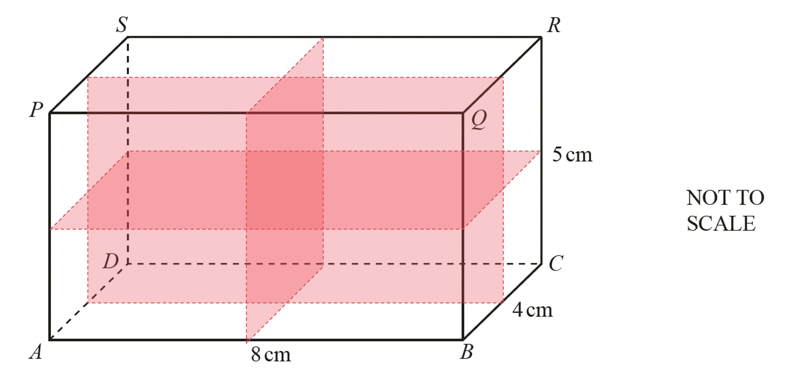
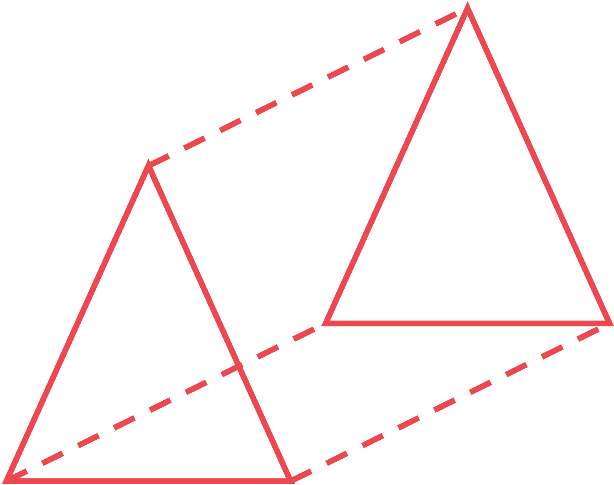
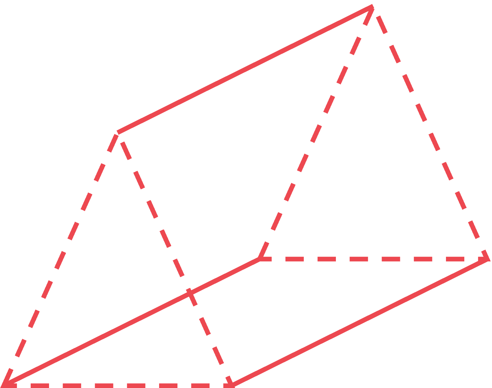
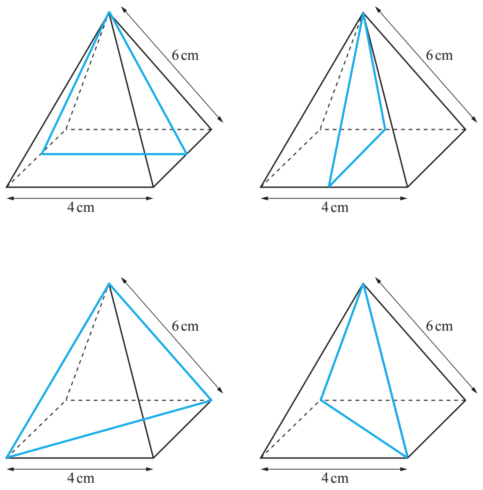
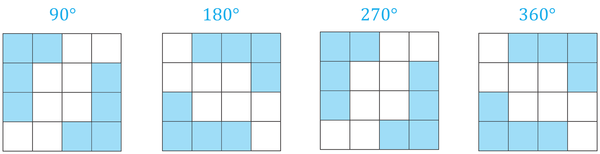
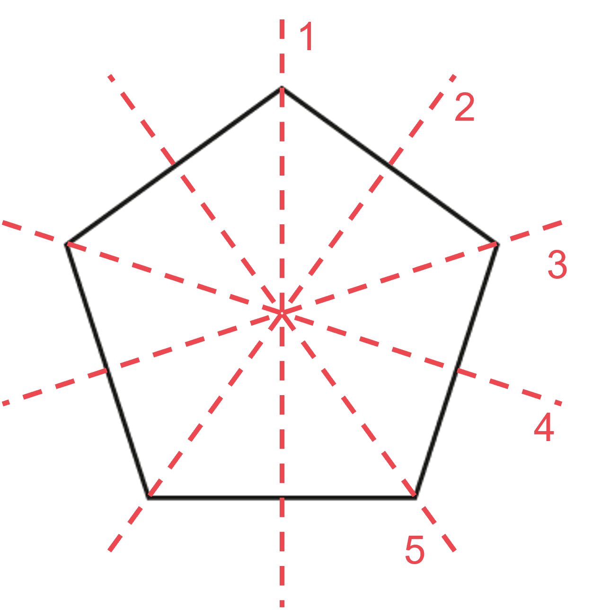
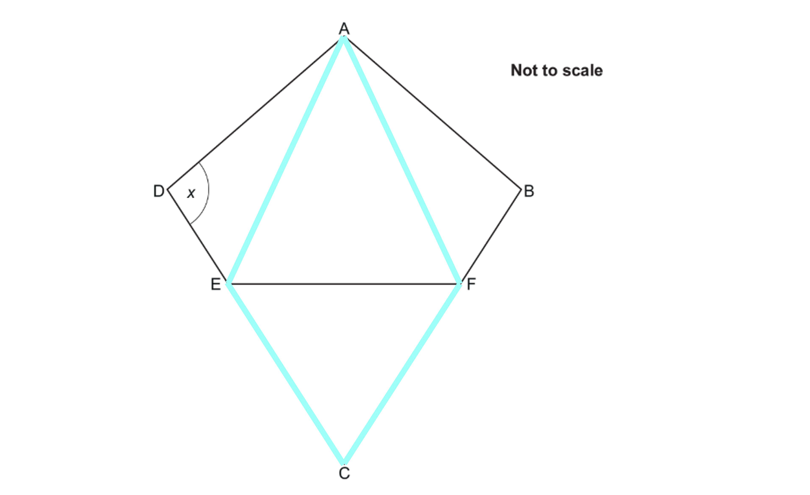
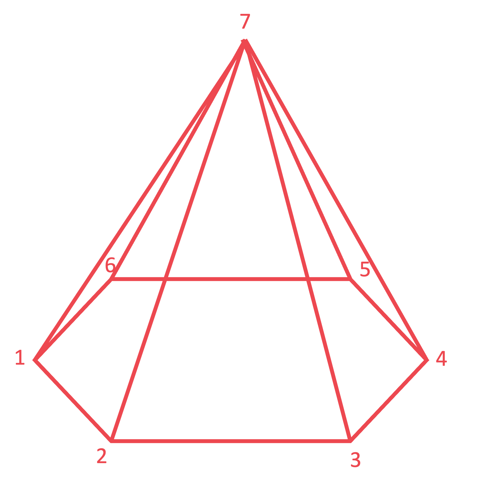

# Mark Schemes — Symmetry & Shapes
**Geometry** · Cambridge (CIE) IGCSE maths (0607)

## Exam Questions (13 questions)

### Q1
> *A kite has 1 line of symmetry, from the top vertex to the bottom*

**1 ****[1]**

### Q2
> *A quadrilateral has 4 sides so consider the shapes with 4 sides*

> *A rectangle and a rhombus have exactly 2 lines of symmetry*
*A rectangle and a rhombus have rotational symmetry of order 2*

**Rectangle or rhombus**** [1]**
**Only 1 needed for mark**

### Q3
> *None of the sides are square, so there are only 3 planes of symmetry, which are shown below.*

**3** **[1]**

### Q4
> *The sides of the cross-section become edges at both ends of the prism.*

> *For example, consider a triangle-based prism (**n **= 3):*

> *So far we have 2**n, **shown by the solid lines.*

> *Now consider the edges joining the cross-sectional faces:*

> *We have another **n** edges, again shown by the solid lines.*

*2***n*** + ***n*** = 3***n**

**The second option is correct, **$3n$** ****[1]**

### Q5
*A plane of symmetry is where a shape can be "sliced" such that it is symmetrical*

> *For a square-based pyramid, it can be sliced in 4 different ways; along each diagonal, and through the middle of each triangular face (as the triangles are isosceles)*

**4 ****[1]**

### Q6
> *Imagine rotating the shape 360° about its centre. Count how many times the shape looks identical to its starting position.*

*Ignoring the shading, the shape only looks the same at 90°, 180°, 270° and 360°.* *The shading is the same as the original at 180° and 360°.*

**Order of rational symmetry is 2** **[1]**

### Q7
> *Count the edges. *
*There are 12 edges, which are equal in length*

> *Some multiples of 18 are divisible by 12; for example, 36, 72, 108, ... . In these cases, **x** would be a whole number. *

> *And some multiples of 18 are not divisible by 12; 18, 54, 90, ... . In these cases, **x** would not be a whole number.*

**The third option is correct,**** **$x$** ****might be a whole number**** ****[1]**

### Q8
> *"The quadrilateral is a rectangle". This is only true if the interior angles are right-angles. We don't know if they are or not, so this **may be true**.*

> *"The quadrilateral is a parallelogram". This is **true** not matter what the interior angles are, as opposite sides are equal.*

> *"The quadrilateral is a rhombus". This can only be true if the sides are all the same length. We know that two sides are twice the length of the other two, so it is **not true**.*

> *"The quadrilateral is a kite". This can only be true if the equal length sides are adjacent to each other. But here the equal length sides are opposite each other. So this statement is **not true**.*

|   | **True** | **May be true** | **Not true** |
|---|---|---|---|
| The quadrilateral is a rectangle |   | **Final answer:** **✓** |   |
| The quadrilateral is a parallelogram | **Final answer:** **✓** |   |   |
| The quadrilateral is a rhombus |   |   | **Final answer:** **✓** |
| The quadrilateral is a kite |   |   | **Final answer:** **✓** |

**one or two correct*** ***[1]**
**three correct*** ***[1]** 
**all correct**** ****[1]**

### Q9
> *Draw on lines of symmetry to check how many times you could cut the pentagon exactly in half*

**The regular pentagon has 5 lines of symmetry** **[1]**
> *Imagine rotating the kite 360° (one full turn) about its centre Count how many times the kite looks identical to its starting position*

**The kite has rational symmetry of order 1** **[1]**

### Q10
> *Note that a rectangle has two pairs of parallel sides*

A quadrilateral with only one pair of parallel sides is called a **trapezium**.  **[1]**
> *Note that angles smaller than 90° are called acute, and angles larger than 180° are called reflex*

An angle greater than 90° but less than 180° is called **obtuse**. **[1]**

### Q11

> *As triangles AFE and CEF are both equilateral (stated in the question), and they both share the side EF, this means that all the highlighted lengths must be the same length*

**AFCE is a ****rhombus** **[1]**

**A rhombus is a parallelogram with all sides the same length** 
**The mark scheme also accepts kite, parallelogram, or trapezium, as a rhombus is a special case of these shapes**

### Q12
> *i) The line A touches the circle at a single point*

**Line A is a ****tangent ****[1]**

> *ii) Shaded region B is formed by a line joining two points on the circumference, which does not pass through the centre; a chord*

**Shaded region B is a ****segment** **[1]**

### Q13
> *Vertices are the "corners". A hexagonal pyramid has 6 vertices at the base and one vertex at its tip. 6 + 1 = 7*

> *If unsure, sketch the shape:*

**The second option is correct, hexagon-based pyramid*** ***[1]**

*A hexagonal prism has two lots of six vertices, six at either end. 6 + 6 = 12*

*A pentagonal prism has two lots of five vertices, five at either end. 5 + 5 = 10*

> *A pentagon-based pyramid has 5 vertices on its base and one at its tip. 5 + 1 = 6*
