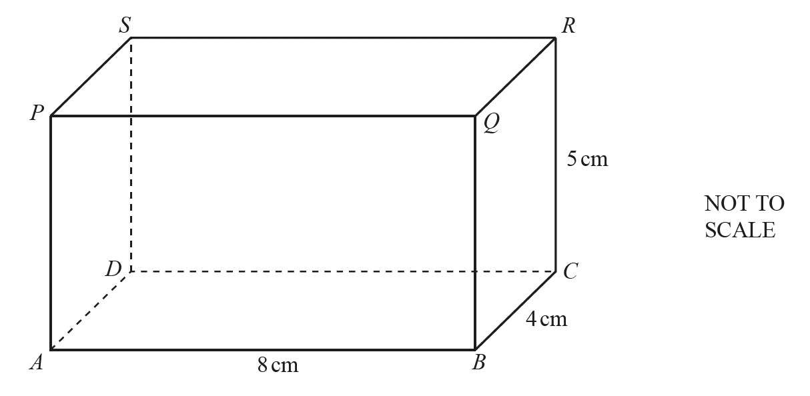
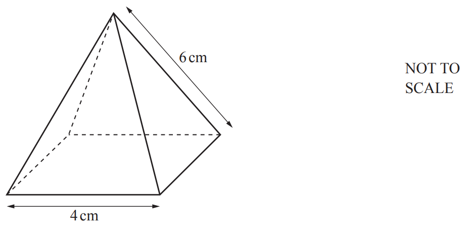
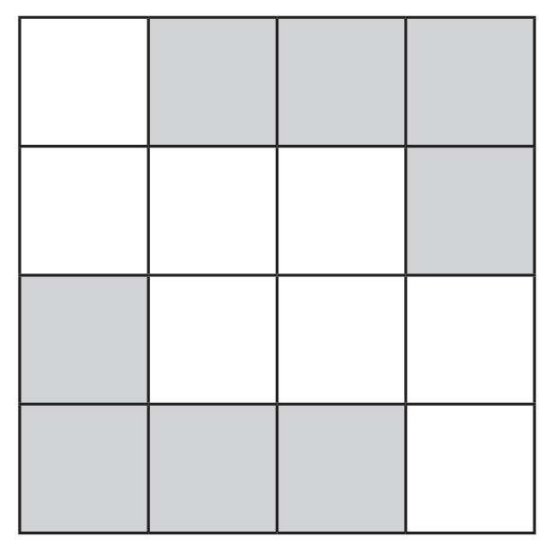
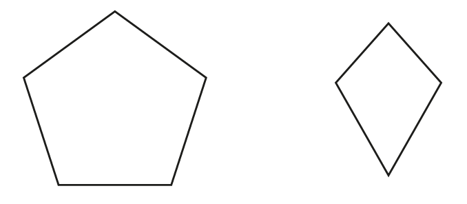
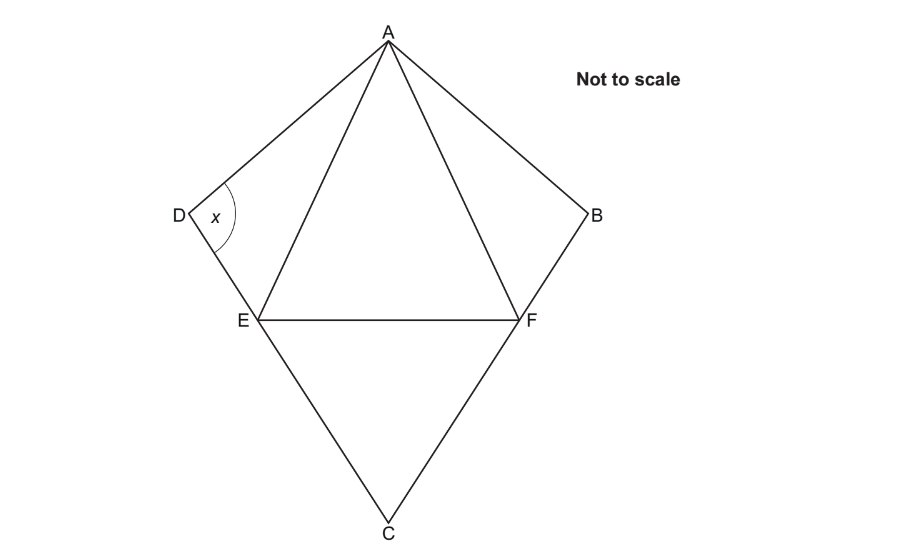
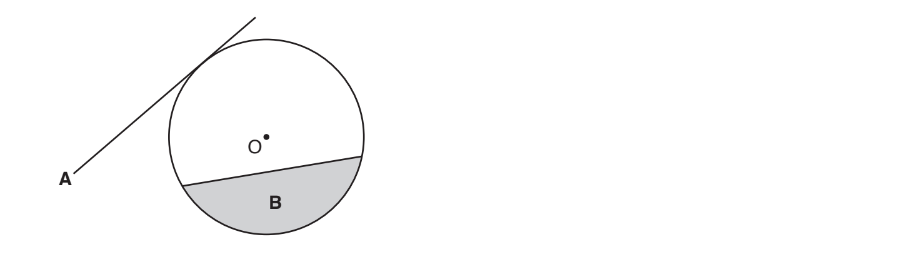

# Exam Questions — Symmetry & Shapes
**Geometry** · Cambridge (CIE) IGCSE maths (0607)
> Source: [https://www.savemyexams.com/igcse/maths/cie/international-maths/23/extended/topic-questions/](https://www.savemyexams.com/igcse/maths/cie/international-maths/23/extended/topic-questions/) · 13 questions across 1 sets

## Exam Questions (13 questions)

### Q1 — easy — 1 marks

**Q1** [1 mark]

Write down the number of lines of symmetry of a kite.

*Source: November 2023 0607/23 Q2*

### Q2 — easy — 1 marks

**Q2** [1 mark]

A quadrilateral has

- exactly 2 lines of symmetry

and

- rotational symmetry of order 2.

Write down the mathematical name of the quadrilateral.

*Source: 2025 Specimen 2 Q3*

### Q3 — hard — 1 marks

**Q3** [1 mark]

The diagram shows a cuboid. 
$AB$ = 8 cm, $BC$ = 4 cm and $CR$ = 5 cm.

Write down the number of planes of symmetry of this cuboid.

*Source: 2018	May/June 0580/43 Q6B*

### Q4 — hard — 1 marks

**Q4** [1 mark]

The cross section of a prism has $n$ sides.

Circle the expression for the number of edges of the prism.

| $2n$ | $3n$ | $n+2$ | $2n+3$ |
|---|---|---|---|

*Source: Nov 2018 8300/2H Q14*

### Q5 — medium — 1 marks

**Q5** [1 mark]

The diagram shows a pyramid with a square base. 
The triangular faces are congruent isosceles triangles.

Write down the number of planes of symmetry of this pyramid.

*Source: 2019	May/June 0580/23 Q13A*

### Q6 — medium — 1 marks

**Q6** [1 mark]

Write down the order of rotational symmetry of the diagram.

*Source: 2020 May/June 0580/22 Q1*

### Q7 — hard — 1 marks

**Q7** [1 mark]

Here is a cube with edge length $x$cm

One diagonal is shown.

The total length, in centimetres, of the edges of the cube is a multiple of 18

Circle the correct statement.

| $x$ is a whole number | $x$ is not a whole number | $x$ might be a whole number |
|---|---|---|

*Source: Nov 2021 8300/2H Q16B*

### Q8 — medium — 3 marks

**Q8** [3 marks]

Here is a **sketch **of a quadrilateral.

All lengths are in centimetres.

Tick **one **box for each statement.

|   | **True** | **May be true** | **Not true** |
|---|---|---|---|
| The quadrilateral is a rectangle |   |   |   |
| The quadrilateral is a parallelogram |   |   |   |
| The quadrilateral is a rhombus |   |   |   |
| The quadrilateral is a kite |   |   |   |

*Source: Nov 2019 8300/1H Q15*

### Q9 — medium — 2 marks

**Q9** [1 mark]

The diagram shows a regular pentagon and a kite.
Complete the following statements.

The regular pentagon has ................................... lines of symmetry.

*Source: 2018	Feb/Mar 0580/22 Q5A*

**Q9** [1 mark]

The kite has rotational symmetry of order ................................... .

*Source: 2018	Feb/Mar 0580/22 Q5B*

### Q10 — easy — 2 marks

**Q10** [1 mark]

Complete each statement.

A quadrilateral with only one pair of parallel sides is called a ............................................... .

*Source: 2019	May/June 0580/22 Q4A*

**Q10** [1 mark]

An angle greater than 90° but less than 180° is called ............................................... .

*Source: 2019	May/June 0580/22 Q4B*

### Q11 — easy — 1 marks

**Q11** [1 mark]

The diagram shows a kite, ABCD.

AFE and CEF are equilateral triangles.

Write down a mathematical name for quadrilateral AFCE.

*Source: Nov 2019 J560/05 Q8A*

### Q12 — easy — 2 marks

**Q12** [2 marks]

The diagram shows a circle, centre O.

Write down the mathematical name of

i) line **A**,

[1]

ii) shaded region **B**.

[1]

*Source: Nov 2017 J560/05 Q1A AND B*

### Q13 — easy — 1 marks

**Q13** [1 mark]

Circle the solid that has 7 vertices.

| hexagonal prism | hexagon-based pyramid | pentagonal prism | pentagon-based pyramid |
|---|---|---|---|

*Source: Nov 2021 8300/1H Q3*

