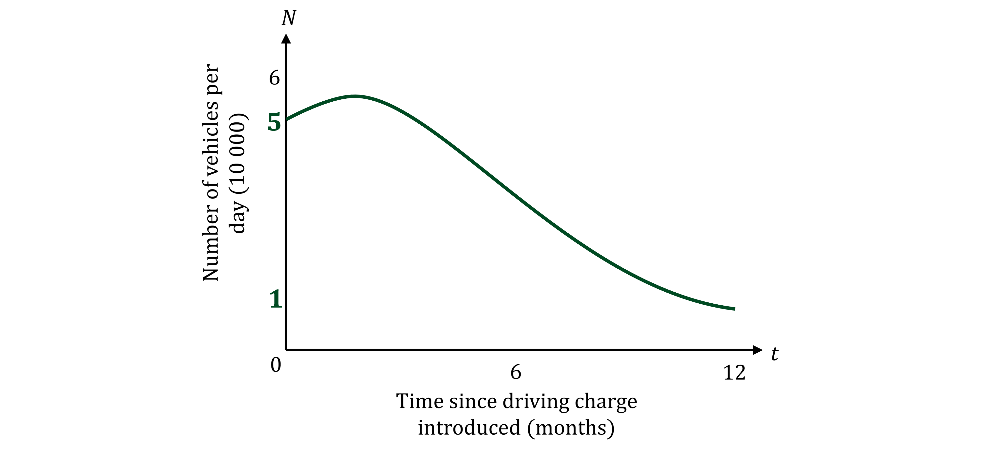

# Mark Schemes — Modelling
**Investigations & Modelling** · Cambridge (CIE) IGCSE maths (0607)

## Modelling: Road Traffic (4 questions)

### Q1
> *Find the length of one full lap of the ring road by finding the circumference of the ring road*

> *The circumference of a circle is found using the formula *$C=2πr$*, for a radius *$r$

> *Substitute *$r=8$* into the formula*

$C=2\timesπ\times8$

**[1]**

> *Find the length of the ring road*

$16π=50.265482...\mathrm{km}$

> *An average vehicle emits 0.1 kg of carbon dioxide for every 1 km travelled*

> *Find the carbon dioxide emission of one lap by multiplying the road length by 0.1*

** **$16 \mathrm{\pi } \times 0.1 = 5.02654 = 5.03 \text{kg} ( 3 \mathrm{s} . \mathrm{f} )$**[1]**
> *Find the assumed carbon emitted per day per vehicle, *$d$* kg, by dividing your answer from (a) by 2*

$d=\frac{5.03}{2}\mathrm{kg}$

> $N$* is measured in tens of thousands per day, so *$10000N$* is the total number of vehicles per day*

> *Find the assumed carbon dioxide emitted per day by *$10000N$* vehicles, by multiplying *$d$* by *$10000N$

$\begin{gathered} c = \frac{5.03}{2} \times 10 000 N \text{kg} \\ = 25150 N \text{kg} \end{gathered}$

**Either half answer from (a) or multiplying by **$10000N$**seen [1]**

> *Round the answer to 2 significant figures*

** **$k = 25000 ( 2 \mathrm{s} . \mathrm{f} . )$ **[1]**
> *Start with the cubic model *$N = \frac{1}{108} ( t^{3} - 21 t^{2} + 72 t + 540 )$

> *Substitute this into the model for *$c$* in terms of *$N$* found in part (b)*

$\begin{gathered} c = 25000 N \\ = 25000 ( \frac{1}{108} ( t^{3} - 21 t^{2} + 72 t + 540 ) ) \end{gathered}$

> *This form is a correct answer, but can be simplified*

$\begin{gathered} c = \frac{25000}{108} ( t^{3} - 21 t^{2} + 72 t + 540 ) \end{gathered}$

$c = \frac{6250}{27} ( t^{3} - 21 t^{2} + 72 t + 540 )$** [1]**
**Any equivalent form accepted**

### Q2
> *Open the graphing software on your calculator and plot the graph of *$\mathrm{f} ( x ) = \frac{1}{108} ( x^{3} - 21 x^{2} + 72 x + 540 )$

> *Navigate to the points of intersection of the graph with the axes and other important points *

> *Plot these points on the diagram given and then join up with a smooth curve*

- *The *$y$*-intercept is *$( 0 , 5 )$
- *The graph does not intercept the *$x$*-axis between *$x=0$* and *$x=12$
- *There is a maximum point at *$( 2 , 5.629... )$
- *There is a minimum point at *$( 12 , 1 )$

**Correct cubic shape of graph [1]**
**Graph in correct position with numbers from at least one point indicated [1]**
> *Navigate to the maximum point on the graph on your calculator*

> *The *$x$*-coordinate should be 2, the *$y$*-coordinate gives the value you need*

$( 2 , 5.6296... )$

> *Remember that the value of *$N$* is measured in tens of thousands, so multiply your answer by *$10000$

$5.62963...\times10000=56296.3....$

> *Round your answer to the nearest hundred*

** 56 300** **[1]**
> *The maximum number of vehicles per day predicted by the cubic model is 56 300*

> *The maximum number of vehicles per day predicted by the quadratic model is 53 300*

*56 300 > 53 300 *

**Final answer:** **The cubic model predicts a higher maximum number of vehicles per day**

**[1]**
> *The graph of the cubic model has a minimum point at *$( 12 , 1 )$

*The value of *$N$* at 12 months is *$10000$

**[1]**

**Final answer:** **Yes, it will have been a success as the final value is **$N=1$** at **$t=12$**, i.e. 10 000 vehicles per day, which is less than 11 000 vehicles per day**

**[1]**
> *Using your calculator's graphing software, plot both graphs on the same set of axes*

> *Navigate to the points of intersection of the two graphs*

> *It may help to change the *$x$*-axis to *$0\leqx\leq12$* and the *$y$*-axis to *$0\leqy\leq6$

** **$( 0 , 5 )$** [1]**
$( 6 , 4 )$** ****[1]**

### Q3
> *Method 1: Using GDC*

> *Open the graphing software on your calculator and plot the graph of *$\mathrm{f} ( x ) = - \frac{1}{12} ( x + 6 ) ( x - 10 )$

> *Navigate to the points of intersection of the graph with the axes (you can ignore the negative *$x$*-intercept)*

> *The *$y$*-intercept is *$( 0 , 5 )$

$p=5$ **[1]**

> *The positive *$x$*-intercept is *$( 10 , 0 )$

$q=10$ **[1]**

> *Method 2*

> *The equation is given in factorised form, so each factor can be used to find a zero of the graph*

> *Setting the first factor to zero and solving gives:*

$\begin{gathered} ( t + 6 ) & = 0 \\ t = - 6 \end{gathered}$

> *Setting the second factor to zero and solving gives:*

$\begin{gathered} ( t - 10 ) & = 0 \\ t = 10 \end{gathered}$

> *The negative *$x$*-intercept can be ignored*

$q=10$ **[1]**

> *The *$y$*-intercept will be the constant term of the expanded equation*

> *This can be found by multiplying the two constant terms with *$-\frac{1}{12}$* (or by substituting in *$t=0$*)*

$-\frac{1}{12}\times6\times-10=-\frac{1}{12}\times-60$

$p=5$ **[1]**
> $p$* is the *$N$*-intercept, at the point where *$t=0$

**Final answer:** $p$** is the initial number of vehicles per day (in tens of thousands) when the driving charge was introduced**

**[1]**
> *Method 1: Using GDC*

> *Open the graphing software on your calculator and plot the graph of *$\mathrm{f} ( x ) = - \frac{1}{12} ( x + 6 ) ( x - 10 )$

> *Navigate to the maximum point on the graph (at the turning point)*

> *The *$x$*-coordinate should be 2, the *$y$*-coordinate gives the value you need*

$( 2 , \frac{16}{3} )$

**[1]**

> *Remember that the value of *$N$* is measured in tens of thousands, so multiply your answer by *$10000$

$\frac{16}{3}\times10000=53333.333....$

> *Round your answer to the nearest hundred*

** 53 300** **[1]**

> *Method 2*

> *Two months after the ring road was introduced will be at the point when *$t=2$

> *Substitute *$t=2$* into the equation of the negative quadratic model*

$N = - \frac{1}{12} ( 2 + 6 ) ( 2 - 10 )$

**[1]**

> *Use your calculator to find the answer*

$N=-\frac{1}{12}\times8\times-8=\frac{16}{3}$

> *Remember that the value of *$N$* is measured in tens of thousands, so multiply your answer by *$10000$

$\frac{16}{3}\times10000=53333.333....$

> *Round your answer to the nearest hundred*

** 53 300** **[1]**
> *Method 1: Using GDC*

> *On the same graph on your calculator plot the graph of *$\mathrm{f} ( x ) = 5$

> *Navigate to the points of intersection of the two graphs, the first should be at the *$y$*-intercept*

> *Read off the coordinates of the second point of intersection, the *$y$*-coordinate should be *$5$

$( 4 , 5 )$

> *The *$x$* value is the coordinate you need*

** 4 months** **[1]**

> *Method 2*

> *Use the symmetry of the quadratic graph*

> *The time for the graph to return to *$N=5$* will be double the time to reach the maximum point at *$t=2$

$2\times2$

** 4 months** **[1]**
> *At the point where *$t=10$* the graph intersects the *$x$*-axis so the values of *$N$* after *$t=10$* will become negative*

> *It is impossible to have a negative number of cars driving on the ring road*

**Final answer:** **The predicted values of **$N$**  become negative after **$t=10$** which is unrealistic**

**[1]**

### Q4
> *The line of best fit is given in the form of the equation of a straight line, *$y=mx+c$*, where *$m=b$* is the gradient, *$c=a$* is the *$y$*-intercept, *$x=t$* and *$y=N$

> *The *$y$*-intercept is the coordinate *$( 0 , 6 )$

$a=6$** ****[1]**

> *Use the coordinates *$( 0 , 6 )$* and *$( 10 , 2 )$* to find the gradient of the line of best fit*

$b=\frac{6-2}{0-10}=\frac{4}{-10}$

**[1]**

> *Simplify*

$b=-\frac{2}{5}$** ****[1]**
> *Substitute *$a=6$* and *$b=-\frac{2}{5}$* into the equation given for the line of best fit*

$N=6-\frac{2}{5}t$

> *Seven months after the ring road was introduced will be at the point when *$t=7$

> *Substitute *$t=7$* into the equation*

$N = 6 - \frac{2}{5} \times ( 7 )$

**[1]**

> *Use your calculator to find the answer*

$N=6-\frac{14}{5}=3.2$

> *Remember that the value of *$N$* is measured in tens of thousands, so multiply your answer by *$10000$

$3.2\times10000$

** 32 000** **[1]**
> *It is given that the mayor is implementing the driving change for one year*

**Final answer:** **No, because the driving charge is only in place for a year, meaning driving numbers may go back up after 12 months **

**[1]**
