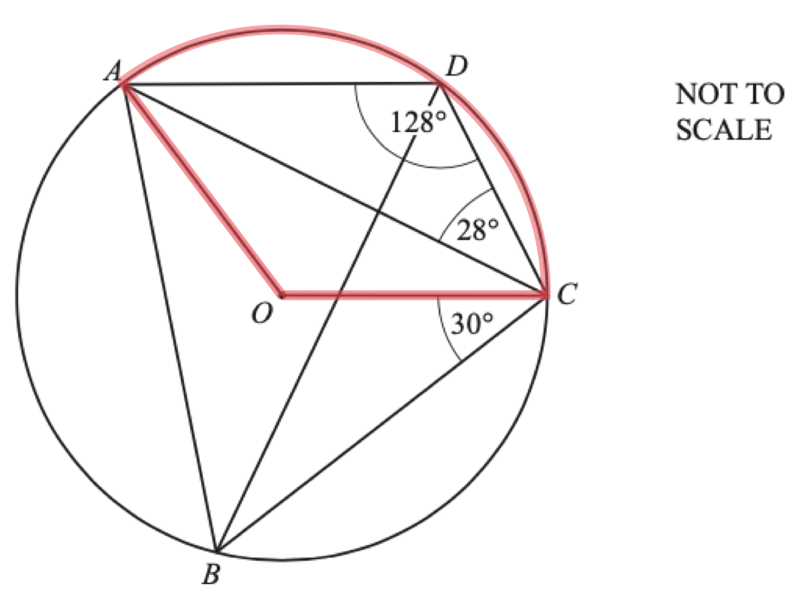
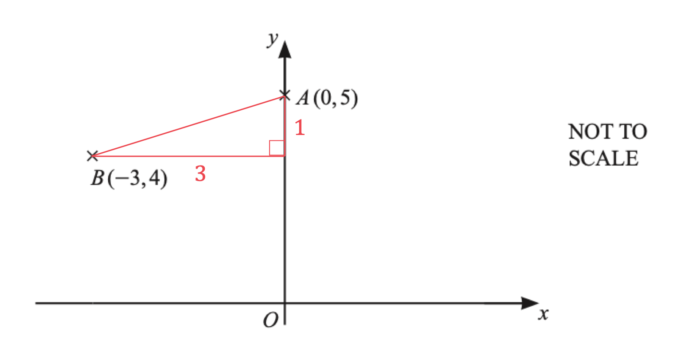
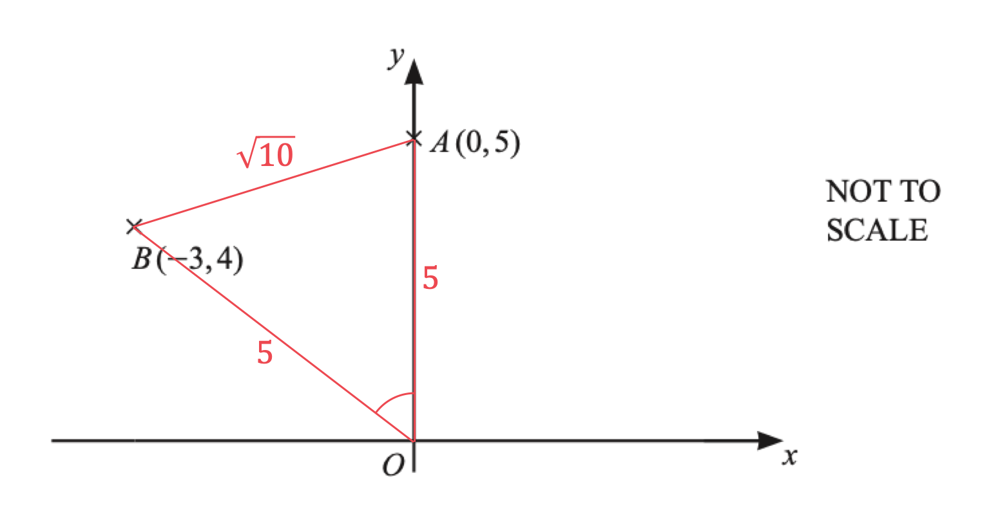
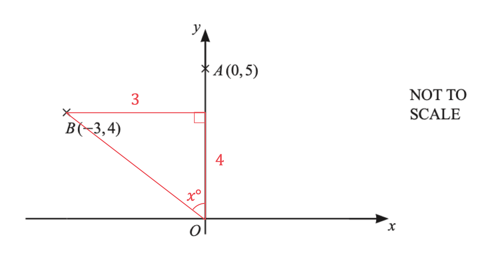

# Mark Schemes — Circles, Arcs & Sectors
**Lengths, Areas & Volumes** · Cambridge (CIE) IGCSE maths (0607)

## Calculator Questions (31 questions)

### Q1

> *Find the arc length of the larger sector using *$\frac{θ}{360}\times2πr$

> *The larger sector has radius 5.5 cm*

$\frac{45}{360} \times 2 \pi ( 5.5 )$

**[M1]**

$=\frac{11}{8}π=4.31968989...$

**[A1]**

> *Find the arc length of the smaller sector; this sector has radius 5.5-2.5=3 cm*

$\frac{45}{360} \times 2 \pi ( 3 )$

$=\frac{3}{4}π=2.3561944...$

> *Find the perimeter of the shaded part by adding together the two arc lengths, plus the two straight edges (each is 2.5 cm)*

$\frac{11}{8}π+\frac{3}{4}π+2.5+2.5$

**[M1]**

$=\frac{17}{8}π+5\,=11.6758843...$

> *Round to 3 significant figures*

**Final answer:** **11.7 cm**

**[A1]**

> **[mark-scheme]**
> **M1**: Using $\frac{θ}{360}\times2πr$ or equivalent to find an arc length.
> 
> **A1**: Accurate answer for either the smaller or the larger arc length.
> 
> **M1**: Finding the total perimeter by summing the found values for the arc lengths and the two straight sides.
> 
> **A1**: Correct final answer.

### Q2
> *Area of a circle is *$πr^{2}$* *
*Use the *$π$* button on your calculator or "3.142"*

$π\times5.1^{2}=81.7128...$* *

**[1]**

**81.7 cm****2**** ****[1]**

### Q3
> *Triangles **AOD **and **COD** are congruent, right-angled triangles. The angle between a tangent and a radius is always 90**o**.*

> *Use SOHCAHTOA to calculate the angle **AOD.*
*You know the adjacent and the hypotenuse, so use *$\mathrm{cos}θ=\frac{Adj}{Hyp}$*.*

*Recognition that AOD is a right angle*** [1]**

$\begin{gathered} \cos \\theta & = \frac{5}{9} \end{gathered}$

**[1]**

$\begin{gathered} \\theta = \cos ^{- 1} ( \frac{5}{9} ) \end{gathered}$

**[1]**

$\begin{gathered} \\theta = 56.251011...^{\circ} \end{gathered}$

> *Find the reflex angle **AOC**, by subtracting two lots of *$θ$* from 360**o**, because angles around a point add up to 360**o**.*

$\begin{gathered} \text{Reflex} \text{Angle} A O C & = 360 - 2 \times 56.251011... \\ = 247.497977...^{\circ} \end{gathered}$

> *Work out the arc length of sector **AOC**, using the formula for the arc length of a sector: *$\mathrm{Arc} \mathrm{length}=\frac{θ^{\circ}}{360^{\circ}}\times2πr$*, where *$r$* is the radius and *$θ$* is the angle of the sector.*

$\mathrm{Arc} \mathrm{length}=\frac{247.497977...}{360}\times2\timesπ\times5$

**[1]**

$\mathrm{Arc} \mathrm{length}=21.598272...$

> *Round to 3 significant figures.*

$21.6\mathrm{cm}$* ***[1]**

### Q4
> *Identify the sector **OACD.*
*Recognise that it is the sector that goes through the four specified points that is asked for, not the quadrilateral.*

> *Calculate the arc length of the sector using the formula, Arc length = *$\frac{θ}{360}\times2πr$*. *
*Angle **AOC** (obtuse) = 104**o**.*

*Arc length =** *$\frac{104}{360}\times2\timesπ\times9.6$* *

**[1]**

*Arc length = *$17.42536...$

> *Add the arc length to two lots of the radius (**AO** and **OC**) to fid the perimeter of the sector.*

*Perimeter of sector = *$17.42536...+2\times9.6$

**[1]**

*Perimeter of sector =** *$=36.62536...$

**36.6 cm**** [1] **
**Answers between 36.63 and 36.63 will be accepted.**

### Q5
> *The formula for the length of an arc is *$l=\frac{θ}{360}\times2πr,$* where **θ** is the angle of the sector and **r **is the radius.*

> *Substitute the known values in to form an equation.*

$6.4=\frac{θ}{360}\times2\timesπ\times8\,6.4=\frac{θ}{360}\times16π$

**[1]**

> *Find **θ **by dividing both sides by 16π and then multiplying both sides by 360.*

$θ=\frac{6.4}{16π}\times360$

**[1]**

> *The formula for the area of a sector is *$A=\frac{θ}{360}\timesπr^{2}.$* Substitute the values in. Using the exact value for **θ **will help as factors will cancel out.*

$\frac{\frac{6.4}{16π}\times360}{360}\timesπ\times8^{2}$

**[1]**

> *Cancel out the 360 from the numerator and denominator of the fraction.*

$\frac{\frac{6.4}{16 \mathrm{\pi } } \times \cancel{360} }{ \cancel{360} } \times \mathrm{\pi } \times 8^{2} = \frac{6.4}{16 \mathrm{\pi } } \times \mathrm{\pi } \times 8^{2}$

> *Cancel out the π.*

`(6.4)/(16 / pi) x / pi x 8 ^2 = (6.4)/(16) x 8 ^2`

> *Work out the value of the expression using your calculator.*

**25.6 cm****2** **[1] **
**Answers between 25.59 and 25.60 are accepted**

### Q6
> *OB **is at right-angles to **AC** (a tangent meets a radius at right-angles) so SOHCAHTOA can be used in the two right-angled triangles **AOB** and **BOC*

**[1]**

*Find angle **AOB** (using the tan ratio)* * *

$\mathrm{tan}(AOB)=\frac{15}{8}$

**[1]**

$A O B = \tan ^{- 1} ( \frac{15}{8} ) = 61.92...^{\circ}$ * *

*Find angle** BOC** (using the tan ratio)* * *

$\tan ( B O C ) = \frac{22.4}{8}$

**[1]**

$B O C = \tan ^{- 1} ( \frac{22.4}{8} ) = 70.34...^{\circ}$ * *

*Find angle **XOY** by adding angle **AOB** to angle** BOC**  *

$61.92...^{\circ}+70.34...^{\circ}$

*At least one correct*** [1]**

** **$132.3^{\circ}$ **[1]**

**The range 132.26 to 132.28 is also accepted**
*The curved length of a sector (an "arc") with angle *$k^{\circ}$* is *$\frac{k}{360}\times2πr$ *Substitute *$k=132.3^{\circ}$* from part (a) and *$r=8$* (from **OB **being a radius) into the formula*

$\frac{132.3}{360}\times2\timesπ\times8$

**[1]**

**Arc ****XBY**** = 18.5 cm** **[1]** **The following are accepted (based on previous rounding): 18.4, 18.5, or between 18.43 and 18.48**
*The two shaded regions are formed by removing the sector **OYBX  **from the triangle **AOC* *Find the area of triangle **AOC **(using *$\frac{1}{2}\times$*base*$\times$*height)* * *

$1 \frac{1}{2} \times ( 15 + 22.4 ) \times 8$

**[1]**

*The area of a sector with angle *$k^{\circ}$* is *$\frac{k}{360}\timesπr^{2}$ *Find the area of sector **OYBX** by substituting *$k=132.3^{\circ}$* from part (a) and *$r=8$* (from **OB **being a radius) into the formula* * *

$\frac{132.3}{360}\timesπ\times8^{2}$

**[2]**

*Subtract the area of sector **OYBX **from the area of triangle** AOC**  *

$1 \frac{1}{2} \times ( 15 + 22.4 ) \times 8 - \frac{132.3}{360} \times \mathrm{\pi } \times 8^{2}$

** 75.7 cm** **[1]** **Answers between 75.7 and 75.9 are accepted**

### Q7
> *The perimeter is the total length around the outside of the shape.*

> *You'll need the length of the arc **AB**. *

> *To help find the angle of the sector, first find the acute angle **DOE**. *

> *Triangle **ODE** is right-angled and we have the hypotenuse (**DO** = 0.5) and the adjacent side (**OE** = 0.25). So we can use *$\text{cos} ( D O E ) = \frac{Adjacent}{Hypotenuse}.$

$\cos ( D O E ) = \frac{0.25}{0.5} = 1 \frac{1}{2}$

**[1]**

> *Use inverse cos on your calculator to find the size of the angle.*

$D O E = \cos ^{- 1} ( 1 \frac{1}{2} ) = 60$

> *Subtract angle **DOE** from 270° to get the size of the angle of the sector.*

$θ=270-60=210$

**[1]**

> *Find the arc length using the formula *$l=\frac{θ}{360}\times2πr$*. Leave your answer in terms of π.*

$l=\frac{210}{360}\times2π\times0.5\,l=\frac{7}{12}π$

**[1]**

*The perimeter is formed by 5 sides: **OC**, **CB**, **BA**, **AD**, **DO**.* *OC** = **BA** = 1.5 cm.* *CB** = **OA** = 0.5 cm.* *DO** is the radius so is also 0.5 cm.*

> *Add together the lengths.*

$\begin{gathered} 1.5 + 0.5 + 1.5 + \frac{7}{12} \mathrm{\pi } + 0.5 \\ = 4 + \frac{7}{12} \mathrm{\pi } \\ = 5.8325... \end{gathered}$

**[1]**

> *Round to 3 significant figures.*

**5.83 cm*** ***[1]**
> *The area is made up two shapes: a rectangle and a sector.*

> *Find the area of the rectangular using the formula *$A=bh.$

$0.5\times1.5=0.75$

> *Find the area of the sector using the formula *$A=\frac{θ}{360}\timesπr^{2}.$* Leave your answer in terms of π.*

$\frac{210}{360}\timesπ\times0.5^{2}=\frac{7}{48}π$

**[1]**

> *Add the two areas together.*

$0.75+\frac{7}{48}π=1.2081...$

**[1]**

> *Round to 3 significant figures.*

**1.21 cm****2** **[1]**

### Q8
> *Calculate the area of the quarter circle, by using the formula for the area of a circle: *$A=πr^{2}$*, where *$r$* radius of the circle, and multiplying the result by *$\frac{1}{4}$*.*

$\begin{gathered} A_{q u a r t e r c i r c l e} & = 1 \frac{1}{4} \times \mathrm{\pi } \times 4.8^{2} \end{gathered}$

**[1]**

$\begin{gathered} A_{q u a r t e r c i r c l e} & = 5.76 \mathrm{\pi } cm^{2} \end{gathered}$

> *Calculate the area of the triangle, using the formula: *$A=\frac{1}{2}bh$*, where *$b$* is the base of the triangle and *$h$* is the perpendicular height.*

$\begin{gathered} A_{t r i a n g l e} & = 1 \frac{1}{2} \times 4.8 \times 4.8 \\ = 11.52 cm^{2} \end{gathered}$

> *Calculate the shaded segment by subtracting the area of the triangle from the area of the quarter circle.*

$\begin{gathered} A_{s h a d e d} & = 5.76 \mathrm{\pi } - 11.52 \end{gathered}$

**[1]**

$\begin{gathered} A_{s h a d e d} & = 6.57557... cm^{2} \end{gathered}$

> *Round to 3 significant figures.*

$6.58\mathrm{cm}^{2}$* ***[1]**

### Q9
> *Calculate the arc length of the large sector **OAB**, by using the formula for the arc length of a sector: *$\mathrm{Arc} \mathrm{length}=\frac{θ^{\circ}}{360^{\circ}}\times2πr$*, where *$r$* radius of the circle and *$θ$* is the angle of the sector.*

$\begin{gathered} \text{Arc} length_{l a r g e s e c t o r} & = \frac{75}{360} \times 2 \times \mathrm{\pi } \times 10 \end{gathered}$

**[1]**

$\begin{gathered} \text{Arc} length_{l a r g e s e c t o r} & = \frac{25}{6} \mathrm{\pi } \text{cm} \end{gathered}$

> *Calculate the arc length of the smaller sector **OCD**. *

$\begin{gathered} \text{Arc} length_{s m a l l s e c t o r} & = \frac{75}{360} \times 2 \times \mathrm{\pi } \times 6 \\ = \frac{5}{2} \mathrm{\pi } \text{cm} \end{gathered}$

> *Calculate the perimeter of the shaded segment by adding the arc lengths together along with the lengths of the straight edges joining them. *

$\begin{gathered} P = \frac{25}{6} \mathrm{\pi } + \frac{5}{2} \mathrm{\pi } + 4 + 4 \end{gathered}$

**[1]**

$\begin{gathered} P = 28.943951... \text{cm} \end{gathered}$

> *Round to 3 significant figures.*

$28.9\mathrm{cm}$* ***[1]**

### Q10
> *Calculate the area of the semi-circle using the formula *$A=\frac{1}{2}\mathrm{πr}^{2}$*.*

$\begin{gathered} \text{Area} & = 1 \frac{1}{2} \times \mathrm{\pi } \times 7.2^{2} \\ = 25.92 \mathrm{\pi } \mathrm{m}^{2} \end{gathered}$

**[1]**

> *Work out the number of boxes of seed that Yuen needs by dividing the area of his garden by the area that each box can cover.*

$\begin{gathered} \frac{25.92 \mathrm{\pi } }{6} = 4.32 \mathrm{\pi } = 13.57... \end{gathered}$

**[1]**

*Yuen needs 14 boxes to cover the whole garden*

**13.57 > 12, Yuen does not have enough boxes **
**Correct answer supported by working**** [1]**

### Q11
> *Formula for area of a sector *$=\frac{θ}{360^{\circ}}\timesπr^{2}$*.*

> *Substitute the given values into the formula, letting *$θ=110$* and *$r=7.1$*.*

$\frac{110}{360}\timesπ\times7.1^{2}$

**[1]**

> *Use your calculator to find the answer. *

$\begin{gathered} \frac{11}{36} ( 7.1^{2} ) \pi & = 48.39012... \end{gathered}$

> *Round the answer to 1 decimal place by looking at the second digit, it is greater than 4 so round the first digit after the decimal point up. *

`| _ _ 48. bottom right 3 9 3012... | |`

**Area = 48.4 cm****2 ****(1 d.p.)**** [1]**

### Q12
*The arc length of a sector (the length of the curved side) with radius *$r$* and angle *$θ$*° is *$\frac{θ}{360}\times2πr$*.* 
*Find the size of the reflex angle **AOC** by subtracting 100° from 360°.*

$\mathrm{Reflex} \mathrm{angle}AOC=360-100=260^{\circ}$

> *Find the arc length **ABC** by substituting *$θ=260$* and *$r=4$* into the formula.*

$\frac{260}{360}\times2π\times4=\frac{52}{9}π=18.15142...$

**[1]**

> *Round the answer to 3 significant figures.*

> *The third non-zero digit is 1 and the digit following it is 5, which is 5 or more so you will need to round the 1 up. *

`18. right 1 bottom 5 142... = 18.2 ( 3 s. f. )`

**18.2 cm ****[1]**

### Q13
> *Calculate the space available on one table for seating by finding the circumference of one table, using the formula: *$C=πd$*, where *$d$* is the diameter of the table.*

$\begin{gathered} \text{Total} & = \mathrm{\pi } \times 140 \end{gathered}$

**[1]**

$\begin{gathered} = 439.82297... \text{cm} \end{gathered}$

*Circumference between 439 - 440*** [1]**

> *Divide the space available by the space required for one person to work out how many people can be seated at each table.*

$\begin{array}{rcl} \frac{439.82287...}{60} \\ = 7.33038... \end{array}$

*7 people can be seated at each table*

> *Multiply the number of people that can be seated at each table by the number of tables to find the total number of people that can be seated.*

$\begin{gathered} 12 \times 7 \\ = 84 \end{gathered}$

**[1]**

**84 < 90****, there are ****not enough tables ****in the conference room ****[1]**

### Q14
> *Find the radius, *$r$*, of the large semi-circle by dividing the diameter by 2.*

$\begin{gathered} r = \frac{9}{2} \\ = 4.5 \mathrm{m} \end{gathered}$

> *Calculate the arc length of the larger semi-circle, using the formula for the circumference of a circle: *$C=2πr$*, and multiplying the result by *$\frac{1}{2}$*.*

$\begin{gathered} \text{Arc} \text{length} & = 1 \frac{1}{2} \times 2 \times \mathrm{\pi } \times 4.5 \end{gathered}$

**[1]**

$\begin{gathered} \text{Arc} \text{length} & = 4.5 \mathrm{\pi } \mathrm{m} \end{gathered}$

> *Find the radius of the smaller semi-circle by dividing its diameter by 2.*

$\begin{gathered} r = \frac{5}{2} \\ = 2.5 \mathrm{m} \end{gathered}$

> *Calculate the arc length of the smaller semi-circle.*

$\begin{gathered} \text{Arc} \text{length} & = 1 \frac{1}{2} \times 2 \times \mathrm{\pi } \times 2.5 \\ = 2.5 \mathrm{\pi } \mathrm{m} \end{gathered}$

> *Work out the perimeter of the lawn by adding together the arc length of both semi-circles and the lengths of the straight edges connecting them.*

$\begin{array}{rcl} P = 4.5 \mathrm{\pi } + 2.5 \mathrm{\pi } + 2 + 2 \end{array}$

**[1]**

$\begin{gathered} P = 7 \mathrm{\pi } + 4 \\ = 25.991148... \end{gathered}$

> *Work out the number of rolls that Brian needs by dividing the perimeter of his lawn by the length of edging in 1 roll.*

$\begin{gathered} \frac{25.991148...}{2.4} \\ = 10.8296... \end{gathered}$

**[1]**

*Brian needs 11 rolls*

> *Work out the cost of the 11 rolls that Brian needs.*

*9 rolls at 3 rolls for £10  2 rolls at £3.99 each*

*Total cost = 3 x 10 + 2 x 3.99*

**[1]**

*= £37.98*

> *Compare the cost with the money that Brian has.*

**Final answer:** **£37.98 > £35, Brian does not have enough money**

**Correct answer supported by working**** [1]**

### Q15
> *Formula for area of a sector *$=\frac{θ}{360^{\circ}}\timesπr^{2}$*.*

> *Substitute the given values into the formula, letting *$θ=60$* and *$r=7.5$*.*

$\frac{60}{360}\timesπ\times7.5^{2}$

**[1]**

> *Use your calculator to find the answer. *

$\begin{gathered} \frac{1}{6} ( 56.25 ) \pi & = 9.375 \pi \\ = 29.452... \end{gathered}$

**Area = 29.5 cm****2  ****(3 s.f.)**** [1] **

**For more accurate rounding answers in the range 29.45 to 29.46 are accepted.**

### Q16
> *Form an equation to find the radius of the circle using the formula for length of an arc *$=\frac{θ^{\circ}}{360^{\circ}}\times2πr$*. *
*Find an expression for the length of the arc in terms of *$r$*, **by substituting *$θ=55$*.*

$\frac{55}{360}\times2\timesπ\timesr$

> *Form an equation by setting it equal to 5 cm.*

$\frac{11}{36}πr=5$

**[1]**

> *Solve the equation to find the radius of the circle.*

$\begin{gathered} \frac{11}{36} \pi r & = 5 \\ \pi r & = \frac{5 \times 36}{11} \\ r & = \frac{180}{11 \pi } \\ r & = 5.208707.... \end{gathered}$

> *Find the area of the circle using the formula for the area of a circle, *$A=πr^{2}$*.*

$\mathrm{Area}=π\times5.208707...^{2}$

**[1]**

> *Use your calculator to find the answer, using the answer button to keep accuracy. *

$\begin{gathered} \text{Area} & = 85.233391... cm^{2} \end{gathered}$

> *Round the answer to one decimal place.*

> *The first digit after the decimal point is 2 and the digit following it is 3, which is less than 5 you do not need to round the 2 up. *

`85. right 2 bottom 3 3391... = 85.2 ( 1 d. p. )`

**Area = 85.2 cm****2 ****(1 d.p.)**** [1]**

### Q17
*The area of a full circle is *$A=πr^{2}$*, and a sector is a portion or fraction of a circle* 
*This sector has a radius of 6.2 cm, and an angle of 217° out of 360°, so we can calculate the area as*

$\frac{217}{360}\timesπ\times6.2^{2}$

**[1]**

$=72.79314524...$

$72.8\mathrm{cm}^{2}$ **[1] **

**Round to 3 significant figures**

### Q18
> *Angle at the centre is twice the angle at the circumference subtended by the same arc*

*Angle *$PRQ=24^{\circ}$

**[1]**

> *Angle *$OPR$*= Angle *$PRQ$* because they are alternate angles in parallel lines*

**Angle**** **$OPR=24^{\circ}$** [1]**
> $\mathrm{Arc} \mathrm{length}=\frac{θ}{360}\times2πr$* where *$θ$* is the angle at the centre, and *$r$* is the radius*

> *Note that the question asks for the **major** arc.*

$θ=360-48=312$

**[1]**

$\begin{gathered} \text{Arc} \text{length} & = \frac{312}{360} \times 2 \pi \times 5.4 \end{gathered}$

**[1]**

$\begin{gathered} = 29.40530724... \end{gathered}$

$\mathrm{Arc} \mathrm{length}=29.4\mathrm{cm}$**[1]**
**Round your answer to at least 3 significant figures**

### Q19
*The arc length of a sector (the length of the curved side) with radius *$r$* and angle *$k$*° is *$\frac{k}{360}\times2πr$ 
*Find the curved length by substituting *$k=76$* and *$r=8.5$* into the formula  *

$\frac{76}{360}\times2π\times8.5$

**[1]**

*Find the total perimeter (by adding two 8.5 m sides to the curved length above)*

$2\times8.5+\frac{76}{360}\times2π\times8.5$

**[1]**

**28.3 m**** [1]**
i) *Find the volume of the cone by substituting *$r=10$* and *$h=36$* into the formula* * *

$\frac{1}{3}\timesπ\times10^{2}\times36$

**[1]**

> *Work out the value on your calculator, giving your answer to 3 significant figures*

**3770 cm****3** **[1]**

ii) *Find the volume of the smaller cone by halving the volume of the bigger cone in part (b)(i)* * *

$\frac{1}{2}\times3770=1885$* cm**3*

**[1]**

*Method 1*  
*The ratio of radii (lengths) is 1 : 2 so the ratio of volumes is 1**3** : 2**3*

*Split this volume up into the ratio 1 : 8 (by finding *$\frac{1}{9}$* of it and *$\frac{8}{9}$* of it)* * *

$\frac{1}{9}\times1885:\frac{8}{9}\times1885\,$ * *

*The volume of the smaller sphere is *$\frac{1}{9}\times1885$ 
*Form an equation in *$r$* by setting the sphere volume formula equal to *$\frac{1}{9}\times1885$ * *

$\frac{4}{3}πr^{3}=\frac{1}{9}\times1885$

**[2]**

*Get *$r^{3}$* on its own (by dividing both sides by *$\frac{4}{3}π$*)* * *

$r^{3}=\frac{\frac{1}{9}\times1885}{\frac{4}{3}π}\,$ * *

*Find *$r$* (by cube-rooting both sides)* * *

$r = cbrt( ( 1 / 9 x 1885 )/( 4 / 3 \pi ) )$

**3.68 cm*** ***[1]**

*Method 2* 
*The ratio of radii is 1: 2 so write the smaller sphere radius as *$r$* and the bigger sphere radius as *$2r$ 
*Form an equation in *$r$* (the sum of the volumes of the two spheres equals *$1885$*)* * *

$\frac{4}{3} \mathrm{\pi } r^{3} + \frac{4}{3} \mathrm{\pi } ( 2 r )^{3} = 1885$

**[1]**

*Collect like terms, using *$( 2 r )^{3} = 8 r^{3}$ * *

$\frac{4}{3}πr^{3}+\frac{4}{3}π\times8r^{3}=1885\,\frac{36}{3}πr^{3}=1885\,12πr^{3}=1885$ * *

*Find *$r$* (by dividing both sides by *$12π$* then cube-rooting)*

$r = \sqrt[3]{ \frac{1885}{12 \mathrm{\pi } } }$

**[1]**

**3.68 cm ****[1]**

### Q20
> *Calculate the length **AC** from the right-angled triangle **ACD** using Pythagoras' theorem, *$a^{2}+b^{2}=c^{2}$*.*

$\begin{gathered} 17^{2} & = 15^{2} + A C^{2} \end{gathered}$

**[1]**

$\begin{gathered} 289 = 225 + A C^{2} \\ 64 = A C^{2} \end{gathered}$

**[1]**

$\begin{gathered} A C & = 8 \end{gathered}$

> *The diameter of the semi-circle is therefore 8 cm.*

> *Calculate the arc length of the semi-circle by using the formula for the circumference of a circle, *$C=πd$*, and multiplying it by *$\frac{1}{2}$*.*

> * *$\begin{gathered} A r c l e n g t h & = 1 \frac{1}{2} \times \mathrm{\pi } \times 8 \end{gathered}$

**[1]**

$\begin{gathered} A r c l e n g t h & = 4 \mathrm{\pi } \end{gathered}$

> *Work out the perimeter of the shaded shape by adding together the arc length of the semi-circle and the lengths of the sides **AD** and **CD**.*

$\begin{gathered} P e r i m e t e r & = 4 \mathrm{\pi } + 17 + 15 \end{gathered}$

**[1]**

$\begin{array}{rcl} P e r i m e t e r & = 44.5663... \end{array}$

> *Round to 3 significant figures.*

**44.6 cm**** [1]**

### Q21
> *Use *$\frac{θ}{360}\timesπr^{2}$* to find the angle*

`| theta / 360 x pi x 7 ^2 | = 40 | theta = (40 x 360)/(pi x 7 ^2) | | _ = 93.54... | |`

**correct equation [1]**

**correct angle [1]**

> *Use *$\frac{θ}{360}\times2πr$* to find the arc length*

$\begin{gathered} \frac{93.54...}{360} \times 2 \pi \times 7 & = \frac{80}{7} \\ = 11.42... \end{gathered}$

**[1]**

> *Add the two radii*

$11.42...+7+7=25.42...$

> *Round to 3 significant figures*

**25.4 cm (3sf)** **[1]**

### Q22
> *The perimeter of a semicircle consists of two parts: a straight line and an arc.*

> *Let **r** be the radius of the semicircle.*

> *The straight line is the diameter of the semicircle so is equal to 2**r**.*

> *The arc of a semicircle is half the circumference so halve the expression for the circumference *$C=2πr.$

*Length of the arc =* $\frac{1}{2}\times2πr=πr$

> *Form an expression for the perimeter by adding together the arc length and the length of the diameter.*

*Perimeter = *$πr+2r$

**[1]**

> *Factorise out the **r.*

*Perimeter =* $( \mathrm{\pi } + 2 ) r$

> *Make the expression for the perimeter equal to 19.02.*

$( \mathrm{\pi } + 2 ) r = 19.02$

> *Divide both sides by π+2.*

$r=\frac{19.02}{π+2}=3.6992...$

**[1]**

> *Round to 3 significant figures.*

**3.70 cm** **[1]**

### Q23
> *Find the perimeter of the square by multiplying one side by 4.*

*Perimeter of square = 4 × 8 = 32 cm**2 *

> *Formula for length of an arc *$=\frac{θ^{\circ}}{360^{\circ}}\times2πr$*. *
*Find an expression for the length of the arc in terms of *$x$*, **by substituting *$θ=x$* and *$r=9.5$*.*

$\frac{x}{360}\times2\timesπ\times9.5$

**[1]**

> *Find an expression for the perimeter of the sector in terms of *$x$*, **by adding this to 2 × the radius.*

$( \frac{x}{360} \times 2 \times \pi \times 9.5 ) + 9.5 + 9.5 
= \frac{x}{360} \times 19 \pi + 19$

> *Form an equation by setting this equal to the perimeter of the square. *

$\begin{gathered} \frac{x}{360} \times 19 \pi + 19 & = 32 \end{gathered}$

**[1]**

> *Solve the equation.*

$\begin{gathered} \frac{x}{360} \times 19 \pi & = 32 - 19 \\ \frac{x}{360} \times 19 \pi & = 13 \\ \frac{x}{360} & = \frac{13}{19 \pi } \\ x & = 360 \times \frac{13}{19 \pi } \\ = 78.40415... \\ \end{gathered}$

$x=78.4^{\circ}$** ****(1 d.p.)**** [1] **
**Answers in the range 78.37 to 78.41 accepted.**

### Q24
> *The shape is made up of a rectangle of length 3 m and width 1.2 m, and a circle (which has been separated into two halves) of diameter 1.2 m.*

> *Find the area of the rectangle*

$3\times1.2=3.6m^{2}$

*Find the area of the circle, even though it has been split in half we still need to find the area of one whole circle in total.* 
*The formula for the area of a circle is *$A=πr^{2}$

*Diameter = 1.2 m so radius = 0.6 m* $π\times0.6^{2}=1.130973355...m^{2}$

**[1]**

> *Add the two areas together*

$3.6+1.130973355...=4.730973355...$

**[1]**

$4.73m^{2}$ **[1]** 
**Round to 3 significant figures**

### Q25
> *Method 1:*

> *Calculate the length **AB** using Pythagoras' theorem, *$a^{2}+b^{2}=c^{2}$*.*

$\begin{gathered} A B^{2} & = ( 5 - 4 )^{2} + ( 0 - - 3 )^{2} \\ A B^{2} & = 10 \\ A B & = \sqrt{10} \end{gathered}$

**[1]**

> *Work out the size of angle **AOB **using the cosine rule, *$\mathrm{cos}A=\frac{b^{2}+c^{2}-a^{2}}{2bc}$*.*

$\mathrm{cos}A=\frac{5^{2}+5^{2}-\sqrt{10}^{2}}{2\times5\times5}$

**[1]**

$\mathrm{cos}A=\frac{4}{5}$

> *Take the cos**-1** of both sides.*

$A = \cos ^{- 1} ( \frac{4}{5} )$

$A=36.86989...$

**[1]**

> *Calculate the arc length using the formula, *$\frac{θ}{360}\times2πr$*.*

$r=OA=OB=5$

**[1]**

$\mathrm{Arc} \mathrm{length}=\frac{36.86989...}{360}\times2\timesπ\times5$

**[1]**

**3.22**** [1]**

**Answers between 3.216... and 3.220... will be accepted.**

> *Method 2:*

> *Work out the size of angle **AOB **using *$\mathrm{tan}x=\frac{Opp}{Adj}$* for the right-angled triangle formed by a horizontal line between **B** and the *$y$* axis.*

**[1]**

$\mathrm{tan}A=\frac{3}{4}$

**[1]**

> *Take tan**-1** of both sides.*

$A = \tan ^{- 1} ( \frac{3}{4} )$

$A=36.86989...$

**[1]**

> *Calculate the arc length using the formula, *$\frac{θ}{360}\times2πr$*.*

$r=OA=OB=5$

**[1]**

$\mathrm{Arc} \mathrm{length}=\frac{36.86989...}{360}\times2\timesπ\times5$

**[1]**

$\mathrm{Arc} \mathrm{length}=3.21750...$

**3.22**** [1]**

**Answers between 3.216... and 3.220... will be accepted.**

### Q26
*The perimeter is made up of two radii and one arc.* 
*A radius is 8 cm.*
*To find the length of the arc write the sector angle as a fraction out of 360° and multiply by the circumference of the circle.*
*The formula for the circumference of a circle is *$2πr$*.*

*Arc length** *$=\frac{165}{360}\times2\timesπ\times8=\frac{22}{3}π$

**[1]**

> *Do not round, write in terms of *$π$* and store exact values using your calculator's memory. *
*Now find the total perimeter.*

*Perimeter** *$=\frac{22}{3}π+2\times8=\frac{22}{3}π+16=39.038346...$

**[1]**

**39.0 cm*** ***[1]**

### Q27
> *Work out the size of the angle **QON**.*

*Angle ***QON*** = 60**o**  ** (Triangle ***ABO*** is an equilateral triangle)*

**[1]**

> * Calculate the area of the sector **ONQ**, using the formula: *$A=\frac{θ^{\circ}}{360^{\circ}}\timesπr^{2}$*, where *$r$* is the radius and *$θ$* is the angle of the sector.*

$\begin{gathered} A = \frac{60}{360} \times \mathrm{\pi } \times 11^{2} \end{gathered}$

**[1]**

$\begin{gathered} A = \frac{121}{6} \mathrm{\pi } cm^{2} \end{gathered}$

*Calculate the area of the triangle **ABO**, using the formula:** *$A=\frac{1}{2}ab\mathrm{sin}C$*, where *$a$* and *$b$* are two sides of the triangle and *$C$* is the angle between the two sides.*

$A=\frac{1}{2}\times7\times7\times\mathrm{sin}60$

**[1]**

$A=\frac{49\sqrt{3}}{4}\mathrm{cm}^{2}$

> *Work out the area of the shaded section by subtracting the area of triangle **ABO** from the area of the sector **QON.*

$\begin{gathered} A_{s h a d e d} & = \frac{121}{6} \mathrm{\pi } - \frac{49 \sqrt{3} }{4} \\ = 42.1378... cm^{2} \end{gathered}$

> *Divide the shaded area by the total area of the sector **ONQ** and multiply by 100% to find the percentage of the total shape that is shaded.*

`| _ _ (42.1378...)/(121 / 6 pi) x 100 | |`

**[1]**

$\begin{array}{rcl} = 66.510186... \end{array}$

> *Round to 1 decimal place.*

$66 . 5 \%$* ***[1]**

### Q28
i) *A sector is a portion, or a fraction, of a circle*

> *The arc length will therefore be a fraction, out of 360°, of the circumference of a circle (*$2πr$*)*

> *In general, the length of an arc can be found by *

> $\mathrm{Arc} \mathrm{length}=\frac{θ}{360}\times2πr$* , where **θ** is the angle at the centre and **r** is the radius*

> *Applying this formula to the given sector*

$7.7=\frac{y}{360}\times2\timesπ\times3.8$

**[1]**

> *Multiply both sides by 360*

$2772=y\times2\timesπ\times3.8$

> *Divide both sides by *$( 2 \times \mathrm{\pi } \times 3.8 )$* (or 23.876... , but it is best to use accurate values)*

$\frac{2772}{2\timesπ\times3.8}=y$

> *Evaluate using calculator*

$y=116.0993427...$

$y=116.1$ **[1]** 
**Round angles to 1 decimal place**

ii) *A sector is a portion, or a fraction, of a circle*

> *The area of a sector will therefore be a fraction, out of 360°, of the area of a circle (*$πr^{2}$*)*

> *In general, the area of a sector can be found by*

> $\mathrm{Area} \mathrm{of} \mathrm{sector}=\frac{θ}{360}\timesπr^{2}$* , where **θ** is the angle at the centre and **r** is the radius*

> *Applying this formula to the given sector, using the most accurate form of your answer from part i for the angle*

$\mathrm{Area}=\frac{116.0993427}{360}\timesπ\times3.8^{2}$

**[1]**

$\mathrm{Area}=14.63...$

$14.6\mathrm{cm}^{2}$* ***[1]*** *
**Rounded to 3 significant figures**

### Q29
> *The formula for the area of a sector is *$A=\frac{θ}{360}\timesπr^{2}$*, where **r **is the radius and **θ°** is the angle.*
*The answer needs to be in square centimetres so convert 65 mm to cm. 10 mm = 1 cm.*

*65 mm = 65 ÷ 10 = 6.5 cm*

> *Substitute **r** = 6.5 and **θ** = 42 into the formula. Leave your answer in terms of π before writing as a decimal*

$\frac{42}{360}\timesπ\times6.5^{2}=\frac{1183}{240}π=15.4854...$

**Using the correct formula with r = 6.5 or 65**** [1] **
**Using the correct formula with r = 6.5*** ***[1]**

> *Round to 3 significant figures.*

**15.5 cm****2** **[1]**

### Q30
> *The diameter of the cake is given in inches and the ribbon length is given in cm. Use the given ratio (1 inch = 2.54 cm) to convert the diameter of the cake into cm. *

$d_{( c m )} = 7 \times 2.54 \text{cm} = 17.78 \text{cm}$

**[1]**

> *To fit perfectly around the edge of the cake, the ribbon will be the length of the **circumference **of the circle.*

> *The formula for the circumference of a circle is *$2πr=πd.$* Use the *$π$* button on your calculator or "3.142", substituting 17.78 in for the diameter, **d.*

$C=π\times17.78=55.85751...$* *

**[1]**

> *One length of ribbon is 50 cm which is **less than **the circumference of the cake (55.857... cm).*

$55.85751...\mathrm{cm}>50\mathrm{cm}$

**[1]**

**No, one length of ribbon is not long enough to go around the cake ****[1] **
**Working must be shown for all marks.**

### Q31
> *We have "SAS" and are finding a missing side so use the version of the cosine rule: *$a^{2}=b^{2}+c^{2}-2bc\mathrm{cos}A$*. *

> *For the purposes of substituting into the formula, it may help to replace the letters on the diagram with the letters from the formula. The formula "*$a$*" is the side to be found, so the formula angle "*$A$*" is always the angle opposite that side- while the formula "*$b$*" and "*$c$*| are interchangeable as the sides either side of the angle. See below:*

> *Thus, according to the letters in the formula, *$b=8,c=7\mathrm{and}A=78$*.*

$( O A )^{2} = 8^{2} + 7^{2} - 2 \times 8 \times 7 \times \text{\cos } 78$

**correct substitution ****[2]**

> *It's a "show that" question so the right hand side of the above line of working must be shown to achieve marks. Evaluate.*

$=89.71389063...$

**[1]**

> *Now square root this result.*

$OA=\sqrt{89.71389063...}$

$OA=9.471741689...=9.47(2d.p.)$

* **showing this result to more than 2 decimal places*** ****[1]**

**The question asks you to "show that ... to two decimal places" - so you must show the above result to ****more than 2 decimal places**** before rounding, to get the final mark for this question!**
*We can use the sine rule to find angle *$OAC$* as we have two pairs of opposite sides and angles; angle *$OAC$* is opposite 7 cm, and angle 78° is opposite 9.47 cm (from part (a)).* *Using sine rule *$\frac{a}{\mathrm{sin}A}=\frac{b}{\mathrm{sin}B}$*,*

$\frac{\sin ( O A C )}{7} = \frac{\sin 78}{9.47}$

**[1]**

> *Make *$\sin ( O A C )$* the subject by multiplying by 7.*

$\sin ( O A C ) = \frac{7 \sin 78}{9.47} = 0.723023569...$

**[1]**

> *To find angle *$OAC$*, inverse sine (SHIFT sin on your calculator) the above result*

**Angle** $OAC=46.3^{\circ}$ **[1] **

**Give answers in degrees to at least one decimal place**
> $OCB$* is a sector, therefore *$OC$*and *$OC$* are radii, therefore *$OC=OB=7\mathrm{cm}$*. We know from part (a) that *$AO=9.47\mathrm{cm}$

> *We can find *$CB$* by subtracting all the remaining lengths from the given perimeter, 29.5 cm*

$C B = 29.5 - ( 8 + 9.47 + 7 ) = 5.03 \text{cm}$

**[1]**

> *We can use the formula for an arc length to find the angle *$COB$*. Arc length = *`theta / 360 x 2 pi r ( or (theta pi r)/(180) )`* where *$r$* is the radius and *$θ$*is the angle bound by the radii. Therefore*

$5.03 = \frac{angle C O B}{360} \times 2 \mathrm{\pi } \times 7$

*using the arc length formula correctly*** [1] **

*equating the arc length formula to 5.03*** ****[1]**

> *Rearrange to find angle *$COB$

$\begin{gathered} 5.03 & = \frac{angle C O B}{360} \times 2 \mathrm{\pi } \times 7 \\ 5.03 \times 360 & = \text{angle} C O B \times 2 \mathrm{\pi } \times 7 \\ \frac{5.03 \times 360}{2 \mathrm{\pi } \times 7} & = \text{angle} C O B \end{gathered}$

**[1]**

> *"Show that ... to 1 decimal place" so to achieve the final mark you must **show angle *$COB$* to more than one decimal place*

$\begin{gathered} \text{angle} C O B & = 41 . 17111014 . . .^{\circ} ( = 41.2^{\circ} \text{to} 1 d. p. ) \end{gathered}$** [1]**

**The final mark will be withheld if you do not state at least "41.17..."**
> *The shape is already split into a non-right-angle triangle and a sector. Sector area = *$\frac{θ}{360}\timesπr^{2}$* where *$r$* is the radius, 7 cm and *$θ$* is the angle bound by the radii, 41.2° (given in part (c))*

*Sector area =*$\frac{41.2}{360}\timesπ\times7^{2}$

**[1]**

> *For the area of the non-right-angle triangle, use Area = *$\frac{1}{2}ab\mathrm{sin}C$*. We can ignore the letters given on the diagram and set *$C$* as 78, and *$a$* and *$b$* as 8 and 7*

*Triangle area = *$\frac{1}{2}\times8\times7\times\mathrm{sin}78$

**[1]**

> *Now add these two areas to get the answer*

*Total area = *$\frac{41.2}{360}\timesπ\times7^{2}+\frac{1}{2}\times8\times7\times\mathrm{sin}78$

**[1]**

$=17.61735347...+27.38813282...\,=45.00548629...$

> *Round the final answer to at least 3 significant figures*

**Total area = 45.0 cm****2 **** ****[1] **

**"45" as your final answer will lose a mark, as it is not rounded to 3 significant figures**
