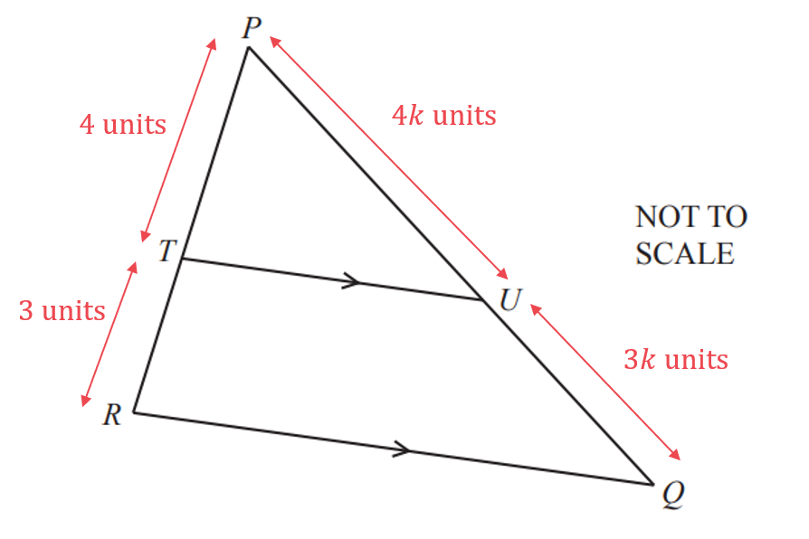
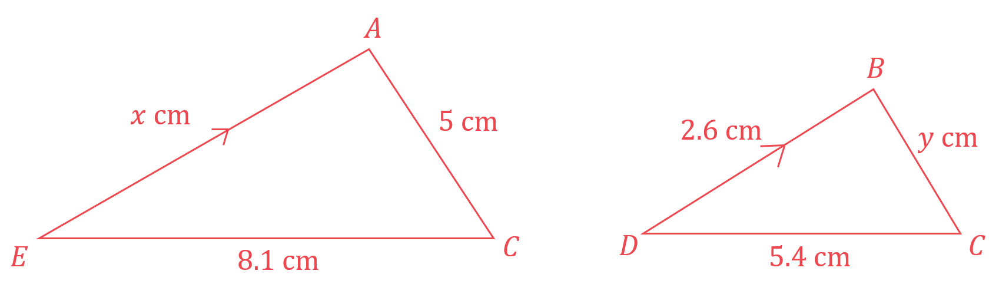
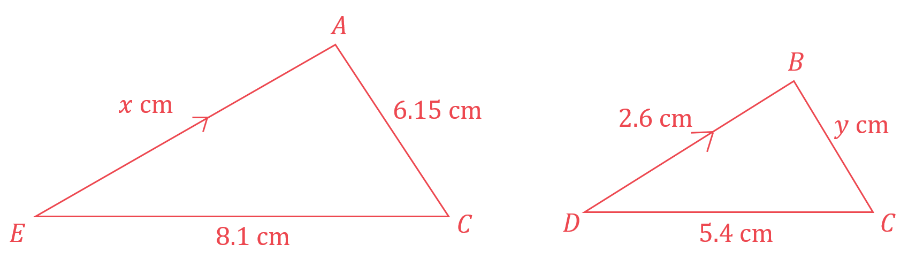
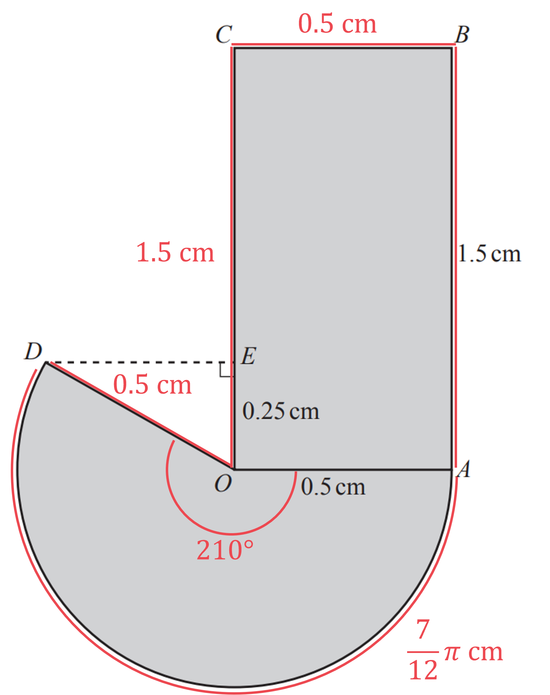
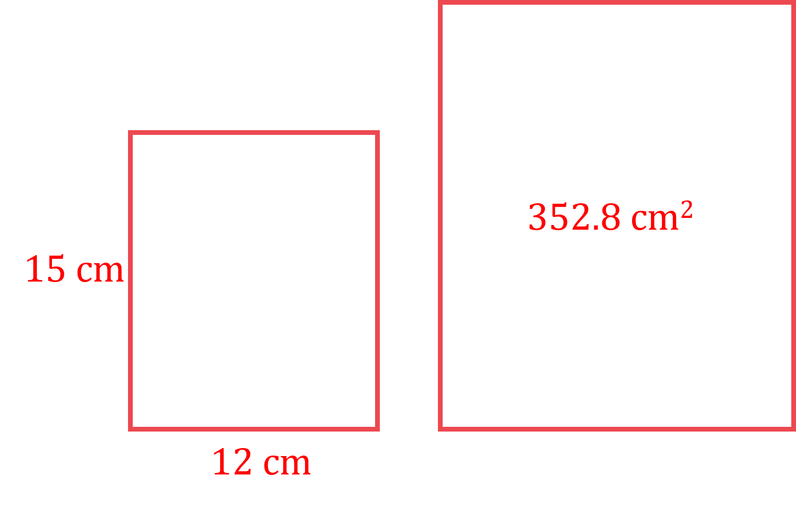
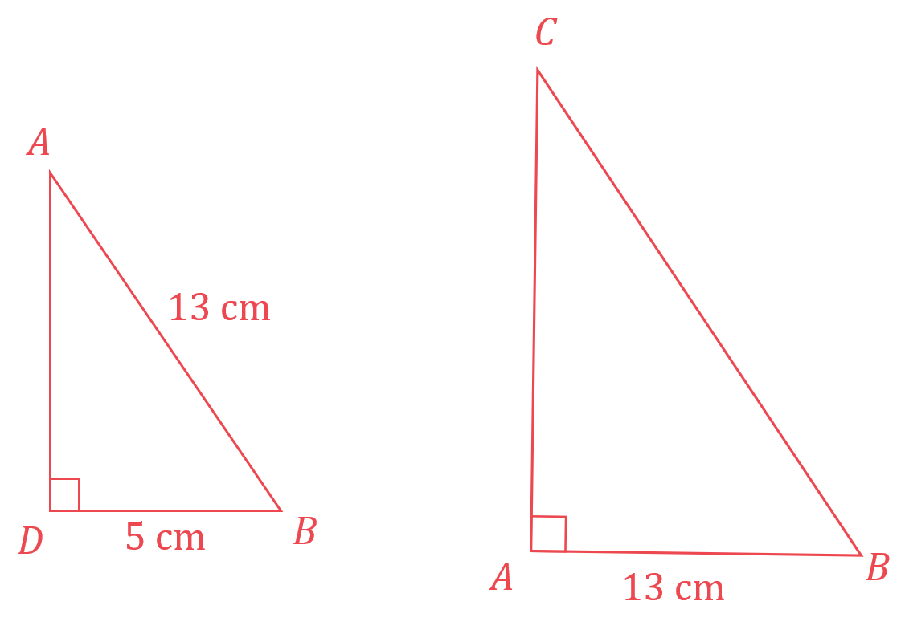

# Mark Schemes — Congruence & Similarity
**Lengths, Areas & Volumes** · Cambridge (CIE) IGCSE maths (0607)

## Calculator Questions (25 questions)

### Q1
> *The volume of the frustum is equal to the volume of the large cone, subtract the volume of the smaller cone that has been removed*

> *The formula for the volume of a cone is given by *$V=\frac{1}{3}πr^{2}h$

> *Find the volume of the larger cone *`open parentheses V subscript L close parentheses`

`V subscript L equals 1 third pi open parentheses 9 squared close parentheses open parentheses 15 close parentheses
V subscript L equals 405 pi`

**[M1 A1]**

> *The smaller cone has a height of 15-11=4 cm*

> *The radius of the smaller cone is not known yet, but you can use similarity to find it*

> *Consider a cross section of the large cone and the small cone. You know the height of the small cone (4), the height of the large cone (15) and the radius of the large cone (9)*

> *The triangles are similar; there is a constant scale factor for the side lengths*

`table row cell 4 over 15 end cell equals cell r over 9 end cell row cell 4 over 15 cross times 9 end cell equals r row cell 2.4 end cell equals r end table`

**[M1]**

> *Find the volume of the smaller cone *`open parentheses V subscript S close parentheses`

`V subscript S equals 1 third pi open parentheses 2.4 close parentheses squared open parentheses 4 close parentheses
V subscript S equals 192 over 25 pi`

**[A1]**

> **[exam-tip]**
> Alternatively, you could use a volume scale factor to find the smaller cone's volume:
> 
> `V subscript S equals open parentheses 4 over 15 close parentheses cubed cross times V subscript L`

> *The volume of the frustum is the volume of the larger cone subtract the volume of the smaller cone*

$V=V_{L}-V_{S}=405π-\frac{192}{25}π$

**[M1]**

$\frac{9933}{25}π$

**[A1]**

> **[mark-scheme]**
> **M1**: Use of $V=\frac{1}{3}πr^{2}h$.
> 
> **A1**: Finding the volume of the larger cone. Can be implied by later working.
> 
> **M1**: Evidence of using similarity. Either to find the unknown radius or using a volume scale factor `open parentheses 4 over 15 close parentheses cubed`.
> 
> **A1**: Finding the volume of the smaller cone. Can be implied by later working.
> 
> **M1**: Method to find the volume of the frustum.
> 
> **A1**: Correct final answer or equivalent. Must be exact as specified in the question.

### Q2
**Triangle ****ADX**** is ****similar**** to triangle ****BCX.** **[1]**
> *First find the **area** (2D) scale factor.*

$\frac{65.61}{36}=1.8225$

> *This is the area scale factor **from** triangle **ADX** **to** triangle **BCX**. *
*We can now find the linear (1D) scale factor by square rooting.*

$\sqrt{1.8225}=1.35$

**[1]**

> *BX** is similar to **AX** so*

$BX=8.6\times1.35=11.61$

**[1]**

**BX**** = 11.61 cm*** ***[1]**

### Q3
*If two shapes are mathematically similar, their length, area and volume scale factors are **k**, **k**2** and **k**3* 
*Find the area scale factor, from small-to-large (by dividing the large area by the small area)* * *

$k^{2}=\frac{226}{94}$ * *

*Find the length scale factor, **k**, by square-rooting both sides* * *

$k=\sqrt{\frac{226}{94}}$

**[1]**

*Find the volume scale factor, **k**3**, by cubing **k* * *

`k cubed equals open parentheses square root of 226 over 94 end root close parentheses cubed` * *

*This scale factor is how much bigger the larger container is compared to the smaller container* * *

*the larger volume, 680 cm**3**, is *`open parentheses square root of 226 over 94 end root close parentheses cubed`* times bigger than the smaller volume* * *

*Find the smaller volume, by dividing the large volume by *`open parentheses square root of 226 over 94 end root close parentheses cubed` * *

*smaller volume = *`680 over open parentheses square root of 226 over 94 end root close parentheses cubed`

**[1]**

> *Use a calculator to find this value, giving your answer to 3 significant figures*

**182 cm****3**** ****[1]**

### Q4
> *The height of model **A** and the height of model **B** are corresponding lengths in similar shapes so find **k, **the scale factor, using**  *`table attributes columnalign right center left columnspacing 0px end attributes row k equals cell space fraction numerator second space corresponding space length over denominator first space corresponding space length end fraction end cell end table`

> *Method 1*

> *The height of model **B** is smaller than the height of model **A**. **To go from the big shape to the small shape, put the small length on top in the fraction so that **k** will be smaller than 1*

`table row cell k space end cell equals cell fraction numerator height space bold B over denominator height space bold A end fraction equals space 147 over 187 end cell end table`

**[1]**

> *Find the height of model **B** by multiplying the height of model **A** by **k **(notice that **k** < 1 so multiplying by **k** will make the length smaller)*

`table row cell height space bold B end cell equals cell space k open square brackets height space bold A close square brackets space equals space 147 over 187 cross times 90 end cell end table`

**[1]**

`table row blank equals cell space 70.7486631... end cell end table`

> *This answer is already in centimetres but give the final answer to the nearest centimetre as requested in the question*

**71 cm**** ****[1]**

> *Method 2*

> *Finding **k **using**  *`table attributes columnalign right center left columnspacing 0px end attributes row k equals cell space fraction numerator second space corresponding space length over denominator first space corresponding space length end fraction end cell end table`*, if you put the larger length on top of the fraction then;*

`table row cell k space end cell equals cell fraction numerator height space bold A over denominator height space bold B end fraction equals space 187 over 147 space end cell end table`

> *Notice that **k** > 1 so multiplying by **k** will make the length bigger- but in going from the height of model **A** to the height of model of **B**, we want to go from a longer length to a smaller length. So divide by **k **instead*

`table row cell height space bold B space end cell equals cell space height space bold A divided by k equals space 90 divided by 187 over 147 end cell end table`

**[1]**

`table row blank equals cell space 70.7486631... end cell end table`

> *This answer is already in centimetres but give the final answer to the nearest centimetre as requested in the question*

**71 cm**** ****[1]**

### Q5
> *The radius of **A** and the radius of **B** are corresponding lengths in similar shapes so find **k, **the scale factor, using**  *`table attributes columnalign right center left columnspacing 0px end attributes row k equals cell space fraction numerator second space corresponding space length over denominator first space corresponding space length end fraction end cell end table`

> *Method 1*

> *The radius of **B** is smaller than the radius of **A**. **To go from the big shape to the small shape, put the small length on top in the fraction so that **k** will be smaller than 1*

`table row cell k space end cell equals cell fraction numerator height space bold B over denominator height space bold A end fraction equals space fraction numerator 0.6 over denominator 1.6 end fraction space equals space 3 over 8 end cell end table`

**[1]**

> *Find radius of **B** by multiplying the radius of **A** by **k **(notice that **k** < 1 so multiplying by **k** will make the length smaller)*

`table row cell radius space bold B end cell equals cell space k open square brackets radius space bold A close square brackets space equals space 3 over 8 cross times 0.56 end cell end table`

**0.21 m**** ****[1]**

> *Method 2*

> *Finding **k **using**  *`table attributes columnalign right center left columnspacing 0px end attributes row k equals cell space fraction numerator second space corresponding space length over denominator first space corresponding space length end fraction end cell end table`*, if you put the larger length on top of the fraction then;*

`table row cell k space end cell equals cell fraction numerator height space bold A over denominator height space bold B end fraction equals space fraction numerator 1.6 over denominator 0.6 end fraction space equals space 8 over 3 end cell end table`

> *Notice that **k** > 1 so multiplying by **k** will make the length bigger- but in going from the radius of **A** to the radius of **B**, we want to go from a longer length to a smaller length. So divide by **k **instead*

`table row cell radius space bold B space end cell equals cell space radius space bold A divided by k equals space 0.56 divided by 3 over 8 end cell end table`

**0.21 m**** ****[1]**

### Q6
> *The statue and the model are similar so there will exist a value of **k **such that the volume of the statue (**V**S**) = **k**3 **× **volume of the model (**V**M**).*

> *Form an equation using the two volumes.*

`table row cell V subscript straight S space end cell equals cell space space k cubed V subscript straight M end cell row cell 40 space 500 space end cell equals cell space 12 k cubed end cell end table`

> *Solve to find *$k$*.*

`table row cell k cubed space end cell equals cell space fraction numerator 40 space 500 over denominator 12 end fraction space equals space 3375 end cell row cell k space end cell equals cell space cube root of 3375 space equals space 15 end cell end table`

**[1]**

> *The same proportions will apply to the height of the model and the statue, however height is one dimension so the formula *`table row cell h subscript straight S space end cell equals cell space k open parentheses h subscript straight M close parentheses end cell end table`* is used.*

`table row cell h subscript straight S space end cell equals cell space 4 open parentheses h subscript straight M close parentheses end cell row space equals cell space left parenthesis 4 right parenthesis left parenthesis 15 right parenthesis end cell end table`

**[1]**

**The height of the statue is 60 cm ****[1]**

### Q7
> *Similar triangles have three equal angles. *
*Identify any corresponding angles that are equal between triangles **PQR**  and **PUT**.*

> *The lines **TU **and **RQ **are parallel. *
*In parallel lines, corresponding angles are equal.*

> *The statement that if three corresponding angles between two triangles are equal then the two triangles are similar must be made.*

**Final answer:** **Angle ****TPU****  = angle ****RPQ****  as they are a common angle. **
**Angle ****PTU****  = angle ****PRQ ****as they are corresponding angles on parallel lines. **
**Angle ****PUT****  = angle ****PQR ****as they are corresponding angles on parallel lines.**** **

**A****t least two of the three statements given, with reasons ****[2]**

** All three angles are the same so the triangles are similar. *** *
**Explanation of similar triangles ****[1]**
i) *The triangles are similar, so there will exist a constant, **k, **such that **PU **:** UQ **= **k **(**PT **: TR).   Adding the values to the diagram may help.*

$PU:UQ=4k:3k$

> *  PQ** = **PU **+** UQ, **so the ratio** PU : PQ **will be equal to the ratio **PU **: (**PU + UQ**).*

> * *

`table row cell P U space colon space open parentheses P U space plus space U Q close parentheses space end cell equals cell space 4 k space colon space open parentheses 4 k space plus space 3 k close parentheses end cell row cell P U space colon space P Q space end cell equals cell space 4 k space colon space 7 k end cell end table`

> * *

> *Simplify by dividing both sides by **k.*

> * *

**4 : 7**** [1]**

ii) *For two lengths, **A** and **B**  to be mathematically similar, there must be a value of **k** such that **A **= **kB. *

> *For two areas, **A** and **B**  to be mathematically similar, there must be a value of **k** such that **A **= **k**2**B.*

> *The area of quadrilateral **QRTU  **= area of triangle **PQR **- area of triangle **PUT.** Find the area of triangle **PQR **first.*

> *If the length **PU **=** kPQ  **for some value of **k**, then area** PUT **= **k**2**(area **PQR**).*

> *Use the ratio **PU **: **PQ **= 4 : 7 to find the value of** k such that PU **=** kPQ .*

`table row cell 7 P U space end cell equals cell space 4 P Q end cell row cell P U space end cell equals cell fraction numerator 4 P Q over denominator 7 end fraction end cell row cell P U space end cell equals cell 4 over 7 P Q end cell row cell k space end cell equals cell 4 over 7 end cell end table`

> *The area of triangle **PQR **= **k**2**(area **PUT**). *

> *Use this value of **k** with the area of triangle **PUT ** to find the area of triangle **PQR.** Remember to use **k**2  **in the formula as we are working with area.*

`table row cell Area subscript P U T end subscript space end cell equals cell space k squared space cross times space Area subscript P Q R end subscript end cell row cell 20 space end cell equals cell space open parentheses 4 over 7 close parentheses squared space cross times space Area subscript P Q R end subscript end cell row cell Area subscript P Q R end subscript space end cell equals cell fraction numerator space 20 over denominator space open parentheses 4 over 7 close parentheses squared end fraction end cell row blank equals cell space 61.25 end cell end table`

*  **Correct scale factor squared*** ****[1]  **

*Correct formula*** ****[1]**

> *Find the area of quadrilateral **QRTU  **using the area of triangle **PQR **minus the area of triangle **PUT.*

*Area of quadrilateral*** QRTU  ***= 61.25 - 20*

**Area = 41.25 cm****2  ****[1]**

### Q8
> *For similar shapes, if the scale factor of enlargement for lengths is *$k$*, then the capacity scale factor is *$k^{3}$* (capacity is equivalent to volume). In this example, the volume scale factor is *

$k^{3}=\frac{0.5}{0.25}=2$

> *Therefore the length scale factor is the cube root of 2.*

`k equals cube root of 2`

**[1]**

> *The height of the larger glass is 13 cm. To get get the height of the smaller glass we need to divide by the length scale factor. *
*A common mistake here is to multiply rather than divide, but this will give you a larger height- remember we're finding the height of the smaller glass.*

`table row h equals cell 13 divided by cube root of 2 end cell end table`

**[1]**

`table attributes columnalign right center left columnspacing 0px end attributes row blank equals cell 10.31810684... end cell end table`

> *Round your answer to at least 3 significant figures.*

$h=10.3$** [1]**
**Check that your answer is a smaller height than 13 cm**

### Q9
> *All of the corresponding angles in the triangles **AEC **and **BDC **are the same, as angle **BCD** is in both triangles, and the other angles are corresponding angles on parallel lines. *

*Triangles ***AEC ***and ***BDC ***are similar*

> *The triangles are similar so there will exist a value of **k **such that  *`table row cell A E space end cell equals cell space k B D end cell end table`*, *`table row cell C D space end cell equals cell space k C E end cell end table`* and *`table row cell B C space end cell equals cell space k A C end cell end table`*. *
*k **is known as the scale factor.*

> *It may help to draw the two triangles out separately next to each other.*

> *Form an equation using the two known sides of the triangle.*

`table row cell C E space end cell equals cell space k C D end cell end table`

> *Substitute the values of *$CE$* and *$CD$* into the equation and solve to find *$k$*.*

`table row cell 8.1 space end cell equals cell space 5.4 k end cell row cell k space end cell equals cell space fraction numerator 8.1 over denominator 5.4 end fraction space equals space 3 over 2 end cell end table`

**[1]**

> *Substitute into *`table row cell A E space end cell equals cell space k B D end cell end table`*.*

`table row cell A E space end cell equals cell space k B D end cell row cell x space end cell equals cell space left parenthesis 3 over 2 right parenthesis open parentheses 2.6 close parentheses end cell end table`

$AE=3.9$** cm**** ****[1]**
> *Add the new information to the diagram.*

> *Find *`table attributes columnalign right center left columnspacing 0px end attributes row blank blank cell B C end cell end table`* by substituting *`table row cell k space end cell equals cell space 3 over 2 end cell end table`* into *`table row cell A C space end cell equals cell space k B C end cell end table`*.*

`table row cell A C space end cell equals cell space k B C end cell row cell 6.15 space end cell equals cell space left parenthesis 3 over 2 right parenthesis B C end cell end table`

> *Solve to find *`B C space open parentheses space equals space y close parentheses`*.*

`table row cell 6.15 space end cell equals cell space fraction numerator space 3 y over denominator 2 end fraction end cell row cell y space end cell equals cell space fraction numerator 2 open parentheses 6.15 close parentheses over denominator 3 end fraction space equals space 4.1 end cell end table`

**[1]**

> $AB=AC-BC$*. *
*Substitute the values of*$AC$* and*$BC$* in.*

`table row cell A B space end cell equals cell space A C space minus space B C space equals space 6.15 space minus space 4.1 end cell end table`

$AB=2.05$** cm**** ****[1]**

### Q10
> *Find the length scale factor (LSF) by dividing the height of the larger cone by the height of the smaller cone.*

$\mathrm{LSF}=\frac{75}{30}=2.5$

> *The volume scale factor (VSF), is the cube of the LSF.*

$\mathrm{VSF}=\mathrm{LSF}^{3}$

> *Find the VSF by cubing the LSF.*

$\mathrm{VSF}=2.5^{3}$

$\mathrm{VSF}=15.625$

**[1]**

> *Find the volume of the smaller container by dividing the volume of the larger container by the VSF.*

$5.5\div15.625=0.352$

> *Convert the value from litres into ml by multiplying by 1000.*

$0.352\times1000$

**[1]**

$352$** ml** **[1]**

### Q11
> *Find the area scale factor (ASF) by dividing the area of the larger cone by the area of the smaller cone.*

$\mathrm{ASF}=\frac{180}{80}=2.25$

> *The ASF, is the square of the length scale factor (LSF).*

$\mathrm{ASF}=\mathrm{LSF}^{2}$

> *Find the LSF by finding the square root of the ASF.*

$\sqrt{\mathrm{ASF}}=\mathrm{LSF}$

$\sqrt{2.25}=\mathrm{LSF}$

$\mathrm{LSF}=1.5$

**[1]**

> *The volume scale factor (VSF) is the cube of the LSF.*

$\mathrm{VSF}=\mathrm{LSF}^{3}$

> *Find the VSF by cubing the LSF.*

$\mathrm{VSF}=1.5^{3}$

$\mathrm{VSF}=3.375$

> *Multiply the volume of the smaller cone by the VSF to find the volume of the larger cone.*

$168\times3.375$

**[1]**

**567 cm****3** **[1]**

### Q12
> *For two lengths, **A** and **B** to be mathematically similar, there must be a value of **k** such that **A **= **kB. **For two volumes, **A** and **B** to be mathematically similar, there must be a value of **k** such that **A **= **k**3**B.*

> *Use the heights of the two mathematically similar objects to find the value of** k.*

$h_{2}=k\timesh_{1}\,7=k\times4\,k=\frac{7}{4}$

> *Use this value of **k** with the volume of the first paperweight to find the volume of the mathematically similar paperweight.  *
*Remember to use **k**3  **in the formula as we are working with volume. *
*Make sure you do not mix up which paperweight is which.*

`V subscript 2 space equals space k cubed space cross times space V subscript 1
space V subscript 2 space equals space open parentheses 7 over 4 close parentheses cubed space cross times space 38.4`

*  **Correct scale factor cubed*** ****[1]  **
*Correct formula ***[1]**
**V = 205.8 cm****3  ****[1]**

### Q13
> *When a shape is enlarged by a scale factor, the lengths are multiplied by the scale factor, and the area is multiplied by the (scale factor)**2**, also known as the area scale factor*

> *Finding the area scale factor*

`table row cell 6 space cm squared cross times Area space Scale space Factor space end cell equals cell space 73.5 space cm squared end cell row cell Area space Scale space Factor end cell equals cell fraction numerator 73.5 over denominator 6 end fraction equals 49 over 4 equals 12.25 end cell end table`

> *Therefore the scale factor for the lengths is*

$\mathrm{Length} \mathrm{scale} \mathrm{factor}=\sqrt{\frac{49}{4}}=\frac{7}{2}=3.5$

**[1]**

> *As all the lengths have been multiplied by 3.5, this means the overall perimeter will also be 3.5 times larger for the bigger pentagon*

> *Expressing this as a ratio of the larger pentagon : smaller pentagon*

$3.5:1$

> *Rewriting with integers*

$7:2$ **[1]**

### Q14
> *Find the length scale factor by dividing a length of the larger shape (**PQ**) by the corresponding length of the smaller shape (**AB**).*

$\mathrm{Length} \mathrm{Scale} \mathrm{Factor}=\frac{12}{8}=1.5$

> *Square the length scale factor to find the area scale factor.*

$\mathrm{Area} \mathrm{Scale} \mathrm{Factor}=1.5^{2}=2.25$

**[1]**

> *You have the area of the smaller shape so multiply this by the area scale factor to get the area of the larger shape.*

$16\times2.25$

**Area of triangle ****PQR**** = 36 cm****2** **[1]**
> *Method 1*

> *Cube the length scale factor to find the volume scale factor.*

$\mathrm{Volume} \mathrm{Scale} \mathrm{Factor}=1.5^{3}=3.375$

**[1]**

> *You have the volume of the smaller shape so multiply this by the volume scale factor to get the volume of the larger shape.*

$320\times3.375=1080$

> *The formula for the volume of a prism is *$V=A\timesl$*, where **A** is the area of the cross-section and **l** is the length. You know the area is 36 and the volume is 1080 so form an equation.*

$1080=36l$

**[1]**

> *Divide both sides by 36.*

$l=\frac{1080}{36}$

**Length of the larger prism = 30 cm** **[1]**

> *Method 2*

> *The formula for the volume of a prism is *$V=A\timesl$*, where **A** is the area of the cross-section and **l** is the length. For the smaller prism you know the area is 16 and the volume is 320 so form an equation.*

$320=16l$

> *Divide both sides by 16.*

$l=\frac{320}{16}=20$

**[1]**

> *To find the length of the larger prism you need to multiply the length of the smaller prism by the length scale factor.*

$20\times1.5$

**[1]**

**Length of the larger prism = 30 cm** **[1]**

### Q15
*If two shapes are mathematically similar, then one is an enlargement of the other* 
*If the lengths are multiplied by the scale factor, then the area will be multiplied by the (scale factor)**2**, which we can call the area scale factor*

> *To find the area scale factor*

$295\div159.5=\frac{590}{319}=1.849529781...$

*This means that the length scale factor would be the square-root of this* *It is best to use the most accurate figure you can, so fractions are preferable to long decimals*

$\mathrm{Scale} \mathrm{factor}=\sqrt{\frac{590}{319}}$

**[1]**

> *As the width of the larger shape is 17 cm, and we are finding the smaller shape's width, we need to divide by the scale factor*

$17\div\sqrt{\frac{590}{319}}=12.50023729...$

**[1]**

$12.5\mathrm{cm}$** ****[1]** 
**Round to 3 significant figures**

### Q16
> *Find the volume of the cone by substituting *$r=10$* and *$h=36$* into the formula *

$\frac{1}{3}\timesπ\times10^{2}\times36$

**[1]**

> *Work out the value on your calculator, giving your answer to 3 significant figures*

**3770 cm****3** **[1]**
> *Find the volume of the smaller cone by halving the volume of the bigger cone in part (b)(i) *

$\frac{1}{2}\times3770=1885$* cm**3*

**[1]**

*Method 1* 
*The ratio of radii (lengths) is 1 : 2 so the ratio of volumes is 1**3** : 2**3* 
*Split this volume up into the ratio 1 : 8 (by finding *$\frac{1}{9}$* of it and *$\frac{8}{9}$* of it*

> $\frac{1}{9}\times1885:\frac{8}{9}\times1885\,$* *

*The volume of the smaller sphere is *$\frac{1}{9}\times1885$ 
*Form an equation in *$r$* by setting the sphere volume formula equal to *$\frac{1}{9}\times1885$ * *

$\frac{4}{3}πr^{3}=\frac{1}{9}\times1885$

**[2]**

> *Get *$r^{3}$* on its own (by dividing both sides by *$\frac{4}{3}π$

> $r^{3}=\frac{\frac{1}{9}\times1885}{\frac{4}{3}π}\,$* *

> *Find *$r$* (by cube-rooting both sides*

`r equals cube root of fraction numerator 1 over 9 cross times 1885 over denominator 4 over 3 straight pi end fraction end root
`

**3.68 cm*** ***[1]**

*Method 2*  
*The ratio of radii is 1: 2 so write the smaller sphere radius as *$r$* and the bigger sphere radius as *$2r$
 *Form an equation in *$r$* (the sum of the volumes of the two spheres equals *$1885$*)* * *

`4 over 3 straight pi r cubed plus 4 over 3 straight pi open parentheses 2 r close parentheses cubed equals 1885`

**[1]**

*Collect like terms, using *`open parentheses 2 r close parentheses cubed equals 8 r cubed` * *

$\frac{4}{3}πr^{3}+\frac{4}{3}π\times8r^{3}=1885\,\frac{36}{3}πr^{3}=1885\,12πr^{3}=1885$ * *

*Find *$r$* (by dividing both sides by *$12π$* then cube-rooting)*

`r equals cube root of fraction numerator 1885 over denominator 12 straight pi end fraction end root`

**[1]**

**3.68 cm ****[1]**

### Q17
> *When lengths are scaled up or down, the volume is scaled up or down by the (scale factor)**3*

*As the scale of the model is 1:20, the model is 20 times smaller than the real car* 
*i.e. the lengths of the model are the real lengths, divided by 20* 
*Therefore the volume will be divided by 20**3*

$12m^{3}\div20^{3}=0.0015m^{3}$

**[1]**

*We now need to convert into *$\text{cm}^{3}$ 
*A metre cubed is a cube of side length 1 m (or 100 cm)* $1m^{3}=100\text{cm}\times100\text{cm}\times100\text{cm}=1000000\text{cm}^{3}$

$0.0015\text{m}^{3}\times1000000=1500\text{cm}^{3}$

*Multiplying by 1 000 000* **[1]**
$1500\text{cm}^{3}$ **[1]**

### Q18
> *Work out the volume scale factor (VSF) by dividing the volume of the larger prism by the volume of the smaller prism.*

$\mathrm{VSF}=\frac{2187}{648}\,\mathrm{VSF}=\frac{27}{8}$

> *Work out the length scale factor (LSF), by taking the cube root of the VSF.*

`LSF equals cube root of VSF
LSF equals cube root of 27 over 8 end root
LSF equals 3 over 2`

**[1]**

> *Work out the area scale factor (ASF), by squaring the LSF.*

`ASF equals LSF squared
ASF equals open parentheses 3 over 2 close parentheses squared
ASF equals 9 over 4`

> *Multiply the area of the smaller prism by the ASF to find the area of the larger prism.*

$36\times\frac{9}{4}$

**[1]**

**81 cm****2**** ****[1]**

### Q19
> *The perimeter is the total length around the outside of the shape.*

> *You'll need the length of the arc **AB**. *

> *To help find the angle of the sector, first find the acute angle **DOE**. *

> *Triangle **ODE** is right-angled and we have the hypotenuse (**DO** = 0.5) and the adjacent side (**OE** = 0.25). So we can use *`cos open parentheses D O E close parentheses equals Adjacent over Hypotenuse.`

`cos open parentheses D O E close parentheses equals fraction numerator 0.25 over denominator 0.5 end fraction equals 1 half`

**[1]**

> *Use inverse cos on your calculator to find the size of the angle.*

`D O E equals cos to the power of negative 1 end exponent open parentheses 1 half close parentheses equals 60`

> *Subtract angle **DOE** from 270° to get the size of the angle of the sector.*

$θ=270-60=210$

**[1]**

> *Find the arc length using the formula *$l=\frac{θ}{360}\times2πr$*. Leave your answer in terms of π.*

$l=\frac{210}{360}\times2π\times0.5\,l=\frac{7}{12}π$

**[1]**

*The perimeter is formed by 5 sides: **OC**, **CB**, **BA**, **AD**, **DO**.* 
*OC** = **BA** = 1.5 cm.* 
*CB** = **OA** = 0.5 cm.* 
*DO** is the radius so is also 0.5 cm.*

> *Add together the lengths.*

`table row blank blank cell 1.5 plus 0.5 plus 1.5 plus 7 over 12 straight pi plus 0.5 end cell row blank equals cell 4 plus 7 over 12 straight pi end cell row blank equals cell 5.8325... end cell end table`

**[1]**

> *Round to 3 significant figures.*

**5.83 cm*** ***[1]**
> *The area is made up two shapes: a rectangle and a sector.*

> *Find the area of the rectangular using the formula *$A=bh.$

$0.5\times1.5=0.75$

> *Find the area of the sector using the formula *$A=\frac{θ}{360}\timesπr^{2}.$* Leave your answer in terms of π.*

$\frac{210}{360}\timesπ\times0.5^{2}=\frac{7}{48}π$

**[1]**

> *Add the two areas together.*

$0.75+\frac{7}{48}π=1.2081...$

**[1]**

> *Round to 3 significant figures.*

**1.21 cm****2** **[1]**
> *Find the area scale factor needed by dividing the area of the new logo by the area of the old logo. Use the full answer from part (b) or the answer button.  *

> $\frac{77.44}{1.2081...}=64.0980...$*  *

> *The area scale factor is the square of the length scale factor. Square root the area scale factor to find the scale factor between the radii.  *

$\sqrt{\frac{77.44}{1.2081...}}=8.0061...$

**[1]**

> *The radius of the sector from the new logo divided by the radius of the sector from the original logo is equal to this scale factor. Use this to form an equation.*

$\frac{r}{0.5}=8.0061...$

> *Multiply both sides by 0.5.*

$r=0.5\times8.0061...=4.0030...$

**[1]**

> *Round to 3 significant figures.*

**Radius is 4.00 cm** **[1] **
**4 cm is acceptable if you use the rounded 1.21 for the area**

### Q20
*Draw a picture of the two frames* 
*Work out the area of the smaller photo*

*Area of smaller photo is *$12\times15=180$* cm**2*  

*"Mathematically similar" means find the length scale factor, *$k$ *First find the area scale factor, *$k^{2}$* (by dividing 352.8 by 180)* * *

$k^{2}=\frac{352.8}{180}$ * *

*Find the length scale factor, *$k$* (by square rooting both sides)* * *

$k=\sqrt{\frac{352.8}{180}}=\frac{7}{5}=1.4$

**[1]**

*Find the length of the larger photo (by multiplying the length of the small photo by the length scale factor)*

$15\times1.4$

**[1]**

**21 cm** **[1]**

### Q21
> *The key here is to spot that the two triangles are similar.*

> *Similar triangles have three equal angles so look at the angles.*

> *Both triangles have a right angle and share the angle **ABD**, this means that the third angle in the triangles must also be equal.*

> *It may help to draw the two triangles out separately next to each other.*

> *As the triangles are similar, there will exist a value of **k **such that *`table row cell A B space end cell equals cell space k B D end cell end table`* and *`table row cell B C space end cell equals cell space k A B end cell end table`*.*
* *$k$* **is known as the scale factor.*

> *Form an equation using the two known sides of the triangle.*

`table row cell A B space end cell equals cell space k B D end cell row cell 13 space end cell equals cell space 5 k end cell end table`

**[1]**

> *Solve to find *$k$*.*

`table row cell k space end cell equals cell space 13 over 5 end cell end table`

> *Substitute into *`table row cell B C space end cell equals cell space k A B end cell end table`*.*

`table row cell B C space end cell equals cell space 13 over 5 open parentheses 13 close parentheses space equals space 169 over 5 end cell end table`

**[1]**

$BC=33.8$** cm**** ****[1]**

### Q22
> $AD$* is a diameter so the radius is half of *$AD$* Angle *$ACD$* is 90° because it is the angle in a semi-circle*

> *Therefore *$AD$* is the hypotenuse of right-angle triangle *$ACD$*. We can use Pythagoras' theorem to find *$AD$* but we need to find *$AC$* first*

> *Triangle *$ABE$* and triangle *$ACD$* are similar, and the scale factor is:*

$\frac{\mathrm{equivalent} \mathrm{longer} \mathrm{side}}{\mathrm{equivalent} \mathrm{shorter} \mathrm{side}}=\frac{CD}{BE}=\frac{18}{13.5}$

**[1]**

> *Multiplying the length of *$AB$* by the scale factor gives *$AC$

$AC=21\times\frac{18}{13.5}=28$

**[1]**

> *Now we can use Pythagoras' theorem *$a^{2}+b^{2}=c^{2}$

$28^{2}+18^{2}=AD^{2}$

**[1]**

> *Rearrange to get *$AD$

`table row cell A D end cell equals cell square root of 28 squared plus 18 squared end root end cell row blank equals cell space 33.28663395 end cell end table`

**[1]**

> *The radius is half of *$AD$

`table row r equals cell space open parentheses 33.28663395... close parentheses divided by 2 end cell row blank equals cell 16.64331698... end cell end table`

> *Round the answer to at least 3 significant figures*

**16.6 cm**** ****[1]**

### Q23
> *Find the area scale factor needed by dividing the area of the larger shape by the area of the smaller shape. *

$\frac{134.4}{52.5}=2.56$

> *The area scale factor is the square of the length scale factor. Square root the area scale factor to find the scale factor between the lengths.*

$\sqrt{2.56}=1.6$

**[1]**

> *As we are finding a missing length on the smaller shape we need to divide the length on the larger shape by the length scale factor.*

$m=\frac{8}{1.6}$

**[1]**

$m=5$* ***[1]**

### Q24
> *First we need to find the volume (3D) scale factor as we know the volume of both the large and small bottles. *
*As we are trying to find the height of the small bottle, we want the scale factor to be **"from** large **to** small".*

*Volume scale factor *$=\frac{0.4}{1.35}=\frac{8}{27}$

> *Do not round this! *
*Height is a linear (1D) measurement so the height scale factor will be the cube root of the volume scale factor.*

`cube root of 8 over 27 end root equals 2 over 3`

**[1]**

> *Now we can find the height of the small bottle by multiplying the height of the large bottle by the linear scale factor.*

$29.7\times\frac{2}{3}=\frac{99}{5}=19.8$

** [1]**

**19.8 cm ****[1]**

### Q25
> *The triangles are similar so there will exist a value of **k **such that  *`table row cell P Q space end cell equals cell space k A B end cell end table`* and *`table attributes columnalign right center left columnspacing 0px end attributes row cell P R space end cell equals cell space k A C end cell end table`*.*

> *Form an equation using the two known sides of the triangle.*

`table row cell P R space end cell equals cell space k A C end cell end table`

> *Substitute the values of *$PR$* and *$AC$* into the equation and solve to find *$k$*.*

`table row cell 21.7 space end cell equals cell space 12.4 k end cell row cell k space end cell equals cell space fraction numerator 21.7 over denominator 12.4 end fraction space equals space 1.75 end cell end table`

**[1]**

> *Substitute into *`table row cell P Q space end cell equals cell space k A B end cell end table`*.*

`table row cell P Q space end cell equals cell space k A B end cell row cell P Q space end cell equals cell space left parenthesis 1.75 right parenthesis left parenthesis 5.2 right parenthesis end cell end table`

$PQ=9.1$** cm**** ****[1]**
