# Exam Questions — Congruence & Similarity
**Lengths, Areas & Volumes** · Cambridge (CIE) IGCSE maths (0607)
> Source: [https://www.savemyexams.com/igcse/maths/cie/international-maths/23/extended/topic-questions/](https://www.savemyexams.com/igcse/maths/cie/international-maths/23/extended/topic-questions/) · 25 questions across 1 sets

## Calculator Questions (25 questions)

### Q1 — hard — 6 marks

**Q1** [6 marks]

A cone has height 15 cm and a base of radius 9 cm.

A smaller cone is cut off the top to form a frustum of height 11 cm.

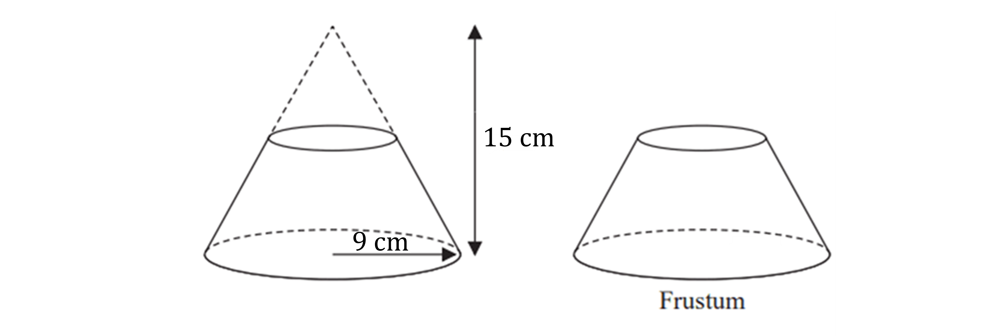

Find the exact volume of the frustum.

### Q2 — hard — 4 marks

**Q2** [1 mark]

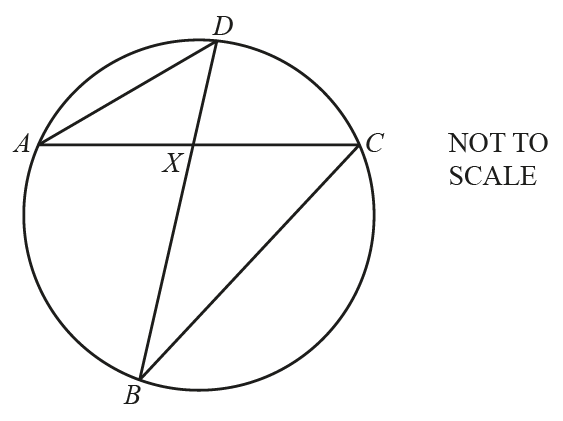

*A*, *B*, *C* and *D* are points on the circumference of the circle. 
*AC* and *BD* intersect at *X*.

Complete the statement.

Triangle *ADX* is ..................................................... to triangle *BCX*.

*Source: 2018	Feb/Mar 0580/22 Q14B*

**Q2** [3 marks]

The area of triangle *ADX* is 36 cm2 and the area of triangle *BCX* is 65.61 cm2. 
*AX* = 8.6 cm and *DX* = 7.2 cm. Find *BX*.

*BX* = .................................. cm

*Source: 2018	Feb/Mar 0580/22 Q14B*

### Q3 — hard — 3 marks

**Q3** [3 marks]

Two containers are mathematically similar. 
The surface area of the larger container is 226 cm2 and the surface area of the smaller container is 94 cm2. 
The volume of the larger container is 680 cm3.

Find the volume of the smaller container.

........................................... cm3

*Source: 2018	Oct/Nov 0580/43 Q8C*

### Q4 — medium — 3 marks

**Q4** [3 marks]

The diagram shows two water towers in Kuwait.

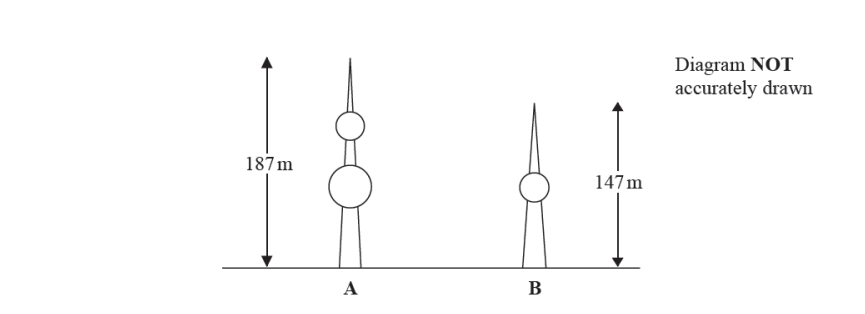

The real height of tower $A$ is $187m$. 
The real height of tower $B$ is $147m$.

Ahmed makes a scale model of both towers.

The height of tower $A$ on the scale model is $90\mathrm{cm}$.

Work out the height of tower $B$ on the scale model. Give your answer correct to the nearest centimetre.

*Source: Jan 2019 4MA1/1HR Q7*

### Q5 — medium — 2 marks

**Q5** [2 marks]

The diagram shows two cylinders, $A$ and $B$

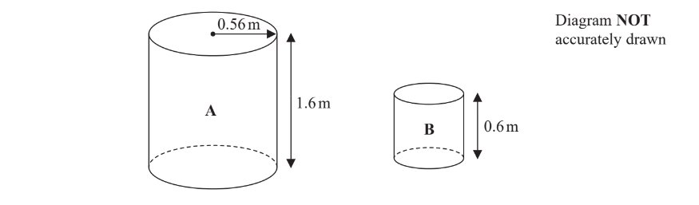

Cylinder $A$ has height 1.6 m and radius 0.56 m.

Cylinder $B$ is mathematically similar to cylinder $A$.
The height of cylinder $B$ is 0.6 m. 
Work out the radius of cylinder $B$.

....................................................... m

*Source: June 2018 4MA1/2H Q6B*

### Q6 — very_hard — 3 marks

**Q6** [3 marks]

A model of a statue has a height of 4cm.
The volume of the model is 12 cm3. 
The volume of the statue is 40 500 cm3.

Calculate the height of the statue.

............................................ cm

*Source: 2020 Oct/Nov 0580/22 Q20*

### Q7 — hard — 7 marks

**Q7** [3 marks]

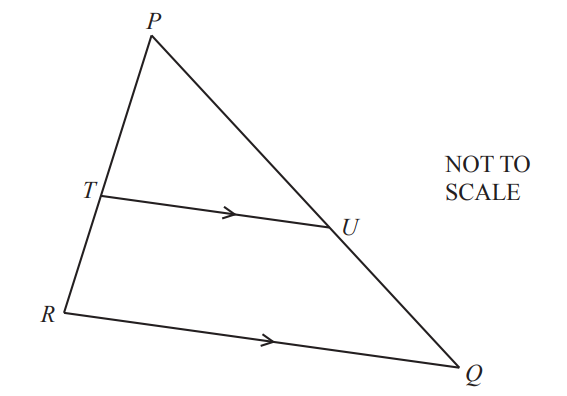

*PQR* is a triangle. 
*T* is a point on *PR *and *U* is a point on *PQ*.
*RQ* is parallel to *TU*.

Explain why triangle *PQR* is similar to triangle *PUT*. Give a reason for each statement you make.

*Source: 2020 Oct/Nov 0580/43 Q5B*

**Q7** [4 marks]

**Extract:**

PQR is a triangle. T is a point on PR and U is a point on PQ. RQ is parallel to TU.

*PT* : *TR* = 4 : 3

i) Find the ratio *PU* : *PQ*.

...................... : ...................... [1]

ii) The area of triangle *PUT* is 20cm2. Find the area of the quadrilateral *QRTU*.

.......................................... cm2 [3]

*Source: 2020 Oct/Nov 0580/43 Q5B*

### Q8 — hard — 3 marks

**Q8** [3 marks]

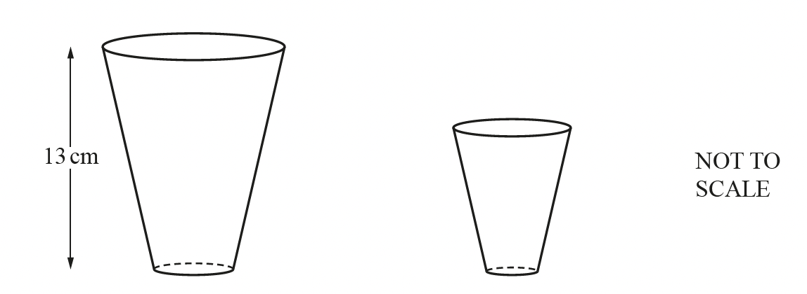

The diagram shows two glasses which are mathematically similar. 
The larger glass has a capacity of 0.5 litres and the smaller glass has a capacity of 0.25 litres. 
The height of the larger glass is 13 cm.

Calculate the height of the smaller glass.

........................................... cm

*Source: 2018	May/June 0580/23 Q25B*

### Q9 — medium — 4 marks

**Q9** [2 marks]

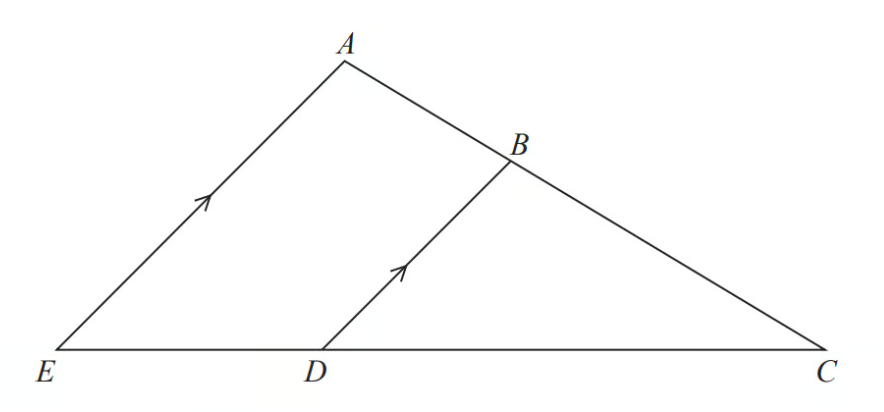

*ABC* and *EDC* are straight lines. 
*EA* is parallel to *DB*.

*EC* = 8.1 cm.
*DC* = 5.4 cm. 
*DB* = 2.6 cm,

Work out the length of *AE*.

*Source: June 2017 1MA1/2H Q5A*

**Q9** [2 marks]

**Extract:**

ABC and EDC are straight lines. 
EA is parallel to DB.
EC = 8.1 cm.
DC = 5.4 cm.
DB = 2.6 cm.

*AC* = 6.15 cm.

Work out the length of *AB*.

*Source: June 2017 1MA1/2H Q5B*

### Q10 — hard — 3 marks

**Q10** [3 marks]

Two mathematically similar containers have heights of 30 cm and 75 cm. 
The larger container has a capacity of 5.5 litres.

Calculate the capacity of the smaller container.
Give your answer in millilitres.

............................................... ml

*Source: 2019	Oct/Nov 0580/22 Q13-*

### Q11 — hard — 3 marks

**Q11** [3 marks]

Two cones are mathematically similar. 
The total surface area of the smaller cone is 80 cm2. The total surface area of the larger cone is 180 cm2. The volume of the smaller cone is 168 cm3.

Calculate the volume of the larger cone.

............................................. cm3

*Source: 2019	Oct/Nov 0580/41 Q4C*

### Q12 — hard — 3 marks

**Q12** [3 marks]

A paperweight has height 4 cm and volume 38.4 cm3. 
A mathematically similar paperweight has height 7 cm.

Calculate the volume of this paperweight.

.......................................... cm3

*Source: 2020 Oct/Nov 0580/23 Q16*

### Q13 — very_hard — 2 marks

**Q13** [2 marks]

The area of pentagon *A* is $73.5\text{cm}^{2}$. 
The area of pentagon *B* is $6\text{cm}^{2}$.

Find the ratio    perimeter of pentagon *A* : perimeter of pentagon *B*   in its simplest form.

......................... : .........................

*Source: 2019	May/June 0580/23 Q25B*

### Q14 — hard — 5 marks

**Q14** [2 marks]

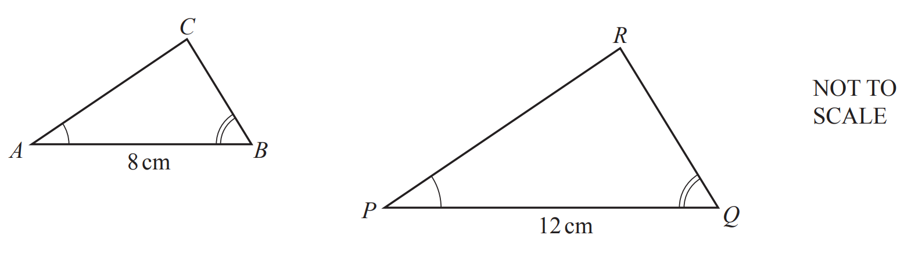

Triangle *ABC* is mathematically similar to triangle *PQR*. 
The area of triangle *ABC* is 16 cm2.

Calculate the area of triangle *PQR*.

.......................................... cm2

*Source: 2020 May/June 0580/42 Q8A*

**Q14** [3 marks]

The triangles are the cross-sections of prisms which are also mathematically similar. 
The volume of the smaller prism is 320 cm3.

Calculate the length of the larger prism.

............................................ cm

*Source: 2020 May/June 0580/42 Q8A*

### Q15 — very_hard — 3 marks

**Q15** [3 marks]

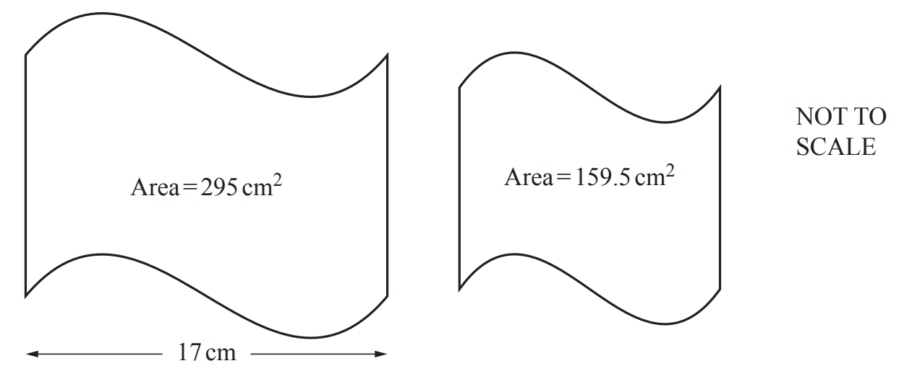

The diagram shows two mathematically similar shapes with areas $295\text{cm}^{2}$ and $159.5\text{cm}^{2}$. 
The width of the larger shape is $17\text{cm}$.

Calculate the width of the smaller shape.

......................................... cm

*Source: 2019	May/June 0580/42 Q10C*

### Q16 — very_hard — 6 marks

**Q16** [2 marks]

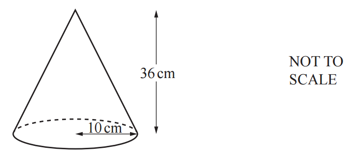

A solid metal cone has radius 10 cm and height 36 cm.

Calculate the volume of this cone.

[The volume, $V$, of a cone with radius $r$ and height $h$ is  $V=\frac{1}{3}πr^{2}h$.]

......................................... cm3

*Source: 2018	Oct/Nov 0580/42 Q10B*

**Q16** [4 marks]

**Extract:**

A solid metal cone has radius 10 cm and height 36 cm.

[The volume, V, of a cone with radius r and height h is V = 1/3 π r^2 h.]

The cone is cut, parallel to its base, to give a smaller cone.

The volume of the smaller cone is half the volume of the original cone.

The smaller cone is melted down to make two different spheres.

The ratio of the radii of these two spheres is 1 : 2.

Calculate the radius of the smaller sphere.

[The volume, $V$, of a sphere with radius $r$ is  $V=\frac{4}{3}πr^{3}$.]

.......................................... cm

*Source: 2018	Oct/Nov 0580/42 Q10B*

### Q17 — hard — 3 marks

**Q17** [3 marks]

A model of a car has a scale 1:20. 
The volume of the actual car is 12 m3.

Find the volume of the model.
Give your answer in cubic centimetres.

......................................cm3

*Source: 2019	May/June 0580/21 Q19*

### Q18 — hard — 3 marks

**Q18** [3 marks]

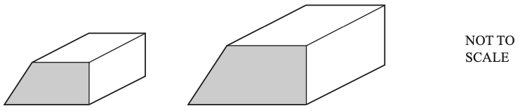

The diagram shows two mathematically similar solid metal prisms. 
The volume of the smaller prism is 648 cm3 and the volume of the larger prism is 2187 cm3. 
The area of the cross-section of the smaller prism is 36 cm2.

Calculate the area of the cross-section of the larger prism.

............................................. cm2

*Source: 2019	Oct/Nov 0580/43 Q6B*

### Q19 — very_hard — 11 marks

**Q19** [5 marks]

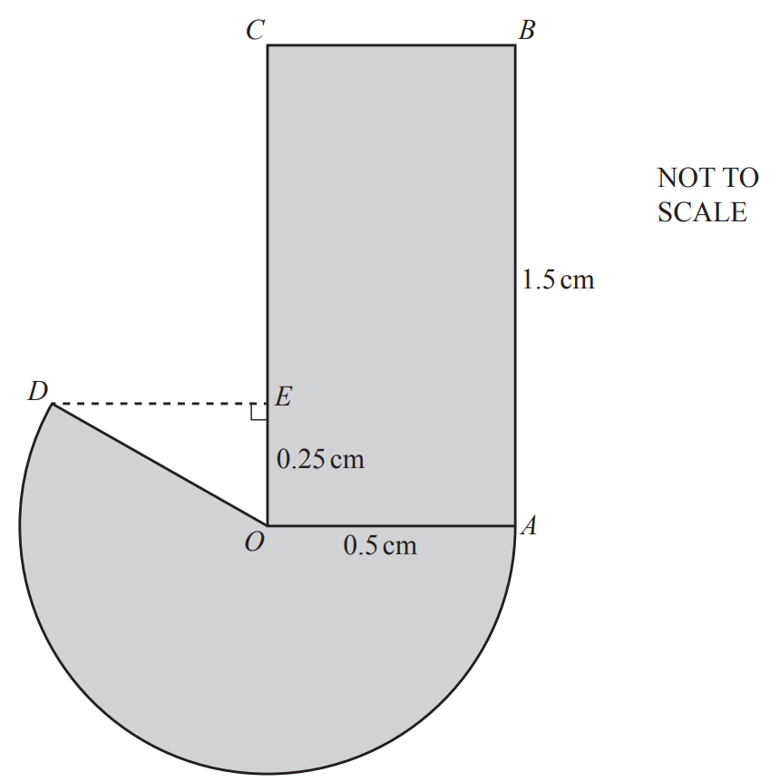

The diagram shows a company logo made from a rectangle and a major sector of a circle. 
The circle has centre *O* and radius *OA*. 
*OA* = *OD* = 0.5 cm and *AB* = 1.5 cm.
 *E* is a point on *OC* such that *OE* = 0.25 cm and angle *OED* = 90°.

Calculate the perimeter of the logo.

............................................. cm

*Source: 2019 March 0580/42 Q6A*

**Q19** [3 marks]

**Extract:**

The diagram shows a company logo made from a rectangle and a major sector of a circle. 

The circle has centre O and radius OA. 

OA = OD = 0.5 cm and AB = 1.5 cm.

E is a point on OC such that OE = 0.25 cm and angle OED = 90°.

Calculate the area of the logo.

............................................ cm2

*Source: 2019 March 0580/42 Q6B*

**Q19** [3 marks]

**Extract:**

Calculate the area of the logo.   ............................................ cm^2^

A mathematically similar logo is drawn. The area of this logo is 77.44 cm2.

Calculate the radius of the major sector in this logo.

............................................. cm

*Source: 2019 March 0580/42 Q6C*

### Q20 — medium — 3 marks

**Q20** [3 marks]

Marianne sells two sizes of photo. 
These photos are mathematically similar rectangles. The smaller photo has length 15 cm and width 12 cm. The larger photo has area 352.8 cm2.

Calculate the length of the larger photo.

.......................................... cm

*Source: 2018	Oct/Nov 0580/41 Q1B*

### Q21 — medium — 3 marks

**Q21** [3 marks]

$ABC$ and $ABD$ are two right-angled triangles.

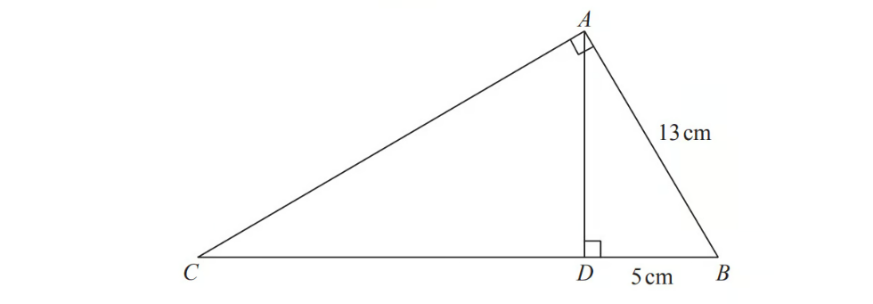

$\mathrm{Angle}BAC=\mathrm{angle}ADB=90^{\circ}\,\,AB=13\mathrm{cm}\,DB=5\mathrm{cm}$

Work out the length of $CB$.

*Source: Spec1 2015 1MA1/2H Q14*

### Q22 — very_hard — 5 marks

**Q22** [5 marks]

$C$ lies on a circle with diameter $AD$.
$B$ lies on $AC$ and $E$ lies on $AD$ such that $BE$ is parallel to $CD$.
$AB$ = 21 cm, $CD$ = 18 cm and $BE$ = 13.5 cm.

Work out the radius of the circle.

............................................ cm

*Source: 2020	May/June 0580/21 Q13*

### Q23 — very_hard — 3 marks

**Q23** [3 marks]

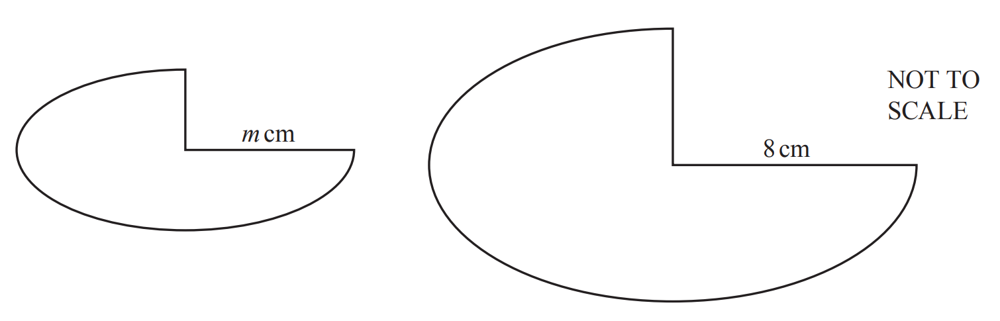

The diagram shows two shapes that are mathematically similar. 
The smaller shape has area 52.5 cm2 and the larger shape has area 134.4 cm2.

Calculate the value of $m$.

$m=$................................................

*Source: 2020 May/June 0580/23 Q17*

### Q24 — very_hard — 3 marks

**Q24** [3 marks]

Manjeet has two mathematically similar bottles in her bathroom. 
The large bottle holds 1.35 litres and is 29.7 cm high. The small bottle holds 0.4 litres.

Calculate the height of the small bottle.

............................................ cm

*Source: 2020 March 0580/42 Q3B*

### Q25 — medium — 2 marks

**Q25** [2 marks]

Triangle $ABC$ is similar to triangle $PQR$.

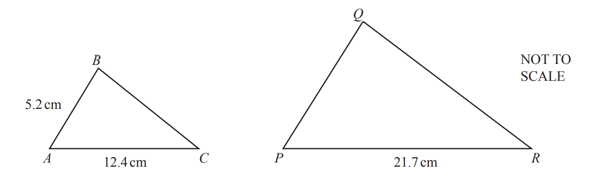

Find $PQ$.

$PQ=$ ......................................... cm

*Source: 2020 Specimen 0580/02 Q12*

