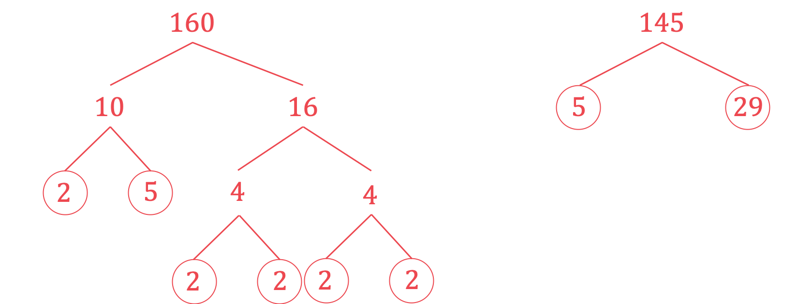

# Mark Schemes — Compound Measures & Speed
**Number** · Cambridge (CIE) IGCSE maths (0607)

## Calculator  Questions (38 questions)

### Q1
> *The distance from **A** to **C** is 115 **metres.*
*The time taken is 35 **seconds**. *
*First convert the units to kilometres (1000 m = 1 km) and hours (1 hour = 3600 seconds (60 × 60)).*

`115 space straight m equals 115 over 1000 equals 0.115 space km
35 space seconds space equals fraction numerator space 35 over denominator 3600 end fraction equals 0.0097 2 with dot on top space hours`

**[1]**

> *Now we can apply the speed-distance-time formula, *$\mathrm{Speed}=\frac{\mathrm{Distance}}{\mathrm{Time}}$*.*

`Speed equals fraction numerator 0.115 over denominator 0.0097 2 with dot on top end fraction equals 11.828 space 571 space...`

**[1]**

$11.8$** km/h*** ***[1]**

### Q2
> *Write the population of the Maldives as a fraction of the surface area of the Maldives.*

$\frac{374600}{3.00\times10^{2}}=\frac{3746}{3}$

> *Convert to a decimal and round to 3 significant figures.*

$\frac{3746}{3}=1248.6666...$

**1250 (3 s.f)**** ****[2] **

**1 mark for 125 × a power of 10**** **

### Q3
> *Density = Mass ÷ Volume  can be rearranged to give  Volume = Mass ÷ Density. *
*But be careful here!  The density is given in g/cm**3**, so 12.5 kg must first be converted to grams. *
*(Remember there are 1000 g in a kg.)*

`table row cell 12.5 space cross times space 1000 space end cell equals cell space 12500 space straight g end cell row blank blank blank row cell 12500 space divided by space 19.3 space end cell equals cell space 647.668393... end cell end table`

**[2] **

> *1 mark for using Volume = Mass ÷ Density. *

> * 1 mark for converting kg to g.*

> *Round to 3 s.f. (and remember your units!).*

**648 cm****3****  [1]**
**Answers in range 647 to 648 will get the mark here.**

### Q4
> *Find the time in hours. Convert 54 minutes into hours by dividing by 60. *

*54 minutes ÷ 60 = 0.9 hours*

> *Write the total time in hours.*

*  5 + 0.9 = 5.9 hours*

*You can use the units for speed to derive the formula if you forget it.* 
*Speed in the question is measured in km/h, km measures the distance and h measures the time.*

> *Therefore the formula is *$\mathrm{Speed}=\frac{\mathrm{Distance}}{\mathrm{Time}}.$

*Substitute in the values for the speed and the time*.

$80=\frac{\mathrm{Distance}}{5.9}$

> *Find the distance by multiplying both sides by 5.9.*

*Distance = 80 × 5.9*

**[1]**

**472 km** **[1]**

### Q5
> *Speed = distance ÷ time. The average speed is given in km/h so convert 11 hours 10 minutes to hours by dividing 10 by 60 and adding it to 11.*

*10 ÷ 60 = 0.16666666... *
*11 + 0.16666666... = 11.166666... hours*

> *Rearrange the formula for speed to make distance the subject.*

*speed = distance ÷ time  ⇒   distance = speed × time.*

> *Find the distance travelled by multiplying the speed by the time taken.*

*813 × 11.166666.... = 9078.5*

* Using formula correctly*** ****[1]  **
*Correct answer before rounding*** ****[1]**

> *Round the answer to the nearest 10 km.*

**9080 km ****[1]**

### Q6
> *Convert the time that car **A** takes to complete a lap into hours. First work out the number of seconds that car **A** took to complete one lap by multiplying the number of minutes by 60 and adding to the number of seconds.*

$2\times60+40=160$

> *Divide the number of total time in seconds by 60 and by 60 again to calculate the total time in hours.*

$160\div60\div60=\frac{2}{45}$

**[1]**

> *Divide the length of the track (in kilometres) by the time taken (in hours) to find the speed of the car in km/h.*

$7.6\div\frac{2}{45}$

**[1]**

**171 km/h ****[1]**

**Answers of 171.0... will also be accepted.**
> *i) The two cars will next both be in the starting position, **S**, at the same time, when the time is a multiple of the time it takes for each car to complete a lap of the racetrack.*

> *Write down the time taken by each car to complete one lap in seconds.*

*Car ***A***: *$160$* seconds*

*Car ***B***: *$2\times60+25=145$* seconds*

> *Break down the numbers of both times into their prime factors and find the highest common factor (HCF).*

**[1]**

*HCF = 5*

> *Calculate the lowest common multiple (LCM) of the time it takes for each car to complete a lap, by multiplying the HCF by the remaining factors of both numbers.*

`table row cell LCM space end cell equals cell space 5 cross times open parentheses 2 cross times 2 cross times 2 cross times 2 cross times 2 close parentheses cross times 29 end cell end table`

**[1]**

`table row LCM equals cell 4640 space end cell end table`

> *Convert the LCM into minutes by dividing by 60.*

$\frac{4640}{60}=77.33333....$

**[1]**

> *Multiply the decimal part by 60 to convert back into second.*

$0.33333...\times60=20$

* ***77 min 20 s ****[1]**

> *ii) Convert the time from part b) i) into hours by dividing by 60.*

$77.33333...\div60=\frac{58}{45}$

> *Calculate the distance travelled by car **A** by multiplying the time taken (in hours) by its speed (in km/h) from part a).*

$\frac{58}{45}\times171$

**[1]**

**220.4 km**** [1]**

### Q7
> *Convert the units for distance into km and time into seconds. Convert 400 metres to km by dividing 400 by 1000.*

*400 ÷ 1000 = 0.4 km*

> *Convert 18 seconds to minutes by dividing 18 by 60.*

*18 ÷ 60 = 0.3 minutes*

> *Convert 0.3 minutes to hours by dividing 0.3 by 60.*

* **0.3 ÷ 60 = 0.005 hours*

**[1]**

> *Find the speed using the formula speed = distance ÷ time.*

*speed = 0.4 km ÷ 0.005 hours*

** **** Correct formula used ****[1] **
**80 km/h ****[1]**

### Q8
*As we are told that water flows in at 200 cm**3** per second, it would be a good idea to change all the measurements into cm and cm**3** rather than m* 
*The dimensions in cm would be 180 cm by 150 cm by 120 cm* *Calculating the volume of the cuboid tank*

$V=180\times150\times120=3240000\mathrm{cm}^{3}$

**[1]**

> *Consider the units of the rate of flow; "200 cm**3** per second" means the volume divided by the time, so we can write that*

`200 space equals fraction numerator volume space open parentheses in space cm cubed close parentheses over denominator time space open parentheses in space seconds close parentheses end fraction`

> *Applying this to the cuboid tank*

$200=\frac{3240000}{\mathrm{time}}$

> *Multiply both sides by time, and then divide both sides by 200*

$\mathrm{time}=\frac{3240000}{200}=16200\mathrm{seconds}$

**[2]**

> *There are 60 seconds in a minute*

$16200\div60=270\mathrm{minutes}$

> *And 60 minutes in an hour*

$4.5\mathrm{hrs}$

$4\mathrm{hours}30\mathrm{minutes}$** [1]**

### Q9
$\mathrm{Average} \mathrm{Speed}=\frac{\mathrm{Total} \mathrm{distance}}{\mathrm{Total} \mathrm{time}}$

*15 20 to 19 50 is 4 hours and 30 minutes, or 4.5 hours* $\mathrm{Average} \mathrm{Speed}=\frac{254}{4.5}$

**[1]**

$\frac{254}{4.5}=56.444...$

$56.4\mathrm{km}/h$** ****[1] **

**Round to 3 significant figures**

### Q10
> *The required units is km/h so convert the time to hours.*

> *There are 60 minutes in an hour so divide 24 minutes by 60 to convert to hours.*

$\frac{24}{60}=0.4$

*3 hours and 24 minutes = 3.4 hours*

**[1]**

$\mathrm{Speed}=\frac{\mathrm{Distance}}{\mathrm{Time}}$*. If you forget this formula then it can be derived by looking at the units for speed km/h. Kilometres measure a distance and hours measure a time.* *Substitute 433.5 for the distance and 3.4 for the time.*

$\frac{433.5}{3.4}=127.5$

**[1]**

**Average speed is 127.5 km/h ****[1]**

### Q11
> *Find the total distance that Olav runs.*

$120+180+150=450$

> *The average speed is the total distance divided by the total time.*

$3.6=\frac{450}{t}$

> *Find the total time taken.*

$t=\frac{450}{3.6}$

$t=125$

> *Find the time taken to run from **A** to **B** by dividing the distance by the speed.*

$\frac{120}{4}=30$

> *Find the time taken to run from **B** to **C** by dividing the distance by the speed.*

$\frac{180}{3}=60$

*Correct speed for either **A** to **B** OR **B** to **C*** [1]**

> *Subtract the time taken to run the first two sections from the total time to find the time taken to run from **C** to **A**.*

$125-30-60=35$

> *Calculate the speed that Olav runs at from **C **to **A** by dividing the distance by the time.*

$\frac{150}{35}=4.28571...$

**[1]**

**4.29 m/s** **[1]**

**Answers in the range 4.285 to 4.286 will be accepted.**

### Q12
> *Using the formula *$\mathrm{Speed}=\frac{\mathrm{Distance}}{\mathrm{Time}}$* we can work out the time it takes the ship to travel form **L** to **P**.*

$40=\frac{248}{t}\,t=\frac{248}{40}=6.2\mathrm{hours}$

**[1]**

> *We need to convert 6.2 hours to hours and minutes.  Change 0.2 hours to minutes by multiplying by 60.*

`table row cell 0.2 cross times 60 end cell equals 12 row cell therefore 6.2 space hours space end cell equals cell space 6 space hours space 12 space minutes end cell end table`

**[1]**

> *Now work out the actual arrival time by adding on 6 h 12 m to 20 45.*

*6 hours later than 20 45 will be 02 45 (the next day) *
*12 minutes later than 02 45 will be 02 57*

**Ship arrives at ****P**** at 02 57 (the next day)*** ***[1]**

**2.57 am is also correct. **

### Q13
> *Find the time Amol spends driving.*

*07 00 to 11 15 is 4 hours and 15 minutes*

> *Convert 15 minutes into hours by dividing by 60. *

*15 minutes ÷ 60 = 0.25 hours*

> *Write the total time in hours.*

*  4 + 0.25 = 4.25 hours*

*You can use the units for speed to derive the formula if you forget it.*

> *Speed in the question is measured in km/h, km measures the distance and h measures the time.*

*Therefore the formula is *$\mathrm{Speed}=\frac{\mathrm{Distance}}{\mathrm{Time}}.$

*Substitute in the values for the speed and the time*.

$50=\frac{\mathrm{Distance}}{4.25}$

> *Find the distance by multiplying both sides by 4.25.*

*Distance = 50 × 4.25*

**[1]**

**212.5 km** **[1]**
> *Find the time Priya spends driving. Find the time to the nearest whole hour first to make it easier.*

*10 55 to 11 00 is 5 minutes *
*11 00 to 12 38 is 1 hour and 38 minutes *
*5 + 38 = 43 *
*10 55 to 12 38 is 1 hour and 43 minutes*

**[1]**

> *Convert 43 minutes into hours by dividing by 60. *

* *$43\mathrm{minutes}\div60=\frac{43}{60}\mathrm{hours}$

> *Write the total time in hours. Write as a mixed number.*

$1+\frac{43}{60}=1\frac{43}{60}\mathrm{hours}$

*You can use the units for speed to derive the formula if you forget it.* 
*Speed in the question is measured in km/h, km measures the distance and h measures the time.*

> *Therefore the formula is *$\mathrm{Speed}=\frac{\mathrm{Distance}}{\mathrm{Time}}.$

*Substitute in the values for the distance and the time*.

`table attributes columnalign right center left columnspacing 0px end attributes row Speed equals cell fraction numerator 54 over denominator 1 begin display style 43 over 60 end style end fraction end cell row blank equals cell 31.4563... end cell end table`

**[1]**

> *Round to 3 significant figures.*

**31.5 km/h** **[1]**

### Q14
> *Once the front of the train enters the station it needs to travel the length of the station (225 m) until the front is out the station. It then needs to travel a further distance, equal to the length of the train (105 m), until the back of the train is out of the station.*

*Total distance = 225 + 105 = 330 m*

> *Write the distance in km by dividing by 1000.*

*330 ÷ 1000 = 0.33 km*

> *Convert 11 seconds into hours by dividing by 60 twice (once for minutes).*

*(11 ÷ 60) ÷ 60 = *$\frac{11}{3600}$* hours*

*Converting both to km and hours*** [1]**

*You can use the units for speed to derive the formula if you forget it.* 
*Speed in the question is measured in km/h, km measures the distance and h measures the time.*

> *Therefore the formula is *$\mathrm{Speed}=\frac{\mathrm{Distance}}{\mathrm{Time}}.$

*Substitute in the values for the distance and the time*.

`fraction numerator 0.33 over denominator open parentheses 11 over 3600 close parentheses end fraction`

**[1]**

**108 km/h** **[1]**

### Q15
> *Speed = distance ÷ time.*

> *Convert 15 hours 42 minutes to hours by dividing 42 by 60 and adding it to 15. *

*42 ÷ 60 = 0.7*

*15 + 0.7 = 15.7 hours*

* **Find the speed by dividing the distance travelled by the time taken.*

> * *

*10260 ÷ 15.7 = 653.503...*

** ****Correct method**** [1]**
**654 km/h (3 s.f.) ****[1]**
i) *Distance travelled = 10260 km.*
*Use the units to help you, km per dollar means divide the number of km by the number of dollars.*

*  **10260 ÷ 470 = 21.82978...*

**21.8 km per dollar (3 s.f.) ****[1]**

ii) *Find the cost per km by dividing the total cost by the distance travelled.*

*  **470 ÷ 10260 = 0.045808....*

* **Find the cost per 100 km by multiplying your answer by 100.*

*  **0.045808.... × 100 = 4.58089...*

** ****Correct method ****[1]**
**\$4.58 per 100 km (3 s.f.) ****[1] **
**\$4.59 also accepted if rounded answer used within correct method.**

### Q16
$\mathrm{Density}=\frac{\mathrm{Mass}}{\mathrm{Volume}}.$* If you forget this formula then you can derive it using the units for density, kg/m**3**. Kilograms measure a mass and cubic metres measure a volume.* 
*Substitute 0.65 for the density and 3.5 for the mass.*

$0.65=\frac{3.5}{\mathrm{Volume}}$

**[1]**

> *Multiply both sides by the volume and divide both sides by 0.65.*

`table row Volume equals cell fraction numerator 3.5 over denominator 0.65 end fraction end cell row blank equals cell 70 over 13 end cell row blank equals cell 5.384615... end cell end table`

**[1]**

> *Round to 3 significant figures. Your answer will be in cubic metres.*

**Volume is 5.38 m****3**** (3sf)** **[1]**

### Q17
> *Calculate the time taken (in hours) for the second part of the journey by dividing the distance travelled by the speed.*

$\frac{45}{20}=2.25$

**[1]**

> *Convert the time taken for the first part of the journey into hours by dividing the minutes part by 60.*

$2\mathrm{hours}24\mathrm{minutes}=2\frac{24}{60}\mathrm{hours}=2.4\mathrm{hours}$

> *Work out the time taken for the whole journey by adding the times for the different sections.*

> $2.25+2.4=4.65\mathrm{hours}$* *

**[1]**

> *Calculate the average speed by dividing the total distance (in kilometres) by the total time (in hours).*

$\frac{105}{4.65}$

**[1]**

**22.6 km/h**** [1]**

**Answers of 22.58... will be accepted.**

### Q18
> *The given units are km/h so convert the time to hours.*

> *There are 60 minutes in an hour so divide 42 minutes by 60 to convert to hours.*

$\frac{42}{60}=0.7$

*6 hours and 42 minutes = 6.7 hours*

**[1]**

$\mathrm{Speed}=\frac{\mathrm{Distance}}{\mathrm{Time}}$*. If you forget this formula then it can be derived by looking at the units for speed km/h. Kilometres measure a distance and hours measure a time.* 
*Substitute 650 for the speed and 6.7 for the time.*

$650=\frac{\mathrm{Di}\text{stance}}{6.7}$

> *Multiply both sides by 6.7.*

$\mathrm{Distance}=650\times6.7$

**[1]**

**Distance is 4355 kilometres ****[1]**

### Q19
> *Time is equal to distance divided by speed*

$\frac{3.9\times10^{7}}{3\times10^{5}}=1.3\times10^{2}$

**[1]**

> *Write as an ordinary number*

**130 seconds** **[1]**
> *Dividing by a smaller number will give a bigger answer*

**It will take longer ****[1]**

### Q20
*The speed is in km/h so the time needs to be in hours* 
*Change 2 hours 20 minutes into hours (by dividing 20 by 60 and adding it to 2)* * *

$\frac{20}{60}+2=\frac{7}{3}$ * *

*speed = *$\frac{\mathrm{distance}}{\mathrm{time}}$

*Find the speed (by dividing the distance of 864 km by the time above in hours)*

$\frac{864}{\frac{7}{3}}$

**dividing 864 by time**** [1] **

**370 km/h** **[1]**

### Q21
> *The fuel pumping rate is given in litres per minute. *
*Start by converting 18500 gallons into litres. *
*Each gallon has 4.5 litres, so **multiply** 18500 by 4.5.*

$18500\times4.5=83250\mathrm{litres}$

**[1]**

> *And each minute, 1700 litres of fuel are pumped. So **divide** 83250 by 1700 to find the number of minutes.*

$83250\div1700=48.970588...\mathrm{minutes}$

**[1]**

> *Finally round to the nearest minute as asked for in the question.*

**49 minutes****  [1]**

> *Answers in the range 48.9 - 49.1 will get the mark here.*

### Q22
> *First find the mass of liquid C.*

$140+128=268g$

**[1]**

> *Now use  Volume = Mass ÷ Density  to find the volumes of Liquids A and B. *

> *Then add those together to find the volume of Liquid C.*

$\mathrm{Liquid}A:\frac{140}{0.7}=200\mathrm{cm}^{3}\,\,\mathrm{Liquid}B:\frac{128}{1.6}=80\mathrm{cm}^{3}\,\,200+80=280\mathrm{cm}^{3}$

**[1]**

> *Use  Density = Mass ÷ Volume  to find the density of Liquid C.*

$\frac{268}{280}=0.957142...$

**[1]**

** **

**0.957 g/cm****3**** (3 s.f.)****  [1]**

**Answers between 0.957 and 0.96 will get the mark here**

### Q23
$\mathrm{speed}=\frac{\mathrm{distance}}{\mathrm{time}}$* so  *$\mathrm{distance}=\mathrm{speed}\times\mathrm{time}$

*The speed is in km/h, so convert *$20$* seconds into hours (by dividing by *$60$* to get minutes, then dividing again by *$60$* to get hours)* * *

$20$* seconds is *$20\div60=\frac{1}{3}$* minutes, which is  *$\frac{1}{3}\div60=\frac{1}{180}$*hours* * *

*Find the distance in km (by multiplying speed by time)* * *

$108\times\frac{1}{180}=0.6$* km*

*Multiplying 108 by time* **[1]**

*1 km = 1000 m*

*Convert km into m (by multiplying by 1000)* * *

$0.6\times1000$* *

** [1]**

$600$** metres ****[1]**

### Q24
> *Find the total distance by adding together the 4 sides. *

* 450 + 350 + 400 + 624 = 1824*

*You can use the units for speed to derive the formula if you forget it.* *Speed in the question is measured in m/s, m measures the distance and s measures the time.*

> *Therefore the formula is *$\mathrm{Speed}=\frac{\mathrm{Distance}}{\mathrm{Time}}.$

*Substitute in the values for the speed and the distance*.

$3=\frac{1824}{\mathrm{Time}}$

**[1]**

> *Rearrange to find the time by multiplying both sides by "Time" and dividing both sides by 3.*

$\mathrm{Time}=\frac{1824}{3}=608$

**[1]**

> *There are 60 seconds in a minute. So divide by 60 to convert to minutes.*

$\frac{608}{60}=10.1333...$

**[1]**

> *There are 10 whole minutes in 608 seconds. Subtract 10 lots of 60 seconds from 608 to find how many seconds are left over.*

`608 minus open parentheses 10 cross times 60 close parentheses equals 8`

**10 minutes 8 seconds*** ***[1]**

### Q25
*To find an average speed, we need to know the total distance and the total time*
* *$\mathrm{Average} \mathrm{speed}=\frac{\mathrm{Total} \mathrm{distance}}{\mathrm{Total} \mathrm{time}}$

*For each bullet point in the question, we will find the total time and the total distance covered, making use of *$\mathrm{Speed}=\frac{\mathrm{Distance}}{\mathrm{Time}}$*or*
$\mathrm{Distance}=\mathrm{Speed}\times\mathrm{Time}$ 
*We also need to find any wait times between journeys, as these also contribute to the total time*

> *Home to airport*

> *To find the distance, we need to use *$\mathrm{Distance}=\mathrm{Speed}\times\mathrm{Time}$

*55 minutes = *$\frac{55}{60}$* of an hour or *$\frac{11}{12}$* hrs *

$\mathrm{Distance}=18\times\frac{11}{12}=16.5\mathrm{km}$

*Speed × Time** [1] *
*16.5*** [1]**

> *Wait time until flight*

> *Left home at 16 30 and took 55 minutes, so arrived at airport at 17 25. Flight left New York at 22 15*

*Wait time of 17 25 to 22 15 = 4h 50m = *$4\frac{50}{60}\mathrm{hrs}=\frac{29}{6}\mathrm{hrs}$

> *Flight from New York to Geneva*

> *To find the arc length we can use the formula *$\frac{θ}{360}\times2πr$* (this is the fraction of the circle, in degrees, multiplied by the formula for the circumference of a circle) where *$θ$* is the angle in degrees, and *$r$* is the radius*

$\frac{55.5}{360}\times2π\times6400=\frac{5920π}{3}=6199.409503...\mathrm{km}$

*55.5 ÷ 360*** [1] **
*Full calculation*** [1] **
*6200 or 6199 to 6200*** [1]**

> *To find the time; the flight left at 22 15 (New York time) and arrived at 11 25 Geneva time. Geneva is 6 hours ahead of New York.*

*11 25 Geneva time is 05 25 New York time*

*22 15 to 05 25 is 7h 10m = *$7\frac{10}{60}=\frac{43}{6}\mathrm{hrs}$

> *Wait time until bus*

> *The flight arrives at 11 25 (Geneva time) but the bus journey only starts at 13 00, so there is a wait time*

*11 25 to 13 00 is 1h35m = *$1\frac{35}{60}=\frac{19}{12}\mathrm{hrs}$

> *Bus Journey from Geneva to Chamonix*

> *To find the distance, we need to use *$\mathrm{Distance}=\mathrm{Speed}\times\mathrm{Time}$

*1h36m = *$1+\frac{36}{60}=1.6\mathrm{hrs}$
 $\mathrm{Distance}=65\times1.6=104\mathrm{km}$

*Speed × Time*** [1] **
*104*** [1]**

> *Average speed for the whole journey*

*Using *$\mathrm{Average} \mathrm{speed}=\frac{\mathrm{Total} \mathrm{distance}}{\mathrm{Total} \mathrm{time}}$* and the distances and times found in km and hours, plus the wait times in hours* *Use the most accurate, unrounded, values you can*

$\mathrm{Average} \mathrm{Speed}=\frac{16.5+\frac{5920π}{3}+104}{\frac{11}{12}+\frac{29}{6}+\frac{43}{6}+\frac{19}{12}+1.6}=392.5409629...$

*Correct total time of 16.1 hours*** [2]**

$393\mathrm{km}/h$ **[2]** 
**392 to 393 allowed**

### Q26
> *All measurements need to use the same units. Convert all lengths to metres using 1 m = 100 cm.*

$1.8\mathrm{cm}=0.018m$

> *Convert all masses to kilograms using 1 tonne = 1000 kg.*

$15\mathrm{tonnes}=15000\mathrm{kg}$

**[1]**

> *Calculate the volume of a wood panel by multiplying the three lengths.*

$\mathrm{Volume}=2.4\times1.2\times0.018=0.05184m^{3}$

**[1]**

> $\mathrm{Density}=\frac{\mathrm{Mass}}{\mathrm{Volume}}.$* Rearrange the formula to find the mass: *$\mathrm{Mass}=\mathrm{Density}\times\mathrm{Volume}.$

$\mathrm{Mass}=750\times0.0518=38.88\mathrm{kg}$

**[1]**

> *Divide 15 000 kg by the mass of one wood panel to determine how many wood panels the truck can hold.*

$\frac{15000}{38.88}=385.802...$

*Dividing 15 tonnes by mass of one wood panel** ***[1] **
*Correct answer***[1]**

> *Round down to the next largest integer.*

**385 wood panels**** [1]**

### Q27
> *As Marseille is 1 hour ahead, 14 46 in "London time" would be 13 46*

> *Finding the time elapsed between 07 19 and 13 46*

*From 07 19 to 08 00 is 41 minutes*

*From 08 00 to 13 00 is 5 hours*

*From 13 00 to 13 46 is 46 minutes*

*In total, 5 hours + 41 minutes + 46 minutes = 5 hours 87 minutes = 6 hours 27 minutes*

**6 h 27 min** **[2]**
*Speed can be calculated using the formula* 
$\mathrm{Speed}=\frac{\mathrm{Distance}}{\mathrm{Time}}$

> *As we want to find the speed in km per hour, we need to find the time in hours between 07 19 (London) and 07 55 (Ashford)*

*07 19 to 07 55 is 36 minutes = *$\frac{36}{60}$* hours = *$0.6$* hours*

**[1]**

> *Calculating the speed*

$\mathrm{Speed}=\frac{90}{0.6}$

**[1]**

$\mathrm{Speed}=150$

**150 km/h** **[1]**
> *Firstly, we will convert the speed of 90 km/h into metres per second, to match the other units used in this question*

> *There are 1000 m in a km*

*90 km/h = 90 000 m/h*

> *60 minutes in an hour, so divide by 60*

*90 000 m/h = 1500 m/min*

> *60 seconds in a minute, so divide by 60*

*25 m/s*

**[1]**

*For the train to completely cross the bridge, the front of the train has to move from one end of the bridge to the other, and then it must move an extra 95 metres (the length of the train) before the tail of the train has crossed the bridge completely* 
*So the total distance the train moves is *$b+95$* where *$b$* is the length of the bridge (and this is what we are finding)*

> *Using *$\mathrm{Speed}=\frac{\mathrm{Distance}}{\mathrm{Time}}$

$25=\frac{b+95}{35}$

**[1]**

> *Multiply both sides by 35*

$875=b+95$

**[1]**

> *Subtract 95 from both sides*

$780=b$

**780 m** **[1]**

### Q28
$\mathrm{Speed}=\frac{\mathrm{Distance}}{\mathrm{Time}}$

> *For an upper bound in a division statement we require the numerator to be as large as possible (upper bound) and the denominator to be as small as possible (lower bound)*

*Upper bound of 146.2 m (1 d.p.) is 146.25 m*

**[1]**

*Lower bound of 7 seconds (nearest second) is 6.5 seconds*

**[1]**

> *So the upper bound for speed is*

$\frac{146.25}{6.5}=22.5$

**Upper bound for the speed of the car is 22.5 m/s ****[1]**

### Q29
> *We want the answer to be in seconds per tray. *
*Start by converting 1 hour into seconds. *
*Remember that there are 60 minutes in an hour, and 60 seconds in a minute.*

$1\mathrm{hour}=60\mathrm{minutes}=60\times60=3600\mathrm{seconds}$

**[1]**

> *Now divide 15000 by 20 to find how many trays are filled in an hour.*

$15000\div20=750\mathrm{trays} \mathrm{per} \mathrm{hour}$

**[1]**

> *Finally divide 3600 by 750 to find the number of seconds per tray.*

$3600\div750=4.8$

**[1]**

**4.8 seconds****  [1]**

### Q30
*Convert each unit separately.* 
*There are 60 seconds in a minute. Divide by 60 to find how many kilometres are travelled in a minute.*

`table row cell 630 space kilometres space per space hour space end cell equals cell fraction numerator space 630 space over denominator 60 end fraction space kilometres space per space minute end cell row blank equals cell 10.5 space kilometres space per space minute end cell end table`

**[1]**

> *There are 60 minutes in an hour. Divide by 60 to find how many kilometres are travelled in a second.*

`table row cell 10.5 space kilometres space per space minute end cell equals cell fraction numerator space 10.5 space over denominator 60 end fraction space kilometres space per space second end cell row blank equals cell 0.175 space kilometres space per space second end cell end table`

> *There are 1000 metres in a kilometre. Multiply by 1000 to find how many metres are travelled in a second.*

`table row cell 0.175 space kilometres space per space second end cell equals cell 1000 cross times 0.175 space metres space per space second end cell end table`

**[1]**

$175\mathrm{metres} \mathrm{per} \mathrm{second}$ **[1]**

### Q31
*Convert each unit separately.* 
*There are 60 seconds in a minute. Multiply by 60 to find how many metres are travelled in a minute.*

`table row cell 50 space metres space per space second space end cell equals cell space 50 space cross times 60 space metres space per space minute end cell row blank equals cell 3000 space metres space per space minute end cell end table`

**[1]**

> *There are 60 minutes in an hour. Multiply by 60 to find how many metres are travelled in an hour.*

`table row cell 3000 space metres space per space minute end cell equals cell space 3000 space cross times 60 space metres space per space hour end cell row blank equals cell 180000 space metres space per space hour end cell end table`

> *There are 1000 metres in a kilometre. Divide by 1000 to find how many kilometres are travelled in an hour.*

`table row cell 18000 space metres space per space hour end cell equals cell 180000 over 1000 space kilometres space per space hour end cell end table`

**[1]**

$180\mathrm{kilometres} \mathrm{per} \mathrm{hour}$ **[1]**

### Q32
$\mathrm{Speed}=\frac{\mathrm{Distance}}{\mathrm{Time}}$*. If you forget this formula then it can be derived by looking at the units for speed km/h. Kilometres measure a distance and hours measure a time.* 
*Substitute 100 for the distance and 28440 for the speed.*

$28840=\frac{100}{\mathrm{Time}}$

> *Rearrange by multiplying both sides by Time and dividing both sides by 28840. Your answer will be in hours.*

$\mathrm{Time}=\frac{100}{28440}\mathrm{hours}$

**[1]**

> *There are 60 minutes in an hour and 60 seconds in each minute. Multiply by 60 twice to convert hours to seconds.*

`table row cell 100 over 28440 space cross times 60 cross times 60 end cell equals cell 1000 over 79 end cell row blank equals cell 12.6582... end cell end table`

**[1]**

> *Round to the nearest integer.*

**13 seconds (nearest second) ****[1]**

### Q33
i) *Find the local time in Berlin when the plane leaves.*
*Berlin is 1 hour behind Athens, so the local time in Berlin is 12.15 when the plane leaves Athens.*

> * Find the time between 12.15 and 15.05.*
*Find the number of minutes until the next hour.*

*12:15 *$\rightarrow$*13:00 (45 mins) *

> *Find the number of hours until 15.00.*

*13:00 *$\rightarrow$*15:00 (2 hours) *

> *Find the number of minutes until 15.05.*

*15:00 *$\rightarrow$*15:05 (5 mins) *

> *Find the total amount of time.*

*12:15 *$\rightarrow$*15:05 = 45 mins + 2 hours + 5 mins*

**2 h 50 mins ****[1]*** *

ii) *Speed = distance ÷ time.*

> *Convert 2 hours 50 minutes to hours by dividing 50 by 60 and adding it to 2.*

* **50 ÷ 60 = 0.833333....*
*2 + 0.833333..... = 2.833333.... hours*

* **Find the speed by dividing the distance travelled by the time taken.*

* **1802 ÷ 2.833333.... *

* Correct method** ***[1]**
**636 km/h ****[1]**

### Q34
> *Average speed is given by (total distance) ÷ (total time) *
*Always check the units. In this case, the distance is given in m, the time is given in s and the answer is requested in m/s- so there is no need to convert units.*

*Average speed *$=\frac{400}{65}=6.153846154...$

$6.15$** ****m/s** **[1]**

**Give your answer to at least 3 significant figures**

### Q35
> *Convert cm**2** to m**2**. *
*As 1 m = 100 cm, you get the conversion 1 m**2** = 100**2** cm**2**.*

*1 m**2** = 100**2** cm**2** = 10**4** cm**2*

> *To convert 120 cm**2**, divide by 10**4**.*

*120 cm**2** = 120 ÷ 10**4** cm**2** = 0.012 m**2*

**[1]**

> *Using the formula for pressure, substitute 810 for the force and 0.012 for the area.*

$\mathrm{Pressure}=\frac{810}{0.012}$

**[1]**

**Pressure is 67500 newtons/m****2** **[1]**

### Q36
> *The required units is km/h so convert the time to hours.*

> *There are 60 minutes in an hour so divide 39 minutes by 60 to convert to hours.*

$\frac{39}{60}=0.65$

*6 hours and 39 minutes = 6.65 hours*

**[1]**

$\mathrm{Speed}=\frac{\mathrm{Distance}}{\mathrm{Time}}$*. If you forget this formula then it can be derived by looking at the units for speed km/h. Kilometres measure a distance and hours measure a time.* *Substitute 429 for the distance and 6.65 for the time.*

$\frac{429}{6.65}=64.5112...$

**[1]**

> *Round to one decimal place.*

**Speed is 64.5 km/h (1dp)** **[1]**

### Q37
> *speed = distance ÷ time so the maximum possible speed is the maximum possible distance divided by the smallest possible time*

> *The upper bound of the distance is*

*7.9 km + (100 m ÷ 2) = 7.9 km + 50 m*

> *The answer is requested in km/h so convert '50 m' to km (by dividing by 1000) in order to get the upper bound of the distance in m*

*                                                        = 7.9 km + 0.05 km = 7.95 km*

> *The lower bound of the time is *

*(133 − 0.5) minutes = 132.5 minutes*

*for a correct upper bound of distance or lower bound of time, in any units*** ****[1]**

> *Convert this to hours by dividing by 60*

*                                        = (132.5 ÷ 60) hours*

> *Now calculate the maximum possible speed by dividing the maximum distance by the minimum time*

*maximum possible speed = *$\frac{7.95}{132.5\div60}$

**Answer = 3.6 km/h ****[1]**

### Q38
> *For a prism, Volume = Area of Cross-section × Length. *
*The cross section here is a right-angled triangle with base 5 cm and height 12 cm. *
*For the area of that triangle, use  Area = (1/2) × Base × Height.  *

`Volume space equals space open parentheses 1 half space cross times space 5 space cross times space 12 close parentheses space cross times space 15 space equals space 450 space cm cubed`

**[1]**

> *Each cm**3** has a mass of 6.6 grams. *
*So multiply 450 by 6.6 to find the mass of the prism.*

$450\times6.6=2970$

**[1]**

**2970 g****  [1]**
