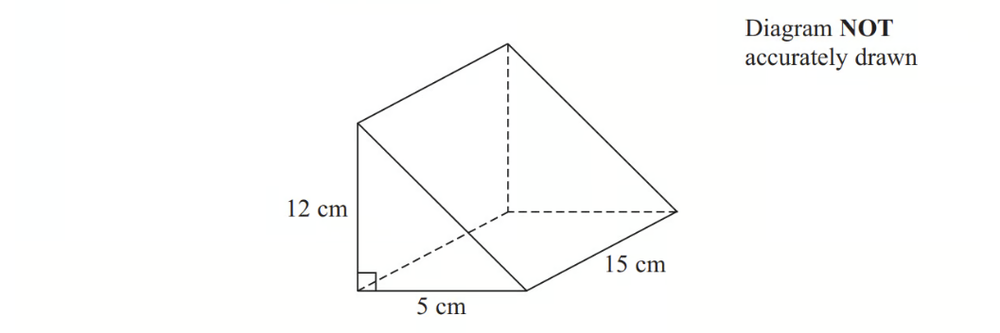

# Exam Questions — Compound Measures & Speed
**Number** · Cambridge (CIE) IGCSE maths (0607)
> Source: [https://www.savemyexams.com/igcse/maths/cie/international-maths/23/extended/topic-questions/](https://www.savemyexams.com/igcse/maths/cie/international-maths/23/extended/topic-questions/) · 38 questions across 1 sets

## Calculator  Questions (38 questions)

### Q1 — medium — 3 marks

**Q1** [3 marks]

The diagram shows the positions of three points $A$, $B$ and $C$ in a field. 
Mitchell takes 35 seconds to run from $A$ to $C$.

Calculate his average running speed in kilometres per hour.

........................................ km/h

*Source: 2020	May/June 0580/41 Q7D*

### Q2 — medium — 2 marks

**Q2** [2 marks]

The table shows the surface area of some countries and their estimated population in 2017.

| Country | Surface area (km2) | Estimated population in 2017 |
|---|---|---|
| Brunei | 5.77 × 103 | 433 100 |
| China | 9.60 × 106 | 1 388 000 000 |
| France | 6.41 × 105 | 67 000 000 |
| Maldives | 3.00 × 102 | 374 600 |

Find the population density of the Maldives.

[Population density = population ÷ surface area]

...............................people/km2

*Source: 2020 Oct/Nov 0580/43 Q1B*

### Q3 — medium — 3 marks

**Q3** [3 marks]

A gold bar has a mass of 12.5 kg.

The density of gold is 19.3 g/cm3

Work out the volume of the gold bar. 
Give your answer correct to 3 significant figures.

*Source: November 2017 1MA1/3H Q3*

### Q4 — medium — 2 marks

**Q4** [2 marks]

A train journey takes 5 hours 54 minutes.
The average speed of the train for this journey is 80 km/h.

Calculate the distance travelled.

................................................ km

*Source: 2020 May/June 0580/23 Q4B*

### Q5 — hard — 3 marks

**Q5** [3 marks]

Karel travelled from London to Johannesburg and then from Johannesburg to Windhoek.
The flight from London to Johannesburg took 11 hours 10 minutes. The average speed was 813 km/h.

Calculate the distance travelled from London to Johannesburg. Give your answer correct to the nearest 10 km.

........................................... km

*Source: 2020 Oct/Nov 0580/42 Q1A*

### Q6 — hard — 9 marks

**Q6** [3 marks]

Car *A* and car *B* take part in a race around a circular track. One lap of the track measures 7.6 km.

Car *A* takes 2 minutes and 40 seconds to complete each lap of the track. 
Car *B* takes 2 minutes and 25 seconds to complete each lap of the track. 
Both cars travel at a constant speed.

Calculate the speed of car *A*. 
Give your answer in kilometres per hour.

........................................... km/h

*Source: 2019	Oct/Nov 0580/42 Q9A*

**Q6** [6 marks]

**Extract:**

Car A and car B take part in a race around a circular track. One lap of the track measures 7.6 km.

Car A takes 2 minutes and 40 seconds to complete each lap of the track. 

Car B takes 2 minutes and 25 seconds to complete each lap of the track. 

Both cars travel at a constant speed.

Both cars start the race from the same position, *S*, at the same time.

i)  Find the time taken when both car *A* and car *B* are next at position *S* **at the same time**.

Give your answer in minutes and seconds.

..................... min ..................... s [4]

ii) Find the distance that car *A* has travelled at this time.

.............................................. km [2]

*Source: 2019	Oct/Nov 0580/42 Q9B*

### Q7 — medium — 3 marks

**Q7** [3 marks]

A car takes 18 seconds to travel 400m along a road.

Calculate the average speed of this car in km/h.

........................................ km/h

*Source: 2020 Oct/Nov 0580/43 Q3B*

### Q8 — hard — 4 marks

**Q8** [4 marks]

A tank is a cuboid measuring $1.8\text{m}$ by $1.5\text{m}$ by $1.2\text{m}$. 
Water flows from a pipe into this empty tank at a rate of $200\text{cm}^{3}$ per second.
Find the time it takes to fill the tank. 
Give your answer in hours and minutes.

........................ hours ..................... minutes

*Source: 2019	May/June 0580/42 Q10B*

### Q9 — hard — 2 marks

**Q9** [2 marks]

The distance between Prague and Vienna is 254 kilometres. 
The local time in Prague is the same as the local time in Vienna. 
A train leaves Prague at 15 20 and arrives in Vienna at 19 50 the same day.
Calculate the average speed of the train.

...................................... km/h

*Source: 2019	May/June 0580/22 Q5*

### Q10 — easy — 3 marks

**Q10** [3 marks]

A train journey from Paris to Amsterdam took 3 hours 24 minutes. The total distance the train travelled was 433.5 km.

Work out the average speed of the train. 
Give your answer in kilometres per hour.

...................................................... km/h

*Source: Jan 2021 4MA1/1HR Q4*

### Q11 — hard — 3 marks

**Q11** [3 marks]

The diagram shows a triangular field, *ABC*, on horizontal ground.
Olav runs from *A* to *B* at a constant speed of 4 m/s and then from *B* to *C* at a constant speed of 3 m/s.
He then runs at a constant speed from *C* to *A*. 
His average speed for the whole journey is 3.6 m/s.

Calculate his speed when he runs from *C* to *A*.

............................................. m/s

*Source: 2019	Oct/Nov 0580/41 Q5A*

### Q12 — hard — 3 marks

**Q12** [3 marks]

The diagram shows two ports, *L* and *P*, and a buoy, *M*.

A ship sails directly from *L* to *P*.
The ship leaves *L* at 20 45 and travels at a speed of 40 km/h.

Calculate the time the next day that the ship arrives at *P*.

*Source: 2018	Feb/Mar 0580/42 Q8B*

### Q13 — medium — 5 marks

**Q13** [2 marks]

Amol drives his truck at an average speed of 50 km/h. 
He leaves at 07 00 and arrives at 11 15.

Calculate the distance he drives.

............................................. km

*Source: 2019 March 0580/42 Q1B*

**Q13** [3 marks]

Priya drives her van a distance of 54 km. 
She leaves at 10 55 and arrives at 12 38.

Calculate her average speed.

.......................................... km/h

*Source: 2019 March 0580/42 Q1C*

### Q14 — hard — 3 marks

**Q14** [3 marks]

A train of length 105 m takes 11 seconds to pass completely through a station of length 225 m.

Calculate the speed of the train in km/h.

........................................ km/h

*Source: 2020 May/June 0580/22 Q17*

### Q15 — medium — 5 marks

**Q15** [2 marks]

Karel travelled from London to Windhoek.

The total time for Karel’s journey was 15 hours 42 minutes. 
The total distance travelled from London to Windhoek was 10 260 km.
Calculate the average speed for this journey.

........................................ km/h

*Source: 2020 Oct/Nov 0580/42 Q1B*

**Q15** [3 marks]

**Extract:**

The total distance travelled from London to Windhoek was 10 260 km.

The cost of Karel’s journey from London to Windhoek was \$470.

i) Calculate the distance travelled per dollar.

........................... km per dollar [1]

ii) Calculate the cost per 100 km of this journey. Give your answer correct to the nearest cent.

\$ .............................. per 100 km [2]

*Source: 2020 Oct/Nov 0580/42 Q1B*

### Q16 — medium — 3 marks

**Q16** [3 marks]

A block of wood has a mass of $3.5\mathrm{kg}$. 
The wood has density $0.65\mathrm{kg}/m^{3}$

Work out the volume of the block of wood. 
Give your answer correct to $3$ significant figures.

*Source: Jan 2019 4MA1/2H Q9A*

### Q17 — hard — 4 marks

**Q17** [4 marks]

Asif cycles a distance of 105 km. 
On the first part of his journey he cycles 60 km in 2 hours 24 minutes. 
On the second part of his journey he cycles 45 km at 20 km/h.

Find his average speed for the whole journey.

........................................... km/h

*Source: 2019	Oct/Nov 0580/43 Q1D*

### Q18 — easy — 3 marks

**Q18** [3 marks]

Abelie flew by plane from Dubai to Rome.

The flight time was $6$ hours $42$ minutes. 
The average speed of the plane was $650$ kilometres per hour.

Work out the distance the plane flew.

..........................................kilometres

*Source: June 2018 4MA1/2HR Q7*

### Q19 — hard — 3 marks

**Q19** [2 marks]

In May 2019, the distance between Earth and Mars was 3.9 $\times$ 107 km.

In May 2019, a signal was sent from Earth to Mars. 
Assuming that the signal sent from Earth to Mars travelled at a speed of 3 $\times$ 105 km per second, how long did the signal take to get to Mars?

....................................seconds

*Source: June 2019 1MA1/3H Q11A*

**Q19** [1 mark]

**Extract:**

In May 2019, the distance between Earth and Mars was 3.9 ![cross times] 10^7^ km. In May 2019, a signal was sent from Earth to Mars. Assuming that the signal sent from Earth to Mars travelled at a speed of 3 ![cross times] 10^5^ km per second, how long did the signal take to get to Mars?

The speed of the signal sent from Earth to Mars in May 2019 was actually less than 3 $\times$ 105 km per second.

How will this affect your answer to part (a)?

*Source: June 2019 1MA1/3H Q11B*

### Q20 — medium — 2 marks

**Q20** [2 marks]

The diagram shows the positions of three cities, Geneva (*G*), Budapest (*B*) and Hamburg (*H*).

A plane flies from Geneva to Hamburg. 
The flight takes 2 hours 20 minutes.

Calculate the average speed in kilometres per hour.

....................................... km/h

*Source: 2018	Oct/Nov 0580/42 Q8A*

### Q21 — medium — 3 marks

**Q21** [3 marks]

There are 18500 gallons of fuel in a fuel tank.

The fuel is pumped from the fuel tank into a plane at a rate of 1700 litres per minute.

1 gallon = 4.5 litres.

How many minutes will it take to empty the fuel tank completely? Give your answer to the nearest minute.

*Source: November 2015 1MA0/2H Q4*

### Q22 — hard — 4 marks

**Q22** [4 marks]

Liquid A has a density of 0.7 g/cm3. 
Liquid B has a density of 1.6 g/cm3.

140 g of liquid A and 128 g of liquid B are mixed to make liquid C.

Work out the density of liquid C.

*Source: June 2015 1MA0/2H Q16*

### Q23 — medium — 3 marks

**Q23** [3 marks]

A car travels at 108 km/h for 20 seconds.

Calculate the distance the car travels. 
Give your answer in metres.

............................................ m

*Source: 2018	Oct/Nov 0580/23 Q15*

### Q24 — medium — 4 marks

**Q24** [4 marks]

The diagram shows a field *ABCD*. 
*AB* = 400m, *BC* = 350m, *CD* = 450m and A*D* = 624m.
Jono runs around the field from *A* to *B*, *B* to *C*, *C* to *D* and *D* to *A*. He runs at a speed of 3 m/s.

Calculate the total time Jono takes to run around the field. 
Give your answer in minutes and seconds, correct to the nearest second.

.................. min .................. s

*Source: 2020 May/June 0580/42 Q5C*

### Q25 — hard — 11 marks

**Q25** [11 marks]

Brad travelled from his home in New York to Chamonix.

- He left his home at 16 30 and travelled by taxi to the airport in New York.  
This journey took 55 minutes and had an average speed of 18 km/h.
- He then travelled by plane to Geneva, departing from New York at 22 15. 
 The flight path can be taken as an arc of a circle of radius 6400 km with a sector angle of 55.5 °.
 The local time in Geneva is 6 hours ahead of the local time in New York. 
Brad arrived in Geneva at 11 25 the next day.
- To complete his journey, Brad travelled by bus from Geneva to Chamonix. 
This journey started at 13 00 and took 1 hour 36 minutes. 
The average speed was 65 km/h.  
The local time in Chamonix is the same as the local time in Geneva.

Find the overall average speed of Brad’s journey from his home in New York to Chamonix. 
Show all your working and give your answer in km/h.

.......................................... km/h

*Source: 2019	May/June 0580/41 Q11*

### Q26 — hard — 6 marks

**Q26** [6 marks]

A truck is used to transport some wood panels. 
Each wood panel is a cuboid measuring 2.4 m by 1.2 m by 1.8 **cm**. The density of each wood panel is 750 kg/m3 .

The truck can carry 15 tonnes of these wood panels.

Calculate the maximum number of wood panels that the truck can carry. 
Show how you decide.

The formula for density is $\frac{\mathrm{mass}}{\mathrm{volume}}$.

*Source: Nov 2020 J560/06 Q6*

### Q27 — hard — 9 marks

**Q27** [2 marks]

Here is part of a train timetable for a journey from London to Marseille. 
All times given are in local time. 
The local time in Marseille is 1 hour ahead of the local time in London.

| London | 07 19 |
|---|---|
| Ashford | 07 55 |
| Lyon | 13 00 |
| Avignon | 14 08 |
| Marseille | 14 46 |

Work out the total journey time from London to Marseille. 
Give your answer in hours and minutes.

.................. h ...................... min

*Source: 2019	May/June 0580/43 Q1A*

**Q27** [3 marks]

**Extract:**

| London | 07 19 |
| Ashford | 07 55 |

The distance from London to Ashford is 90 km.
The local time in London is the same as the local time in Ashford.

Work out the average speed, in km/h, of the train between London and Ashford.

...................................... km/h

*Source: 2019	May/June 0580/43 Q1A*

**Q27** [4 marks]

During the journey, the train takes 35 seconds to completely cross a bridge. 
The average speed of the train during this crossing is 90 km/h. The length of the train is 95 metres.

Calculate the length, in metres, of this bridge.

........................................... m

*Source: 2019	May/June 0580/43 Q1A*

### Q28 — hard — 3 marks

**Q28** [3 marks]

A car travels at a constant speed.
 It travels a distance of 146.2 m, correct to 1 decimal place. 
This takes 7 seconds, correct to the nearest second.

Calculate the upper bound for the speed of the car.

........................................... m/s

*Source: 2020 March 0580/22 Q18*

### Q29 — medium — 4 marks

**Q29** [4 marks]

Tame Valley is a company that makes yoghurt.

A machine fills trays of 20 pots with yoghurt. 
In one hour, the machine fills a total of 15 000 pots.

Work out how many seconds the machine takes to fill each tray of 20 pots.

*Source: June 2013 1MA0/2H Q6*

### Q30 — medium — 3 marks

**Q30** [3 marks]

Change a speed of $630$ kilometres per hour to a speed in metres per second.

*Source: Jan 2019 4MA1/2H Q9B*

### Q31 — easy — 3 marks

**Q31** [3 marks]

Change a speed of 50 metres per second to a speed in kilometres per hour.

.......................... kilometres per hour

*Source: Jan 2020 4MA1/2H Q10*

### Q32 — easy — 3 marks

**Q32** [3 marks]

A rocket travelled $100\mathrm{km}$ at an average speed of $28440\mathrm{km}/h.$

Work out how long it took the rocket to travel the $100\mathrm{km}.$
Give your answer in seconds, correct to the nearest second.

...................................... seconds

*Source: Nov 2020 4MA1/1H Q6*

### Q33 — medium — 3 marks

**Q33** [3 marks]

When the local time in Athens is 09 00, the local time in Berlin is 08 00. A plane leaves Athens at 13 15. It arrives in Berlin at 15 05 local time.

i) Find the flight time from Athens to Berlin.

........................ h ........................ min [1]

ii) The distance the plane flies from Athens to Berlin is 1802 km.   Calculate the average speed of the plane. Give your answer in kilometres per hour.

........................................ km/h [2]

*Source: 2020 Oct/Nov 0580/41 Q2C*

### Q34 — easy — 1 marks

**Q34** [1 mark]

Liz takes 65 seconds to run 400m.

Calculate her average speed.

.......................................... m/s

*Source: 2018	May/June 0580/23 Q3*

### Q35 — easy — 3 marks

**Q35** [3 marks]

$\mathrm{pressure}=\frac{\mathrm{force}}{\mathrm{area}}$

Find the pressure exerted by a force of 810 newtons on an area of 120 $\mathrm{cm}^{2}$ 
Give your answer in $\mathrm{newtons}/m^{2}$

...........................$\mathrm{newtons}/m^{2}$

*Source: Specimen 2016 4MA1/1H Q2*

### Q36 — easy — 3 marks

**Q36** [3 marks]

A train takes 6 hours 39 minutes to travel from New Delhi to Kanpur. 
The train travels a distance of 429 km.

Work out the average speed of the train. 
Give your answer in km/h correct to one decimal place.

*Source: Jan 2021 4MA1/2H Q1*

### Q37 — hard — 3 marks

**Q37** [3 marks]

Serge walks 7.9 km, correct to the nearest 100 metres. 
The walk takes 133 minutes, correct to the nearest minute.

Calculate the maximum possible average speed of Serge’s walk. Give your answer in kilometres/hour.

....................................... km/h

*Source: Specimen 2025 0580/04 Q23*

### Q38 — medium — 3 marks

**Q38** [3 marks]

The diagram shows a solid triangular prism.

The prism is made from metal. 
The density of the metal is 6.6 grams per cm3.

Calculate the mass of the prism.

*Source: 2012 November 2012 1MA0/2H Q13*

