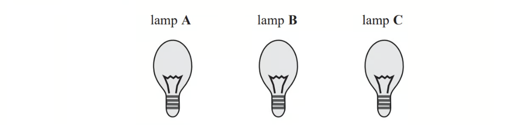

# Exam Questions — Prime Factors, HCF & LCM
**Number** · Cambridge (CIE) IGCSE maths (0607)
> Source: [https://www.savemyexams.com/igcse/maths/cie/international-maths/23/extended/topic-questions/](https://www.savemyexams.com/igcse/maths/cie/international-maths/23/extended/topic-questions/) · 20 questions across 1 sets

## Calculator  Questions (20 questions)

### Q1 — easy — 3 marks

**Q1** [3 marks]

Write 525 as a product of its prime factors.

*Source: 2013	June 1MA0/1H Q5*

### Q2 — hard — 3 marks

**Q2** [2 marks]

Find the lowest common multiple (LCM) of 40 and 56.

*Source: 2018	June 1MA1/2H Q2A*

**Q2** [1 mark]

$A=2^{3}\times3\times5B=2^{2}\times3\times5^{2}$

Write down the highest common factor (HCF) of *A* and *B*.

*Source: 2018	June 1MA1/2H Q2B*

### Q3 — medium — 4 marks

**Q3** [2 marks]

Write 56 as a product of its prime factors.

*Source: 2018	Oct/Nov 0580/22 Q23A*

**Q3** [2 marks]

Find the lowest common multiple (LCM) of 56 and 42.

*Source: 2018	Oct/Nov 0580/22 Q23B*

### Q4 — hard — 4 marks

**Q4** [2 marks]

Find the highest common factor $(\mathrm{HCF})$ of $96$ and $120$.

*Source: Jan 2019 4MA1/2H Q6A*

**Q4** [2 marks]

`table row cell A space end cell equals cell space 2 cubed space cross times space 5 space cross times space 7 squared space cross times space 11 space end cell row cell B space end cell equals cell space 2 to the power of 4 space cross times space 7 space cross times space 11 space end cell row cell C space end cell equals cell space 3 space cross times space 5 squared end cell end table`

Find the lowest common multiple $(\mathrm{LCM})$ of $A,B$ and $C.$

*Source: Jan 2019 4MA1/2H Q6B*

### Q5 — medium — 2 marks

**Q5** [2 marks]

Work out the lowest common multiple (LCM) of 120 and 144.

*Source: Nov 2019 8300/2H Q5*

### Q6 — medium — 3 marks

**Q6** [3 marks]

Buses to Acton leave a bus station every 24 minutes. Buses to Barton leave the same bus station every 20 minutes.

A bus to Acton and a bus to Barton both leave the bus station at 9 00 am.

When will a bus to Acton and a bus to Barton next leave the bus station at the same time?

*Source: 2012	June 1MA0/1H Q7*

### Q7 — hard — 2 marks

**Q7** [2 marks]

`table row cell A space end cell equals cell space 3 to the power of 5 cross times space 5 space cross times space 7 cubed space end cell row cell B space end cell equals cell space 2 cubed cross times space 3 space cross times space 7 to the power of 4 space end cell row cell C space end cell equals cell space 2 to the power of p cross times space 5 to the power of q cross times space 7 to the power of r end cell end table`

Given that

the HCF of $B$ and $C$ is 23× 7 
the LCM of $A$ and $C$ is 24× 35× 52× 73

Find the value of $p,$ the value of $q$ and the value of $r$.

$p=$ .......................................................

$q=$ .......................................................

$r=$ .......................................................

*Source: June 2018 4MA1/1H Q8B*

### Q8 — medium — 2 marks

**Q8** [2 marks]

Work out the lowest common multiple (LCM) of 36 and 120.

*Source: Jan 2022 4MA1/1HR Q6A*

### Q9 — easy — 2 marks

**Q9** [2 marks]

Write 84 as a product of its prime factors.

*Source: 2020 Oct/Nov 0580/02 Q8B*

### Q10 — medium — 4 marks

**Q10** [2 marks]

$A=3^{2}\times5^{4}\times7B=3^{4}\times5^{3}\times7\times11$

Find the highest common factor (HCF) of $A$ and $B$.

*Source: June 2019 4MA1/2HR Q8A*

**Q10** [2 marks]

**Extract:**

A equals 3 squared times 5 to the power of 4 times 7          B equals 3 to the power of 4 times 5 cubed times 7 times 11

Find the lowest common multiple (LCM) of $A$ and $B$.

*Source: June 2019 4MA1/2HR Q8B*

### Q11 — medium — 3 marks

**Q11** [2 marks]

Written as the product of its prime factors

$672=2^{5}\times3\times7$

Write 252 as the product of its prime factors.

*Source: Specimen 2015 8300/2H Q9A*

**Q11** [1 mark]

Work out the value of the highest common factor of 672 and 252.

*Source: Specimen 2015 8300/2H Q9B*

### Q12 — medium — 2 marks

**Q12** [2 marks]

$A=3^{5}\times5\times7^{3}\,B=2^{3}\times3\times7^{4}$

i) Find the Highest Common Factor (HCF) of $A$ and $B$.

[1]

ii) Find the Lowest Common Multiple (LCM) of $A$and $B$.

[1]

*Source: June 2018 4MA1/1H Q8A*

### Q13 — easy — 3 marks

**Q13** [3 marks]

Trams leave Piccadilly

to Eccles every 9 minutes

to Didsbury every 12 minutes

A tram to Eccles and a tram to Didsbury both leave Piccadilly at 9 am.

At what time will a tram to Eccles and a tram to Didsbury next leave Piccadilly at the same time?

*Source: 2013	March 1MA0/1H Q8*

### Q14 — hard — 4 marks

**Q14** [3 marks]

Write 720 as a product of its prime factors. 
Show your working clearly.

*Source: June 2019 4MA1/1HR Q5A*

**Q14** [1 mark]

**Extract:**

Write 720 as a product of its prime factors. 

Show your working clearly.

Find the smallest whole number that 720 can be multiplied by to give a square number.

*Source: June 2019 4MA1/1HR Q5B*

### Q15 — medium — 3 marks

**Q15** [3 marks]

A machine has a buzzer that sounds every 50 minutes. The machine also has a bell that sounds every 80 minutes.

The buzzer and the bell sound together at 10 am.

Find the time at which they next sound together.

*Source: Specimen 2016 4MA1/1H Q3B*

### Q16 — medium — 2 marks

**Q16** [2 marks]

Find the highest common factor (HCF) of 90 and 48.

*Source: 2019	May/June 0580/22 Q9*

### Q17 — medium — 5 marks

**Q17** [3 marks]

Express 180 as a product of its prime factors.

*Source: 2014	November 1MA0/1H Q13A*

**Q17** [2 marks]

Martin thinks of two numbers.

He says,

"The Highest Common Factor (HCF) of my two numbers is 6

The Lowest Common Multiple (LCM) of my two numbers is a multiple of 15"

Write down **two** possible numbers that Martin is thinking of.

*Source: 2014	November 1MA0/1H Q13B*

### Q18 — medium — 2 marks

**Q18** [2 marks]

`table row blank blank cell A space equals space 2 cubed cross times 3 squared cross times 5 squared cross times 11
B space equals space 2 to the power of 4 cross times 3 cross times 5 to the power of 4 cross times 13 end cell end table`

Find the lowest common multiple (LCM) of $A$and $B$. 
Give your answer as a product of powers of prime numbers.

*Source: Jan 2021 4MA1/2H Q9*

### Q19 — hard — 1 marks

**Q19** [1 mark]

Find the highest **odd** number that is a factor of 60 and a factor of 90.

*Source: 2020	May/June 0580/21 Q2*

### Q20 — hard — 3 marks

**Q20** [3 marks]

Here are three lamps.

Lamp **A** flashes every 20 seconds.

Lamp **B** flashes every 45 seconds.

Lamp **C** flashes every 120 seconds.

The three lamps start flashing at the same time.

How many times in one hour will the three lamps flash at the same time?

*Source: 2018 June 1MA1/3H Q10*

