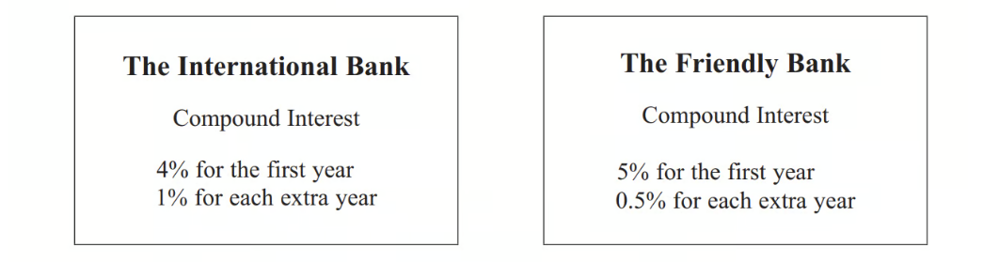
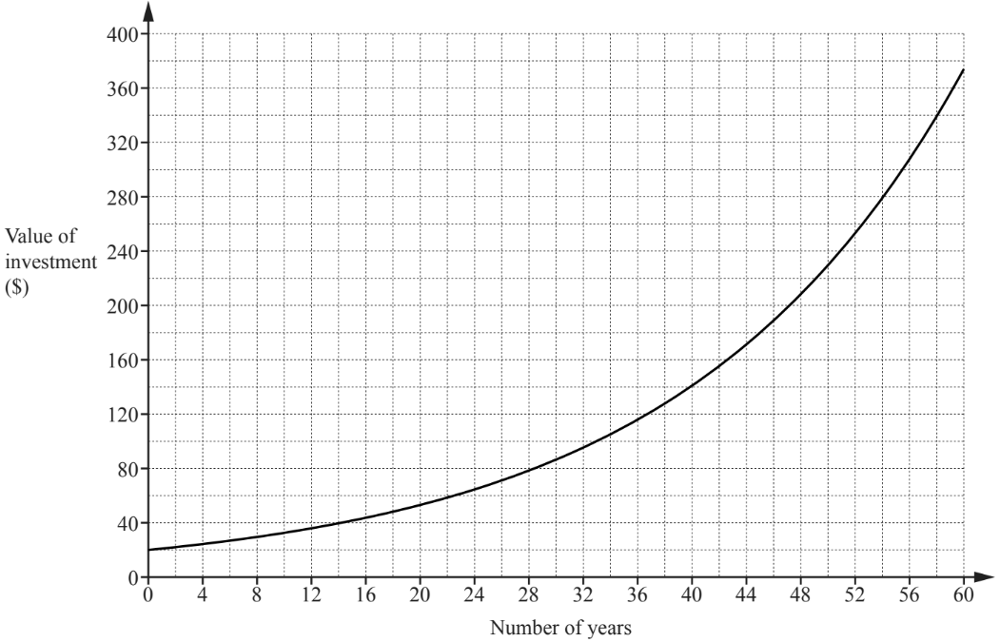

# Exam Questions — Simple & Compound Interest
**Number** · Cambridge (CIE) IGCSE maths (0607)
> Source: [https://www.savemyexams.com/igcse/maths/cie/international-maths/23/extended/topic-questions/](https://www.savemyexams.com/igcse/maths/cie/international-maths/23/extended/topic-questions/) · 31 questions across 1 sets

## Exam Questions (31 questions)

### Q1 — hard — 3 marks

**Q1** [3 marks]

Hans invests \$550 at a rate of $x$% per year compound interest. At the end of 10 years, the value of the investment is \$638.30, correct to the nearest cent.

Find the value of $x.$

$x$ = ..............................................

*Source: 2020 Specimen 4 Q1D*

### Q2 — hard — 3 marks

**Q2** [3 marks]

Edna invests \$500 at a rate of $r$% per year compound interest. At the end of 6 years, the value of Edna’s investment is \$559.78.

Find the value of $r$.

$r=$...............................................

*Source: 2020 May/June 0580/42 Q1C*

### Q3 — very_hard — 3 marks

**Q3** [3 marks]

Alan invests \$200 at a rate of $r$ per year compound interest. 
After 2 years the value of his investment is \$206.46.

Show that     $r^{2}+200r-323=0$.

### Q4 — very_hard — 4 marks

**Q4** [4 marks]

Katy invests £2000 in a savings account for 3 years.

The account pays compound interest at an annual rate of

2.5% for the first year

*x*% for the second year

*x*% for the third year

There is a total amount of £2124.46 in the savings account at the end of 3 years.

Work out the rate of interest in the second year.

*Source: 2015	Sample 1MA1/2H Q10A*

### Q5 — very_hard — 4 marks

**Q5** [4 marks]

Jean invests £12000 in an account paying compound interest for 2 years.

In the first year the rate of interest is $x$% 
At the end of the first year the value of Jean's investment is £12336

In the second year the rate of interest is $\frac{x}{2}$ %

What is the value of Jean's investment at the end of 2 years?

*Source: 2018	June 1MA1/2H Q9*

### Q6 — very_hard — 3 marks

**Q6** [3 marks]

A savings account pays interest at a rate of *R*% per year. 
Jack invests £5500 in the account for one year.

At the end of the year, Jack pays tax on the interest at a rate of 40%. 
After paying tax, he gets £79.20

Work out the value of *R*.

*Source: 2017	November 1MA1/3H Q9B*

### Q7 — very_hard — 3 marks

**Q7** [3 marks]

Naoby invests £6000 for 5 years. The investment gets compound interest of *x*% per annum.

At the end of 5 years the investment is worth £8029.35

Work out the value of *x*.

*Source: 2017	June 1MA1/3H Q10*

### Q8 — very_hard — 5 marks

**Q8** [5 marks]

Paddy and Anna each invest \$2000 for 5 years. 
Paddy earns simple interest at a rate of 1.25% per year. 
Anna earns compound interest at a rate of $r$% per year.
At the end of 5 years, Paddy’s investment is worth the same as Anna’s investment.

Calculate the value of $r$.

$r=$...............................................

*Source: 2020 May/June 0580/23 Q16*

### Q9 — very_hard — 3 marks

**Q9** [3 marks]

Alain invests \$5000 at a rate of $r$% per year compound interest. At the end of 15 years, the value of the investment is \$7566.

Find the value of $r$.

$r$ = ..............................................

*Source: Specimen 2025 0580/04 Q14B*

### Q10 — hard — 2 marks

**Q10** [2 marks]

Ollie invests \$200 at a rate of 0.0035% per day compound interest.

Calculate the value of Ollie’s investment at the end of 1 year. [1 year = 365 days.]

\$ ................................................

*Source: 2020 May/June 0580/42 Q1C*

### Q11 — hard — 3 marks

**Q11** [3 marks]

Bryan invested \$480 in an account 4 years ago. 
The account pays compound interest at a rate of 2.1% per year. Today, he uses some of the money in this account to buy a bicycle costing \$430.

Calculate how much money remains in his account.

\$ ..................................................

*Source: 2019	Oct/Nov 0580/43 Q1E*

### Q12 — hard — 7 marks

**Q12** [7 marks]

Beth invests \$2000 at a rate of 2% per year compound interest.

i) Calculate the value of this investment at the end of 5 years.

\$ ................................................ [2]

ii) Calculate the overall percentage increase in the value of Beth’s investment at the end of 5 years.

............................................. % [2]

iii) Calculate the minimum number of complete years it takes for the value of Beth’s investment to increase from \$2000 to more than \$2500.

[3]

*Source: 2020 Oct/Nov 0580/42 Q3A*

### Q13 — hard — 10 marks

**Q13** [7 marks]

Hong has \$4000 to invest. 
She invests \$2000 at a rate of 2.5% per year **simple** interest. 
She also invests \$2000 at a rate of 2% per year **compound** interest.

i)  Find the value of each investment at the end of 8 years.

Simple interest investment \$ .................................................... Compound interest investment \$ ................................................[5]

ii)  Find the overall percentage increase in the \$4000 investment at the end of 8 years.

............................................% [2]

*Source: Specimen 2025 0580/04 Q14A*

**Q13** [3 marks]

**Extract:**

She also invests \$2000 at a rate of 2% per year compound interest.

Find the number of complete years it takes for the compound interest investment of \$2000 to become greater than \$2500.

*Source: Specimen 2025 0580/04 Q14B*

### Q14 — medium — 2 marks

**Q14** [2 marks]

Sara invests \$500 for 15 years at a rate of 2% per year simple interest.

Calculate the total interest Sara receives.

\$ ...............................................

*Source: 2018	May/June 0580/43 Q1B*

### Q15 — medium — 3 marks

**Q15** [3 marks]

Roland invests \$12 000 in an account that pays compound interest at a rate of 2.2% per year.

Calculate the value of his investment at the end of 6 years. 
Give your answer correct to the nearest dollar.

\$ ...............................................

*Source: 2018	May/June 0580/41 Q2B*

### Q16 — medium — 1 marks

**Q16** [1 mark]

Scott invests \$500 for 7 years at a rate of 1.5% per year simple interest.

Calculate the value of his investment at the end of the 7 years.

\$....................................................

### Q17 — medium — 2 marks

**Q17** [2 marks]

Dina invests \$600 for 5 years at a rate of 2% per year compound interest.

Calculate the value of this investment at the end of the 5 years.

\$ ...................................................

*Source: 2019	Oct/Nov 0580/41 Q3A*

### Q18 — medium — 2 marks

**Q18** [2 marks]

Marlene invests \$550 at a rate of 1.9% per year compound interest.

Calculate the value of the investment at the end of 10 years.

\$ ..............................................

*Source: 2020 Specimen 4 Q1C*

### Q19 — medium — 3 marks

**Q19** [3 marks]

Boris invests \$550 at a rate of 2% per year simple interest.

Calculate the value of the investment at the end of 10 years.

\$ ...............................................

*Source: 2020 Specimen 4 Q1B*

### Q20 — medium — 2 marks

**Q20** [2 marks]

Dean invests \$500 for 10 years at a rate of 1.7% per year simple interest.

Calculate the total interest earned during the 10 years.

\$ ................................................

*Source: 2020 May/June 0580/42 Q1C*

### Q21 — medium — 2 marks

**Q21** [2 marks]

Gretal invests \$5000 at a rate of 2% per year compound interest.

Calculate the value of her investment at the end of 3 years.

\$ ................................................

*Source: 2020	May/June 0580/41 Q1B*

### Q22 — medium — 3 marks

**Q22** [3 marks]

Katy invests £200 000 in a savings account for 4 years. 
The account pays compound interest at a rate of 1.5 % per annum.

Calculate the total amount of interest Katy will get at the end of 4 years.

*Source: June 2019 1MA1/3H Q2*

### Q23 — medium — 3 marks

**Q23** [3 marks]

Liam invests £6200 for 3 years in a savings account. 
He gets 2.5% per annum compound interest.

How much money will Liam have in his savings account at the end of 3 years?

### Q24 — hard — 5 marks

**Q24** [3 marks]

Ian invested an amount of money at 3% per annum compound interest.

At the end of 2 years the value of the investment was £2652.25

Work out the amount of money Ian invested.

*Source: 2015	Spec1 1MA1/3H Q8A*

**Q24** [2 marks]

Noah has an amount of money to invest for five years.

Noah wants to get the most interest possible.

Which account is best? 
You must show how you got your answer.

*Source: 2015	Spec1 1MA1/3H Q8B*

### Q25 — medium — 4 marks

**Q25** [4 marks]

Jack has £15 000 to invest in a savings account for 3 years.

He finds information about two savings accounts.

Jack wants to have as much money as possible in his savings account at the end of the 3 years.

Which of these two savings accounts should he choose?

*Source: 2017	June 1MA0/2H Q14*

### Q26 — medium — 4 marks

**Q26** [4 marks]

Viv wants to invest £2000 for 2 years in the same bank.

At the end of 2 years, Viv wants to have as much money as possible.

Which bank should she invest her £2000 in?

*Source: 2013	June 1MA0/2H Q14*

### Q27 — medium — 2 marks

**Q27** [2 marks]

Toby invested £7500 for 2 years in a savings account. 
He was paid 4% per annum compound interest.

How much money did Toby have in his savings account at the end of 2 years?

*Source: 2015	Spec1 1MA1/2H Q6*

### Q28 — hard — 4 marks

**Q28** [2 marks]

When Heidi was born, her grandfather invested some money in an account that paid compound interest. 
The graph shows the exponential growth of this investment.

i) Use the graph to find the original amount of money invested,

\$ ................................................ [1]

ii) Use the graph to find the number of years it took for the original amount to double,

....................................... years [1]

*Source: 2018	Oct/Nov 0580/21 Q21A*

**Q28** [2 marks]

**Extract:**

i) Use the graph to find the original amount of money invested.
ii) Use the graph to find the number of years it took for the original amount to double.

This account earned compound interest at a rate of $r$% per year.

Use your answers to **part (a)(i)** and** part** **(a)(ii)** to write down an equation in terms of $r$. 
You do not have to solve your equation.

*Source: 2018	Oct/Nov 0580/21 Q21B*

### Q29 — medium — 3 marks

**Q29** [3 marks]

Jan invests \$800 at a rate of 3% per year simple interest.

Calculate the value of her investment at the end of 4 years.

\$ ................................................

*Source: 2018	Oct/Nov 0580/21 Q9*

### Q30 — medium — 3 marks

**Q30** [3 marks]

Eric invests an amount in a bank that pays compound interest at a rate of 2.16% per year. 
At the end of 5 years, the value of his investment is \$6999.31.

Calculate the amount Eric invests.

\$ .................................................

*Source: 2019 March 0580/22 Q14*

### Q31 — hard — 2 marks

**Q31** [2 marks]

Paula invests \$600 at a rate of $r$% per year simple interest. 
At the end of 10 years, the total interest earned is \$90.

Find the value of $r$.

$r$ = ...................................................

*Source: 2019	Oct/Nov 0580/21 Q9*

