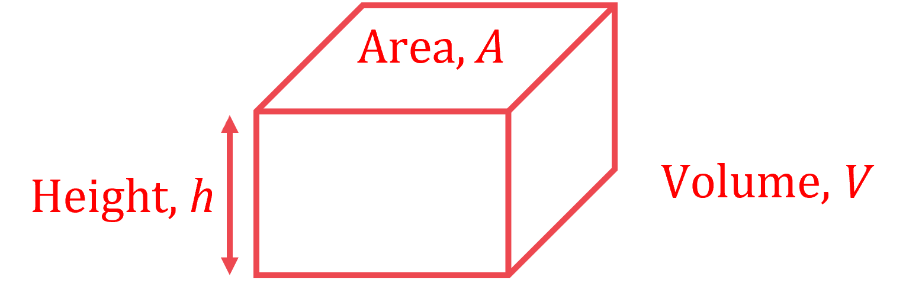

# Mark Schemes — Time, Currency & Units
**Number** · Cambridge (CIE) IGCSE maths (0607)

## Calculator Questions (29 questions)

### Q1
> *Convert 19 euros into Swiss francs*

$19\times1.08=20.52$

**[1]**

> *Find the difference between the cost in Switzerland and the cost in France*

$22-20.52$

**Final answer:** $1.48$** Swiss francs**

**[1]**

### Q2
*Convert each unit separately.*

> *There are 60 seconds in a minute. Multiply by 60 to find how many metres are travelled in a minute.*

`table row cell 50 space metres space per space second space end cell equals cell space 50 space cross times 60 space metres space per space minute end cell row blank equals cell 3000 space metres space per space minute end cell end table`

**[1]**

> *There are 60 minutes in an hour. Multiply by 60 to find how many metres are travelled in an hour.*

`table row cell 3000 space metres space per space minute end cell equals cell space 3000 space cross times 60 space metres space per space hour end cell row blank equals cell 180000 space metres space per space hour end cell end table`

> *There are 1000 metres in a kilometre. Divide by 1000 to find how many kilometres are travelled in an hour.*

`table row cell 18000 space metres space per space hour end cell equals cell 180000 over 1000 space kilometres space per space hour end cell end table`

**[1]**

$180\mathrm{kilometres} \mathrm{per} \mathrm{hour}$ **[1]**

### Q3
> *1 kilometre = 1000 metres so multiply distances in km by 1000 to convert to m*

*90 km = (90 × 1000) m = 90,000 m*

> *1 minute = 60 minutes = 60 lots of 60 seconds. *

*1 h = (1 × 60 × 60) s = 3600 s*

> *90 km in one hour is equivalent to 90,000 metres in 3600 seconds*

*speed = *$\frac{90,000m}{3600s}$

> *Dividing 90,000 by 3600 gives the final answer*

**[1]**

**25 m/s  ****[1]**

### Q4
> *First find the length of the side in metres by taking the positive square root of the area.*

$\sqrt{0.25}=0.5m$

> *1 m = 100 cm. Convert the into centimetres by multiplying by 100.*

*0.5 × 100 = 50*

**50 cm** **[1]**

### Q5
i) *Change 20 minutes into seconds (by multiplying by 60)* * *

*20 *$\times$*60 = 1200* * *

> *75 000 litres of water flows out every 1 second*

*Find the amount of water flowing out over 1200 seconds (by multiplying 75 000 by 1200)* * *

*75 000 *$\times$*1200 = 90 000 000 litres* * *

> *Write 90 000 000 litres in millions*

**90 million litres** **[1]**

ii) *The volume of water that leaves the lake, **V,** formed a prism of height **h** m and cross-sectional area **A **m**2* * *

*V** = 90 000 000 litres from part (a)(i)* 
*Change **V** into m**3** (by dividing by 1000)* * *

**V*** = 90 000 m**3**  *

*A** = 55 hectares*
 *Change **A** into m**2** (by multiplying by 10**4** = 10 000)* * *

**A*** = 55 *$\times$*10 000 = 550 000 m**2* * *

*The volume of a prism is** V** = **A** *$\times$* **h *
*Make **h** the subject of the formula (by dividing both sides by **A**)* * *

$\frac{V}{A}=h$* * * *

*Substitute **V** = 90 000 and **A** = 550 000 into the formula* * *

$h=\frac{90000}{550000}=0.1636...$* metres*

*the figures 164 or 1636 seen*** [1]** 
*0.164 or 0.1636...*** ****[1]**

> *Give **h** in cm (by multiplying by 100)*

**16.4 cm** **[1] **

### Q6
> *First multiply 3.785 litres by 108.9p per litre, to find the London price per US gallon in £.*

`3.785 space cross times space 108.9 space equals space 412.1865 space straight p space equals space £ 4.121865`

**[1]**

> *£1 = \$1.46, so multiply 4.121865 by 1.46 to find the London price per US gallon in \$.*

`4.121865 space cross times space 1.46 space equals space 6.0179229 space equals space $ 6.02 space open parentheses 2 space straight d. straight p. close parentheses`

**[1]**

> *Interpret your results in the context of the question.*

**In London petrol costs \$6.02 per US gallon, but in New York it is only \$2.83 dollars per US gallon.  So it is better value in New York.****  [1]**

**You can also answer the question and get full marks by making the comparison in £s. E.g., \$2.83 per US gallon = 2.83 ÷ 3.785 = \$0.7476... per litre. Which is 0.7476... ÷ 1.46 = £0.5121... = 51.2p per litre, so it's cheaper in New York.  **

### Q7
> *£1 is HK\$12.30.  So HK\$3179.55 is equivalent to 3179.55 ÷ 12.30 £s.*

`3179.55 space divided by space 12.30 space equals space £ 258.50`

**[1]**

> *Subtract that from the London price to find out how much he saved.*

`285 space minus space 258.50 space equals space £ 26.50`

**[1]**

**£26.50 cheaper****  [1]**

**You can also answer this and get full marks by comparing both prices in HK\$.**
** I.e., £285 = 285 × 12.30 = HK\$3505.50.  So it's 3505.50 - 3179.55 = HK\$325.95 cheaper.**

### Q8
> *Find how many euros are equal to 150 dollars by multiplying the number of dollars by the exchange rate.*

$150\times0.84=126\mathrm{euros}$

> *Find the cost, in euros, of 1 kg of cheese by multiplying the cost for 200 grams by 5. *

`table row cell 3.45 space cross times space 5 space end cell equals cell space 17.25 space euros end cell end table`

*Either calculation** ***[1]**

> *Divide the amount of euros the chef has by the cost for 1 kg of cheese. *

$\frac{126}{17.25}=7.30434...$

** ****Correct method**** [1]  **
**Correct answer ****[1]**

> *Round the answer to 1 decimal place.*

$7.3\mathrm{kg}(1d.p.)$* ***[1]**

### Q9
> *Work out the total cost of the apples*

`5 cross times $ 2.69 equals $ 13.45`

**[1]**

> *Subtract this from the total spend*

`$ 17.56 minus $ 13.45 equals $ 4.11`

> *Divide the resulting amount by 3 to find the cost per kilograms of bananas*

`$ 4.11 divided by 3`

**[1]**

`bold $ bold 1 bold. bold 37`** [1]**

### Q10
> *Divide the number of rupees by 68.14 to convert it into dollars.*

$30000\div68.14$

**[1]**

$440.270032...$

** **`bold $ bold 440`** ****[1]**

**Answers between 440.2 and 440.3 will be accepted.**

### Q11
> *Divide the number of Namibian dollars by the number of \$.*

*3891 ÷ 300 = 12.97*

**\$1 = 12.97 Namibian dollars**** [1]**

### Q12
> *Find the cost, in Krone, of 1 litre of oil from Dane Oil by dividing its price by the number of litres.*

$2500000\div4.2\times10^{5}=5.952380952...\mathrm{Krone}$

**[1]**

> *Find the cost, in dollars, of 1 litre of oil from Arctic Oil by dividing its price by the number of litres.*

$770000\div8.6\times10^{5}=0.8953488372...\mathrm{Dollars}$

**[1]**

> *To compare this cost per litre with the cost per litre of Dane Oil, convert it into Krone. 1 Dollar = 6.57 Krone so multiply by 6.57.*

$0.8953488372...\times6.57=5.88244186...\mathrm{Krone}$

**[1]**

> *Compare the prices per litre*

$5.952380952...>5.88244186...$* therefore Dane Oil is more expensive than Arctic Oil*

**Astrid should buy from Arctic Oil**** [1] **

**This question could also be completed by finding the cost per litre from both companies in dollars, by ****dividing**** the Dane Oil price by 6.57**

### Q13
> *As we are asked to give the difference in dollars, we should convert the price in euros, to dollars*

> *If \$1=0.9416 euros, we can **divide both sides by 0.9416** to find the price in dollars for 1 euro*

`table row cell $ 1 space end cell equals cell space 0.9416 space euros end cell row cell $ 1.06202209 space end cell equals cell space 1 space euro end cell end table`

**[1]**

> *We can now use this to find the price of the 2.25 euro newspaper, in dollars*

`2.25 space euros space equals space 2.25 space cross times $ 1.06202209 equals $ 2.389549703`

> *Find the difference between this price and the \$1.13 Maria paid at home*

$2.389549703-1.13=1.259549703...$

**[1]**

`bold $ bold space bold 1 bold. bold 26` **[1]**

**Rounded to 2 decimal places (as it is money)**

### Q14
*The answer is required in rupees so we need to convert the charge in US Dollars to rupees.* 
*We need to find how many times 0.0153 goes into 35.*

$35\div0.0153=2287.581...$

**[1]**

> *Now find the difference between this and the amount the dressmaker charges in rupees.*

$2300-2287.581...=12.418...$

**12.42 rupees** **[1]**

### Q15
> *£1 is 1.16 euros.  So 5 euros is equivalent to 5 ÷ 1.16 £s.*

`5 space divided by space 1.16 space equals space 4.3103... space equals space £ 4.31 space open parentheses nearest space penny close parentheses`

**[1]**

> *Subtract the price in England from that to find the difference.*

`4.31 space minus space 2.50 space equals space £ 1.81`

**[1]**

**£1.81****  [1]**

**You can also answer this and get full marks by comparing both prices in euros. **
**I.e., £2.50 = 2.50 × 1.16 = 2.90 euros.  So it's 5 - 2.90 = 2.10 euros cheaper.**

### Q16
> *£1 is 1.34 euros.  So 31 euros is equivalent to 31 ÷ 1.34 euros.*

`31 space divided by space 1.34 space equals space 23.1343... space equals space £ 23.13 space open parentheses nearest space penny close parentheses`

**[2] **

> *1 mark for dividing to find the price in £.  1 mark for the correct answer.*

> *Make a comparison in the context of the question.*

**The wallet is only £23.13 in France, which is slightly cheaper than the £23.50 London price. ****  [1]**

**You can also answer this and get full marks by comparing both prices in euros.**
** I.e., £23.50 = 23.50 × 1.34 = 31.49 euros.  That is slightly more expensive than the 31 euro price in France.**

### Q17
> *First work out the cost of 9 metres of fabric by multiplying.*

$9\times2.97=26.73$

**[1]**

> *To work out the change the customer receives, subtract this from 50.*

$50-26.73=23.27$

**\$23.27** **[1]**

**US Dollars always need two decimal places.**

### Q18
> *Find the number of hours the museum has been open for by multiplying the number of days by the number of hours the museum is open that day.*

$\mathrm{Monday}-\mathrm{Friday}:5\times8\mathrm{hours}=40\,\mathrm{Saturday}-\mathrm{Sunday}:2\times6\mathrm{hours}=12$

> *Add the times together to get the total number of hours.*

$40+12=52\mathrm{hours}$

**[1]**

> *Multiply the number of hours by the number of security guards to find the total number of security guard hours.*

$52\times4=208$

**[1]**

> *Divide the total number of security guard hours by the maximum number of hours a security guard can work.*

$208\div30=6.93333....$

**[1]**

> *Round up to the nearest security guard.*

**7 security guards.****  [1]**

### Q19
> *£1 is 3.5601 lira.  So £550 is equivalent to 550 × 3.5601 lira.*

$550\times3.5601=1958.055$

**[1]**

> *Round to the nearest lira.*

**1958 lira ****  [1]**
> *In the approximation, each 'lot' of 7 lira is equal to £2. Divide 210 by 7 to find how may lots of 7 lira there are. Then multiply by 2 to find the approximation in pounds.*

$210\div7=30\,\,30\times2=60$

**£60****  [2] **

> *1 mark for a correct method to find the approximate cost in £.  1 mark for all calculations in the method correct.*
> *In your answer, use the facts that he doesn't have a calculator, and that £2 = 7 lira is the same as £1 = 3.50 lira.*

**It is a sensible start, because with his approximation he can do the calculations in his head.  Also £2 = 7 lira is the same as £1 = 3.50 lira, so his approximation is quite close to the actual exchange rate.  ****[1]**

### Q20
*€1 = \$1.091 means that \$1 = € *$\frac{1}{1.091}$ 
*Convert \$6 into euros (by multiplying by *$\frac{1}{1.091}$*)* * *

$6\times\frac{1}{1.091}=5.4995...$

**[1]**

> *Round your answer to 2 decimal places for euros*

**€5.50** **[1]**

### Q21
> *Every \$1.0697 can be changed into €1. *
*Divide to find how many times \$1.0697 goes into \$500.*

*\$500 ÷ \$1.0697 = 467.4207...*

**[1]**

> *Round euros to 2 decimal places.*

**€467.42** **[1]**

**Rounding to 3sf is also acceptable: \$467**

### Q22
> *Work out \$1 in € euros (by dividing by 1.635*

*\$1 =  € *$\frac{1}{1.635}$* *

> *Find \$1962 in euros (by multiplying by *$\frac{1}{1.635}$*)*

$1962\times\frac{1}{1.635}$

**[1] **
**€1200** **[1]**

### Q23
> *£1 = 1.39 Swiss francs, so divide 189 by 1.39 to find the Geneva price in pounds.*

`189 space divided by space 1.39 space equals space 135.9712... space equals space £ 135.97 space open parentheses nearest space penny close parentheses`

**[1]**

> *£1 = 1.27 euros, so divide 174 by 1.27 to find the Paris price in pounds.*

`174 space divided by space 1.27 space equals space 137.0078... space equals space £ 137.01 space open parentheses nearest space penny close parentheses`

**[1]**

> *Interpret your results in the context of the question.*

**£115 in London is cheaper than £135.97 in Geneva and £137.01 in Paris.  So the best value for money is in London.****  [1]**

**Because both exchange rates are given in terms of £1 it is easiest to answer the question in pounds. **
**But you can also answer the question and get full marks by making the comparisons in Swiss francs or euros.**
** In Swiss francs it is 159.85 in London, 189 in Geneva, and 190.44 in Paris.**
** In euros it is 146.05 in London, 172.68 in Geneva, and 174 in Paris.  **

### Q24
> *We need to work out how many times 0.0154 goes in to 64.*

$\frac{64}{0.0154}=4155.844155...$

**[1]**

**4160 rupees**** ****[1]**

### Q25
> *£1 = €1.34, so divide 1980 by 1.34 to find the Paris price in pounds.*

`1980 space divided by space 1.34 space equals space 1477.6119... space equals space £ 1477.61 space open parentheses nearest space penny close parentheses`

**[1]**

> *£1 = \$1.52, so divide 2250 by 1.52 to find the New York price in pounds.*

`2250 space divided by space 1.52 space equals space 1480.2631... space equals space £ 1480.26 space open parentheses nearest space penny close parentheses`

**[1]**

> *Interpret your results in the context of the question.*

**£1477.61 in Paris is cheaper than £1480 in London and £1480.26 in New York.  So Jardins of Paris sells it at the lowest price.****  [1]**

**Because both exchange rates are given in terms of £1 it is easiest to answer the question in pounds. But you can also answer the question and get full marks by making the comparisons in euros or dollars. In euros it is €1983.20 in London, €1980 in Paris, and €1983.55 in New York. In dollars it is \$2249.60 in London, \$2245.97 in Paris, and \$2250 in New York.**

### Q26
> *First multiply 3.79 litres by £1.24 per litre, to find the UK price per US gallon in £.*

`3.79 space cross times space 1.24 space equals space £ 4.6996`

**[1]**

> *£1 = 1.47 dollars, so multiply 4.6996 by 1.47 to find the UK price per US gallon in dollars.*

`4.6996 space cross times space 1.47 space equals space 6.908412 space equals space 6.91 space dollars space open parentheses 2 space straight d. straight p. close parentheses`

**[2] **

**1 mark for multiplying to find the price in US dollars.  1 mark for the correct answer.**

> *Interpret your results in the context of the question.*

**In the UK petrol costs 6.91 US dollars per US gallon, but in the US it is only 3.15 dollars per US gallon.  So it is cheaper in the USA.****  [1]**

**You can also answer the question and get full marks by making the comparison in £s. **
**E.g., 3.15 dollars per US gallon = 3.15 ÷ 3.79 = 0.8311... US dollars per litre. **
**Which is 0.8311 ÷ 1.47 = £0.5653... per litre, so it's cheaper in the USA.  **

### Q27
> *€1 is worth \$1.125. Note that the number in Euros is less than the number in dollars *
*If you're not sure whether to multiply or divide \$306 by 1.125, remember that the resulting number in dollars should be less than the 306 Euros! *

> *Another way to think about this is that if we want to go from Euros to dollars, we multiply by 1.125. But here we want to go from dollars to Euros, so we divide by 1.125*

$306\div1.125$

**[1]**

**€272 ****[1]**

### Q28
> *Find the local time in Berlin when the plane leaves.*

> *Berlin is 1 hour behind Athens, so the local time in Berlin is 12.15 when the plane leaves Athens.*

> * Find the time between 12.15 and 15.05.*

> *Find the number of minutes until the next hour.*

*12:15 *$\rightarrow$*13:00 (45 mins) *

> *Find the number of hours until 15.00.*

*13:00 *$\rightarrow$*15:00 (2 hours) *

> *Find the number of minutes until 15.05.*

*15:00 *$\rightarrow$*15:05 (5 mins) *

> *Find the total amount of time.*

*12:15 *$\rightarrow$*15:05 = 45 mins + 2 hours + 5 mins*

**2 h 50 mins ****[1]*** *

### Q29
> *Multiply \$0.0099 by 40 000.*

$40000\times0.0099$

**\$396**** [1]**
