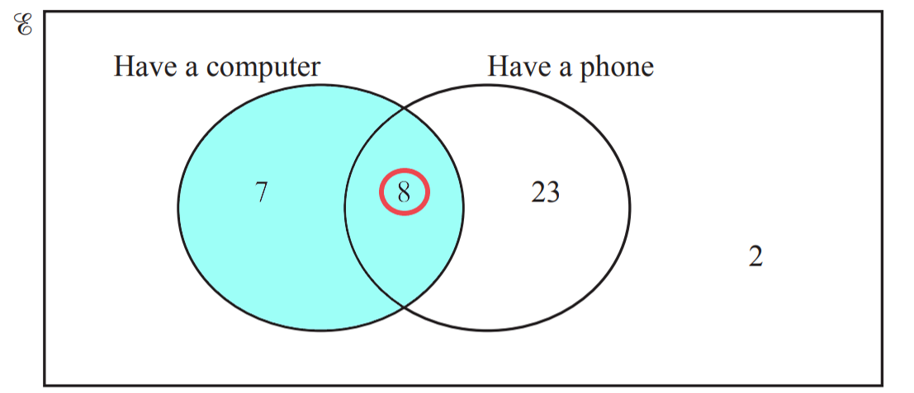
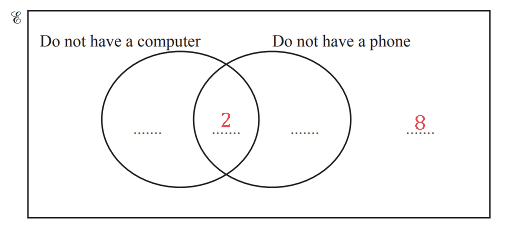
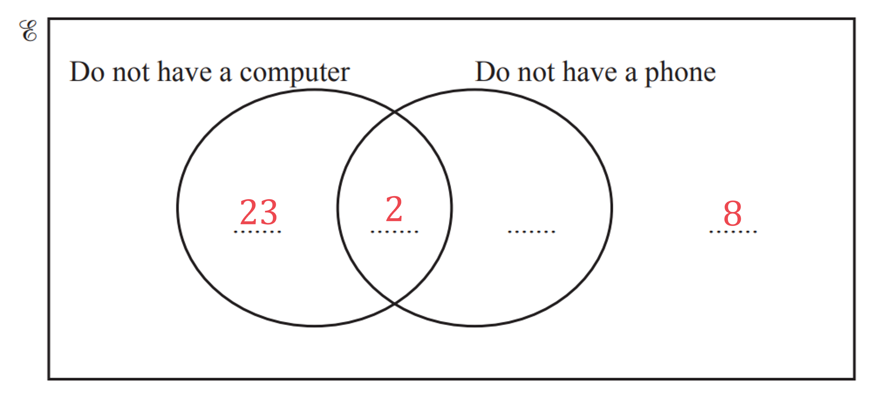
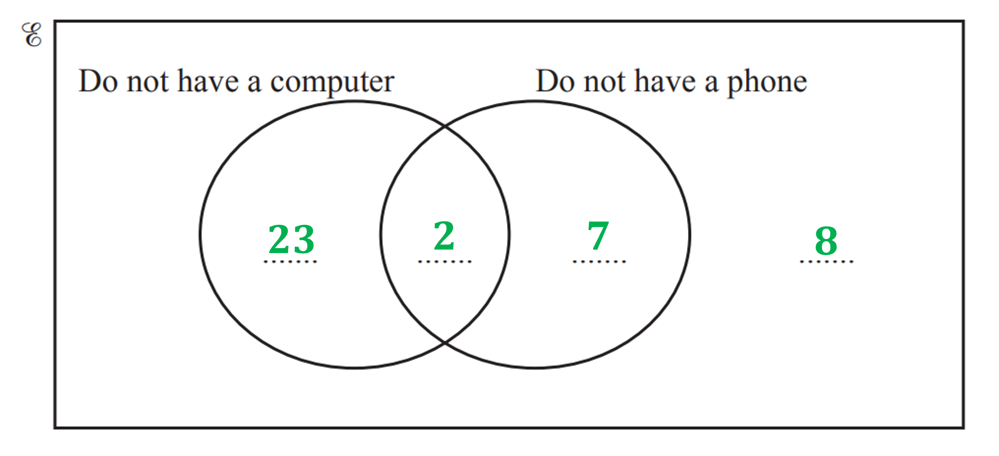
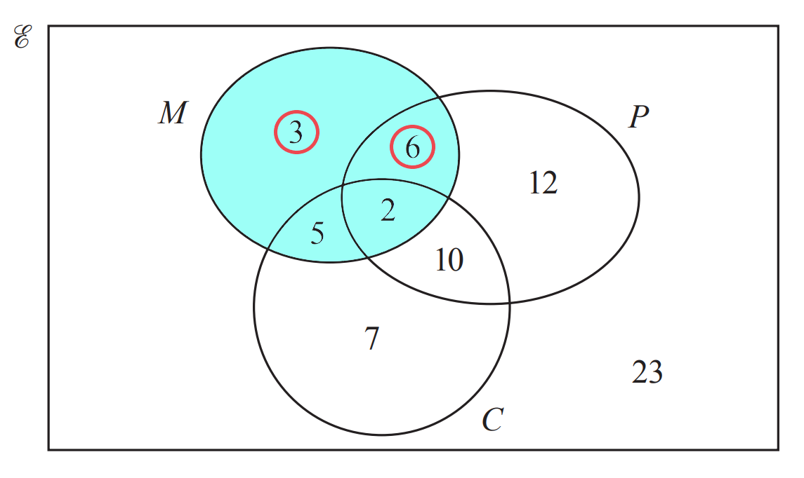
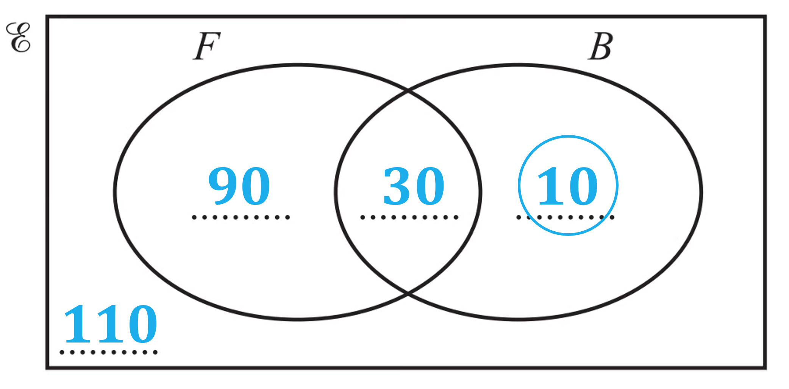
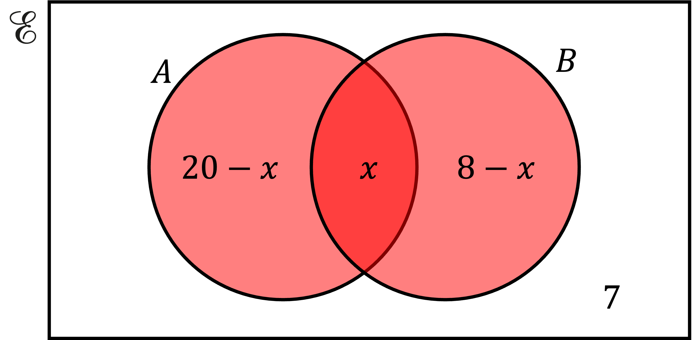
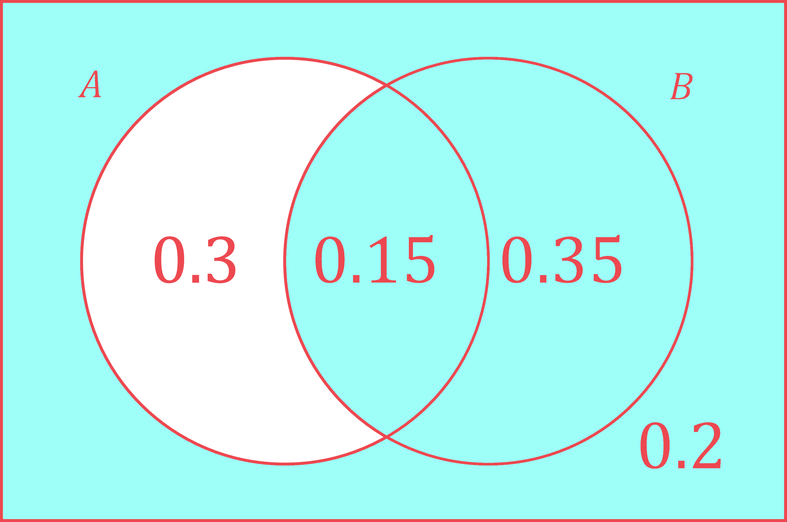
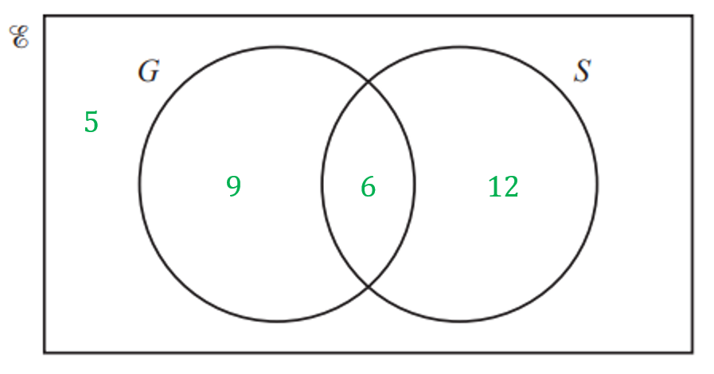

# Mark Schemes — Probabilities from Tables & Charts
**Probability** · Cambridge (CIE) IGCSE maths (0607)

## Exam Questions (12 questions)

### Q1
> *Draw a Venn diagram with two labelled circles and fill in 50 in the overlapping region*

**[B1]**

> *120 study Chemistry in total*

*120 - 50 = 70*

**[B1]**

> *90 study Geography in total*

*90 - 50 = 40*

**[B1]**

> *Calculate how many students from the 200 study neither Chemistry nor Geography*

*200 - 70 - 50 - 40 = 40*

**[B1]**

(i)

> $P ( C \cup G )$* means the probability that the selected student studies Chemistry or Geography*

$\frac{70+50+40}{200}=\frac{160}{200}$

$P ( C \cup G ) = \frac{4}{5}$

**[B1]**

(ii)

> $P ( ( C \cup G ) ' )$* means the probability of not studying "Chemistry OR Geography"*

> *i.e. It means *$1 - P ( C \cup G )$

> *These are the students not in either circle*

> *It is also equal to 1 minus the answer to part (i)*

$\frac{40}{200}$

$P ( ( C \cup G ) ' ) = 1 \frac{1}{5}$

**[B1]**

(iii)

> $P ( ( C \cap G ) ' )$* means the probability of not studying "Chemistry AND Geography"*

> *This is any student not in the overlapping region*

$\frac{70+40+40}{200}=\frac{150}{200}$

$P ( ( C \cap G ) ' ) = \frac{3}{4}$

**[B1]**

> **[mark-scheme]**
> Exact equivalent answers are also accepted for each mark.
> 
> E.g. $\frac{150}{200}$ instead of $\frac{3}{4}$.

### Q2
> *Add together all of the numbers in the Venn diagram to work out how many students there are in total*

*12 + 8 + 7 + 4 = 31 *

> *Express the number of students who liked neither apples or bananas, 4 (outside the circles), as a fraction of the total number of students, 31*

$\frac{4}{31}$ **[1]**

### Q3
*As we are choosing a child from those who have a computer, we are only considering those within the highlighted "have a computer" circle* *Out of these, we are looking for children who also have a phone, this is in the overlapping section*

> *The probability is therefore*

$\frac{8}{8+7}=\frac{8}{15}$

$\frac{8}{15}$ **[1]**
> *Summarising the given information in the Venn diagram:*

*Have only a computer = 7 children* *Have only a phone = 23 children* *Have both a phone and a computer = 8 children* *Do not have either a phone or computer = 2 children*

> *We can first fill in those who do not have either a phone or computer (2), and also those who have both a phone and a computer (8)*

> *We know that 23 children only have a phone, so they will be in the "do not have a computer" circle, but not in the overlapping section as they do own a phone*

*We know that 7 children have only a computer, so they will be in the "do not have a phone" circle, but not in the overlapping section as they do own a computer* *We can also check that all the numbers sum to the total number of children; 40*

**2 or 3 correct regions**** [1]** 
**All regions correct**** [1]**

### Q4
*The probability of an event occurring = *$\frac{\mathrm{number} \mathrm{of} \mathrm{ways} \mathrm{the} \mathrm{event} \mathrm{can} \mathrm{occur}}{\mathrm{total} \mathrm{number} \mathrm{of} \mathrm{possible} \mathrm{outcomes}}$ *We know from Q10(c)(ii) that 50 people use the swimming pool. *
*So the denominator is 50* *Of those people, 4 people use the exercise machines and the tennis court. *
*So the numerator is 4*

**Identifying denominator as 50, or numerator as 4****  [1]**

$\frac{4}{50}\mathrm{or}\frac{2}{25}$**[1]**

### Q5
*As we are only looking at those who grow melons, we are only looking at the blue highlighted region, containing 16 gardeners* *Out of those gardeners, we only want those who do not lie in the C-circle; these are circled in red*

> *Therefore the probability is*

$\frac{3+6}{3+6+5+2}=\frac{9}{16}$

**Correct numerator or denominator ****[1]**

$\frac{9}{16}$ **[1]**

### Q6
> *Using the fact that 90 students play football but not baseball*

> *Using the fact that 120 students play football, the sum of the numbers in the **F** circle should be 120*

> *Using the fact that 40 students play baseball, the sum of the numbers in the **B** circle should be 40*

> *Lastly, using the fact that there are 240 students in the school, the numbers inside and outside the circles should sum to 240*

$240-90-10-30=110$

**Any one correct value**** [1]**

**All values correct**** [1]**
> *Using the Venn diagram, there are 10 students who play baseball (in circle marked B) but not football (so not including the overlapping section)*

> *There are 240 students in total*

$\frac{10}{240}$ **[1]** 
**Or equivalent e.g. **$\frac{1}{24}$

### Q7
> *The region *$n(A\cupB)=23$* is shaded below*

**  ****identifying correct region ****[1]**

> *We can add the expressions in the entire shaded region and equate them to 23*

$( 20 - x ) + x + ( 8 - x ) = 23$

**[1]**

> *Collect like terms and solve for *$x$

$\begin{gathered} 20 - x + x + 8 - x & = 23 \\ 28 - x & = 23 \\ 5 = x \end{gathered}$

$x=5$* ***[1]**
> $(A\cupB)'$* means the compliment of *$(A\cupB)$*, or everything that's not in *$A$*or *$B$*. *
*It is the unshaded region in the diagram below.*

*Probability of an event occurring = *$\frac{\mathrm{number} \mathrm{of} \mathrm{ways} \mathrm{event} \mathrm{can} \mathrm{occur}}{\mathrm{total} \mathrm{number} \mathrm{of} \mathrm{possible} \mathrm{events}}$ *From the diagram we can see there are 7 items in *$(A\cupB)'$*and we know from the previous question part that there are 23 items in *$(A\cupB)$

*Total number of items = 7 + 23 = 30*

$P(A\cupB)'=\frac{7}{30}$

**numerator is 7**** [1] **
**denominator is 30**** [1]**

### Q8
> *(i) List the numbers that appear in set **A  **AND in set **B  **(i.e., in the 'overlap' of the two sets in the Venn diagram).*

**2, 4, 6, 12**  **[1]**

** **

> *(ii) List the numbers that are NOT in set **B  **(i.e., all the numbers anywhere in the Venn diagram outside of the **B** circle). *
*B'**  is the **complement** of set **B**, and includes everything in the universal set *$ℰ$* that isn't in set **B**.*

**5, 7, 8, 9, 10, 11, 13, 14**  **[1]**
> *There are three numbers that are in set **A** but not in set **B  **(8, 10, and 14). There are 14 numbers in total in the Venn diagram.*

$\frac{3}{14}$**  [2]**

**1 mark for 3 in the numerator (with the denominator greater than 3) or for 14 in the denominator (with the numerator less than 14). 1 mark for a fully correct answer.**

### Q9
> *The probabilities in a Venn diagram must sum to 1, as they are exhaustive (cover all possibilities) so we can use this to find the probability on the outside of the circles*

*1-0.3-0.15-0.35=0.2*

> $P(A'UB)$* means "the probability of not A, or B", note that this is different to "not A or B"*

> *The blue shaded area shows the regions which satisfy "not A, or B"*

**[1]**

*The outside is shaded as it satisfies "not A"* *The 0.35 is shaded as it satisfies "not A"* *The 0.15 is shaded as it satisfies "...or B"*

> *Summing the probabilities in the shaded regions*

*0.15+0.35+0.2=0.7*

**0.7** **[1]**

### Q10
> *5 do not study any languages, so place 5 in the Venn diagram outside of both bubbles.*

> *Find the intersection of both bubbles *$( G \cap S )$* by finding how many students have been counted twice in German and Spanish.*

> * *

*German + Spanish - both + neither = 32 *

*15 + 18 - both + 5 = 32 *

*38 - both = 32*

*both = 6*

**[1]**

** **

> *Place 6 in the Venn diagram in the intersection of both bubbles.*

> * *

> * *

> *Find the other two numbers by subtracting 6 from the total for that language.*

> * *

**[1]**
> *Reading from the Venn diagram, 12 students study Spanish but not German.*

> *Find the probability by dividing this by the total number of students.*

$\mathrm{P} ( \text{Spanish} ) = \frac{12}{32}$

$\frac{3}{8}$** [1] **
**The unsimplified fraction is accepted.**
*In total, 15 students study German.* *Of these, 6 of them also study Spanish.*

> *Find the probability by dividing the number who study both by the total number of students who study German.*

$\mathrm{P} ( \text{Student} \text{who} \text{studies} \text{German} \text{also} \text{studies} \text{Spanish} ) = \frac{6}{15}$

$\frac{2}{5}$** [1]**
** The unsimplified fraction is accepted.**

### Q11
(i) $A\cupB$* is the set of all numbers that are in **A** or in **B** or in both.*

**10, 12, 14, 15, 16, 18****  [1]**

**The numbers don't need to be put in order to get the mark, but it can help you make sure you haven't repeated any!**

(ii)

> $A\capB$*is the set of all numbers that are in **A **and in **B**.*

> * *

**12, 18**** [1]**
> *A**' is the set of all numbers that **aren't** in **A**.  (It's called the 'complement' of** A.**) *
*Basically, the question is asking you 'What's the probability that the number isn't in set **A**?'*

$A ' = \{ 10 , 11 , 13 , 14 , 16 , 17 , 19 \}$

**[1] ****You can also get this mark for indicating where set A' is on the Venn diagram.**

> *There are 7 numbers in set **A'**. *
*There are a total of 10 numbers in the diagram.*

$\frac{7}{10}$**  [1]**

### Q12
> *Start by labelling the circles in the diagram.*

**[1]**

> *15 is the only number that's in **A** **and** **B**, so put that that in the 'overlap' (middle) part of the diagram. *

**[1]**

> *The numbers in **A** that aren't also in **B** (3, 9, 21, 27) go in the '**A** only' part of the **A** circle. *
*The numbers in **B** that aren't also in **A** (5, 25) go in the '**B** only' part of the **B** circle. {odd numbers less than 30} = {1, 3, 5, 7, 9, 11, 13, 15, 17, 19, 21, 23, 25, 27, 29} *
*The numbers in that set that aren't in **A** or** B** (1, 7, 11, 13, 17, 19, 23, 29) go inside the rectangle outside the two circles.*

> * *

**  [2]**

**1 mark for the 'only A' part, the 'only B' part, or the 'outside the circles' part being correct. **
**2 marks for ALL those numbers being in the correct place.**
> *There are 15 numbers in the universal set. *
$A\cupB$* is all the numbers that are in either or both of the circles. So *$A \cup B = \{ 3 , 5 , 9 , 15 , 21 , 25 , 27 \}$*, with 7 numbers in that set.*

$\frac{7}{15}$**  [2]**

**1 mark for 7 in the numerator (as long as the denominator is **$\geq$**7****), or for 15 in the denominator (as long as the numerator is **$\leq$**7****).  2 marks for 7/15.  If your part (a) answer was wrong, you can still get the part (b) marks for correctly interpreting your incorrect part (a) diagram.**
