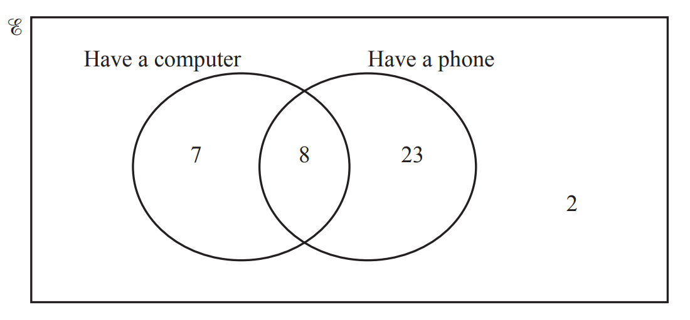
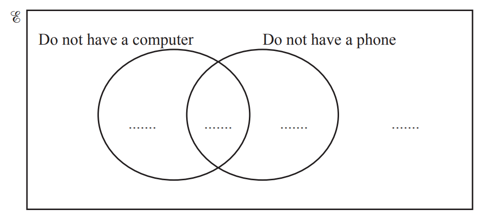
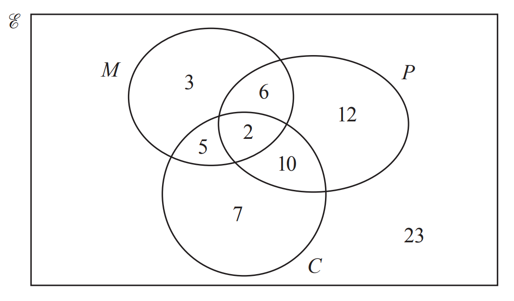
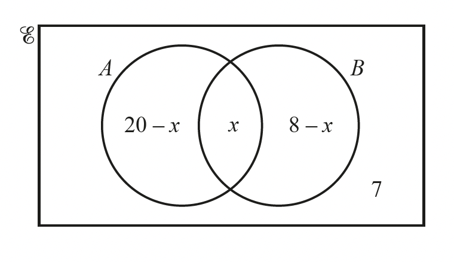
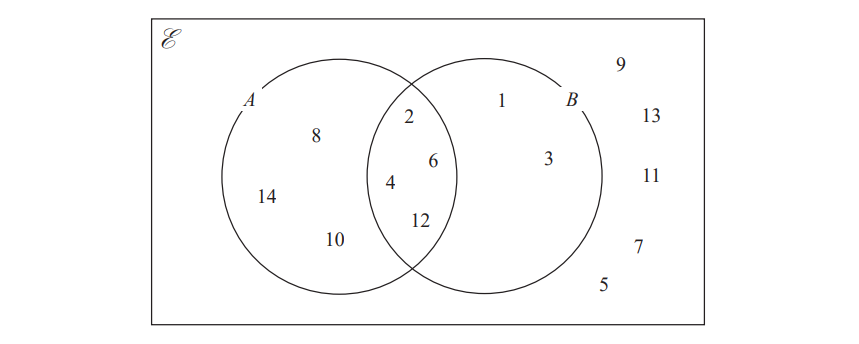
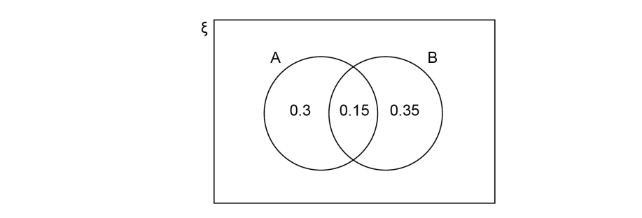

# Exam Questions — Probabilities from Tables & Charts
**Probability** · Cambridge (CIE) IGCSE maths (0607)
> Source: [https://www.savemyexams.com/igcse/maths/cie/international-maths/23/extended/topic-questions/](https://www.savemyexams.com/igcse/maths/cie/international-maths/23/extended/topic-questions/) · 12 questions across 1 sets

## Exam Questions (12 questions)

### Q1 — medium — 7 marks

**Q1** [4 marks]

In a group of 200 students:

- 120 study Chemistry $( C )$,
- 90 study Geography $(G)$,
- 50 study both Chemistry and Geography.

Draw a Venn diagram to represent this information.

**Q1** [3 marks]

A student is selected at random.

Find:

(i) $P ( C \cup G )$.

(ii) $P ( ( C \cup G ) ' )$.

(iii) $P ( ( C \cap G ) ' )$.

### Q2 — easy — 1 marks

**Q2** [1 mark]

The Venn diagram shows information about the number of students in a class who like apples ($A$) and bananas ($B$).

One of the students is chosen at random.

Find the probability that this student does not like apples and does not like bananas.

[1]

*Source: June 2020 0580/33 Q5AV*

### Q3 — hard — 3 marks

**Q3** [1 mark]

40 children were asked if they have a computer or a phone or both. 
The Venn diagram shows the results.

A child is chosen at random from the children who have a computer.   
Write down the probability that this child also has a phone.

*Source: 2019	May/June 0580/23 Q20A*

**Q3** [2 marks]

**Extract:**

40 children were asked if they have a computer or a phone or both. The Venn diagram shows the results.

Complete the Venn diagram.

*Source: 2019	May/June 0580/23 Q20A*

### Q4 — easy — 2 marks

**Q4** [2 marks]

At a fitness centre, the number of members using the exercise machines (*E*), the swimming pool (*S*) and the tennis courts (*T*) is shown on the Venn diagram.

A member using the swimming pool is chosen at random. Find the probability that this member also uses the tennis courts and the exercise machines.

*Source: 2018	May/June 0580/41 Q10C*

### Q5 — easy — 2 marks

**Q5** [2 marks]

The Venn diagram below shows information about the number of gardeners who grow melons ($M$ ), potatoes ($P$ ) and carrots ($C$ ).

A gardener is chosen at random from the gardeners who grow melons.   
Find the probability that this gardener does not grow carrots.

*Source: 2019	May/June 0580/22 Q21B*

### Q6 — medium — 3 marks

**Q6** [2 marks]

$E=${students in a school} 
$F=${students who play football} 
$B=${students who play baseball}

There are 240 students in the school.

• 120 students play football 
  • 40 students play baseball 
  • 90 students play football but not baseball.

Complete the Venn diagram to show this information.

*Source: 2019	May/June 0580/41 Q6A*

**Q6** [1 mark]

**Extract:**

There are 240 students in the school. 

 • 120 students play football 

  • 40 students play baseball 

  • 90 students play football but not baseball.

A student in the school is chosen at random.   
Find the probability that this student plays baseball but not football.

*Source: 2019	May/June 0580/41 Q6C*

### Q7 — hard — 5 marks

**Q7** [3 marks]

The Venn diagram shows information about the number of elements in sets $A$, $B$ and $E$.

$n(A\cupB)=23$ Find the value of $x$.

$x=$................................................

*Source: 2018	May/June 0580/22 Q23A*

**Q7** [2 marks]

**Extract:**

The Venn diagram shows information about the number of elements in sets A, B and calligraphic E.

An element is chosen at random from $E$. 
Find the probability that this element is in $(A\cupB)'$.

*Source: 2018	May/June 0580/22 Q23B*

### Q8 — medium — 4 marks

**Q8** [2 marks]

The numbers from $1$ to $14$ are shown in the Venn diagram.

i) List the members of the set $A\capB$

[1]

ii) List the members of the set $Bʹ$

[1]

*Source: Nov 2020 4MA1/1H Q1A*

**Q8** [2 marks]

**Extract:**

The numbers from 1 to 14 are shown in the Venn diagram. [q1-paper1h-nov2020-edexcel-igcse-maths.png]

A number is picked at random from the numbers in the Venn diagram.

Find the probability that this number is in set $A$but is **not** in set $B$.

*Source: Nov 2020 4MA1/1H Q1B*

### Q9 — medium — 2 marks

**Q9** [2 marks]

A and B are two events.

Some probabilities are shown on the Venn diagram.

Work out $P(A'\cupB)$.

*Source: Nov 2018 8300/1H Q14*

### Q10 — hard — 4 marks

**Q10** [2 marks]

There are 32 students in a class.

5 do not study any languages. 15 study German (G). 18 study Spanish (S).

Complete the Venn diagram to show this information.

*Source: 2020 Oct/Nov 0580/41 Q9A*

**Q10** [1 mark]

**Extract:**

There are 32 students in a class.

5 do not study any languages. 15 study German (G). 18 study Spanish (S).

A student is chosen at random.   
Find the probability that the student studies Spanish but not German.

*Source: 2020 Oct/Nov 0580/41 Q9A*

**Q10** [1 mark]

**Extract:**

There are 32 students in a class.

5 do not study any languages. 15 study German (G). 18 study Spanish (S).

A student who studies German is chosen at random. 
Find the probability that this student also studies Spanish.

*Source: 2020 Oct/Nov 0580/41 Q9A*

### Q11 — medium — 4 marks

**Q11** [2 marks]

Here is a Venn diagram.

Write down the numbers that are in set

i) $A\cupB$

[1]

ii) $A\capB$

[1]

*Source: 2015	Spec2 1MA1/2H Q5A*

**Q11** [2 marks]

**Extract:**

Here is a Venn diagram.

One of the numbers in the diagram is chosen at random.

Find the probability that the number is in set $A'$.

*Source: 2015	Spec2 1MA1/2H Q5B*

### Q12 — medium — 6 marks

**Q12** [4 marks]

$E=${odd numbers less than 30}

$A=${3, 9, 15, 21, 27} 
$B=${5, 15, 25}

Complete the Venn diagram to represent this information.

*Source: 2017	June 1MA1/3H Q1A*

**Q12** [2 marks]

**Extract:**

![calligraphic E space equals space]{odd numbers less than 30} 

![A space equals space]{3, 9, 15, 21, 27} 

![B space equals space]{5, 15, 25}

A number is chosen at random from the universal set, $E$.

What is the probability that the number is in the set $A\cupB$?

*Source: 2017	June 1MA1/3H Q1B*

