# Mark Schemes — Tree Diagrams & Multiple Events
**Probability** · Cambridge (CIE) IGCSE maths (0607)

## Calculator Questions (27 questions)

### Q1
> *The greatest possible length for a piece of string is 15 cm so it is impossible to pick a piece of string with a length greater than 15 cm*

> *The probability of an impossible event is zero*

**Final answer:** **0**

**[1]**
> *Find the probability of the first piece of string having a length greater than 11 cm by adding the last two frequencies together*

$P ( \text{first} > 11 \text{cm} ) = \frac{6 + 4}{100} = \frac{10}{100}$

> *Find the probability of the second piece of string having a length greater than 11 cm, given that the first piece had a length greater than 11 cm *

> *One piece has already been taken so reduce both the numerator and denominator by 1*

$P ( \text{second} > 11 \text{cm} ) = \frac{9}{99}$

> *Find the probability that both the first and second are greater than 11 cm by multiplying the two probabilities together*

$\frac{10}{100}\times\frac{9}{99}$

**[1]**

> *Write your final answer as a fraction in its simplest form*

$\frac{1}{110}$

** Any equivalent answer accepted [1]**
> *Find the probability of the first piece of string having a length greater than 12.5 cm, given than it was picked only from string with a length greater than 11 cm *

$P ( \text{first} > 12.5 \text{cm} \text{given} > 11 \text{cm} ) = \frac{4}{10}$

**[1]**

> *Find the same probability for the second piece of string, given the first had a length greater than 12.5 cm*

> *One piece has already been taken so reduce both the numerator and denominator by 1*

$P ( \text{second} > 12.5 \text{cm} \text{given} > 11 \text{cm} ) = \frac{3}{9}$

> *Find the probability that both the first and second are greater than 12.5 cm by multiplying the two probabilities together*

$\frac{4}{10}\times\frac{3}{9}$

> *Write your final answer as a fraction in its simplest form*

$\frac{2}{15}$

** Any equivalent answer accepted [1]**

### Q2
> *Separate choosing two people at random into choosing a 1st person then choosing a 2nd person *

> *Method 1** *
*Find the probability that the 1st person wants London (by dividing 50 by 200)  *

*P(1st person London) = *$\frac{50}{200}$*  *

> *Find the probability that the 2nd person wants New York (by dividing 56 by the remaining 199 people)  *

*P(2nd person New York) = *$\frac{56}{199}$*  *

> *In probability, "and" means multiply Find the probability that the 1st person wants London "and" the 2nd person wants New York (by multiplying)  *

$\frac{50}{200}\times\frac{56}{199}$

**[1]**

> *Using the same idea, find the probability that the 1st person wants New York, *$\frac{56}{200}$* , "and" the second person wants London, *$\frac{50}{199}$* (by multiplying)  *

$\frac{56}{200}\times\frac{50}{199}$

*In probability, "or" means add* *Find the probability that either the first way happens "or" the second way happens (by adding)*

$\frac{50}{200}\times\frac{56}{199}+\frac{56}{200}\times\frac{50}{199}$

**[1]**

> *Simplify this value (using a calculator)*

$\frac{28}{199}$* (or 0.14070... as a decimal)*

> *Change the answer into a percentage (by multiplying by 100)*

**14.1%**** [1] **
**Give the final answer to 3 significant figures**

> *Method 2** *
*Draw the probabilities on a tree diagram, showing the 1st person and the 2nd person  *

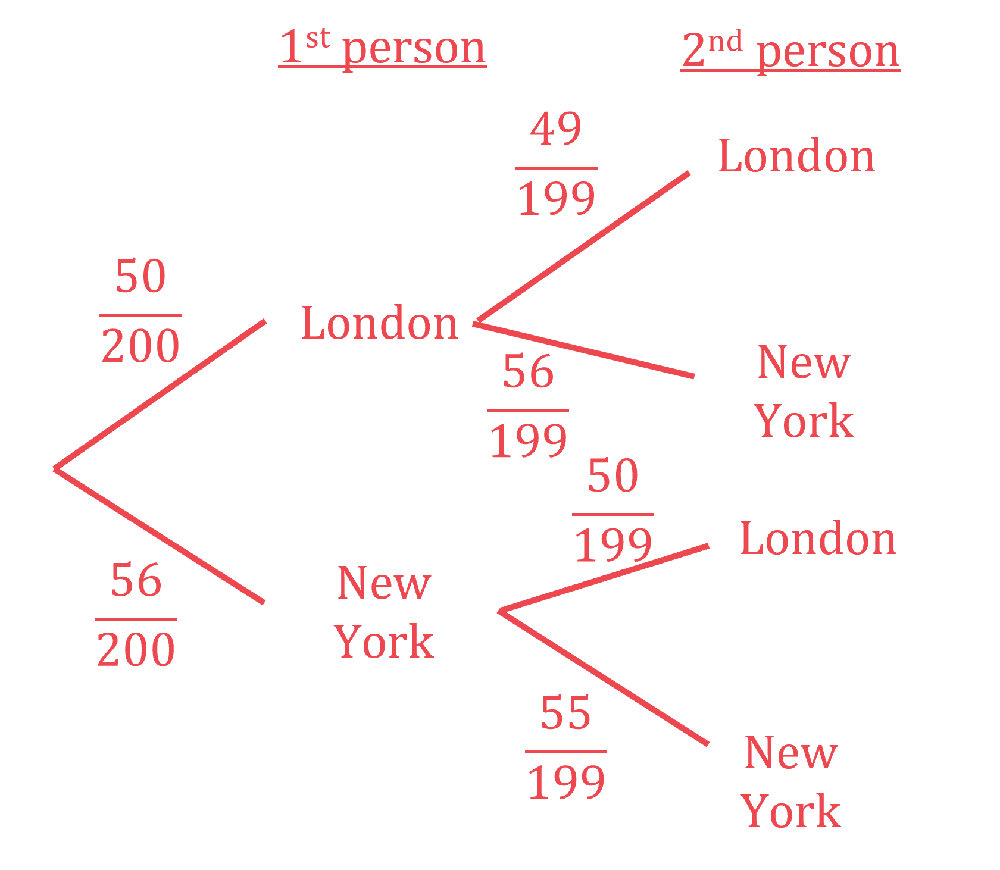

> *Find the probability that the 1st person wants London and the 2nd person wants New York (by multiplying probabilities from left to right across the tree diagram, from London to New York)  *

$\frac{50}{200}\times\frac{56}{199}$

**[1]**

> *Find the probability that the 1st person wants New York and the 2nd person wants London (by multiplying probabilities from left to right across the tree diagram, from New York to London)  *

> $\frac{56}{200}\times\frac{50}{199}$*  *

> *Find the overall probability (by adding the different tree-diagram cases)  *

$\frac{50}{200}\times\frac{56}{199}+\frac{56}{200}\times\frac{50}{199}$

**[1]**

> *Simplify this value (using a calculator)*

$\frac{28}{199}$* (or 0.14070... as a decimal)*

> *Change the answer into a percentage (by multiplying by 100)*

**14.1%**** [1] **
**Give the final answer to 3 significant figures**

### Q3
*Method 1* *This is the most efficient method, if you spot that the only way at least pen **isn't** orange is if both pens are black. So*

$\begin{gathered} P ( \text{at} \text{least} \text{one} \text{orange} ) & = 1 - \mathrm{P} ( \text{both} \text{black} ) \\ = 1 - ( \frac{7}{15} \times \frac{6}{14} ) \end{gathered}$

**[2]**

$=\frac{168}{210}\mathrm{or}\frac{4}{5}$** [1]**

**Giving your answer as another equivalent fraction, or as 0.8 or 80%, is acceptable**

*Method 2* *Identify all the ways that at least one orange pens can be picked*

$\begin{gathered} P ( \text{orange} \text{then} \text{black} ) = ( \frac{7}{15} \times \frac{8}{14} ) , P ( \text{black} \text{then} \text{orange} ) = ( \frac{8}{15} \times \frac{7}{14} ) , P ( \text{both} \text{orange} ) & = ( \frac{8}{15} \times \frac{7}{14} ) \end{gathered}$

**one of these multiplications is seen ****[1]**

> *Add together all the ways that at least one orange pen can be picked*

$\begin{gathered} ( \frac{7}{15} \times \frac{8}{14} ) + ( \frac{8}{15} \times \frac{7}{14} ) + ( \frac{8}{15} \times \frac{7}{14} ) \end{gathered}$

**[1]**

$\frac{168}{210}\mathrm{or}\frac{4}{5}$** ****[1]**

**Giving your answer as another equivalent fraction, or as 0.8 or 80%, is acceptable**

### Q4
> *The students are chosen from only students who estimated the volume to be greater than 100m**2**, so find the total number of students who could be chosen.*

*N(estimated > 100) = 80 + 24 = 104 *

> *Find the individual probabilities first.*

$\mathrm{P} ( \text{estimated} > 150 ) = \frac{24}{104} 
 \mathrm{P} ( \text{estimated} \text{less} \text{or} \text{equal} \text{than} 150 ) = \frac{80}{104}$

> *The possible options for two of these students can be seen in a tree diagram.  *
*This is conditional probability so the total number of students will decrease after the first student has been chosen.*

> *   *

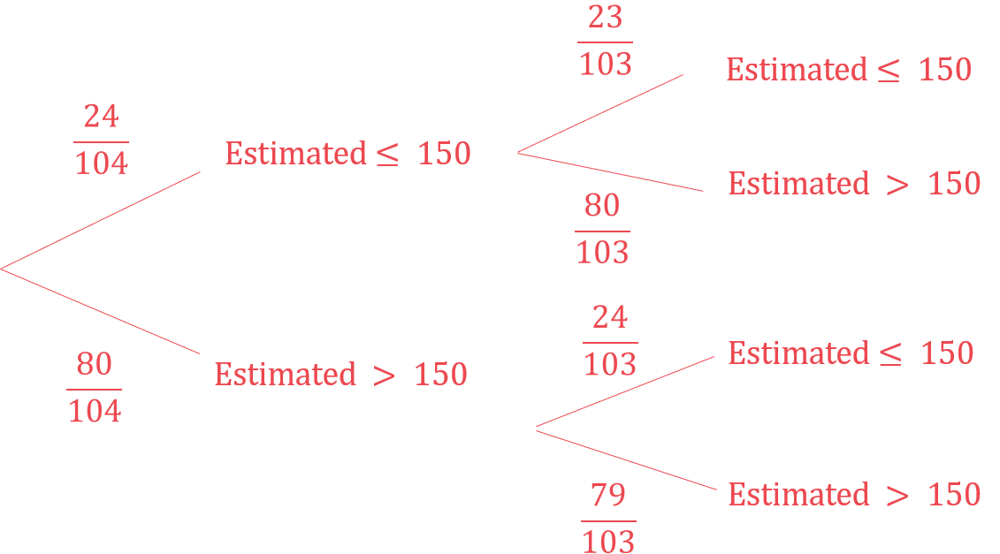

> *   *

> *Use the tree diagram to find the probability that either the first student estimated less than 150 and the second estimated more than 150, or the first student estimates more than 150 and the second estimated less than 150.    *

> $\begin{gathered} \mathrm{P} ( \text{both} \text{different} ) & = ( \frac{ 24}{104} \times \frac{ 80}{103} ) + ( \frac{80}{104} \times \frac{ 24}{103} ) \\ = 2 ( \frac{240}{1339} ) \end{gathered}$*    *

$\begin{gathered} P ( \text{both} \text{different} ) & = \frac{ 480}{1339} \end{gathered}$

**Any correct probability**** [1]**
** ****All working correct**** [1] **
**Correct answer**** [1] **
**The unsimplified answer **$\frac{3840}{10712}$**will also gain full marks.**

### Q5
> *Using the fact that 90 students play football but not baseball*

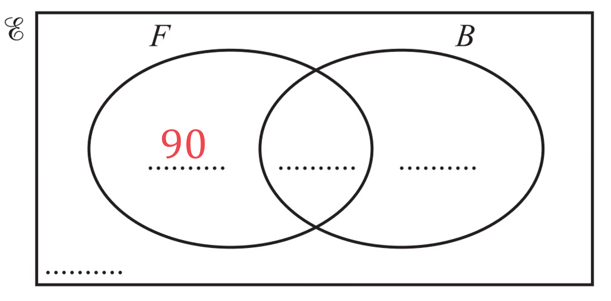

> *Using the fact that 120 students play football, the sum of the numbers in the **F** circle should be 120*

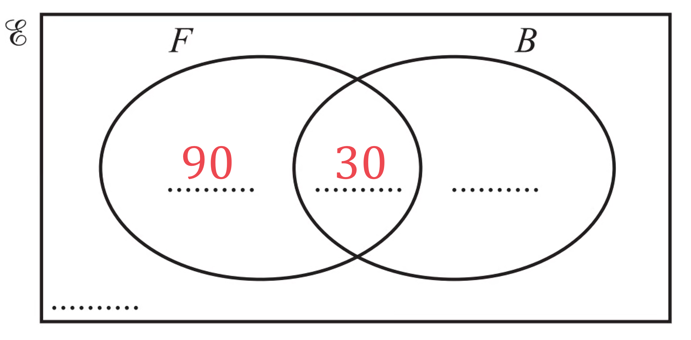

> *Using the fact that 40 students play baseball, the sum of the numbers in the **B** circle should be 40*

> *Lastly, using the fact that there are 240 students in the school, the numbers inside and outside the circles should sum to 240*

$240-90-10-30=110$

**Any one correct value**** [1]**

**All values correct**** [1]**
*We are only picking students from those who play baseball, of which there are 40* *There are 30 students who play both football and baseball, so *

*The probability of picking a baseball player, who also plays football is *$\frac{30}{40}$

> *For the second baseball player who also plays football, there is now one less student to pick from, therefore*

*The probability of picking a second baseball player, who also plays football is *$\frac{29}{39}$

> *We need both of these events to occur, so we multiply their probabilities*

$\frac{30}{40}\times\frac{29}{39}=\frac{29}{52}$

**Multiplying two probabilities of form**** **$\frac{p}{q}\times\frac{p-1}{q-1}$** ****[2]**

$\frac{29}{52}$ **[1]** 
**Or equivalent e.g. **$\frac{870}{1560}$

### Q6
*Place 7, 11 and 9 can directly in the Venn diagram.* 
*Call the intersection between all three events *$x$*, say, and then the intersections between the pairs of events can be found in terms of *$x$*.*

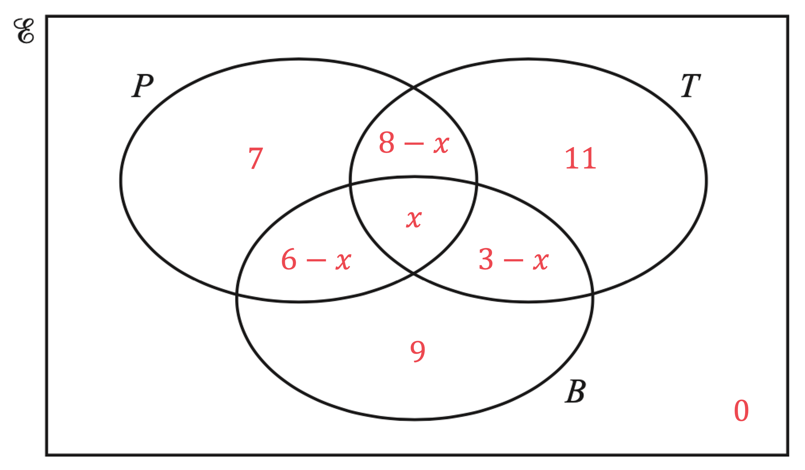

> *As the total number of students is 40, we can now set up and solve an equation in *$x$*.*

$\begin{gathered} x + ( 8 - x ) + ( 6 - x ) + ( 3 - x ) + 7 + 11 + 9 + 0 & = 40 \end{gathered}$

**[1]**

$\begin{gathered} 44 - 2 x & = 40 \\ 2 x & = 4 \\ x = 2 \end{gathered}$

> *Now we can complete all sections of the Venn diagram with values.*

**5 correct values, must include '2'**** [1] **
**Fully correct diagram**** [1]**
*At the start, 7 students (out of 40) have travelled by plane only.* *Mathematically, choosing two students is the same as choosing one student, not replacing them, then choosing another.*

$\mathrm{P} ( \text{both} \text{plane} ) = \frac{7}{40} \times \frac{6}{39}$

**[1]**

$\mathrm{P} ( \text{both} \text{plane} ) = \frac{42}{1560}$

> *You can use your calculator to simplify the fraction, but you will still get the mark if not.*

$\frac{7}{260}$** [1]**
> *First find the number of students that have travelled by plane and train.*

$6+2=8$

> *We are only interested in the number of students who have travelled by train.*

$6+2+1+11=20$

> *So at the start, 8 out of 20 students that travelled by train also travelled by plane. Two students are chosen so*

$\mathrm{P} ( \text{both} \text{plane} \text{given} \text{train} ) = \frac{8}{20} \times \frac{7}{19}$

**[1]**

$\mathrm{P} ( \text{both} \text{plane} \text{given} \text{train} ) = \frac{56}{380}$

> *You can use your calculator to simplify the fraction, but you will still get the mark if not.*

$\frac{14}{95}$* ***[1]**

### Q7
> *Find the probability that the first packet is salt (by dividing 10 by 20*

*P(1st packet is salt) = *$\frac{10}{20}$* *

> *Find the probability that the second packet is salt (by dividing the remaining 9 by 19*

*P(2nd packet is salt) = *$\frac{9}{19}$

**[1]**

*In probability, "and" means *$\times$ *Find the probability that the 1st packet is salt "and" the 2nd packet is salt*

$\frac{10}{20}\times\frac{9}{19}$

> *Simplify this answer (for example, using a calculator)*

$\frac{9}{38}$ **[1]**

### Q8
> *The probability of an event X happening is given by: P(X) = *$\frac{\mathrm{number} \mathrm{of} \mathrm{ways} \mathrm{event} \mathrm{can} \mathrm{happen}}{\mathrm{total} \mathrm{number} \mathrm{of} \mathrm{possible} \mathrm{events}}$*.*

> *The probability of event X and event Y happening is given by: P(X and Y) = P(X) × P(Y).*

> *The probability of event X or event Y happening is given by: P(X or Y) = P(X) + P(Y).*

i) *The two cards can be the same number if; *

> *Option1: Jojo picks a 1 and then another 1. *
*The probability of a 1 first time is *$\frac{2}{5}$*, but the second time there is one less 1 and one less card to choose from so the probability is *

$\frac{2-1}{5-1}=\frac{1}{4}$

> *So the probability of choosing a 1 then a 1 is *

*P(1 and 1)*$= \frac{2}{5} \times 1 \frac{1}{4} ( = \frac{2}{20} )$

> *Option2: Jojo picks a 2 and then another 2. *
*The probability of a 2 first time is *$\frac{3}{5}$*, but the second time there is one less 2 and one less card to choose from so the probability is *

$\frac{3-1}{5-1}=\frac{2}{4}$

> *So the probability of choosing a 2 then a 2 is *

*P(2 and 2)*$= \frac{3}{5} \times \frac{2}{4} ( = \frac{6}{20} )$

**either**** **$"\frac{2}{5}\times\frac{1}{4}"$** or **$"\frac{3}{5}\times\frac{2}{4}"$** ****[1]**

> *Therefore the probability of (1 and 1) **or** (2 and 2) is*

** **$\frac{2}{5} \times 1 \frac{1}{4} + \frac{3}{5} \times \frac{2}{4} ( = \frac{2}{20} + \frac{6}{20} )$

**[1]**

$=\frac{8}{20}$

**Answer = **$\frac{2}{5}$** or 0.4 or 40% ****[1] **
**Any equivalent fraction, such as **$\frac{8}{20}$**, is accepted**

ii) *The two cards can be the same number if; *

> *Option1: Set A is a 1 and  Set B is a 1. We'll refer to this as A1 and B1.*

> *Option 2: Set A is a 2 and Set B is a 2. We'll refer to this as A2 and B2. For Option 1 above, P(A1) =*$\frac{2}{5}$* and P(B1) =*$\frac{3}{5}$*. *
*For Option 2 above, P(A2) =*$\frac{3}{5}$* and P(B2) =*$\frac{1}{5}$*.*

> *Therefore:*

*P(A1 and B1)*$= \frac{2}{5} \times \frac{3}{5} ( = \frac{6}{25} )$*     and    P(A2 and B2)*$= \frac{3}{5} \times 1 \frac{1}{5} ( = \frac{3}{25} )$* *

* ***either of these calculations ****[1]**

> *Therefore the probability of A1 and B2, or A2 and B2 happening is:*

*P[(A1 and B1) or (A2 and B2)]*$= \frac{2}{5} \times \frac{3}{5} + \frac{3}{5} \times 1 \frac{1}{5} ( = \frac{6}{25} + \frac{3}{25} )$** **

**[1]**

**Answer =**$\frac{9}{25}$** ****or 0.36 or 36% ****[1]**

iii) *From part (a)(i) we know that the probability of Jojo picking two cards that have the same number is *$\frac{2}{5}$* and the probability of Kylie picking two cards that the have the same number is *$\frac{9}{25}$*. We need to decide which of these two fractions is bigger.*

> *Method 1*

> *Write both fractions with the same numerator.*
* The lowest common numerator is 25.*

*Jojo: *$\frac{2}{5}=\frac{10}{25}$*      Kylie: *$\frac{9}{25}$

$\frac{10}{25}>\frac{9}{25}$

> *Therefore Jojo is more likely to pick two cards that have the same number.*

$\frac{10}{25}>\frac{9}{25}$** therefore Jojo** **[1]**

**You must show a reason, e.g. **$"\frac{10}{25}>\frac{9}{25}"$** to achieve the mark**

> *Method 2*

> *Convert both fractions to decimals. *
*You can do this directly on your calculator if necessary.*

*Jojo: *$\frac{2}{5}=0.4$*      Kylie: *$\frac{9}{25}=0.36$

$0.4>0.36$

> *Therefore Jojo is more likely to pick two cards that have the same number.*

$0.4>0.36$** therefore Jojo**** ****[1]**

**You must show a reason, e.g. "0.4 > 0.36" to achieve the mark**
> *Method 1*

> *Make a list of the possible ways the third card can be a 4:*

*Option 1: 454* *Option 2: 544* *Option 3: 554*

> *Now we can work out the probabilities, remembering that the cards are not replaced.*

*P(454) = *$\frac{2}{5} \times \frac{3}{4} \times 1 \frac{1}{3} ( = \frac{6}{60} )$*      P(544) =  *$\frac{3}{5} \times \frac{2}{4} \times 1 \frac{1}{3} ( = \frac{6}{60} )$*       P(554) = *$\frac{3}{5} \times \frac{2}{4} \times \frac{2}{3} ( = \frac{12}{60} )$

**all three options 454, 544 and 554 listed, ****or**** ****any one of these products correct ****[1]**

> *Now we can work out the probability of 454 or 544 or 554 occurring using*

*P(454 or 544 or 554)*$=\frac{2}{5}\times\frac{3}{4}\times\frac{1}{3}+\frac{3}{5}\times\frac{2}{4}\times\frac{1}{3}+\frac{3}{5}\times\frac{2}{4}\times\frac{2}{3}$

$( = \frac{6}{60} + \frac{6}{60} + \frac{12}{60} )$

**[1]**

> *Add the fractions to give the final answer*

**Answer = **$\frac{24}{60}$**or **$\frac{2}{5}$** or 0.4****[1]**

### Q9
> *Method 1*

*Write barbeque as B, salt as S and chicken as** **C* *Write down all the different possibilities when choosing a 1st packet then a 2nd packet*

*B then S,    S then B,    S then C,    C then S,    B then C,    C then B** *

> *Find these probabilities using the method in part (a)(i)*

$\frac{6}{20}\times\frac{10}{19}+\frac{10}{20}\times\frac{6}{19}+\frac{10}{20}\times\frac{4}{19}+\frac{4}{20}\times\frac{10}{19}+\frac{6}{20}\times\frac{4}{19}+\frac{4}{20}\times\frac{6}{19}$

**one correct product ****[1]** 
**the sum of two correct products ****[1]** 
**this working line fully correct**** [1]**

> *Use a calculator to simplify this answer*

$\frac{62}{95}$ **[1]**

> *Method 2*

> *Find the probability that the two packets are the same flavour.*

$\begin{gathered} \mathrm{P} ( \mathrm{B} \text{then} \mathrm{B} ) & = \frac{6}{20} \times \frac{5}{19} = \frac{3}{38} \\ \mathrm{P} ( \mathrm{S} \text{then} \mathrm{S} ) & = \frac{10}{20} \times \frac{9}{19} = \frac{9}{38} \\ \mathrm{P} ( \mathrm{C} \text{then} \mathrm{C} ) & = \frac{4}{20} \times \frac{3}{19} = \frac{3}{95} \end{gathered}$

**one correct product ****[1]*** *
**the sum of two correct products ****[1]**

> *Subtract these probabilities from 1 to find the probability that the two packets are not the same flavour.*

$1-\frac{3}{38}-\frac{9}{38}-\frac{3}{95}$

**[1]**

$\frac{62}{95}$* ***[1]**

### Q10
> *Choosing three boys at random in one go is, mathematically, the same as choosing one boy, **not** replacing him back in the group, then choosing another, and the same again.*

> *This is an AND probability question - "greater than 1.8" AND "equal to or less than 1.4" AND "equal to or less than 1.4" - so we need to multiply probabilities.*

$\frac{14}{120}\times\frac{7}{119}\times\frac{6}{118}=\frac{7}{20060}$

**For any one correct probability**** [1] **
**Multiplying all 3**** [1]**

> *However, there are three ways this could happen since they boy with a height greater than 1.8 m could be the first, second or third boy to be chosen.*

`| therefore P ( 1 boy greater than 1.8 and 2 boys <= 1.4 ) | = (7)/(20 060) x 3 | | _ = (21)/(20 060) | |`

**[1]**

$\frac{21}{20060}$ **[1]**

### Q11
> *A probability tree diagram can help you to visualise the problem, even if you only draw the relevant branches. *
*You may be able to do it without a diagram. *
*Remember that the ball does not get replaced, so there are only 17 available balls when choosing the second ball.*

> *There are two options for one being red and one being blue, red then blue and blue then red.*

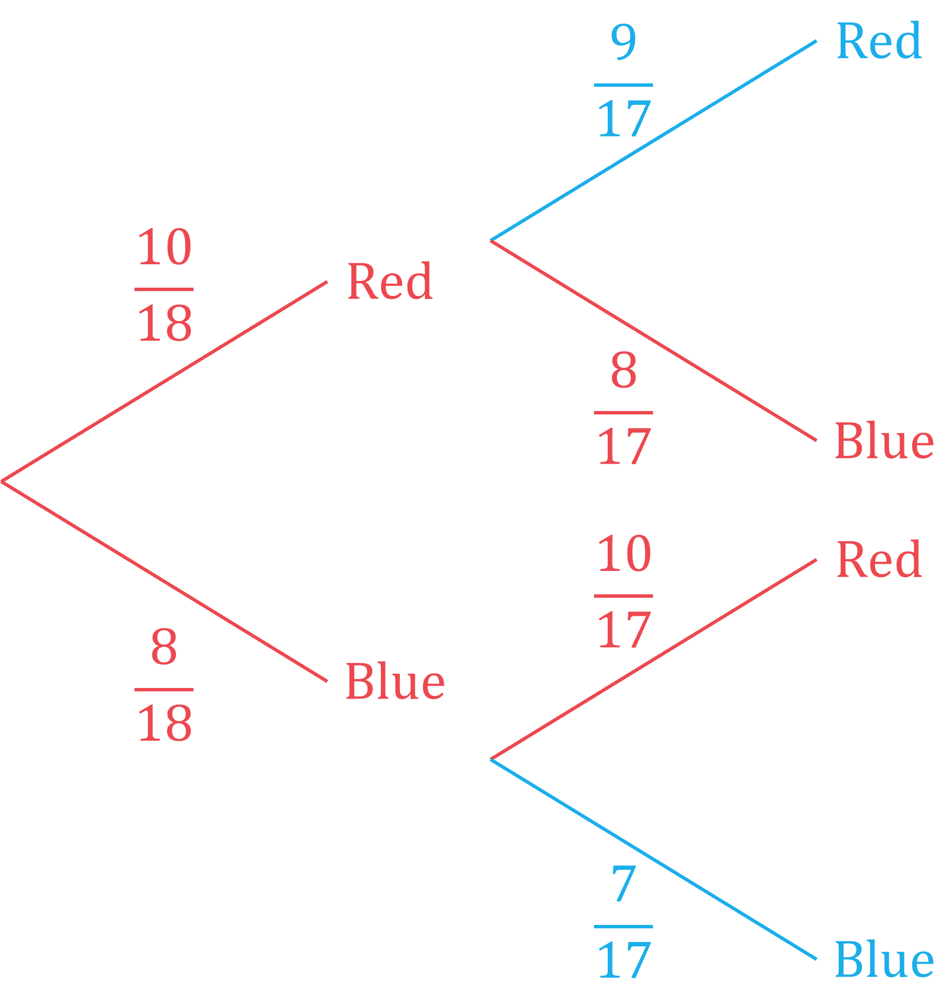

> *To find the probability that the first is red and the second is blue, you multiply the probabilities.*

$P(RB)=\frac{10}{18}\times\frac{8}{17}=\frac{40}{153}$

**[1]**

> *Do the same for the probability of blue then red.*

$P(BR)=\frac{8}{18}\times\frac{10}{17}=\frac{40}{153}$

> *As you want the probability of red then blue or blue then red, you add the combined probabilities together. *
*Leave your answer as an exact fraction in simplest form.*

$P(RB\mathrm{or}BR)=\frac{10}{18}\times\frac{8}{17}+\frac{8}{18}\times\frac{10}{17}=\frac{40}{153}+\frac{40}{153}$

**[1]**

$\frac{80}{153}$ **[1]**

### Q12
i) *The key phrase here is "... without replacement ..." - this means the probabilities will change after the first sweet is chosen.* 
*If the first sweet is green, there will be 5 green sweets left out of a total of 19.*

`| P ( both green ) | = P ( 1 ^ st green ) AND P ( 2 ^ nd g r e e n ) | | _ = P ( 1 ^ st green ) x P ( 2 ^ nd green ) | | _ = 6 / 20 x 5 / 19 | |`

**[1]**

*We are required to **show** the answer is *$\frac{3}{38}$* so we cannot just use a calculator!* 
*Cancel common factors of the numerator and denominator first to make the multiplication easier.*

`table columnalign right center left columnspacing 0px end | P ( both green ) | = (| 3 | / 6 | |)/(| / 20 | | | / 10 | | 2 | | |) x (| 1 | / 5 | |)/(19) = (3 x 1)/(2 x 19) | |`

$P(\mathrm{both} \mathrm{green})=\frac{3}{38}$ **[1]**

ii) *Consider this as the opposite to choosing sweets that are the same colour (so "1 - P(both same colour)").* 
*First work out the probability of getting the same colour (the probability of two greens was given in part i)).*

`| P ( both same colour ) | = P ( red AND red ) OR P ( green AND green ) OR P ( yellow AND yellow ) | | _ = ( 5 / 20 x 4 / 19 ) + ( 3 / 38 ) + ( 9 / 20 x 8 / 19 ) | |`

**Correct reds or yellows multiplication**** [1]** 
**Adding the three combinations together**** [1]**

> *Type this carefully into your calculator or work out the individual parts and store them in your calculator's memory.*

$\mathrm{P} ( \text{both} \text{same} \text{colour} ) = \frac{1}{19} + \frac{3}{38} + \frac{18}{95} = \frac{61}{190}$

> *Remember the question asked for the probability that the sweets were not the same colour so subtract this from 1.*

$\mathrm{P} ( \text{not} \text{same} \text{colour} ) = 1 - \frac{61}{190} = \frac{129}{190}$

**[1]**

$\frac{129}{190}$* ***[1]**

### Q13
*There are two ways that all three balls could be the same colour: all three are red or all three are blue.* 
*Drawing a full probability tree diagram would be time-consuming so you can do it without a diagram or draw a partial tree diagram with only the required branches.*

> *There are 18 balls for the first choice, 17 balls for the second choice and 16 balls for the third choice.*

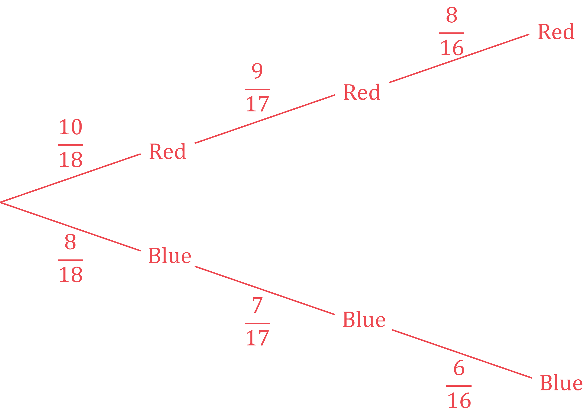

**Writing the correct probabilities for the second and third balls**** [1]**

> *Find the probability that all three are red by multiplying the three probabilities together.*

$P(RRR)=\frac{10}{18}\times\frac{9}{17}\times\frac{8}{16}=\frac{5}{34}$

> *Similarly, find the probability that all three are blue.*

$P(BBB)=\frac{8}{18}\times\frac{7}{17}\times\frac{6}{16}=\frac{7}{102}$

**[1]**

> *Find the probability that all three are red or all three are blue by adding together the two combined probabilities.*

$P(RRR\mathrm{or}BBB)=\frac{5}{34}+\frac{7}{102}$

**[1]**

$\frac{11}{51}$ **[1]**

### Q14
*Find the number of students who study Drama (by adding all numbers in the **D** circle)*

*3 + 8 + 2 + 9 = 22*

*Find the number of students who also study Music (by adding the numbers in the **M** and the **D** overlap)* * *

*3 + 2 = 5*

*Find the probability that the first Drama student chosen studies Music (by dividing 5 by 22)* * *

$\frac{5}{22}$

**[1]**

*Find the probability that the second Drama student chosen studies Music (by dividing the remaining 4 students out of 21)*

$\frac{4}{21}$

*"And" means multiply in probability* *Find the probability that the first Drama student studies Music "and" the second Drama student studies Music (by multiplying the two probabilities together)*

$\frac{5}{22}\times\frac{4}{21}$

**[1]**

$\frac{20}{462}$ **[1]** 
**Any equivalent answer is accepted, for example **$\frac{10}{231}$

### Q15
*"At least two packets" means two or more* *Write out the possibilities for the 1st packet, the 2nd packet and the 3rd packet* * *

*C then C then S,   C then S then C,   S then C then C* 
*C then C then B,   C then B then C,   B then C then C* 
*C then C then C* * *

*The probabilities must be found in the same way as part (a)(ii)* *For example, P(C then C then S) is * * *

$\frac{4}{20}\times\frac{3}{19}\times\frac{10}{18}$ * *

**multiplying by a third fraction over 18**** [1]**

*If it helps, P(C then C then S) is the same as P(C then S then C) and the same as P(S then C then C) as the denominators and numerators are all the same* * *

$4\times3\times10=4\times10\times3=10\times4\times3$ * *

*Write out the overall probability* * *

> $( \frac{4}{20} \times \frac{3}{19} \times \frac{10}{18} ) \times 3 + ( \frac{4}{20} \times \frac{3}{19} \times \frac{6}{18} ) \times 3 + \frac{4}{20} \times \frac{3}{19} \times \frac{2}{18}$* *

**[1]**

> *Use a calculator to work out the answer*

$\frac{5}{57}$ **[1]**

### Q16
> *The first pencil is not replaced before the second pencil is chosen, so the events are conditional and the probabilities will change. *

> *This is best represented using a probability tree diagram.*

> *As the problem only concerns red or not red pencils, it is easiest to group the yellow and green together and call them not red pencils.*

*Total number of pencils = 15 + 8 + 2 = 25** *
*Total number of red pencils = 15** *
*Total number of not red pencils = 25 - 15 = 10  *

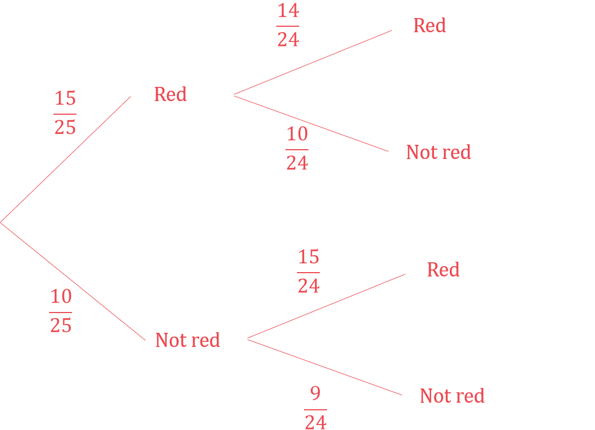

> *Method 1*

> *Subtract the probability that both pencils are not red from 1.*

$\begin{gathered} 1 - \mathrm{P} ( \text{Both} \text{not} \text{red} ) \\ = 1 - ( \frac{10}{25} \times \frac{9}{ 24} ) \end{gathered}$

**[2]**

$\frac{17}{20}$** [1] **
**Unsimplified fraction or equivalent correct decimal accepted.**

> *Method 2*

> *Add the probability of both being red to the probability of one being red and the other being not red. *
*P(at least one red) = P(both red) + P(first red, second not red) + P(first not red, second red).*

$( \frac{15}{25} \times \frac{14}{ 24} ) + ( \frac{15}{25} \times \frac{10}{ 24} ) + ( \frac{10}{25} \times \frac{15}{ 24} )$

** ****At least one correct product**** [1]  **
**All three correct and added together**** [1]**

$\frac{17}{20}$** [1] **
**Unsimplified fraction or equivalent correct decimal accepted.**

### Q17
> *Calculate the number of cars which had a speed greater than 50 km.h by adding together the frequencies for the higher speeds.*

*26 + 4 = 30*

*There are 200 cars and 30 of them had a speed greater than 50 km/h. *
*Once one car is picked there will be 199 cars left to choose from, if the first one had speed greater than 50 km/h then there will be 29 such cars left.* 
*You can draw a tree diagram to help you visualise the options.*

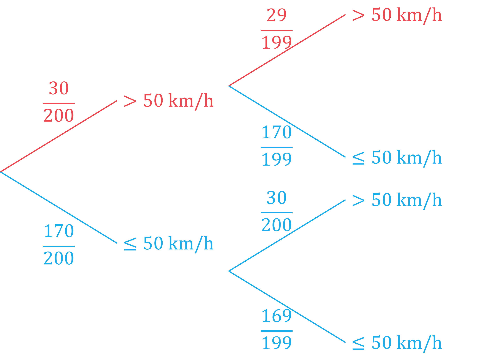

> *Multiply the probabilities together.*

$\frac{30}{200}\times\frac{29}{199}$

**[1]**

$\frac{87}{3980}$ **[1]**

### Q18
> *The first disc is replaced before the second disc is chosen. The probabilities will not change and it is possible for both discs to be any of the colours.*

> *Draw a probability tree, keeping the probabilities the same for the second disc.   *

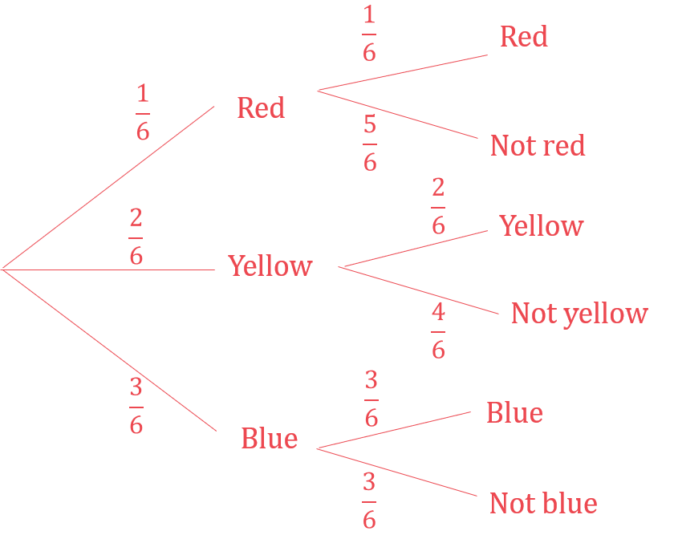

> *Multiply the probabilities with the same colour together and add the products.*

$( \frac{1}{6} \times \frac{1}{6} ) + ( \frac{2}{6} \times \frac{2}{6} ) + ( \frac{3}{6} \times \frac{3}{6} )$

** At least one of the probabilities correct**** [1] **
**Correct method ****[1]**

> *Use your calculator to find the solutions.*

$( \frac{1}{6} )^{2} + ( \frac{2}{6} )^{2} + ( \frac{3}{6} )^{2} = \frac{14}{36}$

$\frac{7}{18}$** [1] **
**Unsimplified fraction or equivalent correct decimal accepted.**

### Q19
> *The probabilities on each branch of the tree must add up to 1. So we can subtract the known probabilities from 1 to find the missing probabilities.*

$1-0.45=0.551-0.67=0.331-0.35=0.65$

** *** *

**  [2]**

**1 mark for 0.55 in the right place on 'Saturday'.  **
**1 mark for the other 4 numbers in the right places on 'Sunday'.**
> *With combined probabilities, 'and' usually means 'multiply' and 'or' usually means 'add'. *
*'Wins exactly one match' is the same as 'wins on Saturday AND does not win on Sunday' OR 'does not win on Saturday AND wins on Sunday'. *
*So multiply the probabilities from the corresponding parts of the tree diagram, and then add the products together to get the answer.*

$( 0.45 \times 0.33 ) + ( 0.55 \times 0.35 ) = 0.341$

**  [2] ****1 mark for one correct product.  **
**1 mark for two correct products added together.**

** ****0.341****  [1] **
**Answers between 0.34 and 0.341 will get the mark here.**

### Q20
> *The probabilities on each branch of the tree must add up to 1. *
*So we can subtract the known probabilities from 1 to find the missing probabilities.*

$1-0.02=0.98\,\,1-0.05=0.95$

** *** *

**  [2]**

**1 mark for 0.98 in the right place on 'machine A'.  **
**1 mark for 0.95, 0.05 and 0.95 in the right places on 'machine B'.**
> *'At least one is faulty' is the same thing as 'both aren't not faulty'. The easiest way to do this is to find the 'not faulty AND not faulty' probability and subtract it from 1. *
*In combined probabilities, 'and' usually means 'multiply'. So multiply 0.98 by 0.95 to find the probability both bottles are **not **faulty.*

$0.98\times0.95=0.931$

**[1]**

> *Then subtract that from 1 to find the probability that at least one is faulty.*

$1-0.931=0.069$

**0.069 *** ***[1]**

**You can also do this by multiplying to get the probabilities for 'faulty AND faulty', 'faulty AND not faulty', and 'not faulty AND faulty', and then adding those together to get the answer. I.e., **$( 0.02 \times 0.05 ) + ( 0.02 \times 0.95 ) + ( 0.98 \times 0.05 ) = 0.069$

### Q21
> *Let *$R$* **be the probability that Raphael picks a blue pen and *$Q$* be the probability that Paulo picks a blue pen.*
*You could draw a tree to help you see the outcomes.*

> *For two events *$R$* **and *$Q$*,  *$P(R\mathrm{and}Q)=P(R)\timesP(Q)$* **so*

$\frac{8}{15} = \frac{2}{3} \times \mathrm{P} ( Q )$

**[1]**

> *Divide both sides by *$\frac{2}{3}$* to find *$P(Q)$

$\begin{gathered} \mathrm{P} ( Q ) & = \frac{8}{15} \div \frac{2}{3} \\ = \frac{4}{5} \end{gathered}$

> *Remember that you can use your calculator to divide the fractions.*

`| _ _ 4 / 5 | |` **[1]**

**Equivalent fractions, a decimal (0.8) or a percentage (80%) are also accepted**
> *Let *$R$* **be the probability that Raphael picks a blue pen and *$Q$* be the probability that Paulo picks a blue pen.*

> *As there are only blue or green pens, the probability that Raphael picks a green pen is the same as the probability Raphael does not pick a blue pen, or *$P(R')$*. *
*The same logic is true for Paulo. *
*We are told *$P(R)=\frac{2}{3}$*. And from part (a), *$P(Q)=\frac{4}{5}$*. Therefore*

$\mathrm{P} ( R ' ) = 1 - \frac{2}{3} = 1 \frac{1}{3}$*  **and**  *$\mathrm{P} ( Q ' ) = 1 - \frac{4}{5} = 1 \frac{1}{5}$

**either of these results**** [1]**

> *You could draw a tree diagram to see this. Multiply the two probabilities to find the probability they both happen*

`| P ( R ' and Q ' ) | = 1 third x 1 fifth | |`

**[1]**

**Answer = **`table columnalign right center left columnspacing 0px end | _ _ 1 / 15 | |` **[1]**

**It is best to leave this answer as a fraction to avoid rounding it as a decimal**

### Q22
> *The bead is replaced each time, so the probability stays the same for each red bead.*

> *Find the probability of choosing one red bead.  *

> $\mathrm{P} ( \text{Red} ) = \frac{15}{15 + 10} = \frac{15}{25}$*   *

> *To find the probability of two things both happening, multiply the probabilities. *
*You could draw a tree diagram to help. *
*P(Both red) = P(first red) and P(second red)  = P(first red) × P(second red).  *

$\mathrm{P} ( \text{Both} \text{red} ) = \frac{15}{25} \times \frac{15}{25}$

** [1]**

> * *

> *Use your calculator to multiply the two fractions.*

$\frac{9}{25}$** [1] **
**The unsimplified fraction is accepted.**
> *Ariana can either pick two red beads, or not pick two red beads. The two events are mutually exclusive. *
*The probabilities of mutually exclusive events add up to 1. *
*The probability of not picking two red beads will be 1 - the probability of picking two red beads. *

$\mathrm{P} ( \text{Not} \text{both} \text{red} ) = 1 - \frac{9}{25}$

$\frac{16}{25}$** [1]**

### Q23
> *We can fill in the probabilities we are given in the question first*

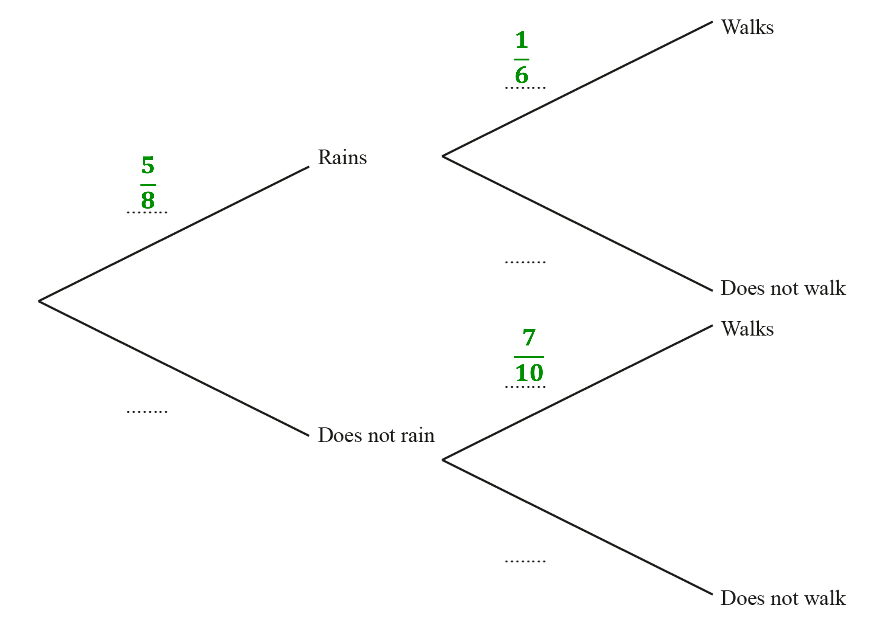

> *The probabilities on each pair of branches should sum to 1*

$1-\frac{5}{8}=\frac{3}{8}\mathrm{and}1-\frac{1}{6}=\frac{5}{6}\mathrm{and}1-\frac{7}{10}=\frac{3}{10}$

> *Complete the tree diagram with these probabilities*

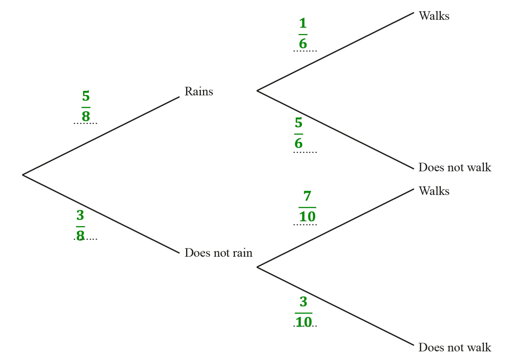

**1 mark for each correct pair of probabilities on diagram**** [3]**
*Let the probability it will rain tomorrow be *$P ( R )$* and the probability Rafael walks to school be *$P ( W )$*.* *Using the "and" rule: *`P ( A and B ) = P ( A ) x P ( B )`

`P ( R and W ) = 5 / 8 x 1 / 6`

**[1]**

$\frac{5}{48}$** [1] **
**It's neater and more accurate to leave your answer as a fraction, rather than as a rounded decimal or percentage**
> *There are two ways that Rafael can not walk to school tomorrow- these two ways are highlighted on the diagram below*

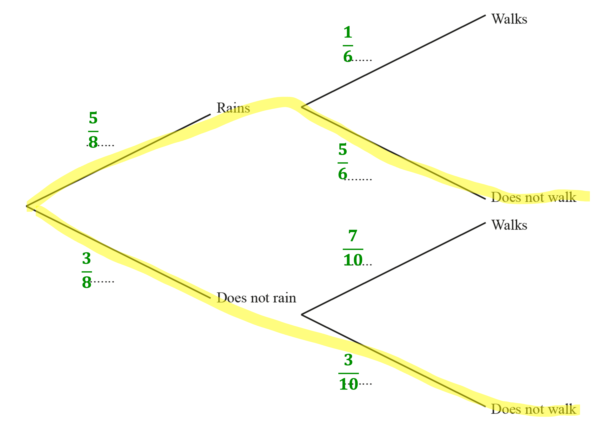

> *It can rain and Rafael does not walk to school...*

`P ( R and W ' ) = 5 / 8 x 5 / 6 = 25 / 48`

> *...or it can not rain and Rafael does not walk to school*

`P ( R ' and W ' ) = 3 / 8 x 3 / 10 = 9 / 80`

** ****calculating either of the above correctly ****[1]**

*That it rains or does not rain are mutually exclusive events- they cannot both happen.* 
*The "or" rule for mutually exclusive events states *$P ( A o r B ) = P ( A ) + P ( B )$

`P ( R and W ' ) or P ( R ' and W ' ) = 25 / 48 + 9 / 80`

**[1]**

> *Use your calculator to work out the final answer*

$\frac{19}{30}$* ***[1]**

**Other equivalent fractions such as **$\frac{304}{480}$**are permitted**

### Q24
*Find P(3 or more) by subtracting a third from 1* * *

$1-\frac{1}{3}=\frac{2}{3}$ * *

> *Fill in the tree diagram*

**[1]**
*P(both dice land on "less than 3") = P(1st one lands on "less than 3") × P(2nd one lands on "less than 3")*

$\frac{1}{3}\times\frac{1}{3}$

$\frac{1}{9}$ **[1]**
*Method 1 *
*To get exactly one "less than 3", either the 1st one is "less than 3" **and** the 2nd one is "3 or more", **or** the 1st one is "3 or more" **and** the 2nd one is "less than 3" ("and" means × and "or" means +)*

$\frac{1}{3}\times\frac{2}{3}+\frac{2}{3}\times\frac{1}{3}$

**first or second product of fractions**** [1]**

$\frac{2}{9}+\frac{2}{9}$

$\frac{4}{9}$ **[1]**

*Method 2 *
*Getting exactly one "less than 3" means definitely not getting no less than 3s and definitely not getting both less than 3s Subtract these impossible scenarios from 1*

$1-\frac{2}{3}\times\frac{2}{3}-\frac{1}{3}\times\frac{1}{3}$

** [1]**

$1-\frac{4}{9}-\frac{1}{9}$

$\frac{4}{9}$ **[1]**

### Q25
> *The expected frequency is the probability times by the number of trials. In this case,*

$\frac{1}{3}\times60$

**20** **[1]**
> *For each pair of branches, the probability must add up to 1. *
*Use this to calculate the two missing probabilities below*

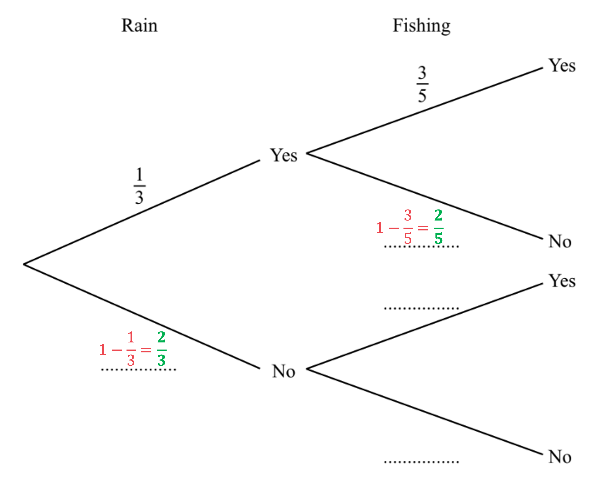

**[1]**

> *We can use the information that "when it does not rain the probability that Amira goes fishing is *$\frac{3}{4}$*" to complete the final two spaces*

**[1]**
> *The two 'paths' that lead to Amira going fishing are highlighted below *
*For each path, to find the resulting probability, multiply the two probabilities together as shown*

**one of the two multiplications shown above**** [1]**

> *Add the resulting probabilities to get the total probability of Amira going fishing*

$\frac{1}{3}\times\frac{3}{5}+\frac{2}{3}\times\frac{3}{4}$

**[1]**

**Answer  = **$\frac{7}{10}$ **[1]**
** '0.7' or equivalent fractions are accepted**

### Q26
> *Find the probability: the bus is late AND Seb is travelling on the bus.  If event 1 AND event 2 are both occurring, MULTIPLY the probabilities.*

*The school bus is late AND Seb travels on the bus: *$\frac{9}{10}\times\frac{15}{16}=\frac{27}{32}$

> *Find the probability: the bus is on time and Seb travels on the bus. *
*The probability that the bus is on time = (1 - The probability that the bus is late)*

*The school bus is on time AND Seb travels on the bus: *$\frac{1}{10}\times\frac{3}{4}=\frac{3}{40}$

** Either **$\frac{27}{32}$** or **$\frac{3}{40}$** [1]**

> *When one OR the other outcome could happen, ADD the probabilities.*

$\frac{27}{32}+\frac{3}{40}=\frac{147}{160}$

**[1]**

$\frac{147}{160}$** [1]**

### Q27
> *Consider the different cases where Bob plays football (P) for two Saturdays and does not play (N) for one Saturday.*

*PPN, PNP, NPP: 3 ways this can happen*

> *You could draw a tree diagram but it would be quicker to spot that each possibility contains 2 Ps and 1 N, and the probabilities are the same for each Saturday. *
*Therefore the probability for all 3 possibilities are the same.*
* Find the probability of one possibility by multiplying the three probabilities together.*

$\begin{gathered} \mathrm{P} ( \text{Bob} \text{plays} ) \times \mathrm{P} ( \text{Bob} \text{plays} ) \times \mathrm{P} ( \text{Bob} \text{does} \text{not} \text{play} ) & = \frac{2}{5} \times \frac{2}{5} \times \frac{3}{5} = \frac{12}{125} \end{gathered}$

**[1]**

> *As all three possibilities have the same probability you can multiply this by 3.*

$\frac{12}{125}\times3$

**[1]**

$\frac{36}{125}$ **[1]** 
**It is acceptable to write as a decimal: 0.288**
> *You want to find the probability that Arun plays football and he scores the winning goal.*

> *You could draw a tree diagram but there is only one route you are interested in.*

$\mathrm{Arun} \mathrm{plays}\rightarrow\mathrm{Scores} \mathrm{winning} \mathrm{goal}$

> *Multiply the two probabilities together.*

$\frac{3}{4}\times\frac{1}{7}$

**[1]**

$\frac{3}{28}$ **[1] **
**It is a recurring decimal so leave as a fraction**
