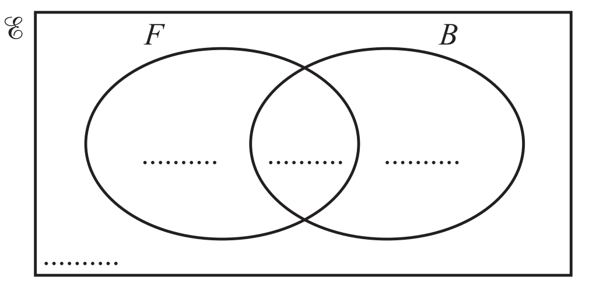
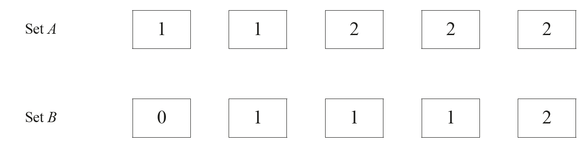
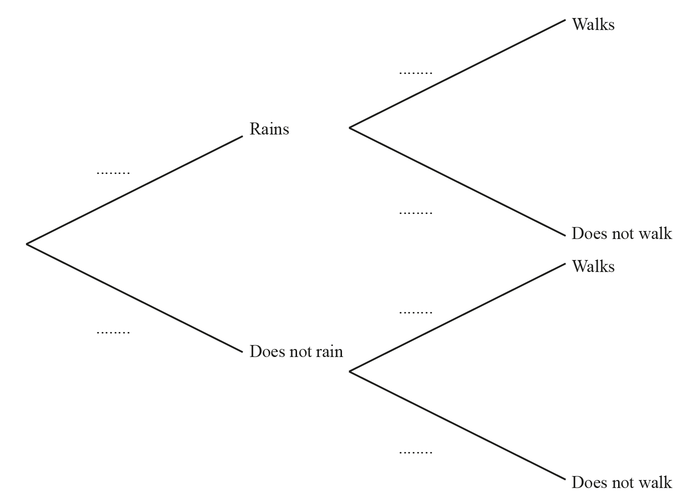

# Exam Questions — Tree Diagrams & Multiple Events
**Probability** · Cambridge (CIE) IGCSE maths (0607)
> Source: [https://www.savemyexams.com/igcse/maths/cie/international-maths/23/extended/topic-questions/](https://www.savemyexams.com/igcse/maths/cie/international-maths/23/extended/topic-questions/) · 27 questions across 1 sets

## Calculator Questions (27 questions)

### Q1 — medium — 5 marks

**Q1** [1 mark]

100 students each cut a piece of string. 
Each student then measures the length, $x\mathrm{cm}$, of their piece of string. 
The results are shown in the table.

| Length ($x\mathrm{cm}$) | $9<x\leq10$ | $10<x\leq10.5$ | $10.5<x\leq11$ | $11<x\leq12.5$ | $12.5<x\leq15$ |
|---|---|---|---|---|---|
| Frequency | $7$ | $48$ | $35$ | $6$ | $4$ |

Joe picks one of the 100 pieces of string at random.

Write down the probability that this piece of string has a length greater than  15 cm.

*Source: 2025 Specimen 4 Q6B*

**Q1** [2 marks]

**Extract:**

| Length (x cm) | 9 < x ≤ 10 | 10 < x ≤ 10.5 | 10.5 < x ≤ 11 | 11 < x ≤ 12.5 | 12.5 < x ≤ 15 |
| Frequency | 7 | 48 | 35 | 6 | 4 |

Kira picks two of the 100 pieces of string at random.

Calculate the probability that both of these pieces of string have a length greater than 11 cm.

*Source: 2025 Specimen 4 Q6C*

**Q1** [2 marks]

**Extract:**

| Length (x cm) | 9 < x ≤ 10 | 10 < x ≤ 10.5 | 10.5 < x ≤ 11 | 11 < x ≤ 12.5 | 12.5 < x ≤ 15 |
| Frequency | 7 | 48 | 35 | 6 | 4 |

Lenny picks two of the pieces of string with a length greater than 11 cm at random.

Calculate the probability that both of these pieces of string have a length greater than 12.5 cm.

### Q2 — medium — 3 marks

**Q2** [3 marks]

A group of 200 people were asked which city they would like to visit next. The table shows the results.

| City | London | Paris | New York | Tokyo |
|---|---|---|---|---|
| Number of people | 50 | 48 | 56 | 46 |

Two people are chosen at random from the group of 200.   
Find the probability that one person would like to visit London next and the other person would like to visit New York next. 
Give your answer as a percentage.

............................................ %

*Source: 2018	Oct/Nov 0580/21 Q22B*

### Q3 — medium — 3 marks

**Q3** [3 marks]

A box contains 7 black pens and 8 orange pens. Two pens are chosen at random from this box without replacement. Calculate the probability that at least one orange pen is chosen.

*Source: 2018	May/June 0580/21 Q20B*

### Q4 — hard — 3 marks

**Q4** [3 marks]

200 students estimate the total area, $Am^{2}$, of the windows in the classroom. 
The table shows their results.

| Area ($A$m2) | $20<A\leq60$ | $60<A\leq100$ | $100<A\leq150$ | $150<A\leq250$ |
|---|---|---|---|---|
| Frequency | 32 | 64 | 80 | 24 |

Two students are chosen at random from those students that estimated the area of the windows to be more than $100m^{2}$.   
Find the probability that one of the two students estimates the area to be greater than $150m^{2}$ and the other student estimates the area to be $150m^{2}$ or less.

*Source: 2020 Specimen 4 Q2B*

### Q5 — hard — 5 marks

**Q5** [2 marks]

$E=${students in a school} 
$F=${students who play football} 
$B=${students who play baseball}

There are 240 students in the school.

• 120 students play football 
  • 40 students play baseball 
  • 90 students play football but not baseball.

Complete the Venn diagram to show this information.

*Source: 2019	May/June 0580/41 Q6A*

**Q5** [3 marks]

**Extract:**

There are 240 students in the school.   • 120 students play football   • 40 students play baseball   • 90 students play football but not baseball.

Two students who play baseball are chosen at random.   
Find the probability that they both also play football.

*Source: 2019	May/June 0580/41 Q6D*

### Q6 — very_hard — 7 marks

**Q6** [3 marks]

This year, 40 students have each travelled by one or more of plane ($P$), train ($T$) or boat ($B$).
 7 have travelled only by plane. 
11 have travelled only by train. 
9 have travelled only by boat.

$n(P\capT)=8$ $n(B\capT)=3$ $n(B\capP)=6$

Complete the Venn diagram.

*Source: 2020 March 0580/42 Q9A*

**Q6** [2 marks]

**Extract:**

This year, 40 students have each travelled by one or more of plane (P), train (T) or boat (B).

7 have travelled only by plane.

Two students are chosen at random. 
Calculate the probability that they both have travelled only by plane.

*Source: 2020 March 0580/22 Q9D*

**Q6** [2 marks]

**Extract:**

This year, 40 students have each travelled by one or more of plane (P), train (T) or boat (B).

7 have travelled only by plane. 

11 have travelled only by train. 

9 have travelled only by boat.

n(P ∩ T) = 8
n(B ∩ T) = 3
n(B ∩ P) = 6

Two students are chosen at random from those who have travelled by train. 
Calculate the probability that they both have also travelled by plane.

*Source: 2020 March 0580/42 Q9E*

### Q7 — medium — 2 marks

**Q7** [2 marks]

A box contains 20 packets of potato chips. 6 packets contain barbecue flavoured chips. 
10 packets contain salt flavoured chips. 4 packets contain chicken flavoured chips. 
Maria takes two packets at random **without replacement**.

Show that the probability that she takes two packets of salt flavoured chips is $\frac{9}{38}.$

*Source: 2018	Oct/Nov 0580/42 Q12A*

### Q8 — very_hard — 10 marks

**Q8** [7 marks]

The diagram shows two sets of cards.

i) Jojo chooses two cards at random from Set *A* without replacement. 
Find the probability that the two cards have the same number.

[3]

ii) Jojo replaces the two cards. Kylie then chooses one card at random from Set *A* and one card at random from Set *B*. 
Find the probability that the two cards have the same number.

[3]

iii) Who is the most likely to choose two cards that have the same number? Show all your working.

[1]

*Source: 2018	May/June 0580/43 Q4A*

**Q8** [3 marks]

**Extract:**

The diagram shows two sets of cards.

[diagram not included]

(But the text refers to Set C, so the extract needed is the list of cards in Set C as shown in the diagram in part a.)

Lena chooses three cards at random from Set C without replacement. Find the probability that the third card chosen is numbered 4.

*Source: 2018	May/June 0580/43 Q4B*

### Q9 — hard — 4 marks

**Q9** [4 marks]

A box contains 20 packets of potato chips. 6 packets contain barbecue flavoured chips. 
10 packets contain salt flavoured chips.
 4 packets contain chicken flavoured chips. 
Maria takes two packets at random **without replacement**.

Find the probability that she takes two packets of different flavoured chips.

*Source: 2018	Oct/Nov 0580/42 Q12A*

### Q10 — hard — 4 marks

**Q10** [4 marks]

The heights, $h$ metres, of the 120 boys in an athletics club are recorded. 
The table shows information about the heights of the boys.

| Height  ($h$ metres) | $1.3<h\leq1.4$ | $1.4<h\leq1.5$ | $1.5<h\leq1.6$ | $1.6<h\leq1.7$ | $1.7<h\leq1.8$ | $1.8<h\leq1.9$ |
|---|---|---|---|---|---|---|
| Frequency | 7 | 18 | 30 | 24 | 27 | 14 |

Three boys are chosen at random from the club. 
Calculate the probability that one of the boys has a height greater than 1.8 m and the other two boys each have a height of 1.4 m or less.

*Source: 2020	May/June 0580/41 Q2B*

### Q11 — medium — 3 marks

**Q11** [3 marks]

Ravi has a bag which contains 10 red balls and 8 blue balls. 
Ravi takes two balls at random from his bag, without replacement.   
Find the probability that one ball is red and one ball is blue.

*Source: 2019 March 0580/42 Q3B*

### Q12 — hard — 6 marks

**Q12** [6 marks]

Sonia has a bag containing 20 sweets. In the bag, there are 5 red, 6 green and 9 yellow sweets. 
Sonia chooses two sweets at random, without replacement, from the bag.

i) Show that the probability that she chooses two green sweets is $\frac{3}{38}$.

[2]

ii) Calculate the probability that the sweets she chooses are **not **both the same colour.

[4]

*Source: 2018	Feb/Mar 0580/22 Q22B*

### Q13 — hard — 4 marks

**Q13** [4 marks]

Talika has a bag which contains 10 red balls and 8 blue balls. Talika takes three balls at random from her bag, without replacement.   
Calculate the probability that the three balls are the same colour.

*Source: 2019 March 0580/42 Q3C*

### Q14 — hard — 3 marks

**Q14** [3 marks]

The Venn diagram above shows information about the number of students who study Music (*M*), Drama (*D*) and Geography (*G*).

Two students are chosen at random from those who study Drama.   
Calculate the probability that they both also study Music.

*Source: 2018	Oct/Nov 0580/41 Q6A*

### Q15 — very_hard — 3 marks

**Q15** [3 marks]

A box contains 20 packets of potato chips. 
6 packets contain barbecue flavoured chips. 
10 packets contain salt flavoured chips. 
4 packets contain chicken flavoured chips.   

Maria takes three packets at random,** without replacement**, from the 20 packets. 

Find the probability that she takes **at least two** packets of chicken flavoured chips.

*Source: 2018	Oct/Nov 0580/42 Q12B*

### Q16 — medium — 3 marks

**Q16** [3 marks]

A box contains 15 red pencils, 8 yellow pencils and 2 green pencils. 
Two pencils are picked at random without replacement.
 Find the probability that at least one pencil is red.

*Source: 2020 Oct/Nov 0580/41 Q9D*

### Q17 — medium — 2 marks

**Q17** [2 marks]

The speed, $v$ km/h, of each of 200 cars passing a building is measured.  
The table shows the results.

| Speed ($v$ km/h) | $0<v\leq20$ | $20<v\leq40$ | $40<v\leq45$ | $45<v\leq50$ | $50<v\leq60$ | $60<v\leq80$ |
|---|---|---|---|---|---|---|
| Frequency | $16$ | $34$ | $62$ | $58$ | $26$ | $4$ |

Two of the 200 cars are chosen at random.   
Find the probability that they both have a speed greater than 50 km/h.

*Source: 2020 May/June 0580/42 Q3C*

### Q18 — very_hard — 3 marks

**Q18** [3 marks]

The diagram shows six discs. Each disc has a colour and a number.

Two of the six discs are picked at random **with **replacement.

Find the probability that both discs have the same colour.

*Source: 2020 Oct/Nov 0580/42 Q6C*

### Q19 — hard — 5 marks

**Q19** [2 marks]

A darts team is going to play a match on Saturday and on Sunday. The probability that the team will win on Saturday is 0.45

If they win on Saturday, the probability that they will win on Sunday is 0.67 If they do **not** win on Saturday, the probability that they will win on Sunday is 0.35

Complete the probability tree diagram.

*Source: 2018	June 1MA1/2H Q15A*

**Q19** [3 marks]

**Extract:**

The probability that the team will win on Saturday is 0.45
If they win on Saturday, the probability that they will win on Sunday is 0.67
If they do not win on Saturday, the probability that they will win on Sunday is 0.35

Find the probability that the team will win exactly one of the two matches.

*Source: 2018	June 1MA1/2H Q15B*

### Q20 — hard — 5 marks

**Q20** [2 marks]

Machine A and machine B make bottles.

The probability that a bottle made by machine A is faulty is 0.02 The probability that a bottle made by machine B is faulty is 0.05

Complete the probability tree diagram.

*Source: 2017	June 1MA0/2H Q19A*

**Q20** [3 marks]

**Extract:**

The probability that a bottle made by machine A is faulty is 0.02 The probability that a bottle made by machine B is faulty is 0.05

Shazia takes at random one bottle made by machine A and one bottle made by machine B.

Work out the probability that at least one of these bottles is faulty.

*Source: 2017	June 1MA0/2H Q19B*

### Q21 — very_hard — 5 marks

**Q21** [2 marks]

Box *A* and box *B* each contain blue and green pens only. 
Raphael picks a pen at random from box *A* and Paulo picks a pen at random from box *B*. 
The probability that Raphael picks a blue pen is $\frac{2}{3}$. The probability that both Raphael and Paulo pick a blue pen is $\frac{8}{15}$.

Find the probability that Paulo picks a blue pen.

*Source: 2018	May/June 0580/22 Q24A*

**Q21** [3 marks]

**Extract:**

Box *A* and box *B* each contain blue and green pens only. Raphael picks a pen at random from box *A* and Paulo picks a pen at random from box *B*. The probability that Raphael picks a blue pen is ![2 over 3]. The probability that both Raphael and Paulo pick a blue pen is ![8 over 15].

Find the probability that both Raphael and Paulo pick a green pen.

*Source: 2018	May/June 0580/22 Q24B*

### Q22 — medium — 3 marks

**Q22** [2 marks]

A bag contains 15 red beads and 10 yellow beads. 
Ariana picks a bead at random, records its colour and replaces it in the bag. 
She then picks another bead at random.

Find the probability that she picks two red beads.

*Source: 2020 Oct/Nov 0580/41 Q9C*

**Q22** [1 mark]

**Extract:**

A bag contains 15 red beads and 10 yellow beads. 

Ariana picks a bead at random, records its colour and replaces it in the bag. 

She then picks another bead at random.

Find the probability that she does not pick two red beads.

*Source: 2020 Oct/Nov 0580/41 Q9C*

### Q23 — very_hard — 8 marks

**Q23** [3 marks]

The probability that it will rain tomorrow is $\frac{5}{8}$. 
If it rains, the probability that Rafael walks to school is $\frac{1}{6}$. 
If it does not rain, the probability that Rafael walks to school is $\frac{7}{10}$.

Complete the tree diagram.

*Source: 2018	May/June 0580/41 Q9A*

**Q23** [2 marks]

**Extract:**

The probability that it will rain tomorrow is ![5 over 8]. 

If it rains, the probability that Rafael walks to school is ![1 over 6].

Calculate the probability that it will rain tomorrow and Rafael walks to school.

*Source: 2018	May/June 0580/41 Q9B*

**Q23** [3 marks]

**Extract:**

The probability that it will rain tomorrow is ![5 over 8]. 

If it rains, the probability that Rafael walks to school is ![1 over 6]. 

If it does not rain, the probability that Rafael walks to school is ![7 over 10].

Calculate the probability that Rafael does not walk to school.

*Source: 2018	May/June 0580/41 Q9C*

### Q24 — hard — 4 marks

**Q24** [1 mark]

Two ordinary fair dice are rolled.

Complete the tree diagram.

*Source: June 2018 8300/2H Q11A*

**Q24** [1 mark]

**Extract:**

Two ordinary fair dice are rolled.

Work out the probability that **both** dice land on a number less than 3.

*Source: June 2018 8300/2H Q11B*

**Q24** [2 marks]

**Extract:**

Two ordinary fair dice are rolled.

Work out the probability that **exactly one** of the dice lands on a number less than 3.

*Source: June 2018 8300/2H Q11C*

### Q25 — medium — 6 marks

**Q25** [1 mark]

On any day the probability that it rains is $\frac{1}{3}$.

When it rains the probability that Amira goes fishing is $\frac{3}{5}$. 
When it does not rain the probability that Amira goes fishing is $\frac{3}{4}$.

In a period of 60 days on how many days is it expected to rain?

*Source: Specimen 2025 0580/04 Q7A*

**Q25** [2 marks]

**Extract:**

On any day the probability that it rains is ![1 third].

When it rains the probability that Amira goes fishing is ![3 over 5]. 

When it does not rain the probability that Amira goes fishing is ![3 over 4].

Complete the tree diagram.

*Source: Specimen 2025 0580/04 Q7B*

**Q25** [3 marks]

**Extract:**

On any day the probability that it rains is ![1 third].

When it rains the probability that Amira goes fishing is ![3 over 5]. 

When it does not rain the probability that Amira goes fishing is ![3 over 4].

Find the probability that on any day Amira goes fishing.

*Source: Specimen 2025 0580/04 Q7C*

### Q26 — very_hard — 3 marks

**Q26** [3 marks]

The probability that the school bus is late is $\frac{9}{10}$. 
If the school bus is late, the probability that Seb travels on the bus is $\frac{15}{16}$. 
If the school bus is on time, the probability that Seb travels on the bus is $\frac{3}{4}$.

Find the probability that Seb travels on the bus.

*Source: 2019	Oct/Nov 0580/21 Q20-*

### Q27 — hard — 5 marks

**Q27** [3 marks]

On any Saturday, the probability that Bob plays football is $\frac{2}{5}.$   Calculate the probability that Bob plays football for 2 of the next 3 Saturdays.

*Source: 2020 May/June 0580/43 Q7B*

**Q27** [2 marks]

On any Saturday, the probability that Arun plays football is $\frac{3}{4}.$ When Arun plays football, the probability that he scores the winning goal is $\frac{1}{7}.$   
Calculate the probability that Arun scores the winning goal one Saturday.

*Source: 2020 May/June 0580/43 Q7C*

