# Exam Questions — 3D Pythagoras & Trigonometry
**Pythagoras & Trigonometry** · Cambridge (CIE) IGCSE maths (0607)
> Source: [https://www.savemyexams.com/igcse/maths/cie/international-maths/23/extended/topic-questions/](https://www.savemyexams.com/igcse/maths/cie/international-maths/23/extended/topic-questions/) · 33 questions across 1 sets

## Exam Questions (33 questions)

### Q1 — hard — 5 marks

**Q1** [5 marks]

The diagram shows a cuboid.

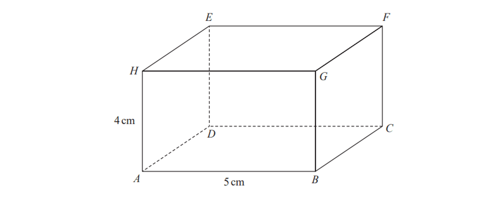

$\begin{gathered} A B & = 5 \text{cm} \end{gathered}$ and $\begin{gathered} A H & = 4 \text{cm} \end{gathered}$.

The size of the angle between $CH$ and the plane $ABCD$ is $35^{\circ}$

Calculate the volume of the cuboid.

Give your answer correct to $3$ significant figures.

### Q2 — medium — 4 marks

**Q2** [4 marks]

The diagram shows a cuboid.
$AB$ = 8 cm, $BC$ = 4 cm and $CR$ = 5 cm.

Calculate the angle between the diagonal $AR$ and the plane $BCRQ$.

*Source: 2018 May/June 0580/43 Q6B*

### Q3 — medium — 3 marks

**Q3** [3 marks]

The diagram shows a prism of length $16\mathrm{cm}$.

Triangle $ABC$ is a cross-section of the prism with $AB=7\mathrm{cm}$, $BC=6\mathrm{cm}$ and angle $ABC=90^{\circ}$.

Calculate the length of $PC$

............................ $\mathrm{cm}$

*Source: 2025 Specimen 4 Q9C*

### Q4 — medium — 3 marks

**Q4** [3 marks]

$ABCD$ is a horizontal rectangular field.

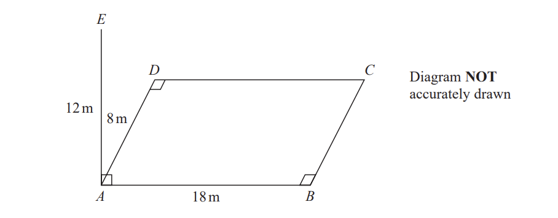

A vertical pole, $AE$, is placed at the corner A of the field.

$AE=12m$      $AB=18m$ $AD=8m$

Calculate the size of the angle between $EC$ and the plane $ABCD$ Give your answer correct to one decimal place.

*Source: Jan 2022 4MA1/2HR Q19*

### Q5 — hard — 7 marks

**Q5** [4 marks]

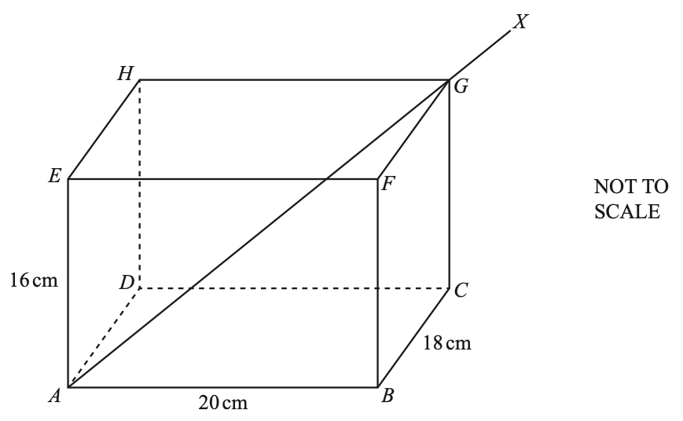

The diagram shows an open box $ABCDEFGH$ in the shape of a cuboid.

$AB=20$ cm, $BC=18$ cm and $AE=16$ cm.

A thin rod $AGX$ rests partly in the box as shown.

The rod is $40$ cm long.

Calculate $GX$, the length of the rod which is outside the box.

$GX=$ ............................................ cm

*Source: 2020 March 0580/42 Q8B*

**Q5** [3 marks]

**Extract:**

The diagram shows an open box A B C D E F G H in the shape of a cuboid.
A B equals 20 cm, B C equals 18 cm and A E equals 16 cm.
A thin rod A G X rests partly in the box as shown.
The rod is 40 cm long.

Calculate the angle the rod makes with the base of the box.

*Source: 2020 March 0580/42 Q8B*

### Q6 — medium — 4 marks

**Q6** [4 marks]

The diagram shows a cuboid $ABCDEFGH$.

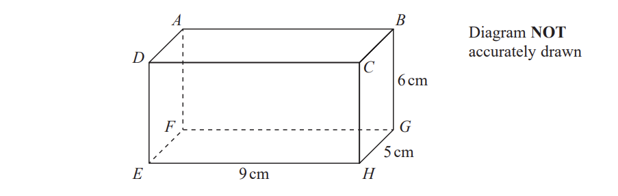

$EH=9\mathrm{cm},HG=5\mathrm{cm}$  and     $GB=6\mathrm{cm}.$

Work out the size of the angle between $AH$ and the plane $EFGH$. 
Give your answer correct to 3 significant figures.

*Source: Jan 2020 4MA1/1H Q19*

### Q7 — very_hard — 5 marks

**Q7** [5 marks]

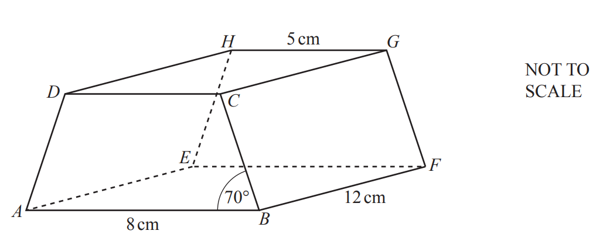

The diagram shows a prism with a rectangular base, *ABFE*. The cross-section, *ABCD*, is a trapezium with *AD* = *BC*. *AB* = 8 cm, *GH* = 5 cm, *BF* = 12 cm and angle *ABC* = 70°.

The perpendicular from *G* onto *EF* meets *EF* at *X*.

i) Show that *EX *= 6.5 cm.

[1]

ii) Calculate *AX*.

*AX* = ........................................... cm [2]

iii) Calculate the angle between the diagonal *AG* and the base *ABFE*.

[2]

*Source: 2020 Oct/Nov 0580/42 Q9B*

### Q8 — very_hard — 4 marks

**Q8** [4 marks]

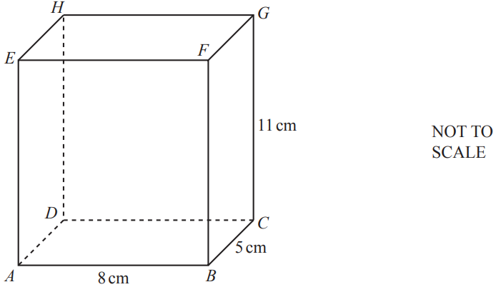

*ABCDEFGH* is a cuboid.

*AB* = 8 cm, *BC *= 5 cm and *CG* = 11 cm.

Ivana has a pencil of length 13cm.

Does this pencil fit completely inside the cuboid?

Show how you decide.

*Source: 2020 Oct/Nov 0580/43 Q6B*

### Q9 — hard — 4 marks

**Q9** [4 marks]

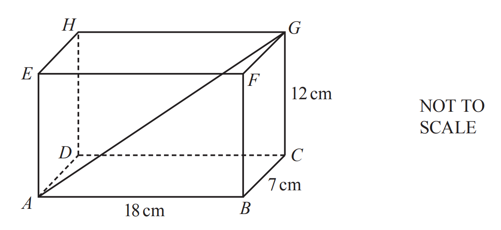

$ABCDEFGH$ is a cuboid.

$AB=18\text{cm}$, $BC=7\text{cm}$ and $CG=12\text{cm}$.

Calculate the angle that the diagonal $AG$ makes with the base $ABCD$.

*Source: 2019	May/June 0580/22 Q24*

### Q10 — very_hard — 6 marks

**Q10** [6 marks]

$VABCD$ is a square-based pyramid.

The horizontal base $ABCD$ has side length 10 cm and centre $M$.

Angle $VMA$ is 90°

Angle $VAM$is 68°

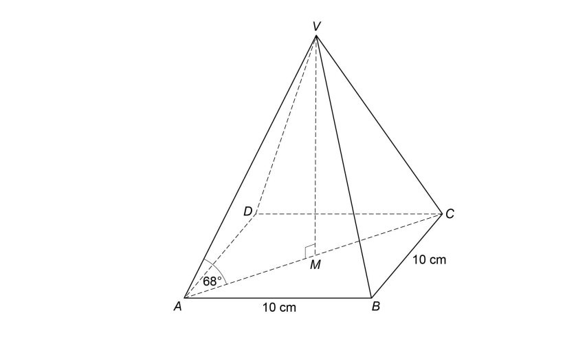

| $\mathrm{Volume} \mathrm{of} \mathrm{pyramid}=\frac{1}{3}\times\mathrm{area} \mathrm{of} \mathrm{base}\times\mathrm{perpendicular} \mathrm{height}$ |
|---|

Work out the volume of the pyramid.

....................cm3

*Source: Nov 2017 8300/3H Q27*

### Q11 — very_hard — 4 marks

**Q11** [4 marks]

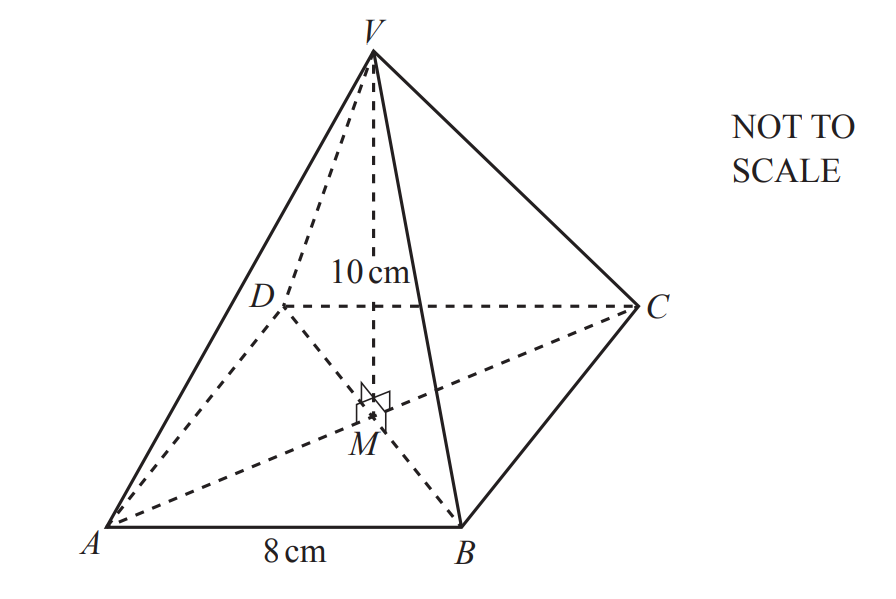

The diagram shows a pyramid with a square base *ABCD* of side length 8cm.

The diagonals of the square, *AC* and *BD*, intersect at *M*. *V* is vertically above *M* and *VM* = 10 cm.

Calculate the angle between *VA* and the base.

*Source: 2019	May/June 0580/21 Q21*

### Q12 — very_hard — 6 marks

**Q12** [6 marks]

The diagram shows a solid pyramid $ABCDE$ with a horizontal base.

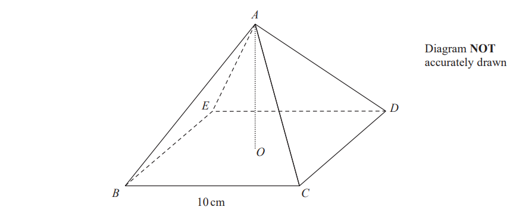

The base, $BCDE$ , of the pyramid is a square of side 10 $\mathrm{cm}$.

The vertex $A$ of the pyramid is vertically above the centre $O$ of the base so that  $AB=AC=AD=AE$

The **total** surface area of the pyramid is 360 $\mathrm{cm}^{2}$

Work out the size of the angle between $AC$ and the base $BCDE$. Give your answer correct to 3 significant figures.

*Source: June 2019 4MA1/2HR Q23*

### Q13 — very_hard — 6 marks

**Q13** [6 marks]

The diagram shows the prism $ABCDEF$ with cross section triangle $ABC$.

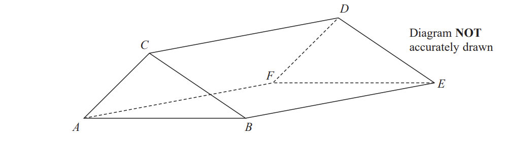

Angle $BEC$= 40° and angle $ACB$is obtuse.

$AC$ = 6 cm and $CE$= 13cm

The area of triangle $ABC$is 22 $\mathrm{cm}^{2}$

Calculate the length of $AB$.

Give your answer correct to one decimal place.

..................$\mathrm{cm}$

*Source: Jan 2020 4MA1/1HR Q21*

### Q14 — medium — 4 marks

**Q14** [4 marks]

The diagram shows a right-angled triangular prism ABCDEF.

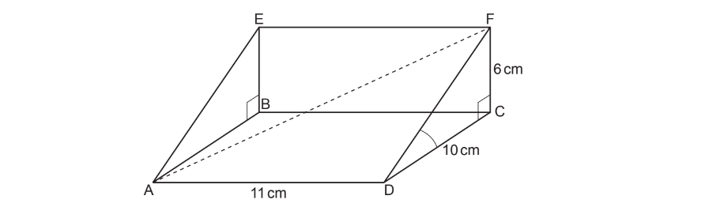

Length AD = 11 cm, length CD = 10 cm and length CF = 6 cm.

Calculate the exact length of AF.

..................................................... cm

*Source: Nov 2019 J560/04 Q18C*

### Q15 — very_hard — 3 marks

**Q15** [3 marks]

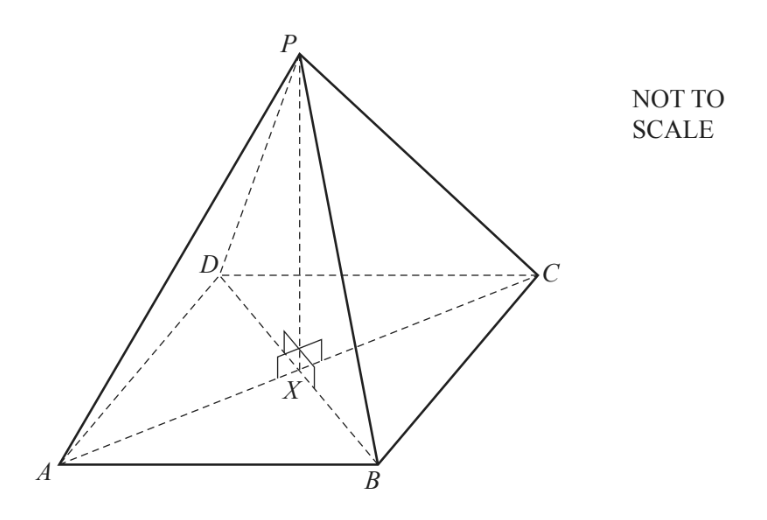

The diagram shows a pyramid with a square base *ABCD*. 
*DB* = 8 cm. 
*P* is vertically above the centre, *X*, of the base and *PX* = 5 cm.

Calculate the angle between *PB* and the base *ABCD*.

*Source: 2019	Oct/Nov 0580/41 Q4D*

### Q16 — medium — 4 marks

**Q16** [4 marks]

*ABCDEFGH* is a cuboid. *AB* = 8 cm, *BC *= 5 cm and *CG* = 11 cm.

i) Calculate angle *CAB*.

Angle* CAB* = ................................................ [2]

ii) Calculate angle *GAC*.

Angle* GAC *= ................................................ [2]

*Source: 2020 Oct/Nov 0580/43 Q6C*

### Q17 — very_hard — 3 marks

**Q17** [3 marks]

The diagram shows a solid prism $ABCDEFGH$.

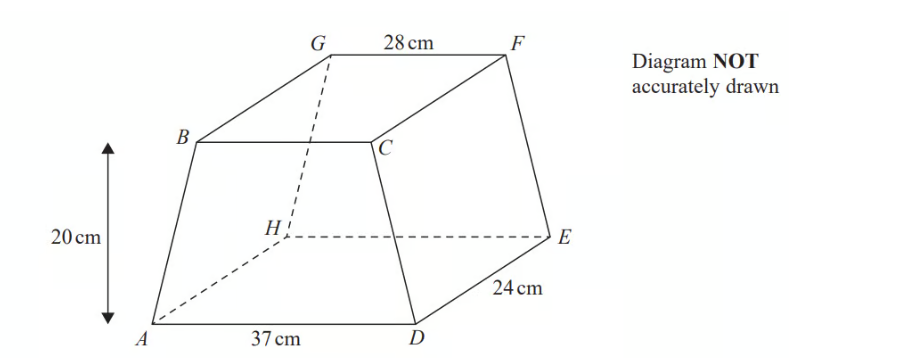

The trapezium $ABCD$, in which $AD$ is parallel to $BC$, is a cross section of the prism.

The base $ADEH$ of the prism is a horizontal plane.

$ADEH$ and $BCFG$ are rectangles.

The midpoint of $BC$ is vertically above the midpoint of $AD$ so that $BA=CD$.

$AD=37\mathrm{cm}$   $GF=28\mathrm{cm}$    $DE=24\mathrm{cm}$

The perpendicular distance between edges $AD$ and $BC$ is 20 $\mathrm{cm}$.

Calculate the size of the angle between $AF$ and the plane $ADEH$. Give your answer correct to one decimal place.

*Source: Jan 2021 4MA1/2H Q17B*

### Q18 — hard — 4 marks

**Q18** [4 marks]

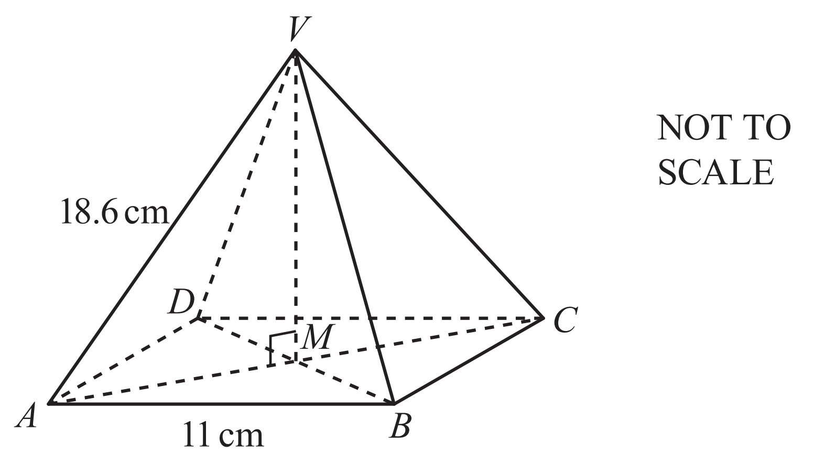

The diagram shows a pyramid with a square base *ABCD*.

The diagonals *AC* and *BD* intersect at *M. *

The vertex *V* is vertically above *M. *

*AB* = 11 cm and *AV* = 18.6 cm.

Calculate the angle that *AV* makes with the base.

*Source: 2020 May/June 0580/23 Q20*

### Q19 — medium — 3 marks

**Q19** [3 marks]

The length of a diagonal of a cuboid is 20 cm

The diagonal makes an angle of 24° with the base.

The area of the base is 150 cm2

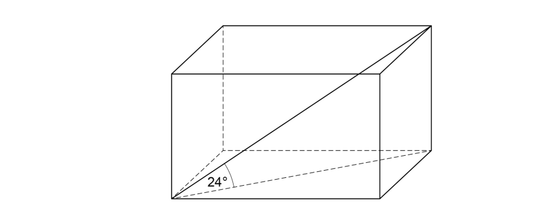

Work out the volume of the cuboid.

...................................... cm3

*Source: June 2019 8300/3H Q24*

### Q20 — medium — 3 marks

**Q20** [3 marks]

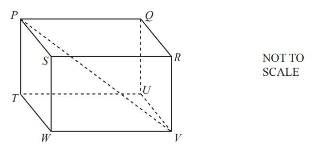

The diagram shows a cuboid $PQRSTUVW$.

$PV=17.2\mathrm{cm}$

The angle between the line $PV$ and the base $TUVW$ of the cuboid is $43^{\circ}$. Calculate $PT$.

$PT=$ ........................................... cm

*Source: 2020 Oct/Nov 0580/02 Q21*

### Q21 — very_hard — 7 marks

**Q21** [4 marks]

Alvin has a crate in the shape of a cuboid.

The crate is open at the top. The internal dimensions of the crate are 46cm long by 46cm wide by 55cm high.

Alvin has a stick of length 95cm.

Alvin places the stick in the crate so that the shortest possible length extends out above the top of the crate.

Calculate the length of the stick that extends out of the crate.

..................................................... cm

*Source: June 2017 J560/06 Q18A*

**Q21** [3 marks]

**Extract:**

Alvin has a crate in the shape of a cuboid. The crate is open at the top. The internal dimensions of the crate are 46cm long by 46cm wide by 55cm high. Alvin has a stick of length 95cm. Alvin places the stick in the crate so that the shortest possible length extends out above the top of the crate.

Calculate the angle the stick makes with the base of the crate.

*Source: June 2017 J560/06 Q18B*

### Q22 — hard — 2 marks

**Q22** [2 marks]

The diagram shows a field, *ABCD*, on horizontal ground.

There is a vertical post at *C*.

From *B*, the angle of elevation of the top of the post is 19°.

Find the height of the post.

................................................ m

*Source: 2019	Oct/Nov 0580/43 Q4A*

### Q23 — hard — 6 marks

**Q23** [4 marks]

The diagram shows a pyramid.

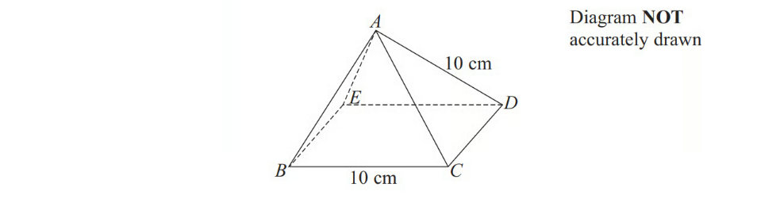

$BCDE$is a square with sides of length 10 cm.

The other faces of the pyramid are equilateral triangles with sides of length 10 cm.

Calculate the volume of the pyramid.

Give your answer in the form $\frac{a}{b}\sqrt{2}\mathrm{cm}^{3}$ where $a$ and $b$ are integers to be found.

*Source: November 2012 1MA0/2H Q23A*

**Q23** [2 marks]

**Extract:**

BCDE is a square with sides of length 10 cm. The other faces of the pyramid are equilateral triangles with sides of length 10 cm.

Find the size of angle $DAB$.

*Source: November 2012 1MA0/2H Q23B*

### Q24 — medium — 3 marks

**Q24** [3 marks]

The diagram shows a triangular prism.

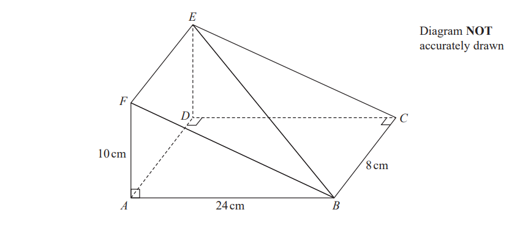

$AF=10\mathrm{cm},AB=24\mathrm{cm}$ and$BC=8\mathrm{cm}$. 
Angle$FAB$ = angle $ADC$ = angle $BCD=90^{\circ}$

Work out the size of the angle between the line $BE$ and the plane $ABCD$. 
Give your answer correct to 1 decimal place.

*Source: June 2018 4MA1/2H Q19*

### Q25 — very_hard — 4 marks

**Q25** [4 marks]

The diagram shows a triangular prism.

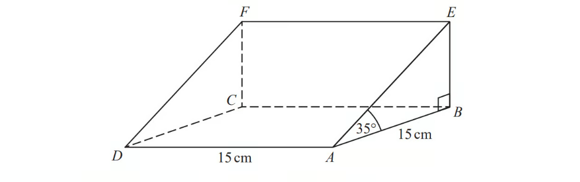

The base, $ABCD$, of the prism is a square of side length 15 cm. Angle $ABE$and angle $CBE$are right angles.

Angle $EAB$= 35°

$M$is the point on $DA$such that

$DM:MA=2:3$

Calculate the size of the angle between $EM$and the base of the prism. Give your answer correct to 1 decimal place.

*Source: June 2019 1MA1/2H Q19*

### Q26 — hard — 4 marks

**Q26** [4 marks]

The diagram shows a cuboid $ABCDEFGH$.

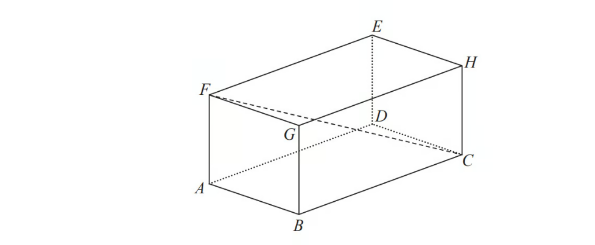

$AB=7\mathrm{cm},AF=5\mathrm{cm} \mathrm{and}FC=15\mathrm{cm}.$

Calculate the volume of the cuboid.

Give your answer correct to $3$ significant figures.

*Source: Spec1 2015 1MA1/3H Q12*

### Q27 — very_hard — 5 marks

**Q27** [5 marks]

$VABCD$is a solid pyramid.

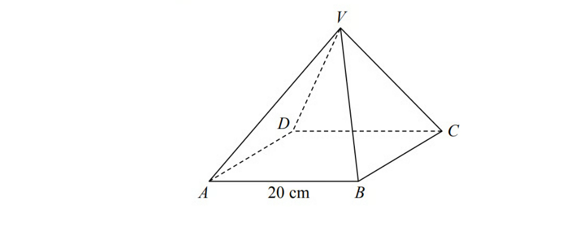

$ABCD$is a square of side 20 cm.

The angle between any sloping edge and the plane $ABCD$is 55°

Calculate the surface area of the pyramid.

Give your answer correct to 2 significant figures.

*Source: Sample 2015 1MA1/3H Q16*

### Q28 — hard — 4 marks

**Q28** [4 marks]

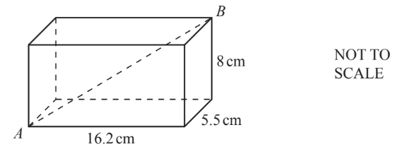

The diagram shows a cuboid with dimensions 5.5 cm, 8 cm and 16.2 cm.

Calculate the angle between the line *AB* and the horizontal base of the cuboid.

*Source: 2018	Oct/Nov 0580/22 Q22*

### Q29 — hard — 4 marks

**Q29** [4 marks]

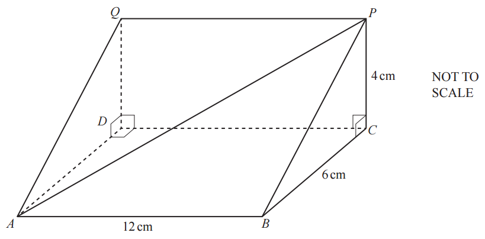

The diagram shows a triangular prism.

*AB* = 12 cm,* BC* = 6 cm, *PC* = 4 cm, angle *BCP* = 90° and angle *QDC* = 90°.

Calculate the angle between *AP* and the rectangular base *ABCD*.

*Source: 2018	Oct/Nov 0580/23 Q23*

### Q30 — hard — 7 marks

**Q30** [4 marks]

The diagram shows a prism *ABCDEF*.

The cross-section is a right-angled triangle *BCD*.

*BD* = 10 cm, *BC* = 5.2 cm and *ED* = 18 cm.

Calculate angle *BEC*.

Angle *BEC* = ...................................................

*Source: 2019	Oct/Nov 0580/42 Q4B*

**Q30** [3 marks]

**Extract:**

The diagram shows a prism ABCDEF. The cross-section is a right-angled triangle BCD. BD = 10 cm, BC = 5.2 cm and ED = 18 cm.

The point *G* lies on the line *ED* and *GD* = 7 cm.

Work out angle *BGE*.

Angle *BGE* = ................................................

*Source: 2019	Oct/Nov 0580/42 Q4B*

### Q31 — hard — 5 marks

**Q31** [5 marks]

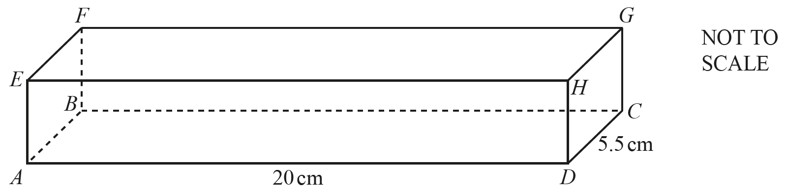

The diagram shows cuboid $ABCDEFGH$ of length 20 cm and width 5.5 cm.

The volume of the cuboid is 495 cm3 .

Find the angle between the line $AG$ and the base of the cuboid $ABCD.$

*Source: 2020	May/June 0580/21 Q19*

### Q32 — medium — 4 marks

**Q32** [4 marks]

$ABCDEFGH$is a cuboid.

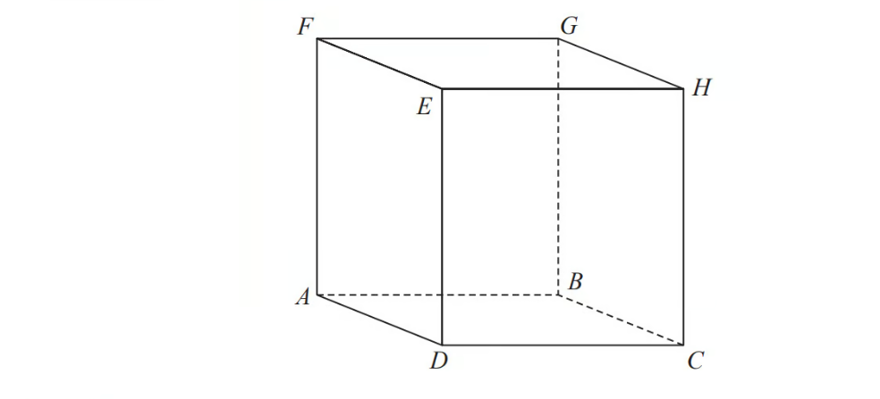

$AB=7.3\mathrm{cm}\,CH=8.1\mathrm{cm}\,\mathrm{Angle}BCA=48^{\circ}$

Find the size of the angle between $AH$ and the plane $ABCD$. Give your answer correct to $1$ decimal place.

*Source: June 2018 1MA1/2H Q18*

### Q33 — medium — 3 marks

**Q33** [3 marks]

The diagram shows cuboid $ABCDEFGH.$

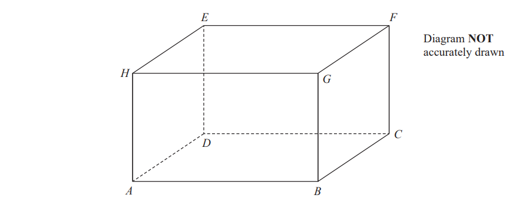

For this cuboid

the length of $AB$ : the length of $BC$ : the length of $CF$ = 4 : 2 : 3

Calculate the size of the angle between $AF$ and the plane $ABCD$Give your answer correct to one decimal place.

*Source: June 2019 4MA1/2H Q21*

