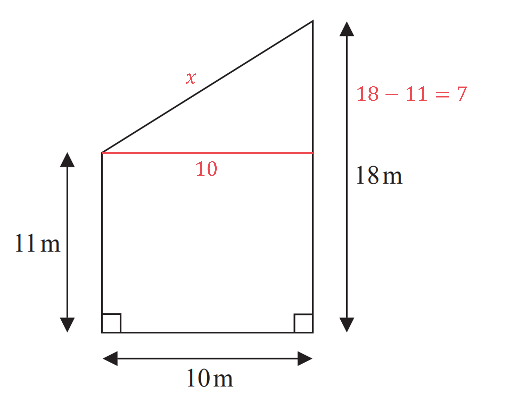
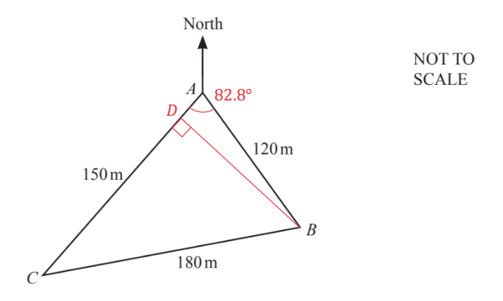
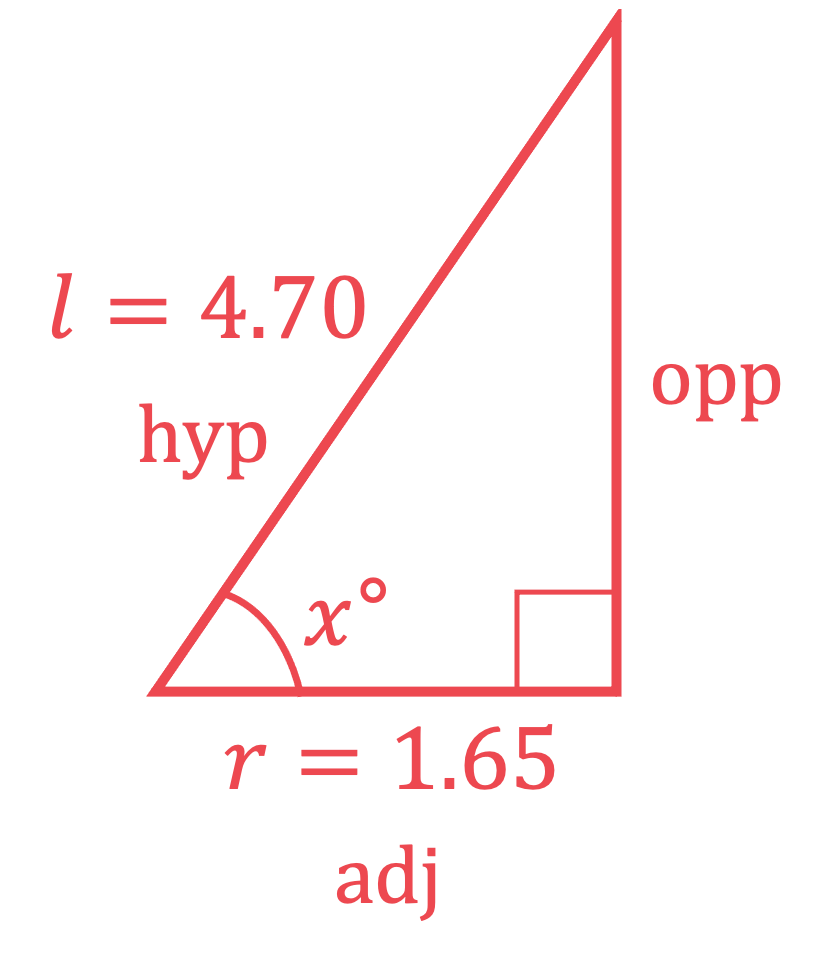
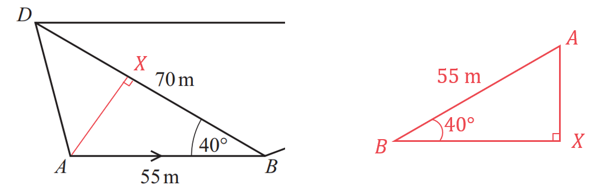
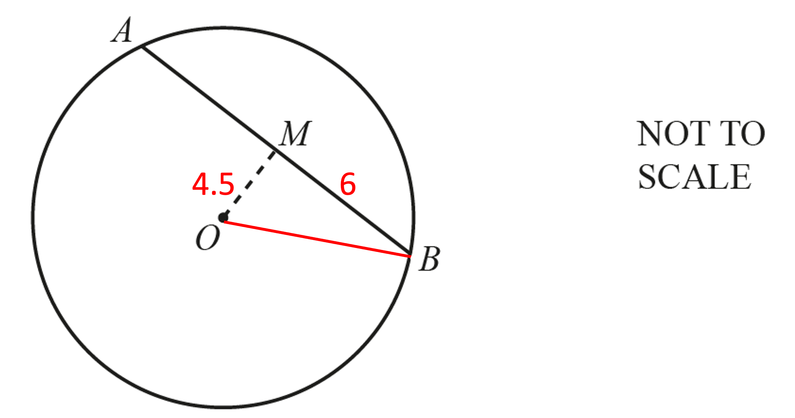
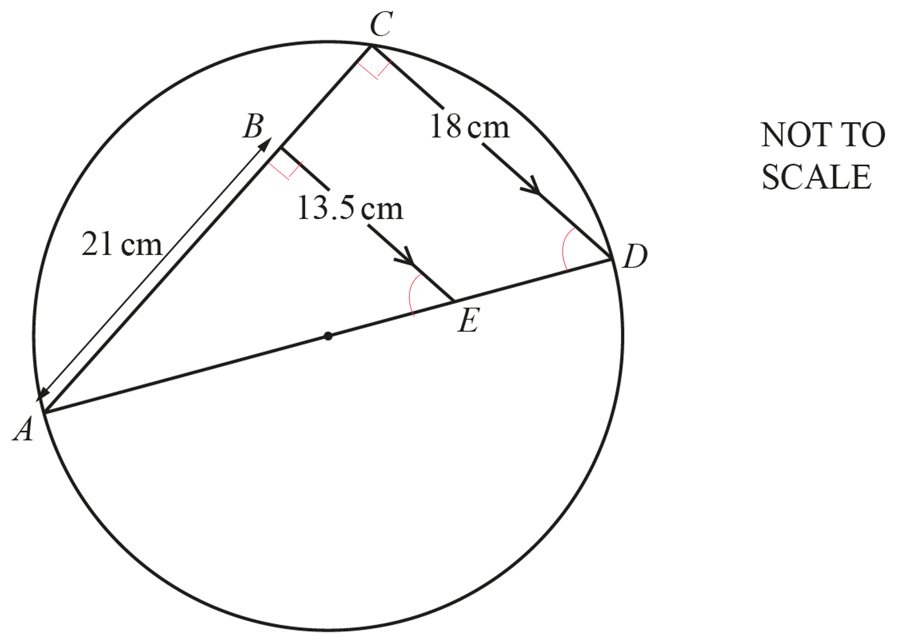
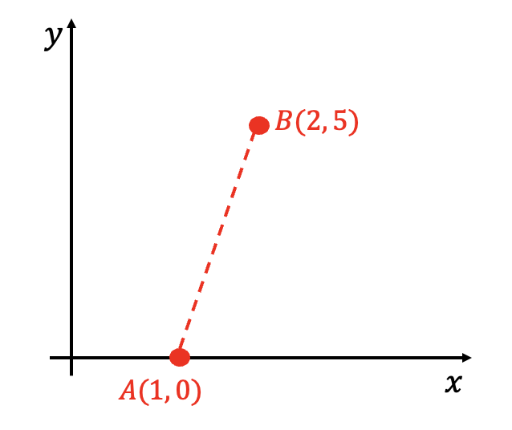
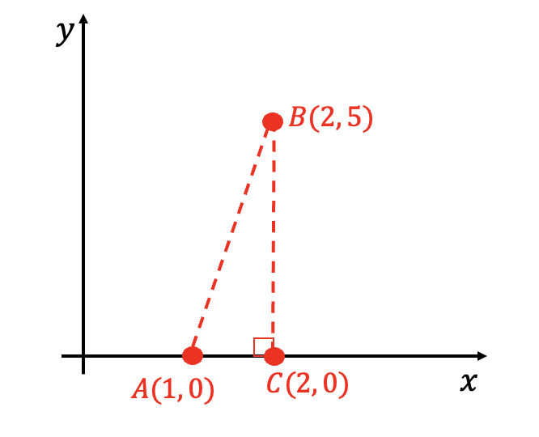
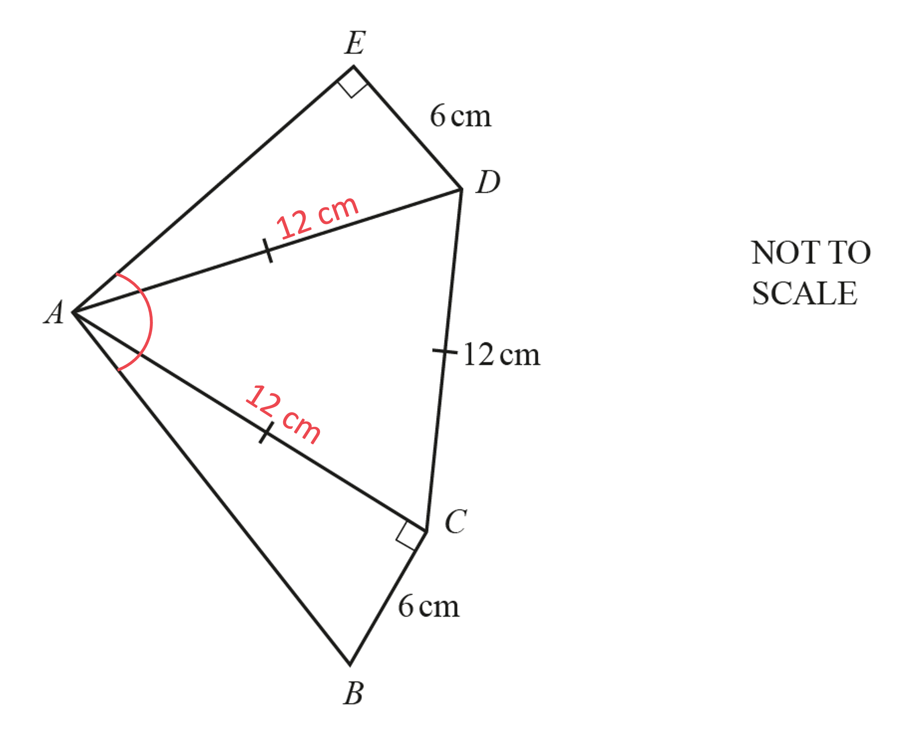

# Mark Schemes — Right-Angled Triangles
**Pythagoras & Trigonometry** · Cambridge (CIE) IGCSE maths (0607)

## Calculator Questions (35 questions)

### Q1
*The volume of a prism is the area of its cross section multiplied by its length.*

*Find the area of the triangular cross section (using *$\frac{1}{2}\times$*base*$\times$*height).* * *

*area of the cross section = *$\frac{1}{2}\times6\timesh$

**[1]**

*Find the volume of the prism (by multiplying the area of the cross section by 18).* * *

*volume of the prism = *$\frac{1}{2}\times6\timesh\times18$ * *

*Form an equation for *$h$* (by setting the volume of the prism equal to 253.8).* * *

$\frac{1}{2}\times6\timesh\times18=253.8$

**[1]**

*Write *$\frac{1}{2}\times6\times18$* as 54 and solve the equation (by dividing by 54).*

$54h=253.8\,h=\frac{253.8}{54}$

$h=4.7$ **[1]**
> *The cross-section is a right angle triangle. The sides that are adjacent and opposite *$x$* are known so use the tan ratio. *

> *Write out the correct tan ratio (using *$\mathrm{tan}x=\frac{\mathrm{opp}}{\mathrm{adj}}$*).*

$\mathrm{tan}x=\frac{4.7}{6}$

**[1]**

*Find *$x$* (by taking inverse tan of both sides).* * *

`x equals tan to the power of negative 1 end exponent open parentheses fraction numerator 4.7 over denominator 6 end fraction close parentheses
x equals 38.0727...` * *

> *As it is an angle, round to 1 decimal place.*

$x=38.1^{\circ}$ **[1]**
*Calculate the length of the diagonal on the triangle face (using Pythagoras' Theorem, *$a^{2}+b^{2}=c^{2}$*).* * *

`table row cell c squared end cell equals cell 6 squared plus 4.7 squared end cell row c equals cell square root of 6 to the power of 2 space end exponent plus 4.7 squared end root end cell end table`

$6^{2}+4.7^{2}$** ***correct*** ****[1]**

*Correct with square root*** ****[1]**

*The total surface area is the sum of individual areas from five different faces.* *Draw lengths on the diagram (to help see the areas).*

*Find the area of the triangle face at the front (area of a triangle = *$\frac{1}{2}\times$*base*$\times$*height).* * *

$\frac{1}{2}\times6\times4.7$ * *

> *This is the same area as the triangle face at the back.*

*Triangle area for front and back*** [1]**

*Find the area of the rectangular face on the side (using length*$\times$*width).* * *

$4.7\times18$

**[1]**

> *Find the area of the rectangular face on the top (using length *$\times$*width).*

> * *

$\sqrt{6^{2}+4.7^{2}}\times18$

* Find the area of the rectangular face on the bottom (using length width).* * *

$6\times18$

**[1]**

*Find the total surface area (by adding together the five individual areas).* * *

`open parentheses 1 half cross times 6 cross times 4.7 close parentheses plus open parentheses 1 half cross times 6 cross times 4.7 close parentheses plus open parentheses 4.7 cross times 18 close parentheses plus open parentheses square root of 6 squared plus 4.7 squared end root cross times 18 close parentheses plus open parentheses 6 cross times 18 close parentheses equals 357.9902...`

**358 cm****2** **[1]**

### Q2
> *Method 1 *

> *The smallest angle is the angle between "*$2x-3$*" and *$6$*.  We have a right-angle triangle, *$x$* (or 3.82) is opposite the required angle and *$6$* is the hypotenuse. So we can use the sine ratio, *$\mathrm{sin}θ=\frac{\mathrm{opposite}}{\mathrm{hypotenuse}}$*.*

$\mathrm{sin}θ=\frac{3.82}{6}$

**[1]**

> *Inverse sine to find the angle.*

`table row theta equals cell sin to the power of negative 1 end exponent open parentheses fraction numerator 3.82 over denominator 6 end fraction close parentheses end cell row blank equals cell 39.54370792... degree end cell end table`

> *Give angles in degrees to 1 decimal place.*

**Final answer:** **Angle = 39.5° **

*final answer between 39.3° and 39.5° depending on rounding of x value***  ****[1]**

> *Method 2 *

> *The smallest angle is the angle between "*$2x-3$*" and *$6$*. Evaluate "*$2x-3$*" by substituting *$x=3.82$*.*

$2\times3.82-3=4.64$

> *We have a right-angle triangle, *$2x-3$* (or 4.64) is adjacent to the angle and *$6$* is the hypotenuse. So we can use the cosine ratio, *$\mathrm{cos}θ=\frac{\mathrm{adjacent}}{\mathrm{hypotenuse}}$*.*

$\mathrm{cos}θ=\frac{4.64}{6}$

**[1]**

> *Inverse cosine to find the angle.*

`table row theta equals cell cos to the power of negative 1 end exponent open parentheses fraction numerator 4.64 over denominator 6 end fraction close parentheses end cell row blank equals cell 39.34582977... degree end cell end table`

> *Give angles in degrees to 1 decimal place.*

**Angle = 39.3°  ****[1]**

*final answer between 39.3° and 39.5° depending on rounding of x value  ***[1]**

### Q3
> *It is a right angled triangle with an angle (**θ**) so you can use trigonometry. You know the length of the hypotenuse (**H**) and you want the length of the side that is opposite (**O**) the angle. Therefore you can use the sin ratio: *$\mathrm{sin}θ=\frac{O}{H}$*.*

`sin open parentheses 23 close parentheses equals fraction numerator A B over denominator 15 end fraction`

**[1]**

> *Multiply both sides by 15 to get **AB** by itself.*

`table row cell A B end cell equals cell 15 cross times sin open parentheses 23 close parentheses end cell row blank equals cell 5.860966... end cell end table`

> *Round to 3 significant figures. Remember to include the units for the length.*

$AB=5.86\mathrm{cm}(3\mathrm{sf})$** ****[1]**

### Q4
> *The missing side *$DE$* can be found using Pythagoras, *$c^{2}=a^{2}+b^{2}$*, as triangle *$ADE$* is right-angled with *$DE$* as the hypotenuse.*

`open parentheses D E close parentheses squared equals 50 squared plus 120 squared`

Take the square root of both sides.

`table row cell D E end cell equals cell square root of 50 squared plus 120 squared end root end cell row blank equals cell 130 space straight m end cell end table`

> *The missing side *$CD$* can also be found using Pythagoras, as triangle *$BCD$* is right-angled with *$BC$* as the hypotenuse.*

$CD=\sqrt{170^{2}-150^{2}}=80m$

*Correct method for either DE or CD*** [1]**

*Correct value for DE** ***[1]**

*Correct value for CD*** [1]**

> *Find the perimeter (total distance around the outer edge).*

$100+50+130+80+170$

$530m$ **[1]**

### Q5
> *Draw a sketch. Label the radius **r**. The diagonals of a square are perpendicular.*

> *Form an equation using the area of the circle.*

$π\timesr^{2}=49$

**[1]**

> *Rearrange to make **r** the subject.*

`table row cell r squared end cell equals cell 49 over straight pi end cell row r equals cell square root of 49 over straight pi end root end cell end table`

> *You can form a right angled triangle using one side of the square and two radii. The length of the square is the hypotenuse of the triangle, you can use Pythagoras' theorem.*

`table row cell r squared plus r squared end cell equals cell x squared end cell end table`

**[1]**

`table row cell open parentheses square root of 49 over straight pi end root close parentheses squared plus open parentheses square root of 49 over straight pi end root close parentheses squared end cell equals cell x squared end cell row cell 49 over straight pi plus 49 over straight pi end cell equals cell x squared end cell row cell 98 over straight pi end cell equals cell x squared end cell end table`

**[1]**

> *Take the positive square root of both sides.*

`table row x equals cell square root of 98 over straight pi end root end cell row blank equals cell 5.585191... end cell end table`

> *Round to 3 significant figures.*

$x=5.59(3\mathrm{sf})$* ***[1]**

### Q6
> *It is a right angled triangle with an angle (**θ**) so you can use trigonometry. Angle **RPQ** is the angle in the triangle at **P**. You know the length of the hypotenuse (**H**) and the length of the side that is adjacent (**A**) to the angle. Therefore you can use the cos ratio: *$\mathrm{cos}θ=\frac{A}{H}$*.*

`cos open parentheses theta close parentheses equals 17 over 25`

**[1]**

> *Use the inverse cos function to get **θ** by itself.*

`table row theta equals cell cos to the power of negative 1 end exponent open parentheses 17 over 25 close parentheses end cell row blank equals cell 47.156356... end cell end table`

**[1]**

> *Round to 1 decimal place. Remember to include the units for the angle.*

$\mathrm{Angle}RPQ=47.2^{\circ}(1\mathrm{dp})$ **[1]**

### Q7
> *It is a right angled triangle so you can use Pythagoras' Theorem: *$a^{2}+b^{2}=c^{2}$*, where **c** is the length of the hypotenuse and **a** and **b **are the lengths of the other two sides.*

`table row cell A B squared plus B C squared end cell equals cell A C squared end cell row cell 39 squared plus 70 squared end cell equals cell A C squared end cell row 6421 equals cell A C squared end cell end table`

**[1]**

> *Take the positive square root of both sides.*

`table row cell A C end cell equals cell square root of 6421 end cell row blank equals cell 80.131142... end cell end table`

**[1]**

> *Round to 1 decimal place. Remember to include the units for the length.*

$AC=80.1\mathrm{cm}(1\mathrm{dp})$ **[1]**

### Q8
> *Find the diagonal length **DB**. **DCB** is a right angled triangle so you can use Pythagoras' Theorem: *$a^{2}+b^{2}=c^{2}$*, where **c** is the length of the hypotenuse and **a** and **b **are the lengths of the other two sides.*

`table attributes columnalign right center left columnspacing 0px end attributes row cell D C squared plus C B squared end cell equals cell D B squared end cell row cell 60 squared plus 200 squared end cell equals cell D B squared end cell row 43600 equals cell D B squared end cell end table`

**[1]**

> *Take the positive square root of both sides. Leave as a surd.*

`table attributes columnalign right center left columnspacing 0px end attributes row cell D B end cell equals cell square root of 43600 end cell row blank equals cell 20 square root of 109 end cell end table`

**[1]**

> *Add together the lengths of the 5 rods.*

`table row cell 60 plus 200 plus 60 plus 200 plus 20 square root of 109 end cell equals cell 520 plus 20 square root of 109 end cell row blank equals cell 728.806... space cm end cell end table`

> *Convert to metres by dividing by 100.*

`table row cell 728.806... space divided by 100 end cell equals cell 7.28806... space straight m end cell end table`

> *Multiply by 0.9 to find the total mass of the framework in kilograms.*

$0.9\times7.28806...=6.55925...\mathrm{kg}$

**[1]**

> *Round to 3 significant figures.*

$6.56\mathrm{kg}(3\mathrm{sf})$* ***[1]**

### Q9
> *Calculate the length **CD** using SOHCAHTOA on the right-angled triangle **ACD**.*

*You know the adjacent side and you want to work out the opposite side so use *$\mathrm{tan}θ=\frac{Opp}{Adj}$*.*

`table row cell tan space 20 end cell equals cell fraction numerator C D over denominator 13 end fraction end cell end table`

**[1]**

`table row cell 13 cross times tan space 20 end cell equals cell C D end cell end table`

**[1]**

`table attributes columnalign right center left columnspacing 0px end attributes row cell C D end cell equals cell 4.7316... end cell end table`

> *Find the length **BD** by adding together the lengths **BC** and **CD**.*

$8+4.7316...=12.7316...$

> *Calculate the angle **BAD** by using SOHCAHTOA on the right-angled triangle **ABD**. *

> *You know the opposite side and the adjacent side so use *$\mathrm{tan}θ=\frac{Opp}{Adj}$* again.*

`table row cell tan space open parentheses B A D close parentheses end cell equals cell fraction numerator 12.7316... over denominator 13 end fraction end cell end table`

**[1]**

`table attributes columnalign right center left columnspacing 0px end attributes row cell B A D end cell equals cell tan to the power of negative 1 end exponent open parentheses fraction numerator 12.7316... over denominator 13 end fraction close parentheses end cell end table`

**[1]**

`table row cell B A D end cell equals cell 44.4024... end cell end table`

> *Find the size of angle **BAC** by subtracting angle **CAD** from angle **BAD**.*

$44.4024...-20=24.4024...$

> *Round to 1 decimal place.*

**24.4****o**** ****[1]**

**Answers between 24.3 and 24.41 will be accepted**

### Q10
> *It is a right angled triangle with an angle (**θ**) so you can use trigonometry. You know the length of the hypotenuse (**H**) and the length of the side that is adjacent (**A**) to the angle. Therefore you can use the cos ratio: *$\mathrm{cos}θ=\frac{A}{H}$*.*

`cos open parentheses theta close parentheses equals 7 over 11`

**[1]**

> *Use the inverse cos function to get **θ** by itself.*

`table row theta equals cell cos to the power of negative 1 end exponent open parentheses 7 over 11 close parentheses end cell row blank equals cell 50.478803... end cell end table`

> *Round to 1 decimal place. Remember to include the units for the angle.*

$\mathrm{Angle}ABC=50.5^{\circ}(1\mathrm{dp})$ **[1]**
> *The hypotenuse has changed to 10 but the adjacent side has remained the same. You can still use *$\mathrm{cos}θ=\frac{A}{H}$*.*

`cos open parentheses A B C close parentheses equals 7 over 10`

$\mathrm{cos}(ABC)$** has ****increased**** as **$\frac{7}{10}>\frac{7}{11}$**[1]**

### Q11
> *Draw a line down the middle of the triangle to split the shape into two identical right angled triangles. The length of this line will be the height of the original triangle and can be used to find the area.*

> *The new triangle is a right angled triangle with an angle (**θ**) so you can use trigonometry. You know the length of the side that is adjacent (**A**) to the angle and you want the length of the side that is opposite (**O**) the angle. Therefore you can use the tan ratio: *$\mathrm{tan}θ=\frac{O}{A}$*.*

`tan open parentheses 54 close parentheses equals x over 6`

**[1]**

> *Multiply both sides by 6.*

`table row x equals cell 6 cross times tan open parentheses 54 close parentheses end cell row blank equals cell 8.258291... end cell end table`

**[1]**

> *You can now find the area of the triangle using the formula *$A=\frac{1}{2}\timesb\timesh$*, where **b** is the length of the base and **h** is the length of the perpendicular height. Use the answer button or store the height in your calculator's memory.*

`table row Area equals cell 1 half cross times 12 cross times 8.258291... end cell row blank equals cell 49.549749... end cell end table`

**[1]**

> *Round to 3 significant figures. Remember to include square units for the area.*

$\mathrm{Area}=49.5\mathrm{cm}^{2}(3\mathrm{sf})$* ***[1] **

**This can also be done using the sine rule**

### Q12
*First find the length of the diagonal side using Pythagoras' theorem *`open parentheses a squared plus b squared equals c squared close parentheses`*.* *It may help to label the diagram first.*

$8.5^{2}+10.8^{2}=c^{2}$

**[1]**

`table row cell c squared end cell equals cell 188.89 end cell row c equals cell 13.743725... end cell end table`

> *Do not round but store the number using your calculator's memory to keep accuracy. *

> *Add up the three sides to find the perimeter.*

$P=8.5+10.8+13.743725...$

**[1]**

$P=33.043725...$

**33.0 cm**** [1]**

### Q13
*The diagonal splits the rectangle into two right-angled triangles.*

> *Because it is a right-angled triangle and you know the lengths of two of the sides, you can use Pythagoras' theorem to work out the length of the third side (the diagonal).*

> *Substitute the values from the diagram into Pythagoras' theorem, *$c^{2}=a^{2}+b^{2}$*.*

$c^{2}=5.6^{2}+8.5^{2}$

**[1]**

> *Simplify the right hand side.*

$c^{2}=103.61$

> *Find the value of *$a$* by taking the square root of both sides.*

`table attributes columnalign right center left columnspacing 0px end attributes row c equals cell square root of 103.61 end root end cell end table`

**[1]**

`table attributes columnalign right center left columnspacing 0px end attributes row c equals cell 10.1788... end cell end table`

> *Round to 1 decimal place.*

$c=10.2\mathrm{cm}$* ***[1]**

### Q14
> *Draw a horizontal to split the shape into a rectangle and a right angled triangle. Subtract the vertical lengths to find the height of the triangle.*

> *It is a right angled triangle so you can use Pythagoras' Theorem: *$a^{2}+b^{2}=c^{2}$*, where **c** is the length of the hypotenuse and **a** and **b **are the lengths of the other two sides.*

`table attributes columnalign right center left columnspacing 0px end attributes row cell 10 squared plus 7 squared end cell equals cell x squared end cell row cell 100 plus 49 end cell equals cell x squared end cell row 149 equals cell x squared end cell end table`

**[1]**

> *Take the positive square root of both sides. Leave as a surd.*

`table attributes columnalign right center left columnspacing 0px end attributes row x equals cell square root of 149 end cell end table`

**[1]**

> *Add together the lengths around the shape to find the perimeter.*

`table attributes columnalign right center left columnspacing 0px end attributes row blank blank cell 11 plus 10 plus 18 plus square root of 149 end cell end table`

**[1]**

`table attributes columnalign right center left columnspacing 0px end attributes row cell 39 plus square root of 149 end cell equals cell 51.206555... end cell end table`

**[1]**

> *Compare the perimeter to 50 m to decide whether the farmer has enough fence.*

**51.2... m > 50 m**** so the farmer does ****not**** have enough fence ****[1]**

### Q15
> *In triangle **BAC**, we have the opposite and adjacent sides to angle **BAC**. Therefore use the tangent ratio*

`tan open parentheses angle B A C close parentheses equals 14 over 12`

**[1]**

> *Find angle **BAC** by inverse cosine (SHIFT-cos on your calculator) 14/12*

`angle B A C equals tan to the power of negative 1 end exponent open parentheses 14 over 12 close parentheses equals 49.3987054...`

> *Give non-exact answers in degrees correct to one decimal place*

**Final answer:** **49.4° **

*49.4 or 49.39 to 49.40*** [1]**
> *The shortest distance from **D** to **AC** meets **AC** at a right angle*

*recognising that the shortest distance forms a right angle with AC*** ****[1]**

> *Triangle **DAX** is a right-angle triangle so we can use right-angle trigonometry to find **DX**, specifically the sine ratio*

$\mathrm{sin}62=\frac{DX}{15}$

**[1]**

> *Multiply both sides by 15 to find **DX**, the shortest distance from **D** to **AC*

$DX=15\mathrm{sin}62$

> *Be careful to enter '15sin62' or 'sin(62)×15' into your calculator but not 'sin(62×15)'*

*= 13.2442139...*

> *Round to at least 3 significant figures*

**13.2 cm**** **

*13.2 or 13.24...** ***[1]**

### Q16
> *Point **D** will be closest to point **B** when **BD** is perpendicular to **AC**. *

> *Because **ABD** is a right angled triangle, you can use simple trigonometry to find the length **AD**.*

> *You know the hypotenuse and you want to find the length of the adjacent side, so use the cos ratio.*

$\mathrm{cos}82.8=\frac{AD}{120}$

**[1]**

> *Multiply both sides by 120.*

$15.039988...=AD$

$15$ **m** **[1]**

**Answers between 14.99 and 15.04 will be accepted.**

### Q17
*This is a right-angled triangle and any out of sin, cos or tan can be used here*

> *For example, find the tan ratio (using the opposite and adjacent sides).*

`table row cell tan space theta end cell equals cell fraction numerator O p p over denominator A d j end fraction end cell row cell tan space open parentheses X A B close parentheses end cell equals cell 6 over 8 end cell end table`

**[1]**

*Find the angle (by applying inverse tan to both sides).* * *

`table row cell angle space X A B end cell equals cell tan to the power of negative 1 end exponent open parentheses 6 over 8 close parentheses end cell row blank equals cell 36.869... end cell end table`

**36.9°**** ****[1]**

### Q18
> *Split the 140° angle at **A** into a right angle and a 50° angle. *

> *You can then form a right angled triangle using the 50° angle and the side **AB** as the hypotenuse. *

> *Label the side adjacent to the 50° as **a** and the side opposite as **b**.*

> *You can find the values of **a **and **b** using the trig ratios: *`sin open parentheses 50 close parentheses equals Opposite over Hypotenuse`* and *`cos open parentheses 50 close parentheses equals Adjacent over Hypotenuse.`

`table row cell sin open parentheses 50 close parentheses end cell equals cell b over 400 end cell row cell cos open parentheses 50 close parentheses end cell equals cell a over 400 end cell end table`

*1 mark for each correct equation*** [2]**

> *Rearrange both equations by multiplying both sides by 400. Leave the values for **a** and **b** in exact form to avoid rounding errors.*

`table row a equals cell 400 cos open parentheses 50 close parentheses end cell row b equals cell 400 sin open parentheses 50 close parentheses end cell end table`

> *You can then form a right angled triangle using **AD **as the hypotenuse and the right angle given in the diagram. *

> *The horizontal length can be found by adding **a **to 350 m.*

*The vertical length can be found by subtracting **b** from 450 m.*

*Correct expression for horizontal length*** [1]*** *

*Correct expression for vertical length*** [1]**

> *You can then use Pythagoras' theorem *$c^{2}=a^{2}+b^{2}$* to find the length of **AD**.*

`A D squared equals open parentheses 350 plus 400 cos open parentheses 50 close parentheses close parentheses squared plus open parentheses 450 minus 400 sin open parentheses 50 close parentheses close parentheses squared`

**[1]**

> *Square root both sides of the expression.*

`A D equals square root of open parentheses 350 plus 400 cos open parentheses 50 close parentheses close parentheses squared plus open parentheses 450 minus 400 sin open parentheses 50 close parentheses close parentheses squared end root`

> *Type the expression in your calculator.*

$AD=623.8625...$

> *Round to 3 significant figures.*

$AD=624m$** ****[1]**

### Q19
> *Draw a right-angled triangle made from the height, radius and slant height of the cone. Use trigonometry to find the angle.*

> *From SOHCAHTOA we need CAH; *$\mathrm{cos}x^{\circ}=\frac{\mathrm{adj}}{\mathrm{hyp}}$*.*

$\mathrm{cos}x^{\circ}=\frac{1.65}{4.70}$

**[1]**

> *Rearrange and solve the trigonometric equation using inverse cosine.*

`x degree equals cos to the power of negative 1 end exponent open parentheses fraction numerator 1.65 over denominator 4.70 end fraction close parentheses
x degree equals 69.447 space 602 space...`

**Angle the slant height makes with the base is 69.4° ****[1]**

### Q20
> *The shortest distance from *$A$* to *$BD$* will be the perpendicular line directly from *$A$* to *$BD$*.*

> *Add the line to the diagram and consider the right angled triangle formed by the line.*

> *Use right-angled trigonometry (SOHCAHTOA) to find the length of the line *$AX$*.*

> *The hypotenuse is known and the side opposite the known angle is needed so use  *$\mathrm{sin}θ=\frac{O}{H}$*.*

$\mathrm{sin}40=\frac{AX}{55}$

**[1]**

> *Rearrange to find *$AX$*.*

`table row cell A X space end cell equals cell 55 space sin space 40 degree end cell row blank equals cell space 35.3533... end cell end table`

$AX=35.4m(3s.f.)$* ***[1]**

> * *

### Q21
> *OB **is at a right-angle to **AC** (a tangent meets a radius at a right-angle) so SOHCAHTOA can be used in the two right-angled triangles **AOB** and **BOC.*

**[1]**

*Find angle **AOB** (using the tan ratio because the opposite and adjacent sides are known).* * *

`equation`

**[1]**

`A O B equals tan to the power of negative 1 end exponent open parentheses 15 over 8 close parentheses equals 61.92... degree` * *

*Find angle** BOC** (also using the tan ratio).* * *

`tan open parentheses B O C close parentheses equals fraction numerator 22.4 over denominator 8 end fraction`

**[1]**

`B O C equals tan to the power of negative 1 end exponent open parentheses fraction numerator 22.4 over denominator 8 end fraction close parentheses equals 70.34... degree` * *

*Find angle **XOY**  by adding angle **AOB** to angle** BOC.**  *

$61.92...^{\circ}+70.34...^{\circ}$

*At least one correct*** [1]**

** **$132.3^{\circ}$ **[1]**

**The range 132.26 to 132.28 is also accepted**

### Q22
*As **M** is the midpoint of** AB**, **MB ** is half of 12, so **MB** = 6cm.*

> *Mark this and **OM** = 4.5 cm on the diagram.*

> *OB **is a radius of the circle.*

*As **M** is the midpoint of the chord, **OM** and **AB** are perpendicular, so triangle **OMB** is a right-angle triangle.*

> *So we can use Pythagoras' theorem, *$c^{2}=a^{2}+b^{2}$* to find **OB.*

`open parentheses O B close parentheses squared equals 4.5 squared plus 6 squared
O B equals square root of 4.5 squared plus 6 squared end root`

*realising angle OMB is a right-angle (this can be implied by use of Pythagoras' theorem)*** [1] **

*correct use of  Pythagoras' theorem*** [1]**

$OB=7.5$

**7.5 cm ****[1]**

### Q23
> *It is a right angled triangle with an angle (**θ**) so you can use trigonometry. You know the length of the hypotenuse (**H**) and the length of the side that is opposite (**O**) to the angle. Therefore you can use the sin ratio: *$\mathrm{sin}θ=\frac{O}{H}$*.*

`sin open parentheses x close parentheses equals 5 over 14`

**[1]**

> *Use the inverse sin function to get **x** by itself.*

`table row x equals cell sin to the power of negative 1 end exponent open parentheses 5 over 14 close parentheses end cell row blank equals cell 20.924832... end cell end table`

> *Round to 1 decimal place. Remember to include the units for the angle.*

$x=20.9^{\circ}(1\mathrm{dp})$ **[1]**

### Q24
> *You need to find the hypotenuse, using Pythagoras' theorem, *$a^{2}+b^{2}=c^{2}$*.*

$AC^{2}=2.5^{2}+4.1^{2}$

**[1]**

`table row cell A C end cell equals cell square root of 2.5 squared plus 4.1 squared end root end cell row blank equals cell square root of 23.06 end root space end cell end table`

$AC=4.80$** ****or **$4.802...$*  ***[1]**

**Answers to at least 3 significant figures- don't round to "4.8"!**

### Q25
> *Considering the right-angled triangle *$ABC$

> *As we know the hypotenuse and the angle, we can find the adjacent *`open parentheses A B close parentheses`* using the cosine ratio; *$\mathrm{cos}θ=\frac{\mathrm{adjacent}}{\mathrm{hypotenuse}}$*.*

`cos open parentheses 26 close parentheses equals fraction numerator A B over denominator 76.7 end fraction`

**[1]**

> *Multiply both sides by 76.7.*

`76.7 cross times cos open parentheses 26 close parentheses equals A B`

$AB=68.93750335...$

**[1]**

> *We can then find the length *$BD$

$68.93750335-58=10.93750335...$

**10.9 m*** ***[1]*** *

**Round to 3 significant figures**

### Q26
> $AD$* is a diameter so the radius is half of *$AD$*.*

> * Angle *$ACD$* is 90° because it is the angle in a semi-circle.*

> *Therefore *$AD$* is the hypotenuse of right-angle triangle *$ACD$*. We can use Pythagoras' theorem to find *$AD$* but we need to find *$AC$* first.*

> *Triangle *$ABE$* and triangle *$ACD$* are similar, and the scale factor is:*

$\frac{\mathrm{equivalent} \mathrm{longer} \mathrm{side}}{\mathrm{equivalent} \mathrm{shorter} \mathrm{side}}=\frac{CD}{BE}=\frac{18}{13.5}$

**[1]**

> *Multiplying the length of *$AB$* by the scale factor gives *$AC$*.*

$AC=21\times\frac{18}{13.5}=28$

**[1]**

> *Now we can use Pythagoras' theorem *$a^{2}+b^{2}=c^{2}$*.*

$28^{2}+18^{2}=AD^{2}$

**[1]**

> *Rearrange to get *$AD$*.*

`table row cell A D end cell equals cell square root of 28 squared plus 18 squared end root end cell row blank equals cell space 33.28663395... end cell end table`

**[1]**

> *The radius is half of *$AD$*.*

`table row r equals cell space open parentheses 33.28663395... close parentheses divided by 2 end cell row blank equals cell 16.64331698... end cell end table`

> *Round the answer to at least 3 significant figures.*

**16.6 cm**** ****[1]**

### Q27
> *The line *$AC$* has a gradient of 4, which means for every 1 unit right, it goes upwards by 4 units.*

> *We are trying to find the angle between the line and the **x**-axis (the horizontal) which has been marked *$x^{\circ}$*.*

> *As we know the opposite and the adjacent, we can use the tan ratio; *$\mathrm{tan}θ=\frac{\mathrm{opposite}}{\mathrm{adjacent}}$*.*

`tan open parentheses x close parentheses equals 4 over 1
tan open parentheses x close parentheses equals 4`

**[1]**

> *Use inverse tan (*$\mathrm{tan}^{-1}$*) on your calculator to find *$x$*.*

`x equals tan to the power of negative 1 end exponent open parentheses 4 close parentheses`

$x=75.96375653...$

**76.0°** **[1]**

**Round angles to 1 decimal place**

### Q28
*The shortest distance from point **B** to side **AC** is a perpendicular line.* *This line is the (perpendicular) height of the triangle when **AC** is the base.* *We can find the height by considering the area of the triangle in two different ways.*

*1. Using* $"A=\frac{1}{2}bh"$

$\mathrm{Area} \mathrm{of}\DeltaABC=\frac{1}{2}\times115\timesh=57.5h$

**[1]**

*2. Using* $"A=\frac{1}{2}bc\mathrm{sin}A"$

$\mathrm{Area} \mathrm{of}\DeltaABC=\frac{1}{2}\times115\times80\times\mathrm{sin}72^{\circ}=4600\mathrm{sin}72^{\circ}$

> *These two areas are equal so we can form an equation for **h**.*

`table row cell 57.5 h end cell equals cell 4600 sin space 72 degree end cell row h equals cell 76.084 space 521 space... end cell end table`

**[1]**

> *This height is the shortest distance between point **B** and **AC**.*

**Shortest distance from point ****B**** to ****AC**** is 76.1 m (3 s.f.)*** ***[1]**

### Q29
> *It is an isosceles triangle so you can draw a vertical line down from **Q** to split it into two identical right angled triangles.*

> *The new triangle is a right angled triangle with an angle (**θ**) so you can use trigonometry. You know the length of the hypotenuse (**H**) and you want the length of the side that is opposite (**O**) the angle. Therefore you can use the sin ratio: *$\mathrm{sin}θ=\frac{O}{H}$*.*

`sin open parentheses 70 close parentheses equals x over 8`

> *Multiply both sides by 8.*

`table row x equals cell 8 cross times sin open parentheses 70 close parentheses end cell row blank equals cell 7.517540... end cell end table`

**[1]**

> *This is half the length of **PR**. So double this value. Use the answer button.*

`table row cell 2 cross times 8 cross times sin open parentheses 70 close parentheses end cell equals cell 2 cross times 7.517540... end cell row blank equals cell 15.035081... end cell end table`

**[1]**

> *Round your answer to 3 significant figures. Remember to include the units for the length.*

$PR=15.0\mathrm{cm}(3\mathrm{sf})$ **[1]**

### Q30
> *ABDF  **is a parallelogram so **DF **= **AB **= 9 cm.*

> *DEF ** is a right-angled triangle so right-angled trigonometry (SOHCAHTOA) can be used to find the height, **h**. *

> *The hypotenuse and the angle opposite the height are known, so use the sin ratio.*

> *  *$\mathrm{sin}θ=\frac{\mathrm{Opp}}{\mathrm{Hyp}}\,\mathrm{sin}80^{\circ}=\frac{h}{9}$

**[1]**

**   ***Solve by multiplying both sides by 9.  *

`table row cell 9 space sin space 80 degree space end cell equals h row cell h space end cell equals cell space 9 space sin space 80 degree end cell row blank equals cell space 8.86326... end cell end table`

$h=8.86$* ***cm (3 s.f.) ****[1]**

### Q31
> *Using Pythagoras' theorem, *$a^{2}+b^{2}=c^{2}$*, side **AC** is given by*

`2.8 squared plus 1.6 squared equals open parentheses A C close parentheses squared`

**[1]**

`table attributes columnalign right center left columnspacing 0px end attributes row cell A C end cell equals cell square root of 10.4 end root end cell row blank equals cell 3.224903... end cell end table`

**AC = 3.22 m*** ***[1]**

### Q32
> *It is a right angled triangle with an angle (**θ**) so you can use trigonometry. You know the length of the hypotenuse (**H**) and the length of the side that is adjacent (**A**) to the angle. Therefore you can use the cos ratio: *$\mathrm{cos}θ=\frac{A}{H}$*.*

`cos open parentheses x close parentheses equals fraction numerator 6.4 over denominator 9.6 end fraction`

**[1]**

> *Use the inverse cos function to get **x** by itself.*

`table row x equals cell cos to the power of negative 1 end exponent open parentheses fraction numerator 6.4 over denominator 9.6 end fraction close parentheses end cell row blank equals cell 48.189685... end cell end table`

**[1]**

> *Round to 1 decimal place.*

$x=48.2(1\mathrm{dp})$ **[1]**

### Q33
> *It's a good idea to start this question by sketching the information as below.*

> *Hopefully you can see that the points form a right-angle triangle. We could add a point **C** to help visualise this.*

> * Considering the difference between the **y**-coordinates, we can see that *$BC=5$*and by considering the **x**-coordinates, *$AC=1$*.** We need to find angle *$BAC$* in a right angle triangle and we know the adjacent and opposite side lengths. So we can use trigonometry tangent ratio!*

`tan open parentheses B A C close parentheses equals 5 over 1`

*Recognising that we need to use tangent ratio ***[1] **

*Applying tangent ratio correctly*** ****[1]**

> *Remember to inverse tangent ("SHIFT tan" or "tan**-1**" on the calculator).*

$78.7^{\circ}$** [1]**

**Give answers in degrees to 1 decimal place**

### Q34
*We know the angle, and the hypotenuse, and want to find the opposite side.*

> *So we will use the sine ratio:  *$\text{sin}θ=\frac{\text{opposite}}{\text{hypotenuse}}$*, substitute in the values and then rearrange to find the missing value.*

`table row cell text sin end text left parenthesis 35 degree right parenthesis end cell equals cell x over 12 end cell end table`

**[1]**

`table row x equals cell 12 cross times text sin end text left parenthesis 35 degree right parenthesis end cell row x equals cell 6.882917236... end cell end table`

$x=6.88\text{cm}$ **[1]**

**Round to 3.s.f for final answer **
**6.882 to 6.883 allowed**

### Q35
> *The required angle *$BAE$* is marked on the diagram below.*

> *Triangle *$ACD$* is equilateral so all angles are 60°.*

*Angle* $DAC=60^{\circ}$

**[1]**

> *We can find angle *$DAE$* using right-angle trigonometry, SOHCAHTOA. We have the hypotenuse and the opposite sides so use sine.*

`table row cell sin theta end cell equals cell fraction numerator O p p over denominator H y p end fraction end cell row cell sin open parentheses angle D A E close parentheses end cell equals cell 6 over 12 end cell end table`

**[1]**

> *Take the inverse tan of both sides.*

`table row cell angle D A E end cell equals cell sin to the power of negative 1 end exponent open parentheses 6 over 12 close parentheses equals 30 degree end cell end table`

> *We can find angle *$BAC$* using right-angle trigonometry, SOHCAHTOA. We have the adjacent and the opposite sides so use tangent.*

`table row cell tan theta end cell equals cell fraction numerator O p p over denominator A d j end fraction end cell row cell tan open parentheses angle B A C close parentheses end cell equals cell 6 over 12 end cell end table`

**[1]**

> *Take the inverse tan of both sides.*

`table row cell angle D A C end cell equals cell tan to the power of negative 1 end exponent open parentheses 6 over 12 close parentheses equals 26.56505118... degree end cell end table`

> *Now add the three found angles to get angle *$BAE$*. *

`table row cell angle B A E end cell equals cell 60 plus 30 plus 26.56505118... equals 116.56505118... end cell end table`

**Angle **$BAE=116.6^{\circ}$ **[1]**

**Give answers in degrees to at least one decimal place**
> *Triangle *$ABC$* is right-angled so we can find *$AB$* using Pythagoras' theorem, *$c^{2}=a^{2}+b^{2}$*, where we have two shorter sides, *$a$* and *$b$*.*

`table attributes columnalign right center left columnspacing 0px end attributes row cell open parentheses A B close parentheses squared end cell equals cell 6 squared plus 12 squared end cell end table`

**[1]**

> *Take the square root of both sides.*

`table attributes columnalign right center left columnspacing 0px end attributes row cell A B end cell equals cell square root of 6 squared plus 12 squared end root end cell row blank equals cell square root of 180 end cell row blank equals cell 13.41640786... end cell end table`

> *Give your final answer to at least 3 significant figures.*

$AB=13.4$** ****cm** **[1]**
> *Triangle *$AED$* is right-angled so we can find *$AE$* using Pythagoras' theorem, *$c^{2}=a^{2}+b^{2}$*, where we have the hypotenuse, *$c$* and a shorter side, *$a$*.*

`table row cell 12 squared end cell equals cell 6 squared plus open parentheses A E close parentheses squared end cell end table`

**[1]**

`table attributes columnalign right center left columnspacing 0px end attributes row cell open parentheses A E close parentheses squared end cell equals cell 12 squared minus 6 squared end cell end table`

> *Take the square root of both sides.*

`table row cell A E end cell equals cell square root of 12 squared minus 6 squared end root end cell row blank equals cell square root of 108 end cell end table`

**[1]**

> *Evaluate and give your final answer to at least 3 significant figures.*

`table row cell A E end cell equals cell 10.39230485... end cell end table`

$AE=10.4$** ****cm** **[1]**
