# Mark Schemes — Sine, Cosine Rule & Area of Triangles
**Pythagoras & Trigonometry** · Cambridge (CIE) IGCSE maths (0607)

## Exam Questions (49 questions)

### Q1
> *Sketch the triangle, this is one possible configuration, where *$PRQ$* is acute*

> *Use the sine rule, *$\frac{\mathrm{sin}A}{a}=\frac{\mathrm{sin}B}{b}$* where *$A$* is the angle opposite side *$a$* and *$B$* is the angle opposite side *$b$

`fraction numerator sin open parentheses 42 close parentheses over denominator 6.5 end fraction equals fraction numerator sin open parentheses R close parentheses over denominator 7.8 end fraction`

**[M1]**

> *Make *$R$* the subject*

`table row cell sin open parentheses R close parentheses end cell equals cell 7.8 cross times fraction numerator sin open parentheses 42 close parentheses over denominator 6.5 end fraction end cell row R equals cell sin to the power of negative 1 end exponent open parentheses 7.8 cross times fraction numerator sin open parentheses 42 close parentheses over denominator 6.5 end fraction close parentheses end cell end table`

> *Evaluate on your calculator using the inverse sine function*

$R=53.4133839...$

> *An alternative solution can be found using *$180-53.4133839...$*, this is the "ambiguous case of the sine rule"*

$180-53.4133839...=126.586616...$

> *Angles should be rounded to 1 decimal place*

$PRQ=53.4^{\circ}\mathrm{or}126.6^{\circ}$

**[A1 A1]**

> **[exam-tip]**
> The triangle where $PRQ$ is obtuse looks like below.
> 
> 

> **[mark-scheme]**
> **M1**: A correct equation formed using the sine rule.
> 
> **A1**: Finding 53.4 degrees (or more accurate).
> 
> **A1**: Finding 126.6 degrees (or more accurate).
> *If *$PQ$* is not the longest side, this means the angle opposite it, angle *$PRQ$*, is not the biggest angle*

**Final answer:** **If **$PRQ=126.6$** this would make it the largest angle in the triangle (as angles in a triangle sum to 180)**

**Final answer:** **The largest angle in a triangle should be opposite the longest side**

**Final answer:** **However, it is known that **$PQ$** is not the longest side, therefore **$PRQ$** cannot be 126.6°, and must be 53.4° instead**

**[B1]**

> **[mark-scheme]**
> **B1**: Identifying the angle must be 53.4° with a clear reason relating to the longest side being opposite the biggest angle in a triangle.
> *Find angle *$QPR$* using the sum of angles in a triangle*

> *To maintain accuracy, you should use the unrounded values wherever possible*

$180-53.4133839...-42=84.5866160...$

> *Use the sine rule to find side *$QR$

`fraction numerator Q R over denominator sin open parentheses 84.6... close parentheses end fraction equals fraction numerator 6.5 over denominator sin open parentheses 42 close parentheses end fraction`

**[M1]**

`Q R equals fraction numerator 6.5 over denominator sin open parentheses 42 close parentheses end fraction cross times sin open parentheses 84.6... close parentheses
Q R equals 9.67077225...`

> *Round to 3 significant figures*

$QR=9.67$

**[A1]**

> **[exam-tip]**
> As all the angles are known and only one side is unknown, the cosine rule could be used instead for this question.

> **[mark-scheme]**
> **M1**: A correct equation formed using the sine rule or cosine rule.
> 
> **A1**: Correct final answer. Using the rounded "53.4" results in the same answer to 3 significant figures.

### Q2
> *The area of a triangle is given by *$\frac{1}{2}ab\mathrm{sin}C$* where angle *$C$* is between sides *$a$* and *$b$

`1 half cross times 6 cross times 8 cross times sin open parentheses 60 close parentheses`

**[M1]**

> *Use the exact value of *`sin open parentheses 60 close parentheses equals fraction numerator square root of 3 over denominator 2 end fraction`

$=\frac{1}{2}\times6\times8\times\frac{\sqrt{3}}{2}$

**[M1]**

> *Simplify*

$=24\times\frac{\sqrt{3}}{2}\,=12\sqrt{3}$

**Final answer:** $12\sqrt{3}\mathrm{cm}^{2}$** **

**[A1]**

> **[mark-scheme]**
> **M1**: Using $\frac{1}{2}ab\mathrm{sin}C$.
> 
> **M1**: Using `sin open parentheses 60 close parentheses equals fraction numerator square root of 3 over denominator 2 end fraction`.
> 
> **A1**: Correct final answer. Must be in exact simplified form.
> *As only 1 angle is known, use the cosine rule, *$a^{2}=b^{2}+c^{2}-2bc\mathrm{cos}A$

> *Relabel the triangle, remember that angle *$A$* must be opposite side *$a$* and so on*

> *Apply the cosine rule*

`a squared equals 6 squared plus 8 squared minus open parentheses 2 cross times 6 cross times 8 cross times cos open parentheses 60 close parentheses close parentheses`

**[M1]**

> *Use the exact value *`cos open parentheses 60 close parentheses equals 1 half`

`a squared equals 6 squared plus 8 squared minus open parentheses 2 cross times 6 cross times 8 cross times 1 half close parentheses`

**[M1]**

> *Simplify*

`a squared equals 36 plus 64 minus open parentheses 48 close parentheses
a squared equals 52`

> *Solve for *$a$*, which will be positive as it is a side length*

$a=\sqrt{52}$

> *Simplify the surd*

$a=\sqrt{4}\sqrt{13}$

$a=2\sqrt{13}$

**[A1]**

> **[mark-scheme]**
> **M1**: Using $a^{2}=b^{2}+c^{2}-2bc\mathrm{cos}A$.
> 
> **M1**: Using `cos open parentheses 60 close parentheses equals 1 half`.
> 
> **A1**: Correct final answer. Must be written as $2\sqrt{13}$ (not $\sqrt{52}$).

### Q3
> *First use the area to form an equation.*

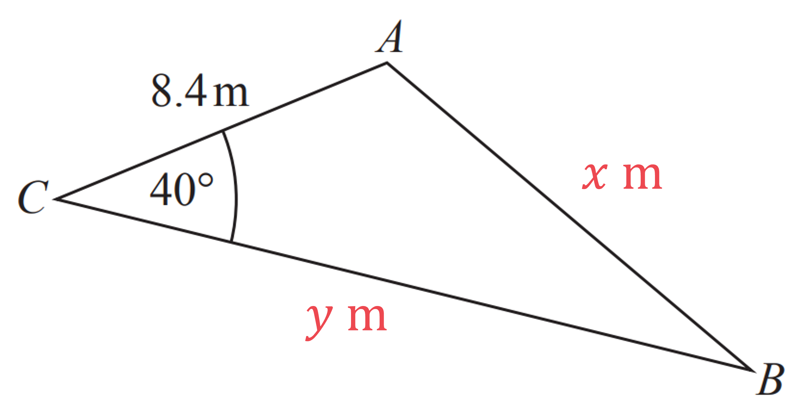

> *The formula for the area of a triangle is *$\mathrm{Area}=\frac{1}{2}ab\mathrm{sin}C$*, where **a** and **b** are the lengths of the two sides that form angle **C**.*
*Substitute Area = 100, **a** = **y**, **b** = 8.4 and **C** = 40 into the formula.*

`table row 100 equals cell 1 half cross times y cross times 8.4 cross times sin open parentheses 40 close parentheses end cell end table`

**[1]**

> *Rearrange to get **y** by itself by multiplying both sides by 2 and dividing both sides by 8.4sin(40). Type into your calculator.*

`table row y equals cell fraction numerator 100 cross times 2 over denominator 8.4 cross times sin open parentheses 40 close parentheses end fraction end cell row blank equals cell 37.041043... end cell end table`

**[1]**

> *You now know the lengths of two sides and the angle between them and you want to find the length of the third side. Therefore you need to use the cosine rule.*

> *The formula for the cosine rule is *$a^{2}=b^{2}+c^{2}-2bc\mathrm{cos}A$*, where **b** and **c** are the lengths of the two sides that form angle **A** and **a** is the length of the side opposite **A**.*
*Substitute **a** = **x**, **b** = 8.4, **c** = 37.041043... (using the answer button) and **A** = 40 into the formula.*

`x squared equals 8.4 squared plus 37.041043... squared minus 2 open parentheses 8.4 close parentheses open parentheses 37.041043... close parentheses cos open parentheses 40 close parentheses`

**[1]**

> *Type the expression into your calculator altogether as one line. If you do it separately you need to remember the order of operations (multiplication before addition).*

$x^{2}=965.897466...$

**[1]**

> *Take the positive square root of both sides.*

`table row x equals cell square root of 965.897466... end root end cell row blank equals cell 31.078891... end cell end table`

> *Round to 3 significant figures. Remember to include units for the length.*

$AB=31.1m(3\mathrm{sf})$* ***[1]**

### Q4
> *The area of triangle *$ACD$* can be found because we have two sides and the angle between them*

`table row cell Area space A C D end cell equals cell 1 half open parentheses A C close parentheses open parentheses A D close parentheses sin space 80 end cell row blank equals cell 1 half open parentheses 12 close parentheses open parentheses 15 close parentheses sin space 80 end cell end table`

**[1]**

> *Leaving the answer as an exact value until the final calculation will keep your working tidy and avoid errors in accuracy *

`table row cell Area space A C D end cell equals cell 90 sin space 80 end cell end table`

> *To find the area of triangle *$ABC$* the side *$AB$* first needs to be found*

> *Find *$AB$* using right-angled trigonometry*

* *`table row cell cos space 25 space end cell equals cell fraction numerator space A B over denominator 12 end fraction end cell row cell A B end cell equals cell 12 cos space 25 end cell end table`

**[1]**

> *The area of triangle *$ABC$* can be now be found because we have two sides and the angle between them*

`table row cell Area space A B C end cell equals cell 1 half open parentheses A B close parentheses open parentheses A C close parentheses sin space 25 end cell row blank equals cell 1 half open parentheses 12 cos space 25 close parentheses open parentheses 12 close parentheses sin space 25 end cell end table`

**[1]**

`table row cell Area space A B C end cell equals cell 72 space cos space 25 sin space 25 end cell end table`

> *Find the area of the quadrilateral *$ABCD$* by adding the areas of the two triangles together*

`table row cell Area space A B C D end cell equals cell 90 sin space 80 plus 72 cos space 25 sin space 25 end cell row blank equals cell 116.21029... end cell end table`

> *Round to 3 significant figures*

`table row cell Area space A B C D end cell equals cell 116 space cm squared end cell end table`

**116.2... accepted [1]**
> *The length *$CD$* can be found using the cosine rule because we know the other two sides and the angle between them*

> *Substitute the values from the diagram into the cosine rule, *$a^{2}=b^{2}+c^{2}-2bc\mathrm{cos}A$

`table row cell C D squared end cell equals cell A C squared plus A D squared minus 2 open parentheses A C close parentheses open parentheses A D close parentheses cos space 80 end cell row blank equals cell 12 squared plus 15 squared minus 2 open parentheses 12 close parentheses open parentheses 15 close parentheses cos space 80 end cell end table`

**[1]**

> *Typing everything into your calculator in one go will keep your working tidy and avoid errors in accuracy *

`table row cell C D end cell equals cell square root of 12 squared plus 15 squared minus 2 open parentheses 12 close parentheses open parentheses 15 close parentheses cos space 80 end root end cell end table`

**[1]**

`table row cell C D end cell equals cell 17.50676... end cell end table`

> *Round to 3 significant figures*

`table row cell C D end cell equals cell 17.5 space cm end cell end table`

**17.50 to 17.51 accepted [1]**
> *The shortest distance from a point to a line is the perpendicular distance*

> *Draw a line from *$A$*to *$CD$*, it should meet the line *$CD$* at a right angle*

> *Mark the point it meets *$CD$* with a new letter, e.g. *$X$

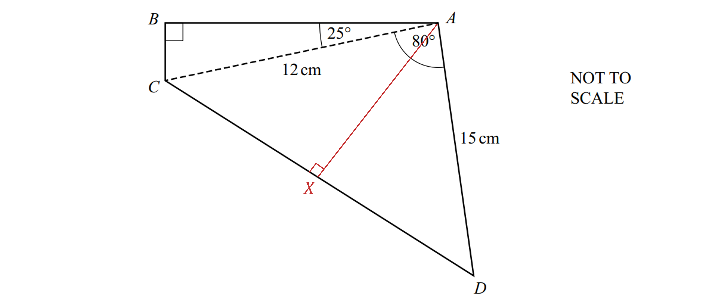

**Recognition of the correct shortest distance [1]**

> *The angle *$C$* can be found using the sine rule because we know the length of the sides of the triangle *$ACD$* and the angle *$CAD$

> *Substitute the values from the diagram into the sine rule, *$\frac{\mathrm{sin}A}{a}=\frac{\mathrm{sin}B}{b}=\frac{\mathrm{sin}C}{c}$*, use the unrounded value of *$CD$*to avoid errors in accuracy*

`fraction numerator sin open parentheses 80 close parentheses over denominator C D end fraction equals fraction numerator sin open parentheses C close parentheses over denominator A D end fraction
fraction numerator sin open parentheses 80 close parentheses over denominator 17.50676... end fraction equals fraction numerator sin open parentheses C close parentheses over denominator 15 end fraction`

**[1]**

> *Rearrange to find *$\mathrm{sin}C$

`sin space C equals fraction numerator 15 sin open parentheses 80 close parentheses over denominator 17.50676... end fraction`

**[1]**

> *Take the inverse sine of both sides to find *$C$

`C equals sin to the power of negative 1 end exponent open parentheses fraction numerator 15 sin open parentheses 80 close parentheses over denominator 17.50676... end fraction close parentheses equals 57.543...`

**[1]**

> *Use right-angled trigonometry to find the length of the shortest distance *$AX$

`table row cell sin space 57.543 end cell equals cell fraction numerator A X over denominator A C end fraction end cell row cell sin space 57.543 end cell equals cell fraction numerator A X over denominator 12 end fraction end cell end table`

**[1]**

> *Rearrange to find *$AX$

`table row cell A X end cell equals cell 12 sin space 57.543 end cell row blank equals cell 10.125539.... end cell end table`

> *Round to 3 significant figures*

`table row cell A X end cell equals cell 10.1 space cm end cell end table`

**10.11 to 10.13 accepted [1]**

### Q5
> *Formula for the area of a triangle: *$\mathrm{Area}=\frac{1}{2}ab\mathrm{sin}C$*. Substitute the values for the two sides adjacent to the angle in triangle **BCD.*

`table row cell area space B C D space end cell equals cell 1 half space open parentheses B C close parentheses open parentheses B D close parentheses space sin space open parentheses C B D close parentheses end cell row blank equals cell space 1 half space open parentheses 192 close parentheses open parentheses 168 close parentheses sin open parentheses 106 degree close parentheses end cell end table`

**[1]**

> *Use your calculator to find the area.*

> `table row cell space 1 half space open parentheses 192 close parentheses open parentheses 168 close parentheses sin open parentheses 106 degree close parentheses space end cell equals cell space 15503.2286... end cell end table`*   *

`equation`* ***[1] **

**Unrounded answers in the range 15 501 to 15 503 m****2**** accepted.**
> *Convert the unrounded area found in part (ii) to hectares using the conversion 1 hectare = 10 000m**2**. *

*15503.2286... ÷ 10000 = 1.5503... hectares*

> *Tomas buys 1.5503 hectares at \$35 750 per hectare.*

*1.5503... × 35750 = 55424.0423...*

**Final answer:** **The land costs \$55 400 (to the nearest \$100) **

*Correct answer** ***[1] **

*Answer** rounded correctly ***[1]**

### Q6
> *Find the length **AH** by using Pythagoras on the triangle **ADH**.*

`table attributes columnalign right center left columnspacing 0px end attributes row cell A H squared end cell equals cell A D squared plus D H squared end cell row blank equals cell 6 squared plus 6 squared end cell row blank equals 72 row cell A H end cell equals cell square root of 72 end cell end table`

**[1]**

> *Find the length **AF** by using Pythagoras on the triangle **ABF**. Note that **BF** = **DH** = 6 cm.*

`table row cell A F squared end cell equals cell A B squared plus B F squared end cell row blank equals cell 8 squared plus 6 squared end cell row blank equals 100 row cell A F end cell equals 10 end table`

**[1]**

> *EH** = **AD** = 6 cm and **EF** = **AB** = 8 cm. Therefore the rectangle **EFGH** is the same size as the rectangle **ABFE**. Therefore the diagonals of the two rectangles are equal.*

$FH=10$

> *Think of triangle **AFH** as a triangle in 2D. You have 3 sides so can find a missing angle using the cosine rule: *$a^{2}=b^{2}+c^{2}-2bc\mathrm{cos}A.$* Use angle **HAF **for **A **in the formula, **FH** for **a**, **AF **for **b** and **AH **for **c**.*

`table row cell F H squared end cell equals cell A F squared plus A H squared minus 2 cross times A F cross times A H cross times cos open parentheses H A F close parentheses end cell row 100 equals cell 100 plus 72 minus 2 cross times 10 cross times square root of 72 cross times cos open parentheses H A F close parentheses end cell end table`

**[1]**

> *Simplify each term. Leave each term as exact values.*

`table row 100 equals cell 172 minus 20 square root of 72 cos open parentheses H A F close parentheses end cell end table`

**[1]**

> *Subtract 172 from both sides.*

`table row cell negative 72 end cell equals cell negative 20 square root of 72 cos open parentheses H A F close parentheses end cell end table`

> *Divide both sides by *$-20\sqrt{72}$*.*

`fraction numerator negative 72 over denominator negative 20 square root of 72 end fraction equals cos open parentheses H A F close parentheses`

**[1]**

> *Use inverse cos on your calculator to find the angle **HAF**.*

`H A F equals cos to the power of negative 1 end exponent open parentheses fraction numerator negative 72 over denominator negative 20 square root of 72 end fraction close parentheses equals 64.8959...`

> *Round angles to 1 decimal place.*

**Angle ****HAF**** = 64.9°*** ***[1]**

### Q7
i) *Looking at triangle *$QRS$*, we have one side-angle pair and the angle opposite the side we're trying to find (*$QR$*).*

> *So use sine rule, *$\frac{s}{\mathrm{sin}S}=\frac{r}{\mathrm{sin}R}$*.*

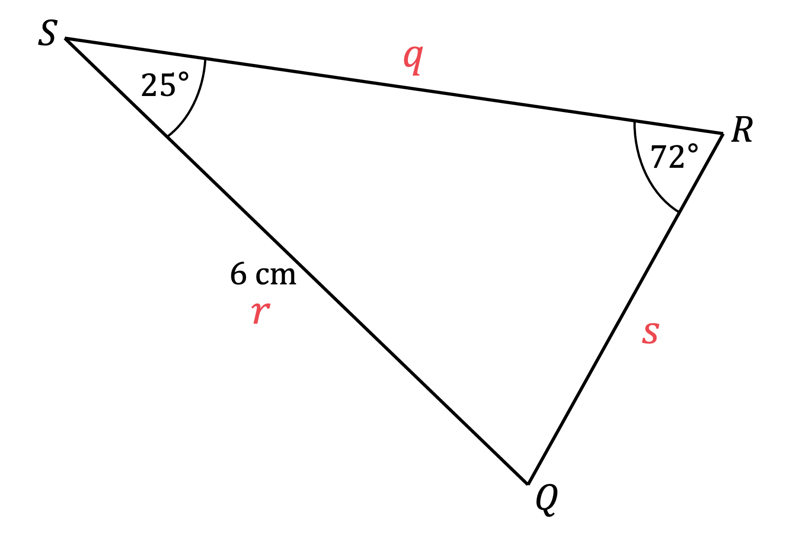

$\frac{QR}{\mathrm{sin}25^{\circ}}=\frac{6}{\mathrm{sin}72^{\circ}}$

**[1]**

> *Rearrange before working any values out to keep accuracy.*

$QR=\frac{6\mathrm{sin}25^{\circ}}{\mathrm{sin}72^{\circ}}$

**[1]**

$QR=2.666202...$

$QR=2.67$* ***cm*** ***[1]**

ii) *Looking at triangle *$PQS$*, we have two sides and the angle between them. *

> *We want the the side opposite that angle (*$PS$*), so use cosine rule, *$q^{2}=p^{2}+s^{2}-2ps\mathrm{cos}Q$*.*

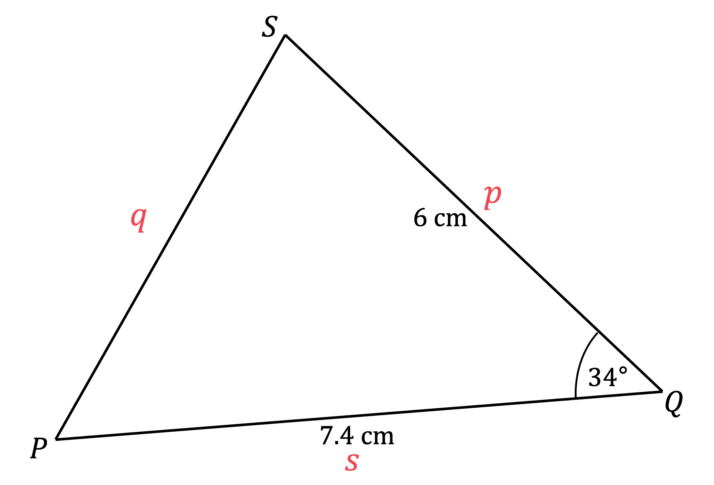

`open parentheses P S close parentheses squared equals 6 squared plus 7.4 squared minus 2 cross times 6 cross times 7.4 cross times cos space 34 degree`

**[1]**

`open parentheses P S close parentheses squared equals 17.141 space 463 space...`

**[1]**

> *Square root before rounding.*

$PS=4.140225...$

$PS=4.14$* ***cm*** ***[1]**

iii) *Split quadrilateral *$PQRS$* into two triangles and apply the area formula *$"A=\frac{1}{2}ab\mathrm{sin}C"$* on each.*

> *We know the length of *$QR$* from our answer to part i), but we do need to find angle *$RQS$* - marked *$x$*° on the diagram.*

*Angle *`R Q S equals x degree equals 180 degree minus open parentheses 25 degree plus 72 degree close parentheses equals 83 degree`

**[1]**

*Area of *$RQS=\frac{1}{2}\times6\times2.666202...\times\mathrm{sin}83^{\circ}=7.938988...$

**[1]**

> *Store this value in your calculator's memory for later.*

*Area of *$PQS=\frac{1}{2}\times6\times7.4\times\mathrm{sin}34^{\circ}=12.414082...$

**[1]**

> *Add the two triangle areas to find the area of the quadrilateral *$PQRS$*.*

*Area of *$PQRS=7.938988...+12.414082...=20.353070...$

$20.4\mathrm{cm}^{2}$* ***[1]**

### Q8
> *Sine rule is *$"\frac{a}{\mathrm{sin}A}\equiv\frac{b}{\mathrm{sin}B}\equiv\frac{c}{\mathrm{sin}C}"$*. *

> *It will help to label the diagram with the side names and other information given in the question.*

> *Find angle **LPM** using the given bearings.*

$201^{\circ}-127^{\circ}=74^{\circ}$

**[1]**

> *We have one side-angle pair (*$m$* and *$M$*) and the angle for the side we are trying to find (**LM**) so apply sine rule.*

`table row cell fraction numerator p over denominator sin space P end fraction end cell identical to cell fraction numerator m over denominator sin space M end fraction end cell row cell fraction numerator p over denominator sin space 74 degree end fraction end cell equals cell fraction numerator 248 over denominator sin space 42 degree end fraction end cell end table`

**[1]**

> *Rearranging we can solve for **p** which is side **LM**.*

$p=\frac{248\mathrm{sin}74^{\circ}}{\mathrm{sin}42^{\circ}}=356.272599...$

**[1]**

**LM**** = 356 km*** ***[1]**
*The shortest distance from **M** to **LP** will be the length of a line from **M** that is perpendicular to **LP**.* *This can be considered as the (perpendicular) height (*$h$*) of the triangle when **LP** (248 km) is considered its base.*

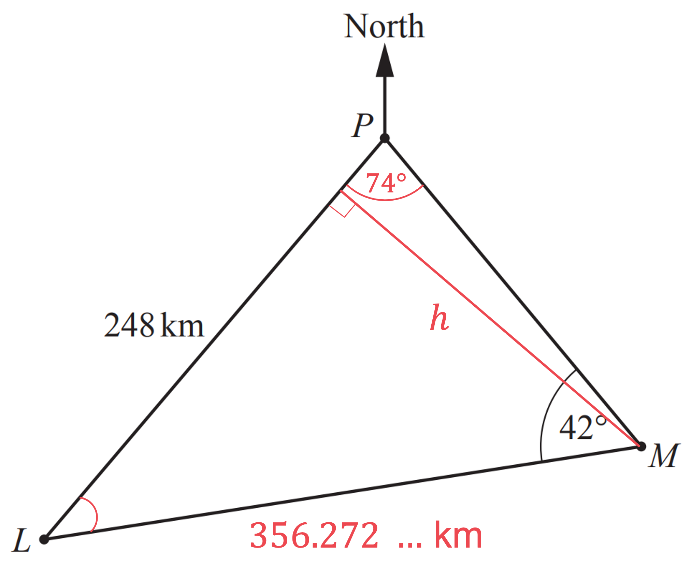

> *Area** links the height and base in a triangle using the formula *$"A=\frac{1}{2}\timesb\timesh"$*.*

$\mathrm{Area} \mathrm{of}\DeltaLPM=\frac{1}{2}\times248\timesh=124h$

> *We can also now work out the angle MLP as angles in a triangle add up to 180°.*

$\mathrm{Angle}MLP=180^{\circ}-74^{\circ}-42^{\circ}=64^{\circ}$

**[1]**

> *We now know the length of two sides and the angle between them so can work out the area of triangle **LPM** using the formula *$"A=\frac{1}{2}ab\mathrm{sin}C"$*.*

`table row cell Area space of space increment L P M end cell equals cell 1 half cross times 248 cross times 356.272 space... cross times sin space 64 degree end cell row blank equals cell 39 space 706.745 space... end cell end table`

**[1]**

> *Using the two area formulae we can set up and solve an equation for *$h$*.*

`table row cell 124 h end cell equals cell 39 space 706.745... end cell row h equals cell 320.215 space 691 space... end cell end table`

**Shortest distance from ****M**** to ****LP**** is 320 km*** ***[1]**

### Q9
> *First use the area to form an equation using triangle **ADC**.*

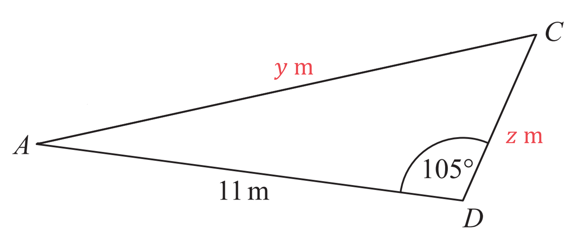

> *The formula for the area of a triangle is *$\mathrm{Area}=\frac{1}{2}ab\mathrm{sin}C$*, where **a** and **b** are the lengths of the two sides that form angle **C**. Substitute Area = 56, **a** = **z**, **b** = 11 and **C** = 105 into the formula.*

`table row 56 equals cell 1 half cross times z cross times 11 cross times sin open parentheses 105 close parentheses end cell end table`

**[1]**

> *Rearrange to get **z** by itself by multiplying both sides by 2 and dividing both sides by 11sin(105). Type into your calculator.*

`table row z equals cell fraction numerator 56 cross times 2 over denominator 11 cross times sin open parentheses 105 close parentheses end fraction end cell row blank equals cell 10.540993... end cell end table`

**[1]**

> *You now know the lengths of two sides and the angle between them and you want to find the length of the third side. Therefore you need to use the cosine rule.*

> *The formula for the cosine rule is *$a^{2}=b^{2}+c^{2}-2bc\mathrm{cos}A$*, where **b** and **c** are the lengths of the two sides that form angle **A** and **a** is the length of the side opposite **A**. *

> *Substitute **a** = **y**, **b** = 11, **c** = 10.540993... (using the answer button) and **A** = 105 into the formula.*

`y squared equals 11 squared plus 10.540993... squared minus 2 open parentheses 11 close parentheses open parentheses 10.540993... close parentheses cos open parentheses 105 close parentheses`

**[1]**

> *Type the expression into your calculator altogether as one line. If you do it separately you need to remember the order of operations (multiplication before addition).*

$y^{2}=292.133170...$

> *Take the positive square root of both sides.*

`table attributes columnalign right center left columnspacing 0px end attributes row y equals cell square root of 292.133170... end root end cell row blank equals cell 17.091903... end cell end table`

> *Now use triangle **ABC**. You know the length of a side and the angle opposite it. You also know another angle so you can use the sine rule to find the length of the side opposite it.*

> *The formula for the sine rule is *$\frac{a}{\mathrm{sin}A}=\frac{b}{\mathrm{sin}B}$*, where **a** and **b** are the lengths of the two sides that are opposite the angles **A **and **B **respectively. *

> *Substitute **a** = **x**, **b** = 17.091903... (using the answer button), **A** = 48 and **B** = 118 into the formula.*

`fraction numerator x over denominator sin open parentheses 48 close parentheses end fraction equals fraction numerator 17.091903... over denominator sin open parentheses 118 close parentheses end fraction`

**[1]**

> *Multiply both sides by sin(48) and type into your calculator.*

`table row x equals cell fraction numerator 17.091903... over denominator sin open parentheses 118 close parentheses end fraction cross times sin open parentheses 48 close parentheses end cell row blank equals cell 14.385632... end cell end table`

> *Round to 1 decimal place. Remember to include units for the length.*

$AB=14.4m(1\mathrm{dp})$* ***[1]**

### Q10
> *According to the labeling in the question, the sine rule would be*

`fraction numerator sin open parentheses A B C close parentheses over denominator 5.9 end fraction equals fraction numerator sin open parentheses 84.6 close parentheses over denominator 17.8 end fraction`

**[1]**

`sin left parenthesis A B C right parenthesis equals 5.9 cross times fraction numerator sin open parentheses 84.6 close parentheses over denominator 17.8 end fraction`

**[1]**

**                 **$=0.32998964...$

> *It's a good idea to store this answer on your calculator and use the exact value for the next step. Don't forget to inverse sine to get the final answer!*

$\mathrm{Angle}ABC=19.3^{\circ}$** ****[1]**

**If you round to more than 3 significant figures, your answer must be between 19.26 and 19.27**

### Q11
> *Use triangle *$ABD$* to find the missing side *$AD$*.*

> $AD$* is opposite the given angle and the two other sides are known so the cosine rule should be used.*

> *Substitute the values of  *$a=55,b=70\mathrm{and}C=40^{\circ}$* into the cosine rule. *

> *Cosine Rule:  *$c^{2}=a^{2}+b^{2}-2ab\mathrm{cos}C$*.*

> `c to the power of 2 space end exponent equals space 55 to the power of 2 space end exponent plus space 70 to the power of 2 space end exponent minus space 2 open parentheses 55 close parentheses open parentheses 70 close parentheses space cos space 40`*  *

**Correct use of equation**** [1] **

**Substitute values into the equation**** ****correctly**** ****[1]**

> *Use your calculator to find the value of *$c^{2}$*.*

$c^{2}=2026.45778...$

**[1]**

> *Square root to find the value of *$c$*.*

`table row cell c to the power of space end cell equals cell square root of space 2026.45778... end root end cell row blank equals cell space 45.0161... end cell end table`

$c=45.0m(3s.f.)$* ***[1] **

**If not rounded, 45.01 to 45.02 is accepted.**
> *Use triangle *$BCD$* to find the missing side *$BC$*.*

> $BC$* is adjacent to the given angle, one other side is known and one more angle is needed to use the sine rule.*

> *The lines *$AB$* and *$DC$* are parallel so angle *$BDC$* is an alternate to angle *$ABD$*. Alternate angles are equal.*

`B D with hat on top C space equals space 40 degree`

**[1]**

> *Substitute the values of  *`B D space equals space 70 comma space space B D with hat on top C space equals space 40 space space and space space B C with hat on top D space equals space 32 degree`* into the sine rule. *

> *Sine Rule:  *$\frac{a}{\mathrm{sin}A}=\frac{b}{\mathrm{sin}B}=\frac{c}{\mathrm{sin}C}$*.*

$\frac{BC}{\mathrm{sin}40^{\circ}}=\frac{70}{\mathrm{sin}32^{\circ}}$

**[1]**

> *Rearrange the equation to find the value of *$BC.$

`table row cell B C space end cell equals cell space fraction numerator space 70 space sin space 40 degree over denominator sin space 32 degree end fraction end cell row blank equals cell space 84.90941... end cell end table`

** ****[1]**

$BC=84.9m(3s.f.)$* ***[1] **

**If not rounded, 84.90 to 84.91 is accepted.**
> *Find the area of each triangle individually and add them together. Formula for the area of a triangle: *$\mathrm{Area}=\frac{1}{2}ab\mathrm{sin}C$*.*

> *Find the area of triangle *$ABD$*.*

`table row cell A B D space end cell equals cell 1 half space open parentheses A B close parentheses open parentheses A D close parentheses space sin space open parentheses A B with hat on top D close parentheses end cell row blank equals cell space 1 half space open parentheses 55 close parentheses open parentheses 70 close parentheses sin open parentheses 40 degree close parentheses end cell row blank equals cell space 1925 space sin space 40 degree end cell row blank equals cell space 1237.366... end cell end table`

**[1]**

> *To find the area of triangle *$BCD$* the third angle in the triangle will be needed.*

`table row cell D B with hat on top C space end cell equals cell space 180 space minus space B C with hat on top D space minus space B D with hat on top C space end cell row blank equals cell space 180 space minus space 32 space minus space 40 space end cell row blank equals cell space 108 degree end cell end table`

> *Area of triangle *`B C D space table row blank equals blank end table table row blank blank space end table table row blank blank cell 1 half end cell end table table row blank blank space end table table row blank blank cell open parentheses B C close parentheses end cell end table table row blank blank cell open parentheses A D close parentheses end cell end table table row blank blank space end table table row blank blank straight s end table table row blank blank straight i end table table row blank blank straight n end table table row blank blank space end table table row blank blank cell open parentheses B C D close parentheses end cell end table`*. *

`table row cell B C D space end cell equals cell 1 half space open parentheses 84.90941... close parentheses open parentheses 70 close parentheses sin open parentheses 108 degree close parentheses end cell row blank equals cell space 2826.377... end cell end table`

**[1]**

> *Add the areas of the two triangles together.*

`table row cell Area space A B C D space end cell equals cell space 1237.366... space plus space 2826.377... space end cell row blank equals cell space 4063.743... end cell end table`

`table row cell bold Area bold space bold italic A bold italic B bold italic C bold italic D bold space end cell bold equals cell bold space bold space bold 4060 bold space bold cm to the power of bold 2 bold space bold space stretchy left parenthesis 3 space s. f. stretchy right parenthesis end cell end table`* ***[1] **

**Answers in the range 4063 to 4064 cm****2**** will gain full marks.**

### Q12
*As the sides *$EF$* and *$FG$* are in the ratio *$1:2$*, this means we do not know their exact length, but we know that *$FG$* is double the length of *$EF$

> *So we can call their lengths *$x$* and *$2x$

> *Draw a sketch of the triangle*

> *Using the formula for the area of a triangle; *$\mathrm{Area}=\frac{1}{2}ab\mathrm{sin}C$* where *$a$* and *$b$* are either side of angle *$C$

`70 equals 1 half cross times x cross times 2 x cross times sin open parentheses 40 close parentheses`

**[1]**

> *Simplify*

`70 equals x squared cross times sin open parentheses 40 close parentheses`

**[1]**

> *Divide both sides by *`sin open parentheses 40 close parentheses`

`fraction numerator 70 over denominator sin open parentheses 40 close parentheses end fraction equals x squared`

> *Square root both sides*

`x equals square root of fraction numerator 70 over denominator sin open parentheses 40 close parentheses end fraction end root equals 10.43554828...`

**[1]**

$EF=10.4m$ **[1]**
> *This triangle has a similar arrangement to the previous triangle, however we now know that *$PQ=EF=10.4m$* which means that *$QR=20.8m$

*It has the same area, and two of the same side lengths as the previous triangle, but it is stated that is is different.*

> *This is because there are two possibilities for the angle, which would give the same area*

$\mathrm{Area}=\frac{1}{2}ab\mathrm{sin}C$

$70=\frac{1}{2}\times10.4\times20.8\times\mathrm{sin}θ$

> *Simplifying*

$70=108.16\times\mathrm{sin}θ$

> *Divide both sides by 108.16*

$\mathrm{sin}θ=\frac{70}{108.16}=0.647...$

`theta equals sin to the power of negative 1 end exponent open parentheses fraction numerator 70 over denominator 108.16 end fraction close parentheses equals 40`

> *There are two solutions for *$θ$* in this equation, one of them is 40 (used in the triangle for part i) and we must find the other*

> *The other solution is *

$180-40=140$

*This can be seen geometrically, and by using angles on a straight line summing to 180° to find the angle marked *$y$ *(Note this diagram is not to scale)*

> *You can also consider the graph of *$y=\mathrm{sin}θ$* and the line *$y=\frac{70}{108.16}$* *

*Their intersections are the solutions to *$\mathrm{sin}θ=\frac{70}{108.16}$

> *You can use the symmetry of the graph to help see why the 2nd solution is 180-40*

$\mathrm{Angle}PQR=140^{\circ}$ **[1]**

### Q13
*The cosine rule is *$a^{2}=b^{2}+c^{2}-2bc\mathrm{cos}A$* where* * *

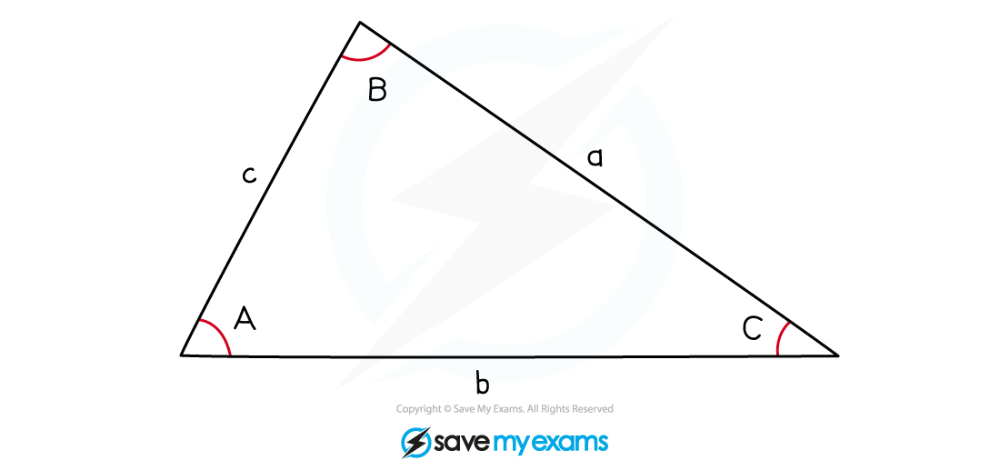

> * *

*Write the distance from **G** to **B** as *$x$ *Substitute *$a=x,b=864,c=928$* and *$A=67$* into the formula* * *

$x^{2}=864^{2}+928^{2}-2\times864\times928\times\mathrm{cos}67$

**[2]**

*Work out this value on your calculator* * *

$x^{2}=981109.81...$

**[1]**

*Find *$x$* (by square-rooting both sides)*

$x=990.509...$

**991 km** **[1] **
*Draw a north arrow at **G** and label the bearing of **H** from **G** as *$x$

*By thinking of the north arrows as parallel lines, find the co-interior angle at **H **(by subtracting 133° and 67° from 360°)*

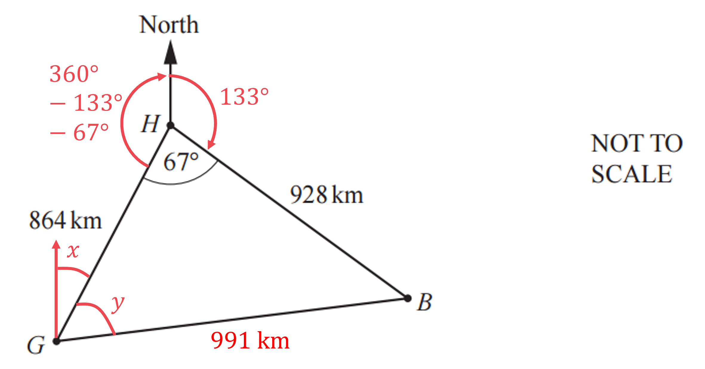

*360° - 133° - 67° = 160°*

*Co-interior angles add to 180°* *Find *$x$* (by subtracting 160° from 180°)*

$x$* = 180° - 160° = 20°* * *

*Label angle **HGB** as *$y$* and label** GB** as 991 km from part (c)* *The sine rule is *$\frac{a}{\mathrm{sin}A}=\frac{b}{\mathrm{sin}B}=\frac{c}{\mathrm{sin}C}$* where*

*Substitute *$a=991,A=67,b=928$* and *$B=y$* into the formula* * *

$\frac{991}{\mathrm{sin}67}=\frac{928}{\mathrm{sin}y}$ * *

*Multiply both sides by *$\mathrm{sin}67$* and *$\mathrm{sin}y$ * *

$991\mathrm{sin}y=928\mathrm{sin}67$ * *

*Make *$\mathrm{sin}y$* the subject (by dividing by 991)* * *

$\mathrm{sin}y=\frac{928\mathrm{sin}67}{991}$

**[2]**

*Find *$y$* (by taking inverse sin of both sides)* * *

`y equals sin to the power of negative 1 end exponent open parentheses fraction numerator 928 sin space 67 over denominator 991 end fraction close parentheses equals 59.5 degree`

**[1] **

*Find the bearing (by adding *$x=20$* to *$y=59.5$*)* * *

`table row cell x plus y end cell equals cell 20 plus 59.5 end cell row blank equals cell 79.5 end cell end table` * *

> *Give the final bearing as three digits (and to one decimal place)*

**079.5°** **[1]**

### Q14
> *You can find the angle between the sides **AC** and **AB** by spotting that the three interior angles of the triangle should add up to 180°.*

`table row cell Angle space B A C end cell equals cell 180 minus 64 minus 49 end cell row blank equals 67 end table`

> *To find the area of a triangle you need to know the lengths of two sides and the angle between them.*

> *You know the length of one side and the angle opposite it. You also know another angle so you can find the length of the side opposite that using the sine rule.*

> *The formula for the sine rule is *$\frac{a}{\mathrm{sin}A}=\frac{b}{\mathrm{sin}B}$*, where **a** and **b** are the lengths of the two sides that are opposite the angles **A **and **B **respectively. Substitute **a** = **AC**, **b** = 8.7, **A** = 49 and **B** = 64 into the formula.*

`fraction numerator A C over denominator sin open parentheses 49 close parentheses end fraction equals fraction numerator 8.7 over denominator sin open parentheses 64 close parentheses end fraction`

**[1]**

> *Multiply both sides by sin(49) and type into your calculator.*

`table row cell A C end cell equals cell fraction numerator 8.7 over denominator sin open parentheses 64 close parentheses end fraction cross times sin open parentheses 49 close parentheses end cell row blank equals cell 7.305314... end cell end table`

*Rearranging correctly** ***[1] **

*Correct answer** ***[1]**

> *The formula for the area of a triangle is *$\mathrm{Area}=\frac{1}{2}ab\mathrm{sin}C$*, where **a** and **b** are the lengths of the two sides that form angle **C**. Substitute **a** = 7.305314... (using the answer button), **b** = 8.7 and **C** = 67 into the formula.*

`table row Area equals cell 1 half cross times 7.305314... cross times 8.7 cross times sin open parentheses 67 close parentheses end cell end table`

**[1]**

> *Type into your calculator.*

`table attributes columnalign right center left columnspacing 0px end attributes row Area equals cell 29.251912... end cell end table`

> *Round to 3 significant figures. Remember to include the units for the area.*

$\mathrm{Area}=29.3\mathrm{cm}^{2}(3\mathrm{sf})$ **[1]**

### Q15
> *First look at triangle **BCD**.*

> *You know the length of one side and the angle opposite it. You also know another angle so you can find the length of the side opposite that using the sine rule.*

> *The formula for the sine rule is *$\frac{a}{\mathrm{sin}A}=\frac{b}{\mathrm{sin}B}$*, where **a** and **b** are the lengths of the two sides that are opposite the angles **A **and **B **respectively. *

> *Substitute **a** = **y**, **b** = 12.5, **A** = 34 and **B** = 109 into the formula.*

`fraction numerator y over denominator sin open parentheses 34 close parentheses end fraction equals fraction numerator 12.5 over denominator sin open parentheses 109 close parentheses end fraction`

**[1]**

> *Multiply both sides by sin(34) and type into your calculator.*

`table row y equals cell fraction numerator 12.5 over denominator sin open parentheses 109 close parentheses end fraction cross times sin open parentheses 34 close parentheses end cell row blank equals cell 7.392674... end cell end table`

**[1]**

> *Now look at triangle **ABD**.*

> *You know the lengths of two sides and the angle between them and you want to find the length of the third side. Therefore you need to use the cosine rule.*

> *The formula for the cosine rule is *$a^{2}=b^{2}+c^{2}-2bc\mathrm{cos}A$*, where **b** and **c** are the lengths of the two sides that form angle **A** and **a** is the length of the side opposite **A**. *

> *Substitute **a** = **x**, **b** = 11.4, **c** = 7.392674... (using the answer button) and **A** = 86 into the formula.*

`x squared equals 11.4 squared plus 7.392674... squared minus 2 open parentheses 11.4 close parentheses open parentheses 7.392674... close parentheses cos open parentheses 86 close parentheses`

**[1]**

> *Type the expression into your calculator altogether as one line. If you do it separately you need to remember the order of operations (multiplication before addition).*

$x^{2}=172.853978...$

**[1]**

> *Take the positive square root of both sides.*

`table attributes columnalign right center left columnspacing 0px end attributes row x equals cell square root of 172.853978... end root end cell row blank equals cell 13.147394... end cell end table`

> *Round to 3 significant figures. Remember to include units for the length.*

$AD=13.1\mathrm{cm}(3\mathrm{sf})$* ***[1]**

### Q16
*We have a triangle with two sides and the included angle, so can use the "sine area rule" given on the formula sheet*

> *Substitute the given values for the two lengths and the area into *$\mathrm{Area}=\frac{1}{2}ab\mathrm{sin}C$

$50=\frac{1}{2}\times18\times13\times\mathrm{sin}x$

**[1]**

> *We can work out '*$\frac{1}{2}\times18\times13$*' first*

$50=117\mathrm{sin}x$

> *Divide both sides by 117 to get *$\mathrm{sin}x$

$\mathrm{sin}x=\frac{50}{117}=0.427350427...$

> *Round to at least 3 significant figures*

**0.427**** or ****0.4273 to 0.4274** **[1]**

**Read the question carefully- you are not asked to find **$x$**, only **$\mathrm{sin}x$**!**

### Q17
> *Sketch a regular hexagon. A regular hexagon can be divided into 6 equilateral triangles as below.*

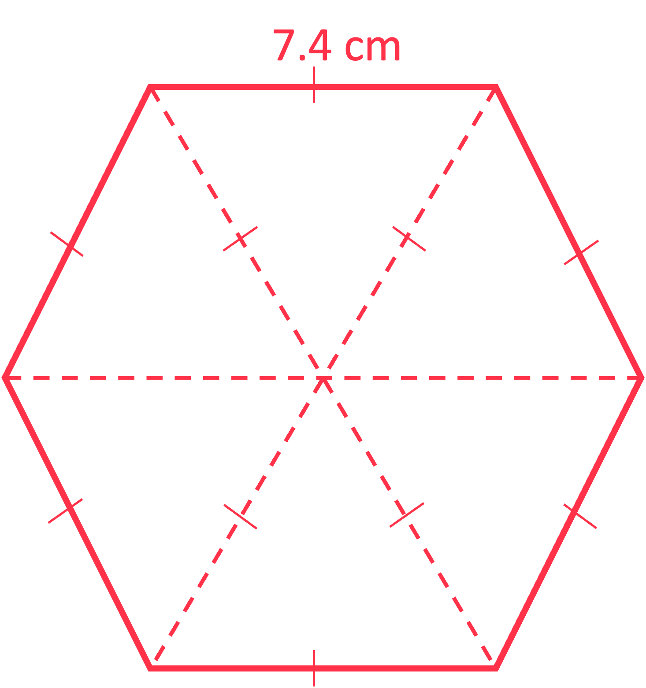

*The side lengths of the triangles are all 7.4 cm and the angles inside the triangles are all 60°*

> *We can find the area of one triangle using the sine area rule, Area *$=\frac{1}{2}ab\mathrm{sin}C$*, where *$a$* and *$b$* are adjacent sides and *$C$* is the included angle*

`table row cell Area triangle end cell equals cell 1 half cross times 7.4 cross times 7.4 cross times sin 60 end cell end table`

**[1]**

> *Multiply by 6 to find the area of the hexagon*

`table row cell Area space hexagon end cell equals cell 6 cross times 1 half cross times 7.4 cross times 7.4 cross times sin 60 end cell end table`

**[1]**

`table row blank equals cell 3 cross times 7.4 squared cross times sin 60 end cell row blank equals cell 142.2706533... end cell end table`

> *Round your answer to at least 3 significant figures*

**142 cm****2**** **** ****[1]**

### Q18
> *We have three known sides (SSS). Therefore to find a missing angle we can use the cosine rule *$\mathrm{cos}A=\frac{b^{2}+c^{2}-a^{2}}{2bc}$

> *When applying the cosine rule to find an angle, always set *$a$* to be the side opposite the angle (*$b$* and *$c$* are interchangeable)*

`cos open parentheses x close parentheses equals fraction numerator 11 squared plus 5 squared minus 13 squared over denominator 2 cross times 11 cross times 5 end fraction`

**correct substitution into cosine rule in any form**** ****[1] **

**correct substitution into cosine rule in the above form*** ***[1]**

> *It's advisable to calculate the numerator and the denominator separately.*

`cos open parentheses x close parentheses equals fraction numerator negative 23 over denominator 110 end fraction`

> *If you prefer to work out cos(*$x$*) on one line of your calculator, remember to put brackets around the numerator and the denominator:*

`table row cell cos open parentheses x close parentheses end cell equals cell open parentheses 11 squared plus 5 squared minus 13 squared close parentheses divided by open parentheses 2 cross times 11 cross times 5 close parentheses end cell row blank equals cell negative 0.209090909... end cell end table`

**  **$\frac{-23}{110}$** or **$-0.209090909...$** [1]**

> *Inverse cosine to get *$x$

$x=102.1^{\circ}$* *** [1]**

**Remember to give answers in degrees to at least one decimal place**

### Q19
> *You can use the cosine rule to find angle **BAC** because you know all three sides.*

> *Let angle **BAC** be *$x^{\circ}$*.*

> *Use the cosine formula, *$\mathrm{cos}A=\frac{b^{2}+c^{2}-a^{2}}{2bc}$*.*

`table row cell cos space x end cell equals cell fraction numerator 150 squared plus 120 squared minus 180 squared over denominator 2 cross times 150 cross times 120 end fraction end cell end table`

*Correct substitution into either form of the cosine formula ***[1]** *Correct form of the cosine formula used*** [1]**

`table row cell cos space x end cell equals cell 4500 over 36000 end cell end table`

**[1]**

> *Take the inverse cos of both sides.*

`x equals cos to the power of negative 1 end exponent open parentheses 4500 over 36000 close parentheses
x equals 82.81924...`

**Angle ****BAC**** = **$82.8^{\circ}$** ****[1]**

**Answers between 82.81****o**** and 82.82****o**** through using the cosine rule will be accepted.**

### Q20
> *You only need to use triangle **PQR**. *

> *You are given the lengths of two sides and the angle in between them. Therefore you can use the cosine rule to find the length of the side opposite the angle. Cosine rule: *$a^{2}=b^{2}+c^{2}-2bc\mathrm{cos}A$*.*

> *For the sides use, **a** = **QR**, **b **= **PR** = 150 and **c** = **PQ** = 120 and for the angle use **A **= **QPR **= 25°.*

> *Substitute the values into the formula.*

$QR^{2}=150^{2}+120^{2}-2(150)(120)\mathrm{cos}(25)$

**[1]**

> *Simplify the expression, type it in the calculator as one long expression. If you evaluate the expression bit by bit then remember to apply the order of operations (multiplication before subtraction).*

$QR^{2}=4272.9196...$

**[1]**

> *Solve for **QR** by square rooting both sides. Use the answer button or type the exact expression in your calculator.*

`table row cell Q R end cell equals cell square root of 150 squared plus 120 squared minus 2 left parenthesis 150 right parenthesis left parenthesis 120 right parenthesis cos left parenthesis 25 right parenthesis end root equals square root of 4272.9196... end root end cell row cell Q R end cell equals cell 65.3675... end cell end table`

> *Round to 3 significant figures.*

**QR ****= 65.4 m** **[1]**
> *You only need to use triangle **PRS**.*

> *You are given two angles so find the 3rd angle by subtracting the other two from 180°.*

`table row cell Angle space P S R end cell equals cell 180 degree minus 45 degree minus 55 degree end cell row blank equals cell 80 degree end cell end table`

**[1]**

> *As you know the length of a side (**PR**) and the angle opposite (**PSR**) you can use the sine rule to find the length of the side (**RS**) which is opposite to the angle (**RPS**). Sine rule: *$\frac{a}{\mathrm{sin}A}=\frac{b}{\mathrm{sin}B}$*.*

> *For the lengths use **a **= **RS **and **b **= **PR** = 150, and for the angles use **A **= **RPS** = 55° and **B **= **RPS **= 100°*

$\frac{RS}{\mathrm{sin}(55)}=\frac{150}{\mathrm{sin}(80)}$

**[1]**

> *Solve for **RS** by multiplying both sides by sin55.*

`table row x equals cell fraction numerator 150 over denominator sin left parenthesis 80 right parenthesis end fraction cross times sin left parenthesis 55 right parenthesis end cell row x equals cell 124.7683... end cell end table`

**[1]**

> *Round to 3 significant figures.*

**RS ****= 125 m** **[1]**
> *The formula for the area of a triangle is *$\frac{1}{2}ab\mathrm{sin}C$* where **a **and **b **are the two sides that make angle **C**.*

> *Find the area of triangle **PQR** by using **a** = **PR** = 150, **b **= **PQ** = 120 and **C** = **QPR ** = 25.*

`1 half open parentheses 150 close parentheses open parentheses 120 close parentheses sin open parentheses 25 close parentheses equals 3803.5643...`

**[1]**

> *Find the area of triangle **PSR** by using **a** = **PR** = 150, **b **= **RS** = 124.7683... and **C** = **PRS ** = 45. Try to use the exact answer for **RS**, if it is still in your calculator then you can use the answer button.*

`1 half open parentheses 150 close parentheses open parentheses 124.7683... close parentheses sin open parentheses 45 close parentheses equals 6616.8392...`

**[1]**

> *Add together the two areas to find the total area.*

$3803.5643...+6616.8392...=10420.4036...$

> *Round to 3 significant figures.*

**10 400 m****2** **[1]**

### Q21
> *In triangle **BAC**, we have the opposite and adjacent sides to angle **BAC**. Therefore use the tangent ratio*

`tan open parentheses angle B A C close parentheses equals 14 over 12`

**[1]**

> *Find angle **BAC** by inverse cosine (SHIFT-cos on your calculator) 14/12*

`angle B A C equals tan to the power of negative 1 end exponent open parentheses 14 over 12 close parentheses equals 49.3987054...`

> *Give non-exact answers in degrees correct to one decimal place*

**Final answer:** **49.4° **

*49.4 or 49.39 to 49.40** ***[1]**
> *Using the answer from part (a), we have a triangle with two sides and the included angle*

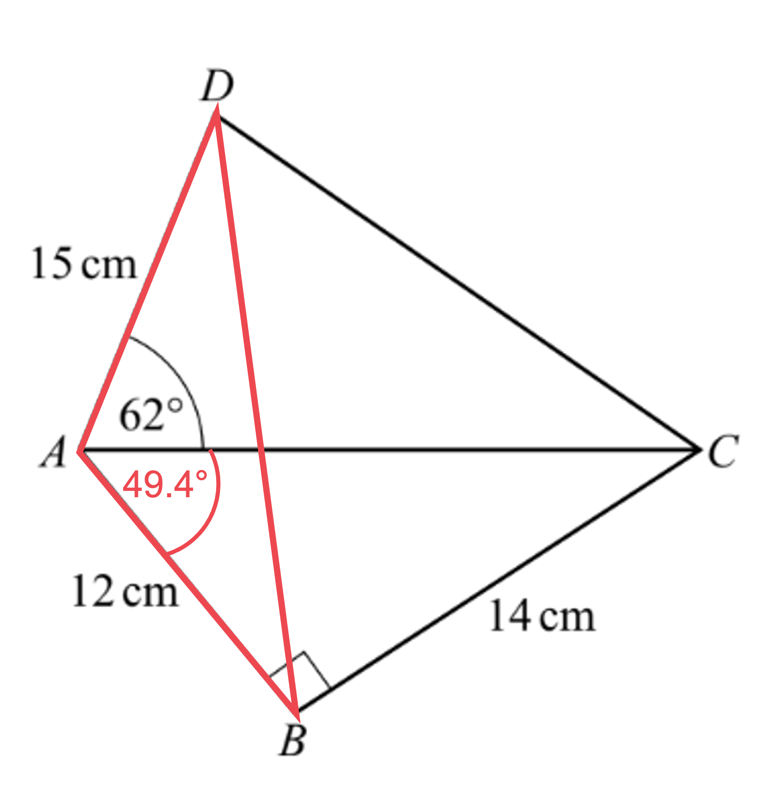

*Angle *$BAD$* = 62 + 49.4 = 111.4°*

**[1]**

> *Therefore we can use the version of the cosine rule given to you on the formula sheet, *$a^{2}=b^{2}+c^{2}-2bc\mathrm{cos}A$*, taking *$BD$* as *$a$

`a squared equals 12 squared plus 15 squared minus 2 cross times 12 cross times 15 cos open parentheses 62 plus 49.4 close parentheses`

**[1]**

$=500.355642...$

> *Square root this to find *$a$* (or *$BD$*)*

$a=\sqrt{500.355642...}=22.3686308...$

> *Round to at least 3 significant figures*

**22.4 cm**** **
**22.4 or 22.36 to 22.37 cm**** ****[1]**

### Q22
> *Use triangle *$BCD$* to find the angle *$CBD$*. *

> $CD$* is opposite the angle and the two other sides are known so the cosine rule should be used.*

> *Substitute the values of *$BD=168,BC=192\mathrm{and}CD=287.9$*into the cosine rule.  *

> *Cosine Rule:  *$c^{2}=a^{2}+b^{2}-2ab\mathrm{cos}C$*, where *$C$* is the angle opposite side *$c.$*   *

`table row cell C D to the power of 2 space end exponent end cell equals cell space B C to the power of 2 space end exponent plus space B D to the power of 2 space end exponent minus space 2 open parentheses B C close parentheses open parentheses B D close parentheses space cos space C B D end cell row cell 287.9 to the power of 2 space end exponent end cell equals cell space 192 squared space plus space 168 to the power of 2 space end exponent minus space 2 open parentheses 192 close parentheses open parentheses 168 close parentheses cos space C B D end cell end table`

**[1]**

> *Rearrange to make*$\mathrm{cos}CBD$* the subject.*

`table row cell 287.9 to the power of 2 space end exponent minus open parentheses space 192 squared space plus space 168 to the power of 2 space end exponent close parentheses end cell equals cell negative space 2 open parentheses 192 close parentheses open parentheses 168 close parentheses cos space C B D end cell row cell cos space C B D space end cell equals cell space fraction numerator 287.9 to the power of 2 space end exponent minus space 192 squared space space minus space 168 to the power of 2 space end exponent over denominator negative 2 open parentheses 192 close parentheses open parentheses 168 close parentheses end fraction end cell end table`

** ****[1]**

> *Use your calculator to find the value of *$\mathrm{cos}CBD$*.*

`table row cell cos space C B D space end cell equals cell space minus 0.275893... end cell end table`

**[1]**

> *Use the cos**-1** button on your calculator to find the value of *$CBD$*.*

`table row cell C B D to the power of space end cell equals cell cos to the power of negative 1 end exponent space open parentheses negative 0.275893... close parentheses end cell row blank equals cell space 106.0152.... end cell end table`

$CBD=106.0^{\circ}(1d.p.)$* ***[1]**

### Q23
> *The formula for the area of a triangle is *$\mathrm{Area}=\frac{1}{2}ab\mathrm{sin}C$*, where **a** and **b** are the lengths of the two sides that form angle **C**. Substitute **a** = 7, **b** = 6 and **C** = 60 into the formula.*

`table row Area equals cell 1 half cross times 7 cross times 6 cross times sin open parentheses 60 close parentheses end cell row blank equals cell 21 sin open parentheses 60 close parentheses end cell end table`

**[1]**

> `sin open parentheses 60 close parentheses equals fraction numerator square root of 3 over denominator 2 end fraction`*.*

`table row Area equals cell 21 cross times fraction numerator square root of 3 over denominator 2 end fraction end cell row blank blank blank end table`

> *Remember to include square units for the area.*

`bold Area bold space bold equals table row blank blank cell fraction numerator bold 21 square root of bold 3 over denominator bold 2 end fraction end cell end table bold space bold cm to the power of bold 2` **[1]**
> *You know the lengths of two sides and the angle between them and you want to find the length of the third side. Therefore you need to use the cosine rule.*

> *The formula for the cosine rule is *$a^{2}=b^{2}+c^{2}-2bc\mathrm{cos}A$*, where **b** and **c** are the lengths of the two sides that form angle **A** and **a** is the length of the side opposite **A**. Substitute **a** = **AB**, **b** = 6, **c** = 7 and **A** = 60 into the formula.*

`table row cell A B squared end cell equals cell 6 squared plus 7 squared minus 2 open parentheses 6 close parentheses open parentheses 7 close parentheses cos open parentheses 60 close parentheses end cell row blank equals cell 36 plus 49 minus 84 cos open parentheses 60 close parentheses end cell row blank equals cell 85 minus 84 cos open parentheses 60 close parentheses end cell end table`

**[1]**

`cos open parentheses 60 close parentheses equals 1 half`

`table row cell A B squared end cell equals cell 85 minus 84 cross times 1 half end cell row blank equals cell 85 minus 42 end cell row blank equals 43 end table`

**[1]**

> *Take the positive square root of both sides. Remember to include units for the length.*

`bold italic A bold italic B bold equals table row blank blank cell square root of bold 43 end cell end table bold space bold cm`* ***[1]**

### Q24
> *Look at triangle **BCG**. You know the lengths of three sides and want to find one of the angles. Therefore you can use the cosine rule: *$a^{2}=b^{2}+c^{2}-2bc\mathrm{cos}A$*where **A** is the required angle (**BCG**), **a **is the length opposite the angle (**BG**), **b **and **c **are the lengths adjacent to the angle (**CG **and **BC**).*

$6.9^{2}=5.3^{2}+11^{2}-2\times5.3\times11\times\mathrm{cos}x$

**[1]**

> *Simplify each term.*

$47.61=149.09-116.6\mathrm{cos}x$

> *Subtract 149.09 from both sides.*

$-101.48=-116.6\mathrm{cos}x$

> *Divide both sides by -116.6. Leave as a fraction but you can cancel out the negative signs*

`table row cell fraction numerator negative 101.48 over denominator negative 116.6 end fraction end cell equals cell cos x end cell row cell cos x end cell equals cell fraction numerator 101.48 over denominator 116.6 end fraction end cell end table`

**[1]**

> *Use inverse cos on your calculator to find the angle.*

`x equals cos to the power of negative 1 end exponent open parentheses fraction numerator 101.48 over denominator 116.6 end fraction close parentheses equals 29.5034...`

**[1]**

> *You need to round angles to 1 decimal place.*

$x=29.5$ **[1]**
> *Look at triangle **ABC**. You can work out angle angle **ABC** by forming an equation using the fact that the interior angles in a triangle add up 180°. Angle ACB is 54 + **x**, so use the full value for **x** (using the answer button on your calculator) rather than the rounded answer. *

`table row cell 42 plus open parentheses 54 plus 29.5034... close parentheses plus A B C end cell equals 180 row cell 125.5034... plus A B C end cell equals 180 row cell A B C end cell equals cell 180 minus 125.5034... end cell row cell A B C end cell equals cell 54.4965... end cell end table`

**[1]**

> *You know an angle and the side opposite (**CAB** and **BC**). You know the angle **ABC** and want to find the side opposite (**AC**). This involves two pairs of opposite angles and sides so you can use the sine rule *$\frac{a}{\mathrm{sin}A}=\frac{b}{\mathrm{sin}B}$* with **a** as side **AC**, **b** as side **BC**, **A** as angle **ABC** and **B** as angle **CAB**.*

`fraction numerator A C over denominator sin open parentheses 54.4965... close parentheses end fraction equals fraction numerator 11 over denominator sin open parentheses 42 close parentheses end fraction`

**[1]**

> *Multiply both sides by sin(54.4965...).*

`A C equals fraction numerator 11 over denominator sin open parentheses 42 close parentheses end fraction cross times sin open parentheses 54.4965... close parentheses equals 13.3828...`

**[1]**

> *Round to 3 significant figures.*

**AC ****= 13.4 cm** **[1]**

### Q25
> *i) Substitute the values in the diagram into the area of a triangle formula, *$A=\frac{1}{2}ab\mathrm{sin}C$*, where *$a$* and *$b$* are the two known sides and *$C$* is the included angle.*

`70 equals 1 half cross times open parentheses x plus 4 close parentheses cross times open parentheses 4 x minus 5 close parentheses cross times sin open parentheses 30 close parentheses`

**[1]**

> *Simplify the right hand side.*

`70 equals 1 fourth open parentheses x plus 4 close parentheses open parentheses 4 x minus 5 close parentheses`

> *Multiply both sides by 4.*

`280 equals open parentheses x plus 4 close parentheses open parentheses 4 x minus 5 close parentheses`

**[1]**

> *Expand the brackets on the right hand side.*

$280=4x^{2}+16x-5x-20$

**[1]**

> *Simplify by collecting like terms.*

$280=4x^{2}+11x-20$

> *Subtract 280 from both sides.*

$0=4x^{2}+11x-300$

$4x^{2}+11x-300=0$ **[1]**

> *ii) Substitute the given values into the quadratic formula, *$x=\frac{-b\pm\sqrt{b^{2}-4ac}}{2a}$*, given an equation of the form *$ax^{2}+bx+c=0$*.*

$x=\frac{-11\pm\sqrt{11^{2}-4\times4\times-300}}{2\times4}$

*Correct substitution of values into the discriminant (the part inside the square root sign)*** [1] **

*Correct substitution of values in to the rest of the formula*** [1]**

> *Simplify the right hand side.*

$x=\frac{-11\pm\sqrt{4921}}{8}$

> *Work out the two results by doing the calculation twice, once using the positive sign and once using the negative sign in front of the square root.*

$x=7.39372...$* or *$x=-10.14372...$

**Final answer:** $x=7.39$** or **$x=-10.14$

*7.39*** [1] **

*-10.14*** [1]**

**Remember to give your answers to 2 d.p. as the question asks for, otherwise you will drop a mark!**

> *iii) Substitute the (positive) value for *$x$* from part ii) into the expression for the side **DE**.*

$7.39372...+4=11.39372...$

**DE**** = 11.4 m**** [1]**

**Answers of 11.39... will be accepted.**

### Q26
> *The area of a triangle is *$\frac{1}{2}ab\mathrm{sin}C$

*Find the area of **PQR** (by substituting *$a=8.9$*, *$b=12.5$* and *$C=130.6^{\circ}$* into the formula)* * *

$\frac{1}{2}\times8.9\times12.5\times\mathrm{sin}130.6$

**[1]**

> *Find this value to 3 significant figures (using a calculator)*

**42.2 cm****2**** ****[1]**

### Q27
> *Finding the angle opposite the side **LN** will help you.*

> *You know the length of one side and the angle opposite it. You also know the length of another side so you can use the sine rule to find the angle opposite it.*

> *The formula for the sine rule is *$\frac{\mathrm{sin}A}{a}=\frac{\mathrm{sin}B}{b}$*, where **a** and **b** are the lengths of the two sides that are opposite the angles **A **and **B **respectively. *

> *Substitute **a** = **12.8**, **b** = 15.7, **A** = **MLN** and **B** = 136 into the formula.*

`fraction numerator sin open parentheses M L N close parentheses over denominator 12.8 end fraction equals fraction numerator sin open parentheses 136 close parentheses over denominator 15.7 end fraction`

**[1]**

> *Multiply both sides by 12.8 and then find the angle by using the inverse sin function.*

`table row cell sin open parentheses M L N close parentheses end cell equals cell fraction numerator sin open parentheses 136 close parentheses over denominator 15.7 end fraction cross times 12.8 end cell row cell M L N end cell equals cell sin to the power of negative 1 end exponent open parentheses fraction numerator sin open parentheses 136 close parentheses over denominator 15.7 end fraction cross times 12.8 close parentheses end cell end table`

**[1]**

> *Type into your calculator.*

`table row cell M L N end cell equals cell 34.495789... end cell end table`

**[1]**

> *You can find the angle between the sides **LM** and **MN** by spotting that the three interior angles of the triangle should add up to 180°. Use the answer button on your calculator.*

`table row cell Angle space L M N end cell equals cell 180 minus 136 minus 34.495789... end cell row blank equals cell 9.504210... end cell end table`

> *You now have enough information to find the side **LN** using either the sine rule or the cosine rule.*

> *Method 1 - Using the sine rule*

> *The formula for the sine rule is *$\frac{a}{\mathrm{sin}A}=\frac{b}{\mathrm{sin}B}$*, where **a** and **b** are the lengths of the two sides that are opposite the angles **A **and **B **respectively. *

> *Substitute **a** = **LN**, **b** = 15.7, **A** = 9.504210... (using the answer button) and **B** = 136 into the formula.*

`fraction numerator L N over denominator sin open parentheses 9.504210... close parentheses end fraction equals fraction numerator 15.7 over denominator sin open parentheses 136 close parentheses end fraction`

**[1]**

> *Multiply both sides by sin(9.504210...) and type into your calculator.*

`table row cell L N end cell equals cell fraction numerator 15.7 over denominator sin open parentheses 136 close parentheses end fraction cross times sin open parentheses 9.504210... close parentheses end cell row blank equals cell 3.731885... end cell end table`

> *Round to 3 significant figures. Remember to include the units for the length.*

$LN=3.73\mathrm{cm}(3\mathrm{sf})$** [1]**

> *Method 2 - Using the cosine rule*

> *The formula for the cosine rule is *$a^{2}=b^{2}+c^{2}-2bc\mathrm{cos}A$*, where **b** and **c** are the lengths of the two sides that form angle **A** and **a** is the length of the side opposite **A**. *

> *Substitute **a** = **LN**, **b** = 15.7, **c** = 12.8 and **A** = 9.504210... (using the answer button) into the formula.*

`L N squared equals 15.7 squared plus 12.8 squared minus 2 open parentheses 15.7 close parentheses open parentheses 12.8 close parentheses cos open parentheses 9.504210... close parentheses`

**[1]**

> *Type the expression into your calculator altogether as one line. If you do it separately you need to remember the order of operations (multiplication before addition).*

$LN^{2}=13.926966...$

> *Take the positive square root of both sides.*

`table row cell L N end cell equals cell square root of 13.926966... end root end cell row blank equals cell 3.731885... end cell end table`

> *Round to 3 significant figures. Remember to include the units for the length.*

$LN=3.73\mathrm{cm}(3\mathrm{sf})$** [1]**

### Q28
> *The parallelogram is split into two identical triangles. To use the formula for the area of a triangle you need two sides and the angle between them. You do not currently have this so use triangle **ACD** to help find the required angle.*

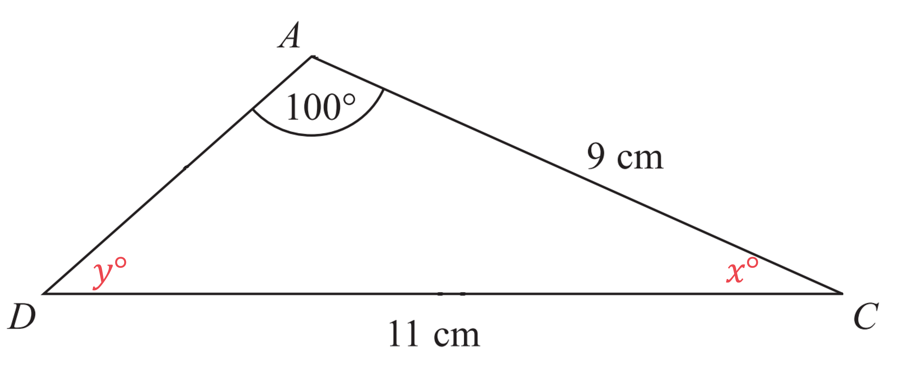

> *You know the length of one side and the angle opposite it. You also know the length of another side so you can use the sine rule to find the angle opposite it.*

> *The formula for the sine rule is *$\frac{\mathrm{sin}A}{a}=\frac{\mathrm{sin}B}{b}$*, where **a** and **b** are the lengths of the two sides that are opposite the angles **A **and **B **respectively. *

> *Substitute **a** = **9**, **b** = 11, **A** = **y** and **B** = 100 into the formula.*

`fraction numerator sin open parentheses y close parentheses over denominator 9 end fraction equals fraction numerator sin open parentheses 100 close parentheses over denominator 11 end fraction`

**[1]**

> *Multiply both sides by 9 and then find the angle by using the inverse sin function.*

`table row cell sin open parentheses y close parentheses end cell equals cell fraction numerator sin open parentheses 100 close parentheses over denominator 11 end fraction cross times 9 end cell row y equals cell sin to the power of negative 1 end exponent open parentheses fraction numerator sin open parentheses 100 close parentheses over denominator 11 end fraction cross times 9 close parentheses end cell end table`

**[1]**

> *Type into your calculator.*

`table row y equals cell 53.682923... end cell end table`

> *You can find the third angle by spotting that the three interior angles of the triangle should add up to 180°. Use the answer button on your calculator.*

`table row x equals cell 180 minus 100 minus 53.682923... end cell row blank equals cell 26.317076... end cell end table`

**[1]**

> *You now have enough information to find the area of one of the triangles.*

> *The formula for the area of a triangle is *$\mathrm{Area}=\frac{1}{2}ab\mathrm{sin}C$*, where **a** and **b** are the lengths of the two sides that form angle **C**. Substitute **a** = 9, **b** = 11 and **C** = 26.317076... (using the answer button) into the formula.*

`table row Area equals cell 1 half cross times 9 cross times 11 cross times sin open parentheses 26.317076... close parentheses end cell row blank equals cell 21.945249... end cell end table`

**[1]**

> *Multiply by 2 to find the area of the parallelogram.*

`table row cell 2 cross times 21.945249... end cell equals cell 43.890498... end cell end table`

> *Round to 3 significant figures. Remember to include square units for the area.*

$\mathrm{Area}=43.9\mathrm{cm}^{2}(3\mathrm{sf})$** [1]**

### Q29
> *First look at triangle **ABD**.*

> *You know the length of one side and the angle opposite it. You also know another angle so you can find the length of the side opposite that using the sine rule.*

> *The formula for the sine rule is *$\frac{a}{\mathrm{sin}A}=\frac{b}{\mathrm{sin}B}$*, where **a** and **b** are the lengths of the two sides that are opposite the angles **A **and **B **respectively.*

> * Substitute **a** = **y**, **b** = 7.4, **A** = 45 and **B** = 80 into the formula.*

`fraction numerator y over denominator sin open parentheses 45 close parentheses end fraction equals fraction numerator 7.4 over denominator sin open parentheses 80 close parentheses end fraction`

**[1]**

> *Multiply both sides by sin(45) and type into your calculator.*

`table row y equals cell fraction numerator 7.4 over denominator sin open parentheses 80 close parentheses end fraction cross times sin open parentheses 45 close parentheses end cell row blank equals cell 5.313311... end cell end table`

**[1]**

> *Now look at triangle **BCD**. You know the angles **BDC** and **ADB** add up to 180° so you can find the missing angle.*

> *You know the lengths of two sides and the angle between them and you want to find the length of the third side. Therefore you need to use the cosine rule.*

> *The formula for the cosine rule is *$a^{2}=b^{2}+c^{2}-2bc\mathrm{cos}A$*, where **b** and **c** are the lengths of the two sides that form angle **A** and **a** is the length of the side opposite **A**. *

> *Substitute **a** = **x**, **b** = 5.8, **c** = 5.313311... (using the answer button) and **A** = 100 into the formula.*

`x squared equals 5.8 squared plus 5.313311... squared minus 2 open parentheses 5.8 close parentheses open parentheses 5.313311... close parentheses cos open parentheses 100 close parentheses`

**[1]**

> *Type the expression into your calculator altogether as one line. If you do it separately you need to remember the order of operations (multiplication before addition).*

$x^{2}=72.573980...$

**[1]**

> *Take the positive square root of both sides.*

`table attributes columnalign right center left columnspacing 0px end attributes row x equals cell square root of 72.573980... end root end cell row blank equals cell 8.519036... end cell end table`

> *Round to 3 significant figures. Remember to include units for the length.*

$BC=8.52\mathrm{cm}(3\mathrm{sf})$* ***[1]**

### Q30
> *i) Substitute the values from the diagram into the cosine rule, *$a^{2}=b^{2}+c^{2}-2bc\mathrm{cos}A$*, where *$a$* is the unknown side, *$b$* and *$c$* are the known sides and *$A$* is the included angle.*

`a squared equals 8 squared plus 13 squared minus 2 cross times 8 cross times 13 cross times cos space open parentheses 79 close parentheses`

*Correct formula*** [1] **

*Correct substitution into formula*** [1]**

$a^{2}=193.31172...$

**[1]**

> *Square root both sides.*

$a=13.90365...$

**BC = ****13.9 m ****[1]**

**Answers of 13.9... will be accepted.**

> *ii) To find a missing angle substitute the known sides and angles into the sine rule. Use the sine rule with the angles on the numerators, *$\frac{\mathrm{sin}A}{a}=\frac{\mathrm{sin}B}{b}=\frac{\mathrm{sin}C}{c}$*. Use the length of **BC** from part i).*

`fraction numerator sin space open parentheses A C B close parentheses over denominator 13 end fraction equals fraction numerator sin space open parentheses 79 close parentheses over denominator 13.90365... end fraction`

**[1]**

> *Multiply both sides by 13.*

`sin space open parentheses A C B close parentheses equals 13 cross times fraction numerator sin space open parentheses 79 close parentheses over denominator 13.90365... end fraction`

**[1]**

`sin space open parentheses A C B close parentheses equals 0.91782...`

> *Take sin**-1** of both sides.*

$ACB=66.61044...$

**Final answer:** **Angle ****ACB**** = 66.6****o**** ****[1]**

**Answers between 66.60 and 66.65 will be accepted.**

### Q31
> *Use triangle *$BCX$* to find angle *$BXC$*. *

> *All three sides are known and one angle is needed so the cosine rule should be used.*

> *Substitute the values of  *$BX=5,BC=8\mathrm{and}CX=7$* into the cosine rule.  *

> *Cosine Rule:  *$c^{2}=a^{2}+b^{2}-2ab\mathrm{cos}C$*.*

`B C to the power of 2 space end exponent equals space B X to the power of 2 space end exponent plus space C X to the power of 2 space end exponent minus space 2 open parentheses B X close parentheses open parentheses C X close parentheses space cos space B X C
8 to the power of 2 space end exponent equals space 5 squared space plus space 7 to the power of 2 space end exponent minus space 2 open parentheses 5 close parentheses open parentheses 7 close parentheses space cos space B X C`

**Correct use of equation**** [1]**

> *Rearrange the equation to make *$\mathrm{cos}BXC$* the subject.*

`table row cell 8 to the power of 2 space end exponent end cell equals cell space 5 squared space plus space 7 to the power of 2 space end exponent minus space 70 space cos space B X C end cell row cell 70 cos space B X C space end cell equals cell space space 5 to the power of 2 space end exponent plus space 7 to the power of 2 space end exponent minus space 8 squared end cell row cell cos space B X C space end cell equals cell space fraction numerator space 5 to the power of 2 space end exponent plus space 7 to the power of 2 space end exponent minus space 8 squared over denominator 70 end fraction end cell end table`

**Equation rearranged**** ****[1]  **

> *Use your calculator to find the value of *$cosBXC$*.*

$\mathrm{cos}BXC^{}=\frac{10}{70}=\frac{1}{7}$

**[1]**

> *Use the cos**-1** button on your calculator to find the value of *$BXC$*.    *

`table row cell B X C to the power of space end cell equals cell cos to the power of negative 1 end exponent open parentheses 1 over 7 close parentheses end cell row blank equals cell space 81.7867... end cell end table`

$BXC=81.8^{\circ}(1d.p.)$* ***[1]**

### Q32
i) *The sine rule is *$\frac{a}{\mathrm{sin}A}=\frac{b}{\mathrm{sin}B}=\frac{c}{\mathrm{sin}C}$* where*

*Write angle** BCD** as *$x$* on the diagram* * *

*The sine rule can be used on triangle **BCD* *Substitute *$a=21.3$*, *$A=123.5$*, *$b=11.6$* and *$B=x$* into the sine rule* * *

$\frac{21.3}{\mathrm{sin}123.5}=\frac{11.6}{\mathrm{sin}x}$

**[1]**

*Make *$\mathrm{sin}x$* the subject (by multiplying both sides by the denominators then dividing by 21.3)* * *

`table row cell 21.3 space sin space x end cell equals cell 11.6 space sin space 123.5 end cell row cell sin space x end cell equals cell fraction numerator 11.6 space sin space 123.5 over denominator 21.3 end fraction end cell end table`

**[1]*** *

*Find *$x$* (by taking inverse sine of both sides)* * *

`x equals sin to the power of negative 1 end exponent open parentheses table row blank blank cell fraction numerator 11.6 space sin space 123.5 over denominator 21.3 end fraction end cell end table close parentheses` * *

> *Use a calculator find angle *$x$*, giving your answer to 1 decimal place*

$x=27.0^{\circ}$ **[1]**

ii) *The cosine rule is *$a^{2}=b^{2}+c^{2}-2bc\mathrm{cos}A$* where *

*The cosine rule can be used to find **AD**, if angle **ABD** is known* *First, find angle **CBD** (using angles in a triangle add to 180°)* * *

*angle ***CBD*** = 180° - 123.5° - 27.0° = 29.5°* * *

*Then find angle **ABD** (using that **CBA** is a right-angle)* * *

*angle ***ABD*** = 90° - angle ***CBD*** = 90° - 29.5° = 60.5°*

**[1]**

*Draw these angles on the diagram if it helps* * *

*Use the cosine rule with *$a=AD$*, *$b=11.6$*, *$c=18$* and *$A=60.5^{\circ}$ * *

$AD^{2}=11.6^{2}+18^{2}-2\times11.6\times18\times\mathrm{cos}60.5$

**[2] **

*Use a calculator to find *$AD^{2}$ * *

$AD^{2}=252.92...$

**[1]**

> *Square root the answer to find *$AD$

$AD=15.9$** ****cm ****[1]**

**Answers in the range 15.90 to 15.91 are accepted**

### Q33
> *The area of a triangle is *$\frac{1}{2}ab\mathrm{sin}C$

> *Triangle **ABC** is equilateral so **AC** = **AB** = 10 cm and angle **CAB **is 60° *

*Find the area of triangle **ABC** (by substituting *$a=10$*, *$b=10$* and *$C=60$* into the formula)* * *

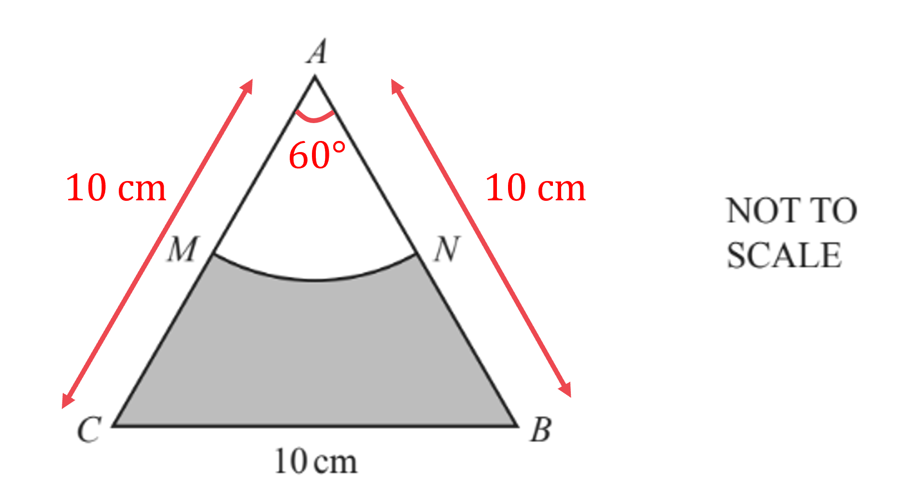

$\frac{1}{2}\times10\times10\times\mathrm{sin}60\,=50\mathrm{sin}60$

**[1]**

`sin open parentheses 60 close parentheses equals fraction numerator square root of 3 over denominator 2 end fraction`

$=50\times\frac{\sqrt{3}}{2}\,=25\sqrt{3}$

**[1]**

> *M** is the mid-point of **AC** (length **AM** is half of **AC**) *

*Draw **AM** = 5 cm and angle **CAB** = 60° on to the diagram* * *

*The area of a sector with angle *$k$*° is *$\frac{k}{360}\timesπr^{2}$

*Find the area of sector **AMN** (by substituting *$k=60$* and *$r=5$* into the formula)* * *

$\frac{60}{360}\timesπ\times5^{2}\,=\frac{1}{6}\timesπ\times25\,=\frac{25}{6}π$

**[1]**

> *Find the grey area by subtracting the sector area from the triangle are*

$(25\sqrt{3}-\frac{25}{6}π)$** cm****2** **[1]**

**There are longer methods involving Pythagoras' Theorem**

### Q34
> *The lines on the sides **PQ** and **RQ** mean that they are equal so they are both 8 cm.*

> *You know the lengths of two sides and the angle between them and you want to find the length of the third side. Therefore you need to use the cosine rule.*

> *The formula for the cosine rule is *$a^{2}=b^{2}+c^{2}-2bc\mathrm{cos}A$*, where **b** and **c** are the lengths of the two sides that form angle **A** and **a** is the length of the side opposite **A**. Substitute **a** = **PR**, **b** = 8, **c** = 8 and **A** = 140 into the formula.*

`P R squared equals 8 squared plus 8 squared minus 2 open parentheses 8 close parentheses open parentheses 8 close parentheses cos open parentheses 140 close parentheses`

**[1]**

> *Type the expression into your calculator altogether as one line. If you do it separately you need to remember the order of operations (multiplication before addition).*

$PR^{2}=226.053688...$

**[1]**

> *Take the positive square root of both sides. Use the answer button or your calculator's memory function.*

`table attributes columnalign right center left columnspacing 0px end attributes row cell P R end cell equals cell square root of 226.053688... end root end cell row blank equals cell 15.035081... end cell end table`

> *Round to 3 significant figures. Remember to include units for the length.*

$PR=15.0\mathrm{cm}(3\mathrm{sf})$* ***[1] **

**This can also be done using the right angled trigonometry**

### Q35
> *Use the formula for the area of a triangle, *$A=\frac{1}{2}ab\mathrm{sin}C$*.*

`A equals 1 half cross times 11 cross times 13 cross times sin open parentheses 39 close parentheses`

**[1]**

$A=44.996407...$

$45.0$** ****cm****2**** ****[1]**

**Answers between 44.99 and 45.00 are accepted.**

### Q36
> *You only need to use triangle **PRS**. You might find it easier to label the angles **A**, **B**, **C** and the sides opposite these **a**, **b**, **c**.*

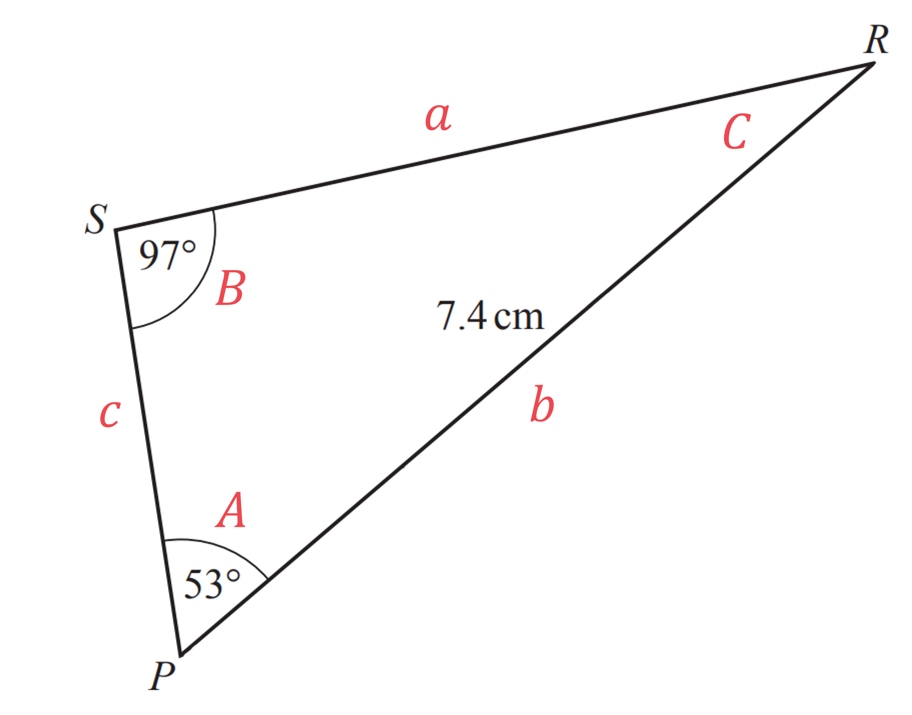

> *You are given a side (**b **= **PR** = 7.4) and the angle opposite (**B **= **PSR **= 97°). *

*As you are given a side and the angle opposite you can use the sine rule.*

> *You are also given the angle (**A **= **RPS** = 53°) so you can find the opposite side (**a **= **SR** = *$x$*).*

> *Sine rule: *$\frac{a}{\mathrm{sin}A}=\frac{b}{\mathrm{sin}B}$*.*

> *Substitute the values into the formula.*

$\frac{x}{\mathrm{sin}(53)}=\frac{7.4}{\mathrm{sin}(97)}$

**[1]**

> *Solve for *$x$* by multiplying both sides by sin53.*

`table row x equals cell fraction numerator 7.4 over denominator sin left parenthesis 97 right parenthesis end fraction cross times sin left parenthesis 53 right parenthesis end cell row x equals cell 5.95428... end cell end table`

**[1]**

> *Round to 3 significant figures.*

**SR ****= 5.95 cm** **[1]**
> *You only need to use triangle **PQR**. You might find it easier to label the angles **A**, **B**, **C** and the sides opposite these **a**, **b**, **c**.*

> *You are given two sides (**b **= **PR** = 7.4 and **c** = **PQ** = 8.5) and the angle between them (**A **= **QPR **= 26°). *

*As you are given a pair of sides and the angle between you can use the cosine rule.* *You can find the side opposite the angle (**a **= **QR** = *$y$*).*

> *Cosine rule: *$a^{2}=b^{2}+c^{2}-2bc\mathrm{cos}A$*.*

> *Substitute the values into the formula.*

$y^{2}=7.4^{2}+8.5^{2}-2(7.4)(8.5)\mathrm{cos}(26)$

**[1]**

> *Simplify the expression, type it in the calculator as one long expression. If you evaluate the expression bit by bit then remember to apply the order of operations (multiplication before subtraction).*

$y^{2}=13.9417...$

**[1]**

> *Solve for *$y$* by square rooting both sides. Use the answer button or type the exact expression in your calculator.*

`table attributes columnalign right center left columnspacing 0px end attributes row y equals cell square root of 7.4 squared plus 8.5 squared minus 2 left parenthesis 7.4 right parenthesis left parenthesis 8.5 right parenthesis cos left parenthesis 26 right parenthesis end root equals square root of 13.9417... end root end cell row y equals cell 3.73385... end cell end table`

**[1]**

> *Round to 3 significant figures.*

**RQ ****= 3.73 cm** **[1]**

### Q37
> *The formula for the area of a triangle is *$\mathrm{Area}=\frac{1}{2}ab\mathrm{sin}C$*, where **a** and **b** are the lengths of the two sides that form angle **C**. Substitute Area = *$6\sqrt{2}$*, **a** = *`open parentheses x plus 3 close parentheses`*, **b** = *`open parentheses 2 x minus 1 close parentheses`* and **C** = 45 into the formula.*

`table row cell 6 square root of 2 end cell equals cell 1 half cross times open parentheses x plus 3 close parentheses cross times open parentheses 2 x minus 1 close parentheses cross times sin open parentheses 45 close parentheses end cell end table`

*Correct expression on the right hand side*** [1] **

*Forming a correct equation ***[1]**

> *Use the fact that *`sin open parentheses 45 close parentheses equals fraction numerator square root of 2 over denominator 2 end fraction`*.*

`table row cell 6 square root of 2 end cell equals cell 1 half cross times open parentheses x plus 3 close parentheses cross times open parentheses 2 x minus 1 close parentheses cross times fraction numerator square root of 2 over denominator 2 end fraction end cell end table`

> *Divide both sides by √2 and multiply both sides by 4 to get rid of the surds and denominators.*

`table row 24 equals cell open parentheses x plus 3 close parentheses open parentheses 2 x minus 1 close parentheses end cell end table`

> *Expand the brackets then simplify.*

$2x^{2}-x+6x-3=24\,2x^{2}+5x-3=24$

**[1]**

> *Subtract 24 from both sides to make the quadratic equal 0.*

$2x^{2}+5x-27=0$

> *As the question asks for 3 significant figures, this suggests that the quadratic does not factorise. Solve by using the quadratic formula, *$x=\frac{-b\pm\sqrt{b^{2}-4ac}}{2a}$*. *

> *Substitute **a** = 2, **b** = 5 and **c =** -27 into the formula.*

`table row x equals cell fraction numerator negative 5 plus-or-minus square root of 5 squared minus 4 open parentheses 2 close parentheses open parentheses negative 27 close parentheses end root over denominator 2 open parentheses 2 close parentheses end fraction end cell end table`

**[1]**

> *Simplify using your calculator.*

`table row x equals cell fraction numerator negative 5 plus square root of 241 over denominator 4 end fraction equals 2.631043... end cell row blank blank or row x equals cell fraction numerator negative 5 minus square root of 241 over denominator 4 end fraction equals negative 5.131043... end cell end table`

> *As **x** + 3 is a length then it can not be negative, so **x** > -3. Therefore reject **x** = -5.131043... *

> *Round the other solution to 3 significant figures.*

$x=2.63(3sf)$* ***[1]**

### Q38
> *The required angle *$BAE$* is marked on the diagram below.*

> *Triangle *$ACD$* is equilateral so all angles are 60°.*

*Angle* $DAC=60^{\circ}$

**[1]**

> *We can find angle *$DAE$* using right-angle trigonometry, SOHCAHTOA. We have the hypotenuse and the opposite sides so use sine.*

`table row cell sin open parentheses angle D A E close parentheses end cell equals cell 6 over 12 end cell end table`

**[1]**

`table row cell angle D A E end cell equals cell sin to the power of negative 1 end exponent open parentheses 6 over 12 close parentheses equals 30 degree end cell end table`

> *We can find angle *$BAC$* using right-angle trigonometry, SOHCAHTOA. We have the adjacent and the opposite sides so use tangent.*

`table row cell tan open parentheses angle B A C close parentheses end cell equals cell 6 over 12 end cell end table`

**[1]**

`table row cell angle D A C end cell equals cell tan to the power of negative 1 end exponent open parentheses 6 over 12 close parentheses equals 26.56505118... degree end cell end table`

> *Now add the three found angles to get angle *$BAE$*. *

`table row cell angle B A E end cell equals cell 60 plus 30 plus 26.56505118... equals 116.56505118... end cell end table`

**Angle **$BAE=116.6^{\circ}$ **[1]**

**Give answers in degrees to at least one decimal place**
i) *Triangle *$ABC$* is right-angled so we can find *$AB$* using Pythagoras' theorem, *$h^{2}=a^{2}+b^{2}$* where we have two shorter sides, *$a$* and *$b$*.*

`table attributes columnalign right center left columnspacing 0px end attributes row cell open parentheses A B close parentheses squared end cell equals cell 6 squared plus 12 squared end cell end table`

**[1]**

`table attributes columnalign right center left columnspacing 0px end attributes row cell A B end cell equals cell square root of 6 squared plus 12 squared end root end cell row blank equals cell square root of 180 end cell row blank equals cell 13.41640786... end cell end table`

> *Give your final answer to at least 3 significant figures.*

$AB=13.4$** ****cm** **[1]**

ii) *Triangle *$AED$* is right-angled so we can find *$AE$* using Pythagoras' theorem, *$h^{2}=a^{2}+b^{2}$* where we have the hypotenuse, *$h$* and a shorter side, *$a$*.*

`table row cell 12 squared end cell equals cell 6 squared plus open parentheses A E close parentheses squared end cell end table`

**[1]**

`table attributes columnalign right center left columnspacing 0px end attributes row cell b squared end cell equals cell 12 squared minus 6 squared end cell row blank equals cell square root of 12 squared minus 6 squared end root end cell end table`

**[1]**

> *Evaluate and give your final answer to at least 3 significant figures.*

`table attributes columnalign right center left columnspacing 0px end attributes row blank equals cell 10.39230485... end cell end table`

$AE=10.4$** ****cm** **[1]**
> *We need to treat the pentagon as 3 separate triangles, *$ADE$*, *$ACD$* and *$ABC$*. All the lengths and angles needed are marked on the diagram below.*

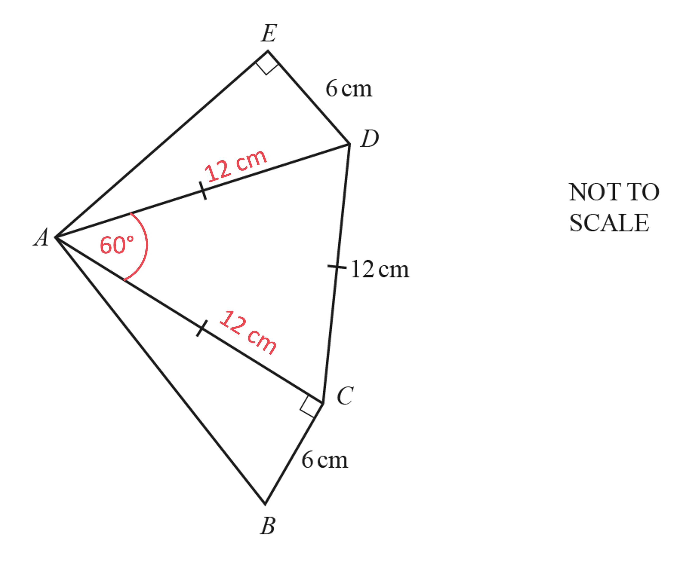

> *Triangle *$ACD$* is not right-angled so use area *$=\frac{1}{2}ab\mathrm{sin}C$* where *$a$* and *$b$* are adjacent sides and *$C$* is the included angle*

*Area* $ACD=\frac{1}{2}\times12\times12\times\mathrm{sin}60$

**[1]**

$=62.35382907...$** ***cm**2*

> *Triangle *$ADE$* is right-angled so we can use area*$=\frac{1}{2}\times\mathrm{base}\times\mathrm{height}$*. The base is *$AD$*, which we know from part (iii) is 10.4 cm, and the height is *$ED$*= 6 cm.*

`table row cell A D E end cell equals cell 1 half cross times 10.4 cross times 6 end cell end table`

**[1]**

`table attributes columnalign right center left columnspacing 0px end attributes row blank equals cell 31.2 end cell end table` *cm**2*

> *Triangle *$ABC$* is right-angled so we can use area*$=\frac{1}{2}\times\mathrm{base}\times\mathrm{height}$*. The base is *$AC$* = 12 cm and the height is *$BC$* = 6 cm.*

`table row cell A B C end cell equals cell 1 half cross times 12 cross times 6 end cell end table`

**[1]**

`table row blank equals 36 end table` *cm**2*

> *Now add the three found angles to get the final answer. *

`table row cell angle B A E end cell equals cell 62.35382907... plus 31.2 plus 36 equals 129.55382907... end cell end table` *cm**2*

**Answer = 130 cm****2**** ****or 129.5... to 129.6 cm****2** **[1]**

**Final answer depends on the level of rounding during working but must be either 130, or within the range **$129.5<\mathrm{area}\leq129.6$

### Q39
i) *To find length *$AB$* we can consider triangle *$ABD$* and use the cosine rule:* $a^{2}=b^{2}+c^{2}-2bc\mathrm{cos}A$

> *In this formula, the lower-case sides, *$a,b,c$* must be opposite their respective angles, which are capital letters (in this case only *$A$*)*

*We will re-label the triangle (in red) to reflect this*

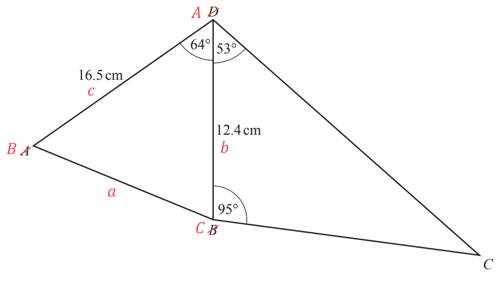

> *Using the cosine rule*

`a squared equals 12.4 squared plus 16.5 squared minus open parentheses 2 cross times 12.4 cross times 16.5 cross times cos open parentheses 64 close parentheses close parentheses`

**[2]**

> *Evaluating the right hand side using calculator*

$a^{2}=246.6285267...$

**[1]**

> *Square-rooting (make sure you use the unrounded value)*

$a=\sqrt{246.6285267...}=15.70441106...$

$AB=15.7\mathrm{cm}$ **[1]**

**Rounded to 3 significant figures**

ii) *Considering triangle *$BDC$* (using the original labels), we can find angle *$C$* using the fact that the sum of the interior angles in a triangle is 180°*

$180-95-53=32$

**[1]**

> *We can now use the sine rule, *$\frac{a}{\mathrm{sin}A}=\frac{b}{\mathrm{sin}B}=\frac{c}{\mathrm{sin}C}$* where the sides *$a,b,c$* must be opposite their respective angles, which are capital letters*

> *Applying the sine rule to *$BDC$* (we are trying to find *$BC$*, labelled as *$d$*)*

`fraction numerator d over denominator sin open parentheses 53 close parentheses end fraction equals fraction numerator 12.4 over denominator sin open parentheses 32 close parentheses end fraction`

> *Multiply both sides by *`sin open parentheses 53 close parentheses`

`d equals fraction numerator 12.4 over denominator sin open parentheses 32 close parentheses end fraction cross times sin open parentheses 53 close parentheses`

**[2]**

$d=18.68790398...$

$BC=18.7\mathrm{cm}$ **[1]**

**Rounded to 3 significant figures**

### Q40
> *We have two sides, the angle between them and are asked to show the length of the third side.*

*This is cosine rule, *$"a^{2}=b^{2}+c^{2}-2bc\mathrm{cos}A"$

> *It may help to label the diagram.*

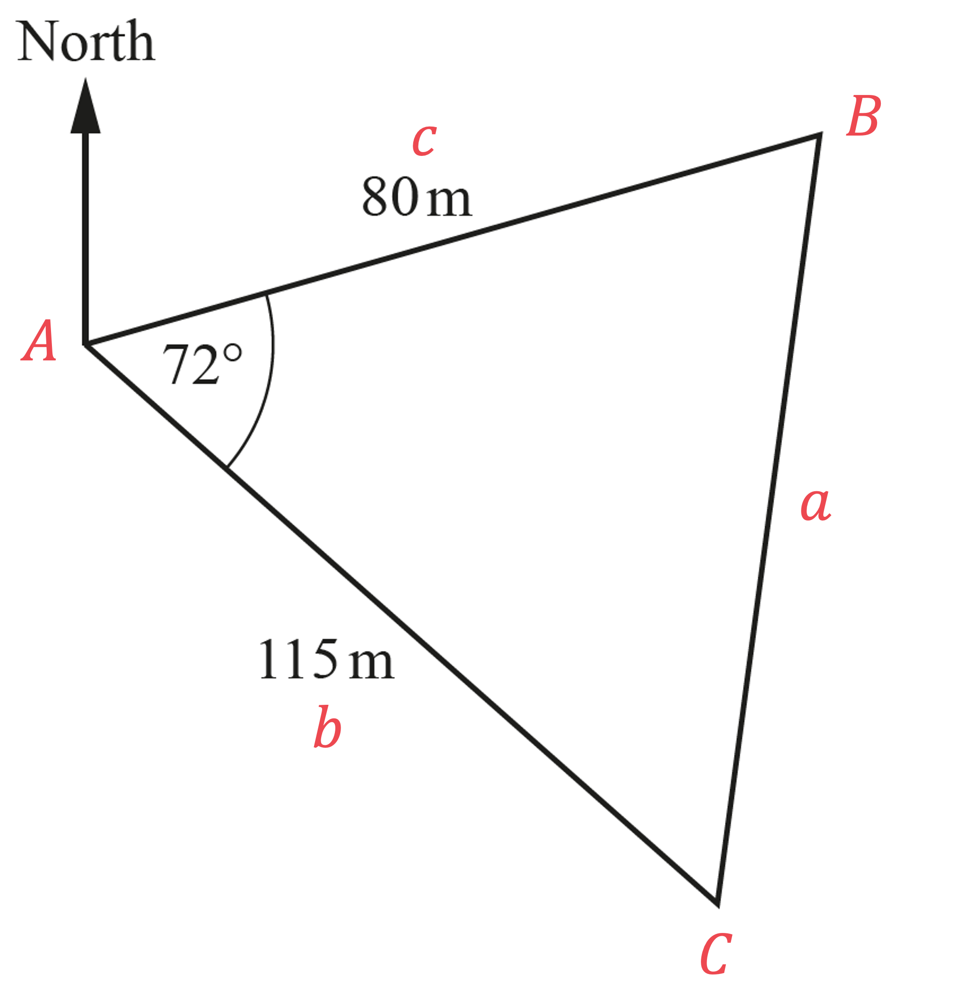

`open parentheses B C close parentheses squared equals 115 squared plus 80 squared minus 2 cross times 115 cross times 80 cross times cos space 72 degree`

**[1]**

> *Avoid rounding before your final answer - store the exact value in your calculator's memory.*

`open parentheses B C close parentheses squared equals 13 space 939.087 space...` 
$BC=118.063911...$

> *Final answer is to be shown to **one decimal place.*

$BC=118.1$** cm (1 d.p.)** **[1]**
> *We now know side **BC**.*

> *For angle **ABC**, we know it's opposite side and a another side-angle pair. *

*This is sine rule, * $"\frac{sinA}{a}=\frac{sinB}{b}"$*.*

$\frac{\mathrm{sin}72^{\circ}}{118.063...}=\frac{\mathrm{sin}ABC}{115}$

**[1]**

> *Do not work out or round any values until your final answer. Use the exact answer for side **BC** stored in your calculator from part a. Rearrange the equation.*

$\mathrm{sin}ABC=\frac{115\mathrm{sin}72^{\circ}}{118.063...}$

**[1]**

> *Use inverse sine (sin**-1**) to find angle **ABC**.*

`table row cell A B C end cell equals cell sin to the power of negative 1 end exponent open parentheses fraction numerator 115 sin space 72 degree over denominator 118.063 space... end fraction close parentheses end cell row cell A B C end cell equals cell 67.876 space 670 space... end cell end table`

**Angle ****ABC**** = 67.9° (1 d.p.)*** ***[1]**

### Q41
> *You have two pairs of opposite sides and angles, because you know three of the pieces of information and you want to find the missing angle, you can use the sine rule with the angles on top.*

> *Substitute your values, *$a=12,A=x^{\circ},b=8$* and *$B=39^{\circ}$* into the sine rule, *$\frac{\mathrm{sin}A}{a}=\frac{\mathrm{sin}B}{b}=\frac{\mathrm{sin}C}{c}$*.*

`table row cell fraction numerator sin open parentheses x close parentheses over denominator 12 end fraction end cell equals cell fraction numerator sin open parentheses 39 close parentheses over denominator 8 end fraction end cell end table`

**[1]**

> *Multiply both sides by 12.*

`table attributes columnalign right center left columnspacing 0px end attributes row cell sin left parenthesis x right parenthesis end cell equals cell fraction numerator 12 sin left parenthesis 39 right parenthesis over denominator 8 end fraction end cell end table`

**[1]**

> *Find *$x$* by taking the inverse sin of both sides (the *$\mathrm{sin}^{-1}$* button on your calculator).*

$x=70.731164...$

> *The angle you have found in the acute angle. *

> *Because the original information you are given for the triangle is SSA, there are two possible triangles that it could be and therefore two possible values that the missing angle could be. To find the obtuse angle, subtract the result from 180.*

$180-70.731164=109.268835...$

$109.3^{\circ}$* ***[1]**

**It's best to round angles to 1 d.p. but answers between 109.26 and 109.27 will be accepted.**

### Q42
> *"SSS" so use the cosine rule, *$\mathrm{cos}A=\frac{b^{2}+c^{2}-a^{2}}{2bc}$

> *Remember that in the numerator, the side you subtract is the one opposite the angle you want to find*

$\mathrm{cos}(LMN)=\frac{19^{2}+16^{2}-14^{2}}{2\times19\times16}$

**[2]**

$=\frac{421}{608}\mathrm{or}0.6924...$

**[1]**

> *Now inverse cosine ("SHIFT cos" or "cos**-1**" on your calculator) to get the final answer*

**46.2°*** ***[1]**

**Remember to give answers in degrees to at least 1 decimal place**

### Q43
> $x$* is opposite a given side and another side with its opposite angle is known so the sine rule can be used.*

> *Sine Rule:  *$\frac{a}{\mathrm{sin}A}=\frac{b}{\mathrm{sin}B}=\frac{c}{\mathrm{sin}C}$*.*

$\frac{8}{\mathrm{sin}x^{\circ}}=\frac{9}{\mathrm{sin}100^{\circ}}$

**[1]**

> *Rearrange the equation to find the value of *$\mathrm{sin}x$*.*

`table row cell space 8 space sin space 100 space end cell equals cell space 9 space s in space x end cell row cell sin space x space end cell equals cell space fraction numerator space 8 space sin space 100 over denominator 9 end fraction end cell end table`

** ****[1]**

> *Use the *$\mathrm{sin}^{-1}$* button on your calculator to find the value of *$x$*.*

`table row cell space x space end cell equals cell sin to the power of negative 1 end exponent space open parentheses fraction numerator space 8 space sin space 100 over denominator 9 end fraction close parentheses end cell row blank equals cell space 61.0905... end cell end table`

$x=61.1^{\circ}(1d.p.)$* ***[1]**
> *The formula for the area of a triangle (if the vertical height is not known) is *$\frac{1}{2}ab\mathrm{sin}C$*.*

> *The angle needs to be between the two known sides, so find the third angle in the triangle by subtracting the two known angles from 180°.*

`180 space minus space open parentheses 100 space plus space 61.0905... close parentheses space equals space 18.9 degree`

**[1]**

> *Substitute the angle found and the two given sides into the formula for the area of a triangle. *

`1 half space open parentheses 8 close parentheses open parentheses 9 close parentheses sin space 18.9 space equals space 11.66665...`

**[1]**

**Area = 11.7 cm****2**** [1]**

### Q44
> *First use the area to form an equation.*

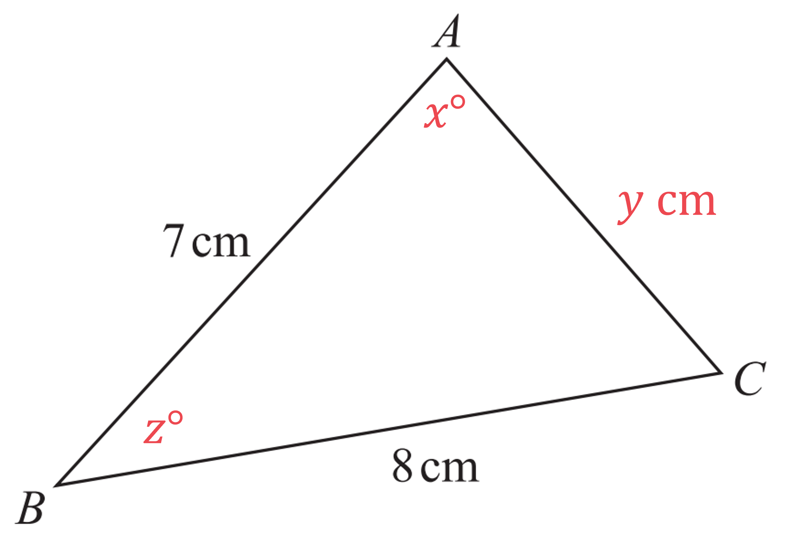

> *The formula for the area of a triangle is *$\mathrm{Area}=\frac{1}{2}ab\mathrm{sin}C$*, where **a** and **b** are the lengths of the two sides that form angle **C**. *

> *Substitute Area = 18, **a** = 8, **b** = 7 and **C** = **z** into the formula.*

`table row 18 equals cell 1 half cross times 8 cross times 7 cross times sin open parentheses z close parentheses end cell end table`

**[1]**

> *Simplify the equation. Then rearrange to find the value of **z**.*

`table row cell 28 sin open parentheses z close parentheses end cell equals 18 row cell sin open parentheses z close parentheses end cell equals cell 18 over 28 end cell row z equals cell sin to the power of negative 1 end exponent open parentheses 18 over 28 close parentheses end cell row z equals cell 40.005200... end cell end table`

**[1]**

> *You now know the lengths of two sides and the angle between them so you can find the length of the third side using the cosine rule.*

> *The formula for the cosine rule is *$a^{2}=b^{2}+c^{2}-2bc\mathrm{cos}A$*, where **b** and **c** are the lengths of the two sides that form angle **A** and **a** is the length of the side opposite **A**.*

> * Substitute **a** = **y**, **b** = 8, **c** = 8 and **A** = 40.005200... (using the answer button) into the formula.*

`y squared equals 8 squared plus 7 squared minus 2 open parentheses 8 close parentheses open parentheses 8 close parentheses cos open parentheses 40.005200... close parentheses`

**[1]**

> *Type the expression into your calculator altogether as one line. If you do it separately you need to remember the order of operations (multiplication before addition).*

$y^{2}=27.209557...$

**[1]**

> *Take the positive square root of both sides.*

`table row y equals cell square root of 27.209557... end root end cell row blank equals cell 5.216278... end cell end table`

> *Now you can find the size of angle **BAC** using the formula for the triangle but this time using the sides **AB** and **AC**.*

> *Substitute Area = 18, **a** = 7, **b** = 5.216278... (using the answer button)  and **C** = **x** into the formula.*

`table attributes columnalign right center left columnspacing 0px end attributes row 18 equals cell 1 half cross times 7 cross times 5.216278... cross times sin open parentheses x close parentheses end cell end table`

**[1]**

> *Rearrange to find the value of **x**.*

`table row cell sin open parentheses x close parentheses end cell equals cell fraction numerator 18 cross times 2 over denominator 7 cross times 5.216278... end fraction end cell row x equals cell sin to the power of negative 1 end exponent open parentheses fraction numerator 18 cross times 2 over denominator 7 cross times 5.216278... end fraction close parentheses end cell row x equals cell 80.375501... end cell end table`

> *Round to 3 significant figures. Remember to include units for the angle.*

$\mathrm{Angle}BAC=80.4^{\circ}(3\mathrm{sf})$* ***[1]**

### Q45
> *The missing side *$DE$* can be found using Pythagoras, as triangle *$ADE$* is right-angled with *$DE$* as the hypotenuse*

$DE=\sqrt{50^{2}+120^{2}}=130m$

> *The missing side *$CD$* can also be found using Pythagoras, as triangle *$BCD$* is right-angled with *$BC$* as the hypotenuse*

$CD=\sqrt{170^{2}-150^{2}}=80m$

*Correct method for either DE or CD*** [1]**

*Correct value for DE** ***[1]**

*Correct value for CD*** [1]**

> *Find the perimeter (total distance around the outer edge)*

$100+50+130+80+170$

$530m$ **[1]**
> *Considering the triangle *$ABD$*, we have 3 known sides and 1 unknown angle, so we will use the cosine rule: *`a squared equals b squared plus c squared minus 2 b c cos open parentheses A close parentheses`

*The labels currently on the triangle in the question don't work for this formula, as we need the angle to be labelled *$A$*, so we will re-label the diagram as below* *Recall that angles use upper case letters, whilst the side directly opposite them is given the lower case label of the same letter*

> *Substitute the values of the sides and angle into the cosine rule formula*

`120 squared equals 150 squared plus 100 squared minus open parentheses 2 cross times 150 cross times 100 cross times cos space x close parentheses`

**[1]**

> *Rearrange to make *$cosx$* the subject*

`table row cell 120 squared minus 150 squared minus 100 squared end cell equals cell negative open parentheses 2 cross times 150 cross times 100 cross times cos space x close parentheses end cell row cell fraction numerator 120 squared minus 150 squared minus 100 squared over denominator 2 cross times 150 cross times 100 end fraction end cell equals cell negative open parentheses cos space x close parentheses end cell row cell negative fraction numerator 120 squared minus 150 squared minus 100 squared over denominator 2 cross times 150 cross times 100 end fraction end cell equals cell cos space x end cell end table`

**[1]**

*To find angle *$x$*, use the inverse cos function on your calculator (usually shift+cos)* *To maintain accuracy, type in the whole expression rather than a decimal*

`table row x equals cell cos to the power of negative 1 end exponent open parentheses negative fraction numerator 120 squared minus 150 squared minus 100 squared over denominator 2 cross times 150 cross times 100 end fraction close parentheses end cell row x equals cell 52.89099505... end cell end table`

*Correct fraction or decimal within the *`cos to the power of negative 1 end exponent open parentheses blank close parentheses`*; 0.603... or *$\frac{181}{300}$* ***[1]**

$\mathrm{Angle}ABD=52.9^{\circ}$ **[1]**

**Angles should be rounded to 1 decimal place**
i) *Redrawing the triangle *$CBD$

*This is a right-angled triangle and we want to find the angle (*$B$*), whilst we know the lengths of the hypotenuse (170 m) and the adjacent (150 m)* *So we will use the cosine ratio *$\mathrm{cos}θ=\frac{\mathrm{adjacent}}{\mathrm{hypotenuse}}$* and substitute in the values, and then use the inverse cos function to find the angle*

$\mathrm{cos}B=\frac{150}{170}$

> *Use the inverse cos function on calculator (usually shift+cos)*

`B equals cos to the power of negative 1 end exponent open parentheses 150 over 170 close parentheses equals 28.07248694...`

*For using inverse cos correctly*** [1]**

$\mathrm{Angle}CBD=28.1^{\circ}$ **[1] **

> *Angles should be rounded to 1 decimal place*

ii) *Drawing the two lines *$BC$* and *$BD$* and using the angle found in part i*

*Bearings are measured clockwise, and from north. The bearing of *$D$* from *$B$* will be the angle shown by the dashed line* *Using the fact that there are 360° in a circle*

$360-28.1$

*360-(answer from i***)**** [1]**

$331.9^{\circ}$ **[1]**
> *Draw a diagram containing all of the information we have been told and worked out so far We can then work out the total area by summing the areas of the three individual triangles*

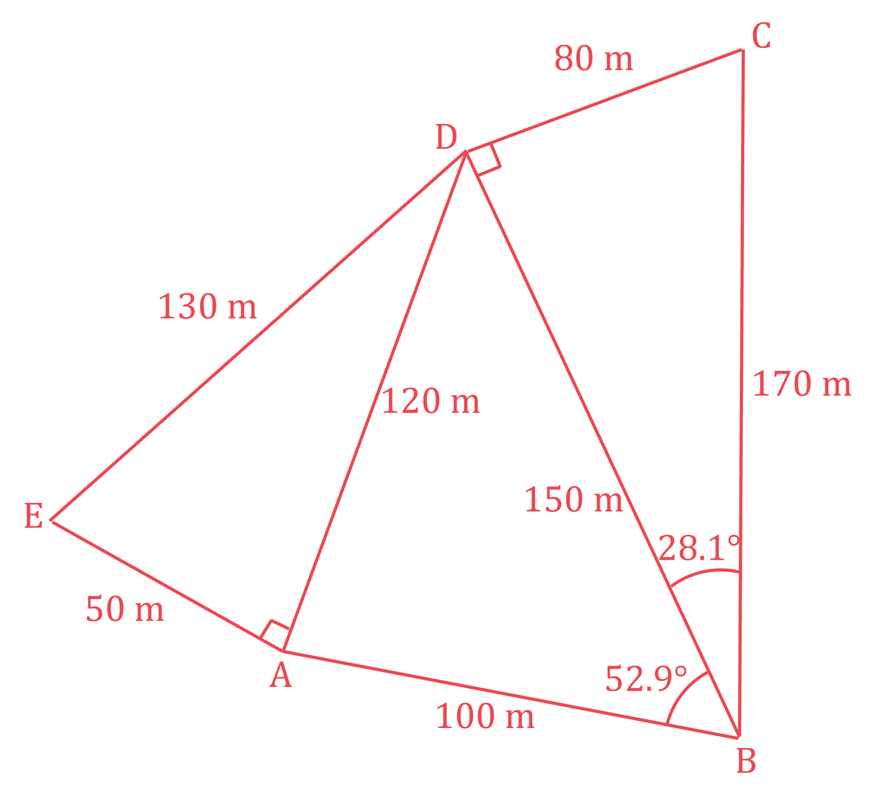

> *Triangles *$ADE$* and *$BCD$* are both right-angled, so their areas can be found using *`Area equals 1 half open parentheses base cross times height close parentheses`

`Area space A D E space equals space 1 half open parentheses 50 cross times 120 close parentheses equals 3000 space straight m squared`

**[1]**

`Area space B C D space equals space 1 half open parentheses 150 cross times 80 close parentheses equals 6000 space straight m squared`

**[1]**

> *Triangle *$ABD$* is not right-angled, so we can instead use the formula *`Area space equals space 1 half ab space sin open parentheses C close parentheses`* where sides *$a$* and *$b$* are either side of angle *$C$

`Area space A B D space equals space 1 half open parentheses 150 cross times 100 cross times sin open parentheses 52.9 close parentheses close parentheses space equals space 5981.879466... space straight m squared`

**[1]**

> *Find total area by summing the three areas*

$\mathrm{Total} \mathrm{Area}=3000+6000+5981.879466...=14981.87947m^{2}$

> *Convert to hectares, it is stated in the question that 1 hectare = 10 000m**2**, so divide by 10 000*

$14981.87947\div10000=1.498187947...$

$1.50$** ****hectares** **[1]**

**Round to 3 significant figures**

### Q46
*Substitute the given values from triangle **ABC **into the cosine rule,* $\mathrm{cos}A=\frac{b^{2}+c^{2}-a^{2}}{2bc}$*.*

`cos space open parentheses B A C close parentheses equals fraction numerator 158 squared plus 132 squared minus 107 squared over denominator 2 cross times 158 cross times 132 end fraction`

* Correct substitution in to the cosine rule ***[1] **

*Correct version of the cosine rule used*** [1]**

`cos space open parentheses B A C close parentheses equals 0.74172...`

**[1]**

> *Take cos**-1** of both sides.*

$BAC=42.12109...$

**Angle ****BAC**** = 42.1****o**** [1]**

**Answers of 42.12... will also be accepted.**
*Substitute the given values from triangle **CAD** into the sine rule.* *Make sure you use the version of the sine rule with the angles in the numerators, *$\frac{\mathrm{sin}A}{a}=\frac{\mathrm{sin}B}{b}=\frac{\mathrm{sin}C}{c}$*.*

`fraction numerator sin space open parentheses C A D close parentheses over denominator 86 end fraction equals fraction numerator sin space 116 over denominator 132 end fraction`

**[1]**

> *Multiply both sides by 86.*

`sin space open parentheses C A D close parentheses equals fraction numerator sin space 116 over denominator 132 end fraction cross times 86`

**[1]**

`sin space open parentheses C A D close parentheses equals 0.58557...`

> *Take sin**-1** of both sides.*

$CAD=35.84382...$

**Angle ****CAD**** = 35.8****o**** ****[1]**

**Answers of 35.84... will also be accepted.**
> *Calculate the area of the triangle **ABC** using the area of a triangle formula, *$A=\frac{1}{2}ab\mathrm{sin}C$*. *

> *Substitute the values from the diagram and from part b).*

`A equals 1 half cross times 158 cross times 132 cross times sin open parentheses 42.12109... close parentheses
A equals 6994.05650...`

**[1]**

> *Work out angle **ACD** by subtracting angle **ADC**  and angle **CAD **(from part c)) from 180**o**.*

$180-116-35.84382...=28.15617...$

> *Calculate the area of the triangle **ACD** using the area of a triangle formula. *

> *Substitute the values from the diagram and from part b).*

* *`A equals 1 half cross times 132 cross times 86 cross times sin open parentheses 28.15617... close parentheses
A equals 2678.37078...`

**[1]**

> *Add the areas of the two triangles together to find the total area of the field.*

$6994.05650...+2678.37078...=9672.42728...$

**9670**** m****2**** [1]**

**Answers between 9669 and 9676 will also be accepted.**

### Q47
a) *Labelling the diagram with the angles of elevation*

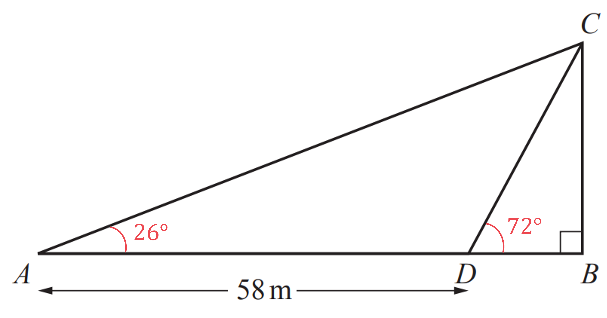

> *The sum of the angles on a straight line is 180°, and we can use this fact to find angle *$ADC$

$ADC=180-72=108$

**[1]**

> *The interior angles in a triangle sum to 180°, and this can be applied to triangle *$ACD$* to find angle *$ACD$

$ACD=180-26-108=46$

**[1]**

> *To find the length of *$AC$* we can use the sine rule; *$\frac{a}{\mathrm{sin}A}=\frac{b}{\mathrm{sin}B}=\frac{c}{\mathrm{sin}C}$* where the lower-case letters are the side lengths and the upper case letters are the angles opposite those sides*

> *Applying the sine rule to the triangle *$ACD$

`fraction numerator A C over denominator sin open parentheses 108 close parentheses end fraction equals fraction numerator 58 over denominator sin open parentheses 46 close parentheses end fraction`

> *Multiplying both sides by *`sin open parentheses 108 close parentheses`

`A C equals fraction numerator 58 over denominator sin open parentheses 46 close parentheses end fraction cross times sin open parentheses 108 close parentheses`

**[2]**

$AC=76.68320023...$

$AC=76.7m$* ***[1]*** *

**Rounded to 1 decimal place**

ii) *Considering the right-angled triangle *$ABC$

> *As we know the hypotenuse and the angle, we can find the adjacent *`open parentheses A B close parentheses`* using the cosine ratio; *$\mathrm{cos}θ=\frac{\mathrm{adjacent}}{\mathrm{hypotenuse}}$

`cos open parentheses 26 close parentheses equals fraction numerator A B over denominator 76.7 end fraction`

**[1]**

> *Multiply both sides by 76.7*

`76.7 cross times cos open parentheses 26 close parentheses equals A B`

$AB=68.93750335...$

**[1]**

> *We can then find the length *$BD$

$68.93750335-58=10.93750335...$

**10.9 m*** ***[1]*** *

**Round to 3 significant figures**

### Q48
*The cosine rule is *$a^{2}=b^{2}+c^{2}-2bc\mathrm{cos}A$* where* * *

> * *

> *Use the cosine rule on triangle **ABC** with **a** = 11, **b** = 13, **c** = 4 and **A** = angle **ACB = x  *

$11^{2}=13^{2}+4^{2}-2\times13\times4\times\mathrm{cos}x$

**[1]**** **

*Simplify the numbers (for example, 11**2** = 121)* * *

* *$121=169+16-104\mathrm{cos}x\,121=185-104\mathrm{cos}x$ * *

*Add *$104\mathrm{cos}x$* to both sides to make it positive* * *

$121+104\mathrm{cos}x=185$ * *

*Get *$104\mathrm{cos}x$* on its own (by subtracting 121 from both sides)* * *

$104\mathrm{cos}x=185-121\,104\mathrm{cos}x=64$ * *

*Get *$\mathrm{cos}x$* on its own (by dividing both sides by 104)* * *

$\mathrm{cos}x=\frac{64}{104}$

**[1]**

*Find **x** (by taking inverse cos of both sides)* * *

`x equals cos to the power of negative 1 end exponent open parentheses 64 over 104 close parentheses`

**[1]**

> *Give your answer to 1 decimal place*

**52.0°**** ****[1]**
*The sine rule is *$\frac{a}{\mathrm{sin}A}=\frac{b}{\mathrm{sin}B}=\frac{c}{\mathrm{sin}C}$* where* * *

*The sine rule on triangle **ADC** only finds angle **DAC**, not angle **ACD.*

*Use the sine rule to find angle **DAC** (by substituting in **a** = 8, **A** = angle **DAC** = **y**, **b** = 13 and **B** = 80)* * *

$\frac{8}{\mathrm{sin}y}=\frac{13}{\mathrm{sin}80}$

**[1]**

*Multiply both sides by the denominators then divide both sides by 13* * *

> $8\mathrm{sin}80=13\mathrm{sin}y\,\frac{8\mathrm{sin}80}{13}=\mathrm{sin}y$* *

**[1]**

*Find **y** (by taking inverse sin of both sides)* * *

`table row cell sin to the power of negative 1 end exponent open parentheses fraction numerator 8 space sin space 80 over denominator 13 end fraction close parentheses end cell equals y row cell 37.30... end cell equals y end table` * *

*Angles in a triangle add up to 180°*

*Find angle **ACD** (by subtracting 80° and 37.30...° from 180°)* * *

*180° - 80° - 37.30...°*

**[1]**

> *Give your answer to 1 decimal place*

**62.7°**** [1]**
*The area of a triangle is *$\frac{1}{2}ab\mathrm{sin}C$* where* * *

> * *

*Draw the angles in part (a) and (b) on to the diagram* * *

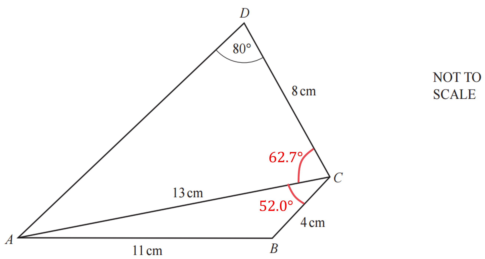

> * *

*Split the area of the quadrilateral **ABCD** into the area of triangle **ACD** and the area of triangle **ACB*

*Find the area of triangle **ACD (**by substituting **a** = 13, **b** = 8 and **C** = 62.7 into the formula)* * *

$\frac{1}{2}\times13\times8\times\mathrm{sin}62.7$

**[1]**

*Find the area of triangle **ACB** (by substituting **a** = 4, **b** = 13 and **C** = 52.0 into the formula)* * *

$\frac{1}{2}\times4\times13\times\mathrm{sin}52.0$

**[1]**

*Calculate the total area of **ABCD** (by adding the two triangle areas together)* * *

$\frac{1}{2}\times13\times8\times\mathrm{sin}62.7+\frac{1}{2}\times4\times13\times\mathrm{sin}52.0$ * *

> *Find this value to 3 significant figures*

**66.7 cm****2**** [1]**

### Q49
> *We have "SAS" and are finding a missing side so use the version of the cosine rule: *$a^{2}=b^{2}+c^{2}-2bc\mathrm{cos}A$*. *

> *For the purposes of substituting into the formula, it may help to replace the letters on the diagram with the letters from the formula. The formula "*$a$*" is the side to be found, so the formula angle "*$A$*" is always the angle opposite that side- while the formula "*$b$*" and "*$c$*| are interchangeable as the sides either side of the angle. See below:*

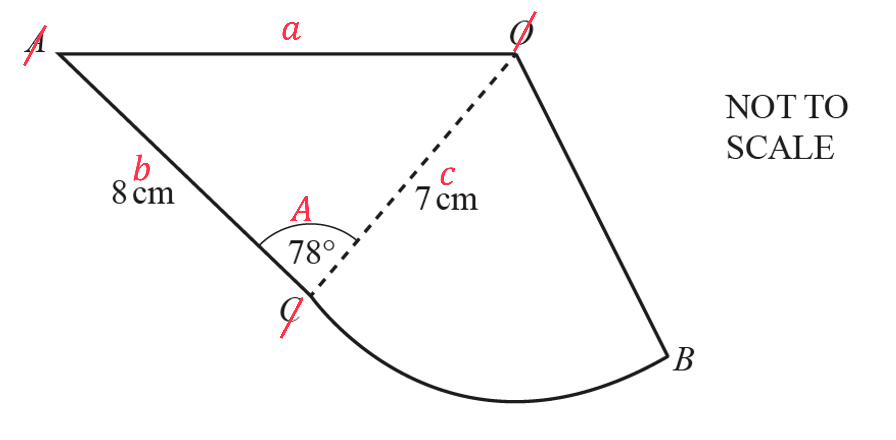

> *Thus, according to the letters in the formula, *$b=8,c=7\mathrm{and}A=78$*.*

`open parentheses O A close parentheses squared equals 8 squared plus 7 squared minus 2 cross times 8 cross times 7 cross times text cos end text 78`

*correct substitution ***[2]**

> *It's a "show that" question so the right hand side of the above line of working must be shown to achieve marks. Evaluate.*

$=89.71389063...$

**[1]**

> *Now square root this result.*

$OA=\sqrt{89.71389063...}$

$OA=9.471741689...=9.47(2d.p.)$

* **showing this result to more than 2 decimal places*** ****[1]**

**The question asks you to "show that ... to two decimal places" - so you must show the above result to ****more than 2 decimal places**** before rounding, to get the final mark for this question!**
*We can use the sine rule to find angle *$OAC$* as we have two pairs of opposite sides and angles; angle *$OAC$* is opposite 7 cm, and angle 78° is opposite 9.47 cm (from part (a)).*

> *Using sine rule *$\frac{a}{\mathrm{sin}A}=\frac{b}{\mathrm{sin}B}$*,*

`fraction numerator sin open parentheses O A C close parentheses over denominator 7 end fraction equals fraction numerator sin 78 over denominator 9.47 end fraction`

**[1]**

> *Make *`sin open parentheses O A C close parentheses`* the subject by multiplying by 7.*

`sin open parentheses O A C close parentheses equals fraction numerator 7 sin 78 over denominator 9.47 end fraction equals 0.723023569...`

**[1]**

> *To find angle *$OAC$*, inverse sine (SHIFT sin on your calculator) the above result*

**Angle** $OAC=46.3^{\circ}$ **[1] **

**Give answers in degrees to at least one decimal place**
> $OCB$* is a sector, therefore *$OC$*and *$OC$* are radii, therefore *$OC=OB=7\mathrm{cm}$*.*

> * We know from part (a) that *$AO=9.47\mathrm{cm}$

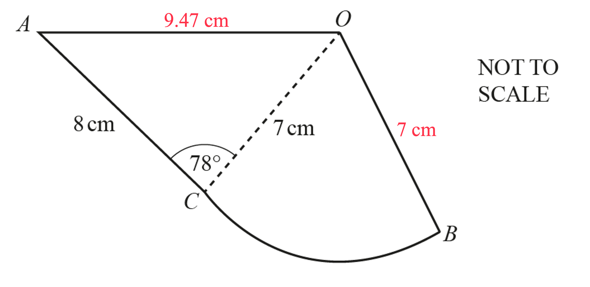

> *We can find *$CB$* by subtracting all the remaining lengths from the given perimeter, 29.5 cm*

`C B equals 29.5 minus open parentheses 8 plus 9.47 plus 7 close parentheses equals 5.03 space cm`

**[1]**

> *We can use the formula for an arc length to find the angle *$COB$*. Arc length = *`theta over 360 cross times 2 straight pi r space open parentheses or space fraction numerator theta straight pi r over denominator 180 end fraction close parentheses`* where *$r$* is the radius and *$θ$*is the angle bound by the radii. Therefore*

`5.03 equals fraction numerator angle C O B over denominator 360 end fraction cross times 2 straight pi cross times 7`

*using the arc length formula correctly*** [1] **

*equating the arc length formula to 5.03 ***[1]**

> *Rearrange to find angle *$COB$

`table row cell 5.03 end cell equals cell fraction numerator angle C O B over denominator 360 end fraction cross times 2 straight pi cross times 7 end cell row cell 5.03 cross times 360 end cell equals cell angle C O B cross times 2 straight pi cross times 7 end cell row cell fraction numerator 5.03 cross times 360 over denominator 2 straight pi cross times 7 end fraction end cell equals cell angle C O B end cell end table`

**[1]**

> *"Show that ... to 1 decimal place" so to achieve the final mark you must **show angle *$COB$* to more than one decimal place*

`table row cell bold angle bold italic C bold italic O bold italic B end cell bold equals cell bold space bold 41 bold. bold 17111014 bold. bold. bold. bold degree bold space stretchy left parenthesis equals space 41.2 degree space to space 1 space d. p. stretchy right parenthesis end cell end table`** [1]**

**The final mark will be withheld if you do not state at least "41.17..."**
> *The shape is already split into a non-right-angle triangle and a sector. Sector area = *$\frac{θ}{360}\timesπr^{2}$* where *$r$* is the radius, 7 cm and *$θ$* is the angle bound by the radii, 41.2° (given in part (c))*

*Sector area =*$\frac{41.2}{360}\timesπ\times7^{2}$

**[1]**

> *For the area of the non-right-angle triangle, use Area = *$\frac{1}{2}ab\mathrm{sin}C$*. We can ignore the letters given on the diagram and set *$C$* as 78, and *$a$* and *$b$* as 8 and 7*

*Triangle area = *$\frac{1}{2}\times8\times7\times\mathrm{sin}78$

**[1]**

> *Now add these two areas to get the answer*

*Total area = *$\frac{41.2}{360}\timesπ\times7^{2}+\frac{1}{2}\times8\times7\times\mathrm{sin}78$

**[1]**

$=17.61735347...+27.38813282...\,=45.00548629...$

> *Round the final answer to at least 3 significant figures*

**Total area = 45.0 cm****2 **** ****[1] **

**"45" as your final answer will lose a mark, as it is not rounded to 3 significant figures**
