# Mark Schemes — Trigonometric Graphs & Equations
**Pythagoras & Trigonometry** · Cambridge (CIE) IGCSE maths (0607)

## Exam Questions (22 questions)

### Q1
> *The amplitude is 4, so *$p=4$

`straight f open parentheses x close parentheses equals 4 sin open parentheses q x close parentheses`

**[M1]**

> *The period of *`sin open parentheses x close parentheses`* is 360, but you are told the period of *`p sin open parentheses q x close parentheses`* is 120*

> *The period is 3 times smaller, so *$q=3$

`straight f open parentheses x close parentheses equals 4 sin open parentheses 3 x close parentheses`

**[M1]**

> **[exam-tip]**
> Alternatively you can use the fact that the period of `a sin open parentheses b x close parentheses` is given by $\frac{360}{b}$. This means $\frac{360}{b}=120$ and hence $b=3$.

> *Substitute in *$x=45$* to find *`straight f open parentheses 45 close parentheses`

`straight f open parentheses 45 close parentheses equals 4 sin open parentheses 3 cross times 45 close parentheses`

> *Evaluate using your calculator*

`straight f open parentheses 45 close parentheses equals 2 square root of 2`

**[A1]**

> **[mark-scheme]**
> **M1**: Expression in the form `4 sin open parentheses q x close parentheses` used.
> 
> **M1**: Expression in the form `p sin open parentheses 3 x close parentheses` used.
> 
> **A1**: Correct final answer.

### Q2
(i)*  The amplitude of a function is equal to half of the vertical distance from the minimum point to the maximum point*

> *The maximum point can be seen on the graph at *$y=3$* *

> *The minimum point cannot be seen on the graph, however from our knowledge of the cosine wave we know that the minimum point would be at *$y=-3$* *

**Amplitude = 3 ****[1]**

> *The **period** is the distance along the** *$x$*-axis to complete a full oscillation *

> *We cannot see the full oscillation of the cosine wave, however we can see that the cosine wave has been stretched by a factor of 4 so it would take four lots of 360 degrees to complete one oscillation*

$4\times360^{\circ}$

**Period = **$1440^{\circ}$**[1]**

(ii)*  The value of *$a$* is equal to amplitude of a function*

> *The value of *$b$* is equal to *$360^{\circ}$* divided by the period*

$\frac{360^{\circ}}{1440^{\circ}}=\frac{1}{4}$

** **$a=3,b=\frac{1}{4}$**[1]**
**Both must be correct for the mark**
**Incorrect answers from (i) used correctly will gain the mark **

### Q3
> *The amplitude of a function is equal to half of the vertical distance from the minimum point to the maximum point*
*The graph has its maximum points at *$y=1$* and minimum points at *$y=0$*, so its amplitude is *$\frac{1}{2}$

**Amplitude = 0.5 ****[1]**

> *The **period** is the distance along the** *$x$*-axis to complete a full oscillation *

**Period = **$180^{\circ}$**[1]**

### Q4
> *For a graph in the form *`space straight f open parentheses x close parentheses equals a space sin space left parenthesis b x right parenthesis`*,  *$a$* is the amplitude of the function *

$a=3$

> $b$* determines the period of the function, where the period is *$\frac{360^{\circ}}{b}$

$b=4\,\frac{360^{\circ}}{4}=90$

**Amplitude = **$3$** [1]**
**Period = **$90^{\circ}$** ****[1]**

### Q5
> *Use inverse sin on your calculator to find the first solution*

`sin to the power of negative 1 end exponent open parentheses negative 0.75 close parentheses equals negative 48.59037...`

> *The range for answers for this question is *$0^{\circ}<x<360^{\circ}$*so the first solution is not an answer for this question*

> *One further solution can be found by adding *$360^{\circ}$* as the function is periodic*

$-48.59037...+360=311.4096...$

> *Further solutions within the range can be found by looking at the graph of *$\mathrm{sin}x$

> *The second solution can be found using the symmetry of the graph*

$180+48.59037...=228.5903...$

> *Round the answers to one decimal place*

$x=228.6^{\circ},311.4^{\circ}$**[1]**
**1 mark for each correct answer**

### Q6
> $a$* is the amplitude of the function*
*The graph has its maximum points at *$y=3$* and minimum points at *$y=-3$*, so its amplitude is 3*

$a=3$** ****[1]**

> $b$* is the number of times the graph repeats itself in *$360^{\circ}$

$b=2$** ****[1]**
> $b$* determines the period of the function, where the period is *$\frac{360}{b}$
*From part (a), *$b=2$

$\frac{360}{2}=180$

$180$** ****[1]**

### Q7
> *For an oscillating function with equation *`straight f open parentheses x close parentheses equals a cos open parentheses b x close parentheses`*, *$a$* represents the amplitude of the function, so *$p=3$

`straight f open parentheses x close parentheses equals 3 cos open parentheses q x close parentheses`*  *

**[1]**

> $b$* determines the period of the function using: period = *$\frac{360^{\circ}}{b}$*, so *$q=\frac{360}{30}=12$

`straight f open parentheses x close parentheses equals 3 cos open parentheses 12 x close parentheses`

**[1]**

> *Substitute *$x=10$* into *`straight f open parentheses x close parentheses`* to find *`straight f open parentheses 10 close parentheses`

`straight f open parentheses 10 close parentheses equals 3 cos open parentheses 120 close parentheses`* *

$f(10)=-1.5$** ****[1]**

### Q8
> *The graph of *$y=\mathrm{cos}x$* intercepts the **y**-axis at (0, 1) and cycles through 0, -1, 0, 1, 0, etc every 90°.*

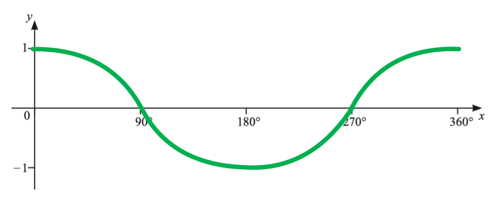

> *Key features of the graph are *

> *Repeating curve shape,*

> * Maximum points at (0, 1) and (360, 1) **and** minimum point at (180, -1), *

> *x**-axis intercepts at (90, 0) **and** (270, 0).*

**Any 1 feature**** [1]**

**All 3 features**** [1]**
> *Rearrange the equation.*

$4\mathrm{cos}x=1\,\mathrm{cos}x=0.25$

**[1]**

> *Use the graph **and** your calculator to find the answers for *$x$* in the range *$0^{\circ}\leqx\leq360^{\circ}$*.*

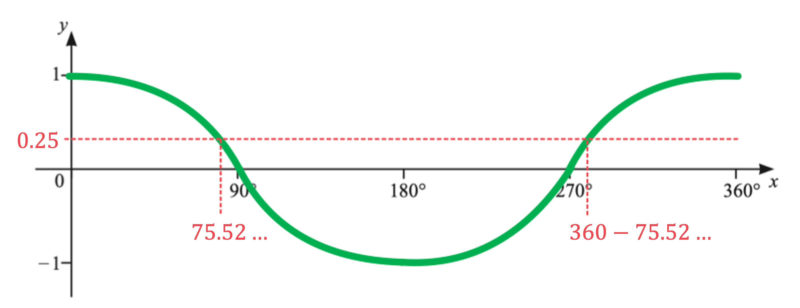

`x equals cos to the power of negative 1 end exponent space open parentheses 0.25 close parentheses
x equals 75.522 space 487 space...`

* ***[1]**

> *We can also see, by symmetry, that*

$x=360-75.522487...=284.477512...$

$x=75.5^{\circ},284.5^{\circ}$* ***[1]**

### Q9
> *Method 1*

> *Know the properties of the **trig graphs**. The key points to know on the graph of **y **= cos**x** are;*

*  ***x*** = 0, ***y*** = 1* * *

* ***x*** = 90, ***y*** = 0* *  *

**x*** = 180, ***y*** = -1* *  *

**x*** = 270, ***y*** = 0*

*  ***x*** = 360, ***y*** = 1*

> *Label -1 and 1 on the **y**-axis, the same distance from 0. Mark the above key points on the diagram, labelling any points not on the axes*

> *Draw a smooth curve through these points*

**smooth curve the correct shape**** [1]*** *

**key points clearly labelled**** [1]**

> *Method 2*

> *Use your calculator to find the key points.*

> * Making sure your calculator is in degrees;   *

> * -create a table of values using the TABLE function of your calculator, starting at **x** = 0 and ending at **x **= 360, steps of 90   *

> * -if your calculator does not have a TABLE function, substitute the key **x** values into **y** = cos**x*

* ***x*** = 0, ***y*** = 1* * *

* ***x*** = 90, ***y*** = 0* * *

* ***x*** = 180, ***y*** = -1* * *

* ***x*** = 270, ***y*** = 0* * *

* ***x*** = 360, ***y*** = 1*

> *Label -1 and 1 on the **y**-axis, the same distance from 0. Mark the above key points on the diagram, labelling any points not on the axes*

> *Draw a smooth curve through these points*

**smooth curve the correct shape*** ***[1]**

** ****key points clearly labelled**** [1]**

### Q10
i) *The graph of *$y=\mathrm{sin}x$* passes through the origin and cycles through 1, 0, -1, 0, 1, ... every 90°.*

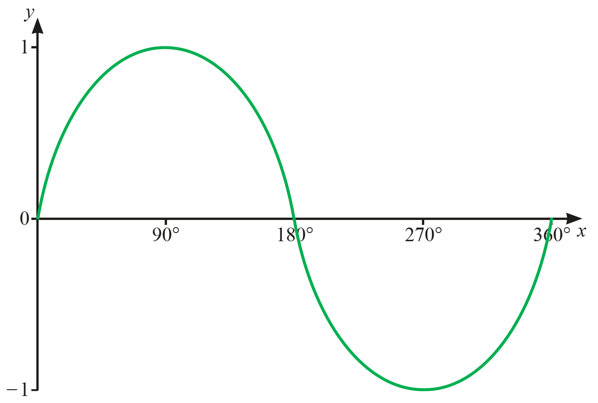

**Correct shape*** ***[1]**

**Correct location**** [1]**

ii) *In the interval *$0^{\circ}<x\leq360^{\circ}$* the graph of *$y=\mathrm{sin}x$* has no line symmetry, only rotational symmetry. *

> *If you cannot see the rotational symmetry, use some tracing paper and experiment with different centres of rotation and see if the curve maps onto itself as you turn the tracing paper.*

**Final answer:** **Rotational symmetry, order 2 with centre of rotation at (180°, 0)**

**Rotational*** ***[1] **

**Order and centre**** [1]**
> *First rearrange the equation.*

`table row cell 4 sin space x end cell equals 3 row cell sin space x end cell equals cell 3 over 4 end cell end table`

**[1]**

> *Use the graph to see how many solutions to expect in the interval *$0^{\circ}\leqx\leq360^{\circ}$*. (The answer line suggests there are two!)*

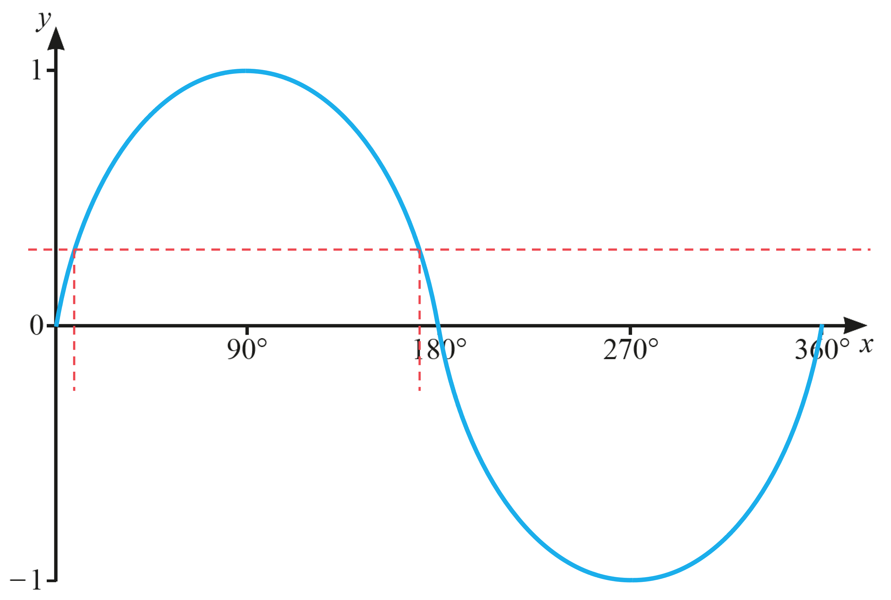

> *There are indeed two solutions! Use your calculator to work out one of them.*

`x equals sin to the power of negative 1 end exponent open parentheses 3 over 4 close parentheses equals 48.590 space 377 space...`

**[1]**

> *Use line symmetry (between 0° and 180°) to work out the other.*

$x=180-48.590377...=131.409622...$

$x=48.6^{\circ}$** (1 d.p.) and **$x=131.4^{\circ}$** (1 d.p.)**** ****[1]**

### Q11
> *You should to know the key points of **trig graphs**, which are marked on the diagram below for **y** = sin**x.*

i) *Check by using your calculator to input sin180°, it will give you '0'.*

**P ****= (180, 0) ****[1]**

ii) *Check by using your calculator to input sin270°, your calculator will give you "-1" (and -1 ≤ sin x ≤ 1 so this must be a minimum point).*

**Q**** = (270, −1) ****[1]**
> *Sketch the graph of *$y=\mathrm{tan}x$* on the graph.  *

> *You should know the shape of the graph but you can use your calculator to find and plot key values to help you. *

> $y=\mathrm{tan}x$* has no value at *$x=90^{\circ}$*and *$x=270^{\circ}$* so asymptotes have been included through these two points.  *

** ****Correct shape of the graph in any section*** ***[1] **** **

**Correct asymptotes and position of the graph ****[1]**

### Q12
> *It is trig graph that has a length of 360° so it is either sin or cos.*

> *The graph goes through the origin so it is a sin graph.*

> *The **y**-values of *$y=\mathrm{sin}x$* go between -1 and 1, the **y**-values of the graph in the question go between -2 and 2. Therefore the function has been doubled.*

**Final answer:** $f(x)=2\mathrm{sin}x$** **

**For expression of the form**** **$k\mathrm{sin}x$**[1]**

** ****Fully correct expression**** [1]**

### Q13
> *This can be done by considering the graphs of  *$\mathrm{sin}y$* and *$\mathrm{cos}y$* for obtuse angles,  *$90^{\circ}<y<180^{\circ}$*, sketching both onto the same axis will help.*

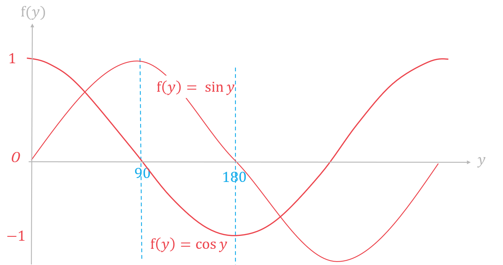

> * *

> *Your sketch does not need to be perfect, just enough to see where both of the graphs lie. *

> *For *$90^{\circ}<y<180^{\circ}$*, the graph of *$\mathrm{sin}y$* is completely above the axis, so *$\mathrm{sin}y>0$* and the graph of *$\mathrm{cos}y$* is completely below the axis, so *$\mathrm{cos}y<0$*.*

**The correct answer is option 2, **$\mathrm{sin}y>0$** and **$\mathrm{cos}y<0$ **[1]**

### Q14
> *Know the properties of the **trig graphs or use your calculator to find key values.*

> *The key points to know on the graph of **y **= cos**x** are;*

*  ***x*** = 0, ***y*** = 0*

*  ***x*** = 90, ***y*** = 1* * *

* ***x*** = 180, ***y*** = 0*

*  ***x*** = 270, ***y*** = -1* * *

* ***x*** = 360, ***y*** = 0*

> *Label -1 and 1 on the **y**-axis, the same distance from 0. Mark the above key points on the diagram, labelling any points not on the axes*

> *Draw a smooth curve through these points*

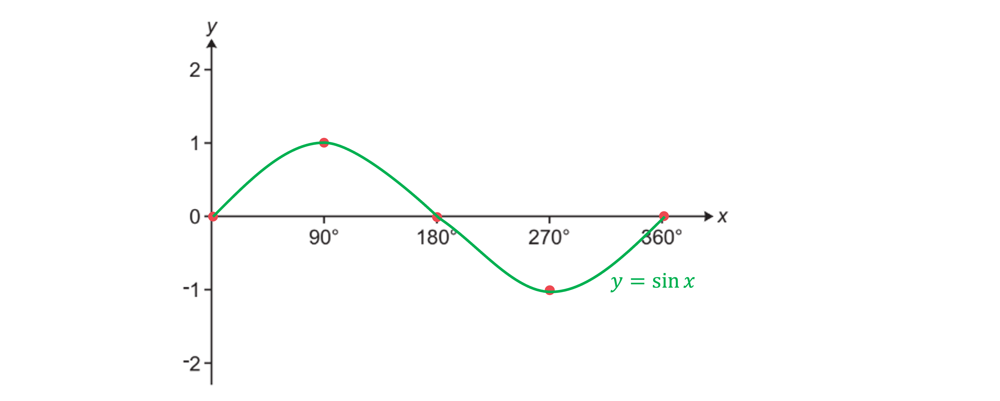

**smooth curve the correct shape**** [1]*** *

**key points clearly marked**** [1]**

### Q15
> *Isolate *$\mathrm{tan}x$* by dividing both sides by 5.*

`table row cell fraction numerator 5 space tan space x over denominator 5 end fraction space end cell equals cell fraction numerator negative 7 over denominator 5 end fraction end cell row cell tan space x space end cell equals cell negative 7 over 5 end cell end table`

> *Use the *$\mathrm{tan}^{-1}$* button on your calculator to find the first value of *$x$

`table row cell space x space end cell equals cell space tan to the power of space minus 1 end exponent open parentheses negative 7 over 5 close parentheses end cell row blank equals cell space minus 54.462322... end cell end table`

**[1]**

> *This is outside of the range given in the question so is not one of the correct answers. *

> *The graph of*$\mathrm{tan}x$* repeats every 180° so the solutions will be this value ± 180°. *

> *Look only for the solutions within the range *$0^{\circ}\leqx\leq360^{\circ}$*.*

`table row cell x subscript 1 space end cell equals cell space table row blank blank minus end table table row blank blank 54 end table table row blank blank. end table table row blank blank 462322 end table table row blank blank. end table table row blank blank. end table table row blank blank. end table space plus space 180 space space equals space 125.5376... end cell end table`

`table row cell x subscript 2 space end cell equals cell space 125.5376... space plus space 180 space equals space 305.5376.... end cell end table`

> *These are the two values in the correct range. *

> *Round the answers to 1 decimal place.*

**Final answer:** ** **$x=125.5^{\circ}\mathrm{and}x=305.5^{\circ}$** **

*1 correct answer ***[1] **

*Both answers correct*** ****[1] **

**Answers in the ranges 125.53 to 125.54 and 305.53 to 305.54 are accepted.**

** **

### Q16
> *Sketch the graph of *$y=\mathrm{tan}x$* on the graph.  *

> $y=\mathrm{tan}x$* has no value at *$x=90^{\circ}$*and *$x=270^{\circ}$* so asymptotes have been included through these two points.  *

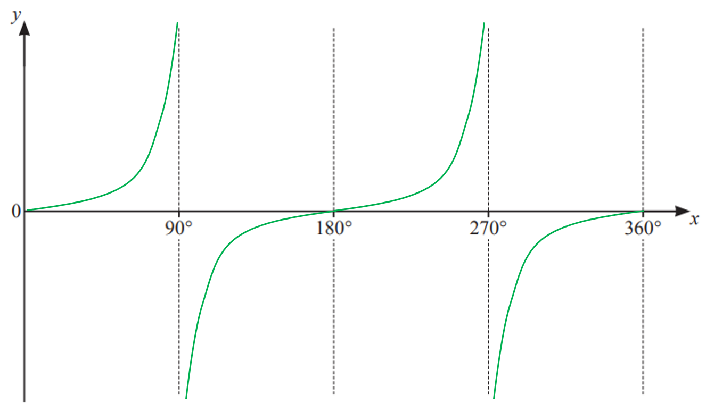

** ****Correct shape of the graph in any section ****[1] **

** ****Correct asymptotes and position of the grap***h*** ****[1]**

### Q17
> *Take sin**-1** of both sides.*

`x equals sin to the power of negative 1 end exponent open parentheses 0.36 close parentheses space`

$x=21.10019...$

$21.1^{\circ}$* ***[1]**

**The value 21.10... will be accepted.**
> *If there are two possible values that the missing angle could be, work out the obtuse angle by subtracting the acute angle from 180**o**.*

$180-21.10019...=158.89980...$

$158.9^{\circ}$* ***[1]**

**It's best to round angles to 1 d.p. but answers between 158.8 and 158.9 will be accepted.**

### Q18
> *Isolate *$\mathrm{tan}x$* by dividing both sides by 3.*

`table row cell fraction numerator space 3 space tan space x over denominator 3 end fraction space end cell equals cell fraction numerator negative 4 over denominator 3 end fraction end cell row cell tan space x space end cell equals cell negative 4 over 3 end cell end table`

**[1]**

> *Use the *$\mathrm{tan}^{-1}$* button on your calculator to find the first value of *$x$

`table row cell space x space end cell equals cell space tan to the power of space minus 1 end exponent open parentheses negative 4 over 3 close parentheses end cell row blank equals cell space minus 53.1301... end cell end table`

> *This is outside of the range given in the question so is not one of the correct answers. *

> *The graph of*$\mathrm{tan}x$* repeats every 180° so the correct solutions will be this value ± 180°. *

> *Look only for the solutions within the range *$0^{\circ}\leqx\leq360^{\circ}$*.*

`table row cell x subscript 1 space end cell equals cell space minus 53.1301... space plus space 180 space space equals space 126.869... end cell end table`

`table row cell x subscript 2 space end cell equals cell space 126.869... space plus space 180 space equals space 306.869.... end cell end table`

> *These are the two values in the correct range.*

> * Round the answers to 1 decimal place.*

**Final answer:** ** **$x=126.9^{\circ}\mathrm{and}x=306.9^{\circ}$** **

**1 correct answer**** ****[1] **

**Both answers correct**** ****[1] **

> *Answers in the ranges 126.86 to 126.87 and 306.86 to 306.87 are accepted. *

### Q19
> *On the graph, mark roughly where *$180-α$* would be by measuring a similar distance from 0 to α left from 180°.*

> *To draw a vertical line from here on the **x **axis to the graph you would need to draw the line downwards to the graph, so the answer must be negative as **k **is below the **x **axis. *

> *By the rotational symmetry of the graph about 90°, you can see that the answer is -**k.*

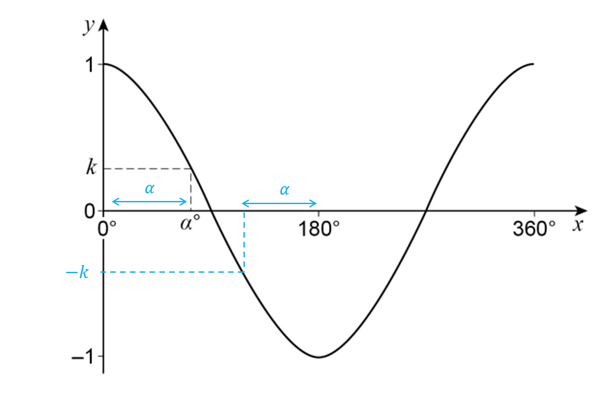

**The correct answer is option 3, **$-k$**[1]**
> *The graph of *$\mathrm{cos}x$* is periodic, repeating every 360°.*

> *By the repetition of the graph, you can see that the answer is **k.*

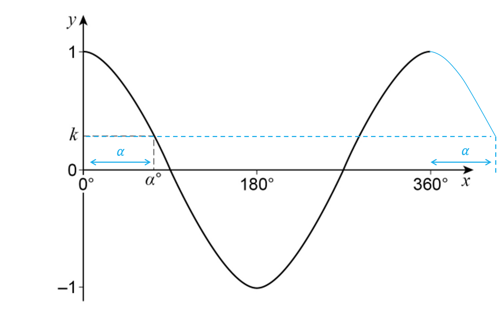

**The correct answer is option 4, **$k$** ****[1]**

### Q20
> *Use the *$\mathrm{tan}^{-1}$* button on your calculator to find the first value of *$x$*.*

`table row cell space x space end cell equals cell space tan to the power of space minus 1 end exponent open parentheses 2 close parentheses end cell row blank equals cell space 63.434... end cell end table`

**[1]**

> *The graph of*$\mathrm{tan}x$* repeats every 180° so the solutions will be this value ± 180°. Look only for the solutions within the range *$0^{\circ}\leqx\leq360^{\circ}$*.*

`table row cell x space end cell equals cell space 63.434... space space end cell row blank blank blank row cell and space space space x space end cell equals cell space 180 space plus space 63.434... space end cell end table`

> *Round the answers to 1 decimal place.*

** ****x = 63.4°  and  x = 243.4°****[1]**

### Q21
> *Rearrange the equation to make *$\mathrm{cos}x$* the subject.*

$\mathrm{cos}x=\frac{1}{3}$

**[1]**

> *Use the *$\mathrm{cos}^{-1}$* button to find the first value of *$x$*.*

`table row cell space x space end cell equals cell space cos to the power of negative 1 end exponent open parentheses 1 third close parentheses end cell row blank equals cell space 70.528... end cell end table`

**[1]**

> *Draw the line *$\mathrm{cos}x=\frac{1}{3}$* on the graph of  *$y=\mathrm{cos}x$* and find the points of intersections by reading off the graph.*

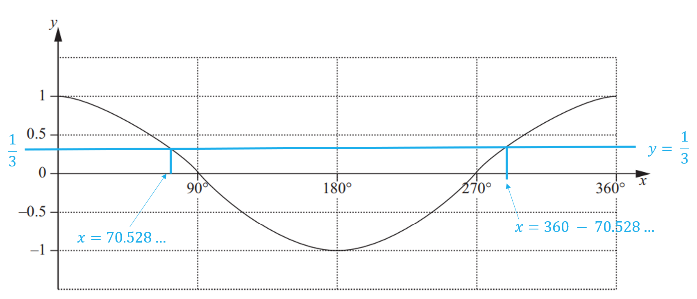

> *Use the symmetry of the graph to find the second value of *$x$*.*

`table row cell x space end cell equals cell space 70.528... space space end cell row blank blank blank row cell and space space space x space end cell equals cell space 360 space minus space 70.528... space end cell row blank equals cell space 289.471... end cell end table`

**[1]**

> *Round the answers to 1 decimal place.*

**Final answer:** ** **$x=70.5^{\circ}\mathrm{and}x=289.5^{\circ}$** ****[1]**
> *Sketch the graph of *$y=\mathrm{sin}x$* on the graph.  You should know the shape of the graph but you can use your calculator to find and plot key values to help you.*

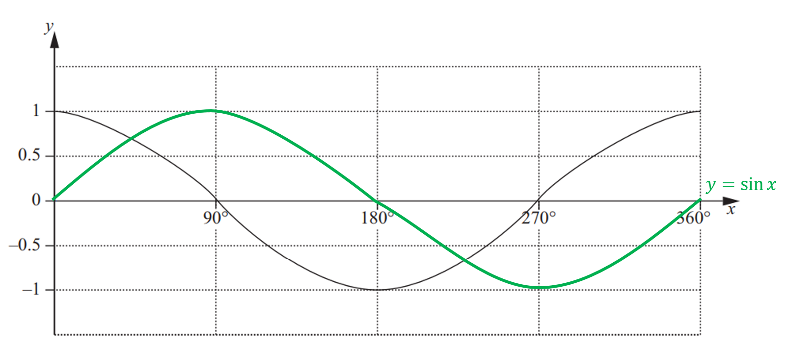

** ****Correct shape of the graph ****[1] **** **

**Correct amplitude and position of the graph ****[1]**

### Q22
*Make *$x$* the subject of the equation *$\mathrm{sin}x=0.43$* (using inverse sin)* * *

`table row cell sin space x end cell equals cell 0.43 end cell row x equals cell sin to the power of negative 1 end exponent space 0.43 end cell end table` * *

*Use a calculator to find the value of *$\mathrm{sin}^{-1}0.43$ * *

$\mathrm{sin}^{-1}0.43=25.46...$

**[1]**

> *The calculator gives an acute angle, but an obtuse angle is needed*

*Method 1*

*Sketch the graph of *$y=\mathrm{sin}x$* between 0° and 180°* * *

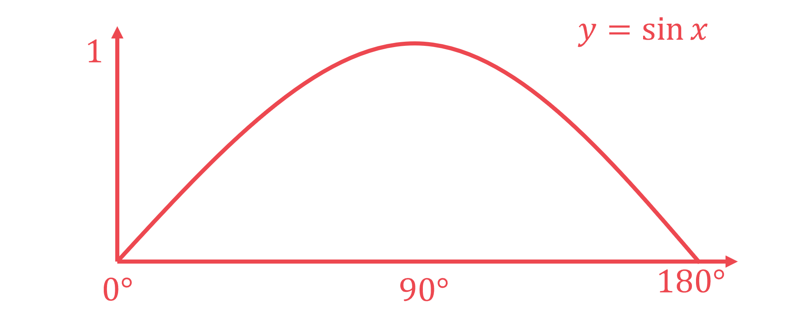

> * *

*Draw the acute angle on the graph (by sketching  *$x=25.46...^{\circ}$* on the *$x$*-axis and  *$y=0.43$* on the *$y$*-axis)* * *

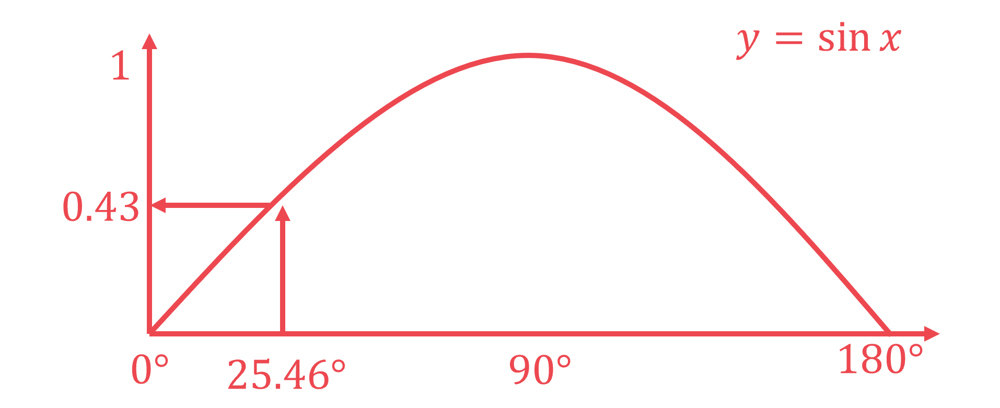

> * *

*The obtuse value of *$x$*is the value on the *$x$*-axis greater than 90° with the same *$y$* value* *Use symmetry to find the obtuse value (by subtracting 25.46...° from 180°)* * *

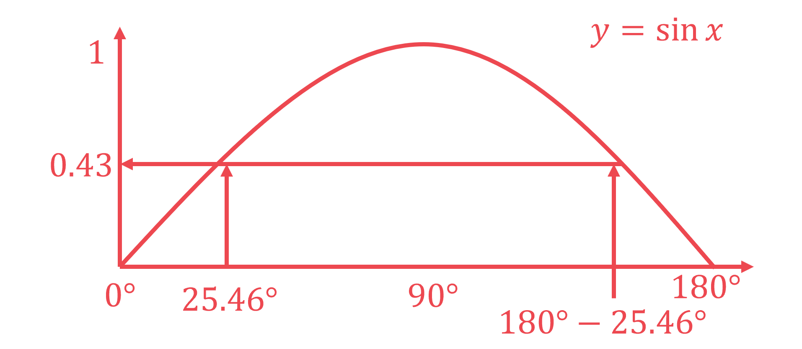

> * *

$180^{\circ}-25.46...^{\circ}=154.54...^{\circ}$ * *

> *Round the obtuse angle to 1 decimal place*

**154.5°**** ****[1]**

**All angles must be rounded to 1 decimal place**

*Method 2*

*Learn the rule that, for *$\mathrm{sin}x$*, the obtuse angle is always "180° - the acute angle"* * *

*Obtuse angle = 180° - 25.46...° = 154.54...°* * *

**154.5°*** ***[1]**

**All angles must be rounded to 1 decimal place**
