# Mark Schemes — Scatter Graphs & Correlation
**Statistics** · Cambridge (CIE) IGCSE maths (0607)

## Exam Questions (21 questions)

### Q1
> *Use your graphical display calculator in statistics mode to enter the data into columns*

> *Choose the option for linear regression, or you may need to press CALC then REG*

> *Make sure you select a format that looks like *$a+bx$*, as you are finding a straight line*

> *Paying careful attention to the format that your calculator is using for the line, write down the values of *$a$* (the *$y$*-intercept) and *$b$* (the gradient, which is the coefficient of *$x$*)*

$y=145.13...-0.28248...x$

> *Round *$a$* to the nearest whole number and *$b$* to 2 decimal places*

$y=145-0.28x$

**[B1 B1]**

> **[mark-scheme]**
> **B1**: Value for $b$ of -0.28 (or more accurate).
> 
> **B1**: Value for $a$ of 145 (or more accurate).
> *Substitute in *$x=250$* into *$y=145-0.28x$

$y=145-0.28\times250\,y=75$

**Final answer:** **75 Mbps**

**[B1]**

> **[mark-scheme]**
> **B1**: For an answer between 74.5 and 75.5.
> *The data has a clear negative correlation (as distance increases, download speed decreases)*

> *Even if a data point is removed, the correlation is still negative*

> *Yet the student's regression line has a positive gradient *

**Final answer:** **The student's regression line cannot be correct as it has a positive gradient but the data has a negative correlation**

**[B1]**

> **[mark-scheme]**
> This mark is for an answer that refers either directly or indirectly to the negative correlation of the data.

### Q2
> *Use your graphical display calculator in statistics mode to enter the data into columns*

> *Choose the option for linear regression, or you may need to press CALC then REG*

> *Make sure you select a format that looks like *$a+bx$*, as you are finding a straight line*

> *Paying careful attention to the format that your calculator is using for the line, write down the values of *$a$* (the y-intercept) and *$b$* (the gradient, which is the coefficient of *$x$*)*

$y=0.28+0.194857142...x$

> *Round the value of *$b$* to 3 decimal places, there is no need to round 0.28 any further as it is exactly 0.28*

$y=0.28+0.195x$

**[B1 B1]**

> **[mark-scheme]**
> **B1**: Value for $b$ of 0.195, or more accurate.
> 
> **B1**: Value for $a$ of 0.28.
> *In the regression line *$y=a+bx$*, *$y$* is the fuel used in litres and *$x$* is the distance travelled in kilometres*

> $b$* is the gradient of the straight line*

`gradient equals b equals fraction numerator change space in space y space open parentheses litres close parentheses over denominator change space in space x space open parentheses kilometres close parentheses end fraction`

**Final answer:** $b$** is the number of litres of fuel used for each kilometre travelled**

**[B1]**

> **[mark-scheme]**
> **B1**: Must include reference to the context, i.e. litres of fuel and kilometres travelled. Can be numerical, e.g. "0.195 litres used per kilometre travelled".
> *The regression line found in part (a) was *$y=0.28+0.194857142...x$

> *Substitute in *$x=38$* and find *$y$

> *Make sure you use the unrounded version of the line of regression, for maximum accuracy*

`y equals 0.28 plus 0.194857142... open parentheses 38 close parentheses
y equals 7.68457139...`

> *Round to 3 significant figures*

**Final answer:** **7.68 litres**

**[B1]**

> **[mark-scheme]**
> **B1**: Answers between 7.68 and 7.69 inclusive receive this mark.

### Q3
> *Enter the data into a spreadsheet on your calculator (you may need to select statistics or regression mode first)*

> *Choose the option for linear regression (*$mx+b$*)*

$y=0.79091749...x+13.1722750...$

> *Round the values for *$m$* **and *$b$*to 3 significant figures*

$y=0.791x+13.2$
**m ****= 0.791 [1]**
**b**** = 13.2 [1]**
(i)  *Substitute *$x=50$* into your linear regression line*

`table row y equals cell 0.791 open parentheses 50 close parentheses plus 13.2 end cell row blank equals cell 52.75 end cell end table`

> *Rounding your answer to the nearest integer is best as this matches the data in the table*

$53$ **[1]**
**Unrounded answers 52.7 to 52.8 accepted**

(ii) *Substitute *$x=6$* into your linear regression line*

`table row y equals cell 0.791 open parentheses 6 close parentheses plus 13.2 end cell row blank equals cell 17.946 end cell end table`

> *Rounding your answer to the nearest integer is best as this matches the data in the table*

$18$ **[1]**
**Unrounded answers 17.90 to 17.95 accepted**
> *Estimating from a linear regression line is only reliable within the range of the original data used to calculate the regression line*

> *50 is within the range of the French marks, 6 is not*

**50 because it is within the range of the data ****[1]**

### Q4
> *The gradient of a linear regression line in the form *$y=mx+c$* is give by the value of *$m$

$m=-5.2$

> *If the value of *$m$*is negative then the gradient of the regression line is negative and so the correlation is negative*

**Negative correlation ****[1]**

### Q5
> *Plot the points on the diagram, being careful to plot the values from the top row on the **x-**axis and the bottom row on the **y-**axis*

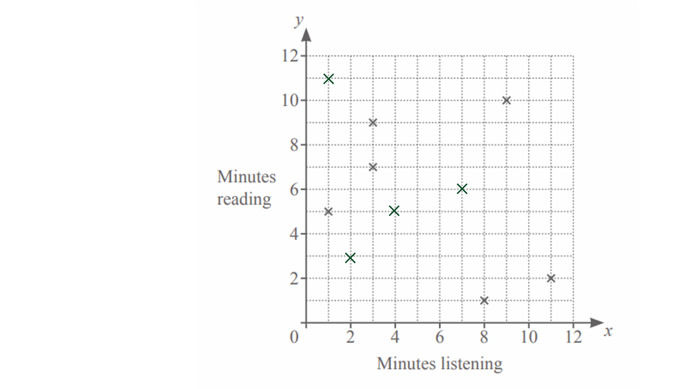

**[2]**
**1 mark for 3 correct points**
> *Find the median of the values in the bottom row of the table*

> *Open a spreadsheet on your graphic display calculator and enter the data from the row titled minutes reading (*$y$*)*

> *Select the statistics function and choose the option for median*

**Final answer:** **5.5 min**
> *Enter the data into a spreadsheet on your calculator (you may need to select statistics or regression mode first)*

> *Make sure that you type the data into the correct columns (*$x$*then *$y$*) and label the columns to help you*

> *Choose the option for linear regression (*$mx+b$*)*

$y=-0.322889...x+7.482158...$

> *Round the values for **m **and **b** to 3 significant figures*

$y=-0.323x+7.48$
**m ****= -0.323 [1]**
**c**** = 7.48 [1]**
> *Each value in the top row of the table (*$x$* value) for Tuesday will be the same as for Monday*
*Each value in the bottom row of the table (*$y$* value) will be 5 minutes greater than in the table for Monday*

> *If only the *$y$* values have increased then every value in the scatter graph will have moved vertically upwards by 5*

> *Therefore the linear regression line will also move vertically upwards by 5*

> *The gradient (*$m$*) of the line of regression remains the same, but the *$y$*-intercept (*$c$*) will increase by 5*

`y equals negative 0.323 x plus open parentheses 7.48 plus 5 close parentheses`

$y=-0.323x+12.48$** ****[1]**

### Q6
> *We can see from the table that as the maximum temperature data increases, so does the minimum temperature data*

> *This could also be seen by entering the data into your calculator and choosing the option for linear regression (ax+b)*

> *The sign of the value for a is positive so the data has positive correlation*

**Positive correlation ****[1]**
> *Enter the data into a spreadsheet on your calculator (you may need to select statistics or regression mode first)*

> *Choose the option for linear regression (*$mx+b$*)*

$y=0.5144230...x+0.2451923...$

> *Round the values for **m **and **b** to 3 significant figures*

$y=0.514x+0.245$
**m ****= 0.514... [1]**
**b**** = 0.245... [1]**

### Q7
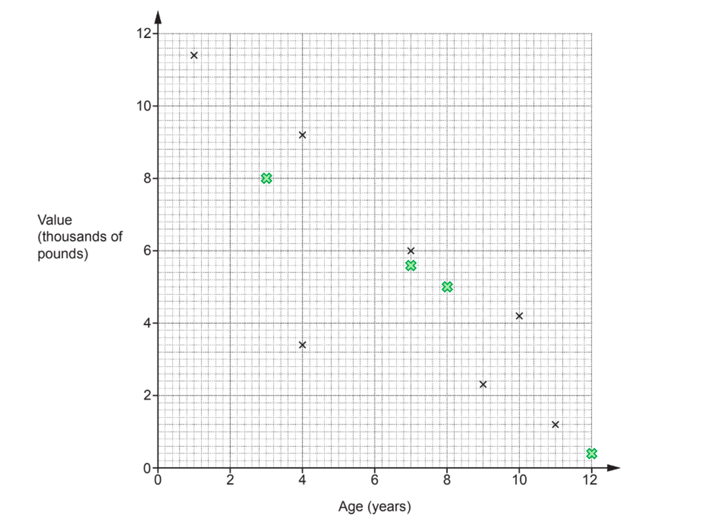

**2 points plotted correctly**** [1]** 
**All points plotted corrected**** [1]**
> *As the age increases the value decreases.*

**Strong negative**** correlation **
**Stating "negative"**** [1]** 
**Stating "strong"**** [1]** 
**Medium or moderate are also accepted**
> *Circle the one whose value is lower than suggested by the trend.*

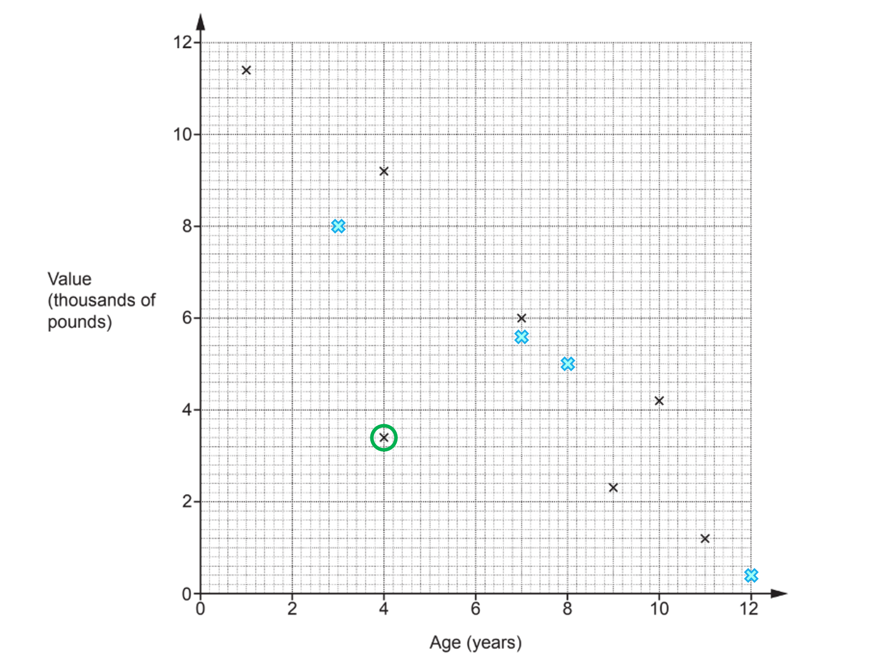

**[1]**
> *Remember the line of best fit should only be drawn within the range of data. *
*It does not need to start at the origin. Draw a vertical line up from 6 on the horizontal axis. *
*When it meets the line of best fit draw a horizontal line to the vertical axis. Read off the value.*

**Drawing a line of best fit ****[1]**

**£6400 ****[1] **
**A range of values will be accepted based on your line of best fit**
**16 years is ****not within the range of data**** so the line of best fit should not be used** **[1]**

### Q8
*Plot the point* *(90, 17)**.*

**[1]**
> *The plotted points roughly form a line that would have a positive gradient, so the type of correlation is positive.*

**Positive correlation** **[1]**
*To estimate from a scatter graph we first need to draw a line of best fit.* 
*A line of best fit does not have to go through any points (but may do) and should roughly have as many points on one side as the other.  *
*The line should not extend beyond the first or last of the plotted points.*

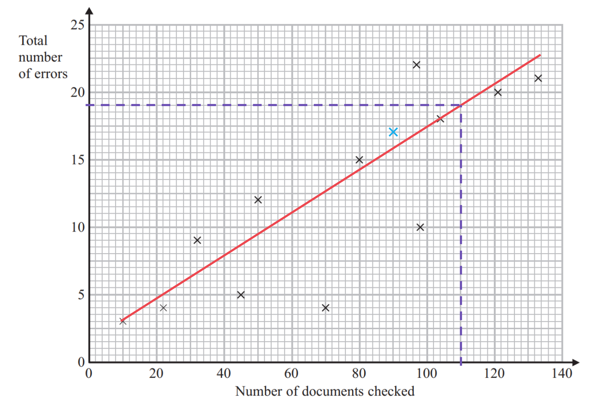

**Line of best fit**** [1]**

> *Take a reading from the line of best fit at 110 documents.  Use a straight edge for accuracy.*

**The total number of errors in the 110 documents is approximately 19 ****[1]**

**Answers in the range 16 - 20 are accepted. **

### Q9
> *Find the point which is at 42 on the "number of people" (**x-**) axis, and read off from the "number of phones" (**y**-) axis. *
*Be careful with the scale; on this graph one square horizontally is equal to two people and one square vertically is 2 phones.*

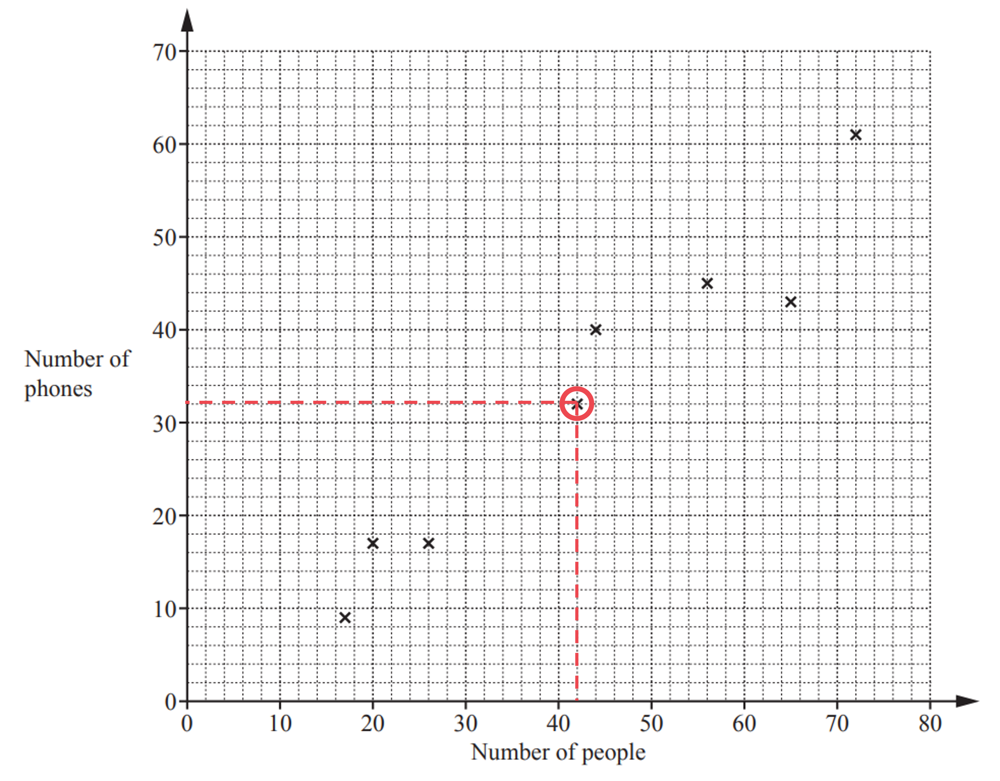

**32** **[1]**
> *As one variable ("number of people") increases, the other variable ("number of phones") also increases.*

**Positive correlation** **[1]**

### Q10
*Plot the points* *(1, 8200)** and **(3.5, 5000)**.*

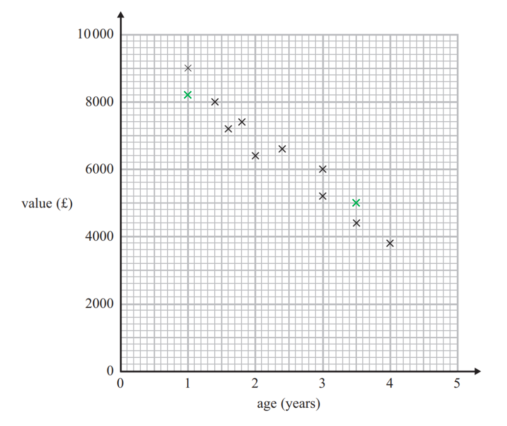

**[1]**
**The older a car is, the lower its value** **[1]**

**Negative correlation is also accepted.**

### Q11
> *Draw a line up from 70 000 on the Value in 1996 axis to find the correct point. *
*Then draw a line across to the Value in 2016 axis to read the correct value.*

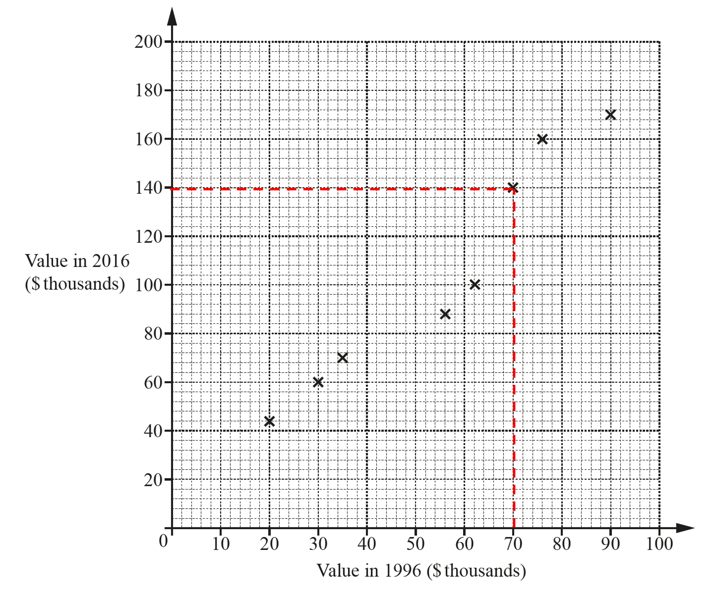

**Final answer:** **\$140 000 ****[1]**

**Pay attention to the scale - the value is in thousands so the correct answer is not "140".**
> *Plot the points (40, 80) and (80, 150) on the scatter diagram, paying attention to the scale.*

** ****both points plotted correctly ****[1]**
> *The line of best fit (LOBF) is drawn by eye so there is some margin of error. *
*It does not have to, but may, pass through any of the plotted points. In this case it does not necessarily have to pass through the origin.*

> *However, the LOBF **must** be drawn with a ruler/ straight edge and must match the correlation of the points. *
*It should have roughly the same number of points above as below it and should extend all the way to the edges of the grid.*

> *The LOBF drawn below is an example of an appropriate answer.*

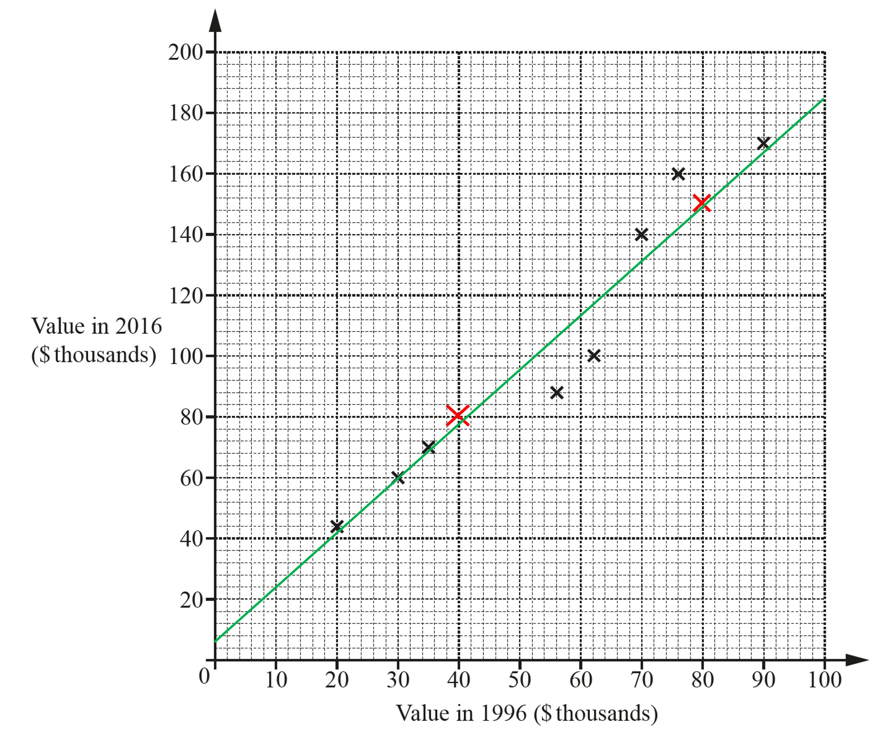

** ****any appropriate line ****[1]**
> *Your answer to this question will depend on your line of best fit (LOBF) drawn in the previous part of the question. But the method should always be the same.*

> *Draw a vertical line up from \$50 000 on the Value in 1996 axis until it hits your LOBF.*
* Then draw a horizontal line across to the Value in 2016 axis.*

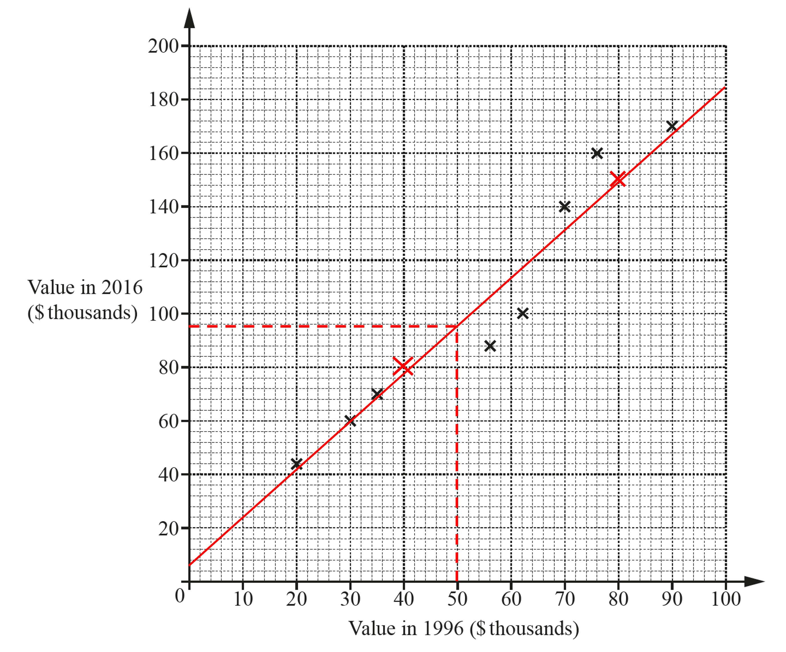

*Read off the graph to estimate the Value in 2016. *
*Pay attention to the scale on the Value in 2016 axis. *
*Notice that 5 small squares represent \$20 000, so 1 small square represents \$4000. *
*The answer on **this** LOBF would be ***\$96 000***.*

** \$80 000 to**** ****\$110 000**** **
**Any answer between \$80 000 and \$110 000 that matches the LOBF****  [1]**

### Q12
*Correlation can either be positive (loosely speaking the points are going up) or negative (points are going down).* 
*On this scatter graph the points are going down, so the correlation is negative.*

**Negative**** [1] **
**No other words or descriptions are accepted.**

### Q13
*Plot the point **(22, 50)**.*

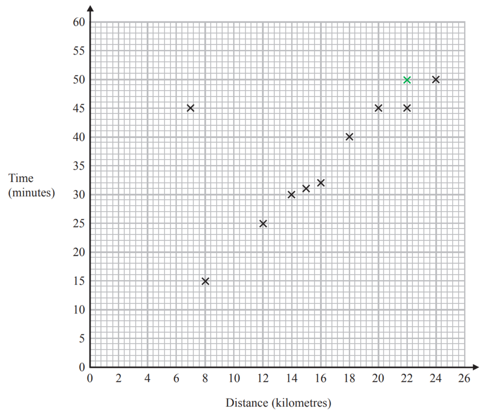

**[1]**
> *The plotted points roughly form a line that would have a positive gradient, so the type of correlation is positive.*

**Positive correlation** **[1]**
*To estimate from a scatter graph we first need to draw a line of best fit.* 
*A line of best fit does not have to go through any points (but may do) and should roughly have as many points on one side as the other.  *
*The line should not extend beyond the first or last of the plotted points. *
*Ignore any outliers when drawing a line of best fit.*

**Line of best fit**** [1]**

> *Take a reading from the line of best fit at a distance of 10 km.  Use a straight edge for accuracy.*

**The time taken for the delivery of 10 km was approximately 20 minutes ****[1]**

**Answers in the range 18 - 22 are accepted. **
*If the driver has been delayed then the time will be unusually high for the distance of the delivery.* 
*We can see from the scatter graph there is such a point (an outlier).*

*This point has coordinates **(7, 45)**.*

**The time taken for the delayed delivery was 45 minutes** **[1]**

### Q14
i) *As physics marks increase, chemistry marks tend to increase. So it is positive correlation.*

**Positive**** ****[1] **
**It is not necessary to comment on the strength of the correlation.**

ii) *The line of best fit (LOBF) is drawn by eye so there is some margin of error. *
*It does not have to, but may, pass through any of the plotted points. *
*In this case it does not necesarily have to pass through the origin.*

> *However, the LOBF **must** be drawn with a ruler/ straight edge and must match the correlation of the points. *
*It should have roughly the same number of points above as below it and should extend all the way to the edges of the grid.*

> *The LOBF drawn below is an example of an appropriate answer.*

**any appropriate line ****[1]**

iii) *Your answer to this question will depend on your line of best fit (LOBF) drawn in the previous part of the question. But your method should always be the same.*

> *Draw a vertical line up from 4 on the physics axis until it hits your LOBF.*
* Then draw a horizontal line across to the chemistry axis.*

> *Read off the chemistry axis to estimate the mark. *
*Give your answer as a whole number, as we assume the test scores are whole numbers. *
*The nearest whole number according to this LOBF is 2.*

**2**** [1]*** *
**Only "2" is accepted- if you don't get "2" then you should check, and if necessary redraw, your LOBF.**

### Q15
> *There are 60 minutes in an hour. Write 1 hour 40 minutes in minutes.*

*60 + 40 = 100 minutes*

**[1]**

> *Plot the two points (210, 130) and (100, 80).*

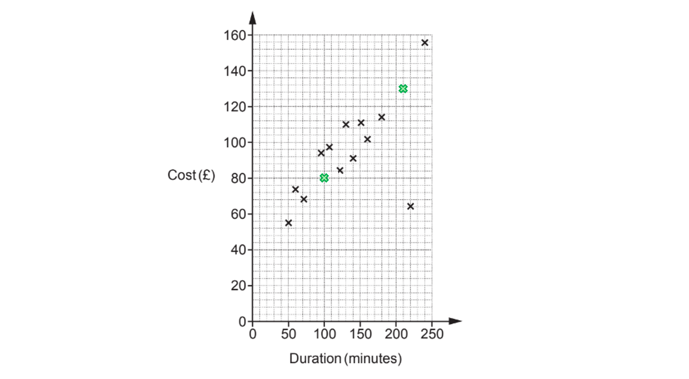

**[1]**
> *The price will be lower than what is suggested by the trend.*

**[1]**
*i) **Remember the line of best fit should only be drawn within the range of data. *
*It does not need to start at the origin.*

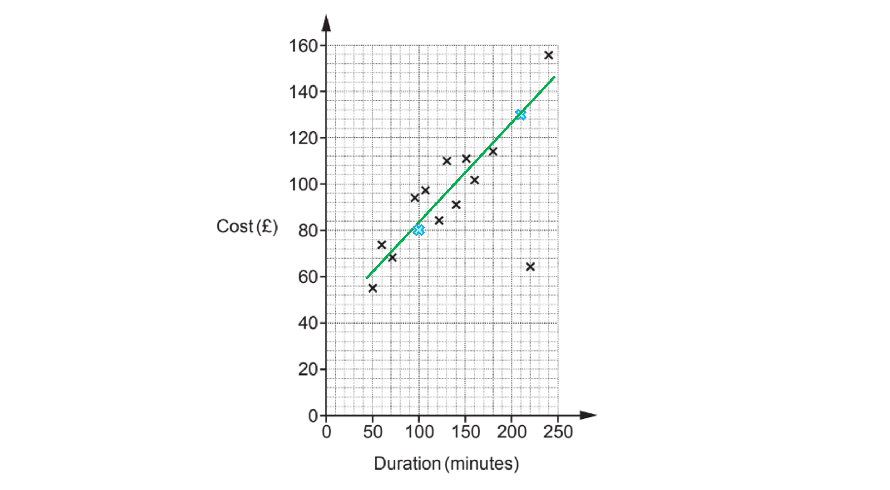

**[1]**

*ii) **Draw a horizontal line from 90 until it meets the line of best fit. From that point draw a vertical line down to the axis. Read off the number.*

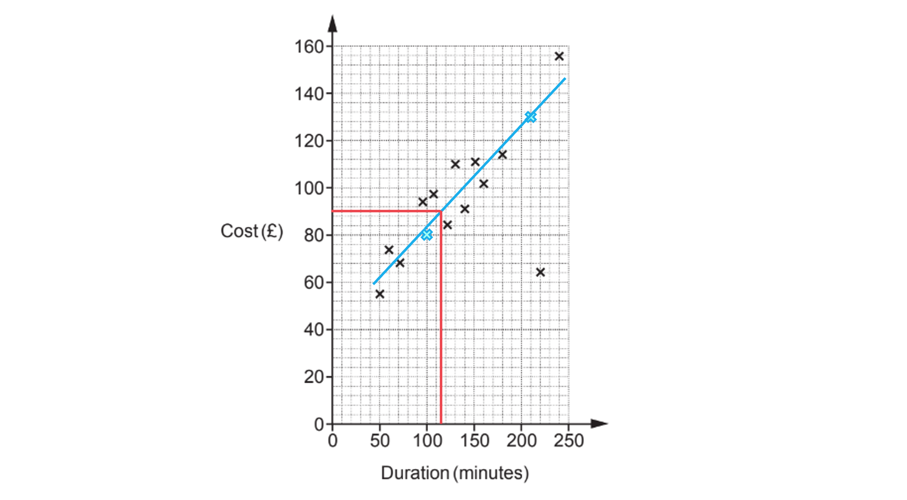

**115 minutes** **[1] **
**A range of answers are accepted based on your line of best fit**
> *Convert 7 hours to minutes.*

*7 × 60 = 420 minutes*

**420 minutes is ****not within the range of data**** so the line of best fit should not be used** **[1]**

### Q16
> *Plot the points (4.2, 13.4), (5.7, 11.8), (7.1, 9.8) and (8.8, 8.3). Reading the scales carefully on the graph - on both axes each small square represents 0.2 units. *
*Using a ruler may help.*

**Two or three points plotted correctly ****[1]** 
**All four points plotted correctly ****[1]**
> *As the distance increases, the average speed decreases.*

**The graph shows negative correlation. ****[1]**

**The type (positive or negative) of correlation must be stated and not just described. **
*The line of best fit should be a straight line, drawn with a ruler and must cover the whole range of the plotted points. It does not have to, but may, pass through any of the plotted points.* 
*Try to have approximately the same amount of points both above and below the line.*

**[1]**
> *Use a ruler to draw a vertical straight line from 6 on the distance** **axis to the line of best fit and then a horizontal straight line to the average speed axis. *

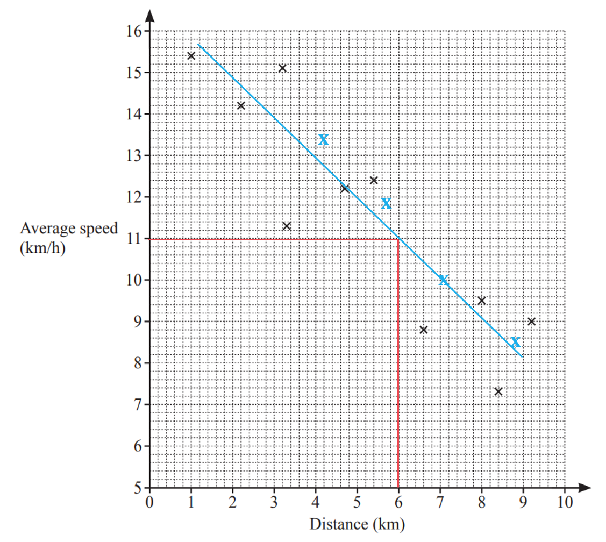

> *Read off the value to estimate the average speed.*

**Approximately 11 km/h** **[1]**

**Answers in the range 10 to 12 km/h are accepted as long as the line of best fit is used correctly.**

### Q17
> *On the scatter diagram, identify the furthest point to the right, as this will be the highest on the Test 1 axis.*

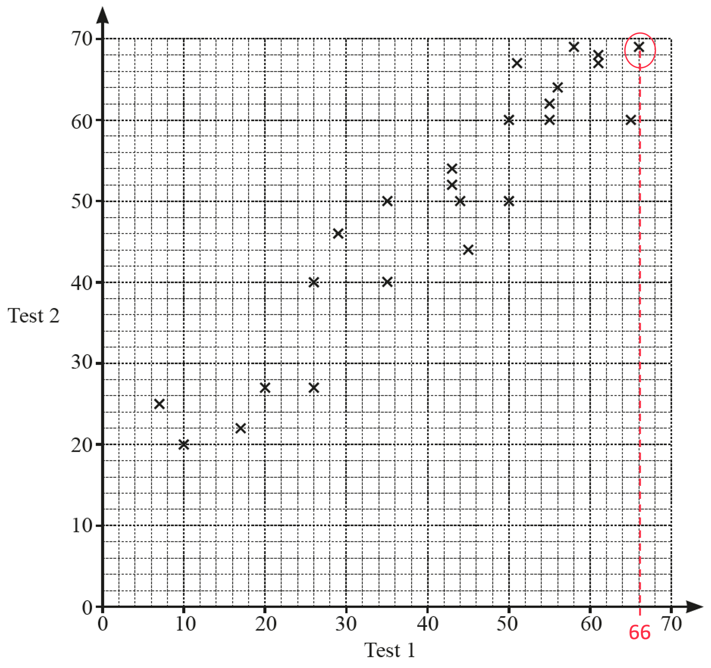

**66 marks**** [1]**
> *As Test 1 scores increase, Test 2 scores tend to increase. So we have positive correlation.*

**Positive correlation **
**the word**** ****"positive" ****[1]**
> *The line of best fit (LOBF) is drawn by eye so there is some margin of error. *
*The LOBF does not have to, but may, pass through any of the plotted points. *
*In this case, the LOBF does not necessarily have to pass through the origin.*

> *The LOBF must be drawn with a ruler/ straight edge and its gradient must match the correlation of the points (positive/ negative). It should have roughly the same number of points above as below it and should extend all the way to the edges of the grid.*

> *The LOBF drawn below is an example of an appropriate answer.*

**correct LOBF drawn with a straight edge ****[1]**
> *Your answer to this question will depend on your line of best fit (LOBF) drawn in the previous part of the question. But your method should always be the same.*

> *Draw a vertical line up from 40 on the Test 1 axis to your LOBF. Then draw a horizontal line across to the Test 2 axis.*

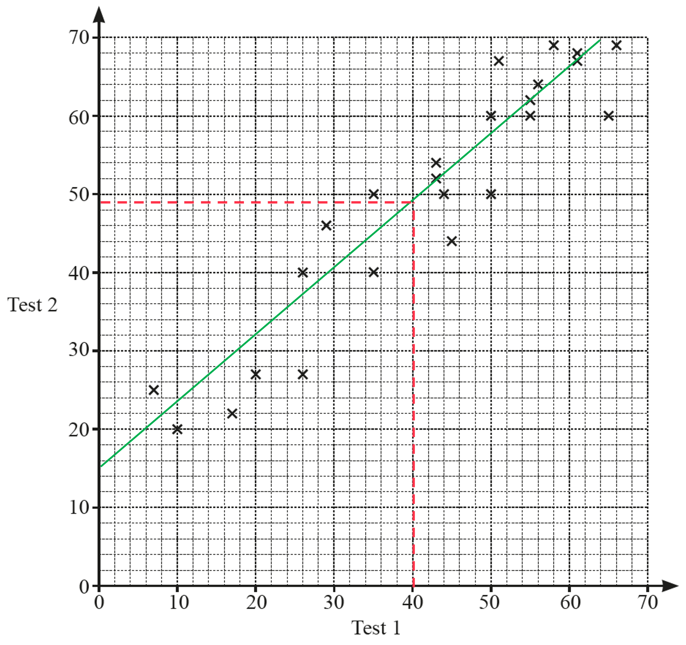

*Read off the Test 2 axis to estimate the score. *
*According to **this** LOBF, the answer would be ***49***.*

**46 to 50 **
**any answer between 46 and 50 that's consistent with the LOBF**** [1] **

### Q18
*To see if Molly is right we need to find the **gradient** of a **line** of **best fit**.* 
*A line of best fit can be drawn by eye, with roughly as many points on one side of the line as the other.*

*To find the gradient of the line of best fit, use* $\mathrm{Gradient}=\frac{\mathrm{Rise}}{\mathrm{Run}}$*.*

**Line of best fit**** [1]**

$\mathrm{Gradient} \mathrm{of} \mathrm{line} \mathrm{of} \mathrm{best} \mathrm{fit}=\frac{-46}{20}=-2.3$

**[1]**

> *This means for every 1 °C the outside temperature increases by, the number of units of electricity used **decreases** by 2,3. Compare this to Molly's statement and answer the question.*

**Molly is not right, the number of units of electricity used for heating decreases by around 2.3 °C on average, not 4 °C ****[1]**

**Gradients in the range ±(2 - 3) are accepted.**
**30 °C is outside the range of plotted (observed) data points and so we do not know if the pattern of points would continue beyond the highest point plotted of around 20 °C so extending and using the line of best fit would be unreliable**** ****[1]**

### Q19
*Draw a vertical line up from 15.12 m on the triple jump (**x**-) axis until it meets the correct point.* 
*Draw horizontal line across to the 100 m (**y**-) axis.*

> *Read off the time axis to estimate the time for the 100 m race.*

$12.88$** seconds** **[1]**
> *Plot the points (14.74, 13.2) and (15.2, 12.76). *
*Be careful with the scale - you may find it helpful to draw vertical and horizontal lines from the axes at the given values for each point and mark the points where they intersect.*

**[1]**
> *The line of best fit (LOBF) does not have to, but may, pass through any of the plotted points.*
*In this case we need to draw a straight line going (roughly) from the top left to the bottom right. *
*Try to keep roughly the same amount of points on either side of the line.*

**[1]**

**Make sure you use a ruler to get the mark.**
> *Your line of best fit can help - it has a negative gradient. *
*This, and the plotted points, indicate that as the distance jumped increases, the time taken to run 100 m decreases.*

**Negative correlation**** [1]**

### Q20
*Plot the points* *(2, 250)** and **(3.1, 190)**.*

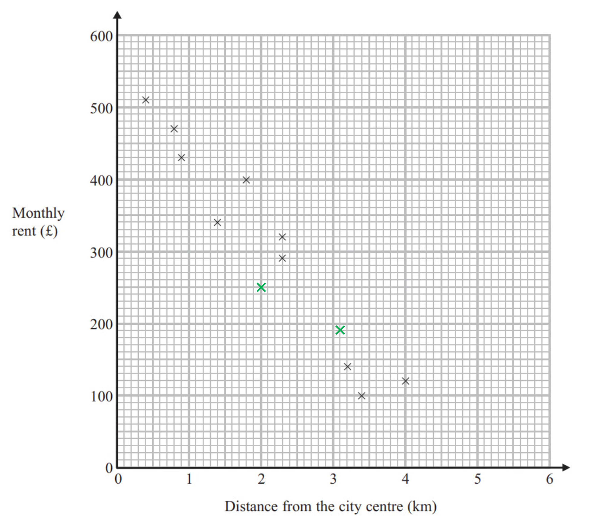

**[1]**
**The further from the city centre an apartment is, the cheaper the monthly rent is** **[1]**

**Negative correlation is also allowed.**

### Q21
> *As one variable increases (more ice cream), the other variable also increases (temperature rises). *
*If both variables increase the correlation must be positive.*

**Positive correlation** **[1]**
