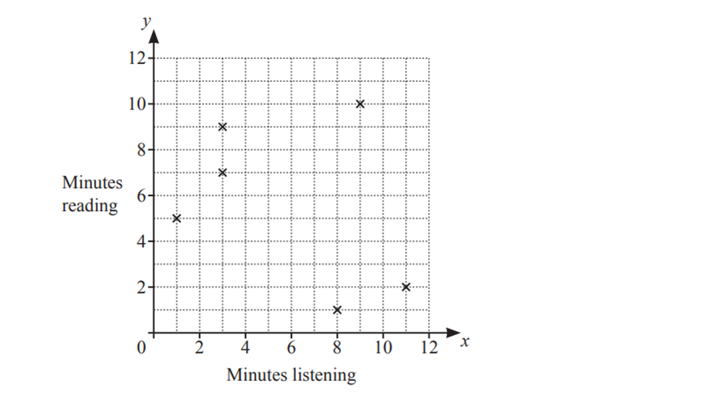
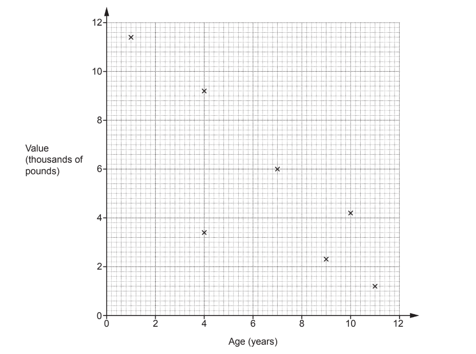
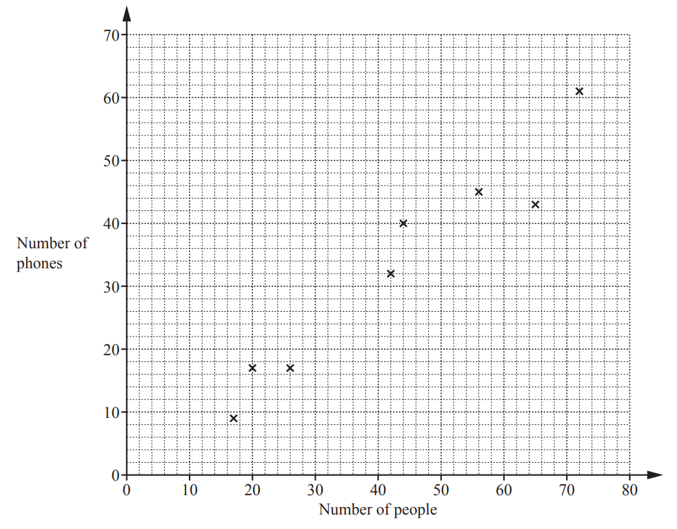
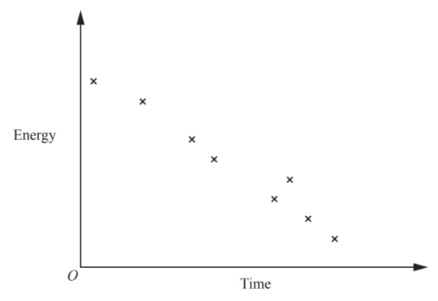
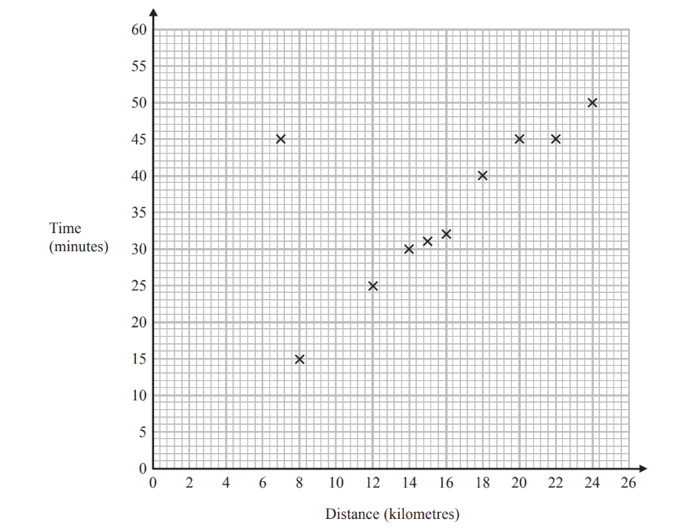
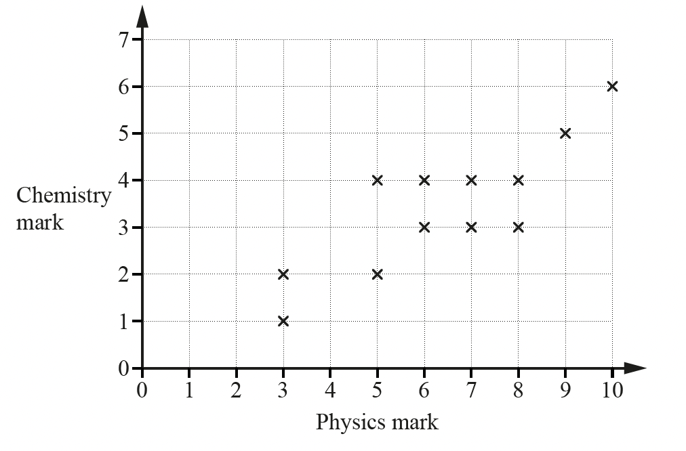
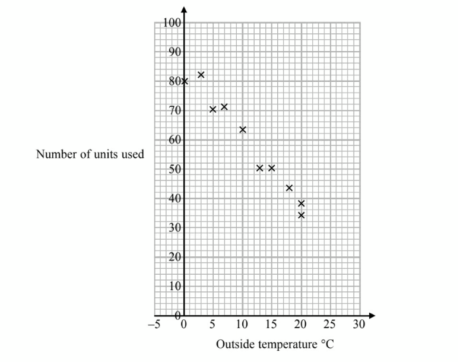

# Exam Questions — Scatter Graphs & Correlation
**Statistics** · Cambridge (CIE) IGCSE maths (0607)
> Source: [https://www.savemyexams.com/igcse/maths/cie/international-maths/23/extended/topic-questions/](https://www.savemyexams.com/igcse/maths/cie/international-maths/23/extended/topic-questions/) · 21 questions across 1 sets

## Exam Questions (21 questions)

### Q1 — hard — 4 marks

**Q1** [2 marks]

The table below shows the distance from the city centre, $x$ km, and the corresponding internet download speed, $y$ Mbps (megabits per second).

| $x$ | 45 | 68 | 92 | 130 | 190 | 320 | 560 |
|---|---|---|---|---|---|---|---|
| $y$ | 180 | 140 | 110 | 85 | 60 | 32 | 12 |

Using your calculator, find the regression line of $y$ on $x$ in the form $y=a+bx$.

Round $a$ to the nearest whole number and round $b$ to 2 decimal places.

**Q1** [1 mark]

Use the regression line in part (a) to predict the download speed in a village that is 250 km away from the city centre.

**Q1** [1 mark]

A data point $( x , y )$ is removed from the table.

A student calculates the regression line for the remaining data and claims that it has the equation $y=140+0.27x$.

Without further calculation, explain why their answer cannot be correct.

### Q2 — medium — 4 marks

**Q2** [2 marks]

The table below shows data collected for a racing car.

$x$ is the distance travelled, measured in kilometres.

$y$ is the amount of fuel used, measured in litres.

| $x$ | 10.0 | 20.0 | 30.0 | 40.0 | 50.0 | 60.0 |
|---|---|---|---|---|---|---|
| $y$ | 2.3 | 4.1 | 6.2 | 8.0 | 9.9 | 12.1 |

Using your calculator, find the regression line of $y$ on $x$ in the form $y=a+bx$.

Round to 3 decimal places where appropriate.

**Q2** [1 mark]

Interpret the meaning of the constant $b$ in the context of the scenario.

**Q2** [1 mark]

The racing car completes a race which is a total distance of 38 km.

Use your regression line to predict the amount of fuel used to complete the the race.

### Q3 — medium — 4 marks

**Q3** [1 mark]

The table shows the marks of 12 students in a French examination and a Spanish examination.

| French mark ($x$) | 17 | 23 | 28 | 32 | 37 | 42 | 57 | 61 | 77 | 82 | 94 | 96 |
|---|---|---|---|---|---|---|---|---|---|---|---|---|
| Spanish mark ($y$) | 26 | 22 | 33 | 46 | 41 | 53 | 62 | 67 | 66 | 75 | 83 | 95 |

Find the equation of the regression line for $y$ in terms of $x.$

$y=$ ...................................

**Q3** [2 marks]

**Extract:**

Find the equation of the regression line for y in terms of x. y equals ...................................

Use your equation to estimate the Spanish mark when

(i)  the French mark is 50

[1]

(ii)  the French mark is 6

[1]

*Source: June 2023 0607/43 Q3D*

**Q3** [1 mark]

**Extract:**

The table shows the marks of 12 students in a French examination and a Spanish examination.

| French mark (x) | 17 | 23 | 28 | 32 | 37 | 42 | 57 | 61 | 77 | 82 | 94 | 96 |
| Spanish mark (y) | 26 | 22 | 33 | 46 | 41 | 53 | 62 | 67 | 66 | 75 | 83 | 95 |

Which French mark, 50 or 6, is likely to give the most reliable Spanish mark? 
Give a reason for your answer.

.................... because .....................

*Source: June 2023 0607/42 Q3E*

### Q4 — easy — 1 marks

**Q4** [1 mark]

There is correlation between quantity $p$ and quantity $q$.

The regression equation is $p=80-5.2q$.

What type of correlation is there between $p$ and $q$?

*Source: June 2023 0607/22 Q10*

### Q5 — hard — 6 marks

**Q5** [2 marks]

A group of 10 people were asked the time, correct to the nearest minute, they each spent listening to the news and reading the news on Monday.

The results are shown in the table.

| Minutes listening ($x$) | 1 | 9 | 3 | 3 | 11 | 8 | 2 | 7 | 1 | 4 |
|---|---|---|---|---|---|---|---|---|---|---|
| Minutes reading ($y$) | 5 | 10 | 9 | 7 | 2 | 1 | 3 | 6 | 11 | 5 |

Complete the scatter diagram.
The first six points have been plotted for you.

*Source: Nov 2023 0607/42 Q4AI*

**Q5** [1 mark]

**Extract:**

Minutes reading ([y]): 5, 10, 9, 7, 2, 1, 3, 6, 11, 5

Find the median time spent reading the news on Monday.

*Source: Nov 23 0607/42 Q4AII*

**Q5** [2 marks]

**Extract:**

| Minutes listening (x) | 1 | 9 | 3 | 3 | 11 | 8 | 2 | 7 | 1 | 4 |
| Minutes reading (y) | 5 | 10 | 9 | 7 | 2 | 1 | 3 | 6 | 11 | 5 |

Find the equation of the line of regression.

Give your answer in the form $y=mx+c$.

*Source: Nov 2023 0607/42 Q4AIII*

**Q5** [1 mark]

**Extract:**

Find the equation of the line of regression. 

Give your answer in the form y = mx + c.

On Tuesday, each person spends the same time listening to the news as they did on Monday. 
They each spend 5 minutes longer reading the news than they did on Monday.

Write down the equation of the line of regression for Tuesday.

*Source: Nov 2023 0607/42 Q4AIV*

### Q6 — medium — 3 marks

**Q6** [1 mark]

The table shows the daily maximum temperature and the daily minimum temperature during a week in a town.

| Maximum temperature ($x^{^{\circ}}C$) | 28 | 25 | 26 | 26 | 30 | 31 | 27 |
|---|---|---|---|---|---|---|---|
| Minimum temperature ($y^{^{\circ}}C$) | 14 | 13 | 14 | 13 | 16 | 16 | 15 |

Write down the type of correlation between the daily maximum temperature and the daily minimum temperature.

*Source: 2025 Specimen Q4A*

**Q6** [2 marks]

**Extract:**

Maximum temperature (x in °C): 28, 25, 26, 26, 30, 31, 27
Minimum temperature (y in °C): 14, 13, 14, 13, 16, 16, 15

Find the equation of the line of regression, giving $y$ in terms of $x$.

*Source: 2025 Specimen Q4B*

### Q7 — hard — 8 marks

**Q7** [2 marks]

The table shows the ages and values of 11 cars of the same model.

| Age (years) | 4 | 7 | 11 | 1 | 9 | 10 | 4 | 3 | 7 | 8 | 12 |
|---|---|---|---|---|---|---|---|---|---|---|---|
| Value (thousands of pounds) | 9.2 | 6.0 | 1.2 | 11.4 | 2.3 | 4.2 | 3.4 | 8.0 | 5.6 | 5.0 | 0.4 |

The points for the first 7 cars are plotted on the scatter diagram.

Plot the points for the remaining 4 cars.

*Source: June 2019 J560/05 Q5A*

**Q7** [2 marks]

Describe the type and strength of the correlation shown in the completed scatter diagram.

*Source: June 2019 J560/05 Q5B*

**Q7** [1 mark]

**Extract:**

| Age (years) | 4 | 7 | 11 | 1 | 9 | 10 | 4 | 3 | 7 | 8 | 12 |
| Value (thousands of pounds) | 9.2 | 6.0 | 1.2 | 11.4 | 2.3 | 4.2 | 3.4 | 8.0 | 5.6 | 5.0 | 0.4 |

One car lost its value more quickly than the other cars.

On the scatter diagram, draw a circle around the point representing this car.

*Source: June 2019 J560/05 Q5C*

**Q7** [2 marks]

**Extract:**

The table shows the ages and values of 11 cars of the same model.

| Age (years) | 4 | 7 | 11 | 1 | 9 | 10 | 4 | 3 | 7 | 8 | 12 |
| Value (thousands of pounds) | 9.2 | 6.0 | 1.2 | 11.4 | 2.3 | 4.2 | 3.4 | 8.0 | 5.6 | 5.0 | 0.4 |

By drawing a line of best fit, estimate the value of a car that is 6 years old.

£ ......................................................

*Source: June 2019 J560/05 Q5D*

**Q7** [1 mark]

**Extract:**

The table shows the ages and values of 11 cars of the same model.

| Age (years) | 4 | 7 | 11 | 1 | 9 | 10 | 4 | 3 | 7 | 8 | 12 |
| Value (thousands of pounds) | 9.2 | 6.0 | 1.2 | 11.4 | 2.3 | 4.2 | 3.4 | 8.0 | 5.6 | 5.0 | 0.4 |

Explain the limitations of using the equation of the line of best fit to estimate the value of a car that is 16 years old.

*Source: June 2019 J560/05 Q5E*

### Q8 — hard — 4 marks

**Q8** [1 mark]

A publisher checks documents for errors.

He records the number of documents that are checked each day. 
He also records the total number of errors in the documents each day.

The scatter graph shows this information.

On another day 90 documents are checked.

There is a total of 17 errors.

Show this information on the scatter graph.

*Source: November 2013 1MA0/1H Q2A*

**Q8** [1 mark]

**Extract:**

He records the number of documents that are checked each day. 
He also records the total number of errors in the documents each day.
The scatter graph shows this information.

Describe the correlation between the number of documents checked and the total number of errors.

*Source: November 2013 1MA0/1H Q2B*

**Q8** [2 marks]

**Extract:**

The scatter graph shows this information. On another day 90 documents are checked. There is a total of 17 errors. Show this information on the scatter graph.

One day 110 documents are checked.

Estimate the total number of errors in these documents.

*Source: November 2013 1MA0/1H Q2C*

### Q9 — easy — 2 marks

**Q9** [1 mark]

The scatter diagram shows the number of people and the number of phones in each of 8 buildings.

One of the buildings contains 42 people.

Write down the number of phones in this building.

*Source: 2019	May/June 0580/23 Q8A*

**Q9** [1 mark]

**Extract:**

The scatter diagram shows the number of people and the number of phones in each of 8 buildings.

What type of correlation is shown in the scatter diagram?

*Source: 2019	May/June 0580/23 Q8B*

### Q10 — easy — 2 marks

**Q10** [1 mark]

The scatter graph shows some information about 10 cars, of the same type and make.

The graph shows the age (years) and the value (£) of each car.

The table shows the age and the value of two other cars of the same type and make.

| **age(years)** | 1 | 3.5 |
|---|---|---|
| **value(£)** | 8200 | 5000 |

On the scatter graph, plot the information from the table.

*Source: June 2013 1MA0/2H Q3A*

**Q10** [1 mark]

**Extract:**

The scatter graph shows some information about 10 cars, of the same type and make. The graph shows the age (years) and the value (£) of each car. The table shows the age and the value of two other cars of the same type and make. | age(years) | 1 | 3.5 | | value(£) | 8200 | 5000 |

Describe the relationship between the age and the value of the cars.

*Source: June 2013 1MA0/2H Q3A*

### Q11 — medium — 4 marks

**Q11** [1 mark]

The scatter diagram shows the value, in thousands of dollars, of eight houses in 1996 and the value of the same houses in 2016.

One of these eight houses had a value of \$70 000 in 1996.

Write down the value of this house in 2016.

\$ ................................................

*Source: 2018	May/June 0580/22 Q21A*

**Q11** [1 mark]

The values of two more houses are shown in the table.

| Value in 1996 (\$ thousands) | $40$ | $80$ |
|---|---|---|
| Value in 2016 (\$ thousands) | $80$ | $150$ |

On the scatter diagram, plot these values.

*Source: 2018	May/June 0580/22 Q21B*

**Q11** [1 mark]

On the scatter diagram, draw a line of best fit.

*Source: 2018	May/June 0580/22 Q21C*

**Q11** [1 mark]

**Extract:**

On the scatter diagram, draw a line of best fit.

Another house had a value of \$50 000 in 1996.

Find an estimate of the value of this house in 2016.

\$ ................................................

*Source: 2018	May/June 0580/22 Q21D*

### Q12 — easy — 1 marks

**Q12** [1 mark]

What type of correlation does the scatter diagram show?

*Source: 2018	Oct/Nov 0580/21 Q3*

### Q13 — hard — 5 marks

**Q13** [1 mark]

A delivery driver records for each delivery the distance he drives and the time taken.

The scatter graph shows this information.

For another delivery he drives 22 kilometres and takes 50 minutes.

Show this information on the scatter graph.

*Source: November 2015 1MA0/2H Q2A*

**Q13** [1 mark]

**Extract:**

A delivery driver records for each delivery the distance he drives and the time taken. The scatter graph shows this information.

What type of correlation does the scatter graph show?

*Source: November 2015 1MA0/2H Q2B*

**Q13** [2 marks]

The driver has to drive a distance of 10 km for his next delivery.

Estimate the time taken for this delivery.

*Source: November 2015 1MA0/2H Q2C*

**Q13** [1 mark]

**Extract:**

A delivery driver records for each delivery the distance he drives and the time taken. The scatter graph shows this information.

During one of the deliveries, the driver was delayed by road works.

Using the graph write down the time taken for this delivery.

*Source: November 2015 1MA0/2H Q2D*

### Q14 — medium — 3 marks

**Q14** [3 marks]

The scatter diagram shows the physics mark and the chemistry mark for each of 12 students.

i) What type of correlation is shown in the scatter diagram?

[1]

ii)On the scatter diagram, draw a line of best fit.

[1]

iii) Find an estimate of the chemistry mark for another student who has a physics mark of 4.

[1]

*Source: 2018	May/June 0580/43 Q3A*

### Q15 — hard — 5 marks

**Q15** [2 marks]

A travel agent records the duration and cost of the 15 flights he sold on one day. 
The data for the first 13 flights are plotted on the scatter diagram.

The data for the final two flights is:

| **Duration** | 210 minutes | 1 hour 40 minutes |
|---|---|---|
| **Cost** | £130 | £80 |

Plot these flights on the scatter diagram.

*Source: Nov 2020 J560/06 Q1A*

**Q15** [1 mark]

**Extract:**

A travel agent records the duration and cost of the 15 flights he sold on one day. The data for the first 13 flights are plotted on the scatter diagram. The data for the final two flights is: Duration: 210 minutes, Cost: £130; Duration: 1 hour 40 minutes, Cost: £80.

The cost of one of the 15 flights had been discounted in a sale.

Circle the most likely flight on the scatter diagram.

*Source: Nov 2020 J560/06 Q1B*

**Q15** [1 mark]

**Extract:**

A travel agent records the duration and cost of the 15 flights he sold on one day. 

The data for the first 13 flights are plotted on the scatter diagram.

The data for the final two flights is:

| **Duration** | 210 minutes | 1 hour 40 minutes |
| **Cost** | £130 | £80 |
Plot these flights on the scatter diagram.

i) Draw a line of best fit on the scatter diagram.

ii) Use your line of best fit to estimate the duration of a flight costing £90.

............................................. minutes

*Source: Nov 2020 J560/06 Q1C*

**Q15** [1 mark]

**Extract:**

A travel agent records the duration and cost of the 15 flights he sold on one day. The data for the first 13 flights are plotted on the scatter diagram. The data for the final two flights is: | **Duration** | 210 minutes | 1 hour 40 minutes | **Cost** | £130 | £80 |

Explain why the travel agent should not use his records to estimate the cost of a 7 hour flight.

*Source: Nov 2020 J560/06 Q1D*

### Q16 — medium — 5 marks

**Q16** [2 marks]

Aisha records the distance she runs and her average speed. 
The results are shown in the scatter diagram.

The table shows the results of four more runs.

| Distance (km) | 4.2 | 5.7 | 7.1 | 8.8 |
|---|---|---|---|---|
| Average speed (km/h) | 13.4 | 11.8 | 9.8 | 8.3 |

On the scatter diagram, plot these points.

*Source: 2020 Oct/Nov 0580/02 Q4A*

**Q16** [1 mark]

**Extract:**

Aisha records the distance she runs and her average speed. 

The results are shown in the scatter diagram.

What type of correlation is shown in the scatter diagram?

*Source: 2020 Oct/Nov 0580/02 Q4B*

**Q16** [1 mark]

**Extract:**

Aisha records the distance she runs and her average speed. The results are shown in the scatter diagram. The table shows the results of four more runs. | Distance (km) | 4.2 | 5.7 | 7.1 | 8.8 | | Average speed (km/h) | 13.4 | 11.8 | 9.8 | 8.3 | On the scatter diagram, plot these points.

On the scatter diagram, draw a line of best fit.

*Source: 2020 Oct/Nov 0580/02 Q4C*

**Q16** [1 mark]

**Extract:**

Aisha records the distance she runs and her average speed. 

The results are shown in the scatter diagram.

| Distance (km) | 4.2 | 5.7 | 7.1 | 8.8 |
| Average speed (km/h) | 13.4 | 11.8 | 9.8 | 8.3 |
 On the scatter diagram, plot these points.

Use your line of best fit to estimate her average speed when she runs a distance of 6 km.

........................................ km/h

*Source: 2020 Oct/Nov 0580/02 Q4D*

### Q17 — medium — 4 marks

**Q17** [1 mark]

Mrs Salaman gives her class two mathematics tests. 
The scatter diagram shows information about the marks each student scored.

Write down the highest mark scored on test 1.

*Source: 2020	May/June 0580/21 Q3A*

**Q17** [1 mark]

**Extract:**

The scatter diagram shows information about the marks each student scored.

Write down the type of correlation shown in the scatter diagram.

*Source: 2020	May/June 0580/21 Q3B*

**Q17** [1 mark]

**Extract:**

The scatter diagram shows information about the marks each student scored.

Draw a line of best fit on the scatter diagram.

*Source: 2020	May/June 0580/21 Q3C*

**Q17** [1 mark]

**Extract:**

Mrs Salaman gives her class two mathematics tests. The scatter diagram shows information about the marks each student scored. Draw a line of best fit on the scatter diagram.

Hamish scored a mark of 40 on test 1. He was absent for test 2. Use your line of best fit to find an estimate for his mark on test 2.

*Source: 2020	May/June 0580/21 Q3D*

### Q18 — hard — 4 marks

**Q18** [3 marks]

In a survey, the outside temperature and the number of units of electricity used for heating were recorded for ten homes.

The scatter diagram shows this information.

Molly says,

"On average the number of units of electricity used for heating decreases by 4 units for each °C increase in outside temperature."

Is Molly right? 
Show how you get your answer.

*Source: 2015	Sample 1MA1/3H Q4A*

**Q18** [1 mark]

**Extract:**

In a survey, the outside temperature and the number of units of electricity used for heating were recorded for ten homes. The scatter diagram shows this information.

You should **not** use a line of best fit to predict the number of units of electricity used for heating when the outside temperature is 30 °C.

Give one reason why.

*Source: 2015	Sample 1MA1/3H Q4B*

### Q19 — medium — 4 marks

**Q19** [1 mark]

Ten athletes compete in both the 100 metre race and the triple jump. 
Their results are shown in the scatter diagram.

One of these athletes jumps 15.12 m in the triple jump.

Write down his time for the 100 metre race.

.................................................. s

*Source: 2019	Oct/Nov 0580/23 Q16A*

**Q19** [1 mark]

**Extract:**

Their results are shown in the scatter diagram.

The values for two other athletes are shown in the table.

| Distance in the triple jump (m) | 14.74 | 15.2 |
|---|---|---|
| Time for 100 m (seconds) | 13.2 | 12.76 |

On the scatter diagram, plot these points.

*Source: 2019	Oct/Nov 0580/23 Q16B*

**Q19** [1 mark]

On the scatter diagram, draw a line of best fit.

*Source: 2019	Oct/Nov 0580/23 Q16C*

**Q19** [1 mark]

**Extract:**

Ten athletes compete in both the 100 metre race and the triple jump. 

Their results are shown in the scatter diagram.

What type of correlation is shown in the scatter diagram?

*Source: 2019	Oct/Nov 0580/23 Q16D*

### Q20 — easy — 2 marks

**Q20** [1 mark]

The scatter graph shows information about 10 apartments in a city.

The graph shows the distance from the city centre and the monthly rent of each apartment.

The table shows the distance from the city centre and the monthly rent for two other apartments.

| **Distance from the city centre(km)** | 2 | 3.1 |
|---|---|---|
| **Monthly rent(£)** | 250 | 190 |

On the scatter graph, plot the information from the table.

*Source: March 2013 1MA0/1H Q2A*

**Q20** [1 mark]

**Extract:**

The scatter graph shows information about 10 apartments in a city. 

The graph shows the distance from the city centre and the monthly rent of each apartment.

The table shows the distance from the city centre and the monthly rent for two other apartments.

| **Distance from the city centre(km)** | 2 | 3.1 |
| **Monthly rent(£)** | 250 | 190 |

Describe the relationship between the distance from the city centre and the monthly rent.

*Source: March 2013 1MA0/1H Q2B*

### Q21 — easy — 1 marks

**Q21** [1 mark]

“We eat more ice cream as the temperature rises.”

What type of correlation is this?

*Source: 2018	Feb/Mar 0580/22 Q1*

