# Mark Schemes — Transformations of Shapes
**Vectors & Transformations** · Cambridge (CIE) IGCSE maths (0607)

## Calculator Questions (13 questions)

### Q1
> *We can see that it is an enlargement but note that the question asks for the transformation **from** **T**  **to** **U**. *
*Triangle **U** is clearly larger than Triangle **T**, so it is an enlargement by a scale factor greater than 1.*

> *Draw three construction lines from vertices on Triangle **U** to corresponding vertices on Triangle **T, **as in the diagram below. Where the three lines intersect is the centre of enlargement. *

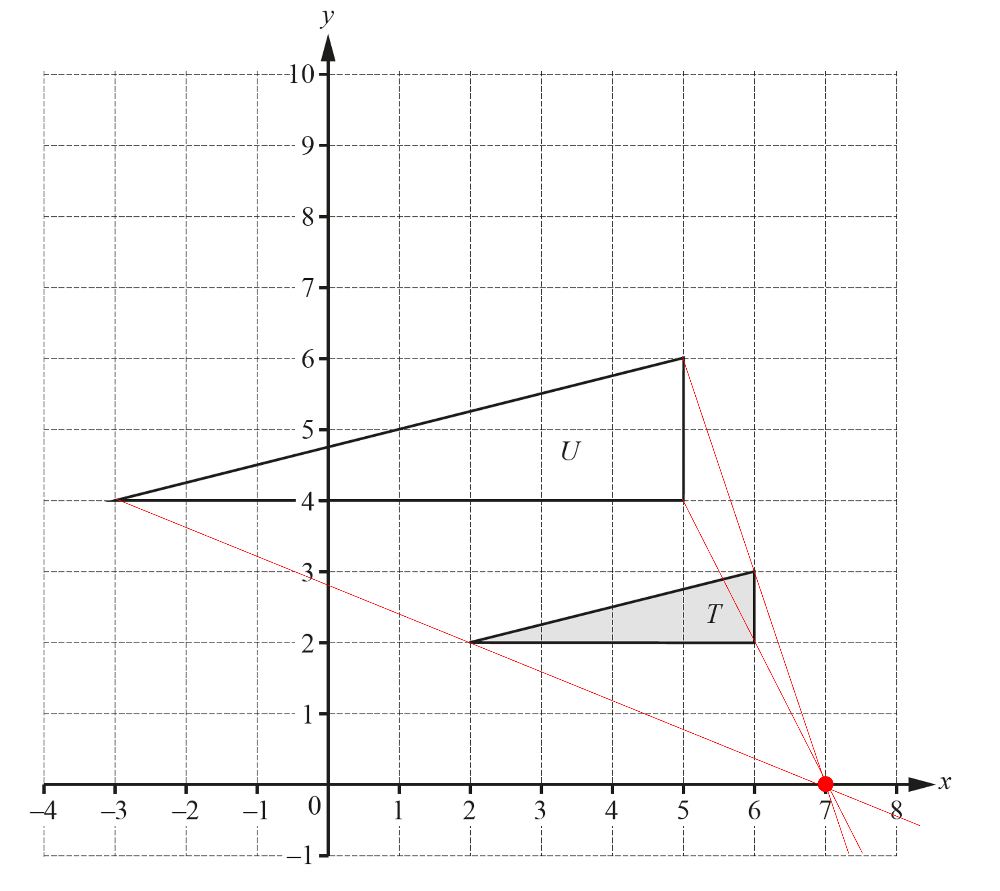

*The centre of enlargement is (7, 0).*

> *The scale factor of enlargement is *`fraction numerator text distance from image ( end text text italic U end text text ) to centre end text over denominator distance space from space object space open parentheses T close parentheses space to space centre end fraction`*. *
*We can measure these distances along the *$x$*- and *$y$*- axes. *
*For example, from the top right vertices of **U** (5, 6) and **T** (6,3);*

`equation`

**Final answer:** **"Enlargement about (7, 0), scale factor 2"**

**"enlargement"  ****[1] **
**correct centre  ****[1] **
**correct scale factor  ****[1]**
> *Method 1 *
*Mark the point (7, 3) on the diagram. *

> *You should be provided with a piece of tracing paper in IGCSE exams. *
*Overlay the tracing paper so that it covers the centre of enlargement (7, 3) and the object, Triangle **T.  *

> *With your pencil, mark all of the vertices of the triangle on the tracing paper. *
*Hold your pencil tip down on centre (7, 3) then rotate the tracing paper 90° clockwise. *
*Carefully holding the paper in place at the centre, lift and mark the new vertices on the exam paper grid.*

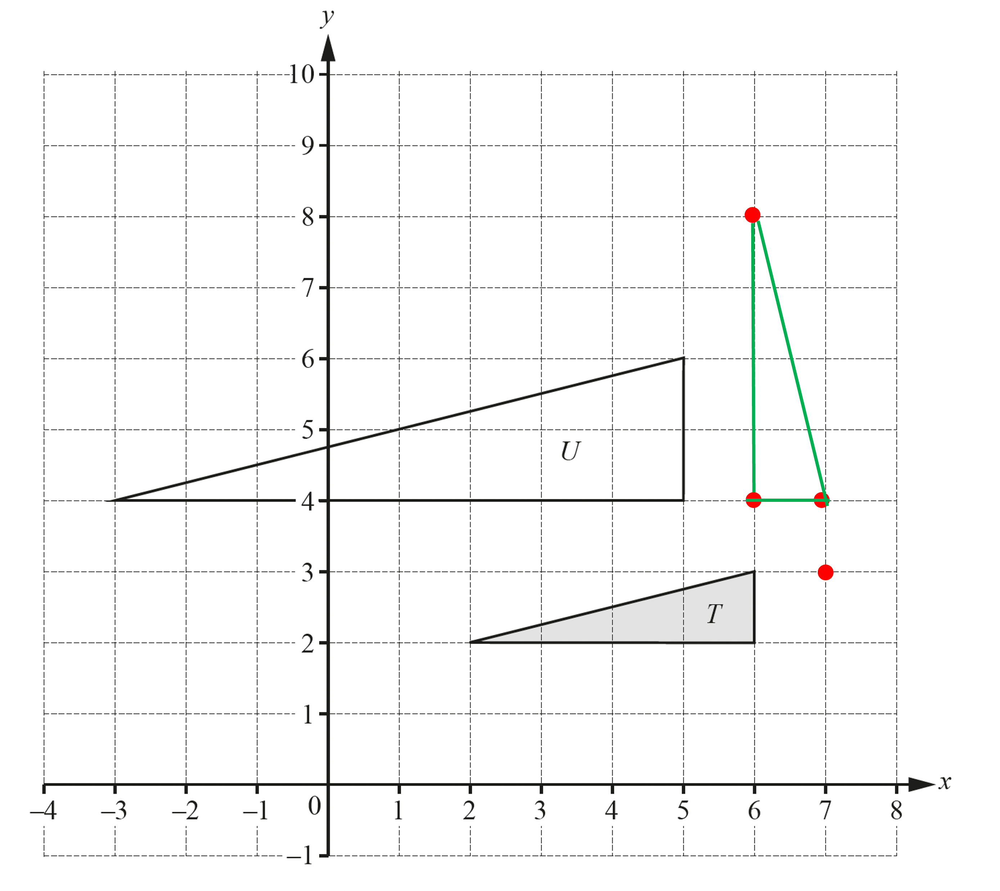

**triangle with vertices at ****(6, 4), (7, 4)**** and ****(6, 8)**** ****[3]**

*Method 2 *
*Mark the point (7, 3) on the diagram.* 
*If you don't want to use the tracing paper, simply draw an "L" shaped route from a vertex on T to centre (7, 3), as shown for vertex (6, 2) on the diagram below.*

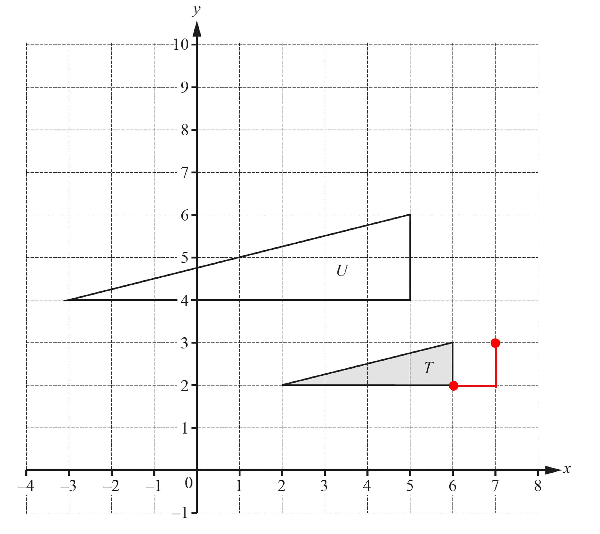

> *Rotate your "L" 90° clockwise from (7, 3)*

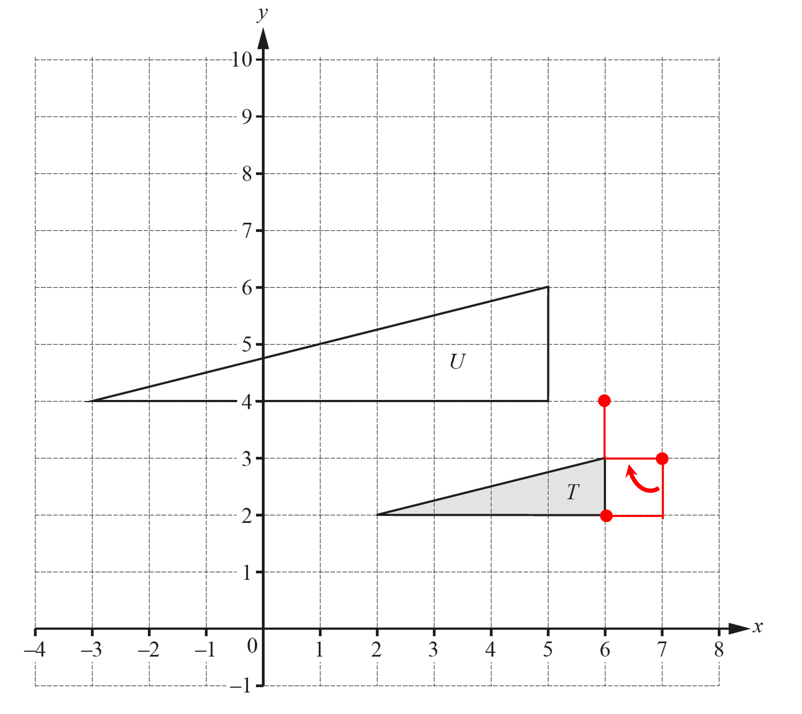

> *Repeat with the other two vertices (in this case the route from (6, 3) to the centre is simply a straight line, not an "L").*

> *The final image is shown below.*

**triangle with vertices at ****(6, 4), (7, 4)**** and ****(6, 8)**** ****[3]**

### Q2
> *An enlargement changes the size of the shape. *
*As the scale factor is between 0 and 1, the shape should be smaller and closer to the centre of enlargement.*

> *Choose a corner and find the displacement from the centre to this corner. *
*Starting at this corner count the distance of each side around the shape. *
*You can ignore the diagonal side as this can be made by joining together the two corners.*

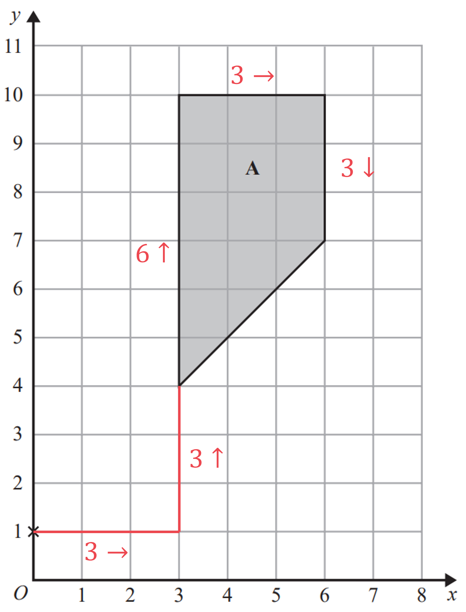

> *Multiply each length/displacement by the scale factor. *
*Starting at the centre use the new displacement to find the position of the new corner. *
*Then use the new lengths to draw the enlarged shape.*

> *To check your answer you can draw a straight line going through the centre and a corner of the original shape, the corresponding corner on the enlarged shape should also lie on this line.*

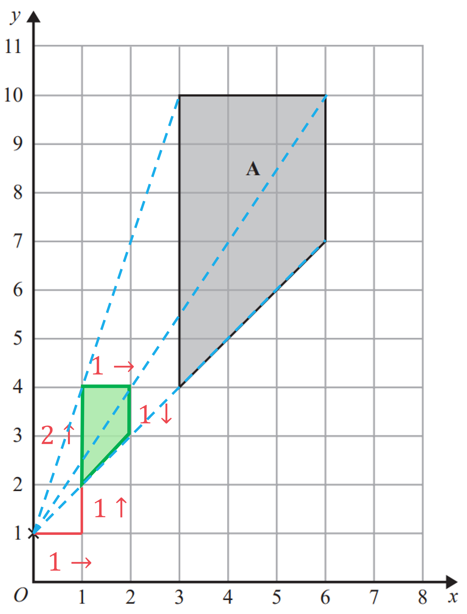

**Enlargement using the correct scale factor ****[1]** 
**Enlargement using the correct centre**** [1]**

### Q3
> *A rotation turns the shape.*

> *Use tracing paper.Hold the tracing paper down at the origin and rotate it 180° in either direction (a half turn). *
*Draw the new shape and label it A.*

> *A rotation of 180° makes each point the same distance from the centre but in the opposite direction. *
*This is a good way to check your answer.*

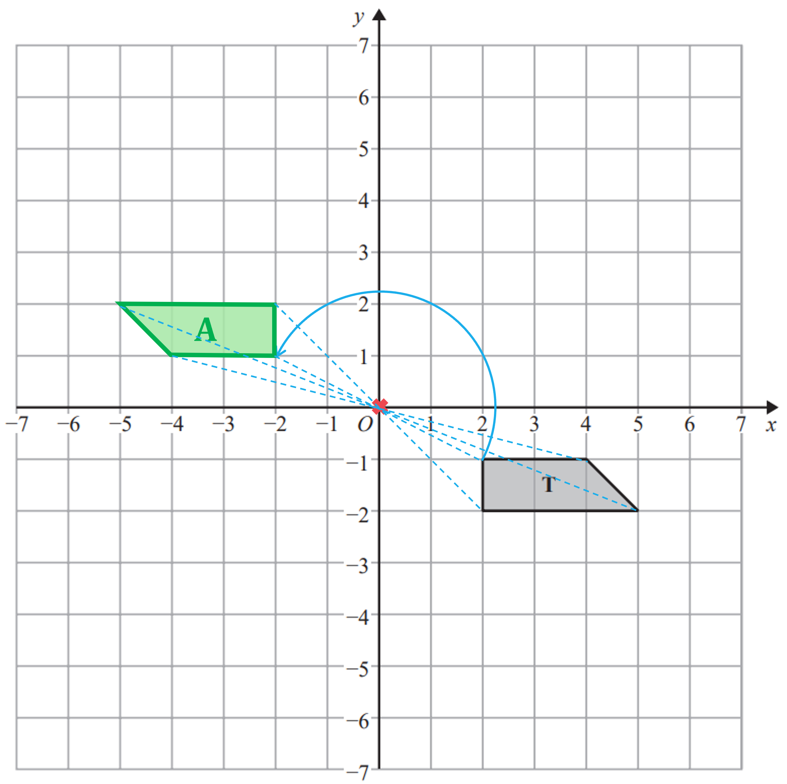

**[1]**
> *A translation moves the shape.*

> *The vector *`open parentheses table row cell negative 1 end cell row cell negative 3 end cell end table close parentheses`* represents 1 unit to the left and 3 units down.*

> *Move the shape left 1 and down 3.*

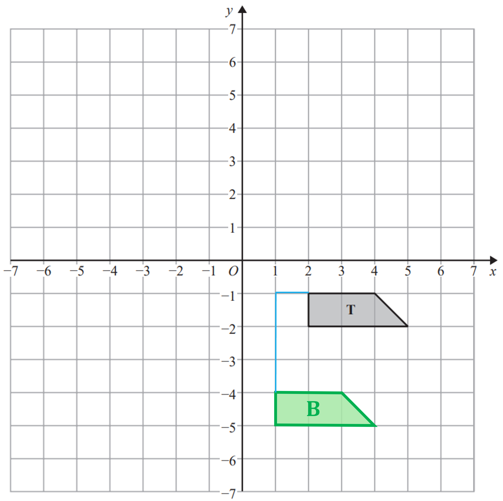

**[1]**

### Q4
> *The shape has been moved so this is a translation.*

> *Pick a point on the original shape and find its corresponding point on the translated shape. *
*Count how many units it has moved horizontally and vertically.*

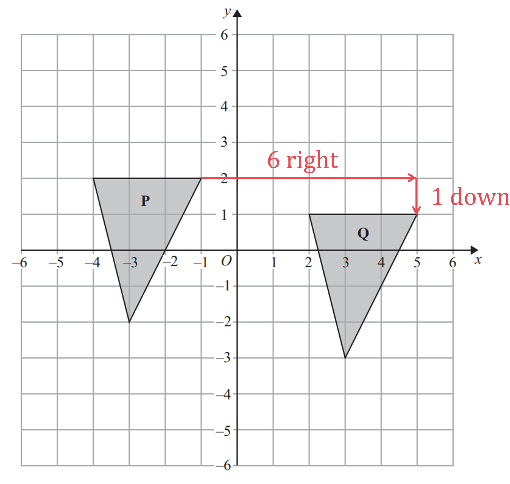

> *Write as a vector. The horizontal displacement goes at the top (right is positive, left is negative). *
*The vertical displacement goes at the bottom (up is positive, down is negative).*

**Translation by** `begin bold style stretchy left parenthesis table row 6 row cell negative 1 end cell end table stretchy right parenthesis end style` 
**Writing "Translation"**** [1]** 
**Correct vector**** [1]**

### Q5
> *A reflection flips the shape.*

> *The perpendicular distance between the reflection of a point and the line of reflection is the same as the perpendicular distance between the original point and the line.*

> *It is easier to turn the page so that the line of reflection is vertical or horizontal. *
*Then count how many squares there are between a corner and the line. *
*Then count the same number of squares on the other side of the line, this is where the new corner will go. *
*Do this for all the corners and then join together to make the new shape.*

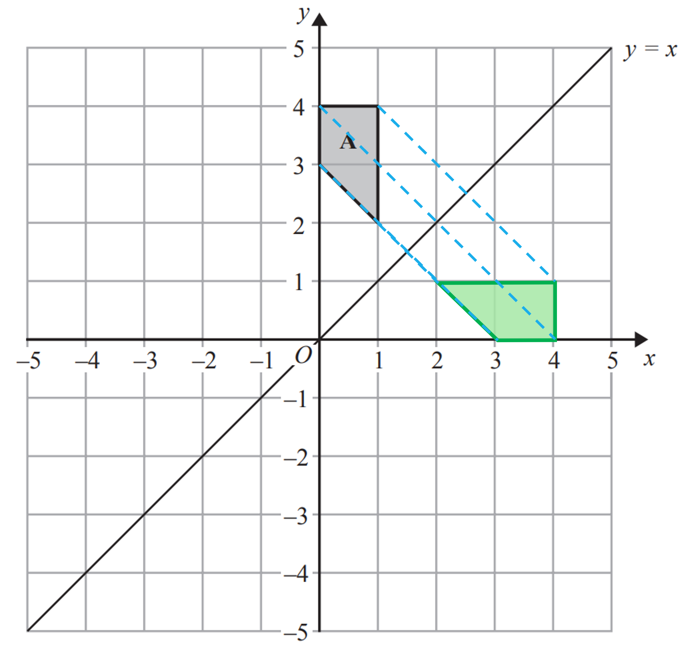

**2 vertices correct**** [1] **
**Shape fully correct**** [1]**
> *The shape has been moved so this is a translation.*

> *Pick a point on the original shape and find its corresponding point on the translated shape. *
*Count how many units it has moved horizontally and vertically.*

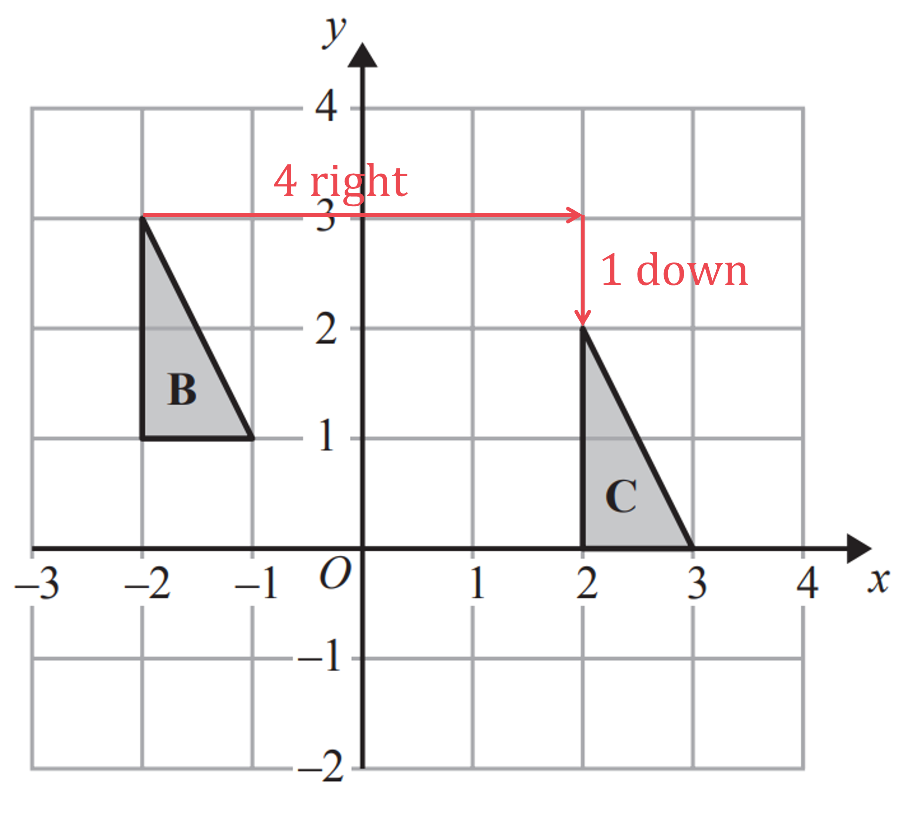

> *Write as a vector. The horizontal displacement goes at the top (right is positive, left is negative). *
*The vertical displacement goes at the bottom (up is positive, down is negative).*

**Translation by** `stretchy left parenthesis table row 4 row cell negative 1 end cell end table stretchy right parenthesis` 
**Writing "Translation"**** [1]** 
**Correct vector**** [1]**

### Q6
*Mark the centre at (3, 1).* 
*Draw rays from the centre (3, 1) through the vertices of Triangle **A**, as shown in the diagram below. *
*As we have a negative scale factor, extend the rays through the point and out the other side.*

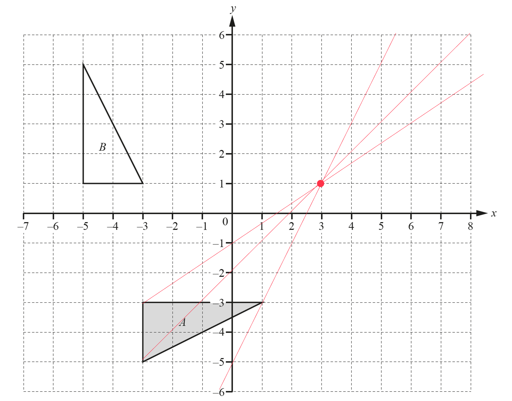

> *The scale factor of enlargement is *$-\frac{1}{2}$*, so use a ruler (or count squares) to measure the lengths of the rays, and halve these lengths. *
*Going in the opposite direction from the centre, measure (or count squares) for the half lengths and mark the vertices of the image, as shown below. Join these vertices to form your answer.*

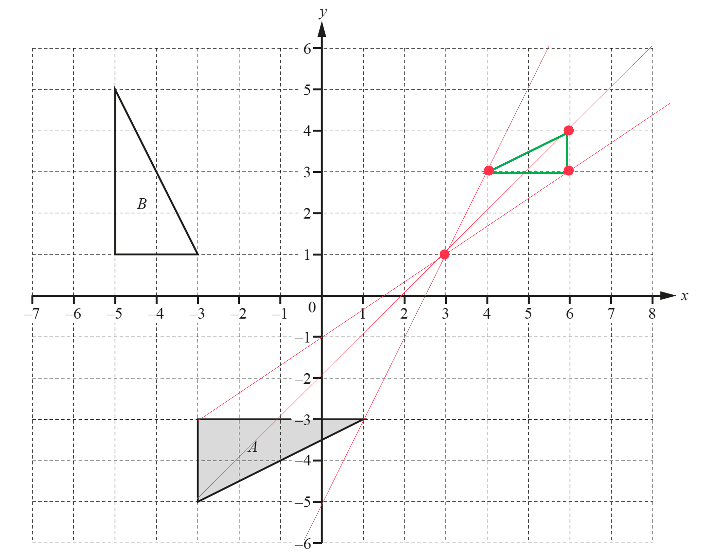

**image drawn in correct shape and size ****[1]**** **
**image drawn in correct orientation ****[1] **
**fully correct answer ****[1]**

**Check that your image looks like a rotation by 180° and that each length is half as big as the original object**

### Q7
*Shape **B** is the same size but a different way up to shape **A** so this must be a rotation or a reflection.* 
*It is not possible to draw in a mirror line so this must be a rotation.  Shape **B** is a quarter of a turn (90°) clockwise from shape **A**.* 
*Find the centre of rotation by joining two pairs of corresponding points on shapes **A** and **B** (dotted lines) and draw their perpendicular bisectors (solid lines). *
*The perpendicular bisectors meet at the centre of rotation (green cross).*

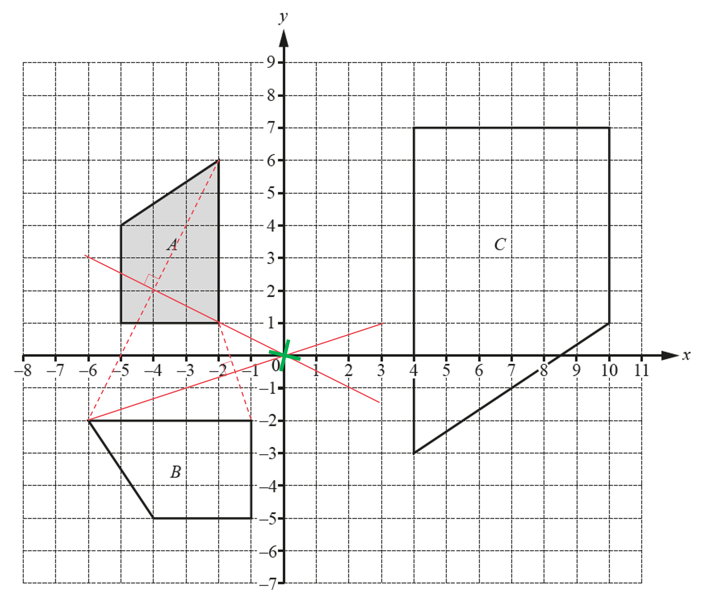

> *You may find it easier to use tracing paper to deduce it is a rotation and to find the angle and direction. *
*You can also use tracing paper to experiment with different centres of rotation - they're not normally far from the origin, if at all!*

**Final answer:** **Shape **$A$** to Shape **$B$** is a 90° anticlockwise rotation with centre of rotation (0, 0)**

**Rotation ****[1] **
**90° anticlockwise (or equivalent)**** [1] **
**Centre of rotation (0, 0)**** [1]**

### Q8
> *The shape has been turned so this is a rotation.*

> *Join each point of the original shape to its corresponding point on the rotated shape with a straight line. *
*If the lines intersect at a point then this is the centre of rotation, otherwise the perpendicular bisectors of the lines will intersect at the centre of rotation.*

> *Using the centre, measure the angle from one point on the original to its corresponding point on the rotated shape.*

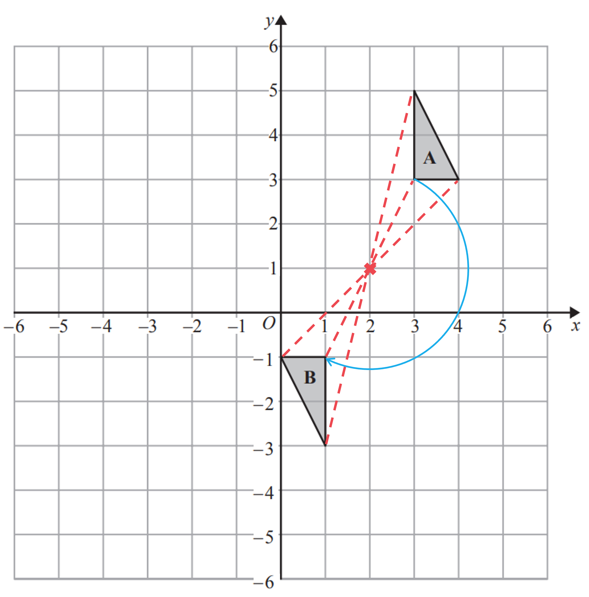

**Rotation 180° about the centre (2, 1) **
**Writing "Rotation" ****[1] **
**Correct angle ****[1] **
**Correct centre ****[1] **
**It is not necessary to write a direction for a rotation of 180° **
**It is also acceptable to write: Enlargement of scale factor -1 about the centre (2, 1)**

### Q9
> *A rotation turns the shape.*

> *Use tracing paper. *
*Hold the tracing paper down at the point (0, 1) and rotate it 90° clockwise (a quarter turn). *
*Draw the new shape and label it B.*

> *A translation moves the shape.*

> `open parentheses table row cell negative 3 end cell row cell negative 1 end cell end table close parentheses`* means 3 unit to the left and 1 unit down. Move B and label it C.*

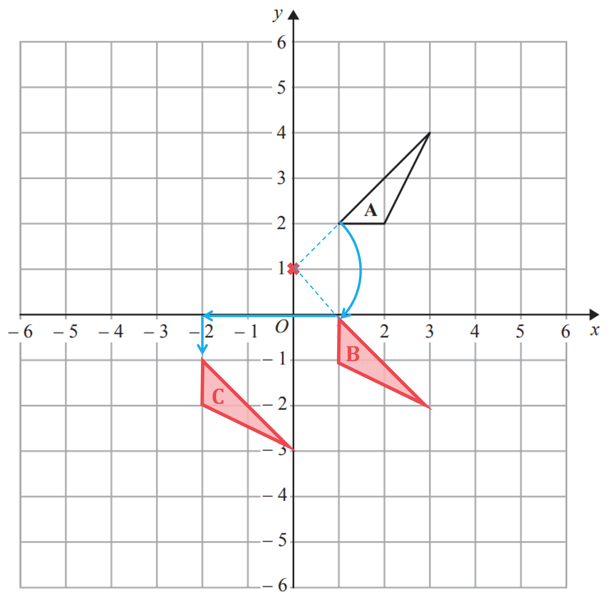

**[1]**

> *The shape has been turned so this is a rotation.*

> *Join each point of the original shape to its corresponding point on the rotated shape with a straight line.*
* If the lines intersect at a point then this is the centre of rotation, otherwise the perpendicular bisectors of the lines will intersect at the centre of rotation.*

> *Using the centre, measure the angle from one point on the original to its corresponding point on the rotated shape. State the direction.*

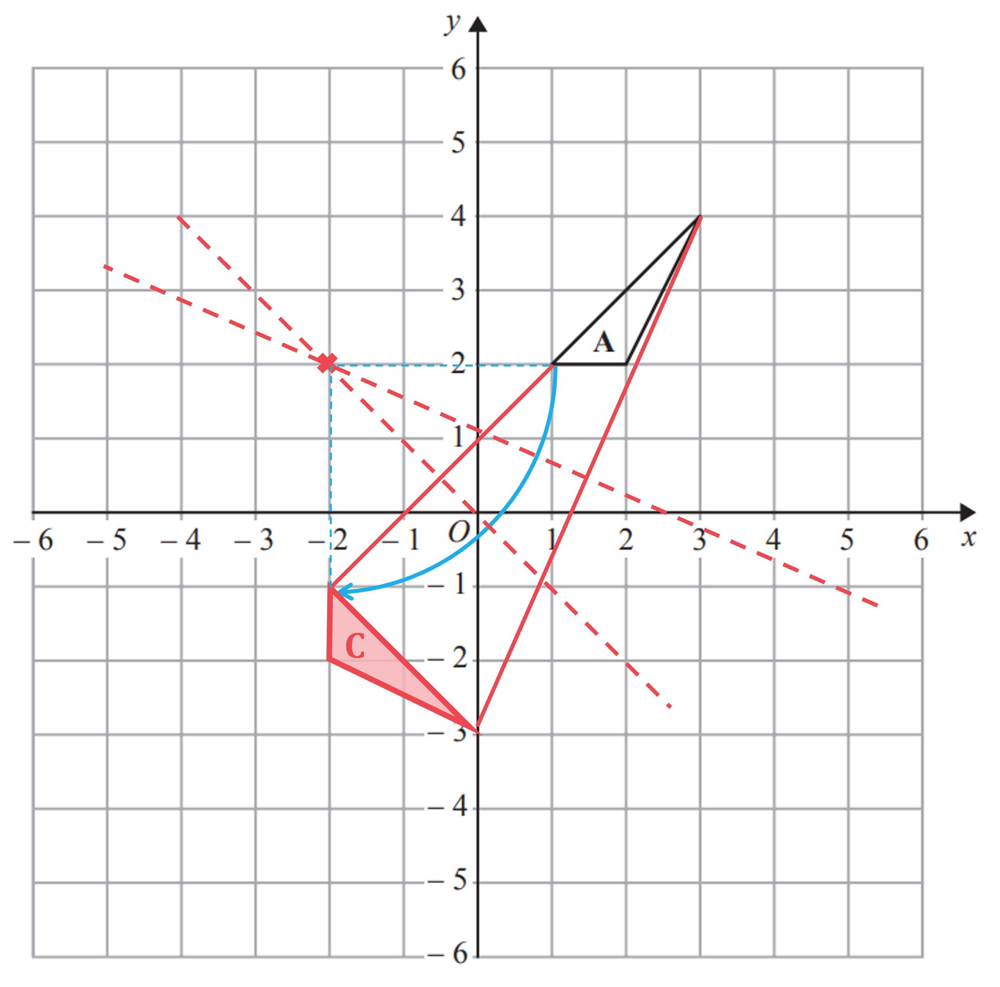

> *You could also use trial and error with tracing paper. *
*Start with trying the centre as the origin and work outwards if needed.*

**Rotation 90° clockwise about the centre (-2, 2) **
**Writing "Rotation" with correct angle ****[1] **
**Writing "Rotation" with correct centre ****[1] **
**It is acceptable to write: 270° anticlockwise**

### Q10
> *A rotation turns the shape.*

> *Use tracing paper.Hold the tracing paper down at the origin and rotate it 90° clockwise (a quarter turn). *
*Draw the new shape.*

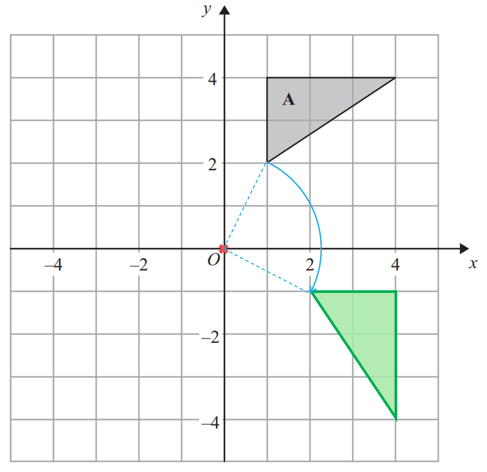

**Rotated 90° clockwise**** [1] **
**Rotated 90° about the correct centre**** [1]**
> *An enlargement changes the size of the shape.*

> *Choose a corner and find the displacement from the centre to this corner. *
*Starting at this corner count the distance of each side around the shape. *
*You can ignore the diagonal side as this can be made by joining together the two corners.*

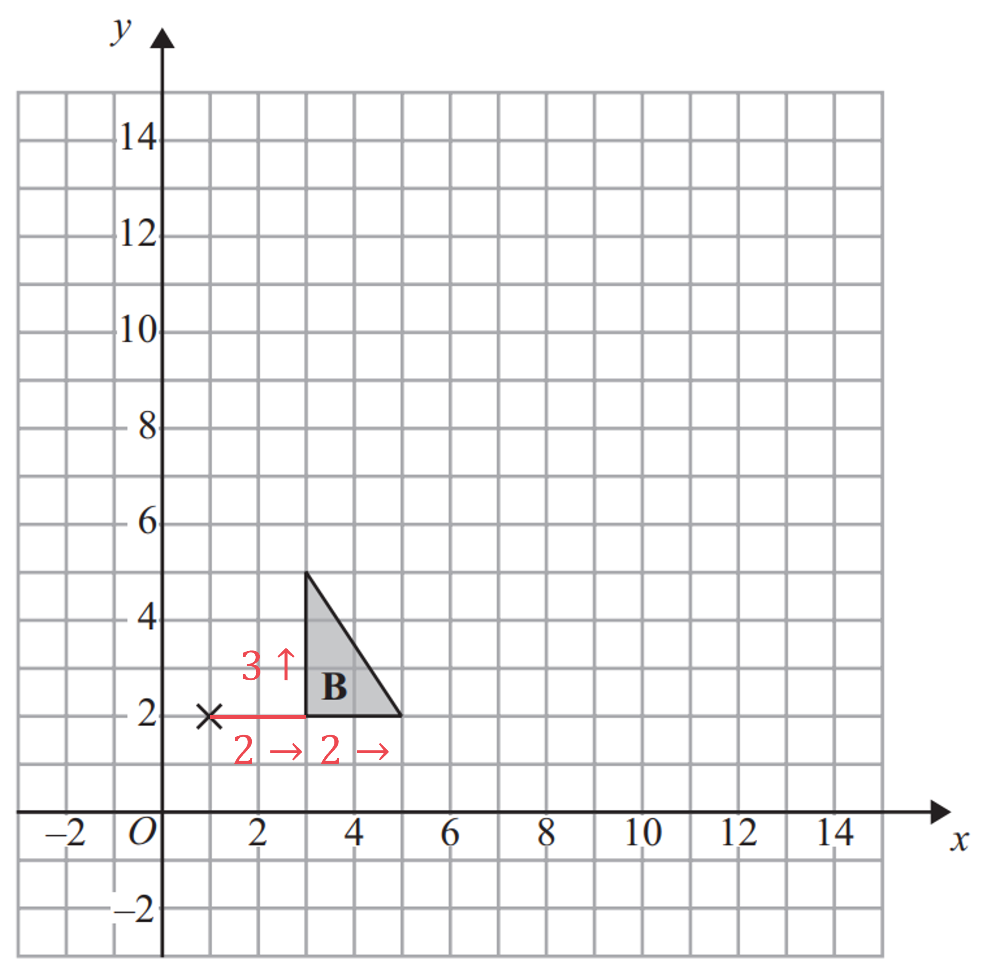

> *Multiply each length/displacement by the scale factor. Starting at the centre use the new displacement to find the position of the new corner. *
*Then use the new lengths to draw the enlarged shape.*

> *To check your answer you can draw a straight line going through the centre and a corner of the original shape, the corresponding corner on the enlarged shape should also lie on this line.*

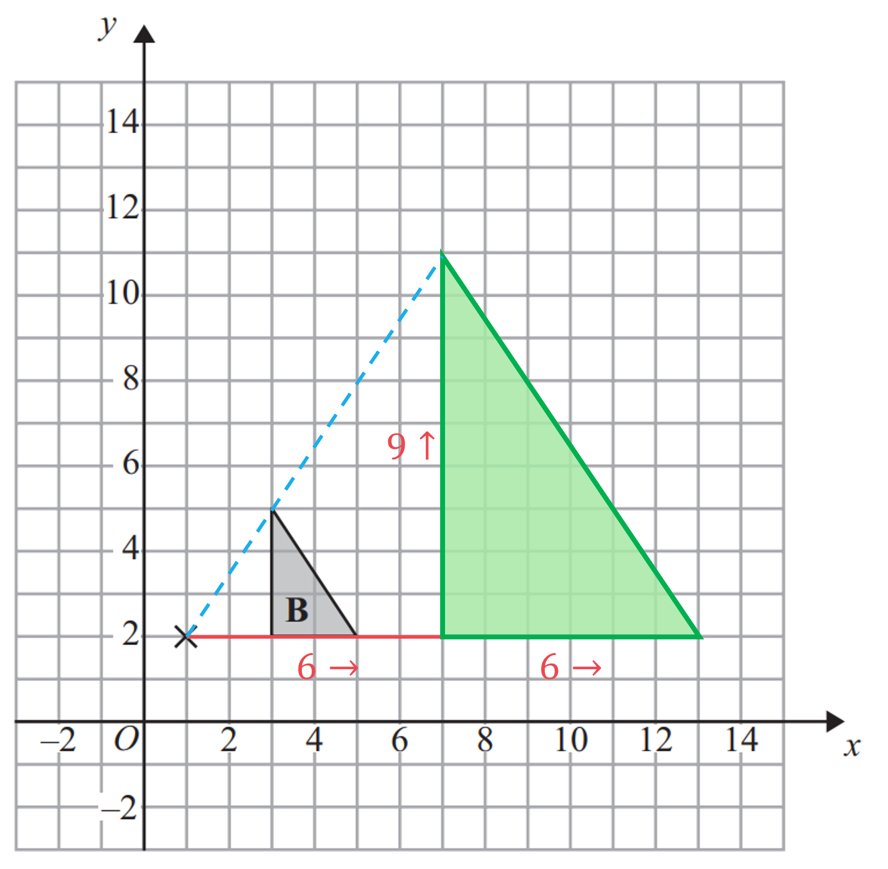

**Enlargement by any scale factor and any centre**** [1]** 
**Enlargement using the correct scale factor ****[1]** 
**Enlargement using the correct centre**** [1]**

### Q11
> *The shape has been moved so this is a translation.*

> *Pick a point on the original shape and find its corresponding point on the translated shape. *
*Count how many units it has moved horizontally and vertically.*

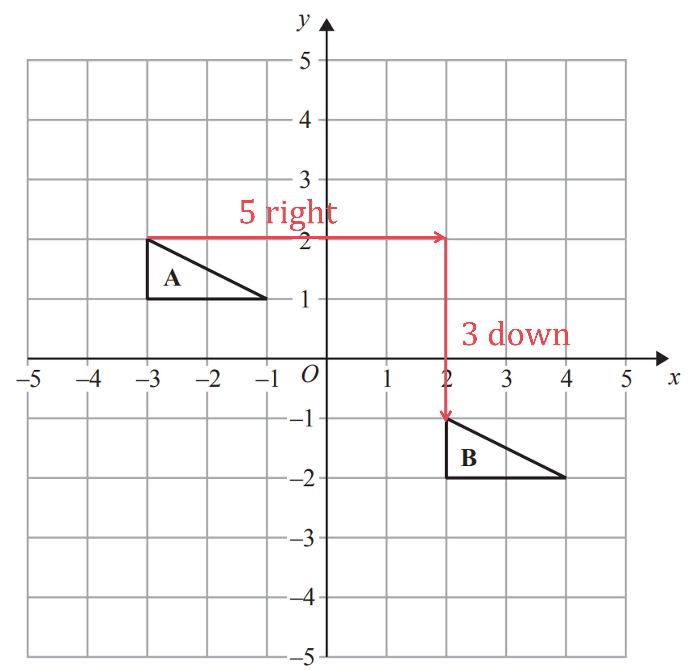

> *Write as a vector. The horizontal displacement goes at the top (right is positive, left is negative). *
*The vertical displacement goes at the bottom (up is positive, down is negative).*

**Translation by** `stretchy left parenthesis table row 5 row cell negative 3 end cell end table stretchy right parenthesis` 
**Writing "Translation"**** [1]** 
**Correct vector**** [1]**

### Q12
> *The shape has been moved so this is a translation.*

> *Pick a point on the original shape and find its corresponding point on the translated shape. *
*Count how many units it has moved horizontally and vertically.*

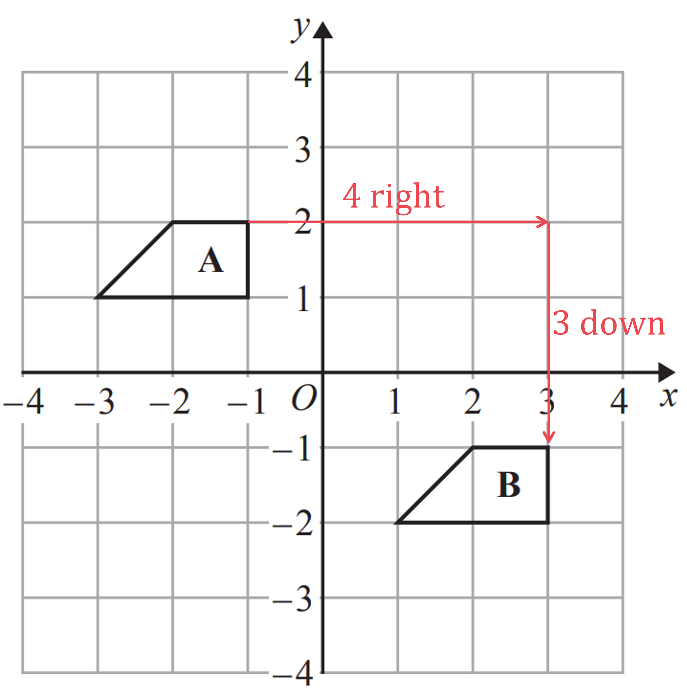

> *Write as a vector. The horizontal displacement goes at the top (right is positive, left is negative). *
*The vertical displacement goes at the bottom (up is positive, down is negative).*

**Translation by** `stretchy left parenthesis table row 4 row cell negative 3 end cell end table stretchy right parenthesis` 
**Writing "Translation"**** [1]** 
**Correct vector**** [1]**

### Q13
*Shape **C** is a different size to shape **A** so this must be an enlargement.* 
*Find the centre of enlargement by joining (at least) two pairs of corresponding points on shapes **A** and **C** (dotted lines) and finding their intersection (green cross).*

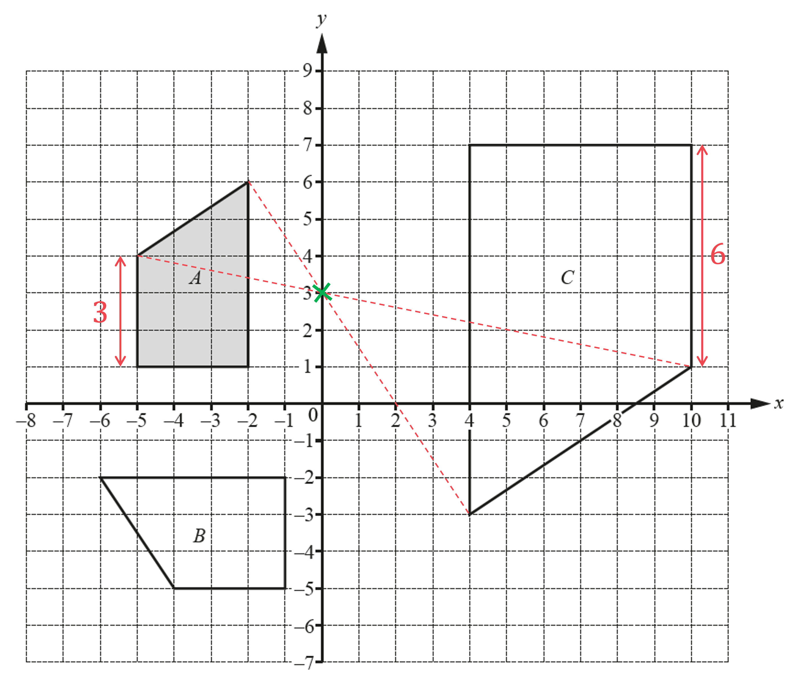

> *Find the scale factor by dividing the distance along one of the sides on shape **C** by the distance along the corresponding side on shape **A**. *
*As shape **C** is on the **opposite** side to the centre of enlargement than shape **A**, this will be a **negative** scale factor.*

`negative open parentheses 6 divided by 3 close parentheses equals negative 2`

**Final answer:** **Shape **$A$** to Shape **$C$** is an enlargment of scale factor **$-2$** and centre of enlargement (0, 3)**

**Enlargement ****[1]**** **
**Scale factor -2**** [1] **
**Centre of enlargement (0, 3)**** [1]**
