# Exam Questions — Transformations of Shapes
**Vectors & Transformations** · Cambridge (CIE) IGCSE maths (0607)
> Source: [https://www.savemyexams.com/igcse/maths/cie/international-maths/23/extended/topic-questions/](https://www.savemyexams.com/igcse/maths/cie/international-maths/23/extended/topic-questions/) · 13 questions across 1 sets

## Calculator Questions (13 questions)

### Q1 — hard — 6 marks

**Q1** [3 marks]

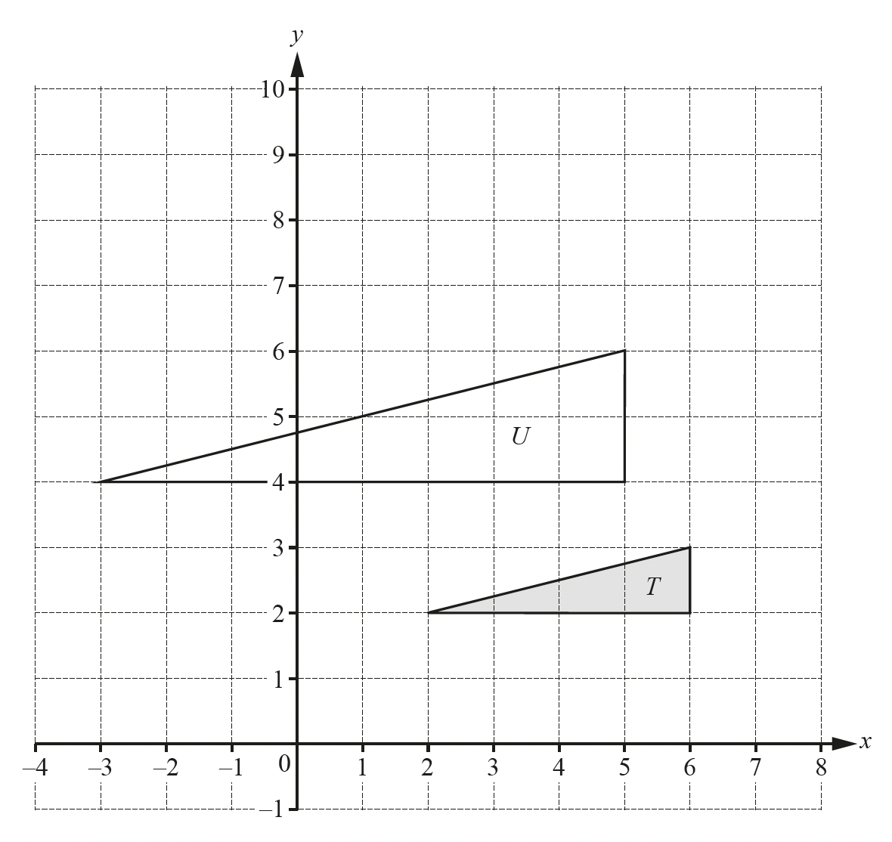

Describe fully the **single** transformation that maps triangle $T$ onto triangle $U$.

*Source: 2018	May/June 0580/23 Q26A*

**Q1** [3 marks]

**Extract:**

[cie-igcse-2018-may-jun-3-p2-q26](https://cdn.savemyexams.com/uploads/2022/09/cie-igcse-2018-may-jun-3-p2-q26.png)

On the grid, draw the image of triangle $T$ after a rotation through 90° clockwise about the point (7, 3).

*Source: 2018	May/June 0580/23 Q26B*

### Q2 — hard — 2 marks

**Q2** [2 marks]

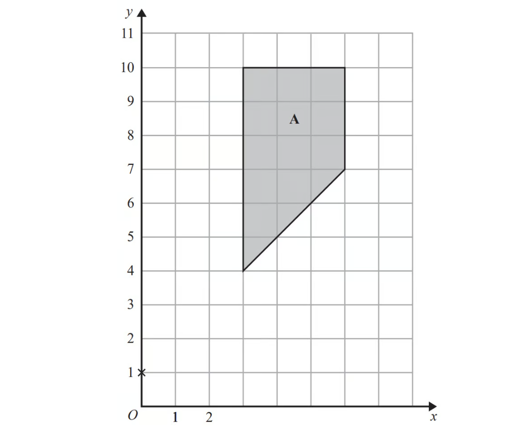

Enlarge shape **A** by scale factor  $\frac{1}{3}$ centre (0, 1).

*Source: June 2018 1MA1/2H Q7*

### Q3 — medium — 2 marks

**Q3** [1 mark]

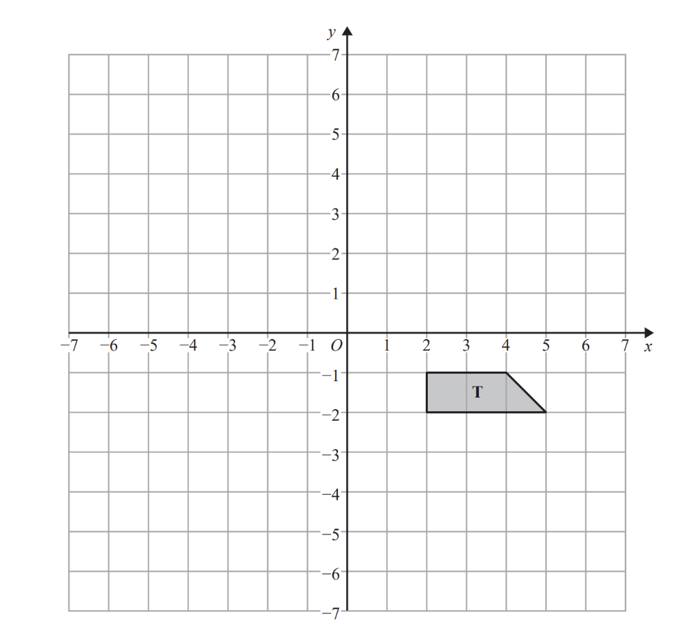

Rotate trapezium **T** $180^{\circ}$ about the origin. 
Label the new trapezium **A**.

*Source: November 2017 1MA1/2H Q5A*

**Q3** [1 mark]

Translate trapezium **T** by the vector  $( \begin{gathered} - 1 \\ - 3 \end{gathered} )$ Label the new trapezium **B**.

*Source: November 2017 1MA1/2H Q5B*

### Q4 — easy — 2 marks

**Q4** [2 marks]

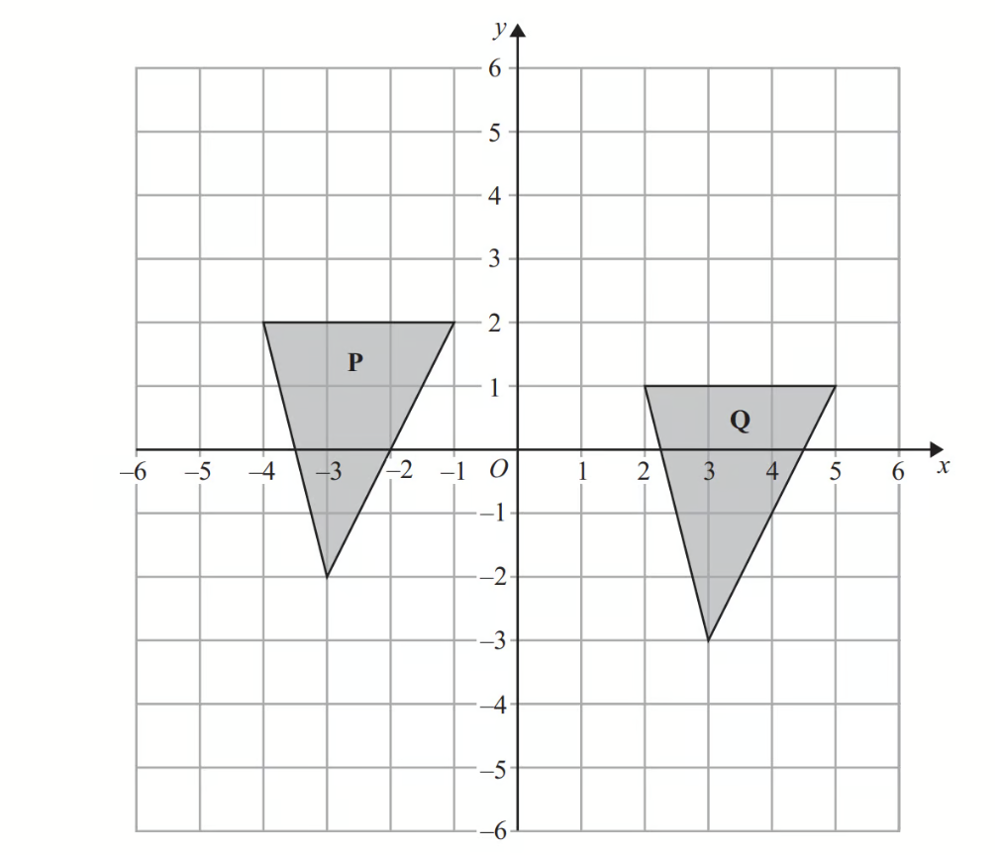

Describe fully the single transformation that maps triangle **P** onto triangle **Q**.

*Source: March 2013 1MA0/2H Q10*

### Q5 — medium — 4 marks

**Q5** [2 marks]

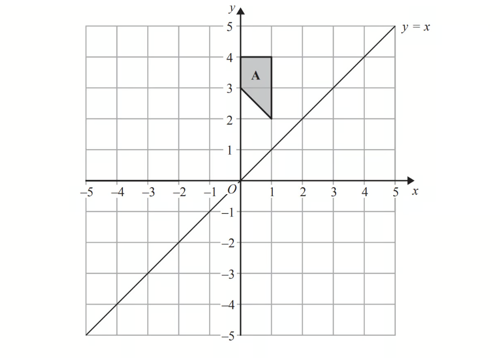

On the grid, reflect shape **A** in the line $y=x$.

*Source: November 2014 1MA0/2H Q4A*

**Q5** [2 marks]

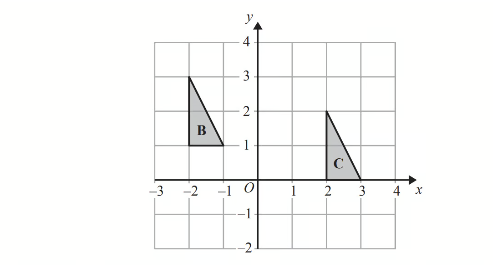

Describe fully the single transformation that maps triangle **B** onto triangle **C**.

*Source: November 2014 1MA0/2H Q4B*

### Q6 — very_hard — 3 marks

**Q6** [3 marks]

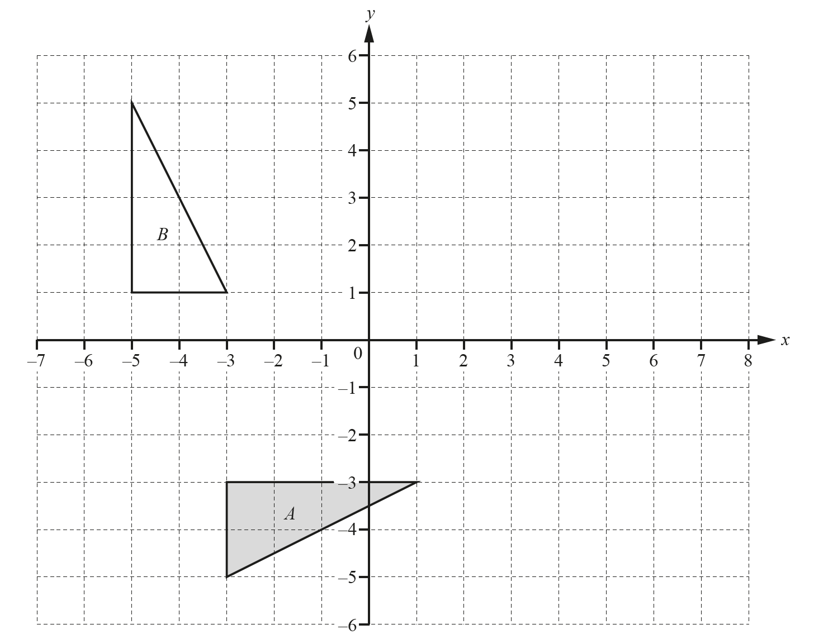

Draw the image of triangle *A* after an enlargement by scale factor $-\frac{1}{2}$, centre $(3,1)$.

*Source: 2018	May/June 0580/42 Q3A*

### Q7 — hard — 3 marks

**Q7** [3 marks]

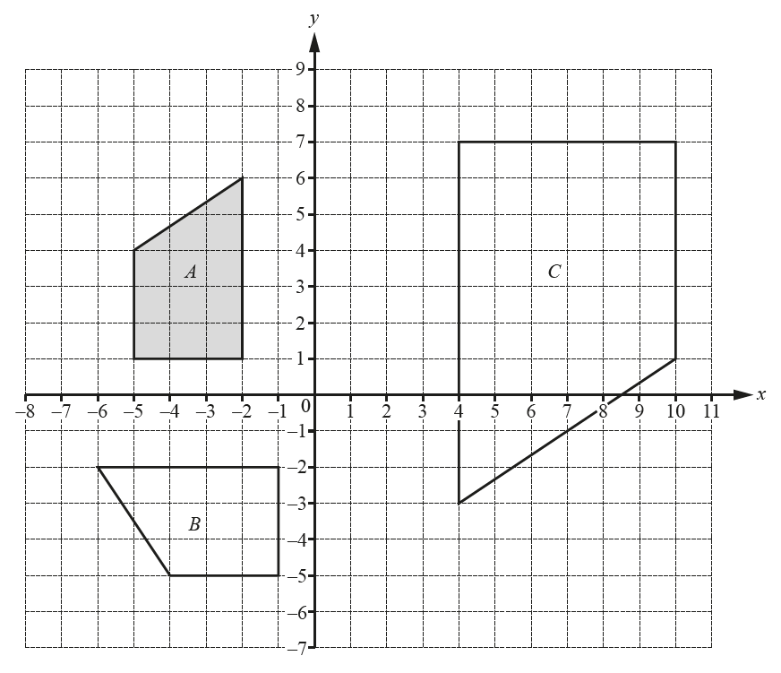

Describe fully the **single **transformation that maps shape *A* onto shape *B*.

*Source: 2018	Feb/Mar 0580/22 Q20A*

### Q8 — easy — 3 marks

**Q8** [3 marks]

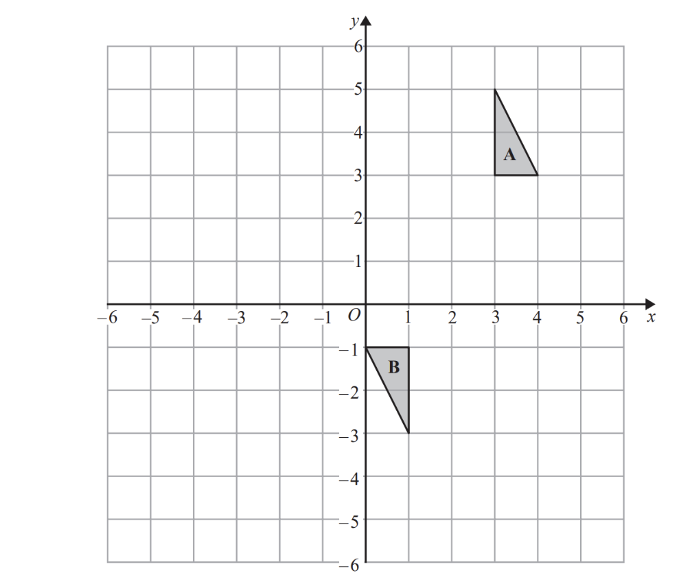

Describe fully the single transformation that maps triangle **A** onto triangle **B**.

*Source: November 2015 1MA0/2H Q12*

### Q9 — very_hard — 3 marks

**Q9** [3 marks]

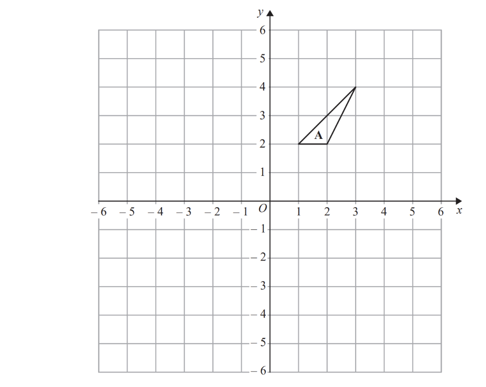

Triangle **A** is rotated $90^{\circ}$ clockwise about the point (0, 1) to give triangle **B**.

Triangle **B** is translated by the vector $( \begin{gathered} - 3 \\ - 1 \end{gathered} )$ to give triangle **C**.

Describe fully the single transformation that maps triangle **A** onto triangle **C**.

*Source: November 2016 1MA0/1H Q14*

### Q10 — medium — 5 marks

**Q10** [2 marks]

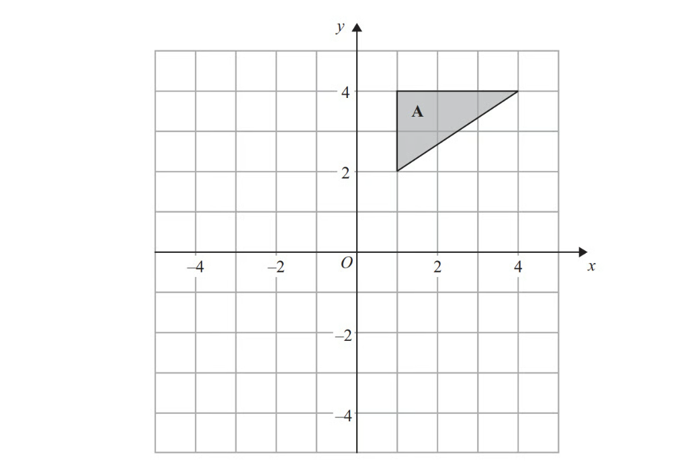

Rotate triangle **A** $90^{\circ}$ clockwise, centre $O$.

*Source: June 2012 1MA0/2H Q8A*

**Q10** [3 marks]

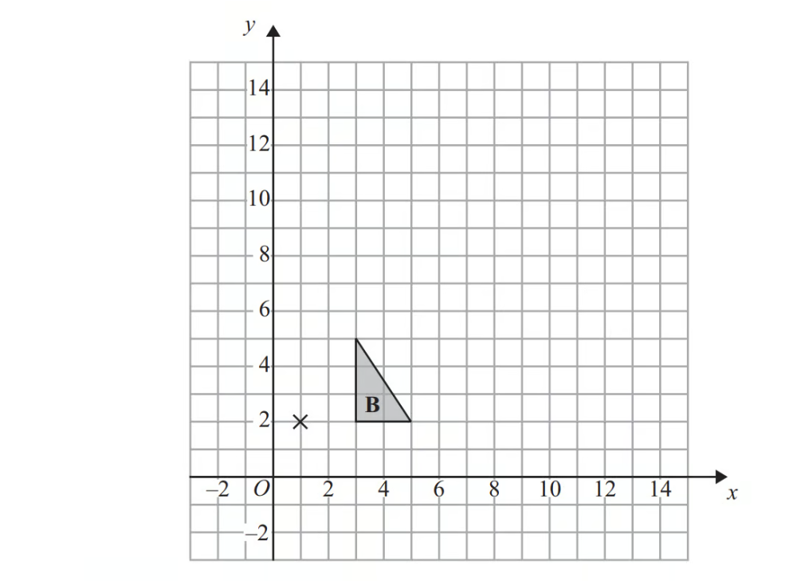

Enlarge triangle **B** by scale factor 3, centre (1, 2).

*Source: June 2012 1MA0/2H Q8B*

### Q11 — easy — 2 marks

**Q11** [2 marks]

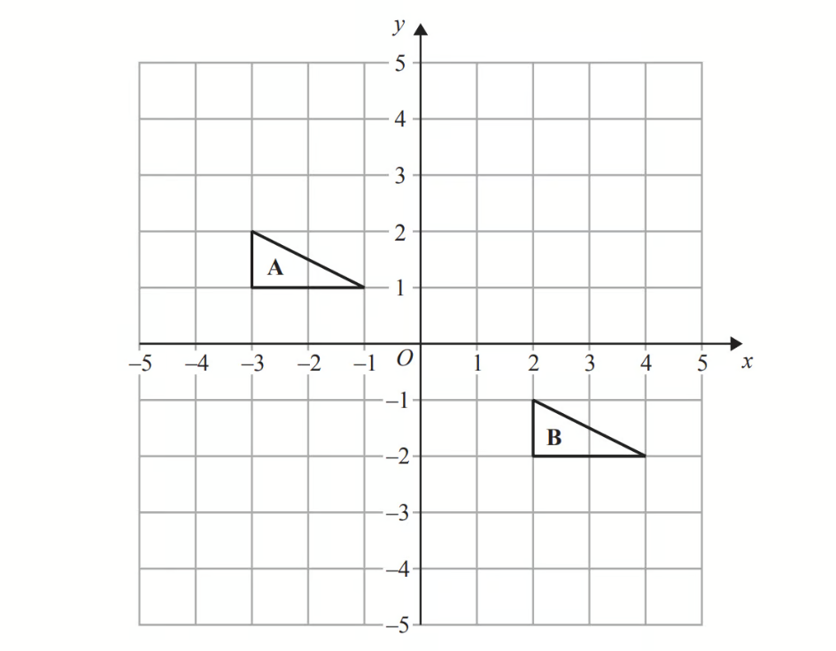

Describe the single transformation that maps triangle **A** onto triangle **B**.

*Source: June 2014 1MA0/2H Q5*

### Q12 — easy — 2 marks

**Q12** [2 marks]

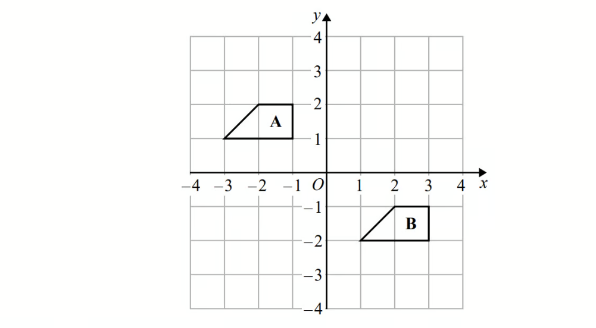

Describe the single transformation that maps shape **A** onto shape **B**.

*Source: Spec2 2015 1MA1/2H Q1*

### Q13 — very_hard — 3 marks

**Q13** [3 marks]

Describe fully the **single **transformation that maps shape *A* onto shape *C*.

*Source: 2018	Feb/Mar 0580/22 Q20B*

