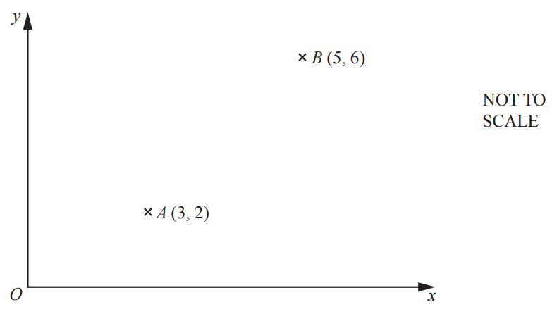

# Exam Questions — Vectors
**Vectors & Transformations** · Cambridge (CIE) IGCSE maths (0607)
> Source: [https://www.savemyexams.com/igcse/maths/cie/international-maths/23/extended/topic-questions/](https://www.savemyexams.com/igcse/maths/cie/international-maths/23/extended/topic-questions/) · 16 questions across 1 sets

## Exam Questions (16 questions)

### Q1 — medium — 2 marks

**Q1** [2 marks]

$A$ is the point (-2, 1) and `stack A B with rightwards arrow on top equals open parentheses table row 4 row 2 end table close parentheses`.

Find the coordinates of point $B$.

### Q2 — hard — 5 marks

**Q2** [5 marks]

`bold p equals open parentheses space space space space 3
minus 2 close parentheses space space space space space space space space space space bold q equals open parentheses negative 5
space space space 1 close parentheses`

(i) Work out  $p+2q$.

[2]

(ii) $A$is the point `open parentheses 2 comma space 6 close parentheses` and $B$ is the image of point $A$after a translation by the vector $p$. 

Find the coordinates of $B$.

( ...................... , ...................... ) [1]

(iii) Find the magnitude of $q$.

[2]

*Source: November 2023 0607/41 Q4A*

### Q3 — easy — 2 marks

**Q3** [2 marks]

Work out   `2 open parentheses space 2
space 3 close parentheses minus open parentheses negative 3
space space space 5 close parentheses`.

`open parentheses
space space space space space space space close parentheses`

*Source: March 2022 0607/22 Q4A*

### Q4 — medium — 2 marks

**Q4** [2 marks]

Find the magnitude of the vector  `open parentheses negative 6
space space space 8 close parentheses` .

*Source: November  2023 0607/22 Q13*

### Q5 — easy — 2 marks

**Q5** [2 marks]

$A$ is the point `open parentheses 1 comma space 2 close parentheses` and `stack A B with rightwards arrow on top equals open parentheses negative 1
3 close parentheses`.

Find the coordinates of the point $B$.

*Source: 2025 Specimen 2 Q10*

### Q6 — medium — 1 marks

**Q6** [1 mark]

`bold m equals open parentheses table row 5 row 7 end table close parentheses` 
Find $3m$.

`open parentheses table row cell space space space space space space end cell row blank end table close parentheses`

*Source: 2020	May/June 0580/21 Q17A*

### Q7 — hard — 5 marks

**Q7** [5 marks]

`bold a equals open parentheses table row cell negative 3 end cell row 2 end table close parentheses space space space space space space space bold b equals open parentheses table row 5 row 4 end table close parentheses space space space space space space space bold c equals open parentheses table row 14 row 9 end table close parentheses`

$ma+nb=\text{c}$

Write down two simultaneous equations and solve them to find the value of $m$ and the value of $n$. Show all your working.

$m$ = ................................................     
 $n$ = ................................................

*Source: 2018	Oct/Nov 0580/42 Q11A*

### Q8 — easy — 2 marks

**Q8** [2 marks]

Find the magnitude of the vector `open parentheses table row cell negative 1 end cell row 7 end table close parentheses`.

*Source: 2018	Feb/Mar 0580/42 Q9A*

### Q9 — medium — 4 marks

**Q9** [4 marks]

`bold p equals open parentheses table row 4 row 5 end table close parentheses`       `bold q equals open parentheses table row cell negative 2 end cell row 7 end table close parentheses`

i) Find $2p+q.$

`open parentheses table row cell space space space space space end cell row blank end table close parentheses` [2]

ii) Find `open vertical bar bold p close vertical bar`.

[2]

*Source: 2020 May/June 0580/42 Q2A*

### Q10 — medium — 4 marks

**Q10** [2 marks]

`bold u bold space equals space open parentheses table row 3 row cell negative 2 end cell end table close parentheses space space space space space space space space space space space bold italic v space equals space open parentheses table row cell negative 12 end cell row 5 end table close parentheses`

Find $u--2v.$

*Source: Specimen 2025 0580/02 Q7A*

**Q10** [2 marks]

**Extract:**

bold italic v space equals space open parentheses table row cell negative 12 end cell row 5 end table close parentheses

Find `space vertical line bold v vertical line space` .

*Source: Specimen 2025 0580/02 Q7B*

### Q11 — easy — 1 marks

**Q11** [1 mark]

Ahmed finds the magnitude of the vector `open parentheses space space space space 2
minus 3 close parentheses`. 
From this list, select the correct calculation.

`square root of 2 squared space plus space minus 3 squared end root space space space space space space space space space space 2 to the power of 2 space end exponent minus space 3 squared space space space space space space space space space space square root of 2 squared space minus space 3 squared end root space space space space space space space space space space 2 to the power of 2 space end exponent plus space open parentheses negative 3 squared close parentheses space space space space space space space space space space square root of 2 squared space plus space open parentheses negative 3 close parentheses squared end root`

*Source: 2020 Oct/Nov 0580/02 Q9B*

### Q12 — medium — 4 marks

**Q12** [4 marks]

`bold a equals open parentheses table row cell negative 3 end cell row 2 end table close parentheses space space space space space space space bold b equals open parentheses table row 5 row 4 end table close parentheses space space space space space space space bold c equals open parentheses table row 14 row 9 end table close parentheses`

i) Find  $3a-2b$ .

`open parentheses table row cell space space space space space end cell row cell space space space space space end cell end table close parentheses` [2]

ii) Find  `vertical line space bold a bold space vertical line`.

[2]

*Source: 2018	Oct/Nov 0580/42 Q11A*

### Q13 — hard — 3 marks

**Q13** [3 marks]

`stack M T with rightwards arrow on top space space equals space open parentheses 2 k
minus k close parentheses`  and  `open vertical bar stack M T with rightwards arrow on top space close vertical bar equals space square root of 180`.   
Find the positive value of $k$.

$k=$ ..............................................

*Source: 2020 Specimen 0580/04 Q6C*

### Q14 — medium — 2 marks

**Q14** [2 marks]

`stack V W with rightwards arrow on top equals open parentheses table row 10 row cell negative 24 end cell end table close parentheses` 
Find  `open vertical bar stack V W with rightwards arrow on top close vertical bar.`

*Source: 2020	May/June 0580/21 Q17A*

### Q15 — easy — 3 marks

**Q15** [3 marks]

i) Find the column vector $\overset{\rightarrow}{AB}$.

`stack A B with rightwards arrow on top equals open parentheses table row cell space space space space end cell row cell space space space space space space end cell end table close parentheses` [1]

ii) Find  `vertical line stack A B with rightwards arrow on top vertical line`.

`vertical line stack A B with rightwards arrow on top vertical line equals`................................................. [2]

*Source: 2018	Oct/Nov 0580/43 Q1B*

### Q16 — easy — 1 marks

**Q16** [1 mark]

`bold m equals open parentheses table row 5 row 7 end table close parentheses` 
Find $3m$.

`open parentheses table row cell space space space space space space end cell row blank end table close parentheses`

*Source: 2020	May/June 0580/21 Q17A*

