# Mark Schemes — Physical Quantities & Measurement Techniques
**1. Motion, Forces & Energy** · Cambridge (CIE) IGCSE physics (0625 & 0972)

## Alternative To Practical Questions (4 questions)

### Q1
Measure the distance *d:*

- The distance, *d *= 5.0 cm **[1 mark]**

**[Total: 1 mark]**

> *It isn't possible online to know how long your lines are, since it depends on your printer or device. We suggest that you **print** the diagram and use a **ruler** to measure the distance as shown below: *

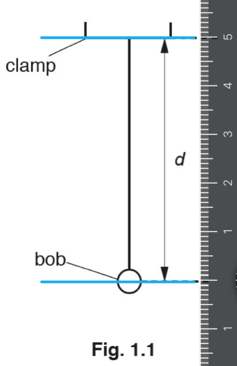

- *It can help to **draw** on the diagram in a different colour, to see the **exact position** of the end of arrow **d*
- *Line the bottom/**zero mark** of the ruler with the bottom of the arrow*
- *Identify the top of the arrow to the **nearest mm*
(i) Calculate the actual distance *D* from the bottom of the clamp to the centre of the bob:

List the known quantities:

- Measured distance from Fig. 1.1: *d *= 5.0 cm (from part (a))
- The scale of drawing to actual size = 1/10th

Link the scale of the drawing to the actual size:

- The drawing is 5.0 cm long
- The actual size = 10 × the size of the drawing = 5.0 × 10

Calculate the actual distance *D*:

- *D *= 50 cm **[1 mark]**

(ii) Write down the time *t* shown in Fig. 1.3:

- The time *t *shown on the stopwatch = 14.06 seconds; **[1 mark]**

(iii) Calculate the period *T* of the pendulum:

List the known quantities:

- The time for 10 oscillations *t *= 14.06 seconds (from part (ii))

Consider the value of the time for 1 oscillation:

- Time for 1 oscillation = time for 10 oscillations ÷ 10
- So, $timeperiod,T=\frac{14.06}{10}$

Calculate the time period, *T*:

- *T *= 1.406 **[1 mark]**

(iv) Calculate *T*2:

List the known quantities:

- Time period, *T *= 1.406 (from part (iii))

Calculate *T**2*:

- $T^{2}=1.406^{2}$
- *T**2* = 1.977 s = 1.98 s (3 s.f.) **[1 mark]**

(v) Calculate the acceleration of free fall *g*:

List the known quantities:

- *T**2* = 1.98 (from part (iv))

Substitute the known quantities into the equation to calculate *g*:

- $g=\frac{20}{T^{2}}=\frac{20}{1.98^{2}}$
- *g* = 10.1 m/s2 **[1 mark]**

**[Total: 5 marks]**

> *We have given you the answer to part (a) here so that your calculation for **D** will match up. In the actual exam the examiner would allow a correct multiplication of your **d × 10**, since they are checking that you can work with scale diagrams.*

> *If one part of this question is wrong, don't worry! With the correct method, you will still gain marks in subsequent parts. Examiners call this **error carried forward**.*
(i) Write the unit for *T*2:

- *T *is measured in seconds, s
- So, *T**2* is measured in seconds squared, s2 **[1 mark]**

(ii) Calculate the acceleration of free fall *g*:

List the known quantities:

- *T**2* = 3.92 s2 (from part (c))

Substitute the known quantities into the equation and calculate *g*:

- $g=\frac{40}{T^{2}}=\frac{40}{3.92}$
- *g *= 10.204 m/s2 

Give your answer to a suitable number of significant figures:

- The final answer should be written to the least number of significant figures provided in the question

  - 3.92 is written to 3 s.f.
- *g *= 10.2 m/s2 **[1 mark]**

**[Total: 2 marks]**

> *Answering this question is similar to following a **recipe**. Each step in the instructions is easy to complete but when there are so many all in a row, then it becomes tricky. **Take your time** to read and **check** each step as you go.*
Suggest** **two changes that you would make to improve the reliability:

- Use additional/more values of *d ****OR*** use a larger value of *d*; **[1 mark]**
- Count more swings of the pendulum and record the time; **[1 mark]**

**[Total: 2 marks]**** **

> *When a reading/measurement is taken, the **same value** should be obtained **every time** for it to be called **reliable**. *

> *Suggesting changes to an experiment to improve its reliability is a **typical** exam question and can be answered with:*

- *Obtaining **more values** of initial measurements*
- *Conducting the experiment for a **wider range** of values e.g. more swings *
State one precaution that you would take in this experiment in order to obtain accurate readings:

Any **one** from:

Measuring *d*:

- View the ruler at right angles to the markings; **[1 mark]**
- Start the measurement at zero on the ruler; **[1 mark]**
- Use of a fiducial mark / markings on the diagram as a point of reference; **[1 mark]**
- Use of a set-square / horizontal rule; **[1 mark]**
- Take the measurement / use a ruler close to the bob; **[1 mark]**
- Measure the length of the string to both the top and bottom of the bob and then take an average; **[1 mark]**
- Measure the length of the string and add the radius of the bob obtained using callipers; **[1 mark]**

Measuring *t*:

- Measure the time of the swing from the centre of the swing; **[1 mark]**

**[Total: 1 mark]**

An experimental result that is **close** to the **accepted value** is considered accurate. Consider the following results for an accepted value of *t *= 2 seconds:

- SET A: *t* = 5 s, 1 s, 8 s

**   OR**

- SET B: *t *= 2.1 s, 1.9 s, 2.0 s

Which results are more accurate?

Set B are more accurate, all the results are close to the accepted value.

A great way to remember this is to consider a target, an accurate archer will hit the middle every time but an inaccurate one will not:

Most points in the markscheme can be applied to **any question** about improving experimental accuracy. For example:

- Viewing a measuring device (ruler, measuring cylinder, ammeter) at **right angles**
- Starting any measurement at **zero **
- Use of a fiducial / **reference mark**:

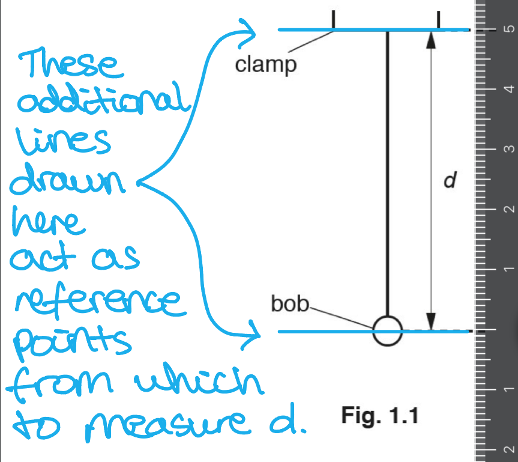

### Q2
State the factor to be tested:

- Clear statement of an appropriate variable to test;** [1 mark]**

Name the control variable:

- A named variable which should be kept constant;** [1 mark]**

Set out the apparatus:

- A metre rule and any apparatus essential to variable under test;** [1 mark]**

State the method:

- measure factor under test **AND **drop ball **AND** measure diameter / depth of depression;** [1 mark]**

State any repetitions:

- Repeat for new value of variable under test;** [1 mark]**

State any additional points:

**Any one from:**

- Repeat experiment or each value of factor and average;** [1 mark]**
- Means of measuring depth;** [1 mark]**
- Means of diameter of crater accurately;** [1 mark]**
- Apparatus for measuring diameter of ball accurately;** [1 mark]**
- Measure diameter of ball / crater in different places (and take mean);** [1 mark]**
- Smooth / flatten sand surface;** [1 mark]**
- At least 5 sets of data taken;** [1 mark]**
- Reliable means of releasing ball;** [1 mark]**
- Sensible values for factor quoted;** [1 mark]**

Draw a graph:

- Graph of diameter / depth of depression vs appropriate continuous variable;** [1 mark]**

**An example of an answer which would score 7 marks is:**

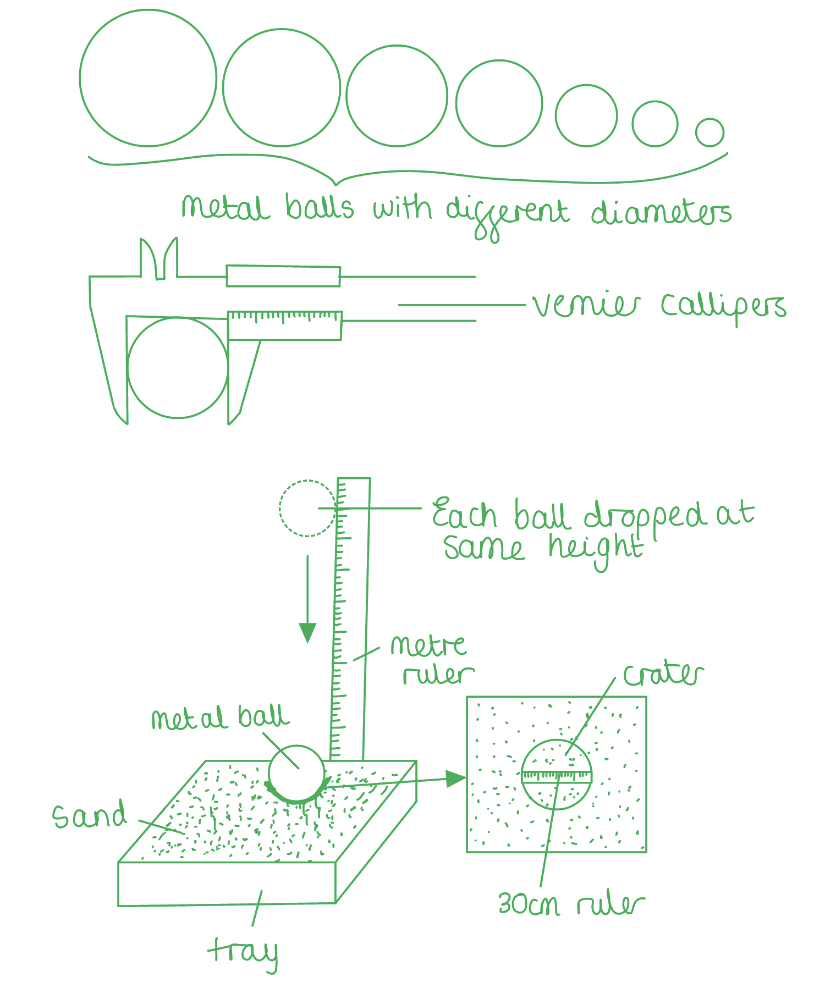

This experiment will investigate the size of the crater made for different sizes of metal balls; **[1 mark]**

The controlled variables are the volume of sand and the height at which the balls are dropped; **[1 mark]**

The additional apparatus needed are a metre ruler, a 30 cm ruler and vernier callipers; **[1 mark]**

First measure the diameter of the balls with the vernier calliper. Measure in at least 3 different places, then calculate an average. Drop the smallest ball from a height of 1 m above the tray of sand. Remove the ball and measure the crater diameter in the sand using the 30 cm ruler.  Repeat for 7 metal balls of different sizes; **[1 mark]**

Repeat the experiment for each size of metal ball at least 3 times and calculate the mean diameter of the crater **AND **record the results in a table; **[1 mark]**

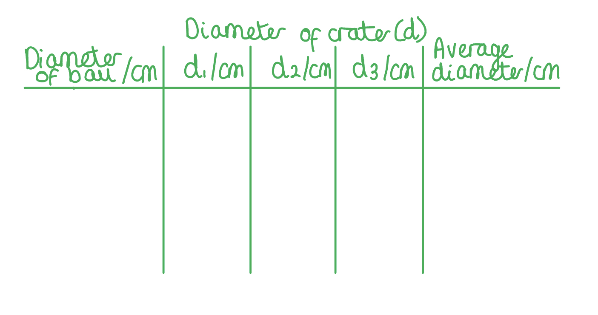

The height of the ball must be measured perpendicular to the ruler to ensure it is dropped at the same height each time and to avoid parallax error; **[1 mark]**

Plot a graph of the diameter of the crater vs. the diameter of the metal ball; **[1 mark]**

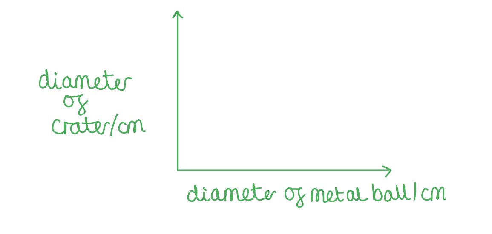

**[Total: 7 marks]**

> *The example above shows the kind of short descriptions which easily score full marks in the exam. *

> *The most common mistakes with the investigation question are;*

- *Saying what the result will be, rather than how to draw the conclusion*
- *Forgetting that only **one** variable can change, and changing them all*
- *Showing repeat readings or the range in the table, but not mentioning them in the description (it seems unfair, but this won't get you the mark)*
- *Wasting time by inventing data for the table - leave it blank and just note the quantity and units*

> *If you find yourself doing one of these - stop!*

> *And finally, sometimes the examiner will award marks for the diagram, so anything which is explained there will count. *

### Q3
A correct diagram would look like:

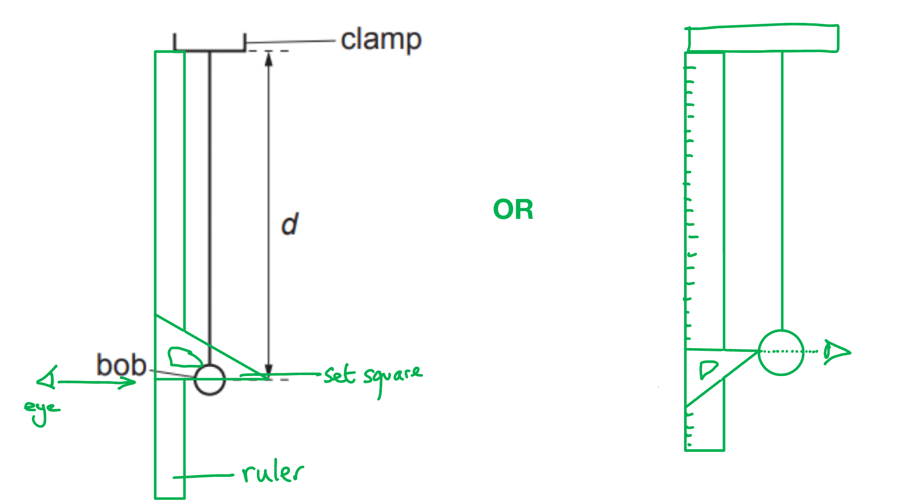

- The set square arranged with the horizontal line connecting the scale on the ruler and (approximately) the centre of the bob; **[1 mark]**
- Ruler connected to the bottom of the clamp; **[1 mark]**

Final mark from **either**** **the diagram **or** the written answer:

- An eye or line to show perpendicular viewing of the rule; **[1 mark]**

**OR**

- The student must view the scale at right angles to avoid parallax;** [1 mark]**

**[Total: 3 marks]**

> *The set square is an important piece of equipment used to find right angles and ensure equipment and lines are perpendicular. Although it's called a 'set square' it is actually triangular in shape!*

> *Unless you study D&T you may not have used a set square very much, so do make sure you try one out before the exams so you understand how to draw it in an experiment.*

> *The two diagrams below show common mistakes students make. One is to draw the set square the wrong way round, so it can't be lined up properly on the ruler. The second is to draw a square.*

> *Avoid these and copy our diagram in the solution above.*

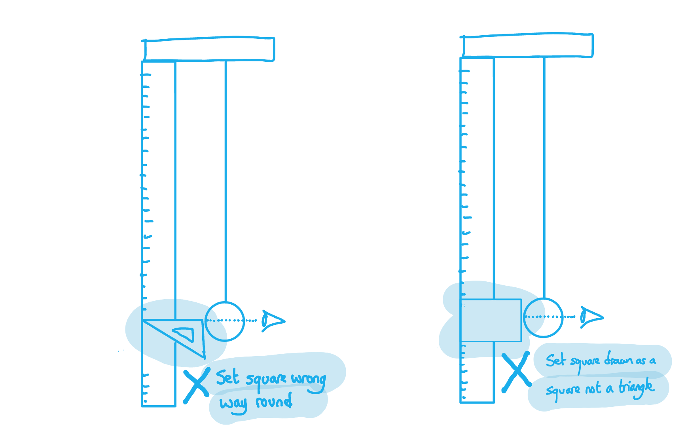

> *You can make your diagram either by adding to the one provided, or starting fresh. Both parts of the paper will be looked at.*
(i) The time *t*1 is:

Check the units on the stopwatch:

- There are 00 minutes, 28 seconds and 12 hundredths
- *t*1 = 28.12 seconds; **[1 mark]**

(ii)  To calculate the period *T*1 of the pendulum:

Divide the total time by the number of oscillations:

- $T_{1}=\frac{28.12}{20}=1.406s$ **[1 mark]**

> *The technique of making multiple measurements and finding the average is a very important one, so you will be tested on it.*
The mass of the bob to the nearest gram is:

Write down the value from the scales:

- Mass = 51.65 g

Round this to the nearest gram:

- Mass *m*A = 52 g; **[1 mark]**

**[Total: 1 mark]**
(i) The correct response is:

Compare the **rounded up data** from the two experiments using *m*A and *m*B and the distances:

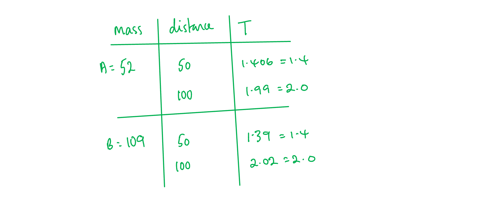

**✓** the period T is affected by *d* only

`square` the period T is affected by both *d* and *m*

`square` the period T is affected by *m* only

`square` the period T is not affected by both *d* or *m*

(ii) To justify your answer with reference to the results:

Explain how the data leads to the answer:

- For 50 cm, the time is 1.4 s for both masses, so mass *m* does not affect *T* **AND**
- When distance *d* increases from 50 cm to 100 cm, the time increases from 1.4 s to 2.0 s (therefore *d* affects *T*); **[1 mark]**

**[Total: 2 marks]**

> *Drawing a grid as we have done is not required, but it will help you see the pattern, and only takes a moment. When asked to justify your answer, though, it is essential to refer to the data and use the values. *
(i) To measure the size of an oscillation:

- Set up a ruler behind the bob ensuring it is <u>horizontal</u>; **[1 mark]**
- View at<u> eye level</u> to find the distance; **[1 mark]**

**OR**

- Use a <u>protractor</u> to find the angle of oscillation; **[1 mark]**
- <u>Calculate</u> using trigonometry;** [1 mark]**

Two diagrams which would score two marks are:

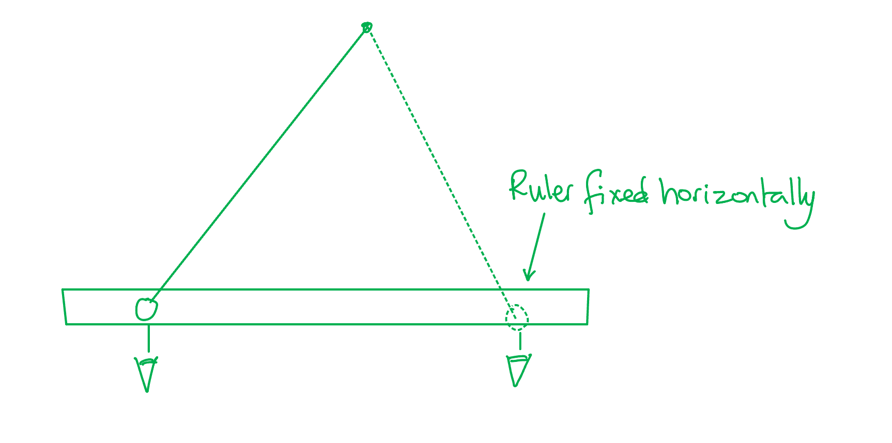

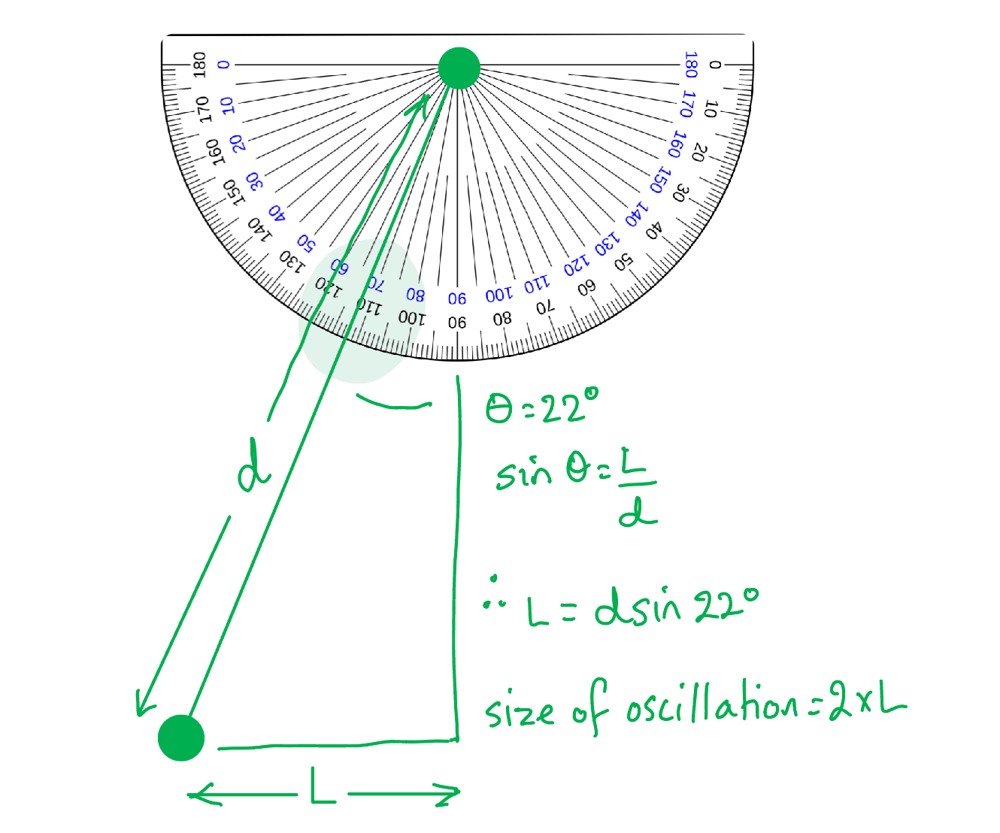

(ii) One variable to keep constant:

- The length must be constant;** [1 mark]**

**[Total: 3 marks]**

### Q4
(i) A suitable length *l* for the slope used in this school laboratory experiment is:

- 1 m – 2.5 m **[1 mark]**

(ii) A suitable height *h*, above the laboratory bench, for one end of the slope is:

- **10 cm – 1 m but ****h**** must be less than **$\frac{l}{2}$** ****[1 mark]**

**[Totat: 2 marks]**

> *This answer simply requires practical thinking. The slope needs to be long enough that the reaction time of the student is negligible compared to the time taken for the car to roll down it. However, this is taking place in a classroom, so a length greater than 2.5 m would be impractical.*

> *When considering height, the time of travel must be considered again. If the slope is too steep, the car will travel too quickly to accurately time. Conversely, if the slope isn't steep enough, the friction of the wheels about their bearing may mean the car doesn't roll.*
Three suggestions about what she could do to ensure that the distance travelled and the time taken by the toy car are measured as reliably as possible are:

**Any three from:**

- Making marks / lines on track for start and finish; **[1 mark]**
- Repeats / find average time; **[1 mark]**
- Constant starting positions; **[1 mark]**
- Not pushing car; **[1 mark]**
- Time from same point on car; **[1 mark]**
- Use light gates / data logger / automatic timer for timings; **[1 mark]**
- Method for avoiding parallax error <u>when judging finishing point</u> / stand level with finish; **[1 mark]**

**[Total: 3 marks]**

## Multiple Choice Questions (20 questions)

### Q1
**Final answer:** **The correct answer is C**

- An irregularly shaped solid cannot have its volume calculated using length measurements, so a ruler alone is not sufficient
- The volume of an irregularly shaped solid can be found by the displacement method:

  - The stone is lowered into a measuring cylinder containing a known volume of water
  - The rise in water level equals the volume of the stone
- This requires a **measuring cylinder** (to measure the water level before and after) and **water **(as the displacement liquid)

**A** is incorrect because a balance measures mass, not volume, and a ruler can only measure the volume of a regularly shaped solid (e.g. a cuboid).

**B** is incorrect because a balance is not needed to find volume by displacement. A balance would be needed to find mass (and then density), but the question only asks about volume.

**D** is incorrect because a ruler cannot measure the volume of water displaced by an irregularly shaped object. A measuring cylinder is needed to read the water level accurately.

### Q2
**Final answer:** **The correct answer is B**

- The total distance is the sum of the two journey legs

total distance = 30 + 40

total distance  = 70 km

- The displacement is the straight-line distance from start to finish, found using Pythagoras

$s=\sqrt{30^{2}+40^{2}}$

$s=\sqrt{2500}$

$s=50\text{km}$

**A **is incorrect because** ** it swaps distance and displacement — 50 km is the displacement, not the distance.

**C **is incorrect because it uses the scalar sum for both distance and displacement — displacement cannot simply be added.

**D **is incorrect because it uses the resultant (Pythagoras) for both — the total distance is the sum of the path lengths, not the straight-line result.

### Q3
**Final answer:** **The correct answer is C**

- The period of a pendulum is the time taken for one complete swing
- To calculate the period, the total time must first be converted into seconds
- There are 60 seconds in 1 minute, so the total time (1 minute and 52 seconds) is:

$\text{total time}=60+52=112\text{s}$

- The period is then found by dividing the total time by the number of swings:

$\text{period}=\frac{\text{total time}}{\text{number of swings}}$

$\text{period}=\frac{112}{40}$

$\text{period}=2.8\text{s}$

> **[exam-tip]**
> Remember to convert all time values to the same unit (seconds) before performing calculations. A common mistake is forgetting to convert minutes to seconds, which would give an incorrect answer. Always check that your final answer has sensible units and magnitude for the quantity being calculated.

### Q4
**Final answer:** **The correct answer is C because:**

- The magnitude of the two vectors is found using Pythagoras' theorem
- The resultant force is equal to

$F^{2}=6.0^{2}+8.0^{2}$

$F=\sqrt{6.0^{2}+8.0^{2}}=10N$

- Therefore, option **C** is correct

### Q5
**Final answer:** **The correct answer is A because:**

- The first reading on the ruler is 2.4 cm
- The second reading is 15.6 cm
- The length of the string is 15.6 − 2.4 = 13.2 cm
- The distance once around the pen is one-sixth of this

$\frac{13.2}{6}=2.2\mathrm{cm}$

Incorrect answers will most likely result from incorrectly reading the ruler or a division error.

### Q6
**Final answer:** **The correct answer is B because:**

- A swimming pool is likely to be at least a few metres in length, so a tape measure would be more suitable than a metre ruler

  - This eliminates options **A** and **D**
- Aluminium foil is very thin, so the micrometer screw gauge would be able to measure thickness to a greater precision than a ruler

  - This eliminates option **C**

### Q7
**Final answer:** **The correct answer is B because:**

- When the lump of clay is removed from the small measuring cylinder, the volume of liquid goes down by 20 cm3
- Therefore, the lump of clay has a volume of 20 cm3
- When the lump of clay is placed in the large measuring cylinder, the volume of liquid will go up by 20 cm3

> *Don’t be fooled by the large measuring cylinder having twice the diameter of the small cylinder. The cylinders both measure volume, so to compensate for the larger size, the larger cylinder has twice as many divisions on its measuring scale.*

### Q8
**Final answer:** **The correct answer is ****C ****because:**

- Scalar quantities have magnitude only

- Weight is a force

  - Forces have both magnitude and direction
- Therefore, weight is a vector quantity

Students commonly confuse weight and mass.

Mass is a measure of the amount of matter in an object, it has magnitude but no direction, therefore it is scalar.

Weight is a force, it has magnitude and direction, therefore it is a vector quantity.

### Q9
**Final answer:** **The correct answer is ****C**** because:**

- Using a large measuring cylinder means that an increase in the volume of the water would give a small change to the height of the liquid in the measuring cylinder.
- Small changes are more difficult to read accurately than larger changes.
- The student *actually* wants to use the *smallest* measuring cylinder possible to take the measurement.

**A **is incorrect as this would eliminate parallax error, making the measurement more accurate.

**B** is incorrect as this makes the reading more accurate and is standard practice .

**D** is incorrect as a vertical cylinder means the surface of the liquid is exactly perpendicular to the graduations on the side. This makes the measurement more accurate.

### Q10
**Final answer:** **The correct answer is C**

- The spheres start at the 5 cm mark and finish at the 16 cm mark
- The total length of the 5 spheres is 11 cm (since 16 - 5 = 11)
- Therefore, the diameter of the single sphere is 2.2 cm (as $\frac{11}{5}$ = 2.2)

**A**, **B**, and **D** are incorrect as the ruler has been misread, or the diameter has been wrongly calculated.

### Q11
**Final answer:** **The correct answer is ****D**** because:**

- Cooling time = end time − start time

- Firstly, consider the minutes

  - 23 − 11 = 12 minutes
- Then consider the seconds

  - 27 − 19 = 8 seconds
- Cooling time = 12 minutes and 8 seconds

It is important to work out the minutes and the seconds separately, because if the number of seconds at the end time is greater than the number of seconds at the start time, you will need to adjust the number of minutes.

Remember that there are only 60 seconds in a minute, so time calculations can't be done easily with decimals.

Another method, would be to convert everything into seconds, do the calculation, and convert the answer into minutes.

### Q12
**Final answer:** **The correct answer is ****B**** because:**

- Scalar quantities have magnitude (size) only, whereas vector quantities have both magnitude and direction
- Distance has magnitude only
- Therefore it is a scalar quantity

**Displacement** is a vector quantity because it has both magnitude and direction

### Q13
**Final answer:** **The correct answer is ****D**** because:**

- A smaller measuring cylinder will give a greater height difference between two different volumes of liquid. This makes any small differences much easier to measure.
- Liquid level measurements should always be taken from the bottom of the meniscus.

**A **is incorrect as the large measuring cylinder would make it more difficult to measure small differences in the liquid volume, and readings should not be taken from the top of the meniscus.

**B** is incorrect as the large measuring cylinder would make it more difficult to measure small differences in the liquid volume.

**C** is incorrect as liquid level readings should not be taken from the top of the meniscus.

### Q14
**Final answer:** **The correct answer is ****A**** because:**

- The total volume of all of the pieces is 90 − 50 = 40 cm3
- Each piece has the same volume, so volume of each piece = $\frac{40}{3}$= 13.3 cm3

**B** is incorrect as this is the “empty” measuring cylinder reading divided by 3.

**C** is incorrect as this is just the reading from the filled measuring cylinder divided by 3.

**D** is incorrect as this is just the total volume of the three pieces without dividing the answer by 3.

### Q15
**Final answer:** **The correct answer is ****B**** because:**

- The student wants to run 5.0 km = 5000 m
- Each lap is 400 m, so the student must run $\frac{5000}{400}$ = 12.5 laps
- The time taken for one lap is 11:10:00 − 9:13:00 = 1:57:00, 1 minute 57 seconds.
- If each of the 12.5 laps takes 1:57 to complete, the total time will be 1:57 x 12.5 = 24:22:50

Remember, when adding times, that there are only 60 seconds in a minute! You cannot add times using decimals on a calculator.

Since 57 s is almost 1 minute, the easiest way to do this calculation is to say 12.5 × 2 mins = 25 mins, then minus the 3 seconds from each of those minutes. 12.5 × 3 s = 37.5 s, 25 min − 37.5 s = 24 min 22.5 s

### Q16
**Final answer:** **The correct answer is ****B**** because:**

- The volume of an irregularly-shaped object is found by subtracting the final water volume from the initial water volume in a measuring cylinder.
- This gives 17 − 6 = 11 cm3

**A** is incorrect as 6 cm3 is just the minimum value of the water level in the measuring cylinder .

**C** is incorrect as 17 cm3 is the answer you get if you just read off the volume of the water in the second measuring cylinder.

**D** is incorrect as 23 cm3 is just the maximum value of the water level in the measuring cylinder.

### Q17
**Final answer:** **The correct answer is ****A**** because:**

- The measurement starts at 1 cm, and ends at 37 cm, therefore, the total measurement is 36 cm.
- The dowel rolls over three times in 36 cm, so the circumference is $\frac{36}{3}$ = 12 cm

**B** is incorrect as the 1cm at the start of the ruler has not been accounted for.

**C** is incorrect as this is 3x the circumference of the dowel.

**D** is incorrect as this is 3x the circumference of the dowel, without accounting for the 1cm at the start of the measurement.

### Q18
**Final answer:** **The correct answer is ****C**** because:**

- The oven needs to be switched on 1 hr and 30 minutes before putting the chicken in
- 1 hr 20 cooking time + 10 minutes to pre-heat = 1 hr 30
- 4:30 − 1 hr 30 = 3:00 pm

**A** & **B** are incorrect as 4:30 − 1 hr 30 is not 2:00 pm or 2:10 pm

**D** is incorrect as 4:30 − 1 hr 30 is not 3:10 pm, the pre-heating time has probably been omitted

### Q19
**Final answer:** **The correct answer is ****C**** because:**

- The actual time for 5 laps is 81.21 − 2.00 = 79.21 s
- The average time is given by:

  - $\mathrm{average} \mathrm{time}=\frac{\mathrm{total} \mathrm{time}}{\mathrm{number} \mathrm{of} \mathrm{laps}}$
  - $\mathrm{average} \mathrm{time}=\frac{79.21}{5}$
  - $\text{average} \text{time} = 15.8 \mathrm{s} ( 3 \mathrm{s} . \mathrm{f} . )$
- The second stopwatch reading is only given as a “red herring” in this question.

**A **is incorrect as the correct values have not been used to calculate the average speed.

**B** is incorrect as this is the time taken to complete only the first lap. The cyclist clearly slows down after this lap.

**D** is incorrect as the correct values have not been used to calculate the average speed.

### Q20
**Final answer:** **The correct answer is**** D**** because:**

- Calculate the volume of each of the blocks in the measuring cylinders, and then we need to put them in order. X: 60 − 30 = 30 cm3 Y: 84 − 23 = 61 cm3 Z: 70 − 43 = 27 cm3
- Therefore, the correct order is Z, X, Y.

## Theory Questions (17 questions)

### Q1
> **[mark-scheme]**
> - Measure the total thickness of a large, known number of sheets with the ruler **[1 mark]**
> - Divide the total thickness by the number of sheets **[1 mark]**
> 
> Accept a stated number of sheets, e.g. "measure 100 sheets and divide by 100"
> 
> Accept "repeat with different numbers of sheets and average" as an additional point

> **[exam-tip]**
> A ruler cannot resolve a single sheet, so the trick is to measure many sheets and divide. The more sheets you stack, the smaller the percentage error in the ruler reading. Give a realistic number, such as 100 sheets, to show your method would work.
> **[mark-scheme]**
> - Measure the length, width and height of the block with the ruler **[1 mark]**
> - Multiply the three measurements together: volume = length × width × height **[1 mark]**
> 
> Accept "measure each dimension in more than one place and take an average" as an additional point
> 
> Do not credit a water displacement method: the question specifies a ruler

> **[exam-tip]**
> The word "accurately" invites you to say how you would reduce the error, for example reading the ruler at eye level or measuring each dimension in more than one place and averaging. Remember a block has three different dimensions: multiplying only two of them gives an area, not a volume.
> **[mark-scheme]**
> - Partly fill the measuring cylinder with water and record the volume reading **[1 mark]**
> - Fully submerge the object in the water and record the new volume reading **[1 mark]**
> - Volume of the object = new volume − original volume **[1 mark]**
> 
> Accept "read the meniscus at eye level" as part of either reading
> 
> The object must be completely under the water for the second mark

> **[exam-tip]**
> Give the two readings and the subtraction: three separate points for three marks. Writing "put it in water and see how much the level rises" shows the idea but not the method. The object must be completely under the water, and the measuring cylinder must be large enough for it to fit.

### Q2
(i) Calculate the average volume of one drop of water:

- Total volume = number of drops × average volume of one drop; **[1 mark]**
- Where:

  - Total volume of water = 60 cm3
  - Number of drops = 200

Rearrange to find the average volume of one drop:

- Average volume of one drop = $\frac{totalvolumeofwater}{numberofdrops}$
- Average volume of one drop = $\frac{60}{200}$ **[1 mark]**
- Average volume of one drop = 0.3 cm3 **[1 mark]**

(ii) Determine the time for the tap to produce 200 drops:

- The stop-watch shows a time reading of 3 minutes and 46.5 seconds
- To convert 3 minutes into seconds, multiply by 60 s
- 3 minutes = 3 × 60 = 180 s

The time reading, in seconds, is:

- Time = 180 + 46.5 **[1 mark]**
- Time = 226.5 s **[1 mark]**

(iii) Determine the average time interval between each drop:

- Time interval = $\frac{totaltime}{numberofintervals}$ **[1 mark]**
- Time interval = $\frac{226.5}{200}$
- Time interval = 1.1 s **[1 mark]**

**Total: [7 marks]**
Determine the volume of water in the measuring cylinder:

- Each division on the measuring cylinder represents 2 cm3
- The volume of water in the cylinder is 2 divisions above 80 cm3
- Volume = 84 cm3 **[1 mark]**

**Total: [1 mark]**

### Q3
To calculate the average thickness of one coin:

Divide the total thickness by the number of coins:

- $\mathrm{average}=\frac{\mathrm{total} \mathrm{thickness}}{\mathrm{number} \mathrm{of} \mathrm{coins}}=\frac{2.4\mathrm{cm}}{8\mathrm{coins}}$ **[1 mark]**

Calculate and write answer:

- 0.3 (cm)  **[1 mark]**

**[Total: 2 marks]**
To measure the volume of one of the coins:

Any **four** from:

**Method 1: use a measuring cylinder**

- Measuring cylinder partially filled with water; **[1 mark]**
- Volume of water recorded; **[1 mark]**
- Coin(s) placed in water; **[1 mark]**
- New volume noted; **[1 mark]**
- (Average) volume of a coin = increase in volume **OR**** **Increase in volume ÷ number of coins = average volume of one coin; **[1 mark]**

**OR**

Any **four** from:

**Method 2: use a displacement can**

- Displacement can filled with water; **[1 mark]**
- Empty measuring cylinder under spout; **[1 mark]**
- Water covers all coin(s); **[1 mark]**
- Displaced water collected in measuring cylinder; **[1 mark]**
- (Average) volume of a coin = increase in volume **OR**** **Increase in volume ÷ number of coins = average volume of one coin; **[1 mark]**

**An example answer which would score 4 marks:**

Take a measuring cylinder and add water, **[1 mark] **noting the starting volume (call this *V**1*) **[1 mark]**

Put five coins in the water, **[1 mark] **the volume will increase.

Note the new volume (call this *V**2*) **[1 mark]**

Find the volume of five coins by calculating, volume *V* = *V**2* - *V**1*

Find the volume of one coin by calculating the average, so $\frac{V}{5}=volumeonecoin$ **[1 mark]**

**[Total: 4 marks]**

> *You can see from the example that by writing a detailed explanation, step by step, you will often get more of the 'marking points' than there are marks for the question.*

> *You will still only be given four marks, but don't take this as a sign you should write less! Remember that you won't know exactly what the examiner is giving marks for. You do know that they are looking for good physics, so practice covering all the steps in short bullet points.*

> *You do not need to write in full paragraphs or sentences in your physics exam, unless the command word specifically asks for it. For this question, bullet points of the main points are better. Make sure you understand what the command words mean so that you can answer the questions fully. *

> *Remember that when using the displacement method to measure mass, 1 cm**3** = 1 g*

### Q4
To calculate average distance:

Find the sum of the distances measured from the graph:

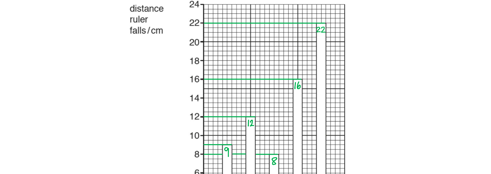

- Sum of distances

  - = A + B + C + D + E
  - = 9 + 12 + 8 + 16 + 22
  - = <u>67</u> cm** [1 mark]**

Divide 67 by 5 (A-E) to find the average:

- $\frac{67}{5}=13.4\mathrm{cm}$ ** [1 mark]**

**[Total: 2 marks]**
Use the graph to determine reaction time:

- The question states that '*The further the ruler falls, the greater the reaction time of the student*'
- Therefore the shorter the bar (distance) on the graph, the faster the reaction time

A correctly completed table with **shortest reaction time in first place** looks like:

| **order** | **student** |
|---|---|
| 1st | **Final answer:** **C** |
| 2nd | **Final answer:** **A** |
| 3rd | B |
| 4th | **Final answer:** **D** |
| 5th | **Final answer:** **E** |

- **C** and **A** in first and second; **[1 mark]**
- **D** and **E** in fourth and fifth; **[1 mark]**

**[Total: 2 marks]**
To calculate the reaction time from this data:

Recall the equation for speed:

- $\mathrm{speed}=\frac{\mathrm{distance}}{\mathrm{time}}$ **OR  **$v=\frac{s}{t}$ **[1 mark]**

Rearrange to make time the subject:

- $\mathrm{time}=\frac{\mathrm{distance}}{\mathrm{speed}}$ **OR  **$t=\frac{s}{v}$

Substitute the values:

- $t=\frac{11}{16}$ **[1 mark]**
- *t* = 0.69 s **[1 mark]**

**[Total: 3 marks]**

> *The key to this question is simply to remember that the reaction time is the amount of time that passes before the person catches the ruler. If you were confused by the description then just remember that you will never be asked to invent or discover anything new in an exam. The questions will always use only the physics you learned in class.*

### Q5
Using a scale of 1 cm = 10 N, construct a scale drawing to show the resultant force of the two tensions:

A diagram scoring 4 marks should look like:

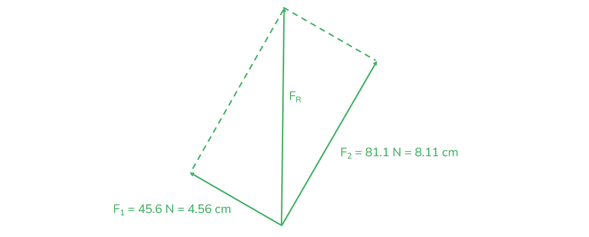

- 45.6 N force is drawn of length 4.5 - 4.6 cm **AND** 81.1 N force is drawn of length 8.1 - 8.2 cm;** [1 mark]**
- Forces are drawn at a right angle to one another (by eye); **[1 mark]**
- Parallelogram is completed;** [1 mark]**
- Resultant force is drawn and clearly labelled;** [1 mark]**

**[Total: 4 marks]**

> *Always draw your scale diagrams with a sharp pencil and ruler - don't be sloppy!*

> *You need good practice in these to make sure you hit all 4 of the marks  *

> *Make sure you always label your diagram*
Using your scale diagram from part (a), determine the magnitude and direction of the resultant force:

To find the magnitude of the resultant force:

- Using Pythagoras' theorem $F_{R}^{2}=F_{1}^{2}+F_{2}^{2}$
- $F_{R}=\sqrt{45.6^{2}+81.1^{2}}=93.0N$ **[1 mark]**

State the direction of the resultant force:

- Vertically upwards **OR** opposite to W; **[1 mark]**

**[Total: 2 marks]**

> *You could have also measured the resultant force vector and used the scale to calculate a value. However, using a calculation is a quicker and more reliable method. You only need to measure the vector if the question specifically asks you to.*

> *Saying that the direction of the resultant force is north will not get you the mark. The direction must correspond to the context of the question.*
State the value of *W*:

- The weight is equal to the resultant force calculated in part (b)
- *W* = 93.0 N **[1 mark]**

**[Total: 1 mark]**

> *The weight is balanced by the upward acting forces, so the weight must be equal and opposite to the resultant force calculated in part (b). Answers rounded to 2 or 3 significant figures will be accepted.*
Another vector quantity is:

Any **one** from:

- displacement; **[1 mark]**
- velocity; **[1 mark]**
- acceleration; **[1 mark]**
- momentum; **[1 mark]**
- electric field strength; **[1 mark]**
- gravitational field strength; **[1 mark]**

**[Total: 1 mark]**

### Q6
State whether you agree with Student 1:

- Student 1 is correct; **[1 mark]**

Explain your reasoning:

- Weight is a <u>force</u> that is dependent on gravitational field strength (*W = mg)*; **[1 mark]**
- Gravitational field strength / *g* is different on Mars than on Earth; **[1 mark]**
- Therefore, the person's weight will be different (on Mars than on Earth); **[1 mark]**

**[Total: 3 marks]**

> *Note that the question has asked you to **explain** your reasoning, which means you need to justify your statement with the physics!*
The vector quantities from the list are:

- Displacement; **[1 mark]**
- Velocity; **[1 mark]**

**[Total: 2 marks]**
Construct a scale diagram showing the effect of the two forces, and label the resultant force as X:

A diagram scoring 3 marks should look like:

- An arrow drawn to the right of length 3.5 cm; **[1 mark]**
- An arrow drawn pointing downwards of length 4.2 cm; **[1 mark]**
- Resultant force pointing diagonally downwards to the right labelled X; **[1 mark]**

**[Total: 3 marks]**

- *When constructing scale diagrams, make sure you use a sharp pencil and a ruler to draw these as neatly as possible*
Calculate the magnitude and direction of the resultant force:

To calculate the magnitude:

- Using Pythagoras' theorem $F^{2}=F_{1}^{2}+F_{2}^{2}$
- $F=\sqrt{35^{2}+42^{2}}$ **[1 mark]**
- $F=55N$ **[1 mark]**

To calculate the direction in degrees from the horizontal:

- Using trigonometry, $\\theta = \cos ^{- 1} ( \frac{adj}{hyp} ) = \cos ^{- 1} ( \frac{35}{55} )$ **[1 mark]**
- $θ=50^{\circ}$ (2 s.f.) **[1 mark]**

**[Total: 4 marks]**

> *To calculate the angle, you could also have used:*

- $\\theta = s i n^{- 1} ( \frac{opp}{hyp} ) = s i n^{- 1} ( \frac{42}{55} )$
- $\\theta = t a n^{- 1} ( \frac{opp}{adj} ) = t a n^{- 1} ( \frac{42}{35} )$

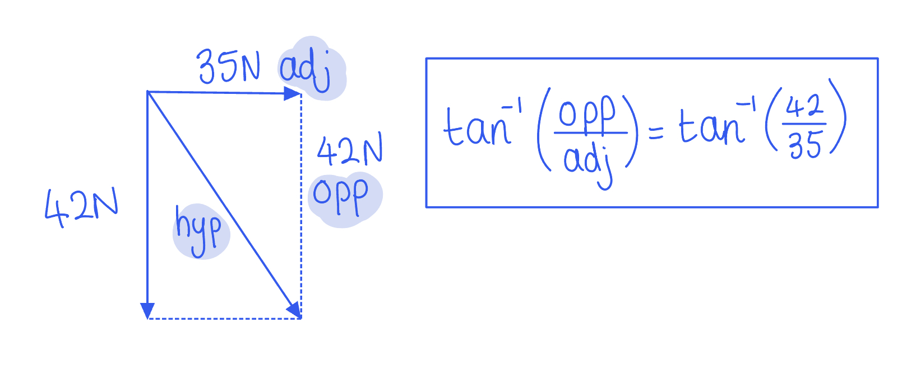

### Q7
List the known quantities:

- Thickness of pile = 5.0 cm
- Number of sheets of paper = 500

Calculate the thickness of one sheet of paper:

- The pile of 500 sheets is 5 cm thick
- $\frac{5}{500}=0.01\mathrm{cm}$ **[1 mark]**

**[Total: 1 mark]**

> *The 500 sheets take up a space of 5 cm. So, to find out how much space 1 sheet takes up divide the 5 cm by the 500 sheets. This question is more about logical thinking than understanding difficult physics concepts. *
List the known quantities:

- Height of paper = 5.0 cm
- Length of paper = 30.0 cm
- Width of paper = 20.0 cm

Recall the equation for the volume of a cuboid:

- Volume of cuboid, *V *= length × width × height

Substitute the known quantities into the equation:

- Volume of paper = 5 × 30 × 20

Calculate the volume of the paper:

- Volume of paper = 3000 cm3 **[1 mark]**

**[Total: 1 mark]**

> *This question requires you to know how to calculate the volume of a cuboid. Recognising that the paper is a cuboid means that you can then answer it. Knowing how to calculate the area and volume of regular shapes can help when answering some Physics examination questions. *
The device used to measure mass is a:

- Balance; **[1 mark]**

**[Total: 1 mark]**

> *There are various types of balance that you could state in your answer such as a pan balance or an electronic balance but just stating "balance" is enough to score the mark. *
List the known quantities:

- Mass of paper, *m* = 2400 g
- Volume of paper, *V* = 3000 cm3 (from part (b))

Recall the equation for density, mass and volume:

- $\mathrm{Density}=\frac{\mathrm{Mass}}{\mathrm{Volume}}\mathrm{or}ρ=\frac{m}{V}$ **[1 mark]**

Substitute the known quantities into the equation for density:

- $ρ=\frac{2400}{3000}$ **[1 mark]**
- *ρ *= 0.8 g / cm3 **[1 mark]**

**[Total: 3 marks]**

> *The equation for density is one of the important equations you need to remember for your exams. If the final units are given in g or cm**3** then you don't need to convert to SI units, however, do watch out for this as harder questions may require it!*

### Q8
The unit for velocity is:

- m/s (metres per second); **[1 mark]**

**[Total: 1 mark]**
Scalar and vector quantities are different because:

- Scalar quantities have magnitude (only); **[1 mark]**
- (Whereas) vector quantities have both magnitude and direction; **[1 mark]**

**[Total: 2 marks]**

> *In order to get both marks, you need to state the definitions for both scalar and vector quantities. *
To determine the velocity $v_{2}$:

Determine the scale of the vector $v_{1}$:

- $v_{1}$ is 3 large squares
- $v_{1}=\frac{6m/s}{3\mathrm{squares}}=2m/s\mathrm{per} \mathrm{square}$** **

Determine the velocity of vector $v_{2}$:

- $v_{2}$ is 5 large squares
- $v_{2} = 5 \times ( 2 \mathrm{m} \div \mathrm{s} ) = 10 \mathrm{m} \div \mathrm{s}$ **[1 mark]**

**[Total: 1 mark]**
Calculate the magnitude of the resultant velocity:

List the known quantities:

- *v*1 = 6 m/s (from part (c))
- *v*2 = 10 m/s (from part (c))

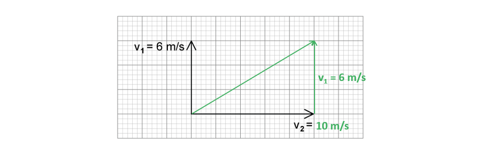

- Using Pythagoras' theorem, $v_{R}^{2}=v_{1}^{2}+v_{2}^{2}$

- $v_{R}=\sqrt{6^{2}+10^{2}}$ **[1 mark]**
- $v_{R}=11.66m/s$

Round to 2 significant figures:

- $v_{R}=12m/s$ **[1 mark]**

**[Total: 2 marks]**

> *If the question requires your answer to be to 2 s.f. you **must** round your answer to this for full marks!*

### Q9
Calculate the mass of the metal:

List the known quantities:

- Weight of metal, *W *= 3.0 N

Recall the value of gravitational field strength on Earth:

- *g *= 9.8 N/kg

Recall the equation for mass, *m* and weight, *W *and rearrange to make mass the subject:

- $W=mg$
- $m=\frac{W}{g}$
- $m=\frac{3.0}{9.8}$ **[1 mark]**

Calculate the mass of the metal:

- *m *= 0.306 kg = 0.31 kg (2 s.f.) **[1 mark]**

**[Total: 2 marks]**

> *For your physics examinations, the gravitational field strength on Earth is 9.8 N/kg.*
(i) Describe how to determine the volume of the metal:

- Determine / read the volume of the water in the measuring cylinder; **[1 mark]**
- Submerge / sink the metal in the water / measuring cylinder; **[1 mark]**
- Determine / read the new volume of water; **[1 mark]**
- Find the difference between the final and initial volumes of the water to obtain a value for the volume of the metal; **[1 mark]**

** **

(ii)  Explain why the procedure in** **(b)(i) is not suitable for finding the volume of a piece of low-density wood:

- Wood floats /** **does not sink; **[1 mark]**

(iii) Calculate the density of the metal:

List the known quantities:

- Mass of metal, *m *= 405 g
- Volume of metal, *V *= 150 cm3

Recall the equation to calculate the density of an object and substitute the known quantities:

- $ρ=\frac{m}{V}$
- $ρ=\frac{405}{150}$ **[1 mark]**

Calculate the density of the metal:

- *ρ* = 2.7 **[1 mark]**

State the unit:

- g/cm3 **[1 mark]**

**[Total: 8 marks]**

> *In this question, you do not need to convert the units, the mass is given in g and the volume in cm**3**, so the units for density are g ÷ cm**3**. *

### Q10
A vector quantity:

- Has both <u>magnitude</u> and <u>direction</u>; **[1 mark]**

**[Total: 1 mark]**
Complete the information missing from the table:

**One mark for each correct answer:**

| **Quantity** | **SI unit** |
|---|---|
| weight | **Final answer:** **N** |
| **Final answer:** **velocity** | m/s |
| **Final answer:** **momentum** | kg m/s |
| gravitational field strength | **Final answer:** **N/kg** |

**[Total: 4 marks]**

> *Lots of students get the units for weight and mass confused. Remember that **weight is a force** so it has the units of newtons (N).*

> *Gravitational field strength** is defined as **the force per unit mass acting on an object with mass in a gravitational field**, therefore its units are newtons per kilogram (N/kg). Acceleration of freefall is the acceleration of the object with mass in a gravitational field, and therefore its units are metres per second squared (m/s**2**). Whilst these quantities are essentially describing the same thing, the context really matters when it comes to units!*
By use of a scale diagram (**not** by calculation) determine the magnitude of the resultant force:

A diagram scoring four marks:

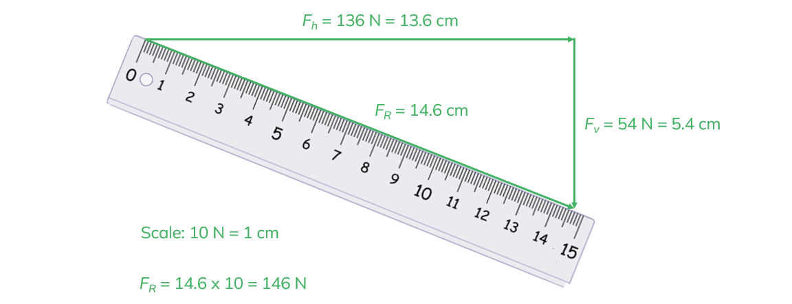

- Correct use of an appropriate scale **AND** scale clearly indicated; **[1 mark]**
- Horizontal and vertical forces drawn at right angles in correct directions; **[1 mark]**
- Resultant force drawn correctly and clearly labelled; **[1 mark]**
- Resultant vector correctly measured **AND** scale used to calculate a value of 146 N ± 2 N; **[1 mark]**

**[Total: 4 marks]**
Determine the direction of the resultant force from the horizontal:

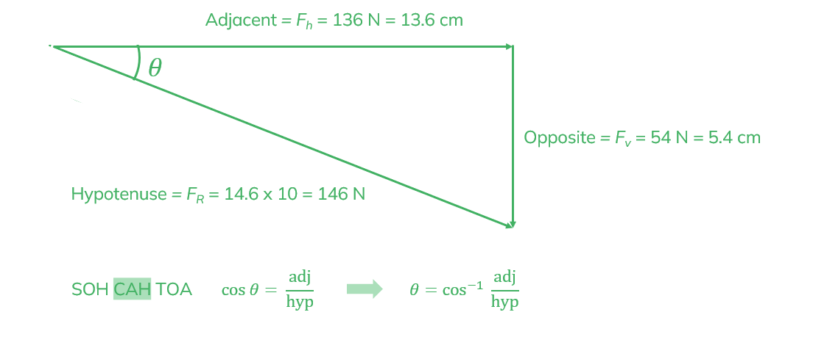

- Using trigonometry $\\theta = \cos ^{- 1} ( \frac{a d j}{h y p} ) = \cos ^{- 1} ( \frac{136}{146} )$ **[1 mark]**
- $θ=21.3^{\circ}$ from the horizontal** [1 mark]**

**[Total: 2 marks]**

> *You must be confident with your trigonometry in the scalars and vectors topic - makes sure you revise this from the maths course if you're still unsure!*

### Q11
The difference between speed and velocity is:

- Speed is a scalar quantity / has magnitude only / is distance travelled per unit time; **[1 mark]**
- Velocity is a vector quantity / has magnitude and direction / has direction / is speed in a given direction / is the rate of change of displacement; **[1 mark]**

**[Total: 2 marks]**

> **[exam-tip]**
> Don't reverse them — speed is the scalar, velocity is the vector
> 
> Make one clear point about each quantity, not just one of them
The scalar quantities from the list are:

- Time; **[1 mark]**
- Distance; **[1 mark]**

**[Total: 2 marks]**
Another example of a scalar quantity and vector quantity is:

**Scalar**

Any **one** from:

- speed; **[1 mark]**
- mass; **[1 mark]**
- energy; **[1 mark]**
- temperature; **[1 mark]**

**Vector**

Any **one** from:

- displacement; **[1 mark]**
- velocity; **[1 mark]**
- weight; **[1 mark]**
- force; **[1 mark]**
- acceleration; **[1 mark]**
- momentum; **[1 mark]**
- impulse; **[1 mark]**
- electric field strength; **[1 mark]**
- gravitational field strength; **[1 mark]**

**[Total: 2 marks]**

> *Part (ii) asks for a scalar apart from time and distance, therefore you will not gain a mark for time or distance in part (ii).*

> *The quantities listed above are the ones you are expected to know in your exam, but you would also be awarded marks for any other correct answer.*

> **[exam-tip]**
> Before answering, underline words such as "other" or "apart from" so you do not give an example the question has already ruled out.
Calculate the magnitude of the resultant force:

- Using Pythagoras' theorem, $F^{2}=F_{1}^{2}+F_{2}^{2}$
- $F=\sqrt{238^{2}+196^{2}}$ **[1 mark]**
- $F=308N$ **[1 mark]**

**[Total: 2 marks]**

> *It is best practice to write numerical answers to the same number of significant figures as the values given in the question. Therefore, in this question, you should give your answer to 3 significant figures.*

### Q12
> **[mark-scheme]**
> - Student S **[1 mark]**

> **[exam-tip]**
> It is easy to confuse students Q and S because both start and finish timing at the centre. One complete oscillation ends only when the pendulum returns to its starting position moving in the same direction as when it started. Student Q's pendulum is moving in the opposite direction at the end, so Q has timed only half an oscillation. Student S's pendulum swings to both sides and returns moving in its original direction, which is one full period.
To calculate the time for one period of the pendulum:

- List the known quantities:

  - Total time = 1 minute 23.37 s
  - Number of periods = 50
- Convert the total time into seconds:

$1 \text{minute} = 60 \text{s}$

$\text{total time} = 60 + 23 . 37 = 83 . 37 \text{s}$ **[1 mark]**

- Write down the equation for the time of one period:

$T = \frac{\text{total time}}{\text{number of periods}}$

- Substitute the known values:

$T = \frac{83.37}{50}$ **[1 mark]**

- Calculate the answer and give it to 3 significant figures:

$T = 1 . 6674 \text{s}$

$T =$$1 . 67 \text{s}$ **[1 mark]**

> **[mark-scheme]**
> 1 mark for converting the total time to seconds: $83 . 37 \text{s}$
> 
> 1 mark for dividing the total time by the number of periods: $T = \frac{83.37}{50}$
> 
> 1 mark for a correct final answer of $1 . 67 \text{s}$
> 
> - Must be given to 3 significant figures; do not accept 1.6674 or 1.7
> - ecf from an incorrectly converted total time (e.g. reading the stopwatch as 123.37 s gives 2.47 s)

> **[exam-tip]**
> A stopwatch display of 1:23.37 means 1 minute 23.37 s. Convert the total time to seconds before dividing — a common error is to read the display as 123.37 s. Give your final answer to the 3 significant figures the question asks for; leaving it as 1.6674 s loses the final mark.
> **[mark-scheme]**
> - Displacement = $165 \text{mm}$ **[1 mark]**

> **[exam-tip]**
> There are 10 mm in 1 cm, so convert centimetres to millimetres by multiplying by 10 — a common error is to multiply by 100. As a sense check, millimetres are smaller than centimetres, so the number in your answer should be larger than the one you started with.

### Q13
> **[mark-scheme]**
> - Side A = 7.5 cm **[1 mark]**
> - Side B = 4.0 cm **[1 mark]**
> - Side C = 2.0 cm **[1 mark]**
> 
> Accept 7.4–7.6 cm (74–76 mm or 0.074–0.076 m) for side A, 3.9–4.1 cm for side B and 1.9–2.1 cm for side C
> 
> The trailing zero is required to show precision to the nearest millimetre: accept 4.0 cm but not 4 cm, and 2.0 cm but not 2 cm
> 
> The unit is required for each mark

> **[exam-tip]**
> The ruler has millimetre markings, so give every reading to the nearest millimetre and keep the trailing zero: 4.0 cm, not 4 cm. Always include the unit, even when the value is correct; "to an appropriate level of precision" and "include the appropriate units" in the question are both instructions that carry marks.
To calculate the volume in cubic metres:

- Convert the side lengths to metres by dividing by 100:

$\text{side A} = \frac{7.5}{100} = 0 . 075 \text{m}$

$\text{side B} = \frac{4.0}{100} = 0 . 040 \text{m}$

$\text{side C} = \frac{2.0}{100} = 0 . 020 \text{m}$

**[1 mark]**

- Multiply the three side lengths:

$V = 0 . 075 \times 0 . 040 \times 0 . 020$ **[1 mark]**

- Calculate the answer:

$V = 0 . 000060 \text{m}^{3} =$$6 . 0 \times 10^{-5} \text{m}^{3}$ **[1 mark]**

> **[mark-scheme]**
> 1 mark for converting the side lengths to metres (dividing by 100)
> 
> 1 mark for multiplying the three side lengths
> 
> - Accept $7 . 5 \times 4 . 0 \times 2 . 0 = 60 \text{cm}^{3}$ followed by dividing by $10^{6}$
> 
> 1 mark for a correct final answer of $6 . 0 \times 10^{-5} \text{m}^{3}$
> 
> - Accept 0.00006 m³ or 0.000060 m³
> - ecf from the candidate's own side lengths in part (a), e.g. 7.4 × 4.0 × 1.9 cm gives $5 . 6 \times 10^{-5} \text{m}^{3}$

> **[exam-tip]**
> Convert each side to metres before multiplying, or your volume will be in cubic centimetres. If you multiply in centimetres first, remember that 1 m3 = 1003 cm3, so divide by 106, not by 100.
> **[mark-scheme]**
> - $m = 0 . 164 \text{kg}$ **[1 mark]**

> **[exam-tip]**
> The scale reads 164 g; to convert grams to kilograms, divide by 1000. A kilogram is the larger unit, so the number must get smaller.
To identify the metal, calculate the density of the cuboid:

- List the known quantities:

  - Volume, $V = 6 . 0 \times 10^{-5} \text{m}^{3}$ (from part (b))
  - Mass, $m = 0 . 164 \text{kg}$ (from part (c))
- Write down the density equation and substitute the known values:

$ρ = \frac{m}{V} = \frac{0.164}{6.0\times10^{-5}}$ **[1 mark]**

$ρ = 2733 \text{kg/m}^{3} \approx 2700 \text{kg/m}^{3}$ **[1 mark]**

- Compare with the densities in the table:

The metal is **aluminium** **[1 mark]**

> **[mark-scheme]**
> 1 mark for $ρ = \frac{m}{V}$ in words or symbols, or correct substitution
> 
> 1 mark for a density of 2733 kg/m³
> 
> - Accept 2700 kg/m³ or 2730 kg/m³
> - ecf from the candidate's own mass and volume
> 
> 1 mark for aluminium
> 
> - ecf: award for the metal whose density is closest to the candidate's own calculated value

> **[exam-tip]**
> Use your own answers from parts (b) and (c): a volume carried forward from an earlier slip can still score here, as long as the metal you choose matches the density you calculated. Your value will not match the table exactly because the measurements were rounded, so pick the closest.

### Q14
To calculate the average time between two drops:

- List the known quantities:

  - Number of drops = 50
  - Time for 50 drops, $t = 20 \text{s}$
- Divide the total time by the number of drops:

$\text{average time} = \frac{\text{time for 50 drops}}{\text{number of drops}} = \frac{20}{50}$ **[1 mark]**

- Calculate the answer:

$\text{average time} =$$0 . 4 \text{s}$ **[1 mark]**

> **[mark-scheme]**
> 1 mark for $20 \div 50$
> 
> 1 mark for a correct final answer of $0 . 4 \text{s}$
> 
> - Accept 0.40 s
> - Both marks can be scored for the correct answer alone

> **[exam-tip]**
> The time between drops is the total time shared between the drops, so divide the time by the number of drops. Dividing the other way round gives 2.5, which is the number of drops per second: a rate, not a time.
(i) The equipment suitable for measuring the volume accurately is:

> **[mark-scheme]**
> - Measuring cylinder **[1 mark]**
> 
> Do not accept "beaker" or "jug": these are not accurate enough

(ii) To calculate the weight of the water:

- List the known quantities:

  - Mass, $m = 0 . 21 \text{kg}$
  - Gravitational field strength, $g = 9 . 8 \text{N/kg}$
- Write down the equation for weight:

$W = m g$ **[1 mark]**

- Substitute the known values:

$W = 0 . 21 \times 9 . 8$ **[1 mark]**

- Calculate the answer:

$W = 2 . 058 \text{N} =$$2 . 1 \text{N}$ **[1 mark]**

> **[mark-scheme]**
> 1 mark for $W = m g$ or $g = \frac{W}{m}$, in words or symbols
> 
> 1 mark for correct substitution, $0 . 21 \times 9 . 8$ (accept $0 . 21 \times 10$)
> 
> 1 mark for a correct final answer of $2 . 1 \text{N}$
> 
> - Accept 2.06 N or 2.058 N
> - Accept 2.1 N obtained with $g = 10 \text{N/kg}$
> - All three marks can be scored for the correct answer alone

> **[exam-tip]**
> Write the equation before you substitute: in CIE calculations the equation line is a mark on its own, even if the arithmetic goes wrong afterwards. The answer line already prints the unit N, so the three marks here are for the equation, the substitution and the value.

### Q15
Calculate the time interval between the two readings:

List the known quantities:

- Start time = 1 minute 22.1 seconds
- Final time = 3 minutes 46.5 seconds

Convert the times to seconds:

- $1\mathrm{min}=60s$
- $\mathrm{start} \mathrm{time}=1\mathrm{minute}22.1s$

  - $\mathrm{start} \mathrm{time}=60s+22.1s=82.1s$
- $\mathrm{final} \mathrm{time}=3\mathrm{minutes}46.5s$

  - $\text{final} \text{time} = ( 3 \times 60 ) + 46.5 = 226.5 \mathrm{s}$

Calculate the time interval:

- The interval is the difference between the start time and the final time
- $interval=finaltime-starttime$
- $interval=226.5-82.1$ **[1 mark]**
- interval = 144.4 s **[1 mark]**

**[Total: 2 marks]**

> *You could have answered this question without converting both times first. You may have subtracted the minutes and seconds separately and given your answer in minutes and seconds before converting to seconds. However, you needed to give your final answer in seconds, because the answer space gives units of seconds.*
Describe how to determine accurately the average time for each interval, using a stopwatch:

- Start the stopwatch as the LED flashes; **[1 mark]**
- Time a large number of flashes, such as 10 (or more); **[1 mark]**
- Stop the stopwatch on the 10th flash (or any integer value greater than 1); **[1 mark]**
- Divide the time on the stopwatch by 10 (or the integer value written in the previous point); **[1 mark]**

**[Total: 4 marks]**

> *Make sure you start the timer on a flash. This flash is t = 0. The next flash is the first flash you count. *

> *Just timing  the duration between two consecutive flashes would give an inaccurate value. There is error involved when using a stopwatch, because the **reaction time** of the experimenter affects the time between the LED flashing and the stopwatch starting. *

> *We want the uncertainty to be a small fraction of the measurement itself, so a longer measurement of time gives a more accurate result. Dividing this by the number of flashes then gives a more accurate value for the length of a single flash. *

> *It is important to state that the stopwatch needs starting as the first marking point. *

### Q16
(i) State the time readings shown:

Time readings that would score a total of 1 mark should look like this:

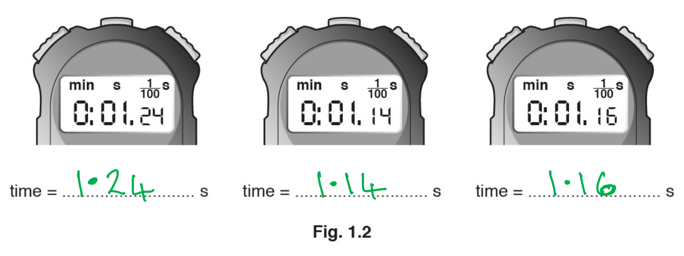

- The three times are written in the following order:

  - 1.24 s
  - 1.14 s
  - 1.16 s **[1 mark]**

** **

(ii) Calculate the average time interval between two drops of water hitting the ground:

Recall the method for calculating the average of 3 numbers:

- $\mathrm{average}=\frac{\mathrm{sum} \mathrm{of}3\mathrm{numbers}}{3}$

Substitute the known quantities into the equation:

- $\mathrm{average}=\frac{1.24+1.14+1.16}{3}$
- $\mathrm{average}=\frac{3.54}{3}$ **[1 mark]**
- Average = 1.18 s **[1 mark]**

**[Total: 3 marks]**

> *Calculating an average in physics is the same as in maths.*
Calculate the average speed of this drop of water:

List the known quantities:

- Distance, $s$ = 12 m (from part (a))
- Time, $t$ = 1.6 s

Recall the equation to calculate average speed:

- $\mathrm{average} \mathrm{speed}=\frac{\mathrm{distance}}{\mathrm{time}}$ **[1 mark]**

Substitute the known quantities into the equation:

- $\mathrm{average} \mathrm{speed}=\frac{12}{1.6}$ **[1 mark]**
- average speed = 7.5 m/s **[1 mark]**

**[Total: 3 marks]**

### Q17
Calculate the magnitude of the downward force acting on the bucket of water:

Determine the vertical resultant tension force of the ropes:

- Construct a vector diagram using the parallelogram method

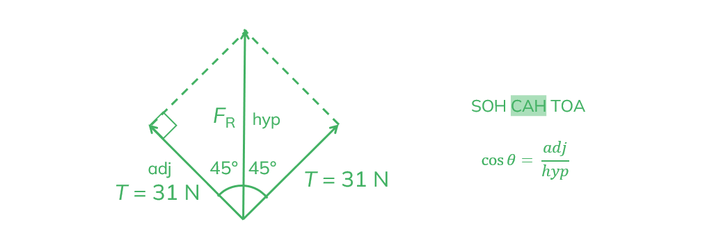

- Using trigonometry, $\mathrm{cos}θ=\frac{adj}{hyp}=\frac{T}{F_{R}}$

Rearranging to make $F_{R}$ the subject:

- $\mathrm{cos}θ=\frac{T}{F_{R}}$
- $\mathrm{cos}θ\timesF_{R}=T$
- $F_{R}=\frac{T}{\mathrm{cos}θ}$ **[1 mark]**
- Therefore, $F_{R} = \frac{ 31}{\cos ( 45 )}$ **[1 mark]**
- $F_{R}=44N$** [1 mark]**

Determine the downward force acting on the bucket:

- The downward force is balanced by the vertical resultant tension force

  - Therefore, the forces are equal and opposite

- The downward force on bucket = 44 N **[1 mark]**

**[Total: 4 marks]**
The name of the downward force acting on the bucket is:

- Weight; **[1 mark]**

**[Total: 1 mark]**
Another vector quantity is:

Any one from:

- displacement; **[1 mark]**
- velocity; **[1 mark]**
- acceleration; **[1 mark]**
- force; **[1 mark]**
- momentum; **[1 mark]**
- electric field strength; **[1 mark]**
- gravitational field strength; **[1 mark]**
Calculate the mass of the water in the bucket, $m_{w}$:

List the known quantities:

- Weight, $W$= 44 N (from part (a))
- Mass of bucket, $m_{b}$= 0.65 kg
- Gravitational field strength, $g$ = 9.8 N/kg

Recall the equation for weight and rearrange to make $m$ the subject:

- $W=mg$
- $m=\frac{W}{g}$ **[1 mark]**

Determine the combined mass of the bucket, $m_{b}$, and the water, $m_{w}$:

- $( m_{b} + m_{w} ) = \frac{W}{g} = \frac{ 44}{9.8}$
- $( m_{b} + m_{w} ) = 4.49 \text{kg}$ **[1 mark]**

Determine the mass of the water:

- $m_{w}=4.49-0.65=3.84=3.8\mathrm{kg}$ **[1 mark]**

**[Total: 3 marks]**

> *You will be expected to remember the value of the gravitational field strength, **g** = 9.8 N/kg or 9.8 m/s. Sometimes, it may be given to you in the question.*
