# Exam Questions — Physical Quantities & Measurement Techniques
**1. Motion, Forces & Energy** · Cambridge (CIE) IGCSE physics (0625 & 0972)
> Source: [https://www.savemyexams.com/igcse/physics/cie/23/topic-questions/](https://www.savemyexams.com/igcse/physics/cie/23/topic-questions/) · 41 questions across 3 sets

## Alternative To Practical Questions (4 questions)

### Q1 — medium — 11 marks

**Q1** [1 mark]

A student is determining the acceleration of free fall *g* using a pendulum. Fig. 1.1 shows the pendulum. Fig. 1.2 shows one complete oscillation of the pendulum.

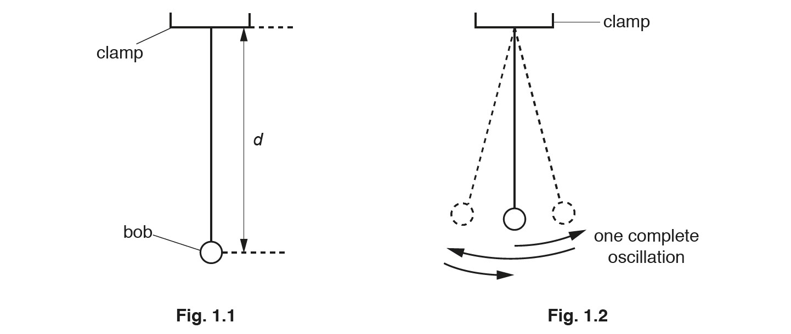

On Fig. 1.1, measure the distance *d*.

*d *= ................................................... cm

*Source: May/June 2018 (Series 1) 0625/61 Q1A*

**Q1** [5 marks]

**Extract:**

Measured distance from Fig. 1.1: d = 5.0 cm (from part (a))
The scale of drawing to actual size = 1/10th
The time t shown on the stopwatch = 14.06 seconds
The time for 10 oscillations t = 14.06 seconds
Equation: g = 20 / T^2

Fig. 1.1 is drawn 1/10th actual size. Assume that distance *d* from part (a) is 5.0 cm.

(i) Calculate the actual distance *D* from the bottom of the clamp to the centre of the bob.

*D* = ................................................... cm [1]

The student displaces the bob slightly and releases it so that it swings. He measures the time *t* for 10 complete oscillations. The time *t* is shown on the stopwatch in Fig. 1.3.

(ii) Write down the time *t* shown in Fig. 1.3.

*t* = ......................................................... [1]

(iii) Calculate the period *T* of the pendulum. The period is the time for one complete oscillation.

*T* = ......................................................... [1]

(iv) Calculate *T*2.

*T*2 = ......................................................... [1]

(v) Calculate the acceleration of free fall *g* using the equation $g=\frac{20}{T^{2}}$.

*g* = ......................................................... [1]

*Source: May/June 2018 (Series 1) 0625/61 Q1B*

**Q1** [2 marks]

The student adjusts the pendulum until the distance *D* measured to the centre of the bob is 100.0cm.

He repeats the procedure and obtains another value of *T*2.

*T*2 = 3.92

(i) On the dotted line above, write the unit for *T*2.

[1]

(ii) Calculate the acceleration of free fall *g *using the equation $g=\frac{40}{T^{2}}$and the value of *T*2 from (c). Give your answer to a suitable number of significant figures for this experiment.

*g* = ......................................................... [1]

*Source: May/June 2018 (Series 1) 0625/61 Q1C*

**Q1** [2 marks]

**Extract:**

A student is determining the acceleration of free fall g using a pendulum. Fig. 1.1 shows the pendulum. Fig. 1.2 shows one complete oscillation of the pendulum.

On Fig. 1.1, measure the distance d.

Fig. 1.1 is drawn 1/10th actual size. Assume that distance d from part (a) is 5.0 cm.

(i) Calculate the actual distance D from the bottom of the clamp to the centre of the bob.

The student displaces the bob slightly and releases it so that it swings. He measures the time t for 10 complete oscillations. The time t is shown on the stopwatch in Fig. 1.3.

(ii) Write down the time t shown in Fig. 1.3.

(iii) Calculate the period T of the pendulum. The period is the time for one complete oscillation.

(iv) Calculate T^2.

(v) Calculate the acceleration of free fall g using the equation g = 20 / T^2.

The student adjusts the pendulum until the distance D measured to the centre of the bob is 100.0cm. He repeats the procedure and obtains another value of T^2.

T^2 = 3.92

(ii) Calculate the acceleration of free fall g using the equation g = 40 / T^2 and the value of T^2 from (c).

Another student states that repeating the experiment improves the reliability of the value obtained for *g*.

Suggest** two** changes that you would make to improve the reliability. The stopwatch cannot be changed.

*Source: May/June 2018 (Series 1) 0625/61 Q1D*

**Q1** [1 mark]

State **one** precaution that you would take in this experiment in order to obtain accurate readings.

*Source: May/June 2018 (Series 1) 0625/61 Q1E*

### Q2 — medium — 7 marks

**Q2** [7 marks]

A student is investigating the factors that affect the size of the crater (hole) a ball makes when it is dropped into sand.

Plan an experiment which would enable you to investigate one factor which might affect the size of the crater.

The apparatus available includes

- metal balls of different sizes
- a tray of sand

Write a plan for the experiment.

In your plan you should:

- state which factor is being investigated,
- state the key variables that you would control,
- list any additional apparatus needed,
- explain briefly how you would carry out the experiment including what would be measured and how this would be done,
- state the precautions which should be taken to obtain reliable results,
- suggest a suitable graph which could be drawn from the results.

You may draw a diagram if it helps to explain your plan.

*Source: 2018 Feb 0625/62 Q4*

### Q3 — medium — 10 marks

**Q3** [3 marks]

A student investigates the period of a pendulum. Fig. 1.1 and Fig. 1.2 show the apparatus she uses.

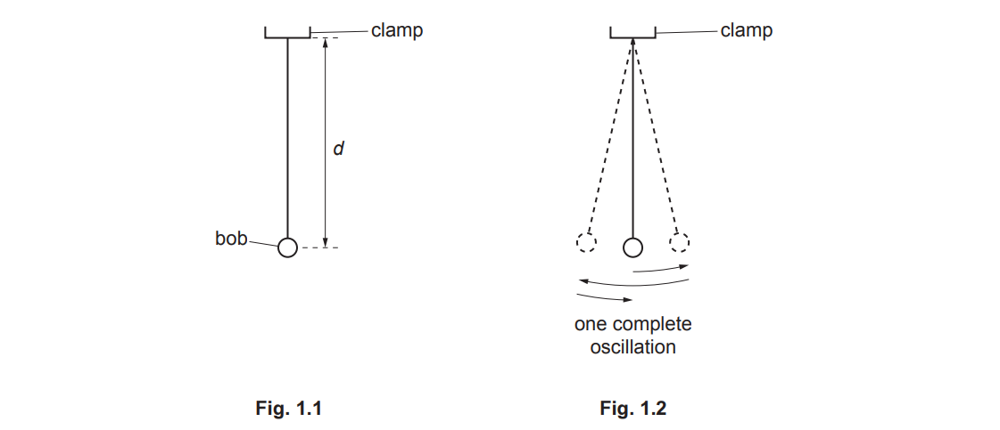

Explain briefly, with the help of a diagram, how you would use a metre rule and set square to measure the length *d* of a pendulum as accurately as possible.

*Source: 2020 May/ June 0625/62 Q1A*

**Q3** [2 marks]

The student adjusts the pendulum so that *d* = 50.0 cm. She displaces the bob slightly and releases it so that it swings. Fig. 1.2 shows one complete oscillation of the pendulum. She measures the time *t*1 for 20 complete oscillations.

(i) Record the time *t*1 in seconds as shown in Fig. 1.3.

[1]

(ii) Calculate the period *T*1 of the pendulum. The period is the time for one complete oscillation.

[1]

*Source: 2020 May/ June 0625/62 Q1B*

**Q3** [1 mark]

The student adjusts the pendulum until the distance *d* is 100.0 cm.

She repeats the procedure and records the time *t*2 for 20 oscillations and the period *T*2.

- *t*2 = 39.80s
- *T*2 = 1.99s

She measures the mass *m*A of the pendulum bob. The reading on the balance is shown in Fig. 1.4.

Record mass *m*A of the pendulum bob to the nearest gram.

*m*A = .................................................. g

*Source: 2020 May/ June 0625/62 Q1C*

**Q3** [1 mark]

**Extract:**

For mass A = 52 g, distance d = 50.0 cm, period T1 = 1.406 s (rounded to 1.4 s); distance d = 100.0 cm, period T2 = 1.99 s (rounded to 2.0 s). For mass B = 109 g, distance d = 50.0 cm, period T3 = 1.39 s (rounded to 1.4 s); distance d = 100.0 cm, period T4 = 2.02 s (rounded to 2.0 s).

The student repeats the procedure using a pendulum bob of mass *m*B.

- *m*B = 109 g

She obtains these results:

- distance *d* = 50.0 cm.

  - period *T*3 = 1.39 s
  - distance *d* = 100.0 cm
  - period *T*4 = 2.02 s

(i) Using the results *T*1, *T*2, *T*3 and *T*4, for the period of each of the pendulums, tick (**✓**) the response that matches your results within the limits of experimental accuracy.

`square` the period T is affected by *d* only

`square` the period T is affected by both *d* and *m*

`square` the period T is affected by *m* only

`square` the period T is not affected by both *d* or *m*

[1]

(ii) Justify your answer to (d)(i) by reference to the results.

[1]

*Source: 2020 May/ June 0625/62 Q1D*

**Q3** [3 marks]

The student now investigates the effect of the size of the oscillations on the period of the pendulum.

(i) Suggest briefly how you would measure the size of an oscillation. You may draw a diagram.

[2]

(ii) State one variable that you would keep constant during this part of the investigation.

[1]

*Source: 2020 May/ June 0625/62 Q1E*

### Q4 — medium — 5 marks

**Q4** [2 marks]

An IGCSE student is investigating the average speed of a toy car travelling down a slope.

She releases the toy car on the slope. She uses a stopwatch to measure the time taken for the car to travel down part of the slope. Fig. 5.1 shows the slope.

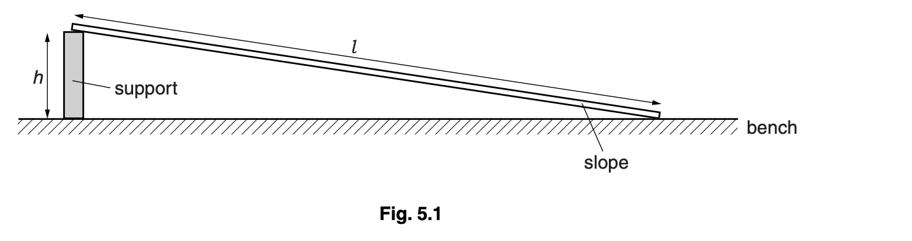

(i) Suggest a suitable length *l* for the slope used in this school laboratory experiment.

[1]

(ii) Suggest a suitable height *h*, above the laboratory bench, for one end of the slope.

[2]

**Q4** [3 marks]

The student tries to determine the time that the toy car takes to travel a distance down the slope.

Make three suggestions about what she could do to ensure that the distance travelled and the time taken by the toy car are measured as reliably as possible.

## Multiple Choice Questions (20 questions)

### Q1 — medium — 1 marks

**Q1** [1 mark]

A student wants to find the volume of a small, irregularly shaped stone.

Which pieces of apparatus should the student use?

### Q2 — medium — 1 marks

**Q2** [1 mark]

A boat travels $30 \text{km}$ due east and then $40 \text{km}$ due north.

Which row correctly shows the total distance and displacement magnitude?

|   | Total distance | Displacement magnitude |
|---|---|---|
| **A** | 50 km | 70 km |
| **B** | 70 km | 50 km |
| **C** | 70 km | 70 km |
| **D** | 50 km | 50 km |

### Q3 — medium — 1 marks

**Q3** [1 mark]

A student uses a stopwatch to time 40 complete swings of a simple pendulum. The total time taken is 1 minute and 52 seconds.

What is the period of the pendulum?

### Q4 — medium — 1 marks

**Q4** [1 mark]

**Extended Tier Only**

** **On the diagram shown, what is the magnitude of the resultant force of the two vectors?

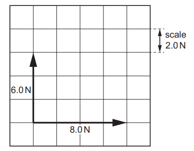

*Source: June 2022 paper 2 Q8*

### Q5 — medium — 1 marks

**Q5** [1 mark]

A length of string is measured between two points on a ruler.

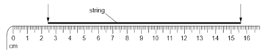

When the length of string is wound closely around a pen, it goes round six times.

What is the distance once round the pen?

*Source: 2023 specimen paper 1 Q1*

### Q6 — easy — 1 marks

**Q6** [1 mark]

Which measuring devices are most suitable for determining the length of a swimming pool and the thickness of aluminium foil?

|   | **length of a swimming pool** | **thickness of aluminium foil** |
|---|---|---|
| **A** | ruler | measuring cylinder |
| **B** | tape measure | micrometer screw gauge |
| **C** | tape measure | ruler |
| **D** | ruler | micrometer screw gauge |

*Source: June 2022 paper 2 Q1*

### Q7 — easy — 1 marks

**Q7** [1 mark]

A lump of modelling clay is moved from a small measuring cylinder to a large measuring cylinder that has twice the diameter.

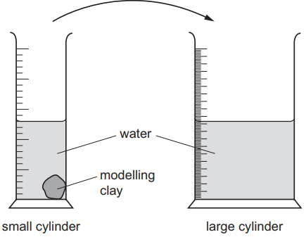

The reading on the small measuring cylinder goes down by 20 cm3.

By how much does the reading on the large cylinder go up?

*Source: June 2022 Paper 1 Q1*

### Q8 — easy — 1 marks

**Q8** [1 mark]

**Extended tier only**

Identify the physical quantity that is **not** scalar.

### Q9 — easy — 1 marks

**Q9** [1 mark]

A student wants to take a particularly accurate measurement of the volume of liquid in a measuring cylinder.

Which of the following procedures would make her measurement **less** accurate?

### Q10 — easy — 1 marks

**Q10** [1 mark]

Five identical spheres are placed between two blocks in order to measure their diameter.

What is the diameter of a single sphere?

### Q11 — easy — 1 marks

**Q11** [1 mark]

A student is timing the rate of cooling of a beaker of water. On a repeat run of the investigation, the student forgets to zero the stopwatch.

The readings on the stopwatch at the start time and the end time are shown in Fig. 1.1

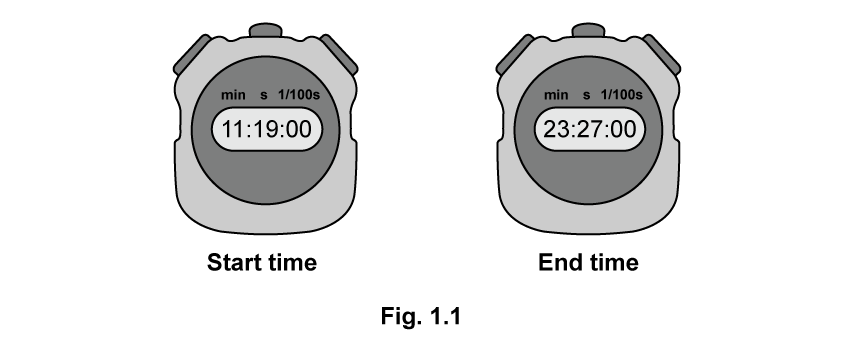

Calculate how long it took the beaker to cool.

### Q12 — easy — 1 marks

**Q12** [1 mark]

**Extended tier only**

Identify the physical quantity that is a scalar.

### Q13 — medium — 1 marks

**Q13** [1 mark]

A particularly diligent student wants to measure the volume of some liquid for an experiment. She has two measuring cylinders available, a large 250 ml one and a small 50 ml one. The liquid will fit into either of the two measuring cylinders.

As expected, the liquid forms a meniscus where it touches the sides of either measuring cylinder.

Which cylinder should the student use to get the most accurate result, and from where should she measure the liquid level?

| ** ** | **Measuring cylinder** | **Reading taken from** |
|---|---|---|
| **A** | large | Top of meniscus |
| **B** | large | Bottom of meniscus |
| **C** | small | Top of meniscus |
| **D** | small | Bottom of meniscus |

### Q14 — medium — 1 marks

**Q14** [1 mark]

A scientist is trying to determine the volume of three identical pieces of a new material. She places them in a measuring cylinder, as shown in the diagram.

The first cylinder shows the level of water in the measuring cylinder before the pieces are added, and the second cylinder shows the measuring cylinder with the pieces of the new material inside.

What is the volume of each piece of the new material?

### Q15 — hard — 1 marks

**Q15** [1 mark]

A student is trying to see how quickly they can run 5.0 km on a standard 400 m running track.

They reason that, if they know how fast they can run one lap, they can assume they will run at the same speed for 5.0 km, and can calculate their predicted time.

They, correctly, reason that they will not be able to maintain their initial pace throughout the whole 5.0 km, so they decide to time lap 5.

The diagram shows the reading on the stopwatch at the beginning and the end of lap 5.

Calculate how long it should take the student to run 5.0 km.

### Q16 — medium — 1 marks

**Q16** [1 mark]

A geologist wants to measure the volume of a particularly interesting pebble she has found in a river.

She uses the apparatus shown below.

What is the volume of the pebble?

### Q17 — hard — 1 marks

**Q17** [1 mark]

A student uses a ruler to determine the circumference of a wooden dowel.

She puts a mark onto the dowel, then rolls it along the ruler three times, before reading the position on the ruler at which it stopped.

What is the circumference of the dowel?

### Q18 — medium — 1 marks

**Q18** [1 mark]

A person wishes to roast a chicken. The chicken requires 1 hour and 20 minutes in the oven to be properly cooked.

The oven must be switched on 10 minutes before any food is put in, in order to pre-heat, and reach the correct temperature for cooking.

The chicken needs to be ready at 4:30 pm. At what time must the oven be switched on?

### Q19 — hard — 1 marks

**Q19** [1 mark]

An Olympic cyclist rides around a velodrome track 5 times.

The diagram below shows the reading on the stopwatch, which was used to time the laps. Unfortunately, the person using the stopwatch started it a little early, so the stopwatch reads 2 seconds when the cyclist starts.

What is the average time to complete one lap of the velodrome?

### Q20 — hard — 1 marks

**Q20** [1 mark]

Three blocks are placed into three measuring cylinders. These are shown below.

Which row in the table shows the blocks in order of increasing volume?

|   | Smallest volume | **→** | Largest volume |
|---|---|---|---|
| **A** | X | Y | Z |
| **B** | Y | X | Z |
| **C** | Z | Y | X |
| **D** | Z | X | Y |

## Theory Questions (17 questions)

### Q1 — easy — 7 marks

**Q1** [2 marks]

**Extract:**

Expected method: measure the thickness of a large number of sheets (e.g. 100) with the ruler, then divide by the number of sheets. Both steps are needed for two marks.

A stack of paper is used for a design project.

Describe how to determine accurately the thickness of one sheet from this stack, using only a ruler.

**Q1** [2 marks]

**Extract:**

Expected method: measure length, width and height with the ruler, then multiply the three measurements. Do not credit a water displacement method because the stem specifies a ruler.

A small rectangular block is required for the design project.

Describe how to accurately measure the volume of the block using a ruler.

**Q1** [3 marks]

**Extract:**

Expected method: record the water volume in the measuring cylinder, fully submerge the object and record the new volume, then subtract to find the volume of the object. Only a measuring cylinder and water may be used.

Describe how to measure the volume of a small, irregularly shaped object using only a measuring cylinder and some water.

### Q2 — medium — 8 marks

**Q2** [7 marks]

Fig. 1.1 shows a dripping tap and a measuring cylinder. The water drops all have the same volume. The drops fall from the tap at equal time intervals.

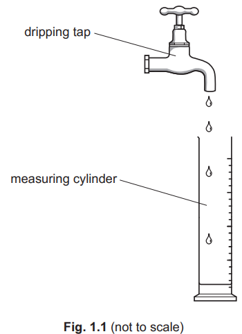

(i) The student collects 200 of the drops in a measuring cylinder. The total volume collected is 60 cm3.

Calculate the average volume of **one** drop of water.

volume = .................................................. cm3 [3]

(ii) Another student uses a stop-watch to measure the time taken for the tap to produce 200 drops. Fig. 1.2 shows the time reading on the stop-watch.

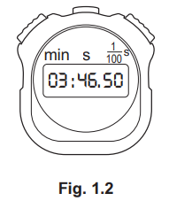

Determine the time, in seconds, for the tap to produce 200 drops.

time = ...................................................... s [2]

(iii) Determine the average time interval between one drop starting to fall and the next drop starting to fall.

time interval = ...................................................... s [2]

*Source: June 2022 paper 3 Q1A*

**Q2** [1 mark]

Fig. 1.3 shows the volume of water collected in the measuring cylinder by another student.

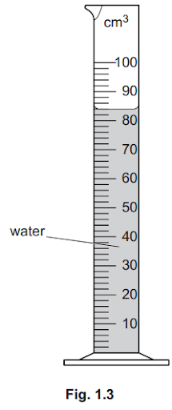

Determine the volume of water in the measuring cylinder in Fig. 1.3.

volume = .................................................. cm3

*Source: june 2022 paper 3 Q1B*

### Q3 — hard — 6 marks

**Q3** [2 marks]

A student places 8 similar coins in a pile, as shown in Fig. 1.1.

The height of the pile of coins is 2.4 cm.

Calculate the average thickness of one coin.

average thickness = .................................................. cm

*Source: 2020 Feb/March 0625/32 Q1A*

**Q3** [4 marks]

Fig. 1.2 shows the pile of coins, a measuring cylinder and a beaker containing some water.

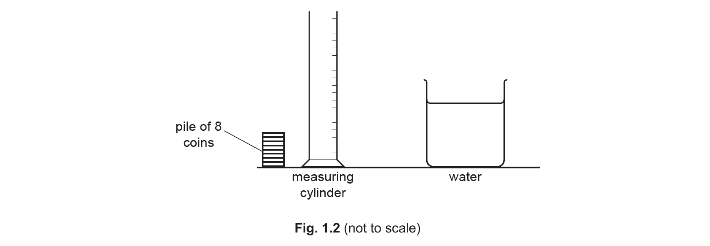

Describe how the student can measure the volume of one of the coins using the set-up shown in Fig. 1.2.

*Source: 2020 Feb/March 0625/32 Q1B*

### Q4 — medium — 7 marks

**Q4** [2 marks]

A teacher investigates the reaction time of five students. A 0.50 m ruler is held above the hand of a student before being allowed to fall. The arrangement is shown in Fig. 3.1.

As soon as the ruler falls the student closes their hand, catching the ruler. The further the ruler falls, the greater the reaction time of the student. The results obtained are shown in Fig. 3.2.

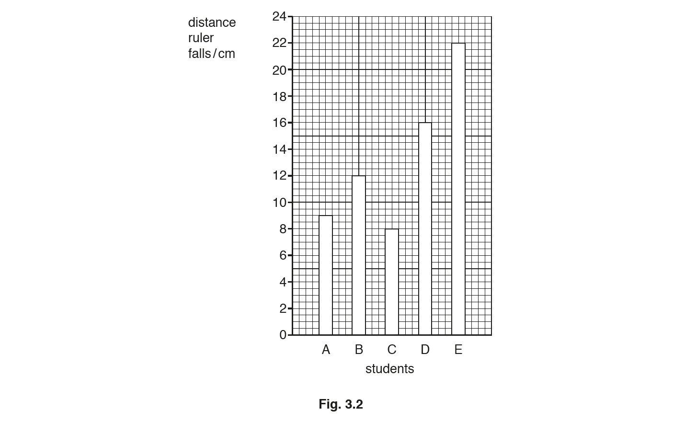

Using the results shown in Fig. 3.2, calculate the average distance that the ruler drops.

average distance = ................................................... cm

*Source: 2019 May/June 0972/31 Q3A*

**Q4** [2 marks]

**Extract:**

A teacher investigates the reaction time of five students. A 0.50 m ruler is held above the hand of a student before being allowed to fall. The arrangement is shown in Fig. 3.1.

As soon as the ruler falls the student closes their hand, catching the ruler. The further the ruler falls, the greater the reaction time of the student. The results obtained are shown in Fig. 3.2.

Sum of distances = A + B + C + D + E = 9 + 12 + 8 + 16 + 22

List the students in order of their reaction times, with the shortest reaction time at the top of the table. One has been done for you.

| order | student |
|---|---|
| 1st |   |
| 2nd |   |
| 3rd | B |
| 4th |   |
| 5th |   |

*Source: 2019 May/June 0972/31 Q3B*

**Q4** [3 marks]

**Extract:**

A teacher investigates the reaction time of five students. A 0.50 m ruler is held above the hand of a student before being allowed to fall. The arrangement is shown in Fig. 3.1.

As soon as the ruler falls the student closes their hand, catching the ruler. The further the ruler falls, the greater the reaction time of the student. The results obtained are shown in Fig. 3.2.

In a similar investigation, a ruler drops a distance of 11.0 cm and has an average speed of 16 cm / s.

Calculate the reaction time.

reaction time = ...................................................... s

*Source: 2019 May/June 0972/31 Q3C*

### Q5 — hard — 8 marks

**Q5** [4 marks]

**Extended tier only**

An object of weight W is suspended by two ropes from a beam, as shown in Fig. 1.1.

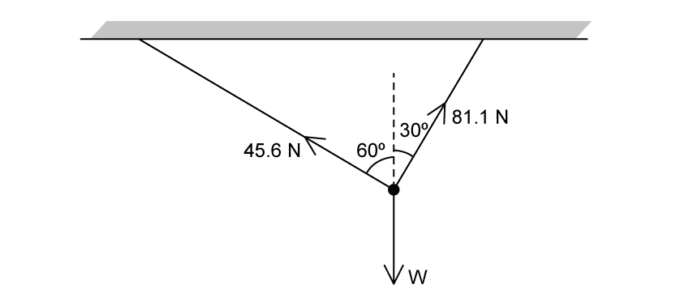

**Fig. 1.1**

The tensions in the ropes are 45.6 N and 81.1 N, as shown.

Using a scale of 1 cm = 10 N, construct a scale drawing to show the resultant force of the two tensions.

Clearly label the resultant force.

**Q5** [2 marks]

**Extract:**

An object of weight W is suspended by two ropes from a beam, as shown in Fig. 1.1. The tensions in the ropes are 45.6 N and 81.1 N, as shown. Using a scale of 1 cm = 10 N, construct a scale drawing to show the resultant force of the two tensions. 45.6 N force is drawn of length 4.5 - 4.6 cm AND 81.1 N force is drawn of length 8.1 - 8.2 cm; Forces are drawn at a right angle to one another (by eye); Parallelogram is completed; Resultant force is drawn and clearly labelled.

**Extended tier only**

Using your scale diagram from part (a), determine the magnitude and direction of the resultant force.

magnitude of resultant force = ....................................

direction of resultant force = ....................................

**Q5** [1 mark]

**Extract:**

magnitude of resultant force = 93.0 N

**Extended tier only**

State the value of *W*.

*W* = ....................................

**Q5** [1 mark]

**Extended tier only**

State another vector quantity other than a type of force.

### Q6 — medium — 11 marks

**Q6** [3 marks]

**Extended tier only**

Two students are discussing mass and weight.

Student 1 claims that a person's weight will be different on Mars than it is on Earth.

State whether you agree with Student 1, and explain your reasoning.

**Q6** [1 mark]

**Extended tier only**

Identify the vector quantities.

Tick all the boxes that apply.

`square` displacement

`square` distance

`square` speed

`square` velocity

**Q6** [3 marks]

**Extended tier only**

Two forces act at right angles to one another: a 35 N force acts to the right and a 42 N force acts downward.

Construct a scale diagram showing the effect of these two forces, and label the resultant force as X.

Use the scale 10 N = 1 cm

**Q6** [4 marks]

**Extract:**

Two forces act at right angles to one another: a 35 N force acts to the right and a 42 N force acts downward.

**Extended tier only**

Calculate the magnitude and direction of the resultant force of the forces acting from part (c)

magnitude of resultant force = ....................................

direction of resultant force = .................................... to the horizontal

### Q7 — medium — 6 marks

**Q7** [1 mark]

A student has a pile of A4 paper for his computer printer.

Fig. 1.1 shows the dimensions of the pile of paper.

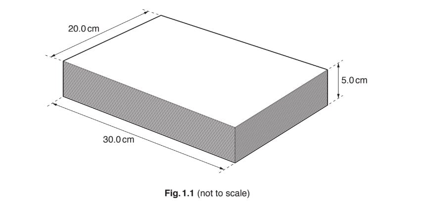

The pile contains 500 sheets of paper.

Calculate the average thickness of one sheet of paper.

average thickness = .................................................... cm

*Source: February/March 2018 0625/32 Q1A*

**Q7** [1 mark]

**Extract:**

Height of paper = 5.0 cm
Length of paper = 30.0 cm
Width of paper = 20.0 cm

Show that the pile of paper has a volume of 3000 cm3. Use the information shown in Fig.1.1.

*Source: February/March 2018 0625/32 Q1B*

**Q7** [1 mark]

The student measures the total mass of the paper in the pile.

State the name of a device used to measure mass.

*Source: February/March 2018 0625/32 Q1C*

**Q7** [3 marks]

**Extract:**

Volume of paper = 3000 cm^3 (from part (b))

The mass of the paper in the pile is 2400 g.

Calculate the density of the paper.

density = .............................................. g/cm3

*Source: February/March 2018 0625/32 Q1D*

### Q8 — easy — 6 marks

**Q8** [1 mark]

**Extended tier only**

Identify the unit of velocity.

Tick **one** box.

`square` m

`square` m/s

`square` m/s2

**Q8** [2 marks]

**Extended tier only**

Explain how a scalar quantity is different to a vector quantity.

**Q8** [1 mark]

**Extract:**

Determine the scale of the vector v1:
- v1 is 3 large squares
- v1 = 6 m/s ÷ 3 squares = 2 m/s per square

Determine the velocity of vector v2:
- v2 is 5 large squares
- v2 = 5 × (2 m/s) = 10 m/s

**Extended tier only**

Fig. 1.1 shows a vector diagram for two component velocities.

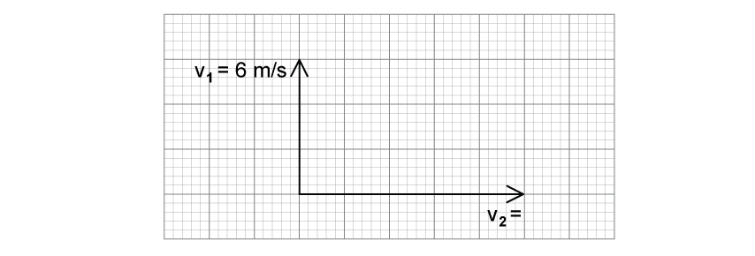

**Fig. 1.1**

Determine the velocity of the vector labelled $v_{2}$.

**Q8** [2 marks]

**Extract:**

Fig. 1.1 shows a vector diagram for two component velocities.

v1 = 6 m/s
v2 = 10 m/s

**Extended tier only**

Calculate the magnitude of the resultant velocity of the components shown in Fig. 1.1.

Give your answer to 2 significant figures.

### Q9 — medium — 10 marks

**Q9** [2 marks]

A student has a piece of metal that has an irregular shape. The weight of the metal is 3.0 N.

Calculate the mass of the metal.

mass = ..................................................... kg

*Source: Oct/Nov 2018 (Series 3) 0625/33 Q2A*

**Q9** [8 marks]

Fig. 2.1 shows the piece of metal, a measuring cylinder and a beaker containing water.

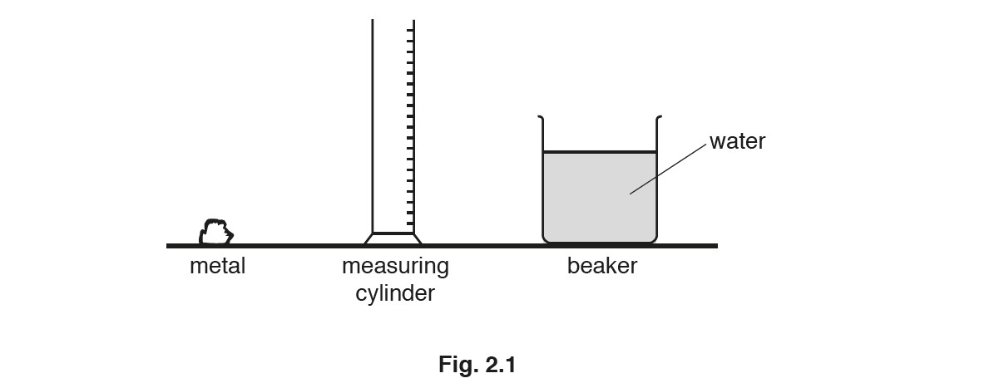

(i) Describe how to determine the volume of the metal, using the equipment in Fig. 2.1.

[4]

(ii) Explain why the procedure in **(b)(i)** is not suitable for finding the volume of a piece of low-density wood that is of similar shape and size to the piece of metal in **(a)**.

[1]

(iii) The mass of another piece of metal is 405 g and its volume is 150 cm3.

Calculate the density of the metal. State the unit.

density = .......................................................... [3]

*Source: Oct/Nov2018  (Series 3) 0625/33 Q2B*

### Q10 — hard — 11 marks

**Q10** [1 mark]

**Extended tier only**

State the definition of a vector quantity.

**Q10** [4 marks]

**Extended tier only**

A list of vector quantities and their SI units are given in the following table.

| **Quantity** | **SI unit** |
|---|---|
| weight |   |
|   | m/s |
|   | kg m/s |
| gravitational field strength |   |

Complete the information missing from the table.

**Q10** [4 marks]

**Extended tier only**

A horizontal force of 136 N to the right, and a vertical downward force of 54 N act on an object perpendicularly to one another.

By use of a scale diagram (**not** by calculation) determine the magnitude of the resultant force.

magnitude of resultant force = ....................................

**Q10** [2 marks]

**Extract:**

A horizontal force of 136 N to the right, and a vertical downward force of 54 N act on an object perpendicularly to one another. Magnitude of resultant force = 146 N (from scale diagram in part c).

**Extended tier only**

Using the information from part (c), determine the direction of the resultant force.

direction of resultant force = .................................... from the horizontal

### Q11 — easy — 8 marks

**Q11** [2 marks]

**Extract:**

Accept "velocity is speed in a given direction", "velocity has direction" or "velocity is the rate of change of displacement" for the velocity mark; the exact phrase "both magnitude and direction" is not required.

Accept "speed is a scalar and velocity is a vector" as a valid distinction: this earns both marks.

Do not accept "velocity can be positive, negative or zero" alone for the velocity mark.

**Extended tier only**

Explain the difference between speed and velocity

**Q11** [2 marks]

**Extended tier only**

Identify the scalar quantities.

Tick **all** the boxes that apply.

`square` time

`square` weight

`square` acceleration

`square` distance

**Q11** [2 marks]

**Extract:**

The scalar quantities from the list are:

- Time; [1 mark]
- Distance; [1 mark]

**Extended tier only**

State:

(i) one example of a vector quantity.

[1]

(ii) one other example of a scalar quantity, apart from time and distance.

[1]

**Q11** [2 marks]

#### Extended Only

Fig. 1.1 shows a vector diagram for the effects of two forces.

**Fig. 1.1**

Calculate the resultant force.

resultant force = ....................................

### Q12 — easy — 5 marks

**Q12** [1 mark]

Four students P, Q, R and S each attempt to measure the time period (the time for one complete oscillation) of a pendulum. The arrows in Fig. 2.1 show the movements of the pendulum that each student times.

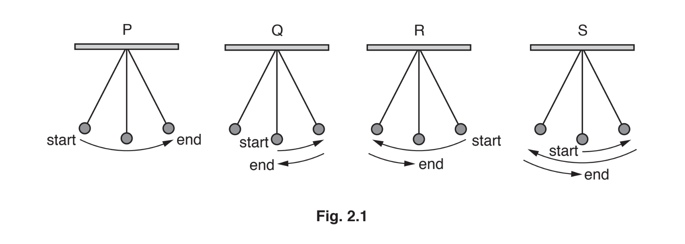

State the student who has chosen the correct movement for one period of a pendulum.

*Source: Oct 2019 0625/31 Q2A*

**Q12** [3 marks]

Another student uses a stopwatch to measure the time taken for 50 periods of a pendulum.

Fig. 2.2 shows the time taken on the stopwatch.

Calculate the time for one period of the pendulum. Give your answer to 3 significant figures.

time for one period = ...................................................... s

*Source: Oct 2019 0625/31 Q2B*

**Q12** [1 mark]

The student measures the displacement of the pendulum bob from its rest position. The displacement is 16.5 cm, as shown in Fig. 2.3.

State the displacement in millimetres.

displacement = ...................................................... mm

*Source: Oct 2019 0625/31 Q2C*

### Q13 — easy — 10 marks

**Q13** [3 marks]

**Extract:**

Expected: side A = 7.5 cm (accept 7.4 cm to 7.6 cm, 74 mm to 76 mm, or 0.074 m to 0.076 m); side B = 4.0 cm (accept 3.9 cm to 4.1 cm); side C = 2.0 cm (accept 1.9 cm to 2.1 cm). Trailing zeros are required to show precision to the nearest millimetre: do not accept 4 cm or 2 cm. A unit is required for each mark.

A student measures the length of the sides of a metal cuboid using a 30 cm ruler.

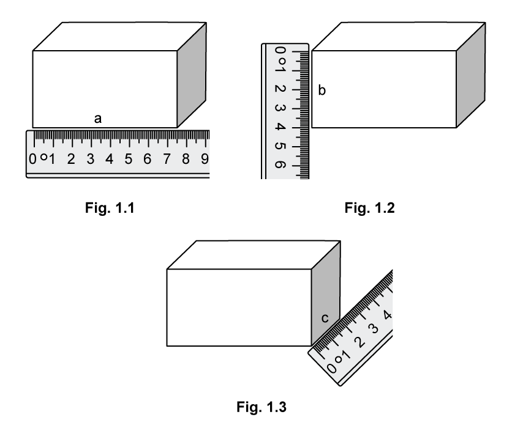

State the measured lengths of the following sides to an appropriate level of precision.

Include the appropriate units in your answer.

(i) Side A in Fig. 1.1

length of side A = .................................... [1]

(ii) Side B in Fig 1.2

length of side B = .................................... [1]

(iii) Side C in Fig 1.3

length of side C = .................................... [1]

**Q13** [3 marks]

**Extract:**

Side lengths from part (a): A = 7.5 cm, B = 4.0 cm, C = 2.0 cm. Expected answer 0.075 times 0.040 times 0.020 = 6.0 × 10-5 m³ (accept 0.00006 m³ or 0.000060 m³). Also accept 60 cm³ divided by 106. Award the final mark by error carried forward for a volume correctly calculated from the candidate's own accepted side lengths, e.g. 5.6 × 10^-5 m³ from 7.4 / 4.0 / 1.9 cm.

Calculate the volume of the metal cuboid. Give your answer in cubic metres.

volume = .................................... m3

**Q13** [1 mark]

**Extract:**

Scale reading 164 g. Expected answer 0.164 kg.

The student measures the mass of the metal cuboid on a scale. The measurement is shown in Fig. 1.4.

**Fig. 1.4**

State the reading for mass. Give your answer in kg.

mass = ................................... kg

**Q13** [3 marks]

**Extract:**

Table of densities in kg/m³: iron 7870, magnesium 1740, titanium 4510, aluminium 2700. Volume V = 6.0 × 10^-5 m³ (from part (b)); mass m = 0.164 kg (from part (c)). Density = m divided by V = 2733 kg/m³ (accept 2700 or 2730 kg/m³), closest to aluminium. Error carried forward: award the identification mark for the metal whose density is closest to the candidate's own calculated value.

The densities of different metals are listed in the following table:

| **Metal ** | **Density kg/m****3** |
|---|---|
| Iron | 7870 |
| Magnesium | 1740 |
| Titanium | 4510 |
| Aluminium | 2700 |

Use the information in the table to identify the type of metal which the cuboid is made of.

### Q14 — easy — 6 marks

**Q14** [2 marks]

**Extract:**

Time for 50 drops is 20 s. Expected answer 0.4 s (accept 0.40 s). Award both marks for the correct answer alone.

Some students observe drops of water falling from a tap that leaks, as shown in Fig. 1.1.

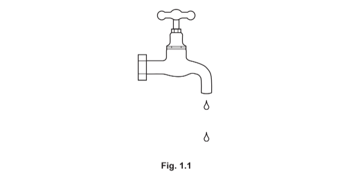

The students measure the time for 50 drops to fall from the tap. The time for 50 drops to fall is 20 s.

Calculate the average time between two drops falling.

average time = ..................................................... s

*Source: 2020 0625/32 Q1A*

**Q14** [4 marks]

**Extract:**

(i) Expected answer: measuring cylinder. (ii) Gravitational field strength g = 9.8 N/kg. Expected answer 2.058 N, rounded to 2.1 N; accept any answer from 2.0 N to 2.1 N, including 2.1 N obtained with g = 10 N/kg. Award all three marks for the correct answer alone.

The students collect some drops of water.

(i) The students measure the volume of the water they collect.

State the term for the equipment that is suitable for measuring the volume accurately.

[1]

(ii) In a similar experiment, another student collects 0.21 kg of water.

Calculate the weight of this water.

weight of water = .................................................... N [3]

*Source: 2020 0625/32 Q1B*

### Q15 — hard — 6 marks

**Q15** [2 marks]

A student uses a stopwatch in a timing experiment.

Fig. 1.1 shows the stopwatch readings.

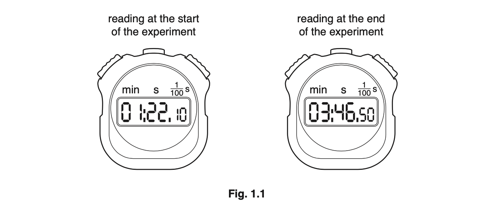

Calculate the time interval between the two readings.

time interval = ...................................................... s

*Source: Oct 2019 0625/33 Q1A*

**Q15** [4 marks]

A device has a light-emitting diode (LED) that flashes briefly at regular intervals.

Describe how to determine accurately the average time for each interval, using a stopwatch.

*Source: Oct 2019 0625/33 Q1B*

### Q16 — medium — 6 marks

**Q16** [3 marks]

Fig. 1.1 shows a large tank containing water. The tank leaks. Drops of water fall from the tank.

The drops hit the ground at a regular rate.

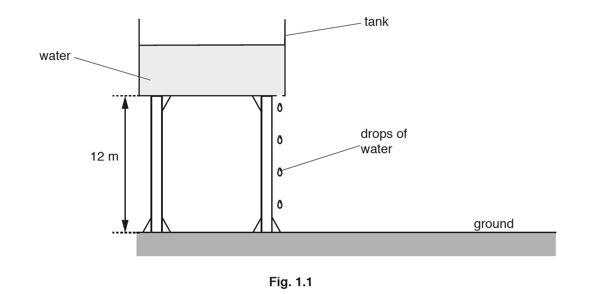

A student measures the time interval between two drops of water hitting the ground.

They use a stopwatch and repeat the procedure three times. Fig. 1.2 shows each stopwatch reading.

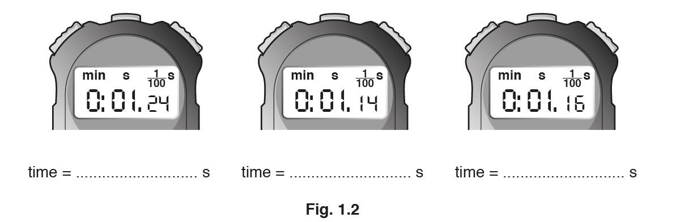

(i) On the line below each stopwatch, state the time readings shown, in seconds.

[1]

(ii) Calculate the average time interval between two drops of water hitting the ground.

average time = ....................................................... s [2]

*Source: Oct/Nov 2018 (Series 3) 0625/33 Q1A*

**Q16** [3 marks]

**Extract:**

Distance, s = 12 m (from part (a))

Another student measures the average time taken for a drop of water to fall from the tank to the ground. The time taken is 1.6 s.

Calculate the average speed of this drop of water.

average speed = ................................................... m/s

*Source: Oct/Nov2018  (Series 3) 0625/33 Q1B*

### Q17 — hard — 9 marks

**Q17** [4 marks]

**Extended Tier Only**

A bucket of water hangs from a rope attached to a pole as shown in Fig. 1.1.

**Fig. 1.1**

The tension force, $T$ = 31 N and the ropes are perpendicular to one another.

Calculate the magnitude of the downward force acting on the bucket of water.

magnitude of downward force = ....................................

**Q17** [1 mark]

**Extract:**

A bucket of water hangs from a rope attached to a pole as shown in Fig. 1.1.

The tension force, T = 31 N and the ropes are perpendicular to one another.

State the name of the downward force acting on the bucket.

**Q17** [1 mark]

**Extended tier only**

Weight is a vector quantity. Name one other vector quantity.

**Q17** [3 marks]

**Extract:**

The downward force on bucket = 44 N

The bucket has a mass of 0.65 kg.

Calculate the mass of the water in the bucket.
