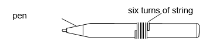
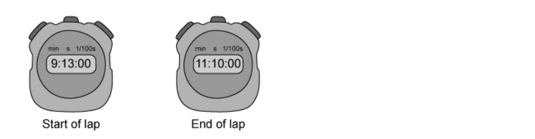
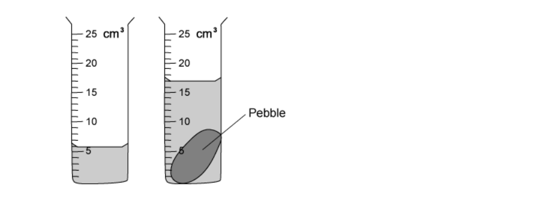
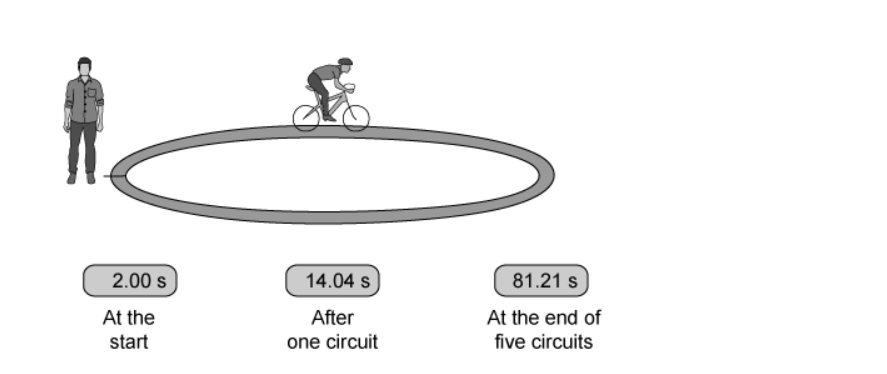

# Exam Questions — Physical Quantities & Measurement Techniques
**1. Motion, Forces & Energy** · Cambridge (CIE) IGCSE physics (0625 & 0972)
> Source: [https://www.savemyexams.com/igcse/physics/cie/23/topic-questions/](https://www.savemyexams.com/igcse/physics/cie/23/topic-questions/) · 20 questions across 1 sets

## Multiple Choice Questions (20 questions)

### Q1 — medium — 1 marks

**Q1** [1 mark]

A student wants to find the volume of a small, irregularly shaped stone.

Which pieces of apparatus should the student use?

### Q2 — medium — 1 marks

**Q2** [1 mark]

A boat travels $30 \text{km}$ due east and then $40 \text{km}$ due north.

Which row correctly shows the total distance and displacement magnitude?

|   | Total distance | Displacement magnitude |
|---|---|---|
| **A** | 50 km | 70 km |
| **B** | 70 km | 50 km |
| **C** | 70 km | 70 km |
| **D** | 50 km | 50 km |

### Q3 — medium — 1 marks

**Q3** [1 mark]

A student uses a stopwatch to time 40 complete swings of a simple pendulum. The total time taken is 1 minute and 52 seconds.

What is the period of the pendulum?

### Q4 — medium — 1 marks

**Q4** [1 mark]

**Extended Tier Only**

** **On the diagram shown, what is the magnitude of the resultant force of the two vectors?

*Source: June 2022 paper 2 Q8*

### Q5 — medium — 1 marks

**Q5** [1 mark]

A length of string is measured between two points on a ruler.

When the length of string is wound closely around a pen, it goes round six times.

What is the distance once round the pen?

*Source: 2023 specimen paper 1 Q1*

### Q6 — easy — 1 marks

**Q6** [1 mark]

Which measuring devices are most suitable for determining the length of a swimming pool and the thickness of aluminium foil?

|   | **length of a swimming pool** | **thickness of aluminium foil** |
|---|---|---|
| **A** | ruler | measuring cylinder |
| **B** | tape measure | micrometer screw gauge |
| **C** | tape measure | ruler |
| **D** | ruler | micrometer screw gauge |

*Source: June 2022 paper 2 Q1*

### Q7 — easy — 1 marks

**Q7** [1 mark]

A lump of modelling clay is moved from a small measuring cylinder to a large measuring cylinder that has twice the diameter.

The reading on the small measuring cylinder goes down by 20 cm3.

By how much does the reading on the large cylinder go up?

*Source: June 2022 Paper 1 Q1*

### Q8 — easy — 1 marks

**Q8** [1 mark]

**Extended tier only**

Identify the physical quantity that is **not** scalar.

### Q9 — easy — 1 marks

**Q9** [1 mark]

A student wants to take a particularly accurate measurement of the volume of liquid in a measuring cylinder.

Which of the following procedures would make her measurement **less** accurate?

### Q10 — easy — 1 marks

**Q10** [1 mark]

Five identical spheres are placed between two blocks in order to measure their diameter.

What is the diameter of a single sphere?

### Q11 — easy — 1 marks

**Q11** [1 mark]

A student is timing the rate of cooling of a beaker of water. On a repeat run of the investigation, the student forgets to zero the stopwatch.

The readings on the stopwatch at the start time and the end time are shown in Fig. 1.1

Calculate how long it took the beaker to cool.

### Q12 — easy — 1 marks

**Q12** [1 mark]

**Extended tier only**

Identify the physical quantity that is a scalar.

### Q13 — medium — 1 marks

**Q13** [1 mark]

A particularly diligent student wants to measure the volume of some liquid for an experiment. She has two measuring cylinders available, a large 250 ml one and a small 50 ml one. The liquid will fit into either of the two measuring cylinders.

As expected, the liquid forms a meniscus where it touches the sides of either measuring cylinder.

Which cylinder should the student use to get the most accurate result, and from where should she measure the liquid level?

| ** ** | **Measuring cylinder** | **Reading taken from** |
|---|---|---|
| **A** | large | Top of meniscus |
| **B** | large | Bottom of meniscus |
| **C** | small | Top of meniscus |
| **D** | small | Bottom of meniscus |

### Q14 — medium — 1 marks

**Q14** [1 mark]

A scientist is trying to determine the volume of three identical pieces of a new material. She places them in a measuring cylinder, as shown in the diagram.

The first cylinder shows the level of water in the measuring cylinder before the pieces are added, and the second cylinder shows the measuring cylinder with the pieces of the new material inside.

What is the volume of each piece of the new material?

### Q15 — hard — 1 marks

**Q15** [1 mark]

A student is trying to see how quickly they can run 5.0 km on a standard 400 m running track.

They reason that, if they know how fast they can run one lap, they can assume they will run at the same speed for 5.0 km, and can calculate their predicted time.

They, correctly, reason that they will not be able to maintain their initial pace throughout the whole 5.0 km, so they decide to time lap 5.

The diagram shows the reading on the stopwatch at the beginning and the end of lap 5.

Calculate how long it should take the student to run 5.0 km.

### Q16 — medium — 1 marks

**Q16** [1 mark]

A geologist wants to measure the volume of a particularly interesting pebble she has found in a river.

She uses the apparatus shown below.

What is the volume of the pebble?

### Q17 — hard — 1 marks

**Q17** [1 mark]

A student uses a ruler to determine the circumference of a wooden dowel.

She puts a mark onto the dowel, then rolls it along the ruler three times, before reading the position on the ruler at which it stopped.

What is the circumference of the dowel?

### Q18 — medium — 1 marks

**Q18** [1 mark]

A person wishes to roast a chicken. The chicken requires 1 hour and 20 minutes in the oven to be properly cooked.

The oven must be switched on 10 minutes before any food is put in, in order to pre-heat, and reach the correct temperature for cooking.

The chicken needs to be ready at 4:30 pm. At what time must the oven be switched on?

### Q19 — hard — 1 marks

**Q19** [1 mark]

An Olympic cyclist rides around a velodrome track 5 times.

The diagram below shows the reading on the stopwatch, which was used to time the laps. Unfortunately, the person using the stopwatch started it a little early, so the stopwatch reads 2 seconds when the cyclist starts.

What is the average time to complete one lap of the velodrome?

### Q20 — hard — 1 marks

**Q20** [1 mark]

Three blocks are placed into three measuring cylinders. These are shown below.

Which row in the table shows the blocks in order of increasing volume?

|   | Smallest volume | **→** | Largest volume |
|---|---|---|---|
| **A** | X | Y | Z |
| **B** | Y | X | Z |
| **C** | Z | Y | X |
| **D** | Z | X | Y |
