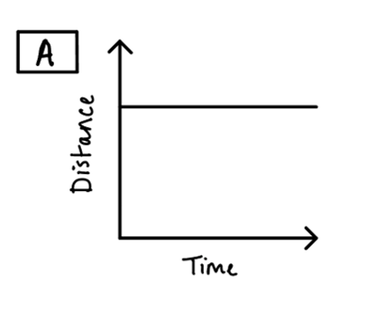
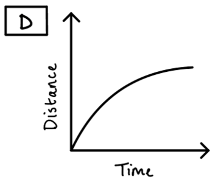
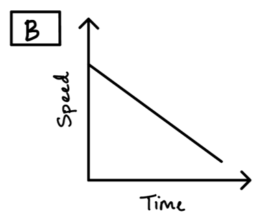
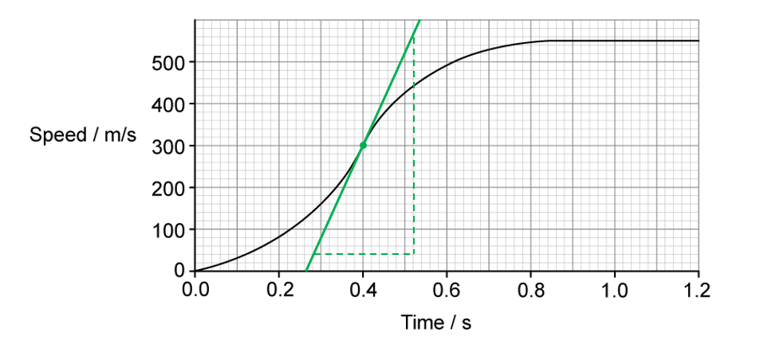
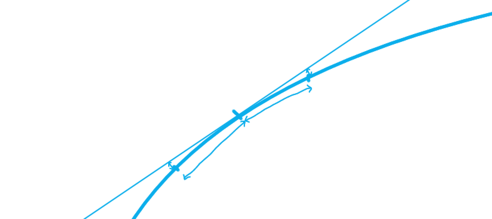
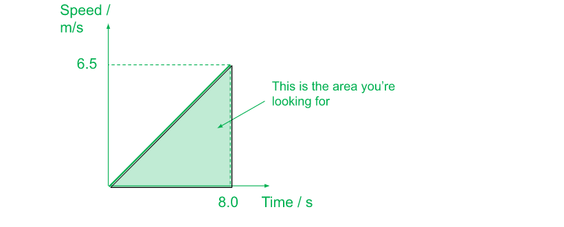
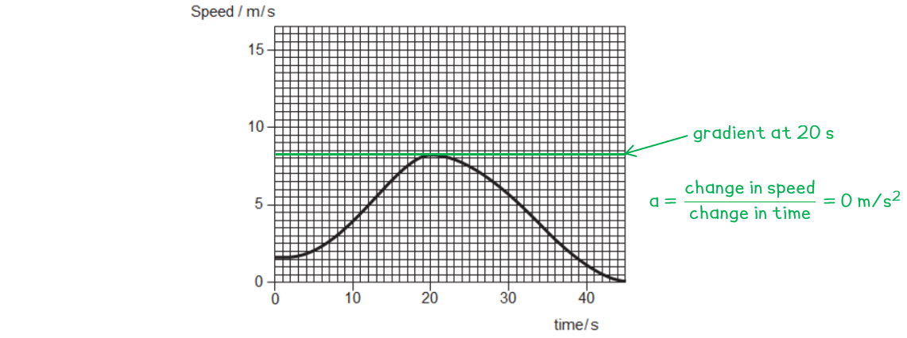
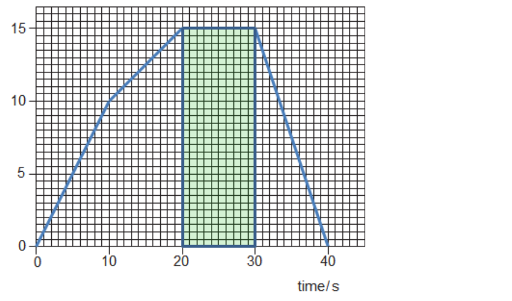

# Mark Schemes — Motion
**1. Motion, Forces & Energy** · Cambridge (CIE) IGCSE physics (0625 & 0972)

## Multiple Choice Questions (27 questions)

### Q1
**Final answer:** **The correct answer is B**

- Average speed is defined as

$\text{average speed}=\frac{\text{total distance}}{\text{total time}}$

- A metre ruler is used to measure the distance the ball travels along the slope
- A stopwatch is used to measure the time taken for the ball to travel that  distance

**A** & **C** are is incorrect as a balance measures mass, which is not needed to calculate speed.

**D** is incorrect as a measuring cylinder is used to measure the volume of liquids or irregular solids.

### Q2
**Final answer:** **The correct answer is C**

- On a speed–time graph, the distance travelled is equal to the area under the graph
- Constant speed is represented by the horizontal section of the graph, which occurs between $10\text{s}$ and $25\text{s}$
- The time interval for this section is calculated by subtracting the start time from the end time: $25-10=15\text{s}$
- The distance travelled by the car between $10\text{s}$ and $25\text{s}$ is:

$\mathrm{distance}=\mathrm{speed}\times\mathrm{time}=\mathrm{area} \mathrm{under} \mathrm{graph}$

$\mathrm{distance}=10\times15=150m$

**A **is incorrect as this is the area between $0\text{s}$ and $10\text{s}$ `open parentheses 1 half cross times 10 cross times 10 space equals space 50 space straight m close parentheses`

**B** is incorrect as it uses the formula for the area of a triangle instead of a rectangle `open parentheses 1 half cross times 10 cross times 15 space equals space 75 space straight m close parentheses`

**D** is incorrect as it uses the total time of $25\text{s}$ instead of the interval where speed was constant `open parentheses 50 space plus thin space 150 space equals space 200 space straight m close parentheses`

### Q3
**Final answer:** **The correct answer is ****B**** because:**

- The object is still moving through the air and so there is air resistance
- At terminal velocity the velocity has reached a maximum and is not changing
- Since the velocity is not changing, the acceleration must be zero

An object moving at terminal velocity can have forces acting on it as long as there is no resultant force. In the case of falling, the gravitational force acting on the object will be balanced by air resistance or drag.

### Q4
**Final answer:** **The correct answer is ****B**** because:**

- The average speed is equal to the gradient of the line between points X and Y
- The gradient is the *change* in distance and the *change* in time between points X and Y

$\mathrm{average} \mathrm{speed}=\mathrm{gradient}=\frac{\mathrm{change} \mathrm{in} \mathrm{distance}}{\mathrm{change} \mathrm{in} \mathrm{time}}=\frac{12m-6m}{30s-10s}=\frac{6m}{20s}=0.30m/s$

You need to be aware that you are just looking at the motion between the two points specified, and so you should not use the starting point of the overall motion (0, 0) in the calculation of the gradient. Using this point could result in calculating incorrect answers **C** or **D**.

**A** is incorrect as this calculation has used the overall time from the start to point Y (30 s) rather than the change in time, which is only 20 s.

**C** is incorrect as this calculation has used the total distance (12 m) and the total time (30 s). This is the average speed for the journey from the start (0, 0), not from point X.

**D** is incorrect as this is the average speed from the origin (0, 0) to point X.

### Q5
**Final answer:** **The correct answer is ****C**** because:**

- The distance travelled is the area beneath the line on a speed−time graph
- In this case, this is a triangle, and the area can be found like this:

$\mathrm{area} \mathrm{of} \mathrm{triangle}=\frac{1}{2}\times\mathrm{base}\times\mathrm{height}=\frac{1}{2}\times400\times20=4000$

- Therefore, the distance travelled by the vehicle is **4000 m**

The distance travelled can also be found using the average speed of the vehicle. Its initial speed is 0 m/s, and its maximum speed is 20 m/s. This gives an average speed of 10 m/s.

The distance travelled can be found from:

$\mathrm{distance} \mathrm{travelled}=\mathrm{average} \mathrm{speed}\times\mathrm{time}=10m/s\times400s=4000m$

Using the average speed is only possible when the acceleration is uniform (the object is speeding up or slowing down at a constant rate).

**A** is incorrect as 20 m is a value which could be incorrectly read from the *y*-axis.

**B** is incorrect as 400 m is a value which could be read from the *x*-axis.

**D** is incorrect as 8000 m could be found by multiplying the time taken by the maximum speed instead of the average speed.

### Q6
**Final answer:** **The correct answer is C because:**

- Terminal velocity is the point at which the falling object is no longer accelerating

  - This occurs when the resultant force is zero
- For a resultant force of zero, the upward force, air resistance, must be equal in size to the object’s weight

**A **is incorrect as negative acceleration would cause the object to lose speed, not remain at a constant speed

**B** is incorrect as the object does not have constant speed when accelerating at *g*

**D** is incorrect as if air resistance was greater than weight, the resultant force would not be zero

### Q7
**Final answer:** **The correct answer is D because:**

- Speed and distance are related by the equation

$speed=\frac{dis\mathrm{tan}ce}{time}$

- The length of the train is equal to the distance that passes the man
- Therefore, the length of the train is

$dis\mathrm{tan}ce=speed\timestime$

$dis\mathrm{tan}ce=40\times2.0=80$ m

### Q8
**Final answer:** **The correct answer is A because:**

- Average acceleration is the change in speed over time
- From 2.0 to 3.0 s, the speed increases from 4.1 to 5.7 m/s

$a=\frac{Δv}{Δt}$

$a=\frac{5.7-4.1}{3.0-2.0}$

$a=1.6m/s^{2}$

- This is option **A**

### Q9
**Final answer:** **The correct answer is A because:**

- Each line represents the motion of a runner
- At time *t*, both lines have the same value on the y-axis

  - This means both runners have the same speed at time *t*

**B **is incorrect as acceleration is the gradient of the line, and neither line has zero gradient at time *t*

**C** is incorrect as the area under runner 2’s line is greater than that of runner 1, so runner 2 has covered a greater distance in the same time and is ahead

**D** is incorrect as runner 2’s acceleration is decreasing – their speed, however, is still increasing

### Q10
**Final answer:** **The correct answer is A because:**

- The gradient of a distance-time graph represents the speed of the vehicle
- P to Q: gradient is constant and non-zero

  - Speed is constant
  - Eliminate options **C** and **D**
- Q to R: gradient is zero

  - Speed is zero
- R to S: gradient is constant and non-zero

  - Speed is constant
  - Eliminate option **B**

Familiarise yourself with the distance-time graph for acceleration, deceleration, constant speed and stationary objects.

### Q11
**Final answer:** **The correct answer is B because:**

- The speed-time graph shows

  - P: the train is not moving
  - Q: the train is speeding up (accelerating)
  - R: the train is moving at a constant speed
  - S: the train is slowing down (decelerating)
- The regions where the train is moving are Q, R and S only

### Q12
**Final answer:** **The correct answer is A because:**

- The **gradient **of a speed-time graph is equal to the **acceleration **of the object
- The **area **under a speed-time graph is equal to the **distance travelled **by the object

### Q13
**Final answer:** **The correct answer is ****D**** because:**

- On a speed-time graph, distance is represented by the **area under the graph**
- Section **D** has the largest area underneath the line, therefore the greatest distance is covered here

- There are **4.5** large squares under part **A** of the line
- There are **12** large squares under part **B** of the line
- There are **4** large squares under part **C** of the line
- There are **14** large squares under part **D** of the line

  - When finding the area under a sloped line, split the area into a rectangle and a triangle
  - Then use the **½ × base × height** formula for the triangular area and **base × height** for the rectangular area

### Q14
**Final answer:** **Answer ****B**** is correct because:**

- On a distance-time graph, constant speed is shown by a non-horizontal straight line
- This shows that the distance travelled per unit time is increasing at a steady rate
- Therefore, the only correct graph is graph **B**

| **A** is incorrect as |   A horizontal line shows that distance is not changing over time, therefore the object is **stationary** |
|---|---|
| **C** is incorrect as | An upward curved line shows that the distance travelled over time is increasing. The object is speeding up or **accelerating** |
| **D** is incorrect as |   A curve like this shows that the distance travelled over time is decreasing. The object is slowing down or **decelerating** |

### Q15
**Final answer:** **The correct answer is ****C**** because:**

- The gradient of a speed-time graph represents acceleration

  - As the BASE jumper gains speed, their air resistance increases
  - This reduces their resultant force and therefore acceleration
- Eventually their speed becomes constant

  - This is terminal speed and is represented by the graph flattening out

**A** is incorrect as this is a distance-time graph and the constant gradient shows constant speed but the BASE jumper is accelerating

**B** is incorrect - this is the speed-time graph is air resistance is **ignored**

**D** is incorrect as the graph shows a non-zero initial velocity but we are told the BASE jumper is initially at rest

### Q16
**Final answer:** **The correct answer is ****C**** because:**

- Speed is calculated using

  - $v=\frac{s}{t}$
  - $v=\frac{s}{t}=\frac{30}{2.5}=12$
  - This eliminates options **A** and **B**
- Distance is given in **metres** and time is given in **seconds**, so units are metres per second (m/s)

  - Therefore, the answer is **C**

### Q17
**Final answer:** **The correct answer is ****C**** because:**

- Constant speed means that the speed is not changing
- Therefore, constant speed on a speed-time graph is a horizontal line
- Graph **C **is the only graph showing constant speed

| **A** is incorrect as |   the speed is increasing over time, therefore the object is getting faster or **accelerating** |
|---|---|
| **B** is incorrect as |   the speed is decreasing over time, therefore the object is slowing   down or **decelerating** |
| **D** is incorrect as |   the **speed is zero** for the first part of the graph which means the object is **not moving. **We can say the object is **at rest.** Then the object's speed begins to **increase** over time, so the object is **accelerating** in the second part of the graph |

### Q18
**Final answer:** **The correct answer is ****C**** because:**

- The area under a speed-time graph represents distance
- Consider graph **A**:

  - Split the area into a triangle and a rectangle
  - Area = (½ × 5 × 5) + (3 × 5) = 27.5
- Consider graph **B**:

  - Split the area into a rectangle and triangle
  - Area = (8 × 1) + (½ × 5 × 5) = 20.5
- Consider graph **C**:

  - Split the area into approximately one quarter of a circle and a rectangle
  - Area ≈ (¼ × π × 52) + (3 × 5) = 34.6
- Consider graph **D**:

  - Area = (8 × 4) = 32
- The largest area is under graph **C**

- With more complicated graph shapes, a good tactic is to **split** the area under a curve into recognisable shapes - **triangles**, **rectangles** and even sections of **circles**

### Q19
**Final answer:** **The correct answer is ****D**** because:**

- Acceleration is equal to the **gradient **of a speed-time graph
- Therefore, the gradient of the tangent must be determined at 0.4 s

- Calculate the gradient of the tangent

  - $\mathrm{gradient}=\frac{Δy}{Δx}=\frac{560-40}{0.52-0.28}=2167m/s^{2}$
  - $\mathrm{acceleration}=2.2\times10^{3}m/s^{2}$ (2 s.f.)
- More than any other graph technique in your exam, tangent questions require you to be **accurate**

  - Use a **sharp** pencil
  - Place it on the data point of which you want to draw the tangent
  - Use a ruler (preferably clear)
  - Line the ruler up so, around the point, the graph looks roughly symmetrical (like in the diagram below)
  - Hold the ruler **in place firmly** and draw your line
- It pays to be **neat** here - no blunt pencils and definitely **don't** use a pen - you may need a few tries to get it right! 
- Make sure you always check the units on the axes! The time here is in **ms** not **s**!

### Q20
**Final answer:** **The correct answer is ****D**** because:    **

- average speed* *= $\frac{\mathrm{total} \mathrm{distance}}{\mathrm{total} \mathrm{time}}=\frac{10.0+3.0}{6.0+3.0}$

**A** is incorrect as this is only the average speed of the roadworks part of the journey.

**B** is incorrect as this is the average speed of the motorway part of the journey.

**C **is incorrect as this is the sum of the two average speeds, it will not give the correct average speed.

### Q21
**Final answer:** **The correct answer is ****C**** because:**

- Distance = speed x time taken
- The total distance travelled by the sound to the cliff and back again will be twice the distance the man is away from the cliff. Therefore, we must divide our answer by 2.
- Distance = $\frac{343\times0.84}{2}$ = 144 m

**A **is incorrect as speed has been, incorrectly, divided by time, and the factor of 2 not accounted for.

**B **is incorrect as speed has, correctly, been multiplied by time, but the factor of 2 has not been accounted for.

**D **is incorrect as speed has been, incorrectly, divided by time, though the factor of 2 has been accounted for.

### Q22
**Final answer:** **The correct answer is ****B**** because:**

- All objects in a gravitational field accelerate at the same rate

  - This rate is 9.8 m/s2 on Earth, but it is different on different planets
- Since the cannon ball accelerates at a constant rate, its speed must be increasing because acceleration is the change in velocity per unit time

**A** is incorrect as if the speed were constant the cannon ball would not speed up as it falls

**C** is incorrect as the acceleration of falling objects does not increase, it is constant

**D** is incorrect as if the speed remained constant, then no acceleration would be taking place

### Q23
**Final answer:** **The correct answer is**** B**** because:**

- average speed = $\frac{totaldistancetravelled}{timetaken}$
- The Go Kart does 8 laps of the 300 m course, so the total distance is 300 x 8.
- average speed =$\frac{300\times8}{4.0\times60}$= 10 m/s

Remember to convert the time in minutes into seconds!

**A** is incorrect as the distance of 1 lap has been divided by the time in minutes.

**C** is incorrect as the distance of just 1 lap has been divided by the correct time.

**D** is incorrect as the distance of the whole race has been divided by the time in minutes. 600 m/s is faster than even the fastest rifle bullet, so this answer ought to ring alarm bells.

### Q24
**Final answer:** **The correct answer is ****D**** because:**

average speed = $\frac{totaldistancetravelled}{timeintheair}$
= $\frac{100+50+30+70}{4.0-0.5}=71.4\mathrm{km}/h$

**A **is incorrect as the 30 minute stop has been added to the total time.

**B **is incorrect as this the total distance travelled.

**C** is incorrect as the time spent on the ground has not been accounted for.

### Q25
**Final answer:** **The correct answer is ****A ****because:**

- The distance travelled by an object is given by the **area **under a speed-time graph
- This is because distance = speed × time
- The area in question is a triangle. The area of a triangle is calculated using ½ × base × height
- Distance = area of triangle =  ½ × 6.5 × 8.0 = 26 m
- Therefore equation **A** is correct

**B, C and D **are incorrect as these equations have been incorrectly set up.

### Q26
**Final answer:** **The correct answer is ****C**** because:**

- The acceleration is given by the gradient of a speed-time graph

  - This gradient is found by taking a tangent to the curve

- At time = 20 s, the tangent (and therefore the gradient) is exactly horizontal: gradient equals zero
- Therefore, at time = 20 s, acceleration = zero

**A **is incorrect as this is the gradient just before 20 s

**B** is incorrect as this is the gradient just after 20 s.

**D **is incorrect as this is a reading of the speed of the cyclist at 20 s, not the acceleration.

### Q27
**Final answer:** **The correct answer is ****A ****because:**

- The motorbike is moving at a constant speed when the gradient of the line is 0 (the line is horizontal).
- This happens between t = 20 and t = 30 seconds.
- The distance travelled by an object is given by the area under a speed-time graph.

This is the area you’re looking for:

Distance = (30 - 20) x 15 = 150 m

**B **is incorrect as the distance has not been correctly calculated.

**C** is incorrect as this would be the distance if the time was calculated at 20 s.

**D** is incorrect as this would be the distance if the time was calculated at 50 s
