# Mark Schemes — Motion
**1. Motion, Forces & Energy** · Cambridge (CIE) IGCSE physics (0625 & 0972)

## Multiple Choice Questions (27 questions)

### Q1
**Final answer:** **The correct answer is B**

- Average speed is defined as

$\text{average speed}=\frac{\text{total distance}}{\text{total time}}$

- A metre ruler is used to measure the distance the ball travels along the slope
- A stopwatch is used to measure the time taken for the ball to travel that  distance

**A** & **C** are is incorrect as a balance measures mass, which is not needed to calculate speed.

**D** is incorrect as a measuring cylinder is used to measure the volume of liquids or irregular solids.

### Q2
**Final answer:** **The correct answer is C**

- On a speed–time graph, the distance travelled is equal to the area under the graph
- Constant speed is represented by the horizontal section of the graph, which occurs between $10\text{s}$ and $25\text{s}$
- The time interval for this section is calculated by subtracting the start time from the end time: $25-10=15\text{s}$
- The distance travelled by the car between $10\text{s}$ and $25\text{s}$ is:

$\mathrm{distance}=\mathrm{speed}\times\mathrm{time}=\mathrm{area} \mathrm{under} \mathrm{graph}$

$\mathrm{distance}=10\times15=150m$

**A **is incorrect as this is the area between $0\text{s}$ and $10\text{s}$ $( 1 \frac{1}{2} \times 10 \times 10 = 50 \mathrm{m} )$

**B** is incorrect as it uses the formula for the area of a triangle instead of a rectangle $( 1 \frac{1}{2} \times 10 \times 15 = 75 \mathrm{m} )$

**D** is incorrect as it uses the total time of $25\text{s}$ instead of the interval where speed was constant $( 50 + 150 = 200 \mathrm{m} )$

### Q3
**Final answer:** **The correct answer is ****B**** because:**

- The object is still moving through the air and so there is air resistance
- At terminal velocity the velocity has reached a maximum and is not changing
- Since the velocity is not changing, the acceleration must be zero

An object moving at terminal velocity can have forces acting on it as long as there is no resultant force. In the case of falling, the gravitational force acting on the object will be balanced by air resistance or drag.

### Q4
**Final answer:** **The correct answer is ****B**** because:**

- The average speed is equal to the gradient of the line between points X and Y
- The gradient is the *change* in distance and the *change* in time between points X and Y

$\mathrm{average} \mathrm{speed}=\mathrm{gradient}=\frac{\mathrm{change} \mathrm{in} \mathrm{distance}}{\mathrm{change} \mathrm{in} \mathrm{time}}=\frac{12m-6m}{30s-10s}=\frac{6m}{20s}=0.30m/s$

You need to be aware that you are just looking at the motion between the two points specified, and so you should not use the starting point of the overall motion (0, 0) in the calculation of the gradient. Using this point could result in calculating incorrect answers **C** or **D**.

**A** is incorrect as this calculation has used the overall time from the start to point Y (30 s) rather than the change in time, which is only 20 s.

**C** is incorrect as this calculation has used the total distance (12 m) and the total time (30 s). This is the average speed for the journey from the start (0, 0), not from point X.

**D** is incorrect as this is the average speed from the origin (0, 0) to point X.

### Q5
**Final answer:** **The correct answer is ****C**** because:**

- The distance travelled is the area beneath the line on a speed−time graph
- In this case, this is a triangle, and the area can be found like this:

$\mathrm{area} \mathrm{of} \mathrm{triangle}=\frac{1}{2}\times\mathrm{base}\times\mathrm{height}=\frac{1}{2}\times400\times20=4000$

- Therefore, the distance travelled by the vehicle is **4000 m**

The distance travelled can also be found using the average speed of the vehicle. Its initial speed is 0 m/s, and its maximum speed is 20 m/s. This gives an average speed of 10 m/s.

The distance travelled can be found from:

$\mathrm{distance} \mathrm{travelled}=\mathrm{average} \mathrm{speed}\times\mathrm{time}=10m/s\times400s=4000m$

Using the average speed is only possible when the acceleration is uniform (the object is speeding up or slowing down at a constant rate).

**A** is incorrect as 20 m is a value which could be incorrectly read from the *y*-axis.

**B** is incorrect as 400 m is a value which could be read from the *x*-axis.

**D** is incorrect as 8000 m could be found by multiplying the time taken by the maximum speed instead of the average speed.

### Q6
**Final answer:** **The correct answer is C because:**

- Terminal velocity is the point at which the falling object is no longer accelerating

  - This occurs when the resultant force is zero
- For a resultant force of zero, the upward force, air resistance, must be equal in size to the object’s weight

**A **is incorrect as negative acceleration would cause the object to lose speed, not remain at a constant speed

**B** is incorrect as the object does not have constant speed when accelerating at *g*

**D** is incorrect as if air resistance was greater than weight, the resultant force would not be zero

### Q7
**Final answer:** **The correct answer is D because:**

- Speed and distance are related by the equation

$speed=\frac{dis\mathrm{tan}ce}{time}$

- The length of the train is equal to the distance that passes the man
- Therefore, the length of the train is

$dis\mathrm{tan}ce=speed\timestime$

$dis\mathrm{tan}ce=40\times2.0=80$ m

### Q8
**Final answer:** **The correct answer is A because:**

- Average acceleration is the change in speed over time
- From 2.0 to 3.0 s, the speed increases from 4.1 to 5.7 m/s

$a=\frac{Δv}{Δt}$

$a=\frac{5.7-4.1}{3.0-2.0}$

$a=1.6m/s^{2}$

- This is option **A**

### Q9
**Final answer:** **The correct answer is A because:**

- Each line represents the motion of a runner
- At time *t*, both lines have the same value on the y-axis

  - This means both runners have the same speed at time *t*

**B **is incorrect as acceleration is the gradient of the line, and neither line has zero gradient at time *t*

**C** is incorrect as the area under runner 2’s line is greater than that of runner 1, so runner 2 has covered a greater distance in the same time and is ahead

**D** is incorrect as runner 2’s acceleration is decreasing – their speed, however, is still increasing

### Q10
**Final answer:** **The correct answer is A because:**

- The gradient of a distance-time graph represents the speed of the vehicle
- P to Q: gradient is constant and non-zero

  - Speed is constant
  - Eliminate options **C** and **D**
- Q to R: gradient is zero

  - Speed is zero
- R to S: gradient is constant and non-zero

  - Speed is constant
  - Eliminate option **B**

Familiarise yourself with the distance-time graph for acceleration, deceleration, constant speed and stationary objects.

### Q11
**Final answer:** **The correct answer is B because:**

- The speed-time graph shows

  - P: the train is not moving
  - Q: the train is speeding up (accelerating)
  - R: the train is moving at a constant speed
  - S: the train is slowing down (decelerating)
- The regions where the train is moving are Q, R and S only

### Q12
**Final answer:** **The correct answer is A because:**

- The **gradient **of a speed-time graph is equal to the **acceleration **of the object
- The **area **under a speed-time graph is equal to the **distance travelled **by the object

### Q13
**Final answer:** **The correct answer is ****D**** because:**

- On a speed-time graph, distance is represented by the **area under the graph**
- Section **D** has the largest area underneath the line, therefore the greatest distance is covered here

- There are **4.5** large squares under part **A** of the line
- There are **12** large squares under part **B** of the line
- There are **4** large squares under part **C** of the line
- There are **14** large squares under part **D** of the line

  - When finding the area under a sloped line, split the area into a rectangle and a triangle
  - Then use the **½ × base × height** formula for the triangular area and **base × height** for the rectangular area

### Q14
**Final answer:** **Answer ****B**** is correct because:**

- On a distance-time graph, constant speed is shown by a non-horizontal straight line
- This shows that the distance travelled per unit time is increasing at a steady rate
- Therefore, the only correct graph is graph **B**

| **A** is incorrect as |   A horizontal line shows that distance is not changing over time, therefore the object is **stationary** |
|---|---|
| **C** is incorrect as | An upward curved line shows that the distance travelled over time is increasing. The object is speeding up or **accelerating** |
| **D** is incorrect as |   A curve like this shows that the distance travelled over time is decreasing. The object is slowing down or **decelerating** |

### Q15
**Final answer:** **The correct answer is ****C**** because:**

- The gradient of a speed-time graph represents acceleration

  - As the BASE jumper gains speed, their air resistance increases
  - This reduces their resultant force and therefore acceleration
- Eventually their speed becomes constant

  - This is terminal speed and is represented by the graph flattening out

**A** is incorrect as this is a distance-time graph and the constant gradient shows constant speed but the BASE jumper is accelerating

**B** is incorrect - this is the speed-time graph is air resistance is **ignored**

**D** is incorrect as the graph shows a non-zero initial velocity but we are told the BASE jumper is initially at rest

### Q16
**Final answer:** **The correct answer is ****C**** because:**

- Speed is calculated using

  - $v=\frac{s}{t}$
  - $v=\frac{s}{t}=\frac{30}{2.5}=12$
  - This eliminates options **A** and **B**
- Distance is given in **metres** and time is given in **seconds**, so units are metres per second (m/s)

  - Therefore, the answer is **C**

### Q17
**Final answer:** **The correct answer is ****C**** because:**

- Constant speed means that the speed is not changing
- Therefore, constant speed on a speed-time graph is a horizontal line
- Graph **C **is the only graph showing constant speed

| **A** is incorrect as |   the speed is increasing over time, therefore the object is getting faster or **accelerating** |
|---|---|
| **B** is incorrect as |   the speed is decreasing over time, therefore the object is slowing   down or **decelerating** |
| **D** is incorrect as |   the **speed is zero** for the first part of the graph which means the object is **not moving. **We can say the object is **at rest.** Then the object's speed begins to **increase** over time, so the object is **accelerating** in the second part of the graph |

### Q18
**Final answer:** **The correct answer is ****C**** because:**

- The area under a speed-time graph represents distance
- Consider graph **A**:

  - Split the area into a triangle and a rectangle
  - Area = (½ × 5 × 5) + (3 × 5) = 27.5
- Consider graph **B**:

  - Split the area into a rectangle and triangle
  - Area = (8 × 1) + (½ × 5 × 5) = 20.5
- Consider graph **C**:

  - Split the area into approximately one quarter of a circle and a rectangle
  - Area ≈ (¼ × π × 52) + (3 × 5) = 34.6
- Consider graph **D**:

  - Area = (8 × 4) = 32
- The largest area is under graph **C**

- With more complicated graph shapes, a good tactic is to **split** the area under a curve into recognisable shapes - **triangles**, **rectangles** and even sections of **circles**

### Q19
**Final answer:** **The correct answer is ****D**** because:**

- Acceleration is equal to the **gradient **of a speed-time graph
- Therefore, the gradient of the tangent must be determined at 0.4 s

- Calculate the gradient of the tangent

  - $\mathrm{gradient}=\frac{Δy}{Δx}=\frac{560-40}{0.52-0.28}=2167m/s^{2}$
  - $\mathrm{acceleration}=2.2\times10^{3}m/s^{2}$ (2 s.f.)
- More than any other graph technique in your exam, tangent questions require you to be **accurate**

  - Use a **sharp** pencil
  - Place it on the data point of which you want to draw the tangent
  - Use a ruler (preferably clear)
  - Line the ruler up so, around the point, the graph looks roughly symmetrical (like in the diagram below)
  - Hold the ruler **in place firmly** and draw your line
- It pays to be **neat** here - no blunt pencils and definitely **don't** use a pen - you may need a few tries to get it right! 
- Make sure you always check the units on the axes! The time here is in **ms** not **s**!

### Q20
**Final answer:** **The correct answer is ****D**** because:    **

- average speed* *= $\frac{\mathrm{total} \mathrm{distance}}{\mathrm{total} \mathrm{time}}=\frac{10.0+3.0}{6.0+3.0}$

**A** is incorrect as this is only the average speed of the roadworks part of the journey.

**B** is incorrect as this is the average speed of the motorway part of the journey.

**C **is incorrect as this is the sum of the two average speeds, it will not give the correct average speed.

### Q21
**Final answer:** **The correct answer is ****C**** because:**

- Distance = speed x time taken
- The total distance travelled by the sound to the cliff and back again will be twice the distance the man is away from the cliff. Therefore, we must divide our answer by 2.
- Distance = $\frac{343\times0.84}{2}$ = 144 m

**A **is incorrect as speed has been, incorrectly, divided by time, and the factor of 2 not accounted for.

**B **is incorrect as speed has, correctly, been multiplied by time, but the factor of 2 has not been accounted for.

**D **is incorrect as speed has been, incorrectly, divided by time, though the factor of 2 has been accounted for.

### Q22
**Final answer:** **The correct answer is ****B**** because:**

- All objects in a gravitational field accelerate at the same rate

  - This rate is 9.8 m/s2 on Earth, but it is different on different planets
- Since the cannon ball accelerates at a constant rate, its speed must be increasing because acceleration is the change in velocity per unit time

**A** is incorrect as if the speed were constant the cannon ball would not speed up as it falls

**C** is incorrect as the acceleration of falling objects does not increase, it is constant

**D** is incorrect as if the speed remained constant, then no acceleration would be taking place

### Q23
**Final answer:** **The correct answer is**** B**** because:**

- average speed = $\frac{totaldistancetravelled}{timetaken}$
- The Go Kart does 8 laps of the 300 m course, so the total distance is 300 x 8.
- average speed =$\frac{300\times8}{4.0\times60}$= 10 m/s

Remember to convert the time in minutes into seconds!

**A** is incorrect as the distance of 1 lap has been divided by the time in minutes.

**C** is incorrect as the distance of just 1 lap has been divided by the correct time.

**D** is incorrect as the distance of the whole race has been divided by the time in minutes. 600 m/s is faster than even the fastest rifle bullet, so this answer ought to ring alarm bells.

### Q24
**Final answer:** **The correct answer is ****D**** because:**

average speed = $\frac{totaldistancetravelled}{timeintheair}$
= $\frac{100+50+30+70}{4.0-0.5}=71.4\mathrm{km}/h$

**A **is incorrect as the 30 minute stop has been added to the total time.

**B **is incorrect as this the total distance travelled.

**C** is incorrect as the time spent on the ground has not been accounted for.

### Q25
**Final answer:** **The correct answer is ****A ****because:**

- The distance travelled by an object is given by the **area **under a speed-time graph
- This is because distance = speed × time
- The area in question is a triangle. The area of a triangle is calculated using ½ × base × height
- Distance = area of triangle =  ½ × 6.5 × 8.0 = 26 m
- Therefore equation **A** is correct

**B, C and D **are incorrect as these equations have been incorrectly set up.

### Q26
**Final answer:** **The correct answer is ****C**** because:**

- The acceleration is given by the gradient of a speed-time graph

  - This gradient is found by taking a tangent to the curve

- At time = 20 s, the tangent (and therefore the gradient) is exactly horizontal: gradient equals zero
- Therefore, at time = 20 s, acceleration = zero

**A **is incorrect as this is the gradient just before 20 s

**B** is incorrect as this is the gradient just after 20 s.

**D **is incorrect as this is a reading of the speed of the cyclist at 20 s, not the acceleration.

### Q27
**Final answer:** **The correct answer is ****A ****because:**

- The motorbike is moving at a constant speed when the gradient of the line is 0 (the line is horizontal).
- This happens between t = 20 and t = 30 seconds.
- The distance travelled by an object is given by the area under a speed-time graph.

This is the area you’re looking for:

Distance = (30 - 20) x 15 = 150 m

**B **is incorrect as the distance has not been correctly calculated.

**C** is incorrect as this would be the distance if the time was calculated at 20 s.

**D** is incorrect as this would be the distance if the time was calculated at 50 s

## Theory Questions (31 questions)

### Q1
> **[mark-scheme]**
> - Change in velocity per unit time
> **OR**
> Rate of change of <u>velocity</u> **[1 mark]**
> 
> Accept: $\Deltav/\Deltat$ stated in words
> 
> Do not accept: "change in speed per unit time" (velocity is required for the full mark)

> **[exam-tip]**
> Avoid writing "rate of change of velocity per unit time". This is redundant as "rate" and "per unit time" mean the same thing.
> 
> Also, make sure you use "velocity" and not "speed" — acceleration is a vector quantity, so the definition must reference velocity (also a vector), not speed (a scalar).
To calculate the total distance travelled by the cyclist:

- Recall how to use the graph to determine distance:

distance = area under the speed–time graph **[1 mark]**

- Determine the area of each section:

area of triangle (0-8 s) $=\frac{1}{2}\times8.0\times12=48\text{m}$

area of rectangle (8-28 s) $=20\times12=240\text{m}$

area of triangle (28-32 s) $=\frac{1}{2}\times4.0\times12=24\text{m}$

**[1 mark]**

- Determine the total distance by adding the areas:

$\text{total distance}=48+240+24$

$\text{total distance}=$ $312m$ **[1 mark]**

> **[mark-scheme]**
> 1 mark for stating or implying that distance equals the area under the speed–time graph
> 
> - Accept distance = average speed × time taken
> 
> 1 mark for at least two correct area calculations **OR** correct average speed used
> 
> - Accept any valid method, e.g. area of a trapezium, average speed of each section, counting squares, etc.
> 
> 1 mark for a correct final answer of $312m$
> 
> Working must be shown to score full marks. Score 1 mark max for stating the correct answer alone with no working.

### Q2
**Apparatus**

Use a metre ruler to measure bounce height and a set square to ensure the metre rule is vertical.

**Method**

1. Set up the metre rule vertically using the stand and clamp
2. Place the first surface material (e.g., wood) on the bench at the base of the ruler
3. Hold the ball at a fixed drop height (e.g., 50.0 cm) and release it
4. Observe the maximum height reached by the ball on its first bounce and record it in the table
5. Repeat the drop from the same height at least two more times for this surface and calculate an average bounce height
6. Repeat the entire procedure for at least four other different surface materials

**Control variables**

The variables to be controlled are the drop height of the ball and the type of ball used (i.e. use the same ball each time).

**Table**

| surface material | bounce height 1 / cm | bounce height 2 / cm | bounce height 3 / cm | average bounce height / cm |
|---|---|---|---|---|
|   |   |   |   |   |

**Conclusion**

Compare the average bounce heights for each material by plotting a bar chart with surface material on the x-axis and average bounce height on the y-axis. The tallest bar shows which surface results in the highest bounce.

> **[mark-scheme]**
> The plan is marked out of 7, with one mark awarded for each of the following points:
> 
> **Apparatus**
> 
> - Metre rule **[1 mark]**
> 
> **Method**
> 
> - Valid procedure, e.g. dropping the ball from a fixed point and measuring the bounce height using the ruler **[1 mark]**
> - Repeat the experiment for at least 3 different surface materials **[1 mark]**
> 
> **Control variable**
> 
> - Drop height **[1 mark]**
> 
> **Table**
> 
> - Table with columns for surface material and bounce height with appropriate units **[1 mark]**
> 
> **Conclusion/analysis of the data**
> 
> - Compare readings in the table to see if different surfaces produce a change in the dependent variable (average height)** ** **OR** Plot a bar chart of material vs bounce height **[1 mark]**
> 
> **Additional points**
> 
> Any **one **from:
> 
> - Method to ensure the metre ruler is vertical / perpendicular to the bench, e.g. use of a set square
> - Method to measure the bounce height more accurately, e.g. use of a video camera / slow-motion phone camera
> - Take at least 5 sets of data
> - Repeat each measurement and take the average
> - Use the same ball / diameter / mass of ball each time
> 
> **[1 mark]**

> **[exam-tip]**
> In your table headings, always use the format 'Quantity / unit'. If you write "Height (cm)" or just "Height", you may lose the mark.
> 
> Never just say "repeat the experiment." You must say *what* you are repeating (e.g., "Repeat for 5 different materials") and *why* (e.g., "Repeat three times for each material to find an average").
> 
> If the apparatus list doesn't include something essential for a fair test, add it! For example, a "fiducial marker" (a pointer) is a great answer for anything involving scales or oscillators.
> 
> The conclusion mark is usually the easiest mark. If the independent variable is "categories" (like materials), suggest a **bar chart**. If the independent variable is "numerical" (like length or temperature), suggest a **line graph**.

### Q3
> **[mark-scheme]**
> Any **three** from (1 mark for each point):
> 
> - At time *t* = 0 s, the car is travelling at 5 m/s
> - Between *t* = 0 s and *t* = 4.0 s, the car is accelerating
> - Between *t* = 4.0 s and* t *= 10.0 s, the car is travelling at a constant speed
> - Between *t* = 10.0 s and* t* = 16.0 s, the car is decelerating / slowing down / stopping
> - Between *t* = 16.0 s and *t* = 20.0 s, the car is at rest / stationary
> 
> **[3 marks]**
> 
> Times must be referenced to gain marks.
> 
> Times given with no decimal places still gain marks.

> **[exam-tip]**
> You do not need to give the times in the form *t *= 0 s to gain the mark, but this is the conventional way to reference times from a graph. It makes it clear to the examiner exactly which time intervals you are describing.
> 
> Treat each straight sloping line as a single phase of constant acceleration or deceleration — do not split it into several parts, even if it is long.
> **[mark-scheme]**
> - Calculate the area under the graph **[1 mark]**

> **[exam-tip]**
> The command word here is 'state', and the question is only worth 1 mark. These are clues that indicate the level of detail required in the question. You only need to name the procedure, you do not need to describe how or explain why.
> **[mark-scheme]**
> - Forward arrow labelled thrust / driving force / engine force **[1 mark]**
> - Backward arrow labelled friction / air resistance / fluid resistance **[1 mark]**
> - Arrows are equal in length **[1 mark]**

> **[exam-tip]**
> At the time interval between 4 and 10 s, the graph is flat. Therefore, the car has a constant velocity, which means it is not accelerating, so there is no resultant force acting on the car. The opposing forces are balanced, therefore the magnitudes of the forces are equal and the length of the force arrows should reflect this by being of equal length.

### Q4
To calculate the average speed of the train:

- List the known quantities:

  - Distance between neighbouring stations = $12 \text{km}$
  - Time taken, $t = 30 \text{minutes}$
- Determine the total distance from station A to station D (three sections of 12 km):

$d = 3 \times 12 = 36 \text{km} = 36  000 \text{m}$ **[1 mark]**

- Convert the time into seconds:

$t = 30 \times 60 = 1800 \text{s}$ **[1 mark]**

- Write down the equation:

$\text{average speed} = \frac{\text{total distance}}{\text{total time}}$

- Substitute the known values:

$\text{average speed} = \frac{36000}{1800}$ **[1 mark]**

- Calculate the answer:

$\text{average speed} =$$20 \text{m/s}$ **[2 marks]**

> **[mark-scheme]**
> 1 mark for a total distance of 36 km **OR** 36 000 m
> 
> 1 mark for converting the time to 1800 s **OR** 0.5 hours
> 
> 1 mark for dividing the total distance by the total time
> 
> 1 mark for the correct value of 20
> 
> 1 mark for the unit m/s **OR** metres per second
> 
> You may also gain full marks by working in kilometres and hours: 36 km ÷ 0.5 h = 72 km/h

> **[exam-tip]**
> Count the gaps, not the stations. Four stations have only three sections of track between them, so the train travels 3 × 12 km, not 4 × 12 km.
> 
> Always sense-check a time conversion. Thirty minutes is half an hour, and an hour is 3600 s, so the answer must be 1800 s. If your value is ten times bigger or smaller than this, look again at your working.

### Q5
Use the graph to find the speed of the cyclist when the time is 300 s:

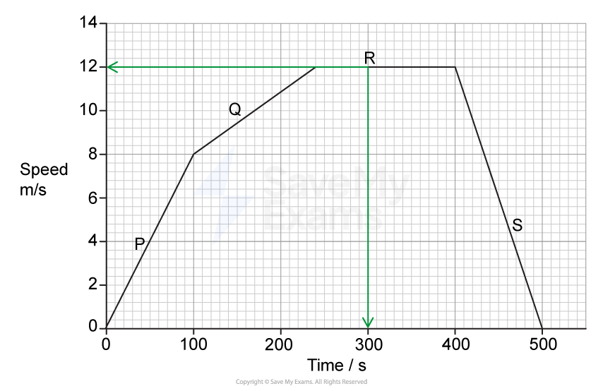

- velocity of cyclist = 12 m/s **[1 mark]**

State the direction of travel:

- North; **[1 mark]**

**[Total: 2 marks]**

> **[mark-scheme]**
> A tolerance of ∓½ a small square is generally allowed when reading data from graphs. Therefore, an acceptable range of speeds would be 11.6 m/s to 12.4 m/s.

> **[exam-tip]**
> This question asks you to **determine** something. That means you have to establish an answer using the information given in the question. In this case, you need to use the graph as well as information from the context.
> 
> You have been asked for a velocity, not a speed. You need to read off the speed from the graph and also state the direction of travel to achieve both marks. Checking the number of marks allocated to the question (2 marks) should tell you that you need to give two pieces of information.

### Q6
State the feature of the graph related to the distance travelled:

- distance travelled = area under the graph (for section P);** [1 mark]**
- $\mathrm{area} \mathrm{of} \mathrm{triangle}=\frac{1}{2}\times\mathrm{height}\times\mathrm{base}$ ; · ** [1 mark]**

Use the graph to find the value of speed when time = 100 s:

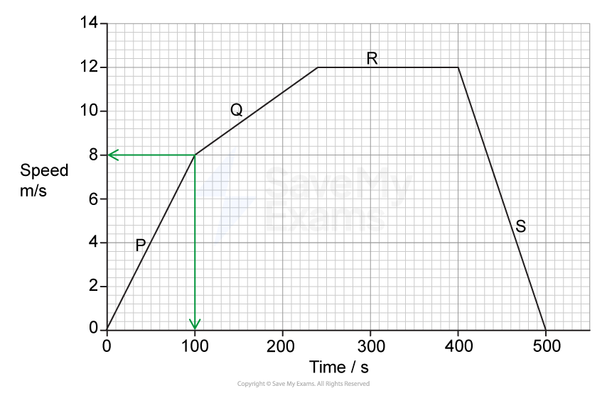

- From the graph, when time = 100 s, speed = 8 m/s

Calculate the distance travelled by the cyclist:

- $\mathrm{distance} \mathrm{travelled}=\frac{1}{2}\times8\times100=400m$. **[1 mark]**

**[Total: 3 marks]**

> **[mark-scheme]**
> A tolerance of ∓½ a small square is generally allowed when reading data from graphs. Therefore, if you read the speed as 7.6 m/s and used this correctly in your calculation, you would still gain full marks.

> **[exam-tip]**
> Make sure that you read the question carefully so that you are looking at the right part of the graph. The question only asks for the distance travelled for section P, so don’t try to work out any of the other distances; they are not needed.
In section Q:

- The graph shows that the speed increases with time
- **Q:** The cyclist is <u>accelerating</u>;** [1 mark]**

In section R:

- The graph shows that the speed remains constant over time with time
- **R:** The cyclist is moving at a <u>constant</u> speed / steady speed;** [1 mark]**

In section S:

- The graph shows that the speed decreases with time
- **S:** The cyclist is <u>decelerating</u>; **[1 mark]**

**[Total: 3 marks]**

> **[exam-tip]**
> Make sure that you use the correct terms when describing motion. For part S of the motion, you might say ‘slowing down’. This may be marked as correct in some questions, but the mark scheme does not use this term; it lists only ‘decelerating’ as a correct answer. You will always get the mark if you use the word ‘decelerating’.
> 
> Always be careful when looking at motion graphs. Check the *y*-axis to see whether the graph is showing distance travelled or speed. These two graphs look very similar, but they show different things. For example, the gradient of a distance–time graph shows the velocity, but the gradient of a speed–time graph shows the acceleration.

### Q7
(i) Using the graph in Fig. 2.1, the speed of car A at time = 10 s is:

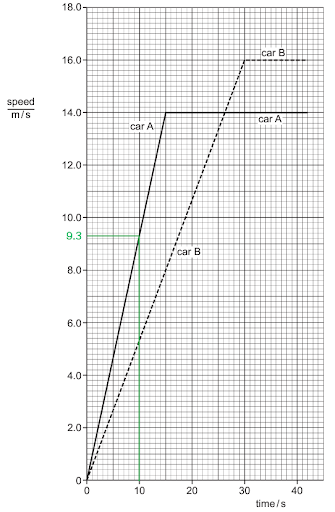

- Vertical line drawn on graph from 10.0 s;** [1 mark]**
- Speed = 9.3 m/s [1 mark]

(ii) During the first 10 seconds, the car which has the greater acceleration is:

- Car A; **[1 mark]**
- (This is because) the speed-time graph for car A has a greater / steeper gradient; **[1 mark]**

**[Total:4 marks]**
(i) After 30 s, the graph shows:

- Car B travels at a steady / constant speed; **[1 mark]**
- of 16 m/s; **[1 mark]**

(ii) Calculate the distance moved by car B in 30 seconds:

- The distance travelled is equal to the area under the speed-time graph

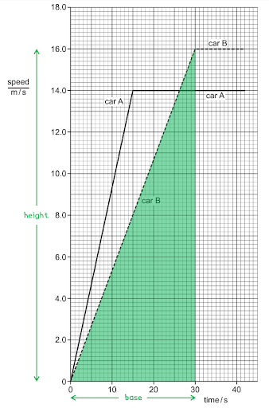

- Distance = area of a triangle = ½ $\times$base $\times$ height **[1 mark]**
- Distance = ½ $\times$ 30 $\times$ 16 **[1 mark]**
- Distance = 240 m **[1 mark]**

**[Total: 5 marks]**

### Q8
Deceleration is:

- A negative acceleration **OR** a decrease in velocity; **[1 mark]**
- The change in velocity per unit time **OR** the rate of change of velocity;** [1 mark]**

**[Total: 2 marks]**
The car does not begin to decelerate at *t* = 0 because:

- There is a delay in applying the brakes;** [1 mark]** **OR **
- There is a delay due to (human) reaction time; **[1 mark]** **OR **
- The driver’s foot is not removed from the accelerator; **[1 mark]**

**[Total: 1 mark]**

### Q9
(i) Describe the movement of the student, as shown in Fig. 1.1.:

- The student is moving at a constant speed / a speed of 4 m/s (for 80 s); **[1 mark]**
- Then the student decelerates (after 80 s) **OR **the student stops after 100 s; **[1 mark]**

(ii) Calculate the distance travelled by the student between 80s and 100s:

- The distance travelled can be determined by calculating the area under the graph;** [1 mark]**

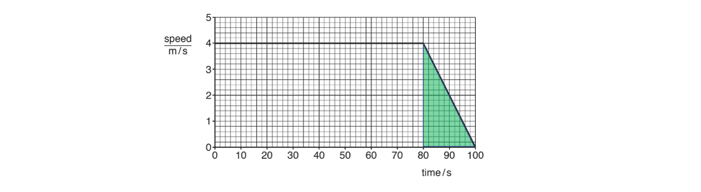

Recall the equation for the area of a right-angled triangle:

- $\mathrm{Area}=\frac{1}{2}\times\mathrm{base}\times\mathrm{height}$ **OR **$A=\frac{1}{2}bh$

Determine the base value of time taken:

- $b=100-80=20s$

Determine the height value of change in speed:

- $h=4-0=4m/s$

Substitute in the known values into the equation to calculate:

- $A=\frac{1}{2}\times20\times4$ **[1 mark]**
- *A* = 40 m **[1 mark]**

**[Total: 5 marks]**

> *Always set out the steps of your calculation clearly. Even if you do not get the final answer correct, marks can be awarded for the working out. The mark scheme for part (ii) awards a mark for giving the correct equation if you did not get the mark for substituting in the known values. *
Calculate the average speed for the total distance run by the athlete:

List the known quantities:

- Distance travelled on flat road,* s*1 = 630 m
- Distance travelled on downhill slope,* s*2 = 254 m
- Time taken on flat road, *t*1 = 130 s
- Time taken on downhill slope, *t*2 = 40 s

State the equation for average speed, *v*:

- $averagespeed=\frac{totaldistance}{totaltime}$ **OR** $averagespeed=\frac{s_{1}+s_{2}}{t_{1}+t_{2}}$ **[1 mark]**

Substitute in the known values to calculate:

- $v=\frac{s_{1}+s_{2}}{t_{1}+t_{2}}$
- $v=\frac{630+254}{130+40}=\frac{884}{170}$ **[1 mark]**

- *v* = 5.2 m/s **[1 mark]**

**[Total: 3 marks]**

> *Equations with multiple values of the same quantity can sometimes look intimidating or confusing, but once you understand the notation, they are not that complex.*

> *For example, this question has **two** values for distance and **two** values for time. The easiest way to deal with this is to give the variables a number. Distance 1 and distance 2, time 1 and time 2. The short way to write this is just **d**1** and **d**2**, **t**1** and **t**2**. Try not to be overwhelmed by the notation, just read it as distance 1 and distance 2. *

### Q10
The definition of acceleration is:

- Acceleration is the c<u>hange in velocity per unit time</u> **OR   **$a=\frac{Δv}{Δt}$ **[1 mark]**

**[Total: 1 marks]**

> *Some teachers and textbooks write this equation as  *$a=\frac{v-u}{t}$*, where **v** = final velocity and **u** = initial velocity. This means that (**v** - **u** **) is Δ**v**, the change in velocity.*

> *If your teacher does prefer it, and especially if you expect to continue physics at A-Level, writing the equation like this is a good habit to get into, as later on the situations you are calculating will get more complicated.*
Recall that the gradient of a speed-time graph shows acceleration:

- In the first section acceleration is increasing
- Therefore the gradient increases - the graph must curve upwards to show this

In the second section acceleration is constant

- Therefore the gradient is constant and going up (as the speed is increasing)

A correct sketch graph looks like:

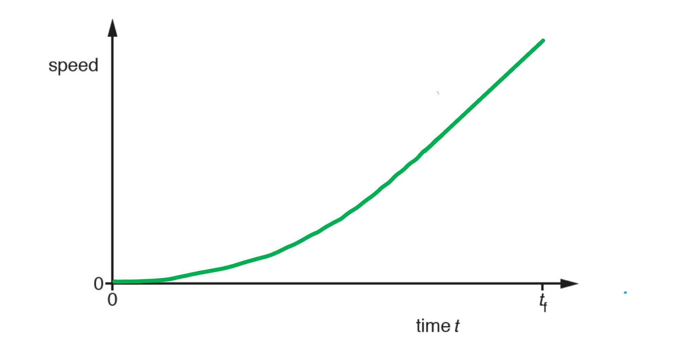

- The line starts at the origin **AND**** **begins by curving upwards from the x-axis; **[1 mark]**
- The gradient increases to begin with **AND**** **it never decreases; **[1 mark]**
- After the changing point the gradient is constant and clearly going upwards / in a positive direction; **[1 mark]**

**[Total: 3 marks]**

> *Do you ever wonder how teachers, text books and revision sites draw such good graphs? There are two secrets to this. One is practice (of course!) but the other is helping ourselves with guides which we rub out before showing our work.*

> *Here's what my graph looked like before I rubbed out the plotting points and guides. (I added labels to show you why I put each one down.)*

> *In an exam you should do this too. Another secret? You can leave them all in place and the examiner won't mind a bit. They will just mark your slope.*

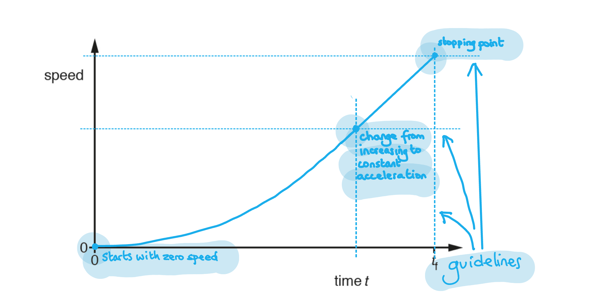
(i) The principle of the conservation of momentum states that:

- Total momentum remains constant (before and after a collision); **[1 mark]**
- When there are no external forces* ***OR**** **in an isolated system; **[1 mark]**

(ii) Conservation of momentum applies in this case because:

Treat the rocket and its fuel as an isolated system:

- The <u>rocket gains</u> upward momentum; **[1 mark]**
- The gas / fuel gains <u>equal</u> momentum in <u>opposite direction</u> **OR*** *momentum of gas decreases by <u>equal amount</u>; **[1 mark]**

**[Total: 4 marks]**

> *This is a difficult question. But you will never be asked to invent anything new in your exam, so the physics must be the physics you learned. This means that if the rocket is gaining momentum as it goes up, something else must be balancing that out by gaining momentum in the opposite direction.*

### Q11
Draw the speed-time graph for this part of the journey made by the bus:

A graph that would score 5 marks should look like:

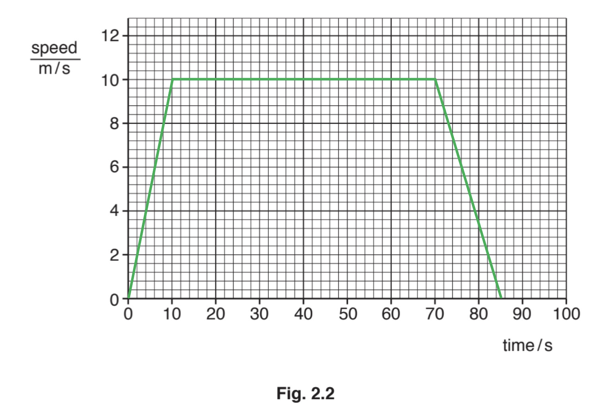

- Line starts from 0 on y-axis; **[1 mark]**
- Straight diagonal line to 10 m/s; **[1 mark]**
- Line parallel to time axis; **[1 mark]**
- Straight diagonal line to x-axis at greater time (from horizontal section); **[1 mark]**
- Line drawn to time axis at (85, 0); **[1 mark]**

**[Total: 5 marks]**

> *Make sure you remember the key features of a speed-time graph*

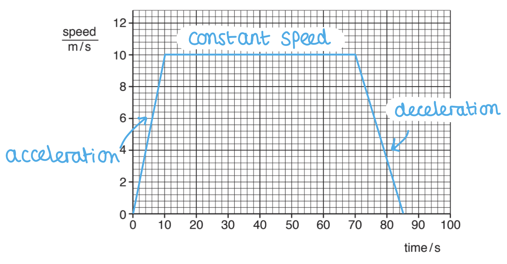

- *Acceleration is shown by a diagonal line with a positive gradient (speed increases over time)*
- *Constant speed is shown by a horizontal line (no change in speed over time)*
- *Deceleration is shown by a diagonal line with a negative gradient (speed decreases over time)*
Calculate the distance the bus travels in 150 s.

List the known quantities:

- Average speed = 7.5 m/s
- Time travelled = 150 s

State the equation linking speed, distance and time:

- $v=\frac{s}{t}$ **OR*** *** **$s=vt$** ****[1 mark]**

Substitute the values into the distance equation:

- $s=7.5\times150$ **[1 mark]**
- *s* = 1125 m **[1 mark]**

**[Total: 3 marks]**

> *The mark scheme will accept the equation for speed, distance and time in any form. For example, *$s=\frac{d}{t}$*. *

> *If you are ever unsure of the symbols used in an equation, stick to writing the equation out in words to avoid any mistakes. The examiner will normally allow the equation rearranged in any way too, unless otherwise specified. *

### Q12
To calculate the weight of the ball:

List the known quantities:

- Mass of the ball, *m* = 0.12 kg
- Gravitational field strength,* g *= 9.8 N/kg

Recall the equation for weight:

- weight = mass × gravity* *OR** **$W=mg$ **[1 mark]**

Substitute the values and calculate:

- $W=0.12\times9.8$ **[1 mark]**
- $W=1.176N$
- $W = 1.2 \mathrm{N} ( 2 \mathrm{s} . \mathrm{f} . )$**[1 mark]**

**[Total: 3 marks]**
The correct descriptions of the graph are:

- **One mark** for each correct line

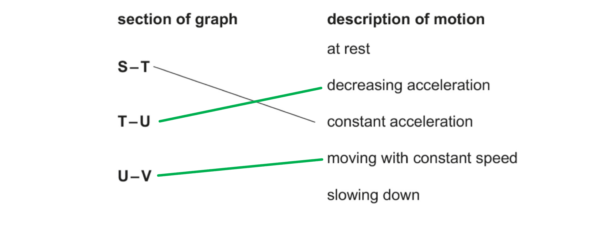

**[Total: 2 marks]**
To determine the distance fallen by the ball, find the area under the graph:

- An annotated graph which would score 3 marks looks like:

- Clear attempt to find area under graph;** [1 mark]**
- $Area=2\times20$ **[1 mark]**
- (Distance =) 40 (m);** [1 mark]**

**[Total: 3 marks]**

> *For the first mark here you are just showing the examiner that you know the distance is the area under the line. You can demonstrate this by writing a calculation of the area, or by adding notes to the graph as shown here. They will accept either for this 'method mark', even if your answer is wrong!*

> *Questions like this one prove how important it is to **show your working.*
State the distance fallen by the ball in section V – W of the graph: Use the area under graph method:

- Section V-W is half the width of section U-V

  - Therefore the distance is half the distance in the previous answer
- Distance = 20 m; **[1 mark]**

**[Total: 1 mark]**

> *This mark is what examiners call **'error carried forward'** (you will see it written **'ecf'** in mark schemes).*

> *This means that even if you got the previous answer wrong, as long as you have correctly halved it for this part, you will get this mark.*

> *For example, if you wrote 20 m for (c) and 10 m for (d), you don't get the mark for (c) because it's wrong, but you do get the mark for (d) because you used the right method.*

> *Another reason to always show your working!*

### Q13
Calculate acceleration:

List the known quantities:

- Initial velocity, *u* = 0 m/s
- Final velocity, *v* = 120 m/s
- Time, *t* = 8.0 s

Recall the equation for acceleration:

- $a=\frac{\Deltav}{\Deltat}$ **OR **$acceleration=\frac{changeinvelocity}{changeintime}$ **[1 mark]**

Substitute the values:

- $a=\frac{120-0}{8}$

Calculate the final answer:

- Acceleration, *a* = 15 m/s2 **[1 mark]**

**[Total: 2 marks]**

> *A "change in" any quantity means the final value minus the initial value. In the case of velocity, this is often written as **v** − **u**. It is important to get this the right way round, as there is a big difference between gaining 120 m/s and losing 120 m/s.*
(i) A correctly completed graph would look like:

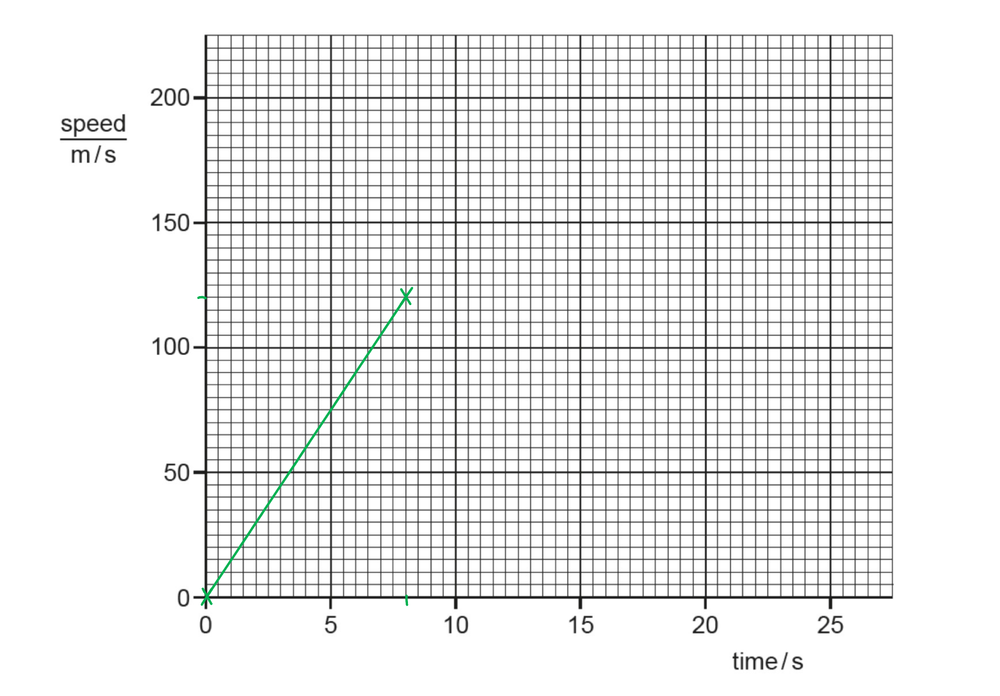

- A <u>straight</u> line from <u>(0, 0) to (8, 120)</u>; **[1 mark]**

(ii) To use the graph to determine the height of the rocket at 8.0 s:

To find distance (in this case height) travelled, find the area under the line:

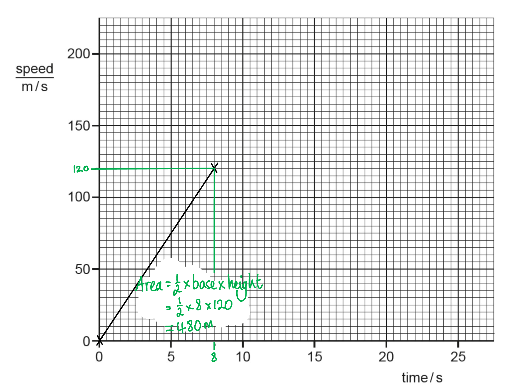

- $A r e a = 1 \frac{1}{2} ( b a s e \times h e i g h t )$ **[1 mark]**
- Height = 480 m; **[1 mark]**

(iii) A correctly completed graph would look like:

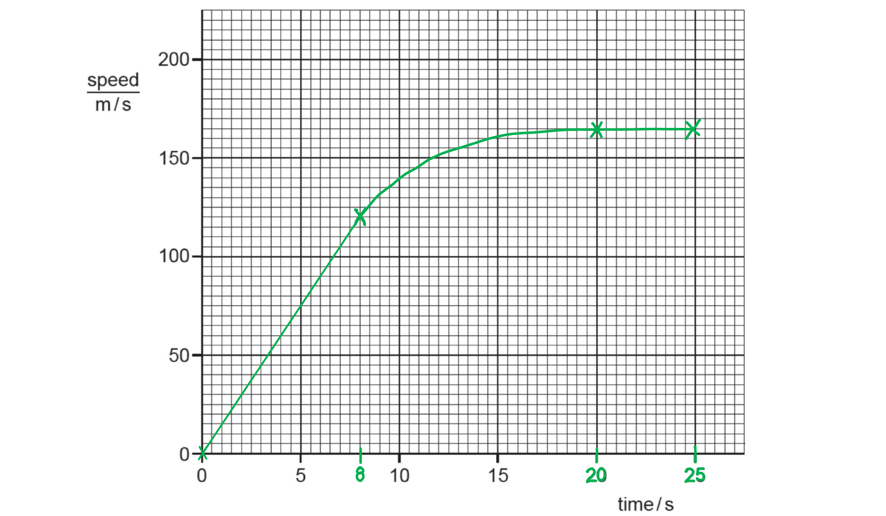

- A rising curve from <u>8 s to 20 s</u>; **[1 mark]**
- The curve has decreasing gradient; **[1 mark]**
- The line is horizontal from <u>20 s to 25 s</u> **AND **lies between 120 m / s and 200 m / s; **[1 mark]**

**[Total: 6 marks]**

> *On our example graph in part (iii) we have plotted the points. Even though there are no marks awarded directly for this, it does mean that our line was accurate enough to get all three marks.*

> *The graph below shows the range of 'safe' lines which you could have sketched and stayed inside the accepted range for this answer. As long as your line was this shape and fell between the dotted lines shown, you got the marks.*

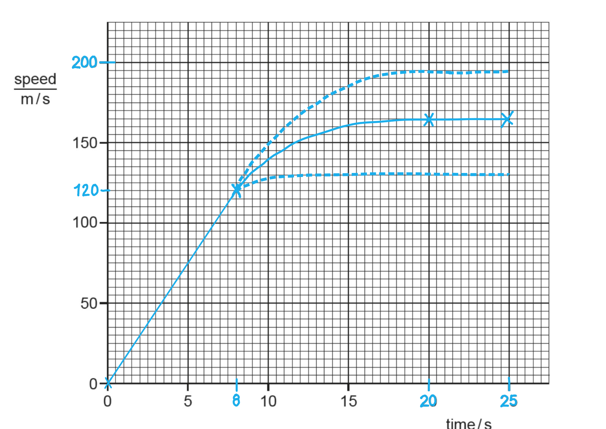

### Q14
To calculate the time for the car to go around the track once:

Calculate the time on each stopwatch in seconds:

- Time at start = 1:22.15 = 82.15 s
- Time after going round the track once = 2:33.65 = 153.65 s

Determine the difference between the two times:

- 153.65 − 82.15 **[1 mark]**
- Difference = 71.50 s **[1 mark]**

**[Total: 2 marks]**

> *Take care not to make calculation or copying errors - check if the units need changing to SI units!*

> *You could work this out in your head, but always write down your working!*
To calculate the average speed of the car:

List the known quantities:

- Length of the track = 4.0 km
- Time for 20 laps = 26 minutes and 40 seconds

Determine total distance, s, travelled in m:

- $s=lengthofonelap\times20$
- $s=4.0\times20=80.0\mathrm{km}$
- $s=80.0\times1000=80000m$ **[1 mark]**

Recall the equation linking average speed, distance and time:

- $averagespeed=\frac{s}{t}$ **[1 mark]**

Substitute in values and calculate average speed:

- $t=(26\times60)+40=1600$
- $averagespeed=\frac{80000}{1600}$**[1 mark]**
- Average speed = 50 m / s **[1 mark]**

**[Total: 4 marks]**

> *Don't forget to check how many laps have been completed as this is how you find the total distance!*
(i) The section of the graph which shows the greatest acceleration is:

- Section P; **[1 mark]**

The explanation is:

- The gradient is steepest; **[1 mark]**

(ii) To calculate the distance travelled by the car in the first 2.5 seconds:

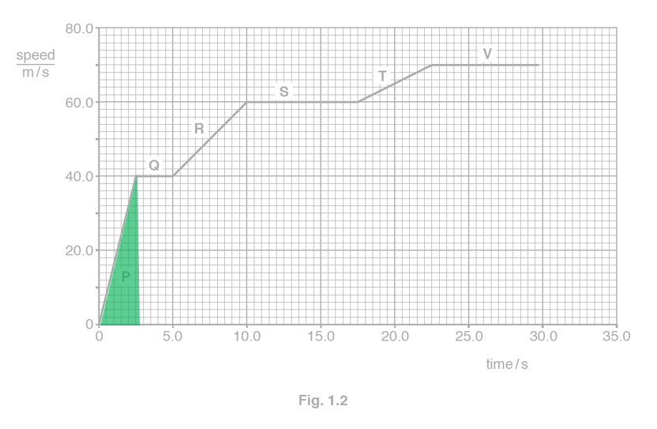

- Distance travelled is the area under the graph;** [1 mark]**

Calculate the area under the graph:

- $Area=\frac{1}{2}\timesbase\timesheight$
- $Area=\frac{1}{2}\times2.5\times40.0$ **[1 mark]**
- Area = 50 m **[1 mark]**

**[Total: 5 marks]**

> *Make sure you memorise what different parts of distance-time and speed-time graphs represent:*

- *Gradient = acceleration*
- *Area under the graph = distance travelled*

> *A really common mistake is to mix these two up.*

### Q15
(i) A graph which would score one mark would look like:

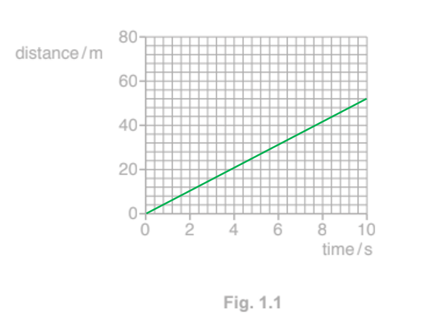

- A straight line from (0, 0) to (10, 50); **[1 mark]**

State the property of the graph which represents speed:

- The gradient / slope; **[1 mark]**

(ii) To calculate the average acceleration:

List the known quantities:

- Time, $t=20-10=10s$
- Final speed, *v* = 9.0 m/s
- Initial speed, *u* = 5.0 m/s

Recall the equation linking change in speed and time:

- $acceleration=\frac{finalvelocity-initialvelocity}{time}$ **[1 mark]**

**OR**

- $a=\frac{v-u}{t}$ **[1 mark]**

**OR**

- $a=\frac{Δv}{Δt}$**[1 mark]**

Substitute in values and calculate acceleration:

- $a=\frac{9.0-5.0}{10}=\frac{4}{10}$
- a = 0.4 m/s2 **[1 mark]**

**[Total: 4 marks]**

> *The first mark for (ii) could be given for stating the input values, i.e. *$a=\frac{9.0-5.0}{10}$* would gain the first mark.*
(i) A graph which would obtain two marks would look like:

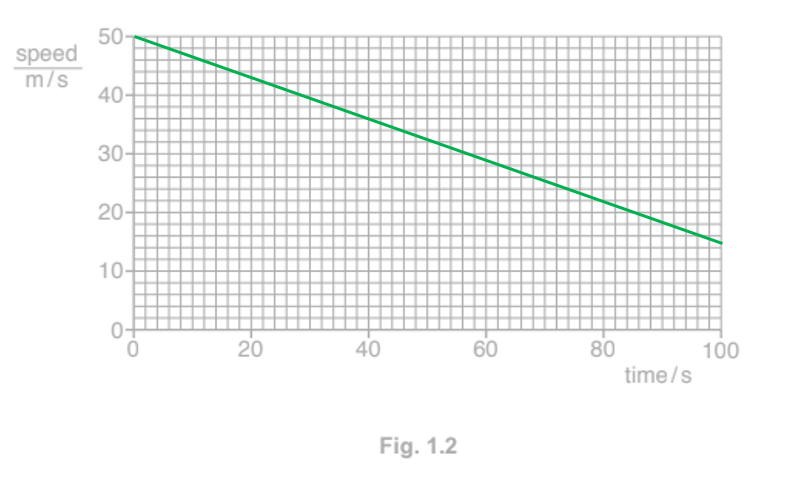

- Straight line drawn down from any point on y-axis to any speed at 100 s; **[1 mark]**
- Line starts at (0, 50) and ends at (100, 15); **[1 mark]**

(ii) To calculate the distance travelled:

State the link between the area under the graph and the distance travelled:

- The area under the graph = distance travelled; **[1 mark]**

Calculate the area under the graph:

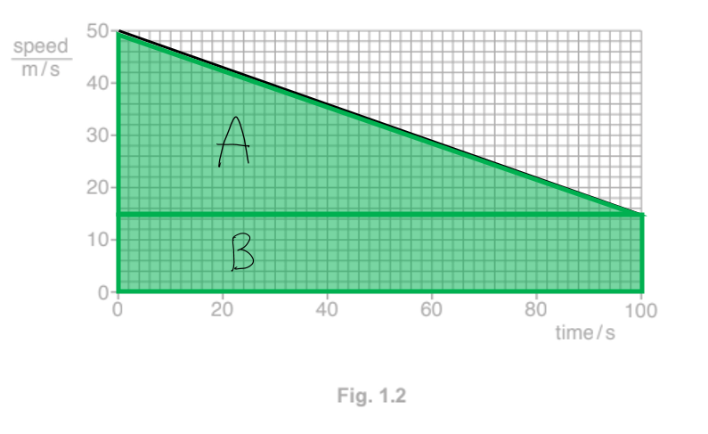

- Calculate the area of A:

  - $area=\frac{1}{2}\timesbase\timesheight=\frac{1}{2}\times100\times35=1750$

**AND**

- Calculate the area of B:

  - $area=base\timesheight=100\times15=1500$ **[1 mark]**

Combine the areas to give the distance travelled:

- $distancetravelled=1750+1500$
- distance travelled = 3250 m **[1 mark]**

**[Total: 5 marks]**

> *To calculate the end point of the line in part (i), use *$a=\frac{v-u}{t}$*:*

- $a=\frac{v-u}{t}$
- $v = a t + u = ( - 0.35 \times 100 ) + 50$

  - *The minus sign is because it is a deceleration*
- *v** = 15*

> *Therefore the speed at 100 s is 15 m/s.*

### Q16
To calculate the acceleration of the vehicle at time = 30 s:

State the feature of the graph which represents the acceleration:

- The acceleration is given by the gradient of the line; **[1 mark]**

Draw a tangent to the line at *t* = 30 s:

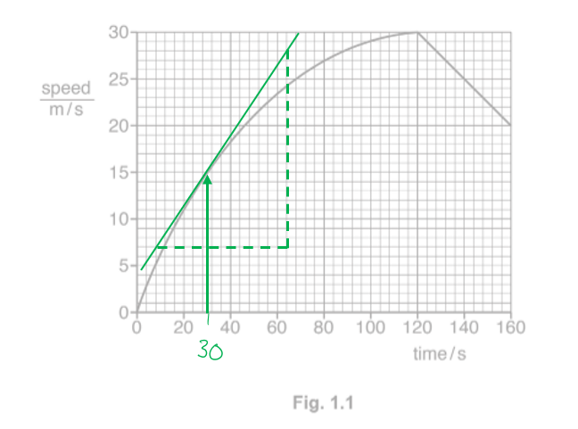

- Drawing a tangent and triangle would also gain the first mark

Find the gradient of the line:

- $gradient=\frac{\Deltay}{\Deltax}=\frac{28-7}{64-8}=0.375$
- Therefore acceleration = 0.375 m / s2 **[1 mark]**

  - Range 0.30 to 0.45 allowed

**[Total: 2 marks]**

> *Always use a ruler to draw a tangent, and make sure you remember:*

- *Gradient gives the acceleration*
- *Area under the graph gives the distance*
State the difference in acceleration between 100 s and 10 s:

- Acceleration occurs at a slower rate / acceleration is less; **[1 mark]**

Suggest why there is this difference:

- There is a smaller resultant force; **[1 mark]**

** **

- Because the driving force is reduced; **[1 mark]**

**OR**

- Because there is greater resistive force / drag / friction / air resistance; **[1 mark]**

**Final answer:** **[Total: 3 marks] **

> *Due to Newton's second law (F = ma) we know that a resultant force produces an acceleration, and that the rate of acceleration is proportional to the resultant force applied.*

> *Therefore a smaller acceleration must come from a smaller resultant force. This can only be achieved by reducing the driving force or increasing the resistive forces.*
To determine the distance travelled by the vehicle between 120 and 160 s:

Recognise the part of the graph that represents distance travelled:

- The area under the graph represents the distance travelled; **[1 mark]**

Calculate the area under the graph:

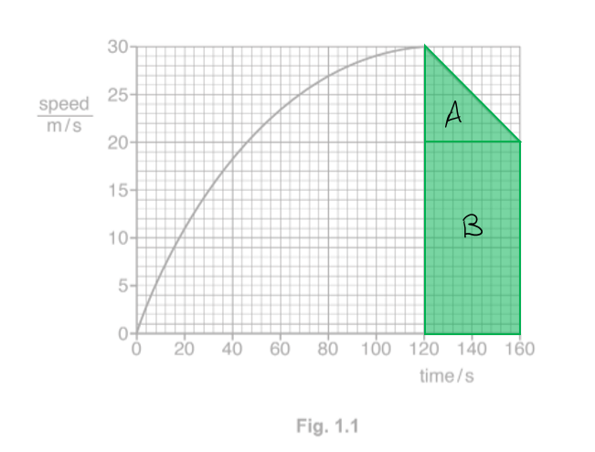

- $areaA=\frac{1}{2}\timesbase\timesheight=\frac{1}{2}\times40\times10=200$

**AND** * *

- $areaB=base\timesheight=40\times20=800$ **[1 mark]**

Calculate total area:

- $totalarea=areaA+areaB=200+800=1000$
- Therefore distance travelled = 1000 m** [1 mark]**

**[Total: 3 marks]**

> *Take care that you may need to add together multiple sections of a graph to find the total area.*

### Q17
Define acceleration:

- Acceleration is defined as the <u>rate of change</u> of velocity; **[1 mark]**

**   ****OR **

- Acceleration is defined as the change in speed per unit time / second; **[1 mark]**

**[Total: 1 mark]**
Describe the motion shown by:

(i) graph A

- Graph A shows <u>deceleration</u>; **[1 mark]**
- The deceleration is <u>constant</u>; **[1 mark]**

(ii) graph B

- Graph B shows acceleration; **[1 mark]**
- The acceleration is increasing; **[1 mark]**

(iii) graph C

- Graph B shows decreasing speed / velocity **OR **deceleration; **[1 mark]**

(iv) graph D

- Graph D shows constant speed; **[1 mark]**

**[Total: 6 marks]**

Don't let interpreting motion graphs confuse you! Talk yourself through each section of the graph by asking the following questions:

- What does this gradient mean?
- Is the object getting faster/slower?
- Is the object accelerating?
- Where is the object stationary?

> *Drawing a tangent to a curve in two different places will let you see if the gradient is increasing or decreasing. *

### Q18
(i)

1. Use **Fig. 1.1** to determine the average speed of the train during the 120 s:

Use the graph to determine the total distance travelled and the total time taken:

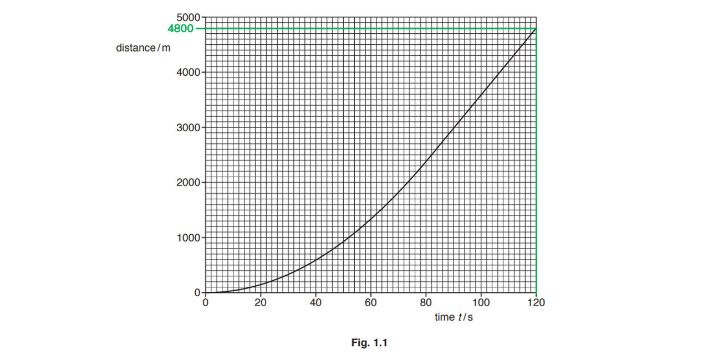

- Total distance travelled = 4800 m
- Total time taken = 120 s

Recall the equation for average speed:

- $averagespeed=\frac{totaldistancetravelled}{totaltimetaken}$

Substitute in the known values to calculate:

- $averagespeed=\frac{4800}{120}$
- average speed = 40 m/s **[1 mark]**

** **

2. Use **Fig. 1.1** to determine the speed of the train at time *t* = 100 s:

Draw a tangent at 100 s to determine the instantaneous speed:

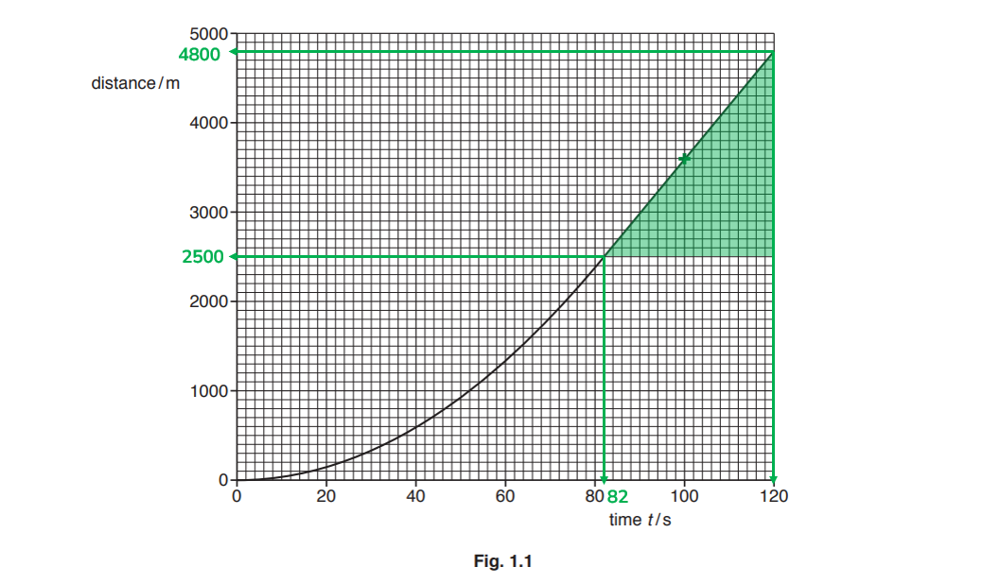

- $v=\frac{changeindistance}{changeintime}=\frac{\Deltay}{\Deltax}=\frac{\Deltas}{\Deltat}$
- $v=\frac{4800-2500}{120-82}=\frac{2300}{38}$ **[1 mark]**
- *v* = 60.5 m/s **[1 mark]**

(ii) Describe how the acceleration of the train at time *t* = 100 s differs from the acceleration at time *t* = 20 s:

- At t = 20 s, the acceleration is greater than the acceleration at 100 s; **[1 mark]**
- At t = 100 s, the acceleration is zero (because the speed has a constant value); **[1 mark]**

**[Total: 5 marks]**

> *You can choose which ever equation you recognise to calculate the gradient, they all express the same thing. You may have drawn you tangent / triangle at a slightly different place, and that's ok. The mark scheme allows a gradient between 55 m/s and 65 m/s. As long as your calculation falls within this range, you will get the marks. *
(i) Calculate the resultant force that acts on the train at this time:

List the known quantities:

- Mass, *m* = 5.6 × 105 kg
- Acceleration, *a* = 0.75 m/s2

Recall the equation for resultant force:

- Force = mass × acceleration **OR ***F = ma*

Substitute in the known values to calculate:

- F = (5.6 × 105) × 0.75 **[1 mark]**
- F = 4.2 × 105 N **[1 mark]**

** **

(ii) State what is meant by deceleration:

Any **one** from:

- The speed / velocity decreases (with time); **[1 mark]**
- Slowing down; **[1 mark]**
- Negative acceleration; **[1 mark]**
- Rate of decrease of speed / velocity; **[1 mark]**

**[Total: 3 marks]**

> *In part (i) of this question, you can gain the mark for writing out the equation or substituting the numbers correctly into the equation. Therefore, if you did accidentally put in the wrong numbers you can still get a mark for providing the correct equation. This shows how important it is to show all of your working out in a clear and logical way. *

### Q19
Calculate the athlete’s average speed in km/h:

List the known quantities:

- Distance, *s* = 12 km
- Time, *t* = 1.5 hours

Recall the equation to calculate speed:

- $v=\frac{s}{t}$ **[1 mark]**

Substitute in the known quantities:

- $v=\frac{12}{1.5}$ **[1 mark]**

Calculate the speed:

- *v* = 8.0 km/h **[1 mark]**

**[Total: 3 marks]**

> *The quantities given are not in SI units so your first instinct may be to convert them to metres and seconds. The question asks for a speed in km/h, however, so make sure you check the units being asked for before marching on with a question. Underlining or circling the units in the answer space may help you. *
(i) Use the graph in Fig. 2.1 to calculate the distance travelled by the footballer during the first 4.0 seconds:

State how to determine the distance travelled from the graph:

- Distance is represented by the area under the graph; **[1 mark]**

Use the graph to determine the dimensions of the area under the graph:

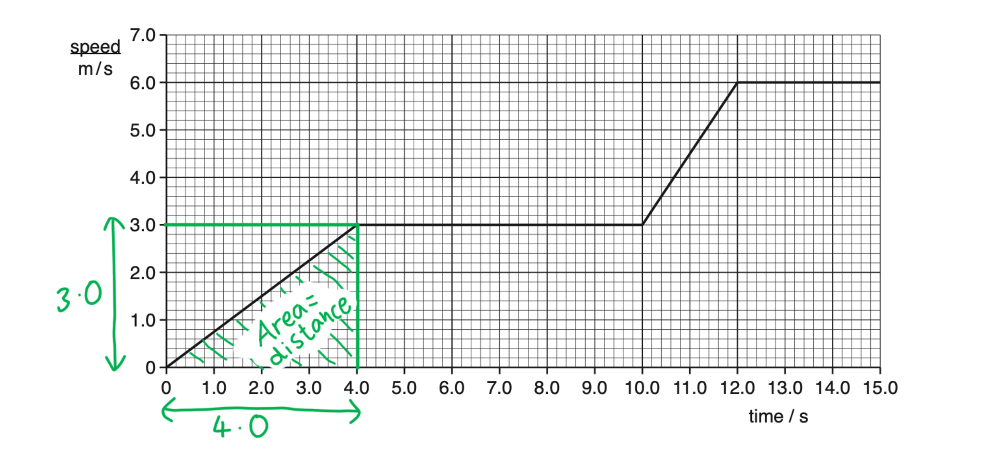

- The area under the graph from 0.0 s to 4.0 s forms a right-angled triangle
- $area=\frac{1}{2}\timesbase\timesheight$

Substitute in the dimensions of the triangle from the graph and calculate distance:

- $area=\frac{1}{2}\times4.0\times3.0$ **[1 mark]**
- $area=distance=6.0m$** [1 mark]**

ii) The greatest acceleration is:

- When the gradient of the graph is steepest
- Between 10s and 12 s; **[1 mark]**

**[Total: 3 marks]**

> *If you can't recall the area of a right-angled triangle, this question will be tricky. Make sure you can recall the areas of basic shapes - you never know when they might pop up in physics, plus it's maths revision for free!*
Calculate the weight of the footballer:

List the known quantities:

- Mass, *m* = 72 kg
- Acceleration due to gravity, *g* = 9.8 m/s2

Recall the equation for weight:

- $W=m\timesg$ **[1 mark]**

Substitute in the known quantities:

- $W=72\times9.8$ **[1 mark]**

Calculate the weight of the footballer:

- *W *= 705.6 N = 710 N (2 s.f) **[1 mark]**

**[Total: 3 marks]**

> *The final answer has been given to two significant figures (72 × 9.8 = 705.6 on a calculator). This is because the information has only been given to two significant figures. We can't just create higher resolution than we were given - that would be like measuring a table as 1 m by 2 m and saying the area is 2.056 m**2**, we have not been given enough information to be that specific. *

### Q20
Acceleration is defined as:

- Rate of change of velocity; **[1 mark]**

**   OR**

- $\frac{\mathrm{change} \mathrm{in} \mathrm{velocity}}{\mathrm{time}}$ **[1 mark]**

**   OR**

- Change in velocity over time / per unit time; **[1 mark]**

**   OR**

- $\frac{( v - u )}{t}$ **[1 mark]**

**[Total: 1 mark]**

It is important that you use the revision notes to help you learn the definitions for this topic, which include:

- Speed and velocity
- Displacement and distance
- Acceleration

This question is not uncommon but in some years, credit is not given for the use of an equation so it is best practice to use words to define acceleration
(i) To draw the graph:

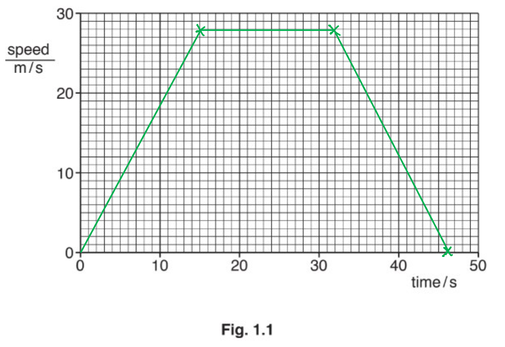

A graph that would score 5 marks should look like this:

- Straight line from origin to (15, 28); **[1 mark]**
- Horizontal line from (15, 28) to (32, 28); **[1 mark]**
- $a=\frac{v-u}{t}$ **OR****  **$a = \frac{( v - u )}{t}$ **OR**** **** **$t = \frac{( v - u )}{a}$ **[1 mark]**

Substitute the values and calculate:

- $t = \frac{( 0 - 28 )}{2}$
- *t *= 14 s; **[1 mark]**

Add the line to the graph:

- Straight line from (32, 28) to (46, 0); **[1 mark]**

(ii) To state the direction of the resultant force on the car and what happens to the velocity of the car:

1. Towards the centre of the circle / inwards; **[1 mark]**

2. Velocity is continuously changing its direction; **[1 mark]**

**[Total: 7 marks]**

> *It makes it easier to draw the lines on your graph if you have marked the relevant coordinates with a little cross 'x'. *

> *The constantly changing velocity involved in circular motion is a tricky concept to understand. Velocity is speed with a given direction. If an object is travelling in a circle then its direction is constantly changing.  If the velocity is constantly changing then there must be acceleration, as acceleration is the rate of change of velocity. *

### Q21
Compare the speed and velocity between points A and B on the diagram:

Compare the speed at A and the speed at B:

- The speed is constant / the same at A and B **OR** the speed is 300 m/s at both points; **[1 mark]**

Compare the velocity at A and the velocity at B:

- The velocity is different; **[1 mark]**

**[Total: 2 marks]**

- *The difference between speed and velocity is to do with **direction*

  - *Since the directions are different, or the velocity points right at A and left at B, this means the velocities are different at points A and B*
- *Speed does not depend on the velocity, just the magnitude (size) *
State how she could use the graph to determine the distance travelled during the test flight:

- (The analyst finds / calculates) the <u>area under</u> the speed-time graph (to determine distance); **[1 mark]**

**[Total: 1 mark]**
(i) State the length of time for which the jet is travelling at constant speed:

- Speed is constant between 200 s and 40 s
- (The jet is travelling at a constant speed for 200 – 40 =) <u>160 s</u>; **[1 mark]**

(ii) Calculate the distance covered by the jet during this time:

Calculate the shape of the graph between 40 s and 200 s:

- rectangle area = height × width

Calculate the area (distance):

- distance = 350 × 160 **[1 mark]**
- distance = 56 000 m **[1 mark]**

**[Total: 3 marks]**

- *You must remember how to calculate the area of simple shapes such as:*

  - *A square or rectangle*
  - *A right-angled triangle*
  - *A trapezium (this can be split up into rectangles and triangles)*
Describe the gradient of the speed-time graph during this time:

- The gradient is <u>positive</u>; **[1 mark]**
- The gradient is <u>constant</u>; **[1 mark]**

**[Total: 2 marks]**

- *To answer this question, you must recall that acceleration due to free fall is **constant*

  - *This means that the **gradient** of the graph is also constant*
  - *The gradient must be positive as the **speed** of the jet plane is **increasing*
- *It doesn't matter what direction the jet is going in, as this is a **speed-time** graph that doesn't rely on direction*

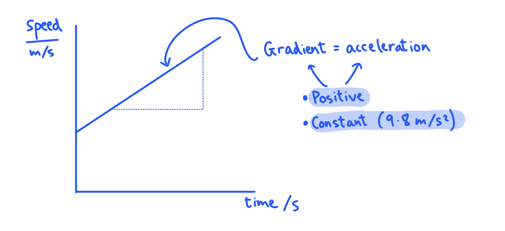

### Q22
The correct lines draw from each section of the graph to the description of the motion would look like:

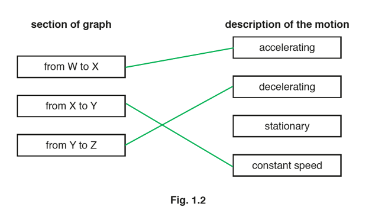

- One line correct scores one mark
- Two lines correct scores two marks
- Three lines correct scores three marks

**Final answer:** **[Total: 3 marks] **
To calculate the distance travelled:

Recall the feature of the graph which represents the distance travelled:

- The area under the graph = the distance travelled; **[1 mark]**

Find the area of the section between 30 and 60 s:

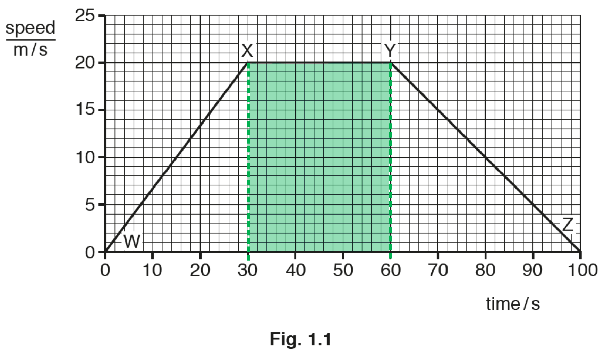

- Area = base × height = 30 × 20 **[1 mark]**
- Area = distance travelled = 600 m **[1 mark]**

**[Total: 3 marks]**
State whether the acceleration or deceleration of the car is greater:

- The acceleration of the car is greater; **[1 mark]**

**[Total: 1 mark]**

### Q23
(i) State the time taken for 30 drops to hit the ground:

Read the time, *t* from the stopwatch in Fig. 1.2:

- *t *= 13.20 s **[1 mark]**

(ii) Calculate the average time between two drops hitting the ground:

Determine the equation needed:

- 30 drops hit the ground in 13.2 seconds
- $averagetimebetweendrops,t=\frac{totaltime}{numberofdrops}$

Substitute in the values:

- $t=\frac{13.2}{30}$ **[1 mark]**

Calculate the average time between two drops:

- *t* * *=* *0.44 s **[1 mark]**

iii) The student measures the time for 30 drops to hit the ground because:

- It is more <u>accurate</u> to count many and take the <u>average</u>; **[1 mark]**

**[Total: 4 marks]**

> *Calculating the time between two drops can be confusing, especially when considering 30 of them. If you are unsure how to approach this kind of question, using more manageable numbers can often help.*

> *Let's say that the student starts the timer when a drop of water hits the ground, and the next **three** drops take 6.0 s to pass. *

> *This 6.0 s covers three spaces between drops, so the time for each space between drops is 6.0 ÷ 3 = 2.0 s. We then simply apply the same idea to the larger numbers of 30 drops and 13.2 s.*

> *This is an **average** as there will be slight variations in the times between drops. *
State why the drops get further apart:

- The drops are <u>accelerating</u> / <u>increasing</u> in speed; **[1 mark]**

**[Total: 1 mark]**

> *A force (weight) is acting downwards on the drops, causing them to accelerate in that direction. This means the drops closer to the ground are travelling at a greater speed than those higher up, so they are increasing the distance from those above. *
To calculate distance:

Recall how to determine distance from a speed-time graph:

- Distance is represented by the area under the line (on a speed-time graph); **[1 mark]**

**OR**

- $distance=\frac{1}{2}\timesbase\timesheight$; **[1 mark]**

Determine the area from the graph:

- The area under the line forms a right-angled triangle, so use the corresponding equation for area
- $area=\frac{1}{2}\timesbase\timesheight$
- Use the Y axis to determine the height of the triangle under the line
- Use the X axis to determine the base of the triangle under the line

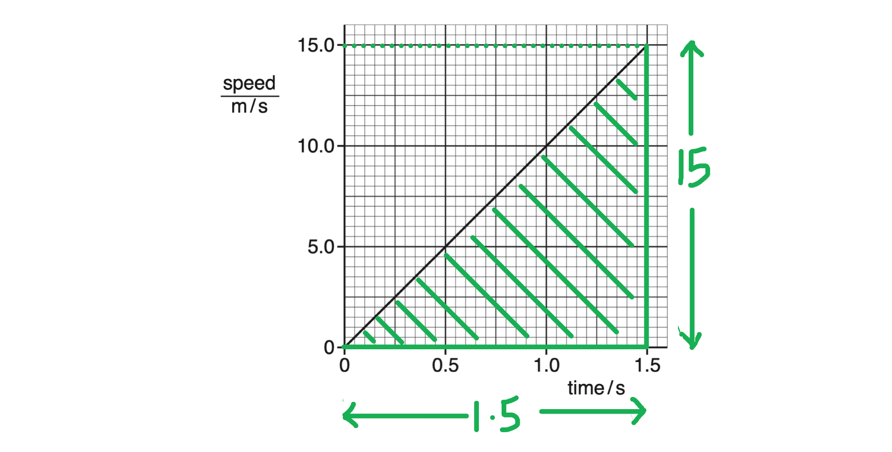

Substitute in the values from the graph:

- $area=\frac{1}{2}\timesbase\timesheight$
- $area=\frac{1}{2}\times1.5\times15$ **[1 mark]**

Calculate the distance covered in 1.5 s:

- $area=distance$
- Distance = 11.25 m **[1 mark]**

**[Total: 3 marks]**

> *Using the equation*$\frac{1}{2}\timesbase\timesheight$* for area under a graph only works for a diagonal straight line that forms a triangular area with the X axis, so don't just memorise it and use it for every graph you come across! *

> *You're looking for the shape between the line of a graph and the X axis - this may be a rectangle, a triangle or some combination of these. You will never have to calculate an irregular area under the curve (but in this case, counting squares under the curve is a crude alternative). *

### Q24
Complete the table to show when each type of motion occurs:

**One **mark for each correct row:

| **motion** | **start of motion** | **end of motion** |
|---|---|---|
| acceleration | W | X |
| deceleration | **Final answer:** **Y** | **Final answer:** **Z** |
| constant speed | **Final answer:** **X** | **Final answer:** **Y** |

**[Total: 2 marks]**

If you need a reminder of the features of a speed-time graph:

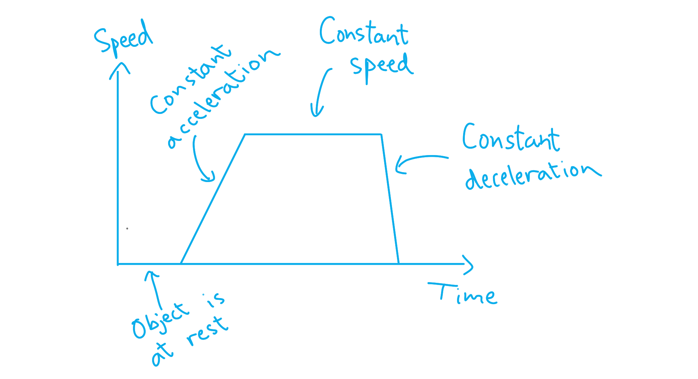
Calculate the distance travelled between 60 s and 100 s:

- The distance travelled is the area under the graph; **[1 mark]**

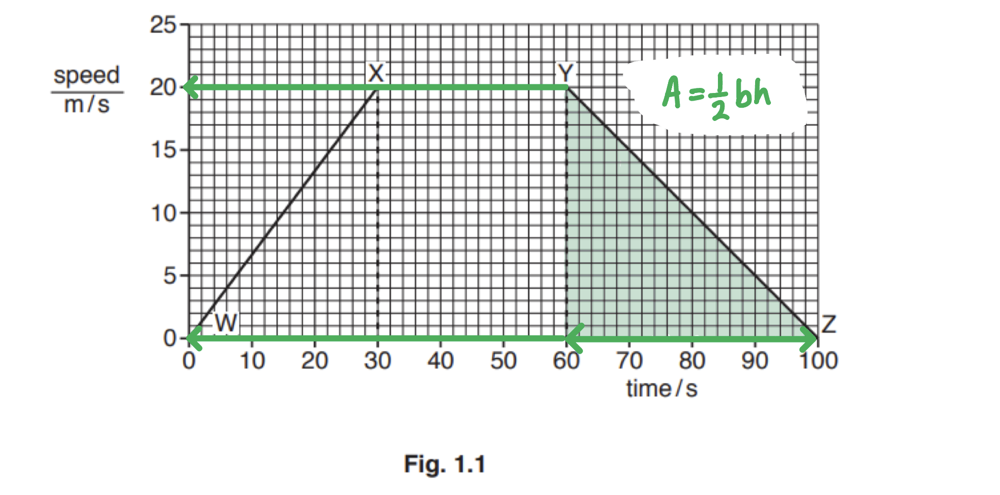

- $area=\frac{1}{2}\timesbase\timesheight$** OR** $A=\frac{1}{2}bh$
- $A = 1 \frac{1}{2} \times ( 100 - 60 ) \times ( 20 - 0 )$
- $A=\frac{1}{2}\times40\times20$ **[1 mark]**
- Area = 400 m **[1 mark]**

**[Total: 3 marks]**

> *You don't need to explicitly write out that the distance travelled is the area under the graph to get the mark, demonstrating that you know this by performing the calculation is enough. However, it is always best practice to show your train of thought throughout your calculation. Writing out equations, or simple statements such as **distance travelled = area under graph** will help the examiner to see what were trying to do if you do get lost and end up with an incorrect answer.*

> *The same is true for using the equation *$A=\frac{1}{2}bh$*. You can get a mark for writing out the equation before you put the numbers in. If you then put in the wrong numbers, you will still get the mark. However, if you don't write out the equation, and then you put the wrong numbers in, you will not get the mark, so it is always best practice to write out the equation first!*

> *If you need a reminder on how to calculate the area of a triangle:*

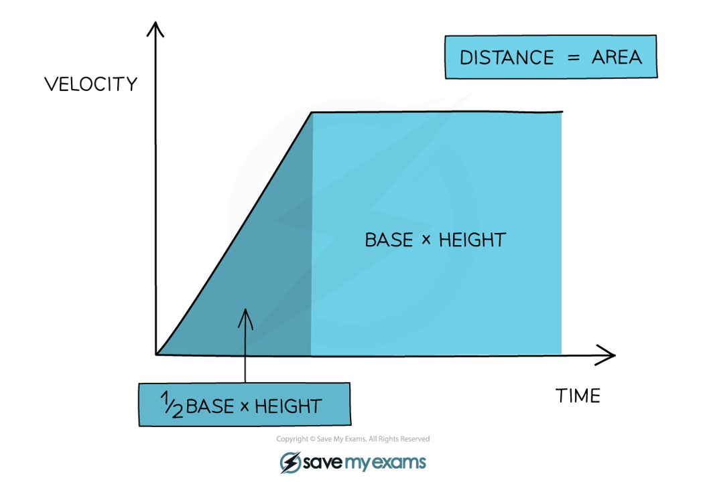
Describe how Fig. 1.1 shows that the size of the acceleration is greater than the deceleration:

- WX (the upward sloping line) has a steeper gradient (than YZ); **[1 mark] **

**[Total: 1 mark]**

> *Remember that for a speed-time graph, the steeper the gradient, the greater the acceleration.*

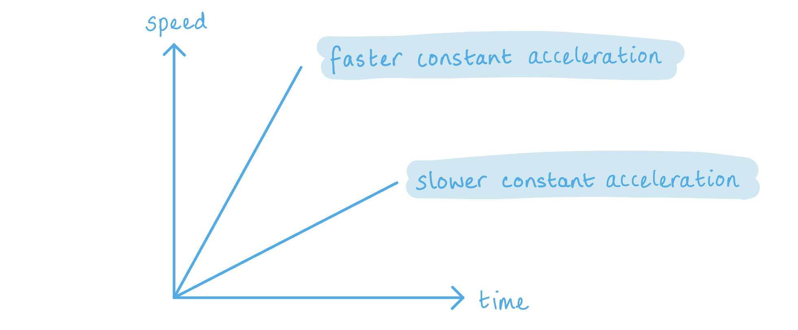

### Q25
To calculate the average speed of the skier:

- List the known quantities:

  - Distance travelled, *s* = 200 m
  - Time taken, *t* = 6.4 s
- State the equation linking average speed, distance and time:

$\mathrm{average} \mathrm{speed}=\frac{\mathrm{total} \mathrm{distance} \mathrm{travelled}}{\mathrm{time} \mathrm{taken}}$**[1 mark]**

- Substitute values into the average speed equation:

$\mathrm{average} \mathrm{speed}=\frac{200}{6.4}$ **[1 mark]**

average speed = 31.25 = **31 m/s** **[1 mark]**

> **[mark-scheme]**
> 1 mark for $\mathrm{average} \mathrm{speed}=\frac{\mathrm{total} \mathrm{distance} \mathrm{travelled}}{\mathrm{time} \mathrm{taken}}$ **OR****  **$v=\frac{s}{t}$
> 
> 1 mark for calculating $200\div6.4$
> 
> 1 mark for a correct final answer of 31 m/s (2 s.f.)

> **[exam-tip]**
> Regularly in CIE exams, there is a mark for stating the correct equation. Therefore, don't just jump straight into substituting in values. If you are unsure of the symbols for average speed, distance, and time, write the equation out in words, as this is also accepted!
> **[mark-scheme]**
> At **P**:
> 
> - The skier (constantly) accelerates (from 5 m/s) / speed is increasing / speeding up **[1 mark]**
> 
> At **Q**:
> 
> - The skier is at constant speed (of 17.5 m/s) **[1 mark]**
> 
> At **R**:
> 
> - The skier decelerates (from 17.5 m/s to rest) / speed is decreasing / slowing down **[1 mark]**
> 
> At **S**:
> 
> - The skier is at rest / stationary **[1 mark]**

> **[exam-tip]**
> On a speed-time graph a horizontal line means constant speed, not stationary — the skier is still moving
> 
> Don't confuse decelerating (slowing down) with decreasing acceleration (still speeding up, just less quickly)
> 
> Make sure you recognise the key aspects of a speed-time graph:
> 
> - The area under the graph is the distance travelled
> - A horizontal straight line is constant speed
> - A diagonal straight line with a positive gradient is acceleration and with a negative gradient is deceleration
> - A curved line directed upwards is non-constant acceleration and directed downwards (like at R) is non-constant deceleration
> **[mark-scheme]**
> - The skies have a large (surface) area **[1 mark]**
> - So there is less pressure (on the snow/ground) **[1 mark]**

> **[exam-tip]**
> Remember that $\mathrm{pressure}=\frac{\mathrm{force}}{\mathrm{area}}$. Since 'area' is in the denominator (bottom) of the fraction, a larger area means a smaller pressure.
> 
> This is the case for any equations that are fractions. As the denominator increases, the value decreases, and vice versa.

### Q26
(i) To calculate the distance travelled:

Recall the equation for calculating distance, *s:*

- $s=vt$* ***OR**** **$distancetravelled=areaundergraph$; **[1 mark]**

Use the graph to obtain the time for each section of movement:

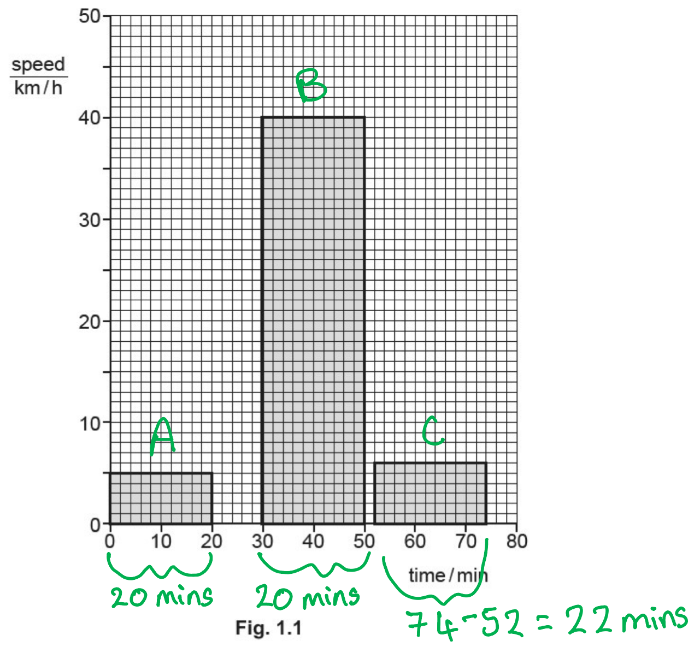

- Section (A) = 20 minutes
- Section (B) = 20 minutes
- Section (C) = 22 minutes

Convert the time from minutes to hours:

- This is because the speed is measured in km/h (not km/min)
- $1hour=60minutes$

  - $SectionsAandBare20minutes=\frac{20}{60}=\frac{1}{3}ofanhour$
  - $SectionCis22minutes=\frac{11}{30}ofanhour$

Calculate the area under each part of the graph:

Any **one **from:

- $areaundersectionA=5\times\frac{1}{3}=1.667km$ **[1 mark]**
- $areaundersectionB=40\times\frac{1}{3}=13.33km$ **[1 mark]**
- $areaundersectionC=6\times\frac{11}{30}=2.2km$ **[1 mark]**

- *No additional marks for further correct areas*

Calculate the total area under the graph:

- $totalarea=areaofsectionA+areaofsectionB+areaofsectionC$
- $totalarea=1.667+13.33+2.2$
- total area = 17 km **[1 mark]**

(ii) To calculate the average speed:

Convert the total time from minutes into hours:

- $totaltimeofjourney=74minutes=\frac{74}{60}=\frac{37}{30}hours$

Recall the equation to calculate the average speed:

- $averagespeed=\frac{totaldistance}{totaltime}$ **[1 mark]**

Calculate the average speed:

- $averagespeed=\frac{17}{\frac{37}{30}}=13.78=14km/h$ **[1 mark]**

**[Total: 5 marks]**

> *You can give the equation for distance in words or symbols and in any rearrangement to score 1 mark. *

> *Look carefully at the **units** on the axes of the graph. Time is measured in **minutes**. Don't try to convert to seconds, as the units for speed are km / h. Convert the time into **hours**.*
State the feature of a speed-time graph that shows acceleration:

- The gradient of a speed-time graph shows acceleration; **[1 mark]**

Explain the feature:

- Gradient equals acceleration which is the change in speed divided by change in time **[1 mark]**

**[Total: 2 marks]**

> *The gradient of a graph is found using *$\frac{\Deltay}{\Deltax}$*. In a speed-time graph this is equal to*$\frac{\Deltav}{\Deltat}$*which is also the equation for calculating acceleration.*
State the acceleration of the person at 40 minutes:

- There is no acceleration; **[1 mark]**

**   OR**

- Acceleration is zero / 0; **[1 mark]**

Explain the acceleration:

- The gradient of the graph is zero / 0; **[1 mark]**

**   OR **

- The speed of the person is constant; **[1 mark]**

**[Total: 2 marks]**

### Q27
Calculate the speed of the elevator:

List the known quantities:

- Height of each level, $h$ = 4.0 m
- Number of levels  = 3
- Time taken, $t$ = 5.0 s

Recall the speed equation:

- $v=\frac{s}{t}$ **[1 mark]**

Determine the total distance covered:

- $s=3\timesh=3\times4.0$
- $s=12m$ **[1 mark]**

Calculate the speed and give its units:

- $v=\frac{12}{5.0}$ **[1 mark]**
- $v=2.4$ **[1 mark]**

State the units:

- Units are m/s **OR** metres per second **[1 mark]**

**[Total: 5 marks]**

- *If you got this question wrong, you most likely did not spot that the elevator travels the distance of **three** levels*

  - *You could have missed **two** marks by not reading the question fully*
  - *You were also awarded a mark for giving the units - **always** go through a question and **underline** crucial information **before** you start*
Calculate the deceleration of the elevator:

List the known quantities:

- Time taken to stop, $t$ = 1.5 s
- Initial speed, $u$ = 2.4 m/s (from part **(a)**)

Determine the change in speed:

- Elevator comes to **rest** so the final speed = 0 m/s
- $Δv=v-u=0-2.4=-2.4m/s$ **[1 mark]**

Recall the equation for acceleration:

- $a=\frac{Δv}{Δt}$ **[1 mark]**

Calculate the deceleration:

- $a=\frac{-2.4}{1.5}$ **[1 mark]**
- $a=-1.6m/s^{2}$

State the deceleration:

- $\text{deceleration} = 1.6 ( \mathrm{m} \div \mathrm{s}^{2} )$ **[1 mark]**

**[Total: 4 marks]**

- *If your final answer had a negative sign, you may still have gained the marks*

  - *However, it is important to know the distinction between **acceleration** and **deceleration*
  - *They have opposite signs to one another, so if acceleration is −8.0 m/s**2** then deceleration is 8.0 m/s**2*
- *Change in speed =** final speed − initial speed**, not the other way round*

  - *The order is important, **swapping** initial and final speeds changes the **sign** of change in speed!*
(i) Calculate the gradient of the speed-time graph:

Recall how to calculate gradient:

- $\mathrm{gradient}=\frac{Δy}{Δx}$ **[1 mark]**

Calculate the gradient of the graph:

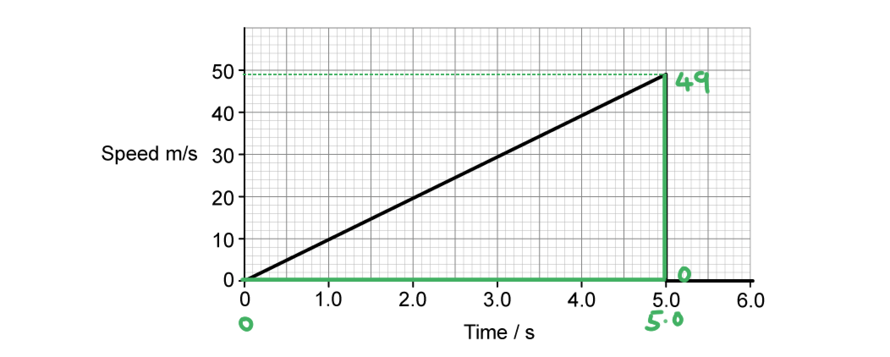

- $Δy=49-0=49$
- $Δx=5.0-0.0=5.0$
- $\mathrm{gradient}=\frac{49}{5.0}$ **[1 mark]**
- $\mathrm{gradient}=9.8m/s^{2}$ (range of 9.7 to 9.9 m/s2 accepted) **[1 mark]**

(ii) Explain how the gradient shows the elevator is in freefall:

- 9.8 m/s2 is the acceleration due to gravity; **[1 mark]**

**[Total: 4 marks]**

- *The simplest way to calculate this gradient was to use a triangle covering the **whole** diagonal line, giving the values shown in the mark scheme*

  - *It is important to notice that the line goes up to 49 m/s, not 50 m/s - differences likes this are crucial when reading data from a graph*
- *To answer part (ii) correctly, you must recognise that the value you calculated for **gradient** is **similar** or **identical** to the value of acceleration due to **free fall **/ gravity*

  - *This means the cable is no longer supporting the elevator, which is **falling** under the force of its own **weight** **only*
Describe the motion of the elevator after 5.0 s and explain how the graph shows this:

- The elevator is stationary; **[1 mark]**
- The speed of the elevator / the graph is zero (after 5.0 s); **[1 mark]**

**[Total: 2 marks]**

### Q28
To state the time taken between entering Station A and entering Station B:

Read the values from the stopwatches and convert them into seconds:

- 1 minute 22 seconds = 60 + 22 = 82 s
- 2 minutes 34 seconds = (2 × 60) + 34 = 154 s

Calculate the difference between the two times:

- 154 − 82 = 72 s **[1 mark]**

**[Total: 1 mark]**
To calculate the average speed of the train:

List the known quantities:

- Distance between the stations = 120 m
- Time taken = 54 s

Recall the equation linking average speed, distance and time:

- $averagespeed=\frac{distance}{time}$ **[1 mark]**

Substitute in known values:

- $averagespeed=\frac{120}{54}$ **[1 mark]**

Calculate average speed:

- Average speed = 2.2 m/s **[1 mark]**

**[Total: 3 marks]**
To determine the total distance travelled by the train on this part of the track:

Recall the feature of the graph which represents distance travelled:

- The area under the graph = the distance travelled; **[1 mark]**

Find the area of section A and section C:

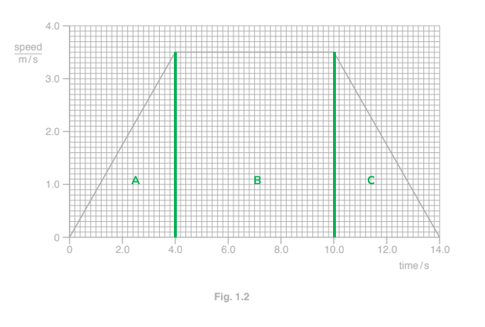

- Area A = ½ × base × height = ½ × 4.0 × 3.5
- Area C = ½ × base × height = ½ × 4.0 × 3.5

- Therefore Area A = 7.0 **AND*** *Area C = 7.0 **[1 mark]**

Find the area of section B :

- Area B =  base × height = 6.0 × 3.5 = 21.0 **[1 mark]**

Calculate total distance by combining the area of sections A, B and C:

- Distance = 7.0 + 21.0 + 7.0 = 35.0 m **[1 mark]**

**[Total: 4 marks]**

### Q29
(i) Determine the speed of the lorry at time t = 30 s:

Draw a gradient triangle on the graph:

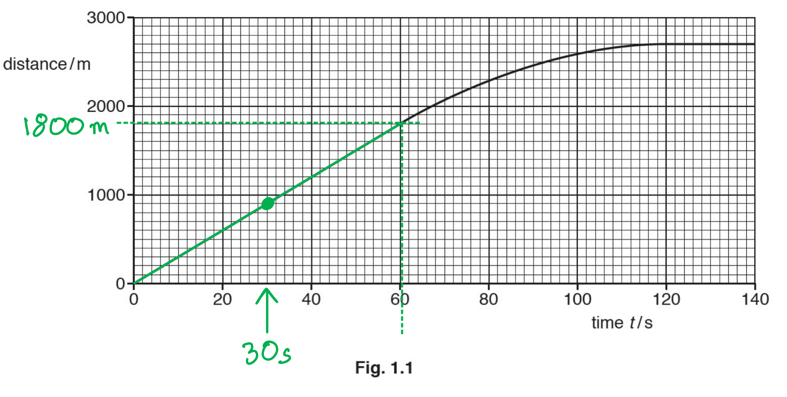

Obtain an expression for the gradient of the graph:

- $gradient=\frac{\Deltay}{\Deltax}=v=\frac{s}{t}$
- $v=\frac{1800}{60}$ **[1 mark]**

Calculate the speed, *v* of the lorry:

- *v *= 30 m/s **[1 mark]**

(ii) Determine the average speed of the lorry between t = 60 s and t = 120 s:

Draw a gradient triangle on the graph:

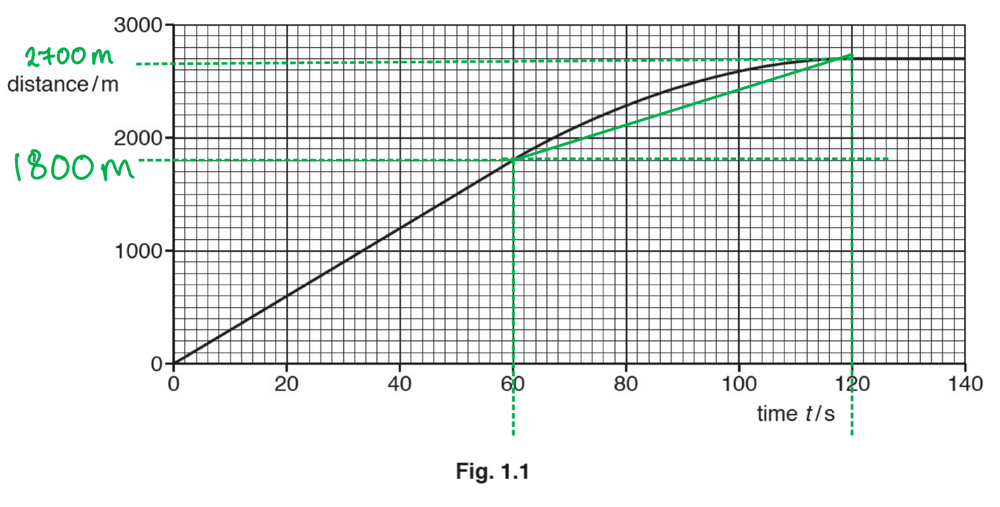

Obtain an expression for the gradient of the graph:

- $gradient=\frac{\Deltay}{\Deltax}=v=\frac{s}{t}$
- $v=\frac{2700-1800}{120-60}=\frac{900}{60}$ **[1 mark]**

Calculate the speed, *v* of the lorry:

- *v *= 15 m/s **[1 mark]**

**[Total: 4 marks]**

> *Drawing as much as you can on the graph makes it easier to calculate the gradient.*
(i) Determine the magnitude of the lorry's acceleration at t = 30 s:

Consider the gradient at t = 30 s:

- The gradient  is a straight line / is constant
- Therefore, acceleration = 0 m/s2 **[1 mark]**

(ii) Determine the forward force on the engine at t = 30s:

List the known quantities:

- Total resistive force acting on the lorry = 1.4 × 104 N

Consider the lorry's acceleration:

- Acceleration = 0 m/s2
- Hence, resultant force = 0 N
- So, forward force due to engine = total resistive force acting on lorry
- Forward force due to engine = 1.4 × 104 N **[1 mark]**

**[Total: 2 marks]**

> *Learn the different types of gradients represented on a distance-time graph. *
Describe the motion of the lorry between t = 60 s and t = 130 s:

Draw lines on the graph to analyse the gradient between t = 60 s and t = 130 s:

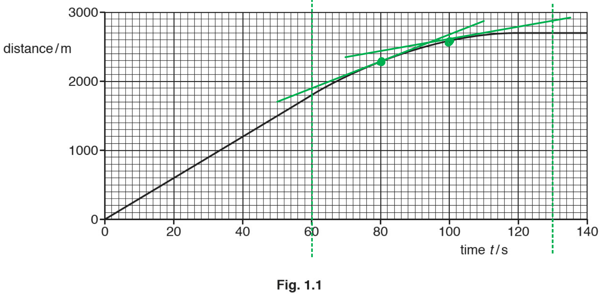

- From the tangents to the curve at t = 80 s and t = 100 s observe that the gradient of the graph is decreasing

Convert the changing gradient to a property of lorry speed:

- The speed / velocity of the lorry decreases **OR**** ** acceleration is negative **OR **deceleration; **[1 mark]**
- **To zero / stationary; [1 mark]**

**[Total: 2 marks]**

> *Draw tangents to the graph at several points, so the gradient change is clear.*

### Q30
(i) To tick the box that represents the cyclist travelling at constant speed:

`square` A

**✔** B; **[1 mark]**

`square` C

`square` D

(ii) To calculate the distance travelled by the cyclist in the first 5 seconds:

Identify the known quantities from the graph:

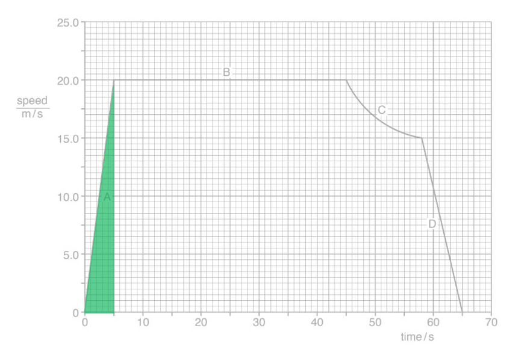

- Time, *t *= 5 s
- Speed = 20 m / s

Recall the equation to calculate distance under a speed-time graph:

- Distance = area under line **OR **½ × base × height **[1 mark]**

Substitute the known quantities into the equation:

- ½ × 5 × 20 **[1 mark]**

Calculate the distance travelled:

- 50 m **[1 mark]**

**[Total: 4 marks]**

> *It is essential that you can interpret and understand what both a speed-time and distance-time graph represent. You will often be asked to use the graph's information to calculate. Make sure you know where the information in this question has come from. *
(i) To calculate the average speed of this cyclist:

List the known quantities:

- Distance of one lap = 250 m
- Total time = 80 s

Calculate the total distance of 4 laps:

- 250 × 4 = 1000 m **[1 mark]**

Recall the equation to calculate average speed:

- $Averagespeed=\frac{totaldis\mathrm{tan}ce}{totaltime}$**[1 mark]**

Substitute the known quantities into the equation for average speed:

- $Averagespeed=\frac{1000}{80}$ **[1 mark]**

Calculate the average speed:

- Average speed = 12.5 m / s **[1 mark]**

(ii)

To calculate the time taken for the cyclist to go around the track during the second lap:

Time difference between the second and first lap:

- The difference is the time elapsed between the end of the first lap and the end of the second lap
- 43.88 − 20.16 = 23.72 s **[1 mark]**

**[Total: 5 marks]**

### Q31
Describe the motion of tractor B from a time of 0 s to 12 s:

- <u>Between 0 s and 5 s</u>, the tractor travels with <u>constant speed</u>; **[1 mark]**
- <u>Between 5 s and 9 s</u>, the tractor is <u>stationary</u>; **[1 mark]**
- <u>Between 9 s and 12 s</u>, the tractor is <u>accelerating</u>; **[1 mark]**

**[Total: 3 marks]**

- *You **must** state the time range for each different type of motion*

  - *This shows you know exactly **when** the tractor stops or starts moving*
- *Make sure you include the units when quoting values from a graph*
State which tractor has the greatest initial speed and explain how the graph shows this:

- Tractor A has the greatest initial speed; **[1 mark]**
- (The initial) gradient is steeper / bigger (for tractor A); **[1 mark]**

**[Total: 2 marks]**

- *You may have referred to specific values to gain the second marking point*

  - *For example: "in 1 s, tractor A travels 14 m whereas tractor B only travels 6 m in 1 s"*
  - *If you do this, there must be a **comparison** between values for A and B*
Calculate the initial speed of tractor B:

Recall how to calculate gradient:

- $\mathrm{gradient}=\frac{Δy}{Δx}$ **[1 mark]**

Calculate the gradient of the initial part of tractor B's graph:

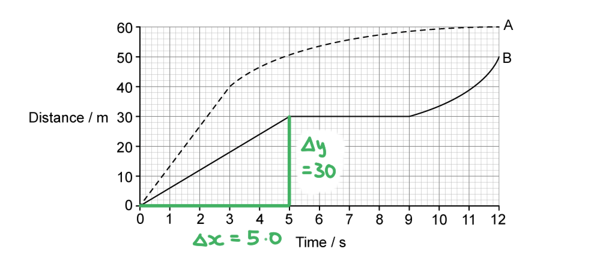

- $Δy=30-0=30$
- $Δx=5.0-0.0=5.0$
- $\mathrm{gradient}=\frac{30}{5.0}$ **[1 mark]**
- $\mathrm{gradient}=\mathrm{speed}=6.0m/s$ **[1 mark]**

**[Total: 3 marks]**
Describe the gradient of the distance-time graph of tractor A after 12 s and before landing:

- The gradient is <u>positive</u> **and** <u>increasing</u>; **[1 mark]**

**[Total: 1 mark]**

- *You need to spot that the tractor is **accelerating** here - this gives a graph shape which **curves** **upwards*

  - *A statement such as "the distance is increasing at an increasing rate" would also gain this marking point*
