# Exam Questions — Motion
**1. Motion, Forces & Energy** · Cambridge (CIE) IGCSE physics (0625 & 0972)
> Source: [https://www.savemyexams.com/igcse/physics/cie/23/topic-questions/](https://www.savemyexams.com/igcse/physics/cie/23/topic-questions/) · 58 questions across 2 sets

## Multiple Choice Questions (27 questions)

### Q1 — easy — 1 marks

**Q1** [1 mark]

A student carries out an experiment to find the average speed of a metal ball as it rolls down a slope.

Which pieces of equipment are needed?

### Q2 — medium — 1 marks

**Q2** [1 mark]

The diagram shows a speed–time graph for a car travelling along a straight road.

What is the distance travelled by the car while it is moving at constant speed?

### Q3 — medium — 1 marks

**Q3** [1 mark]

An object falls towards the surface of the Earth.

The object is falling at its terminal velocity.

Which statement is correct?

*Source: June2023 0972/21 Q2*

### Q4 — medium — 1 marks

**Q4** [1 mark]

The diagram shows a distance– time graph for an object moving in a straight line.

`equation`

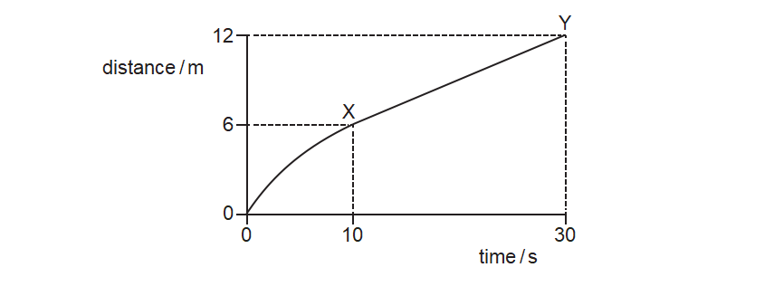

What is the average speed between X and Y?

*Source: June 2023 0972/11 Q3*

### Q5 — medium — 1 marks

**Q5** [1 mark]

The graph represents the motion of a vehicle.

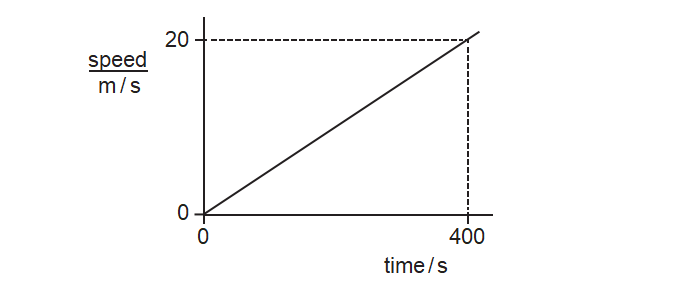

What is the distance travelled by the vehicle in 400 s?

*Source: June 2023 0972/11 Q2*

### Q6 — medium — 1 marks

**Q6** [1 mark]

**Extended Tier Only**

When does an object falling vertically through the air reach terminal velocity?

*Source: specimen 2023 paper 2 Q2*

### Q7 — medium — 1 marks

**Q7** [1 mark]

A man stands next to a railway track.

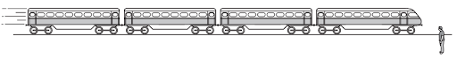

A train travelling at 40 m/s takes 2.0 s to pass the man.

What is the length of the train?

*Source: June 2022 paper 1 Q3*

### Q8 — medium — 1 marks

**Q8** [1 mark]

**Extended Tier Only**

An athlete runs a 100 m race in a straight line. The table shows how his speed changes with time for the first 5.0 s of the race.

| speed m/s | 0 | 1.7 | 4.1 | 5.7 | 6.5 | 6.8 |
|---|---|---|---|---|---|---|
| time/s | 0 | 1.0 | 2.0 | 3.0 | 4.0 | 5.0 |

What is the average acceleration of the athlete between time 2.0 s and time 3.0 s?

*Source: specimen 2023 paper 2 Q3*

### Q9 — medium — 1 marks

**Q9** [1 mark]

Two runners take part in a race.

The graph shows how the speed of each runner changes with time.** **

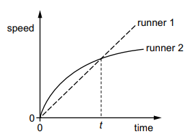

What does the graph show about the runners at time t?

*Source: specimen 2023 paper 1 Q4*

### Q10 — easy — 1 marks

**Q10** [1 mark]

The graph shows how the distance travelled by a vehicle changes with time.

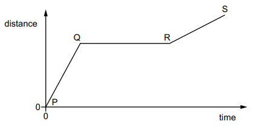

Which row describes the speed of the vehicle in each section of the graph?

|   | **P to Q** | **Q to R** | **R to S** |
|---|---|---|---|
| **A** | constant | zero | constant |
| **B** | constant | zero | decreasing |
| **C** | increasing | constant | decreasing |
| **D** | increasing | zero | constant |

*Source: 2023 specimen paper 1 Q2*

### Q11 — easy — 1 marks

**Q11** [1 mark]

The speed–time graph for a train is shown.

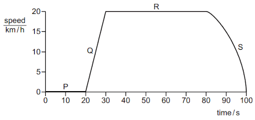

Which regions of the graph show the train moving**?**

*Source: June 2022 paper 1 Q2*

### Q12 — easy — 1 marks

**Q12** [1 mark]

**Extended Tier Only**

A speed–time graph is used to describe the motion of an object.

Which quantities are calculated from the gradient of the graph and from the area under the graph?

|   | **gradient of the graph** | **area under the graph** |
|---|---|---|
| **A** | acceleration | distance travelled |
| **B** | acceleration | total journey time |
| **C** | distance travelled | acceleration |
| **D** | total journey time | distance travelled |

*Source: June 2022 paper 2 Q3*

### Q13 — easy — 1 marks

**Q13** [1 mark]

In which section of the graph is the most distance covered?

### Q14 — easy — 1 marks

**Q14** [1 mark]

Which distance-time graph shows an object moving with constant speed?

### Q15 — easy — 1 marks

**Q15** [1 mark]

A BASE jumper, initially at rest, falls from the top of El Capitan in Yosemite National Park. Air resistance is **not** ignored.

Which graph represents their motion as they approach terminal velocity?

### Q16 — easy — 1 marks

**Q16** [1 mark]

What is the speed of a bowling ball which travels down a 30 m lane in 2.5 seconds?

### Q17 — easy — 1 marks

**Q17** [1 mark]

Which speed-time graph shows an object moving with a constant speed?

### Q18 — medium — 1 marks

**Q18** [1 mark]

Four speed-time graphs have axes with the same scales. Each large square has a height of 1 m/s and width of 1 s.

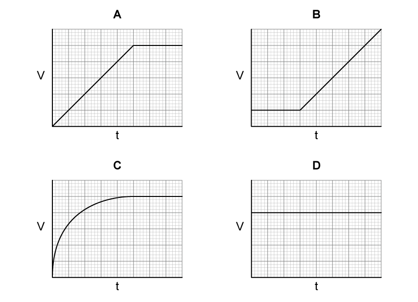

Which graph shows the greatest distance covered?

### Q19 — medium — 1 marks

**Q19** [1 mark]

**Extended tier only**

A charged particle is accelerated when passing through an electric field.

What is the acceleration of the particle at 0.4 s?

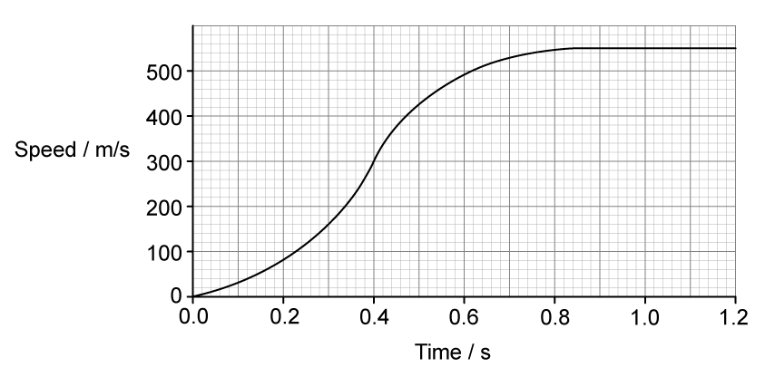

### Q20 — medium — 1 marks

**Q20** [1 mark]

A car travels along a clear 10.0 km section of motorway in 6.0 minutes. It then drives through 3.0 km of roadworks in 3.0 minutes.

Which calculation will give the correct average speed for the journey?

### Q21 — hard — 1 marks

**Q21** [1 mark]

A man claps in a forest. There is nobody around to hear the sound.

However, there is a very flat cliff face some distance away, and the man hears an echo from the clap 0.84 s later.

The speed of sound in air is 343 m/s.

How far away was the man from the cliff?

### Q22 — hard — 1 marks

**Q22** [1 mark]

**Extended tier only**

A cannonball is dropped from a three story building.

Which row of the table correctly describes both the speed and the acceleration of the cannonball as it falls?

You can ignore air resistance for this question.

| ** ** | **Speed** | **Acceleration** |
|---|---|---|
| **A** | constant | constant |
| **B** | increasing | constant |
| **C** | increasing | increasing |
| **D** | constant | increasing |

### Q23 — medium — 1 marks

**Q23** [1 mark]

During a Go Karting race, a car does 8 laps of a 300 m course. It takes 4.0 minutes to complete the race.

What was the average speed of the Go Kart?

### Q24 — hard — 1 marks

**Q24** [1 mark]

A helicopter flies the route shown below.

It stops at point I for 30 minutes to pick up some cargo.

The total time the helicopter takes between taking off from **H** and landing at **L** is 4.0 hours.

Calculate the average speed of the helicopter **when it is flying.**

### Q25 — medium — 1 marks

**Q25** [1 mark]

The graph shows the journey undertaken by a car.

Which equation correctly gives the distance travelled by the car?

### Q26 — hard — 1 marks

**Q26** [1 mark]

**Extended tier only**

The graph shows the speed-time graph of a cyclist moving in a straight line.

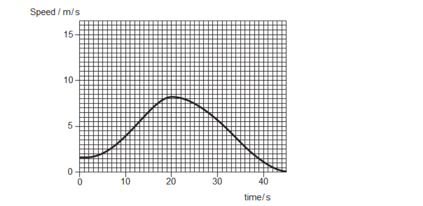

What is the acceleration of the cyclist at a time of 20 seconds?

### Q27 — hard — 1 marks

**Q27** [1 mark]

The graph shows the motion of a motorbike.

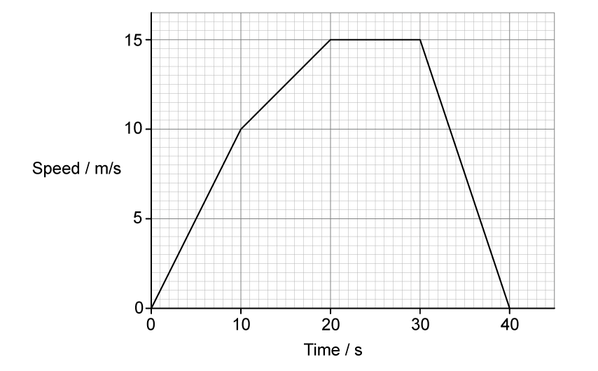

What is the distance travelled by the motorbike while it is moving at a constant speed?

## Theory Questions (31 questions)

### Q1 — hard — 4 marks

**Q1** [1 mark]

A cyclist starts from rest and accelerates along a straight, level road. The cyclist then travels at a constant speed before decelerating to a stop.

Fig. 1.1 shows the speed–time graph for the cyclist's journey.

**Fig. 1.1**

Define acceleration.

**Q1** [3 marks]

**Extract:**

A cyclist starts from rest and accelerates along a straight, level road. The cyclist then travels at a constant speed before decelerating to a stop.

Fig. 1.1 shows the speed–time graph for the cyclist's journey.

**Fig. 1.1**

Calculate the total distance travelled by the cyclist.

Show your working.

### Q2 — medium — 7 marks

**Q2** [7 marks]

A student investigates how the material of a surface affects the height to which a ball bounces.

The following apparatus is available to the student:

- a selection of balls of similar size
- a clamp, stand, and boss
- samples of different surface materials (e.g., wood, carpet, rubber, tile)

Plan an experiment to investigate how the surface material affects the bounce height of the ball.

In your plan:

- list any additional apparatus needed
- explain briefly how you would carry out the investigation
- state the key variables to keep constant
- draw a table, with column headings, to show how you would display your readings (you are **not** required to enter any readings in the table)
- explain how you would use your readings to reach a conclusion.

You may draw a diagram if it helps your explanation.

### Q3 — hard — 7 marks

**Q3** [3 marks]

**Extract:**

- Award the acceleration and constant-speed marks for correct motion descriptions even if the transition time is read as approximately 3.6 s instead of 4.0 s.
- Do not penalise transition times read within one small square (0.5 s) of the mark scheme value, provided the type of motion for each phase is correct.

Fig. 2.1 shows the speed-time graph for a car.

**Fig. 2.1**

Describe the motion of the car between 0 s and 20 s.

**Q3** [1 mark]

**Extract:**

Fig 2.1 shows the speed-time graph for a car.

**Fig 2.1**

State a method that could be used to calculate the distance travelled by the car between 4 s and 16 s.

**Q3** [3 marks]

**Extract:**

Fig 2.1 shows the speed-time graph for a car.

Graph showing speed versus time starting at time 5 m/s at t = 0. The graph curves upward to 15 m/s at t = 4 s, then is horizontal and flat to t = 10 s. The graph drops linearly to 0 m/s between t = 10 s and t = 16 s, then remains at 0 m/s for the remainder of the time.

Fig. 2.2 shows the car at a point during its motion.

**Fig. 2.2**

Draw arrows on Fig. 2.2 to show the horizontal forces acting on the car for the time interval between 4.0 s and 10.0 s.

Label your arrows with the name of the forces.

### Q4 — medium — 5 marks

**Q4** [5 marks]

**Extract:**

When marking this answer:

- If the total distance is incorrect (for example 24 km or 48 km), the substitution and value marks can still be awarded for correctly dividing that distance by the time
- Answers in other consistent units score full marks only when the unit matches the value, for example 72 km/h or 1.2 km/min
- The unit mark is not awarded for a unit that does not match the value given
- A correct answer of 20 m/s with no working scores full marks

A high-speed train travels along a straight track and passes four stations, A, B, C and D.

The distance between each pair of neighbouring stations is 12 km.

The train takes 30 minutes to travel from station A to station D.

Calculate the average speed of the train. State the unit of your answer.

### Q5 — easy — 2 marks

**Q5** [2 marks]

A cyclist is travelling along a straight road. Fig. 1.1 shows the speed–time graph for the cyclist. The graph is divided into four sections labelled P, Q, R and S.

The cyclist is moving north along the road.

Determine the velocity of the cyclist at time = 300 s. Include the unit.

velocity of cyclist =..........................................................

*Source: June 2023 0972/31 Q1C*

### Q6 — medium — 6 marks

**Q6** [3 marks]

A cyclist is travelling along a straight road. Fig. 1.1 shows the speed–time graph for the cyclist. The graph is divided into four sections labelled P, Q, R and S.

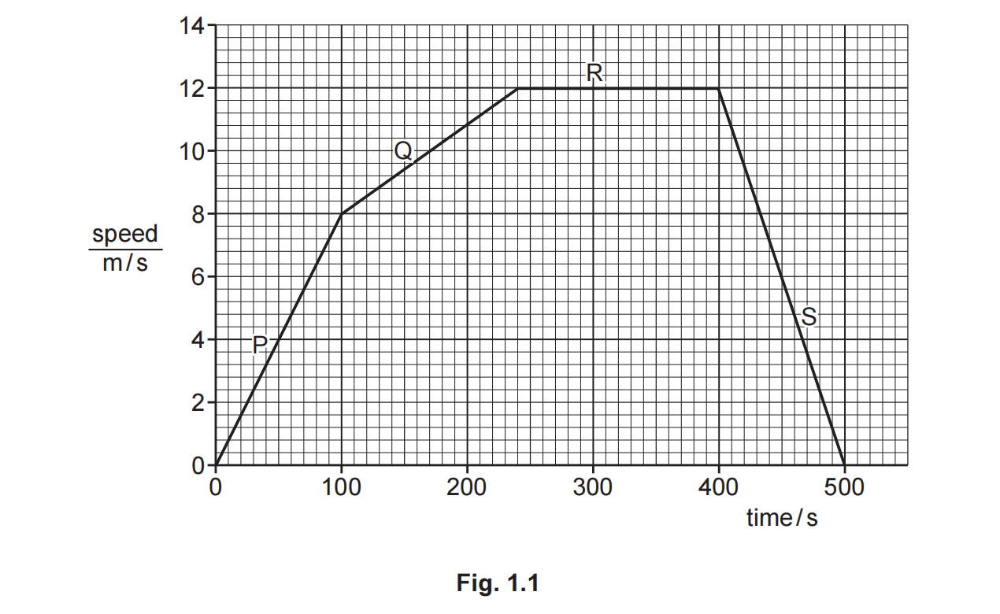

Calculate the distance travelled by the cyclist in section P from time = 0 to time = 100 s.

*Source: June 2023 0972/32 Q1A*

**Q6** [3 marks]

Describe the motion of the cyclist in each of sections Q, R and S shown in Fig. 1.1.

Q.............................................................................................................

R .............................................................................................................

S .............................................................................................................

*Source: June 2023 0972/31 Q1B*

### Q7 — medium — 9 marks

**Q7** [4 marks]

Fig. 2.1 shows the speed–time graphs for two cars, A and B.

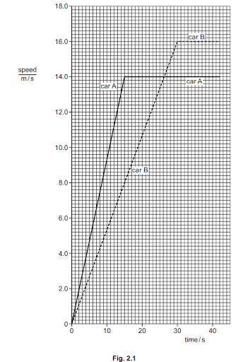

(i)** ** Determine the speed of car A at time = 10 s.

speed = ................................................. m/s [2]

(ii)** **State and explain which car, A or B, has the greater acceleration during the first 10 seconds. Use information from the graph in Fig. 2.1 in your explanation.

[2]

*Source: June 2022 paper 3 Q2A*

**Q7** [5 marks]

**Extract:**

Fig. 2.1 shows the speed–time graphs for two cars, A and B.

(i) Describe the motion of car B after 30 s.
(ii) Calculate the distance moved by car B from time = 0 to time = 30.0 s.

The distance travelled is equal to the area under the speed-time graph. Distance = area of a triangle = ½ × base × height. Distance = ½ × 30 × 16. Distance = 240 m.

(i) Describe the motion of car B after 30 s.

[2]

(ii) Calculate the distance moved by car B from time = 0 to time = 30.0 s.

distance = ..................................................... m  [3]

*Source: june 2022 paper 3 Q2B*

### Q8 — medium — 3 marks

**Q8** [2 marks]

**Extended Tier Only**

A car of mass m is travelling along a straight, horizontal road at a constant speed v.

At time t = 0, the driver of the car sees an obstruction in the road ahead of the car and applies the brakes.

The car does **not **begin to decelerate at t = 0.

Explain what is meant by deceleration

*Source: June 2022 paper 4 Q1A*

**Q8** [1 mark]

**Extract:**

A car of mass m is travelling along a straight, horizontal road at a constant speed v.

At time t = 0, the driver of the car sees an obstruction in the road ahead of the car and applies the brakes. 

The car does **not **begin to decelerate at t = 0.

**Extended Tier Only**

Suggest **one **reason why the car does **not** begin to decelerate at t = 0

*Source: June 2022 paper 4 Q1B*

### Q9 — hard — 8 marks

**Q9** [5 marks]

Fig. 1.1 shows a speed-time graph for a student who is running.

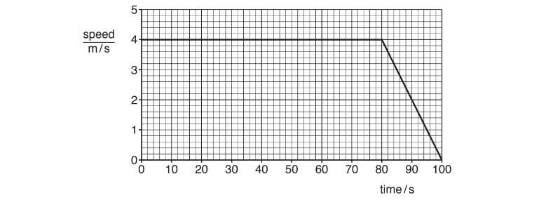

**Fig. 1.1**

(i) Describe the movement of the student, as shown in Fig. 1.1.

[2]

(ii) Calculate the distance travelled by the student between 80s and 100s.

distance travelled = .......................................................m [3]

*Source: 2018 0625/31 Q1A*

**Q9** [3 marks]

An athlete runs 630 m in 130 s on a flat section of a road and then 254 m in 40 s on a downhill slope.

Calculate the average speed for the total distance run by the athlete.

average speed = ...................................................m/s

*Source: Nov 2018 (S1) 0625/31 Q1B*

### Q10 — hard — 8 marks

**Q10** [1 mark]

**Extended tier only**

A rocket is stationary on the launchpad. At time *t* = 0, the rocket engines are switched on, and exhaust gases are ejected from the nozzles of the engines. The rocket accelerates upward.

Fig. 1.1 shows how the acceleration of the rocket varies between time *t* = 0 and time *t* = *t*f.

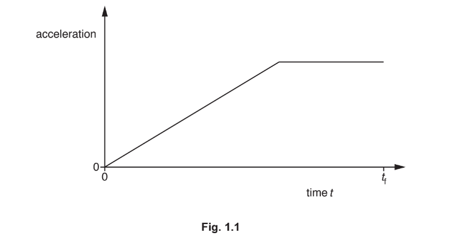

Define *acceleration*.

*Source: 2019 May/June 0972/41 Q1A*

**Q10** [3 marks]

**Extract:**

A rocket is stationary on the launchpad. At time t = 0, the rocket engines are switched on, and exhaust gases are ejected from the nozzles of the engines. The rocket accelerates upward. Fig. 1.1 shows how the acceleration of the rocket varies between time t = 0 and time t = t_f.

On Fig. 1.2, sketch a graph to show how the speed of the rocket varies between time *t* = 0 and time *t *= *t*f.

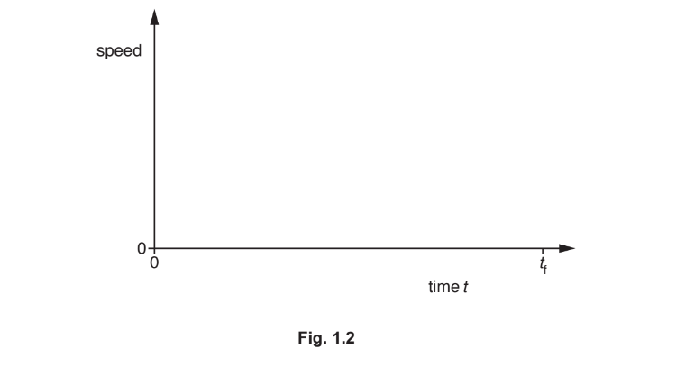

*Source: 2019 May/June 0972/41 Q1B*

**Q10** [4 marks]

**Extended tier only**

A rocket is now far from the Earth. The effect of the Earth’s gravity on the motion of the rocket is insignificant. As the rocket accelerates, its momentum increases.

(i) State the principle of the conservation of momentum.

[2]

(ii) Explain how the principle of the conservation of momentum applies to the accelerating rocket and the exhaust gases.

[2]

*Source: 2019 May/June 0972/41 Q1C*

### Q11 — hard — 8 marks

**Q11** [5 marks]

Fig. 2.1 shows students getting onto a school bus.

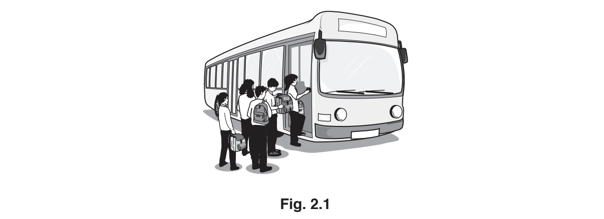

A student describes part of the journey.

The bus accelerates from rest at a constant rate for 10 s. It reaches a maximum speed of 10 m/s.

The bus maintains a constant speed of 10 m/s for 60 s.

The bus then decelerates at a constant rate for 15 s, until it stops.

On Fig. 2.2, draw the speed-time graph for this part of the journey made by the bus.

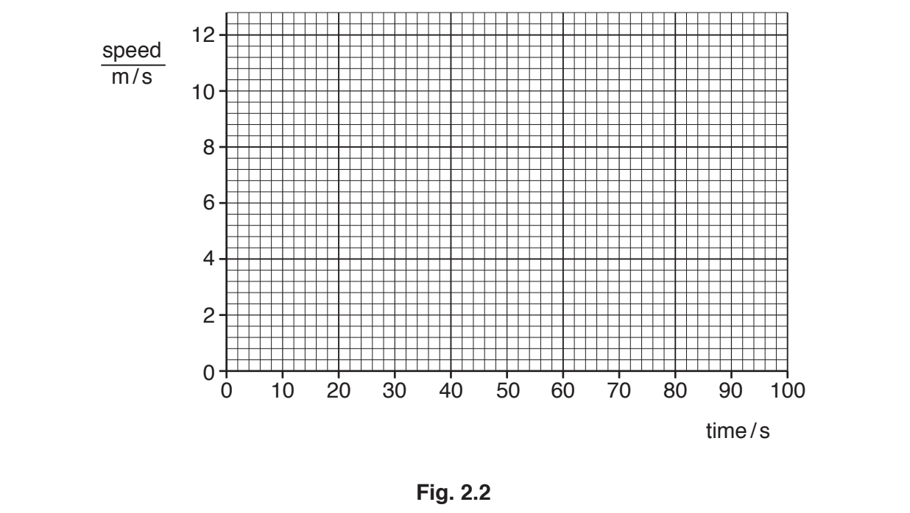

*Source: 2019 0625/32 Q2A*

**Q11** [3 marks]

**Extract:**

Fig. 2.1 shows students getting onto a school bus.

A student describes part of the journey.

The bus accelerates from rest at a constant rate for 10 s. It reaches a maximum speed of 10 m/s.

The bus maintains a constant speed of 10 m/s for 60 s.

The bus then decelerates at a constant rate for 15 s, until it stops.

On another part of the journey, the average speed of the bus is 7.5 m/s.

Calculate the distance the bus travels in 150 s.

distance = ..................................................... m

*Source: 2019 0625/32 Q2B*

### Q12 — hard — 9 marks

**Q12** [3 marks]

A student drops a ball from a high window.

The mass of the ball is 0.12 kg.

Calculate the weight of the ball.

weight = .................................................... N

*Source: 2020 Feb/March 0625/32 Q3A*

**Q12** [2 marks]

Fig. 3.1 shows the speed of the ball while it is falling. The points S, T, U, V and W are shown on the graph.

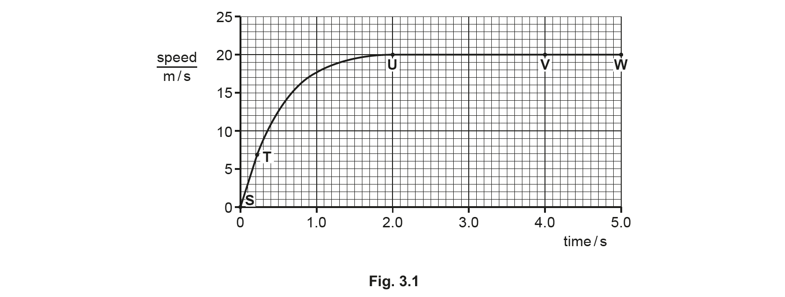

Draw one line from each section of the graph to the correct description of the motion.

One has been drawn for you.

*Source: 2020 Feb/March 0625/32 Q4B*

**Q12** [3 marks]

**Extract:**

To determine the distance fallen by the ball, find the area under the graph:

- Clear attempt to find area under graph; [1 mark]
- (Distance =) 40 (m); [1 mark]

For the first mark here you are just showing the examiner that you know the distance is the area under the line. You can demonstrate this by writing a calculation of the area, or by adding notes to the graph as shown here. They will accept either for this 'method mark', even if your answer is wrong!

Questions like this one prove how important it is to show your working.

Determine the distance fallen by the ball in section U – V of the graph.

distance = .................................................... m

*Source: 2020 Feb/March 0625/32 Q3C*

**Q12** [1 mark]

**Extract:**

To determine the distance fallen by the ball, find the area under the graph:
- (Distance =) 40 (m); [1 mark]

State the distance fallen by the ball in section V – W of the graph.

distance = .................................................... m

*Source: 2020 Feb/March 0625/32 Q3D*

### Q13 — hard — 8 marks

**Q13** [2 marks]

**Extended tier only**

A rocket is launched vertically upwards from the ground. The rocket travels with uniform acceleration from rest. After 8.0 s, the speed of the rocket is 120 m/s.

Calculate the acceleration of the rocket.

acceleration = ........................................................ m/s2

*Source: 2020 Feb/March 0625/42 Q1A*

**Q13** [6 marks]

**Extract:**

A rocket is launched vertically upwards from the ground. The rocket travels with uniform acceleration from rest. After 8.0 s, the speed of the rocket is 120 m/s.

- Initial velocity, u = 0 m/s
- Final velocity, v = 120 m/s
- Time, t = 8.0 s

(i) On Fig. 1.1, draw the graph for the motion of the rocket in the first 8.0 s.

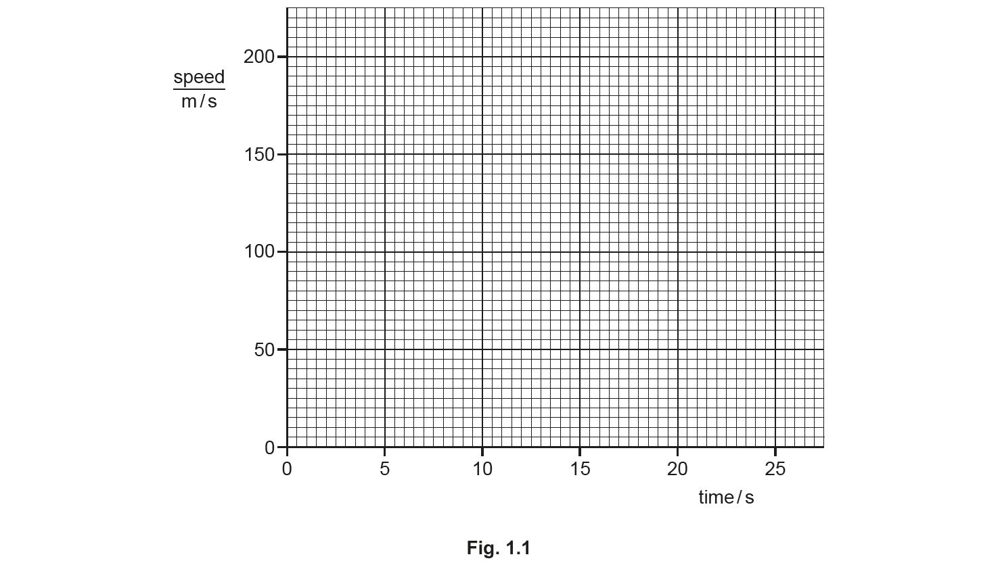

[1]

(ii) Use the graph to determine the height of the rocket at 8.0 s.

height = .....................................................  [2]

(iii) From time = 8.0 s to time = 20.0 s, the rocket rises with increasing speed but with decreasing acceleration.

From time = 20.0 s to time = 25.0 s, the rocket has a constant speed of less than 200 m / s.

On Fig. 1.1, draw the graph for this motion.

[3]

*Source: 2020 Feb/March 0625/42 Q1B*

### Q14 — hard — 11 marks

**Q14** [2 marks]

A student watches a car race around a track. He uses a stopwatch to measure the time for the car to make one lap of the track.

The student forgets to reset the stopwatch at the start of the race. Fig. 1.1 shows the time on the stopwatch at the start and the time after going around the track once.

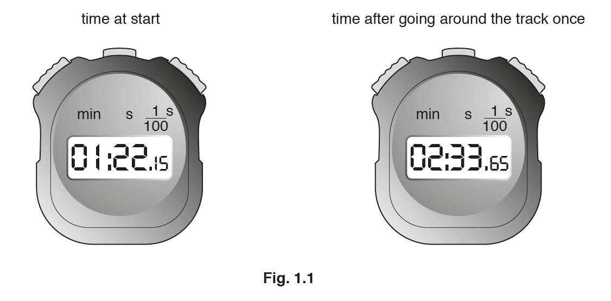

Calculate the time the car takes to go around the track once, in seconds.

time = ....................................................... s

*Source: 2018 0625/33 Q1A*

**Q14** [4 marks]

**Extract:**

A student watches a car race around a track. He uses a stopwatch to measure the time for the car to make one lap of the track.

The student forgets to reset the stopwatch at the start of the race. Fig. 1.1 shows the time on the stopwatch at the start and the time after going around the track once.

The length of the track is 4.0 km. The car goes around the track 20 times. The car takes 26 minutes and 40 seconds to complete the 20 laps.

Calculate the average speed of the car in m / s.

average speed = .................................................. m / s

*Source: 2018 0625/33 Q1B*

**Q14** [5 marks]

Fig. 1.2 shows a speed-time graph for the car during part of the race.

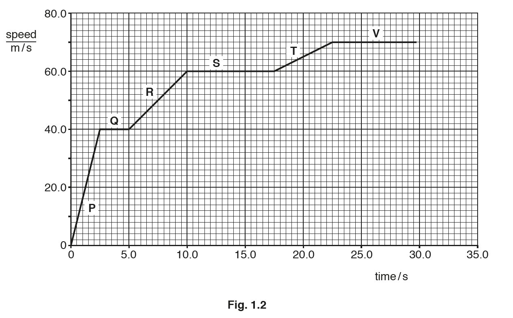

(i) State the section of the graph that shows the greatest acceleration.

...........................................................................................................................................

Explain your answer.

...........................................................................................................................................

[2]

(ii) Calculate the distance travelled by the car during the first 2.5 seconds.

distance = ...................................................... m [3]

*Source: 2018 0625/33 Q1C*

### Q15 — hard — 9 marks

**Q15** [4 marks]

**Extended tier only**

Fig. 1.1 shows the axes of a distance-time graph for an object moving in a straight line.

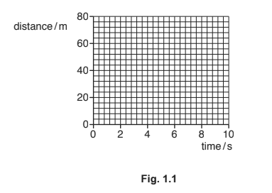

(i) On Fig. 1.1, draw between time = 0 and time = 10 s, the graph for an object moving with a constant speed of 5.0 m/s. Start your graph at distance = 0 m.

State the property of the graph that represents speed.

[2]

(ii) Between time = 10 s and time = 20 s the object accelerates. The speed at time = 20 s is 9.0 m/s.

Calculate the average acceleration between time = 10 s and time = 20 s.

acceleration = ...........................................................[2]

*Source: 2018 0625/42 Q1A*

**Q15** [5 marks]

Fig. 1.2 shows the axes of a speed-time graph for a different object.

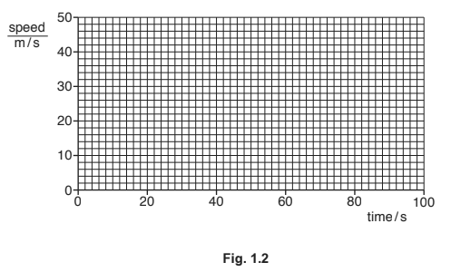

(i) The object has an initial speed of 50 m/s and decelerates uniformly at 0.35 m/s2 for 100 s.

On Fig. 1.2, draw the graph to represent the motion of the object.

[2]

(ii) Calculate the distance travelled by the object from time = 0 to time = 100 s.

distance = ...........................................................[3]

*Source: 2018 0625/42 Q1B*

### Q16 — hard — 8 marks

**Q16** [2 marks]

**Extended tier only**

Fig. 1.1 shows the speed-time graph for a vehicle accelerating from rest.

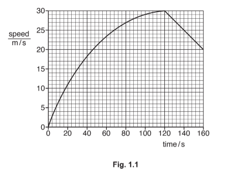

Calculate the acceleration of the vehicle at time = 30s.

acceleration = ...........................................................

*Source: 2018 0625/41 Q1A*

**Q16** [3 marks]

**Extended tier only**

Without further calculation, state how the acceleration at time = 100 s compares to the acceleration at time = 10 s. Suggest, in terms of force, a reason why any change has taken place.

*Source: 2018 0625/41 Q1B*

**Q16** [3 marks]

**Extract:**

To determine the distance travelled by the vehicle between 120 and 160 s:

Recognise the part of the graph that represents distance travelled:

- The area under the graph represents the distance travelled; [1 mark]

Calculate the area under the graph:

- area A = 1/2 × base × height = 1/2 × 40 × 10 = 200

AND  

- area B = base × height = 40 × 20 = 800 [1 mark]

Calculate total area:

- total area = area A + area B = 200 + 800 = 1000
- Therefore distance travelled = 1000 m [1 mark]

Take care that you may need to add together multiple sections of a graph to find the total area.

Determine the distance travelled by the vehicle between time = 120 s and time = 160 s.

distance = ...........................................................

*Source: 2018 0625/41 Q1C*

### Q17 — hard — 7 marks

**Q17** [1 mark]

**Extended tier only**

Define acceleration.

*Source: May/June 2020 (Series 3) 0625/43 Q1A*

**Q17** [6 marks]

Fig. 1.1 shows two speed–time graphs, A and B, and two distance–time graphs, C and D.

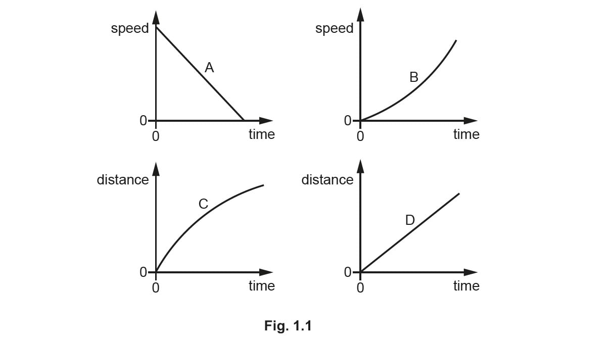

Describe the motion shown by:

(i) graph A

[2]

(ii) graph B

[2]

(iii) graph C

[1]

(iv) graph D

[1]

*Source: May/June 2020 (Series 3) 0625/43 Q1B*

### Q18 — hard — 8 marks

**Q18** [5 marks]

**Extended tier only**

A train of mass 5.6 × 105 kg is at rest in a station.

At time *t* = 0 s, a resultant force acts on the train and it starts to accelerate forward.

Fig. 1.1 is the distance-time graph for the train for the first 120 s.

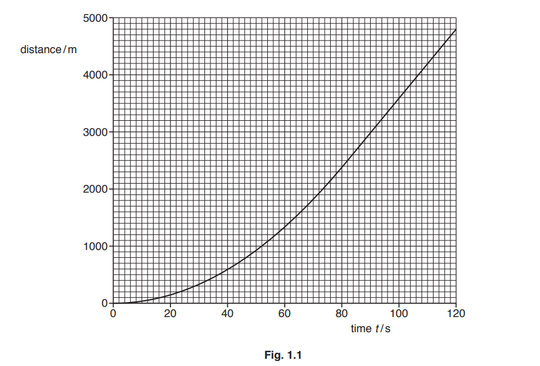

(i) Use** **Fig. 1.1 to determine:

1. the average speed of the train during the 120 s

average speed = ...........................................................[1]

2. the speed of the train at time *t* = 100 s.

speed = ...........................................................[2]

(ii) Describe how the acceleration of the train at time *t* = 100 s differs from the acceleration at time *t* = 20 s.

[2]

*Source: 2018 (Series 1) 0625/41 Q1A*

**Q18** [3 marks]

**Extract:**

A train of mass 5.6 × 10^5 kg is at rest in a station.

**Extended tier only**

(i) The initial acceleration of the train is 0.75 m/s2.

Calculate the resultant force that acts on the train at this time.

resultant force = ...........................................................[2]

(ii) At time *t* = 120 s, the train begins to decelerate.

State what is meant by deceleration.

[1]

*Source: 2018 (Series 1) 0625/41 Q1B*

### Q19 — medium — 11 marks

**Q19** [3 marks]

A student reviews some data about athletes and footballers.

An athlete runs 12 km in 1.5 hours.

Calculate the athlete’s average speed in km/h.

average speed = ...................................................... km/h

*Source: Oct 2019 0625/33 Q2A*

**Q19** [5 marks]

Fig. 2.1 shows the speed-time graph for a footballer for the first 15.0 seconds of a game.

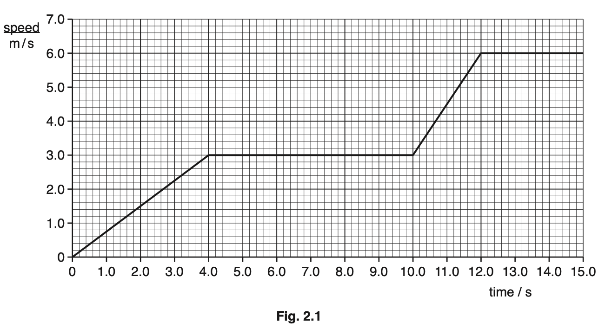

(i) Use the graph in Fig. 2.1 to calculate the distance travelled by the footballer during the first 4.0 seconds.

distance = ...................................................... m [3]

(ii) Use the graph in Fig. 2.1 to determine when the footballer is moving with greatest acceleration.

Between .............................. s and .............................. s.

Give a reason for your answer.

[2]

*Source: Oct 2019 0625/33 Q2B*

**Q19** [3 marks]

Another footballer has a mass of 72kg.

Calculate the weight of this footballer.

weight = ...................................................... N

*Source: Oct 2019 0625/33 Q2C*

### Q20 — medium — 8 marks

**Q20** [1 mark]

**Extended tier only**

Define acceleration.

*Source: February/March 2018 0625/42 Q1A*

**Q20** [7 marks]

**Extended tier only**

Fig. 1.1 shows the speed-time axes for the graph of the motion of a car.

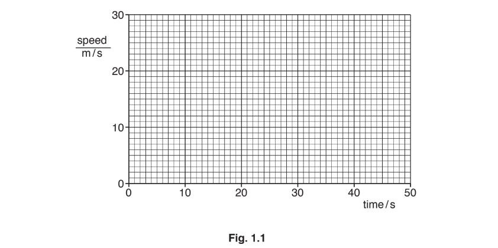

(i) The car starts from rest.

From time = 0 to time = 15 s, the car has a constant acceleration to a speed of 28 m/s.

From time = 15 s to time = 32 s, the car has a constant speed of 28 m/s.

From time = 32 s, the car has a constant deceleration of 2.0 m/s2 until it comes to rest.

On Fig. 1.1, draw the graph, using the space below for any calculations.

[5]

(ii) From time = 15 s to time = 32 s, the path of the car is part of a circle.

For this motion, state

1. the direction of the resultant force on the car,

2. what happens to the velocity of the car.

[2]

*Source: February/March 2018 0625/42 Q1B*

### Q21 — easy — 8 marks

**Q21** [2 marks]

During a training flight, a fighter jet travelling at 300 m/s makes a turn to avoid bad weather.

**Fig. 1.1**

** **Compare the speed and velocity between points A and B in Fig. 1.1.

**Q21** [1 mark]

The speed-time graph of a different test flight is presented to an analyst.

State how she uses the graph to determine the distance travelled during the test flight.

**Q21** [3 marks]

**Extract:**

The speed-time graph for the initial part of the fighter jet's test flight is shown in Fig 1.2:

(i) State the length of time for which the jet is travelling at constant speed.

Speed is constant between 200 s and 40 s
(The jet is travelling at a constant speed for 200 – 40 =) 160 s

(ii) Calculate the distance covered by the jet during this time.

rectangle area = height × width
distance = 350 × 160
distance = 56 000 m

The speed-time graph for the initial part of the fighter jet's test flight is shown in Fig 1.2:

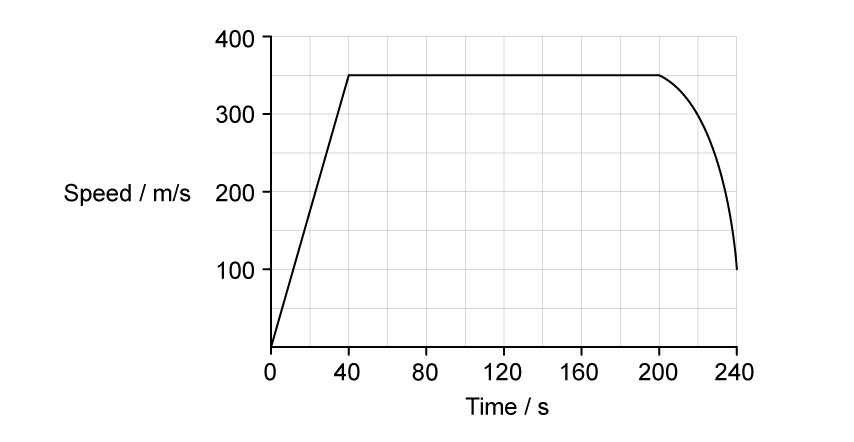

**Fig. 1.2**

(i) State the length of time for which the jet is travelling at constant speed.

[1]

(ii) Calculate the distance covered by the jet during this time.

[2]

**Q21** [2 marks]

**Extended tier only**

For a brief time, the engine cuts out and the jet is in free fall.

Describe the shape and the gradient of the speed-time graph during this time.

### Q22 — easy — 7 marks

**Q22** [3 marks]

Fig. 1.1 shows the speed-time graph for a car.

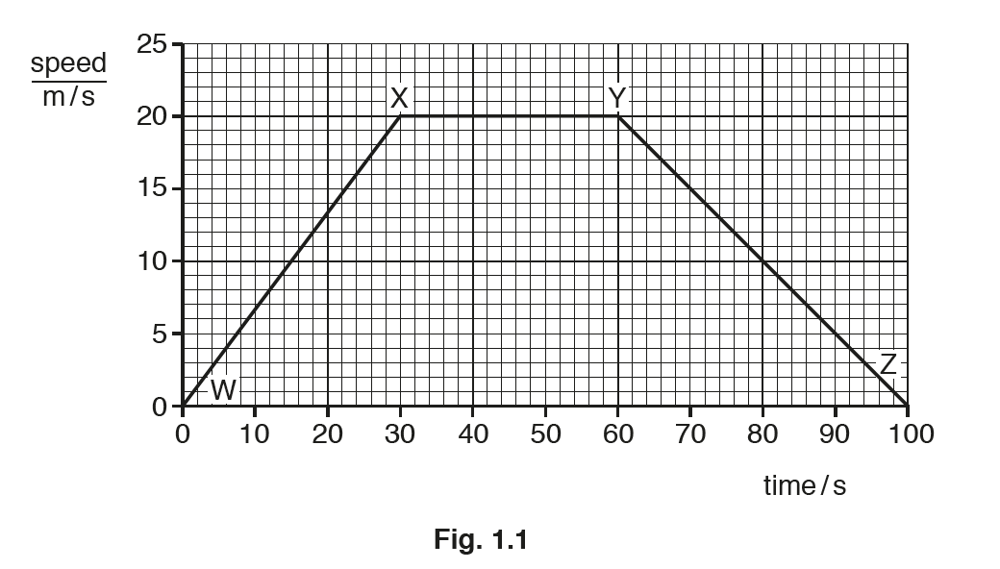

On Fig. 1.1, the labels W, X, Y and Z show the points when the car’s motion changed.

On Fig. 1.2, draw a line from each section of the graph to the correct description of the motion.

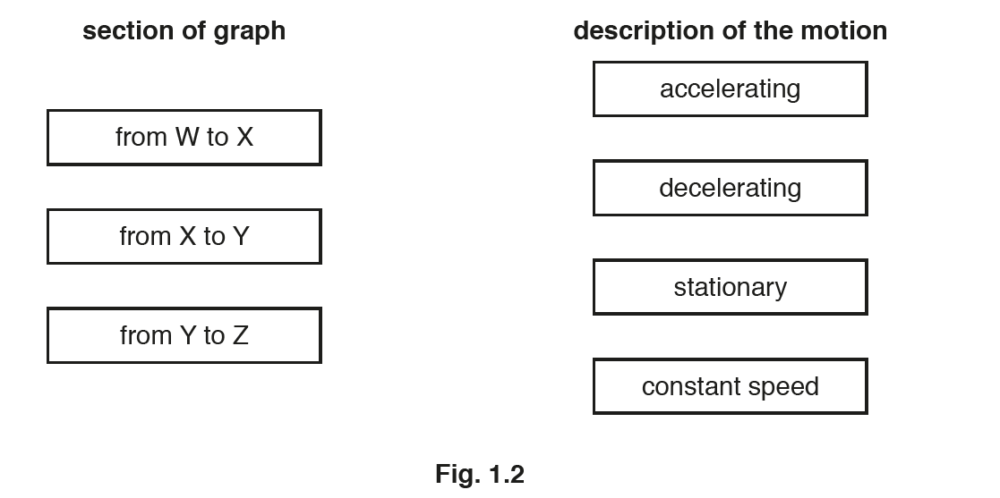

*Source: 2018 0625/32 Q1A*

**Q22** [3 marks]

**Extract:**

Fig. 1.1 shows the speed-time graph for a car.

The horizontal axis is labelled time/s and the vertical axis is labelled speed/m/s. The graph shows a section between 30 s and 60 s where the speed is constant at 20 m/s.

Calculate the distance that the car travels between 30 s and 60 s.

distance travelled = ...................................................... m

*Source: 2018 0625/32 Q1B*

**Q22** [1 mark]

**Extract:**

Fig. 1.1 shows the speed-time graph for a car. On Fig. 1.1, the labels W, X, Y and Z show the points when the car's motion changed.

State, using Fig. 1.1, whether the acceleration or deceleration of the car is greater.

*Source: 2018 0625/32 Q1C*

### Q23 — medium — 8 marks

**Q23** [4 marks]

Fig. 1.1 shows a water tank that is leaking. Drops of water fall from the tank at a constant rate.

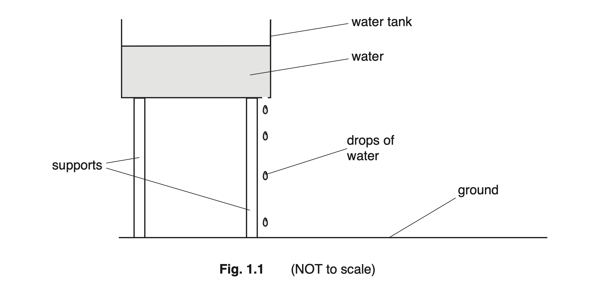

A student uses a stopwatch to determine the time between two drops hitting the ground.

He sets the stopwatch to zero. He starts the stopwatch when the first drop hits the ground.

He stops the stopwatch after a further 30 drops have hit the ground.

The reading on the stopwatch is recorded and shown in Fig. 1.2.

(i) State the time taken for 30 drops to hit the ground.

time = ...................................................... s [1]

(ii) Calculate the average time between two drops hitting the ground.

time = ...................................................... s [2]

(iii) Explain why the student measures the time for 30 drops to hit the ground instead of measuring the time for one drop to hit the ground.

[1]

*Source: Oct 2019 0625/32 Q1*

**Q23** [1 mark]

**Extract:**

Fig. 1.1 shows a water tank that is leaking. Drops of water fall from the tank at a constant rate.

**Extended tier only**

Fig. 1.1 shows that the drops get further apart as they get close to the ground.

State why the drops get further apart.

*Source: Oct 2019 0625/32 Q1B*

**Q23** [3 marks]

**Extract:**

Fig. 1.1 shows a water tank that is leaking. Drops of water fall from the tank at a constant rate.

A student uses a stopwatch to determine the time between two drops hitting the ground.

He sets the stopwatch to zero. He starts the stopwatch when the first drop hits the ground.

He stops the stopwatch after a further 30 drops have hit the ground.

The reading on the stopwatch is recorded and shown in Fig. 1.2.

In another experiment the student determines the speed of a falling weight at different times. The speed–time graph for his results is shown in Fig. 1.3.

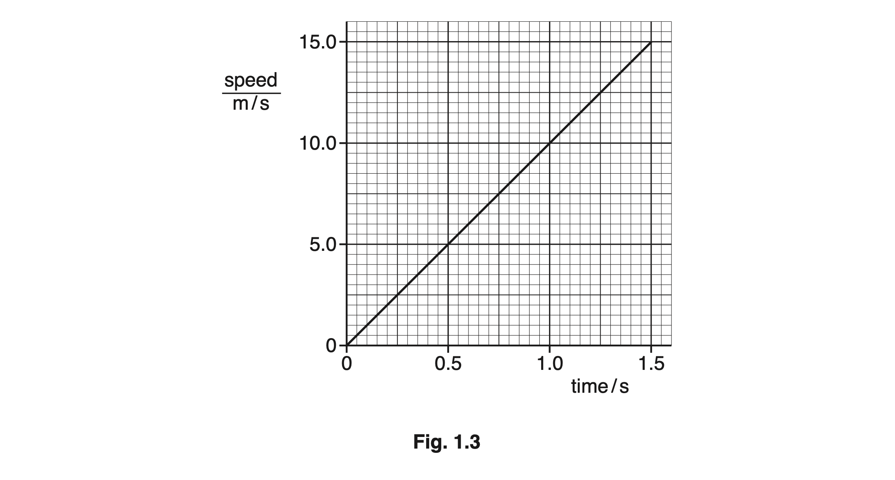

Calculate the distance fallen by the weight in the first 1.5 s.

distance = ...................................................... m

*Source: Oct 2019 0625/32 Q1C*

### Q24 — medium — 6 marks

**Q24** [2 marks]

A person on roller skates makes a journey. Fig. 1.1 shows the speed-time graph for the journey.

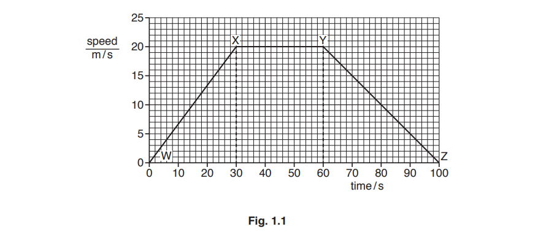

The graph shows three types of motion.

Complete the table to show when each type of motion occurs. Use the letters shown on Fig. 1.1. Add a letter to each of the blank spaces. The first row is done for you.

| **motion** | **start of motion** | **end of motion** |
|---|---|---|
| acceleration | W | X |
| deceleration |   |   |
| constant speed |   |   |

*Source: 2018 (Series 2) 0625/32 Q1A*

**Q24** [3 marks]

**Extract:**

The distance travelled is the area under the graph; 
A = 1/2 × (100 − 60) × (20 − 0)
A = 1/2 × 40 × 20
Area = 400 m

Calculate the distance travelled between 60 s and 100 s.

distance = ..................................................... m

*Source: 2018 (Series 2) 0625/32 Q1B*

**Q24** [1 mark]

**Extract:**

A person on roller skates makes a journey. Fig. 1.1 shows the speed-time graph for the journey. The graph shows three types of motion. | motion | start of motion | end of motion | | acceleration | W | X | | deceleration | Y | Z | | constant speed | X | Y |

The size of the acceleration is greater than the deceleration.

Describe how Fig. 1.1 shows this.

*Source: 2018 (Series 2) 0625/32 Q1C*

### Q25 — easy — 9 marks

**Q25** [3 marks]

During part of a race, a skier travels a distance of 200 m in a time of 6.4 s.

Calculate the average speed of the skier.

average speed = ................................................ m/s

*Source: 2020 0625/31 Q4A*

**Q25** [4 marks]

**Extract:**

- At P accept "speed is increasing" or "speeding up"; at R accept "speed is decreasing" or "slowing down" for the mark.
- Do not accept "decreasing acceleration" or "non-uniform/decreasing in acceleration" for "decelerates" at R.

Fig. 4.1 shows a speed–time graph for the skier in another part of the race.

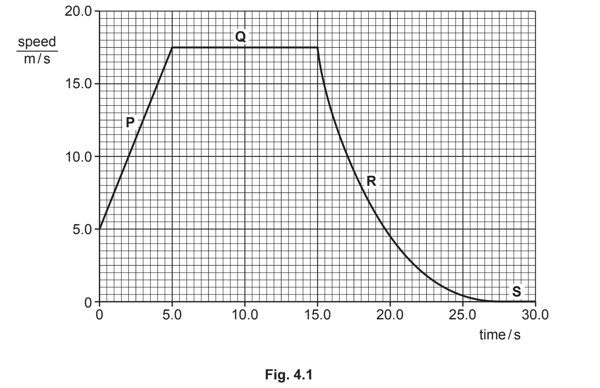

Describe the motion of the skier at each point **P**, **Q**, **R **and **S **on the graph.

*Source: 2020 0625/31 Q4B*

**Q25** [2 marks]

Skis are strapped to a skier’s feet and are longer and wider than the skier’s feet.

Explain how the skis prevent the skier from sinking into soft snow.

*Source: 2020 0625/31 Q4C*

### Q26 — medium — 9 marks

**Q26** [5 marks]

Fig. 1.1 shows the speed–time graph of a person on a journey.

On the journey, he walks and then waits for a bus. He then travels by bus. He gets off the bus and waits for two minutes. He then walks again. His journey takes 74 minutes.

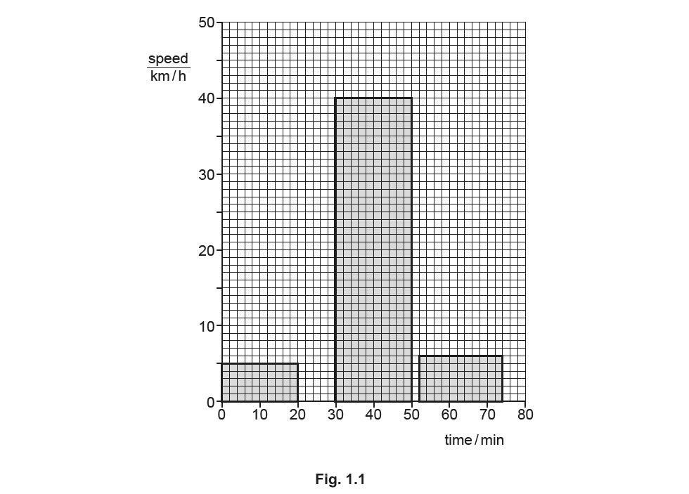

For the whole journey calculate:

(i) the distance travelled

distance = ......................................................... [3]

(ii) the average speed.

average speed = ......................................................... [2]

*Source: May/June 2020 (Series 2) 0625/42 Q1A*

**Q26** [2 marks]

**Extended tier only**

State and explain which feature of a speed–time graph shows acceleration.

*Source: May/June 2020 (Series 2) 0625/42 Q1B*

**Q26** [2 marks]

**Extract:**

Fig. 1.1 shows the speed–time graph of a person on a journey.

On the journey, he walks and then waits for a bus. He then travels by bus. He gets off the bus and waits for two minutes. He then walks again. His journey takes 74 minutes.

**Extended tier only**

State and explain the acceleration of the person at time = 40 minutes.

*Source: May/June 2020 (Series 2) 0625/42 Q1B*

### Q27 — easy — 14 marks

**Q27** [5 marks]

An elevator in the Empire State Building is travelling at constant speed downward as it passes three levels.

This takes 5.0 seconds and each level has a height of 4.0 m. Calculate the speed of the elevator. State the correct units in your answer.

**Q27** [3 marks]

**Extract:**

Calculate the speed of the elevator:

List the known quantities:

- Height of each level, h = 4.0 m
- Number of levels  = 3
- Time taken, t = 5.0 s

Recall the speed equation:

- v = s / t

Determine the total distance covered:

- s = 3 × h = 3 × 4.0
- s = 12 m

Calculate the speed and give its units:

- v = 12 / 5.0
- v = 2.4

State the units:

- Units are m/s OR metres per second

**Extended tier only**

From this constant speed, it takes the elevator 1.5 s to come to rest.

Calculate the deceleration of the elevator.

deceleration = ...................................................... m/s2

**Q27** [4 marks]

**Extended tier only**

Once everyone has left the elevator, the cable breaks. A device which measures speed over time was found in the elevator when a team investigated the incident.

The data from this are shown in Fig. 1.1.

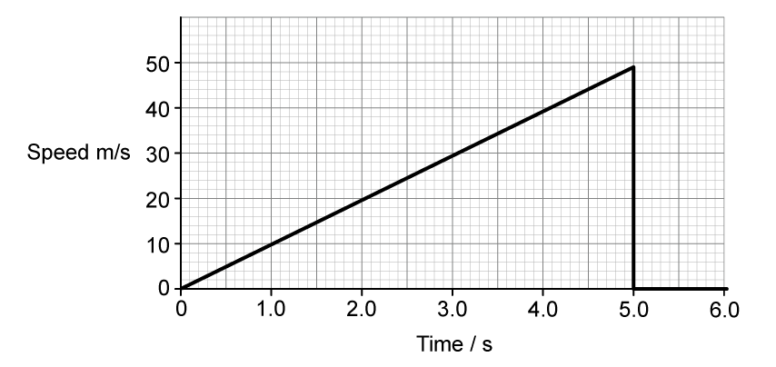

**Fig 1.1**

(i) Calculate the gradient of the speed-time graph.

[3]

(ii) When the elevator's cable completely snapped, the elevator is in freefall. Explain how the gradient shows this.

[1]

**Q27** [2 marks]

**Extract:**

Once everyone has left the elevator, the cable breaks. A device which measures speed over time was found in the elevator when a team investigated the incident.

The data from this are shown in Fig. 1.1.

Describe the motion of the elevator after 5.0 s and explain how the graph shows this.

### Q28 — medium — 8 marks

**Q28** [1 mark]

Model trains move along a track passing through two model stations. Students analyse the motion of a train. They start a digital timer as the train starts to move. They record the time that it enters Station A and the time it enters Station B.

Fig 1.1 below shows the time on entering Station A and the time on entering Station B.

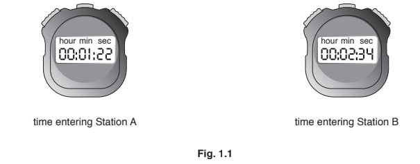

Calculate the time taken from the train entering Station A to the train entering Station B. State your answer in seconds.

time taken = ....................................................... s

*Source: 2018 0625/31 Q1A*

**Q28** [3 marks]

A faster train takes 54 s to travel from Station A to Station B. The distance between the stations is 120 m.

Calculate the average speed of this train.

average speed = .................................................. m/s

*Source: 2018 0625/31 Q1B*

**Q28** [4 marks]

**Extract:**

The area under the graph = the distance travelled. Area A = ½ × base × height = ½ × 4.0 × 3.5. Area C = ½ × base × height = ½ × 4.0 × 3.5. Therefore Area A = 7.0 AND Area C = 7.0. Area B = base × height = 6.0 × 3.5 = 21.0. Distance = 7.0 + 21.0 + 7.0 = 35.0 m.

Fig. 1.2 shows the speed-time graph for a train travelling on a different part of the track.

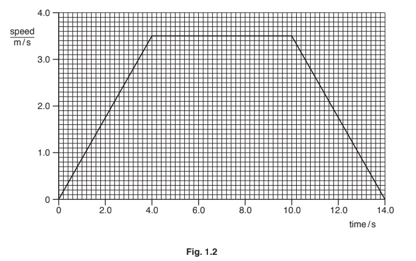

Determine the total distance travelled by the train on this part of the track.

distance = ...................................................... m

*Source: 2018 0625/31 Q1C*

### Q29 — medium — 8 marks

**Q29** [4 marks]

A lorry is travelling along a straight, horizontal road. Fig. 1.1 is the distance-time graph for the lorry.

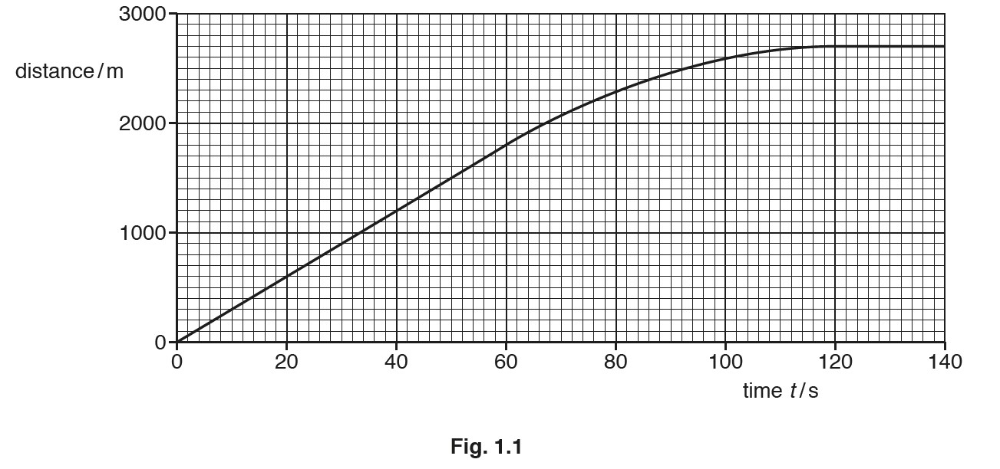

Using Fig. 1.1, determine:

(i) the speed of the lorry at time t = 30 s

speed = ...........................................................[2]

(ii) the average speed of the lorry between time t = 60 s and time t = 120 s.

average speed = ...........................................................[2]

*Source: October/.November 2018 (Series 2) 0625/42 Q1A*

**Q29** [2 marks]

At time t = 30s, the total resistive force acting on the lorry is 1.4 × 104 N.

(i) Using Fig. 1.1, determine the magnitude of the acceleration of the lorry at time t = 30 s.

acceleration = ...........................................................[1]

(ii) Determine the forward force on the lorry due to its engine at time t = 30 s.

forward force = ...........................................................[1]

*Source: Oct/Nov2018  (Series 2) 0625/42 Q1B*

**Q29** [2 marks]

**Extract:**

Describe the motion of the lorry between t = 60 s and t = 130 s:

Draw lines on the graph to analyse the gradient between t = 60 s and t = 130 s:

- From the tangents to the curve at t = 80 s and t = 100 s observe that the gradient of the graph is decreasing

Convert the changing gradient to a property of lorry speed:

- The speed / velocity of the lorry decreases OR acceleration is negative OR deceleration; [1 mark]
- To zero / stationary; [1 mark]

Draw tangents to the graph at several points, so the gradient change is clear.

**Extended tier only**

Describe the motion of the lorry between time t = 60 s and time t = 130 s.

*Source: Oct/Nov2018  (Series 2) 0625/42 Q1C*

### Q30 — medium — 9 marks

**Q30** [4 marks]

Some cyclists are racing around a track.

Fig.2.1 shows the speed-time graph for one cyclist.

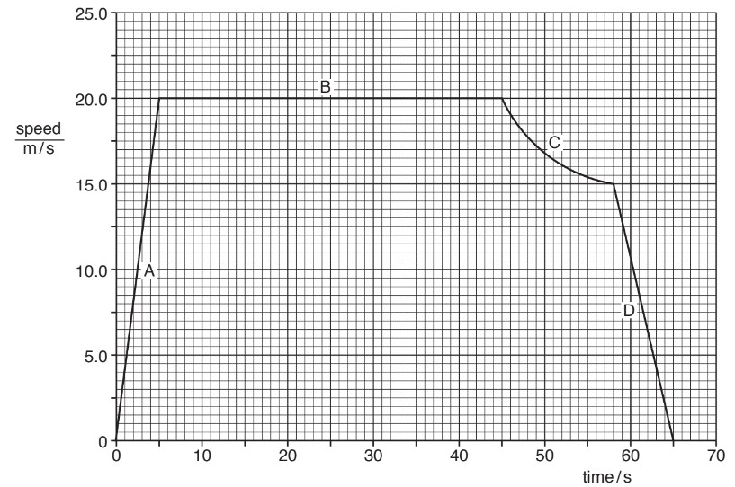

(i) Tick the box that represents the cyclist travelling at constant speed.

`square` A

`square` B

`square` C

`square` D

[1]

(ii) Calculate the distance travelled by the cyclist in the first 5 seconds.

distance = ..................................................... m [3]

*Source: February/March 2018 0625/32 Q2A*

**Q30** [5 marks]

**Extract:**

Some cyclists are racing around a track.

Fig.2.1 shows the speed-time graph for one cyclist.

The length of the track is 250m.

Another cyclist goes around the track four times (four laps). This takes 80.0 seconds.

(i) Calculate the average speed of this cyclist.

average speed = ................................................. m/s [4]

(ii) A friend of the cyclist starts a stopwatch at the beginning of the race.

Fig.2.2 shows the reading on the stopwatch when the cyclist has gone around the track **once**.

Fig.2.3 shows the reading on the stopwatch when the cyclist has gone around the track **twice**.

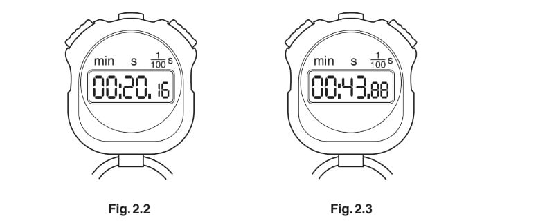

Calculate the time taken for the cyclist to go around the track during the second lap.

time = ....................................................... s [1]

*Source: February/March 2018 0625/32 Q2B*

### Q31 — easy — 9 marks

**Q31** [3 marks]

The UKTRA (UK tractor racing association) hold an annual race between tractors. The distance time graphs of two tractors are shown on Fig. 1.1.

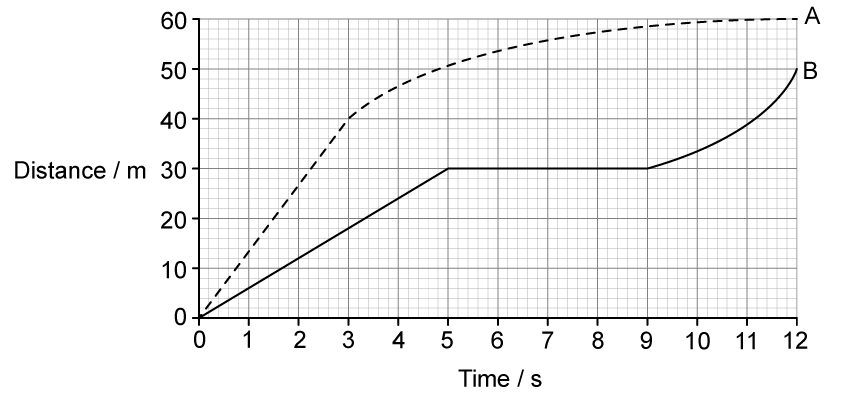

**Fig 1.1**

Describe the motion of tractor B from a time of 0 s to 12 s.

**Q31** [2 marks]

**Extract:**

The UKTRA (UK tractor racing association) hold an annual race between tractors. The distance time graphs of two tractors are shown on Fig. 1.1.

State which tractor has the greatest initial speed and explain how the graph shows this.

**Q31** [3 marks]

**Extract:**

The distance-time graph of two tractors is shown. For tractor B, in the initial part of the graph:
Δy = 30 (distance in meters)
Δx = 5.0 (time in seconds)
Gradient = Δy / Δx = 30 / 5.0 = 6.0 m/s
This gradient represents the initial speed of tractor B.

Calculate the initial speed of tractor B.

**Q31** [1 mark]

This year, the UKTRA racecourse is particularly treacherous. After 12 s, tractor A drives off a steep cliff and is briefly in free fall before landing.

Describe the gradient of the distance-time graph of tractor A after 12 s and before landing.
