# Mark Schemes — Mass, Weight & Density
**1. Motion, Forces & Energy** · Cambridge (CIE) IGCSE physics (0625 & 0972)

## Alternative To Practical Questions (2 questions)

### Q1
(i) To measure length and diameter:

- This value will vary based on your screen or printer
- An example is *l* = 4.5 cm and *d* = 2.0 cm; **[1 mark]**

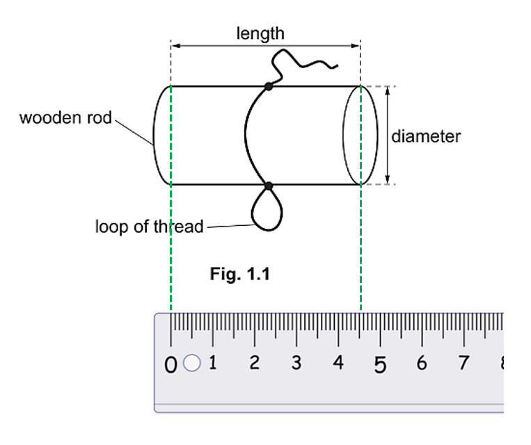

- Both values given to 1 decimal place; **[1 mark]**

(ii) An accurate method to measure the diameter of the wooden rod:

- Sensible method outlined; **[1 mark]**
- Explanation of how the diameter can be measured accurately; **[1 mark]**

Examples which would score 2 marks are:

**EXAMPLE 1**

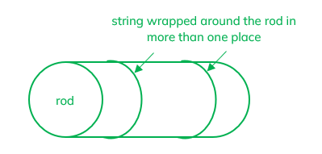

- Use string wrapped round the rod and measured; **[1 mark]**
- Several turns are used and diameter calculated from the circumference; **[1 mark]**

**EXAMPLE 2**

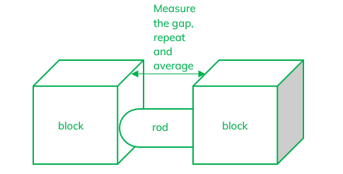

- Put the rod between two blocks and measure the gap; **[1 mark]**
- Readings taken in at least 2 places and average is taken; **[1 mark]**

**EXAMPLE 3**

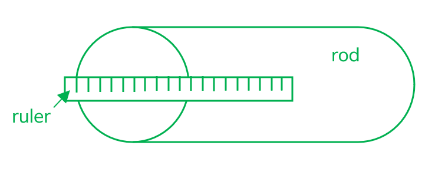

- Use a ruler / measuring tape to measure the diameter across the ends of the rod; **[1 mark]**
- Repeat at several places and take an average; **[1 mark]**

**EXAMPLE 4**

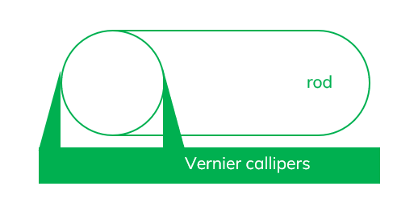

- Use a micrometer /(Vernier) callipers (along length or across ends); **[1 mark]**
- Repeat at various points and take an average; **[1 mark]**

**[Total: 4 marks]**

> *Whilst there are no specific marks for a diagram,  a diagram labelled appropriately can however gain both marks.*
List the known quantities:

- *m* = 7.8 g
- *d* = 2.0 cm
- *l* = 4.5 cm

List the equation from the question:

- $ρ_{1}=\frac{4m}{πd^{2}l}$

Substitute in known values and calculate *ρ*1:

- $ρ_{1}=\frac{4\times7.8}{π\times2.0^{2}\times4.5}$
- *ρ*1 = 0.55
- Both *ρ*1 and *m* stated correctly; **[1 mark]**

State the unit:

- g/cm3 **[1 mark]**

**[Total: 2 marks]**

> *In the exam you would get error carried forward if any of the readings you took in part a or b were incorrect.*
State the two values:

- V1 = 144 (cm3) **AND** V2 = 152 (cm3) **[1 mark]**

**[Total: 1 mark]**

> *Both readings must be correct to obtain the mark.*
To calculate the value *ρ*2:

List the known quantities:

- *V*1 = 144 cm3 (from part (c))
- *V*2 = 152 cm3 (from part (c))
- *V*3 = 164 cm3
- *V*4 = 178 cm3
- *k* = 1.0 g/cm3

From the question:

- $ρ_{2}=\frac{V_{2}-V_{1}}{V_{4}-V_{3}}\timesk$

Substitute in the known quantities:

- $ρ_{2}=\frac{152-144}{178-164}\times1.0$
- *ρ*2 = 0.57 (g/cm3) **[1 mark]**
- Answer to 2 or 3 significant figures; **[1 mark]**

**[Total: 2 marks]**
An arrow drawn showing the correct line of sight would look like:

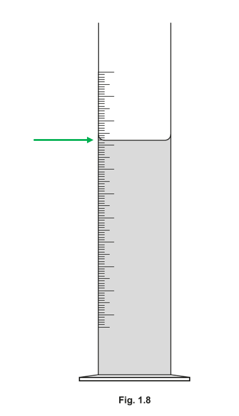

- Straight arrow drawn perpendicular to measuring cylinder; **[1 mark]**

**[Total: 1 mark]**

> *It is important that a measuring cylinder is read at eye level. This is to avoid parallax error, where the reading obtained is incorrect due to the position of the eye. The diagram below shows an example of parallax in action giving different readings:*

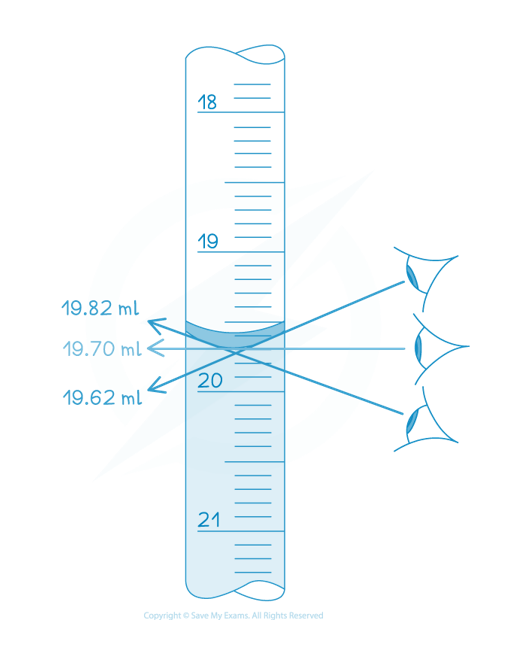

> *As you can see, the eye position changes the value obtained. You can also get parallax error with rulers or protractors!*
To suggest a possible source of inaccuracy in method 2:

**Any one from:**

- measuring cylinder scales less precise / accurate;** [1 mark]**
- water lost on transfer / droplets on clay;** [1 mark]**
- wood might absorb water;** [1 mark]**

**[Total: 1 mark]**

> *It is always important to consider sources of inaccuracy when looking at experimental methods. Ideally, you would then improve on the experiment, if possible!*

### Q2
(i) Measure the dimensions of the block:

length $l = 6 . 0 \text{cm}$

width $w = 3 . 0 \text{cm}$

height $h = 4 . 0 \text{cm}$

**[1 mark]**

> **[mark-scheme]**
> The absolute values depend on the size of the diagram on your screen or printout, so 6.0 / 3.0 / 4.0 cm are not required. Award the mark for any three measurements in the ratio l : w : h = 6 : 3 : 4, i.e. the width about half the length and the height about two thirds of the length, each within 10%
> 
> Accept, for example, 4.6 / 2.3 / 3.1 cm or 5.0 / 2.5 / 3.3 cm

(ii) Calculate the volume of the block:

- Substitute the measurements into the given equation:

$V_{1} = l \times w \times h = 6 . 0 \times 3 . 0 \times 4 . 0$

$V_{1} =$$72 \text{cm}^{3}$ **[1 mark]**

> **[mark-scheme]**
> 1 mark for a volume equal to the candidate's own $l \times w \times h$, correctly evaluated
> 
> - ecf from the candidate's own measurements in (a)(i)
> - Do not award if the arithmetic is wrong, e.g. $4 . 6 \times 2 . 3 \times 3 . 1$ given as 3.28 instead of 32.8
> - The unit cm3 is printed on the answer line and is not required

> **[exam-tip]**
> It is not possible in an online format to know how long your measurements are, because the size of the diagram depends on your printer or device. Print the diagram, line up your 0.0 cm mark with the dotted lines and ask a friend or teacher to check your measurements.
> 
> 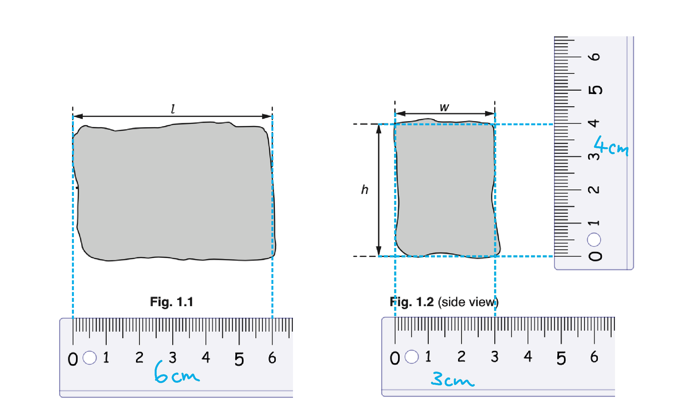
> 
> Your values may differ from ours, but they should be in the same ratio: the width about half the length and the height about two thirds of the length. In the real exam, you measure a printed diagram, so give every length to the nearest millimetre and keep the trailing zero (6.0 cm, not 6 cm).
> **[mark-scheme]**
> Source of inaccuracy:
> 
> Any **one** from:
> 
> - The block is an irregular shape / not a perfect cuboid
> - The faces of the block are not flat
> - The edges are not straight, so each dimension varies along the block
> - Difficulty lining up the ruler with the edge of the block
> - Parallax error when reading the ruler
> 
> **[1 mark]**
> 
> Improvement:
> 
> - Measure each dimension in several places and take an average **[1 mark]**
> 
> Accept "repeat the measurements and average" for the improvement mark

> **[exam-tip]**
> "More reliable" is the clue: reliability comes from repeating and averaging. A single more careful reading improves accuracy, not reliability, so make sure your improvement involves repeats. Measuring in several places and averaging is the same technique you use for the diameter of a wire with a micrometer.
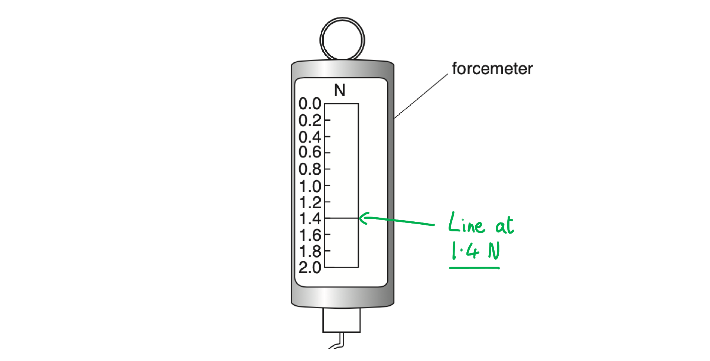

> **[mark-scheme]**
> - $W = 1 . 4 \text{N}$ **[1 mark]**

> **[exam-tip]**
> In the practical paper you meet instruments with many kinds of scale: needles, digital displays or, as here, a line against a scale. Do not over-complicate it. The line sits on the 1.4 N mark, so the reading is 1.4 N.
To calculate the density of the modelling clay:

- List the known quantities:

  - Weight, $W = 1 . 4 \text{N}$ (from part (c))
  - Volume, $V_{1} = 72 \text{cm}^{3}$ (from part (a)(ii))
  - $k = 100 \text{g/N}$
- Substitute into the given equation:

$ρ_{1} = \frac{W\timesk}{V_{1}} = \frac{1.4\times100}{72} = 1 . 944$

- Round to two significant figures and give the unit:

$ρ_{1} =$$1 . 9 \text{g/cm}^{3}$ **[2 marks]**

> **[mark-scheme]**
> 1 mark for a value of 1.9, given to two significant figures
> 
> - ecf: accept the candidate's own $W \times 100 \div V_{1}$ correctly evaluated and rounded to two significant figures
> - Do not accept 1.944 or 1.94 (too many significant figures)
> 
> 1 mark for the unit g/cm3

> **[exam-tip]**
> The value mark can only be gained at two significant figures, because an answer cannot be more precise than the data used to calculate it: the forcemeter reads to two significant figures and the ruler gives each length to two significant figures. CIE has become stricter about this, so for every calculation: find the piece of data with the fewest significant figures, write your answer to more figures than that, then round it to match.
> 
> 
> 
> Write the full calculator value (1.944) in your working and then round it: this shows the examiner both the correct arithmetic and the correct rounding. The unit is a separate mark, so g/cm3 must be written on the answer line.
> **[mark-scheme]**
> (i) Record the volume of the water:
> 
> - $V_{2} = 160 \text{cm}^{3}$ **[1 mark]**

> **[mark-scheme]**
> (ii) Describe how the measuring cylinder is read:
> 
> - Line of sight perpendicular to the scale / read at eye level / read the bottom of the meniscus **[1 mark]**
> 
> Accept a labelled diagram showing the eye level with the bottom of the meniscus
> 
> An example of a diagram that would score the mark:
> 
> 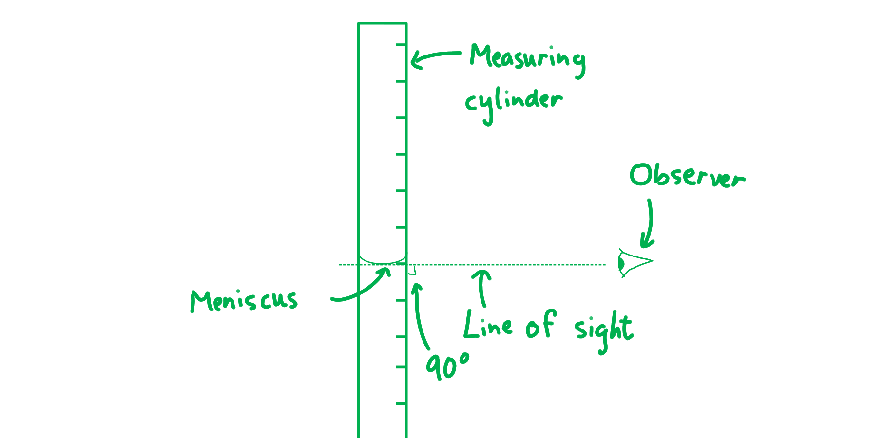

> **[exam-tip]**
> Each 25 cm3 gap on the scale is split into five divisions, so each small division is 5 cm3. The meniscus sits two divisions above 150 cm3, giving 160 cm3. Reading at an angle gives a parallax error, so put your eye level with the bottom of the meniscus.
(i) Record the new reading and calculate the second value for the density:

- List the known quantities:

  - Weight, $W = 1 . 4 \text{N}$ (from part (c))
  - Volume, $V_{2} = 160 \text{cm}^{3}$ (from part (e)(i))
  - $k = 100 \text{g/N}$

- Record the new reading *V*3 of the measuring cylinder:

$V_{3} = 230 \text{cm}^{3}$

- Substitute into the given equation:

$ρ_{2} = \frac{W\timesk}{V_{3}-V_{2}} = \frac{1.4\times100}{230-160}$

$ρ_{2} =$$2 . 0 \text{g/cm}^{3}$ **[1 mark]**

> **[mark-scheme]**
> 1 mark for $V_{3} = 230 \text{cm}^{3}$ **AND** $ρ_{2} = 2 . 0 \text{g/cm}^{3}$
> 
> - ecf: accept the candidate's own `W \times 100 \div \left(V_{3} - V_{2}\right)` correctly evaluated

> **[mark-scheme]**
> (ii) Which value is likely to be more accurate:
> 
> Any **one** from:
> 
> - *ρ*1, because the measuring cylinder used for *ρ*2 is less precise / has a lower resolution than the ruler
> - *ρ*1, because the string adds to the volume of water displaced in the method for *ρ*2
> - *ρ*2, because the volume is measured directly rather than calculated from three separate measurements
> 
> **[1 mark]**
> 
> The inverse arguments are accepted, e.g. "*ρ*2 because the volume is not measured directly in the method for *ρ*1"

> **[exam-tip]**
> Either choice can score, but only with a reason that refers to the procedure: name the instrument or the step that introduces the error. When reading the water level, use the bottom of the meniscus, not where the water touches the glass.

## Multiple Choice Questions (41 questions)

### Q1
**Final answer:** **The correct answer is D**

- Density $ρ$ is calculated using the equation:

$ρ=\frac{m}{V}$

- An object floats if its density is **less **than the density of the liquid it is placed in ($1.0\text{g/cm}^{3}$ for water)
- The density of object Q is:

$ρ=\frac{15}{20}=0.75\text{g/cm}^{3}$

- Since $0.75\text{g/cm}^{3}$ is **less **than $1.0\text{g/cm}^{3}$, object Q will **float**

**A** is incorrect because object P will sink as its density $( 15 \div 5 = 3.0 \text{ g/cm}^{3} )$ is greater than the density of water.

**B** & **C** are incorrect as floating or sinking depends on density, not mass or volume.

### Q2
**Final answer:** **The correct answer is B**

- Mass is the measure of the quantity of matter in an object and does not change when the object is moved to a different location
- Therefore, the mass of the object is $4.0\text{kg}$ on both the Earth and the Moon

  - This eliminates options **A** and **D**
- Weight is the gravitational force acting on an object that has mass and does change depending on location
- Weight is calculated using the equation:

$W=mg$

- The weight of the object on the Moon is:

$W=4.0\times1.6=6.4N$

- This is option **B**

### Q3
**Final answer:** **The correct answer is ****A**** because.**

- Density is mass per unit volume `( density = mass / volume or rho = m / v )`
- The measuring cylinder is being used to measure the volume of the stone
- The stone’s mass needs to be measured to find the density
- A balance can be used to find the mass density

**B** is incorrect as a thermometer is used to measure temperature.

**C** is incorrect as a metre rule is used to measure length.

**D** is incorrect as a stopwatch is used to measure time.

### Q4
**Final answer:** **The correct answer is ****D**** because:**

- The balance measures the mass of the food and dish·
- Since the mass of the dish is unchanged, the mass of the rice and the pasta must be the same for the reading on the scale to be the same
- The weight of an object depends only on its mass and the gravitational field strength
- The rice and pasta have the same mass, and therefore, the same weight

The key thing in this question is the use of the word ‘must’. All the answers *could* be true. However, only one *must* be true because of the spring balance giving the same reading when the rice and the pasta are weighed. Whenever a measuring instrument is used, think about what quantity it measures.

**A** is not correct because the question does not give any information about the volumes of the two foods. If the volumes were also equal, then the density would be the same.

**B** is incorrect, because no information about the temperature is given.

**C** is incorrect because no information about the volume is given. Although the dish might hold the same volumes of the two foods, it also might not. There could be differently sized air gaps between the rice grains and the pasta pieces.

### Q5
**Final answer:** **The correct answer is ****C**** because:**

- The mass of an object is the same everywhere in space, so the mass of the rocket on the Moon is the same as its mass on Earth

  - Therefore, options **A** and **B** can be eliminated
- The weight of an object at a location depends on the acceleration of free fall (or gravitational field strength) at that location
- The greater the acceleration of free fall, the greater the weight of each kilogram of mass
- As the acceleration of free fall is lower on the Moon than on the Earth, the rocket’s weight must be less on the Moon

  - Therefore, option **C** is correct

Confusion between mass and weight is quite common, so this concept is tested regularly. Remember that mass does not change unless part of the object is removed or something else is added, while weight changes depending on acceleration of free fall, or gravitational field strength.

### Q6
**Final answer:** **The correct answer is ****D**** because:**

- An object's weight is the gravitational force acting on it due to its mass
- Forces are measured in newtons. A weight of several thousand newtons could be expressed in kilonewtons, where 1 kilonewton = 1000 newtons

Mass and weight are often confused, so make sure that you know the difference. Mass is an amount of matter measured in kilograms and weight is a force measured in newtons. This confusion is why ‘kilogram’ has also been given as an option. The other two incorrect options were given because the kilo- prefix is often used with metres and joules.

**A** is incorrect as kilogram is a unit of mass.

**B** is incorrect as kilojoule is a unit of energy.

**C** is incorrect as kilometre is a unit of length.

### Q7
**Final answer:** **The correct answer is B because:**

- Gravitational field strength is a measure of the force per unit mass acting on an object in a gravitational field

  - An object’s **mass **is always the **same**, regardless of location
  - The force (**weight**) exerted on the object will be **different **depending on the strength of the gravitational field
- The **spring balance** measures the **weight **of the object but is calibrated to give a reading of mass

  - The Earth’s gravitational field strength is stronger than the Moon’s
  - The object experiences a **greater weight **on the Earth than on the Moon
  - Therefore, measurements using the spring balance will be **larger **on the Earth than on the Moon
  - This eliminates options **C** and **D**
- The** beam balance** measures the **mass **of the object

  - The object has the **same mass** on both the Earth and the Moon
  - Therefore, the measurement using the beam balance will be the **same **on the Earth as on the Moon
  - Therefore, the correct answer is **B**

### Q8
**Final answer:** **The correct answer is D because:**

- For an object to float in a liquid, it must have a density lower than the liquid
- For an object to sink in a liquid, it must have a density greater than the liquid

  - Only the values in row **D** mean that P floats while Q sinks

**A **is incorrect as P’s density is greater than the liquid’s, so it would sink

**B **is incorrect as P’s density is greater than the liquid’s, so it would sink

**C **is incorrect as Q’s density is lower than the liquid’s, so it would float

### Q9
**Final answer:** **The correct answer is C because:**

- The density of a substance is given by the equation:

$ρ=\frac{m}{V}$

- When the mass of the liquid increases by 30 g, this corresponds to a volume of:

$V=50-30=20$ cm3

- The density of the liquid is

$ρ=\frac{30}{20}=1.5$ g/cm3

There are a few different measurements given in this question, so you must read and analyse it carefully to understand the scenario

### Q10
**Final answer:** **The correct answer is C because:**

- The acceleration of free fall on the Moon can be described by the equation

$g=\frac{W}{m}$

- The weight of an object on the Moon is

$W=mg$

- Since the acceleration of free fall is the same for all objects on the Moon

$W\proptom$

- This means that the weight of an object is **directly proportional** to its mass

**A** is incorrect because weight depends on an object’s mass, so heavier objects have a greater weight than lighter objects

**B** is incorrect because while this is true, it does not explain why all objects fall with the same acceleration on the Moon

**D** is incorrect because weight and mass are directly proportional

### Q11
**Final answer:** **The correct answer is C because:**

- Weight is the product of mass and gravitational field strength

  - On the Moon, gravitational field strength *g* = 1.6 N/kg
  - Astronaut mass, *m* = 75 kg

$W=mg$

$W=75\times1.6=120$ N

- This is option **C**

You can check the logic of your answer. On Earth, *g* is around 10 N/kg so weight on Earth is around 750 N. Your answer should be a good deal smaller than this.

### Q12
**Final answer:** **The correct answer is C because:**

- The unit of mass is the kilogram (kg)
- The unit of weight (force) is the newton (N)

**A **is incorrect as weight is affected by a change in acceleration of free fall, but mass is an intrinsic property of an object

**B** is incorrect as weight is a force but mass is not a force

**D** is incorrect as weight is calculated by multiplying mass and acceleration of free fall

### Q13
**Final answer:** **The correct answer is ****D**** because:**

- The unit of weight (a force) is the Newton, N.
- The unit of mass is the kilogram, kg.

### Q14
**Final answer:** **The correct answer is ****D**** because:**

- Weight is defined as a gravitational force on an object with mass
- Therefore, weight is a** force**

**A **is incorrect as weight is not a field strength

**B** is incorrect as weight is not an acceleration

**C** is incorrect as weight is not the same as mass, mass is defined as a measure of the quantity of matter in an object at rest relative to the observer

### Q15
**Final answer:** **The correct answer is ****D**** because:**

- Weight is defined as **the gravitational force acting on an object with mass**

**A **is incorrect as the force of the ground pushing on an object is a (normal) **reaction force**

**B **is incorrect as a measure of the quantity of matter of an object at rest to the observer is the definition of **mass**

**C** is incorrect as the mass per unit volume of an object is its **density**

### Q16
**Final answer:** **The correct answer is ****C ****because:  **

- $density=\frac{mass}{volume}$
- The student is only able to measure the volume of the regular shaped objects using his metre ruler. He cannot measure the volume of the steel bolt.

### Q17
**Final answer:** **The correct answer is ****C**** because:**

- weight (N) = mass (kg) x gravitational field strength (N/kg)
- The only true statement is **C**. All the others contain mistakes.

**A** Is incorrect because weight is measured in Newtons, not kilograms

**B** Is incorrect because weight (N) = mass (kg) x gravitational field strength (N/kg)

**D** Is incorrect because weight is a force, not mass.

### Q18
**Final answer:** **The correct answer is ****B**** because: **

- mass is measured in kilograms, kg.

**A **Is incorrect as weight is measured in Newtons, N

**C** Is incorrect as pressure is measured in Pascals, Pa

**D** Is incorrect as density is measured in kg/m3

### Q19
**Final answer:** **The correct answer is ****C**** because:**

- If the balance gives the same reading for two different items, then those items must be pulling the balance down with the same amount of force
- Weight is defined as the gravitational force on an object with mass
- Therefore, the two items must have the same weight

**A** is incorrect as a balance does not measure volume

**B** is incorrect as a balance does not measure density

**D** is incorrect as a balance does not measure internal energy, you would need a thermometer for that

### Q20
**Final answer:** **The correct answer is ****C**** because:**

- Mass is the amount of matter in the cup, while weight is the strength of the gravitational force pulling that matter downwards.
- As liquid leaves the cup, matter leaves the cup as evaporated vapour, and both the mass and weight decrease.

**A** is incorrect because the mass does not increase.

**B **is incorrect because neither the mass nor the weight increase.

**D** is incorrect because the weight does not increase.

### Q21
**The correct answer is ****D ****because:**

- $density=\frac{mass}{volume}$
- $\mathrm{density}=\frac{319}{350}=0.911g/\mathrm{cm}^{3}$

### Q22
**Final answer:** **The correct answer is ****B**** because:**

- $g=\frac{W}{m}$
- Rearranging the equation to solve for mass gives: 
$m=\frac{W}{g}$
- Gravitational field strength on Earth is 9.8 N/kg
- The question asked for an approximate mass, so the value of *g* can be rounded to 10 N/kg
- $m=\frac{5.0}{10}$
- *m* = 0.5 kg
- This is answer **B**

### Q23
**Final answer:** **The correct answer is ****B**** because:**

- Mass is the amount of matter that the dough is made from
- Compression changes the shape / volume but does not remove matter, so **mass stays the same**
- Weight is given by $W=mg$
- Since mass $m$ and gravitational field strength $g$ are unchanged, **weight stays the same**

**A** is incorrect because weight does not decrease

**C** is incorrect because neither weight nor mass decrease.

**D** is incorrect because mass does not decrease.

### Q24
**Final answer:** **The correct answer is**** ****C because:**

- $d e n s i t y ( \mathrm{g} \div cm^{3} ) = \frac{m a s s ( \mathrm{g} )}{v o l u m e ( cm^{3} )}$
- $2.7 = \frac{583.8}{v o l u m e ( cm^{3} )}$
- $V o l u m e ( cm^{3} ) = \frac{583.8}{2.7} = 216.2 ( cm^{3} )$

### Q25
**Final answer:** **The correct answer is ****B**** because: **

- mass is measured using a balance.

**A** is incorrect as a burette is used to measure volume of liquids very accurately.

**C** is incorrect as a thermometer is used to measure temperature differences

**D **is incorrect as a trundle wheel is used to measure longer distances.

### Q26
**Final answer:** **The correct answer is ****A**** because :**
$\mathrm{density}=\frac{2500}{800-500}$
$\mathrm{density}=\frac{2500}{300}$

density = 8.33 g/cm3

### Q27
**Final answer:** **The correct answer is ****B**** because:  **

- $density=\frac{mass}{volume}$** **therefore:
- $\begin{gathered} \text{Density} & = ( 190 - 100 ) \div 30 \\ = 90 \div 30 \\ = 3 \mathrm{g} \div cm^{3} \end{gathered}$

### Q28
**Final answer:** **The correct answer is ****D**** because:**

- ** **$density=\frac{mass}{volume}$
- Density = (70 - 20 ) / 14 = 3.57 g/cm3

### Q29
**Final answer:** **The correct answer is ****A**** because: **

- $density=\frac{mass}{volume}$
- $density=\frac{mass}{π\timesr^{2}\timesh}$
- To calculate the volume of a cylinder, you need to know the radius. Therefore, the three measurements required are radius, height and mass

**B** is incorrect as this would only allow the teacher to calculate the volume.

**C** is incorrect as this combination would allow nothing useful to be calculated.

**D** is incorrect as this would only give the mass, the volume is also required to calculate the density.

### Q30
**Final answer:** **The correct answer is ****B**** because:**

- weight (N) = mass (kg) x gravitational field strength (N/kg)
- weight (N) = 80 x 1.6 = 128 N

**A** is incorrect as weight is a force, measured in Newtons. Any answer in kg must, therefore, be incorrect.

**C** is incorrect as this answer is weight x gravitational field strength on Earth. The astronaut is on the Moon.

**D** is incorrect as this is the mass of the astronaut, not the weight*.*

### Q31
**Final answer:** **The correct answer is ****A**** because:**

- Mass is the amount of matter that Starman is made from. Since no parts of Starman are cut off during the launch, his mass remains the same.
- The force of gravity acting on Starman decreases as he gets further away from the gravitational pull exerted by Earth. Therefore, his weight decreases.

**B** is incorrect because weight does not stay the same

**C** is incorrect because mass does not decrease.

**D** is incorrect because mass does not decrease.

### Q32
**Final answer:** **The correct answer is ****D ****because: **

- $density=\frac{mass}{volume}$
- Density = 10 / 20 = 0.5 g / cm3
- This is the lowest density in the table.

A is incorrect as density = 100 / 100 = 1.0 g / cm3

B is incorrect as density = 150 / 50 = 3.0 g / cm3

C is incorrect as density = 58 / 17 = 5.0 g / cm3

### Q33
**Final answer:** **The correct answer is ****D**** because: **

- If two materials are made from the same material, their density must be the same.

**A **is incorrect as the longer beam has the greater volume because it takes up more space.

**B** is incorrect as the longer beam will weigh more because there is more of it.

**C** is incorrect as the longer beam will have a greater mass because there is more of it.

### Q34
**Final answer:** **The correct answer is ****B**** because:**

- $density=\frac{mass}{volume}$
- Density = 200 / 230 = 0.87 g/cm3
- This is less than 1.0 g/cm3

**A** is incorrect as the density is less than the density of water.

**C** is incorrect as the density is less than the density of water.

**D** is incorrect as it is possible to tell what the density is.

### Q35
**Final answer:** **The correct answer is ****C**** because: **

- density = mass / volume.

### Q36
**Final answer:** **The correct answer is ****B ****because: **

- $density=\frac{mass}{volume}$
- density = $\frac{25.6}{5\times5\times5}$= 0.20 g/cm3

### Q37
**Final answer:** **The correct answer is ****D**** because: **

- $density=\frac{mass}{volume}$
- Volume = $x\timesy\timesz$

### Q38
**Final answer:** **The correct answer is ****A**** because:**

- The balance tips right when there is 100 + 50 + 50 + 20 + 5 + 2 = 227 g on it
- The balance tips left when there is 200 + 10 + 10 + 5 = 225 g on it
- The mass of the object is therefore the mean of the two values: $\frac{227+225}{2}=$226 g

### Q39
**Final answer:** **The correct answer is ****D**** because**

$density=\frac{mass}{volume}$

**W**   density =  $\frac{20}{4.0\times4.0\times8.0}=0.156g/\mathrm{cm}^{3}$

**X** density =  $\frac{50}{4.0\times8.0\times8.0}=0.195g/\mathrm{cm}^{3}$

**Y **density = $\frac{20}{4.0\times4.0\times4.0}=0.313g/\mathrm{cm}^{3}$

**Z **density = $\frac{10}{4.0\times4.0\times4.0}=0.156g/\mathrm{cm}^{3}$

- As you can see, W and Z have the same density.

**A** is incorrect as **W** and **X** do not have the same density

**B** is incorrect as **W** and **Y** do not have the same density

**C** is incorrect because **Y** and **Z** do not have the same density

### Q40
**Final answer:** **The correct answer is ****C**** because:**

- the mass of an object is the quantity of matter it contains, regardless of its volume or any forces acting on it.
- the mass of the Quality Street will be the same on the Moon as on Earth.

**A** , **B** and **D** are incorrect as mass does not change when you change the strength of gravity.

### Q41
**Final answer:** **The correct answer is ****C**** because:**

- ** **Answer** C** substitutes the numbers correctly into this equation:  $density=\frac{mass}{volume}$

## Theory Questions (18 questions)

### Q1
> **[mark-scheme]**
> - Mass **[1 mark]**
> - Volume **[1 mark]**

> **[exam-tip]**
> Remember that density is calculated using the formula $ρ = \frac{m}{V}$, so you need both mass and volume to determine density. For a regular-shaped solid like a cube, volume can be found by measuring the dimensions (e.g. length, width and height) and calculating, but the question asks for the two quantities needed, not how to measure them.
> **[mark-scheme]**
> (i) State the volume of water in the measuring cylinder shown in Fig. 1.1.:
> 
> - $22\text{cm}^{3}$ **[1 mark]**
> 
> (ii) State the name of the curve formed by the water surface in Fig. 1.1.:
> 
> - Meniscus **[1 mark]**

> **[exam-tip]**
> When reading a measuring cylinder, always read from the bottom of the meniscus (the curved water surface) at eye level.

(iii) Calculate the volume of the stone:

$V=V_{f}-V_{i}$

$V = 46 - 22$  **[1 mark]**

$V=$$24\text{cm}^{3}$ **[1 mark]**

> **[exam-tip]**
> For displacement method questions, remember that the volume of an irregular object equals the difference between the final and initial water levels. Always show your working clearly, even for simple subtractions.
Calculate the density of the stone:

$ρ=\frac{m}{V}$

$ρ=\frac{6.5}{24}$ **[1 mark]**

$ρ=0.2708...$

$ρ=$ $0.27g/\mathrm{cm}³$** **(2 s.f.)** ****[1 mark]**

> **[exam-tip]**
> Remember the density formula: $ρ = \frac{m}{V}$. Make sure you use the correct values for mass and volume from the question. Always include units in your final answer—density is typically expressed in g/cm3 or kg/m3 depending on the units given.

### Q2
Compare the arrangement of particles in ice and water:

- In ice, particles are in a lattice / regularly arranged **AND**
- In water, particles are randomly / irregularly arranged; **[1 mark]**

Compare the motion of particles in ice and water:

- In ice, particles vibrate **AND**
- In water, particles move around / slide over each other; **[1 mark]**

**[Total: 2 marks]**
(i) To calculate the mass of ice:

List the known quantities:

- Area, *A* = 1800 m2
- Thickness, *t* = 0.025 m
- Density, *ρ* = 920 kg/m3

Calculate the volume, *V*, of the ice:

- $V=At$
- $V=1800\times0.025$
- $V=45m^{3}$

Recall the equation for density and rearrange for mass:

- $ρ=\frac{m}{V}$ **[1 mark]**
- $m=ρV$

Substitute the known quantities:

- $m=920\times45$
- $m=41000kg$ **[1 mark**]

(ii) To calculate the energy change:

List the known quantities:

- Temperature change, Δ*θ* = 3.5 °C
- Mass, *m* = 41 000 kg (from part (a))
- Specific heat capacity, *c* = 2.1 × 103  J/kg °C

Recall the equation for thermal energy transfer:

- $ΔE=mc\mathrm{Δθ}$** [1 mark]**

Substitute the known quantities:

- $ΔE=41000\times(2.1\times10^{3})\times3.5$
- $ΔE=3.0\times10^{8}$ J **[1 mark]**

**[Total: 4 marks]**

### Q3
To calculate the mass of the metal:

List the known quantities:

- Weight, *W* = 3.0 N
- Acceleration of free fall, *g* = 9.8 m/s2

Recall the equation for weight, rearrange it for mass and substitute the known quantities:

- *W = mg ***OR **$m=\frac{W}{g}$*** *****OR **$m=\frac{3.0}{9.8}$** ****[1 mark]**

Calculate the mass:

- $m=0.31$ kg **[1 mark]**

**[Total: 2 marks]**
(i) To determine the volume of metal:

Any **four** from:

- Fill the measuring cylinder with water; **[1 mark]**
- Measure the volume of water in the measuring cylinder; **[1 mark]**
- Fully submerge the metal in water; **[1 mark]**
- Measure the new volume of the cylinder’s contents; **[1 mark]**
- The metal’s volume is the difference between final and initial volumes; **[1 mark]**

(ii) The procedure from (i) is not suitable for low density wood because:

- Wood <u>floats</u>;** [1 mark]**

(iii) To find the density of the metal:

List the known quantities:

- Mass of metal, *m* = 405 g
- Volume of metal, *V* = 150 cm3

Recall the equation for density:

- $ρ=\frac{m}{V}$ **[1 mark]**

Substitute the known quantities:

- $ρ=\frac{405}{150}$ **[1 mark]**

Calculate density:

- ρ=2.7 g / cm3 **[1 mark]**

**[Total: 8 marks]**

> *The fact that wood floats means that the full volume of the wood cannot be submerged. The displacement method works when a fully submerged object displaces a volume of water equal to its own volume. If the wood cannot be fully submerged, its full volume cannot be accurately calculated.*

> *Pushing the wood down with a finger, for example, would measure the volume of the wood and the submerged volume of the student’s finger.*

### Q4
(i) To calculate the area of the metal block in contact with the ground:

- The face on the ground measures 12.0 cm by 2.0 cm, so:

$\text{area} = \text{length} \times \text{width} = 12 . 0 \times 2 . 0$ **[1 mark]**

$\text{area} =$$24 \text{cm}^{2}$ **[1 mark]**

> **[mark-scheme]**
> 1 mark for $\text{length} \times \text{width}$ or $12 . 0 \times 2 . 0$ (accept $12 \times 2$)
> 
> 1 mark for a correct final answer of $24 \text{cm}^{2}$
> 
> - Do not accept 36 ($12 \times 3$) or 6 ($3 \times 2$): the face on the ground is the 12.0 cm by 2.0 cm face
> - Both marks can be scored for the correct answer alone

(ii) To calculate the weight of the metal block:

- List the known quantities:

  - Mass, $m = 0 . 84 \text{kg}$
  - Gravitational field strength, $g = 9 . 8 \text{N/kg}$
- Write down the equation for weight and substitute the known values:

$W = m g = 0 . 84 \times 9 . 8$ **[1 mark]**

- Calculate the answer:

$W = 8 . 232 \text{N} =$$8 . 2 \text{N}$ **[1 mark]**

> **[mark-scheme]**
> 1 mark for $W = m g$ in words or symbols, or correct substitution $0 . 84 \times 9 . 8$ (accept $0 . 84 \times 10$)
> 
> 1 mark for a correct final answer of $8 . 2 \text{N}$
> 
> - Accept 8.23 N or 8.232 N
> - Accept $8 . 4 \text{N}$ if $g = 10 \text{N/kg}$ is used
> - Both marks can be scored for the correct answer alone

> **[exam-tip]**
> Use the diagram to decide which face touches the ground: it is the 12.0 cm by 2.0 cm face, not the 12.0 cm by 3.0 cm one. The current syllabus takes *g* as 9.8 N/kg; this 2022 paper used 10 N/kg, so 8.4 N is also credited here, but in your exam, use 9.8 N/kg unless the paper tells you otherwise.

### Q5
To calculate the total weight of the raft:

- List the known quantities:

  - Average mass of each log $= 65 . 0 \text{kg}$
  - Number of logs = 8
  - Gravitational field strength, $g = 9 . 8 \text{N/kg}$

- Calculate the total mass of the raft:

$m = 8 \times 65 . 0 = 520 \text{kg}$

- Write down the equation for weight:

$W = m g$ **[1 mark]**

- Substitute the known values:

$W = 520 \times 9 . 8$ **[1 mark]**

- Calculate the answer:

$W = 5096 \text{N}$

$W =$$5100 \text{N}$ **[1 mark]**

> **[mark-scheme]**
> 1 mark for the correct final answer of $5100 \text{N}$; 5096 N is also accepted

> **[exam-tip]**
> Always use the value of *g* given in the question rather than one you remember: using 10 N/kg here gives 5200 N, which does not match the data you were given. Read the question carefully too. It asks for the weight of the whole raft, so remember to multiply the mass of one log by the number of logs.
(i) To calculate the density of the wood in the log:

- List the known quantities:

  - Mass of the log, $m = 66 . 0 \text{kg}$
  - Length of the log, $l = 3 . 0 \text{m}$
  - Cross-sectional area, $A = 0 . 040 \text{m}^{2}$
- Calculate the volume of the log:

$V = l \times A = 3 . 0 \times 0 . 040$

$V = 0 . 12 \text{m}^{3}$ **[1 mark]**

- Write down the equation for density:

$ρ = \frac{m}{V}$ **[1 mark]**

- Substitute the known values:

$ρ = \frac{66.0}{0.12}$

- Calculate the answer:

$ρ =$$550 \text{kg/m}^{3}$ **[1 mark]**

> **[mark-scheme]**
> (ii) The log floats on water because:
> 
> - The density of the log is less than the density of water **[1 mark]**
> 
> Any wording with the same meaning is accepted, for example "water is denser than the wood"

> **[exam-tip]**
> The density of water is 1000 kg/m3, which gives you a quick sense-check here. If your answer to part (i) comes out above 1000 kg/m3, the log would sink, so go back and check your volume calculation before you explain why it floats.

### Q6
(i) Show that the average thickness of the wire is about 0.2 cm

List the known quantities:

- Number of turns on the wire = 20
- Length of coil = 3.8 cm

Calculate the average thickness:

- $\mathrm{average} \mathrm{thickness}=\frac{\mathrm{length} \mathrm{of} \mathrm{coil}}{\mathrm{number} \mathrm{of} \mathrm{turns} \mathrm{of} \mathrm{the} \mathrm{wire}}$
- $\mathrm{average} \mathrm{thickness}=\frac{3.8}{20}$ **[1 mark]**
- average thickness = 0.19 cm = 0.2 cm (1 s.f.) **[1 mark]**

(ii) One reason why the measurement is inaccurate is:

**Any one from:**

- The wire(s) are not touching; **[1 mark]**
- The wire could be stretched (in places); **[1 mark]**
- The ruler does not start at zero; **[1 mark]**
- The wire(s) (could) overlap; **[1 mark]**
- Eye is not directly above ruler (when reading from the scale); **[1 mark]**

**[Total: 3 marks]**

> *The 3.8 cm does not need to be converted into metres (m), since the final answer is required in cm. Since the number of turns of the wire has no units,  *$\frac{3.8}{20}$*still has the units of cm. To know which value to divide by which, have a look at the diagram given in Fig 1.1, the thickness of the wire would be the thickness of one coil.*

> *A 'show that' calculation question often involves rounding your final answer to equal the value you've been asked to show. Remember to show this in your mark scheme by, for example, showing that your final answer is equal to the value requested when rounded to a certain number of significant figures (like is done in this mark scheme). *
Calculate the density of the metal used for the wire in the coil:

List the known quantities:

- Volume of the wire, *V* = 16.6 cm3
- Mass of the wire, *m* = 148 g

State the equation linking density, volume and mass:

- $\mathrm{density}=\frac{\mathrm{mass}}{\mathrm{volume}}$ **OR **$ρ=\frac{m}{V}$** [1 mark]**

Substitute the values into the density equation, *ρ:*

- $ρ=\frac{148}{16.6}$ **[1 mark]**
- $ρ$* *= 8.9157 = 8.9 g/cm3 **[1 mark]**

**[Total: 3 marks]**

> *If you forget whether it's mass or volume on the numerator (or denominator), have a look at the units that you've been required to give your final answer in. This is g/cm**3** where g (grams) is a unit of mass whilst cm**3** (centimetres cubed) is a unit of volume. The '/' means 'per', which means the equation must be *$\frac{mass}{volume}$*. Units will always match the equations, so it is a good habit to get into interpreting these if you're stuck in the exam!*
The student can determine the volume of the coil by:

- Partially filling the measuring cylinder with water; **[1 mark]**
- Submerging the coil in the water; **[1 mark]**
- Measuring the new volume; **[1 mark]**
- The volume of the wire is the difference/increase in volume; **[1 mark]**

**[Total: 4 marks]**

> *This method works because the volume of water **displaced** is equal to the volume of the object, and is a great way of measuring the weight or volume of an irregular object. This is based upon 'Archimedes' principle'.*

### Q7
> **[mark-scheme]**
> - Weight **[1 mark]**

> **[exam-tip]**
> Mass is the amount of matter in an object, so it does not change with location. Weight is the gravitational force on that mass, so it decreases when the astronaut moves to the Moon's weaker gravitational field. Density does not change because neither the astronaut's mass nor their volume changes.
To calculate the astronaut's weight:

- List the known quantities:

  - Mass, $m = 65 \text{kg}$
  - Gravitational field strength on Earth, $g_{E} = 9 . 8 \text{N/kg}$
  - Gravitational field strength on the Moon, $g_{M} = 1 . 6 \text{N/kg}$

(i) Weight on Earth:

- Write down the equation for weight:

$W = m g$

- Substitute the known values using the gravitational field strength on Earth:

$W = 65 \times 9 . 8 = 637 \text{N}$ **[1 mark]**

- Calculate the answer to two significant figures:

$W =$$640 \text{N}$ **[1 mark]**

> **[mark-scheme]**
> 1 mark for substitution into $W = m g$ using $g = 9 . 8 \text{N/kg}$ **OR** a correct intermediate answer of $637 \text{N}$
> 
> 1 mark for a correct final answer of $640 \text{N}$
> 
> - Accept 637 N
> - Must include the unit N for this mark

(ii) Weight on the Moon:

- Substitute the known values using the gravitational field strength on the Moon:

$W = 65 \times 1 . 6 = 104 \text{N}$

$W =$$100 \text{N}$ **[1 mark]**

> **[mark-scheme]**
> 1 mark for a correct final answer of $100 \text{N}$
> 
> - Accept 104 N
> - Must include the unit N for this mark

> **[exam-tip]**
> Weight is a force, so its unit is N, not N/kg — writing the unit of gravitational field strength after a weight loses the mark. Round your final answers to the same number of significant figures as the data; two significant figures is a safe choice in almost every calculation.
> **[mark-scheme]**
> The astronaut's weight on Earth is more than their weight on the Moon because, although their **mass** is the same, the **gravitational** force on Earth is **greater**.
> 
> - mass **[1 mark]**
> - gravitational **[1 mark]**
> - greater **[1 mark]**
> 
> Accept larger for the third mark

> **[exam-tip]**
> A common error is to write weight in the first blank — but weight is the quantity being compared, so it cannot also be the explanation. Always re-read the completed sentence to check it makes sense as a whole.
> **[mark-scheme]**
> - A balance **[1 mark]**

> **[exam-tip]**
> A balance works by comparing the astronaut with known masses, so it compares mass and weight at the same time. An instrument that only measures one of them, such as a force meter for weight, does not answer the question.

### Q8
The equipment needed to find density is:

(i)

- Measuring cylinder (containing water); **[1 mark]**
- Volume; **[1 mark]**

(i)

- (Digital) balance / scales; **[1 mark]**
- Mass; **[1 mark]**

**[Total: 4 marks]**
To find the volume of a piece of modelling clay of irregular shape:

- Record the (initial) volume of water (in the measuring cylinder); **[1 mark]**
- Add the modelling clay (to the measuring cylinder / water); **[1 mark]**
- Record the new volume **OR**** **the water level will rise; **[1 mark]**
- Subtract the initial volume of water from the final volume; **[1 mark]**

**[Total: 4 marks]**

> *This part of the practical is a very common question and one that often trips students up. Practice explaining the steps in a logical fashion.*

> *You could also try answering with a diagram if that suits you better. The one below would get all four marks **as long as** all of the labels and the calculation are included.*

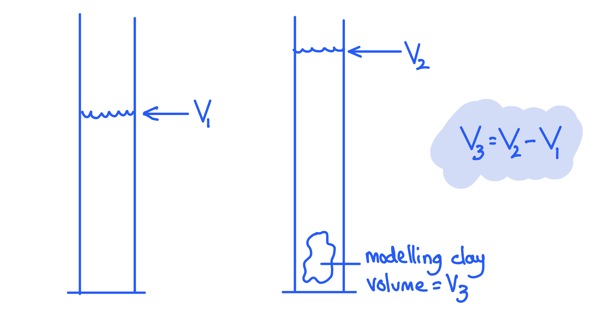
To convert cm3 to m3:

Calculate the number of cubic centimetres in one cubic metre by imagining a large cube with sides of 100 cm:

- $1 \mathrm{m}^{3} = ( 100 \times 100 \times 100 ) = 1 000 000 = 1 \times 10^{6} cm^{3}$

Find the reciprocal (do 1 divided by) to find the number of m3 in one cm3:

- $1\mathrm{cm}^{3}=\frac{1}{1\times10^{6}}=1\times10^{-6}m^{3}$

Calculate the answer:

- $64\mathrm{cm}^{3}=\frac{64}{1\times10^{6}}=64\times10^{-6}m^{3}$
- Volume = $64\times10^{-6}m^{3}$**OR**** **$0.000064m^{3}$ **[1 mark]**

**[Total: 1 mark]**

> *Many students find these conversions difficult to begin with but they are essential, so, practice!*
(i) The mass in kg is:

Use the fact that 1 kg = 1000 g:

- $\frac{60}{1000}$
- $=0.060\mathrm{kg}$ **[1 mark]**

(ii) To calculate density in S.I. units:

List the known quantities:

- Mass, *m* = 0.06 kg
- Volume, *v* = 0.000064 m3 (from part (c)

Use the density equation and calculate:

- $ρ=\frac{m}{v}$ **[1 mark]**
- $ρ=\frac{0.06}{0.000064}$** [1 mark]**

Write the answer to two sig figs and include the units:

- $ρ=940\mathrm{kg}/m^{3}$ **[1 mark]**

**[Total: 4 marks]**

> *Calculations like these are almost always what examiners call 'error carried forward' (you will see it written 'ecf' in mark schemes).*

> *This means that even if you got the conversions from cm**3** to m**3**, or from g to kg, wrong, as long as you have correctly calculated density in the final part, you will get those marks because you used the right method.*

> *Another reason to always show your working!*

### Q9
To find the volume of the model:

- Use a measuring cylinder (half-filled) with water **AND**** **record the (initial) volume of water; **[1 mark]**
- Add the model **AND** record the new volume; **[1 mark]**
- Subtract the initial volume of water from the final volume; **[1 mark]**

A diagram which would score three marks looks like:

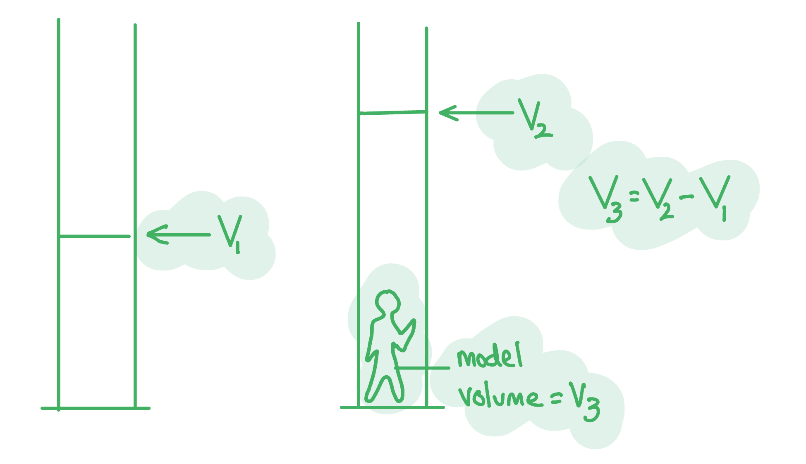

- Initial volume labelled; **[1 mark]**
- Model and final volume labelled; **[1 mark]**
- Calculation shown; **[1 mark]**

**[Total: 3 marks]**
(i) To use a force meter:

- Hang the statue from the (hook on the) balance; **[1 mark]**
- Read <u>weight</u> (from the scale); **[1 mark]**
- Calculate mass by dividing weight by 9.8 **OR**** **$m=\frac{W}{g}$ <u>where g = 9.8</u> **[1 mark]**

(ii) To reduces errors:

- Check the force meter is at zero before starting; **[1 mark]**

**[Total: 4 marks]**
Use the density equation to calculate the density of the model:

- $ρ=\frac{m}{V}=\frac{625}{72}=8.68g/\mathrm{cm}^{3}$ **[1 mark]**

Compare the density to the data in part (a):

- Density is not correct for copper or gold / they are both wrong; **[1 mark]**
- The most likely metal is brass; **[1 mark]**
- Value is not the same due to errors measuring <u>volume</u>;** [1 mark]**

**[Total: 4 marks]**

> *In a discussion of results it is worth mentioning experimental errors.*

> *It would be more likely to have an error in volume due to incorrect measuring technique, rather than mass. This is especially so since you have already discussed zero error earlier in the question.*
To find the density of a table-tennis ball:

- The ball will <u>float</u>; **[1 mark]**
- It needs to be pushed / held under water **AND**** **using a wire / thin stick / weight;** [1 mark]**
- The volume of the wire / stick / weight must be subtracted from the volume change; **[1 mark]**

**[Total: 3 marks]**

> *You may have thought of a different way to hold the table tennis ball under the surface of the water. Any sensible suggestion would be accepted. Check with a friend or teacher if you aren't sure about your idea.*

### Q10
The density of water is greater than that of oil because:

- The molecules (of water) are closer together **OR** there are more molecules (of water) per unit <u>volume</u>; **[1 mark]**

**[Total: 1 mark]**
The difference between mass and weight is:

- Weight is a <u>gravitational force</u> on an object that has mass;** [1 mark]**

**[Total: 1 mark]**

- *You have learned simpler definitions of mass and weight in Key Stage 3 but now you need to practice using the correct scientific vocabulary in your answers.*
The total weight of the oil is:

Determine the mass of oil:

- Mass of oil = total mass - mass of bucket = 14.1 − 1.2 kg = 12.9 kg **[1 mark]**

Use the equation for weight:

- $g=\frac{W}{m}$
- $W=mg=12.9\times9.8$ **[1 mark]**
- $W=126.42$** **

Round the answer to two sig figs and include the unit:

- $W=130N$ **[1 mark]**

**[Total: 3 marks]**

> *Unless otherwise stated in the question, you must use **g** = 9.8 N/kg *
To calculate the density of the oil:

List the known quantities:

- Volume of the oil, *V* = 0.0163 m3
- Mass of the oil, *m* = 12.9 kg (from part (c)

Use the equation for density:

- $ρ=\frac{m}{V}=\frac{12.9}{0.0163}$ **[1 mark]**
- $ρ=791.4$

State the answer to two sig figs and include the units:

- *ρ* = 790 kg/m3 **[1 mark]**

**[Total: 2 marks]**

### Q11
The unit of mass is:

- kg (kilogram); **[1 mark]**

**[Total: 1 mark]**
The correct definitions of mass and weight are:

(i)

- Mass is a measure of the quantity of **matter** in an object; **[1 mark]**
- at **rest**** **relative to the observer; **[1 mark]**

(ii)

- Weight is a gravitational **force**** **on an object; **[1 mark]**
- that has **mass**; **[1 mark]**

**[Total: 4 marks]**
(i) The equipment used to find mass is:

- (Digital) scales; **[1 mark]**

(ii) To calculate density:

List the known quantities:

- Mass, *m* = 0.75 kg
- Volume, *V* = 0.001 m3

Use the equation for density

- $ρ=\frac{m}{V}$ **[1 mark]**

Calculate:

- $ρ=\frac{0.75}{0.001}=750\mathrm{kg}/m^{3}$ **[1 mark]**

**[Total: 3 marks]**
The liquid which will float is:

- <u>Oil</u> (floats on water);** [1 mark]**

Explain why:

- Oil is less dense than water **OR**** **water is more dense than oil (so it sinks); **[1 mark]**

**[Total: 2 marks]**

### Q12
> **[mark-scheme]**
> - Density **[1 mark]**

> **[exam-tip]**
> The clue is "made from the same material": density is a property of the material, so every mass has the same density however big it is. The masses have different sizes, so their volumes and weights cannot be the same.
To convert the mass into grams:

- $1 \text{kg} = 1000 \text{g}$

$2 . 5 \text{kg} = 2 . 5 \times 1000 =$$2500 \text{g}$ **[1 mark]**

> **[exam-tip]**
> The prefix kilo means × 1000, so kilograms to grams is a multiplication. If you are unsure which way to convert, remember that a gram is a smaller unit, so the number of grams must be larger.
To calculate the combined weight of the three masses:

- List the known quantities:

  - Masses: $2 . 5 \text{kg}$, $1 . 0 \text{kg}$ and $0 . 5 \text{kg}$
  - Gravitational field strength, $g = 9 . 8 \text{N/kg}$
- Add the masses to find the combined mass:

$m = 2 . 5 + 1 . 0 + 0 . 5 = 4 . 0 \text{kg}$ **[1 mark]**

- Write down the equation linking weight, mass and gravitational field strength, and substitute the known values:

$W = m g = 4 . 0 \times 9 . 8$ **[1 mark]**

- Calculate the answer:

$W=39.2=$$39$ **[1 mark]**

- Give the unit:

**N** **[1 mark]**

> **[mark-scheme]**
> 1 mark for the combined mass of $4 . 0 \text{kg}$ (accept 4 kg)
> 
> 1 mark for the equation $W = m g$ or $g = \frac{W}{m}$ in words or symbols, **OR** correct substitution $4 . 0 \times 9 . 8$ (accept the three weights calculated separately and added: $24 . 5 + 9 . 8 + 4 . 9$)
> 
> 1 mark for a correct final value of 39
> 
> - Accept 39.2
> - Accept 40 if $g = 10 \text{N/kg}$ is used
> - ecf from an incorrect combined mass
> 
> 1 mark for the unit N (or newtons), awarded independently of the value

> **[exam-tip]**
> "Include the unit" is a signal that the unit is credited separately, so write N, not kg. You can add the masses first or multiply each mass by *g* and add the three weights: both routes score full marks. Rounded to two significant figures, 39.2 N is 39 N, not 40 N.

### Q13
Describe how the student can accurately determine the volume of the piece of metal:

**Any four from:**

- Pour water into the measuring cylinder; **[1 mark]**
- Record the volume of water (in the measuring cylinder); **[1 mark]**
- Place the metal in water (in the cylinder and completely submerge); **[1 mark]**
- Record the new volume of the water and the metal (in the cylinder); **[1 mark]**
- Subtract starting volume from final volume (to give volume of metal); **[1 mark]**

> *There are, of course, other methods of measuring the volume of an irregular object such as the use of a displacement or "eureka" can. In the question above, however, this equipment is not provided so you would not score any marks for outlining this method. If you did this mistake, a teacher would be likely to write "RTQ!!" on your paper, or "read the question!".*
(i) State the name of the instrument used to measure the mass:

- Balance / scales; **[1 mark]**

(ii) Calculate the density of the metal:

List the known quantities:

- Volume of the metal, *V* = 20 cm3
- Mass of the metal, *m* = 146 g

Recall the equation for density:

- $density=\frac{mass}{volume}$ **OR** $ρ=\frac{m}{V}$ **[1 mark]**

Substitute in the known quantities:

- $ρ=\frac{146}{20}$ **[1 mark]**

Calculate the density and give its units:

- *ρ *= 7.3 **[1 mark]**
- Mass has units of g
- Volume has units of cm3
- Density has units of g / cm3; **[1 mark]**

**[Total: 5 marks]**

### Q14
(i) The equipment used to measure the mass is:

- Mass is measured using a (digital) <u>balance</u>; **[1 mark]**

** **

(ii) To calculate density:

List the known quantities:

- Mass, *m* = 1260 g
- Volume, *v* = 150 cm3

Recall the equation for density:

- $ρ=\frac{m}{v}$**[1 mark]**

Substitute the values and calculate:

- $ρ=\frac{1260}{150}$

Write the answer including the units:

- Density, *ρ* = 8.4 **[1 mark]** g / cm3 **[1 mark]**

(iii) The mass in kilograms is:

There are 1000 g per kilogram:

- Therefore 1260 g = <u>1.26</u> kg; **[1 mark]**

**[Total: 5 marks]**

> *The only example of when you can usually leave the original units without first converting to S.I. units such as kg and m**3** is with density questions.*

> *However, when you do this you must remember to **state the units you used**. This question awards a mark for your correct units, as you are showing that you understand their importance and can get them right.*
To calculate the values of the forces:

- The mass of the vase, *m* = 0.25 kg
- Gravitational field strength, *g* = 9.8 N  / kg

Decide what each force represents:

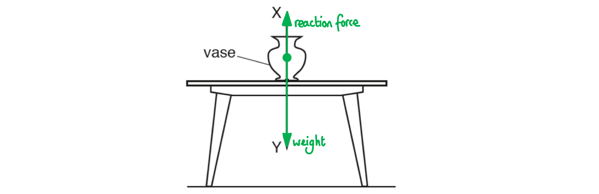

Recall the equation for weight in terms of gravitational field strength:

- $g=\frac{W}{m}$
- *W = mg*;** [1 mark]**

Substitute the values and calculate:

- Therefore force Y = 0.25 × 9.8;** [1 mark]**
- Y = 2.45 N
- <u>Y = 2.5 N</u>;** [1 mark]**

Recall that reaction force is equal to weight in equilibrium:

- Therefore force X = force Y = <u>2.5 N</u>;** [1 mark]**

**[Total: 4 marks]**

> *The final mark for the value of X is what examiners call '**error carried forward**' (you will see it written '**ecf**' in mark schemes).*

> *This means that even if you got the answer for Y wrong, as long as you have correctly identified that X = Y, you will get this mark.*

> *For example, if you wrote 250 N for Y and 250 N for X, you don't get the mark for Y, but you do get the mark for X because you used the right method.*

> *Another reason to always show your working!*

### Q15
(i) To describe an experiment to determine the density of the liquid:

- Measure the mass of the empty measuring cylinder / beaker; **[1 mark]**
- Add a measured / fixed volume of liquid; **[1 mark]**
- Measure the mass of the measuring cylinder/beaker and liquid; **[1 mark]**
- Subtract the mass when empty from the mass when full; **[1 mark]**
- Calculate density using $density=\frac{mass}{volume}$ **[1 mark]**

(ii) To state an appropriate unit of density:

- g / cm3 **OR** kg / m3 **[1 mark]**

**[Total: 6 marks]**
(i) An explanation of why polythene floats in water is:

- Polythene is less dense than water; **[1 mark]**

(ii) To calculate the mass of the block:

List the known values:

- Weight, *W* = 0.84 N
- *g* = 9.8 N / kg

Recall the equation linking *W*, *m* and *g*:

- $g=\frac{W}{m}$ **OR** $W=mg$ **[1 mark]**

Rearrange to make *m* the subject, and substitute in known values:

- $m=\frac{W}{g}=\frac{0.84}{9.8}$ **[1 mark]**

Calculate *m*:

- *m* = 0.086 kg **[1 mark]**

**[Total: 4 marks]**

### Q16
(i) An instrument suitable to take these measurements:

- Metre ruler / tape measure; **[1 mark]**

(ii) A method to reduce errors while taking these measurements:

**Any two from:**

- Ruler/ tape at right angles / perpendicular to the wall / floor; **[1 mark]**
- View scale at eye level / perpendicular to scale; **[1 mark]**
- <u>Metre rule</u> should be placed end to end <u>without gaps</u>; **[1 mark]**
- <u>Tape measure</u> should be <u>straight / no bends</u>; **[1 mark]**

(iii) To ensure the results are reliable.:

- <u>Repeat </u>readings / measure each distance (at least) <u>three</u> times;** [1 mark]**
- Calculate the <u>average</u>;** [1 mark]**

**[Total: 5 marks]**
To calculate the volume of air in the room:

Divide the shape into rectangles and calculate the two areas:

**Method 1:**

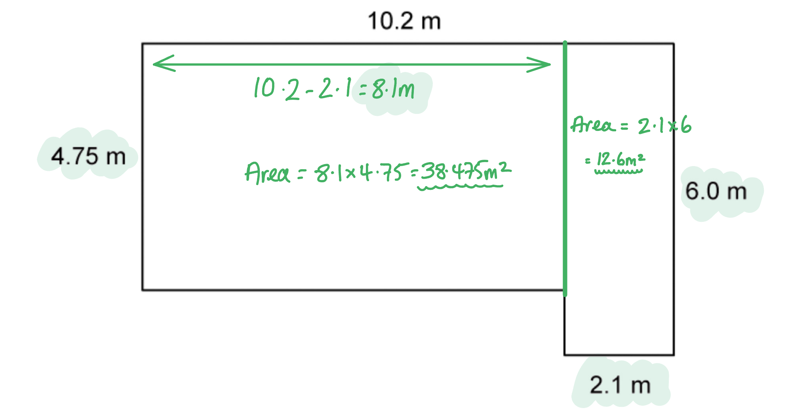

- (Area 1) = 38.5 / 38.48 **AND**** **(Area 2) = 12.6 **[1 mark]**
- Total area = 51.1(2) m2 **[1 mark]**

**Method 2:**

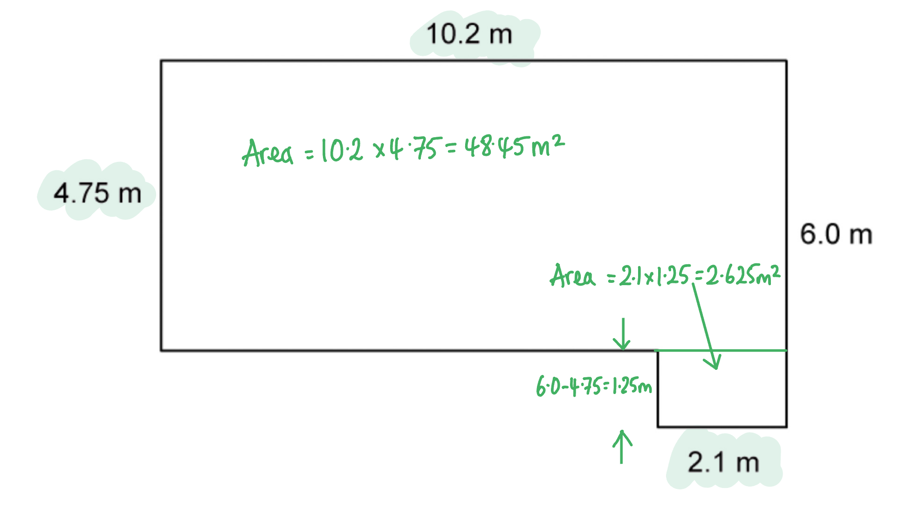

- (Area 1) = 48.49 / 48.5  **AND**** **(Area 2) = 2.625 / 2.63 **[1 mark]**
- Total area = 51.1(2) m2 **[1 mark]**

Recall the height of the ceiling is 3.5 m (part (a) and calculate the volume:

- Volume $v=area\timesheight=51.12\times3.5=178.92$ **[1 mark]**
- Volume = 179 m3 **[1 mark]**

**[Total: 4 marks]**

> *In a longer calculation like this one, avoid rounding up too soon. You should round at the end though.*
To calculate the mass of air:

List the known quantities:

- Volume of air = 179 m3 (from part (b)
- Density of air = 1.2 kg / m3

Use the density equation to calculate:

- $ρ=\frac{m}{V}$ **[1 mark]**
- $m=ρV=1.2\times179$ **[1 mark]**
- $m=214.8$

Write the final answer to two sig figs and include the unit:

- $m=210\mathrm{kg}$** [1 mark]**

**[Total: 3 marks]**

> *Longer calculations are always given as what examiners call 'error carried forward' (you will see it written 'ecf' in mark schemes).*

> *This means that even if you got the previous answer wrong, as long as you have correctly continued using it, you get subsequent marks.*

> *For example, if you calculated the volume of the room incorrectly in part (b) but then used your value in the right way in part (c), then you don't get the mark for (b) because it's wrong, but you do get the mark for (c) because you used the right method.*

> *Another reason to always show your working!*
Measurements to find the density of air:

*Volume of balloon:*

- Add water to the bucket **AND**** **add the balloon; **[1 mark]**
- Submerge the balloon **AND**** **mark the new level; **[1 mark]**
- Use the measuring cylinder to find the volume of water displaced by the balloon; **[1 mark]**

*Mass of balloon:*

**Any three from**:

- Let balloon dry; **[1 mark]**
- Use digital scales to find mass of the inflated balloon; **[1 mark]**
- Burst balloon **AND**** **find mass of the empty balloon; **[1 mark]**
- Subtract (balloon + air) − (balloon) to find mass of air; **[1 mark]**

**[Total: 6 marks]**

> *An example answer which scores five marks is:*

> *To calculate density you will need mass and volume. *

> *To find the volume of air, fill the balloon and tie the neck. Add water to the bucket then put the balloon in, pushing it down so it is completely under water. Note the new level of the water.*

> *Take out the balloon and use the measuring cylinder to top up the bucket to the same level. The volume of the water needed is the volume of air in the balloon.*

> *Let the balloon dry before weighing.*

> *Find the mass of the balloon using the digital scales. Burst the balloon and find the empty mass. Subtract mass 2 from mass 1 to find the mass of the air.*

> *The statement that 'you do not need to include details of the calculation' indicates that you will not get any marks for doing so. Especially since in part (c) you have already calculated density, so doing so again is not showing the examiner any new skills.*

> *In real laboratory settings, measuring the mass of air can be affected by air buoyancy. This is such a tiny effect for school experiments that it can be ignored.*

### Q17
(i) State the name given to the force shown in Fig. 2.1.:

- <u>Weight</u>; **[1 mark]**

(ii) Calculate the mass of the raft:

List the known quantities:

- Weight, *W* = 20 000 N
- Gravitational field strength, *g *= 9.8 m/s2

Recall the equation for weight:

- $g=\frac{W}{m}$ **OR** $W=mg$ **[1 mark]**

Rearrange to make mass the subject:

- $m=\frac{W}{g}$

Substitute in the known values to calculate:

- $m=\frac{20000}{10}$ **[1 mark]**
- *m* = 2000 kg **[1 mark]**

**[Total: 4 marks]**

> *Remember that when stating an equation, you will still get the marks if the equation is given in its rearranged form as long as the rearrangement is correct.*
Calculate the resultant horizontal force acting on the raft and state the direction of this force:

List the known quantities:

- Force acting to the right = 1200 N
- Force acting to the left = 800 N

Deduce the method for calculating the resultant force:

- Resultant force = force acting to the right − force acting to the left

Substitute in the known values to calculate:

- Resultant force = 1200 − 800
- Resultant force = 400 N **[1 mark]**

State the direction of the resultant force:

- To the right / forwards; **[1 mark]**

**[Total: 2 marks]**

> *A **resultant force** is a single force that describes all of the forces operating on a body. When many forces are applied to an object they can be combined (added) to produce one final force which describes the **combined action** of all of the forces.*

> *This single resultant force determines:*

- *The **direction** in which the object will move as a result of all of the forces*

  - *The **magnitude** of the final force experienced by the object*

> *If we determine that forward acting force is positive and the backward acting force is negative, then the resultant force is:*

> *F** = (+ 1000 N) + (− 800 N)*

> *Which is the same as saying:*

> *F** = 1000 N − 800 N*

### Q18
List the known quantities:

- Volume of pure water = 0.050 m3
- Density of pure water = 1000 kg / m3

Recall the equation relating density, volume and mass:

- $density=\frac{mass}{volume}$ **OR**** ** $ρ=\frac{m}{V}$ **[1 mark]**

Rearrange the equation to make mass the subject:

- $ρ=\frac{m}{V}$
- Multiply both sides by volume to give `V x rho = / V x (m)/(/ V) = m`
- $m=V\timesρ$

Substitute the known quantities into the rearranged equation:

- $m=0.05\times1000$ **[1 mark]**

Calculate the mass of pure water in the barrel:

- *m* = 50 kg **[1 mark]**

**Final answer:** ** **

**[Total: 3 marks]**
State whether the barrel will float or not:

- The full barrel will float / does not sink

Explain why, referring to the density of **one** material:

**Any one from:**

- The density of the full barrel is less than sea water; **[1 mark]**
- The density of plastic / the barrel is less than sea water; **[1 mark]**
- The density of (pure) water is less than sea water; **[1 mark]**

Explain why, referring to the **combination** of materials:

- The (average) density of the plastic/barrel **AND** the (pure) water is less than the density of sea water; **[1 mark]**

** **

**[Total: 2 marks]**
