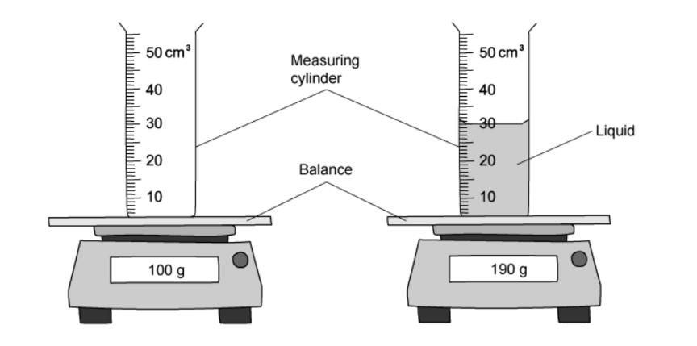
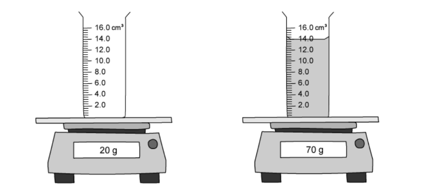
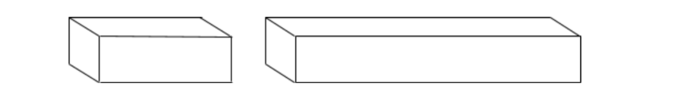
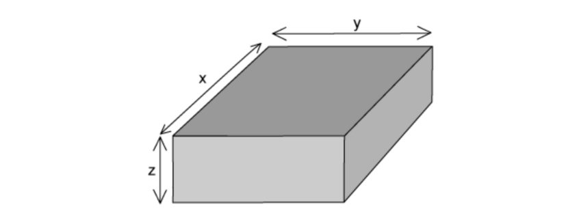
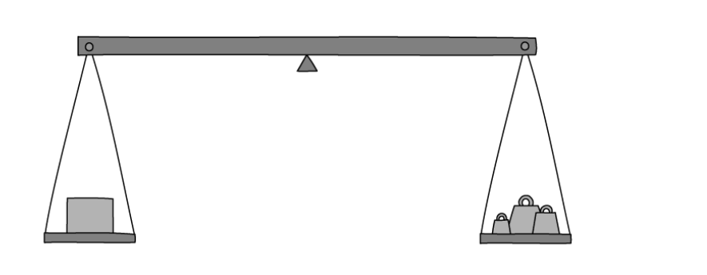
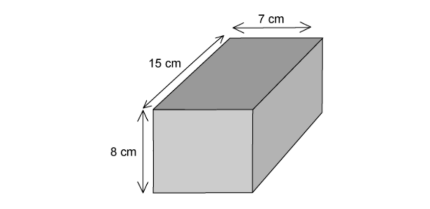

# Exam Questions — Mass, Weight & Density
**1. Motion, Forces & Energy** · Cambridge (CIE) IGCSE physics (0625 & 0972)
> Source: [https://www.savemyexams.com/igcse/physics/cie/23/topic-questions/](https://www.savemyexams.com/igcse/physics/cie/23/topic-questions/) · 41 questions across 1 sets

## Multiple Choice Questions (41 questions)

### Q1 — medium — 1 marks

**Q1** [1 mark]

The table shows the mass and the volume of two objects, P and Q. The objects are placed in a tank of water which has a density of $1.0\text{g/cm}^{3}$.

| object | mass / g | volume / cm3 |
|---|---|---|
| P | 15 | 5 |
| Q | 15 | 20 |

Which statement is correct?

### Q2 — easy — 1 marks

**Q2** [1 mark]

An object has a mass of $4.0\text{kg}$ on Earth, where the acceleration of free fall is $9.8\text{m/s}^{2}$.

The object is taken to the Moon, where the acceleration of free fall is $1.6\text{m/s}^{2}$.

Which row gives the correct mass and weight of the object on the Moon?

|   | mass / kg | weight / N |
|---|---|---|
| **A** | 2.5 | 4.0 |
| **B** | 4.0 | 6.4 |
| **C** | 4.0 | 39 |
| **D** | 6.4 | 39 |

### Q3 — easy — 1 marks

**Q3** [1 mark]

A student determines the density of an irregularly shaped stone. The stone is slowly lowered into a measuring cylinder partly filled with water.

Which other apparatus does the student need to calculate the density of the irregularly shaped stone?

*Source: June 2023 0972/11 Q6*

### Q4 — easy — 1 marks

**Q4** [1 mark]

A shopkeeper pours rice into a dish that hangs from a spring balance. He records the reading.

A customer buys some pasta. The shopkeeper notices that the reading on the spring balance, with just pasta in the dish, is the same as it was with just rice in the dish.

Which quantity **must **be the same for the rice and for the pasta?

*Source: June 2023 0972/11 Q5*

### Q5 — medium — 1 marks

**Q5** [1 mark]

A space rocket travels to the Moon.

The acceleration of free fall is greater on the Earth than it is on the Moon.

How do the mass and weight of the space rocket on the Moon compare with their values on the Earth?

|   | mass on the Moon | weight on the Moon |
|---|---|---|
| **A** | less than on the Earth | same as on the Earth |
| **B** | less than on the Earth | more than on the Earth |
| **C** | same as on the Earth | less than on the Earth |
| **D** | same as on the Earth | more than on the Earth |

*Source: June 2021 0972/11 Q4*

### Q6 — easy — 1 marks

**Q6** [1 mark]

Which unit is a unit of weight?

*Source: June 2023 0972/11 Q1*

### Q7 — hard — 1 marks

**Q7** [1 mark]

A spring balance operates by the compression of a spring. It has been calibrated on the Earth in grams.

A beam balance operates by balancing standard masses against the unknown mass to be measured.

The same unknown mass is measured with each balance on the Earth and on the Moon.

The gravitational field strength on the Earth is greater than that on the Moon.

How would the measurements on the Earth compare with those on the Moon?

| ** ** | **spring balance measurements** | **beam balance measurements** |
|---|---|---|
| **A** | larger on the Earth than on the Moon | larger on the Earth than on the Moon |
| **B** | larger on the Earth than on the Moon | same on the Earth as on the Moon |
| **C** | same on the Earth as on the Moon | larger on the Earth than on the Moon |
| **D** | same on the Earth as on the Moon | same on the Earth as on the Moon |

*Source: June 2022 paper 1 Q4*

### Q8 — medium — 1 marks

**Q8** [1 mark]

Two objects P and Q are placed in a beaker containing a liquid.

Object P floats in the liquid and object Q sinks.

Which row for the densities of object P, object Q and the liquid is possible?

| ** ** | **density of object P g/cm****3** | **density of object Q g/cm****3** | **density of liquid **  **g/cm****3** |
|---|---|---|---|
| **A** | 1.2 | 0.6 | 0.8 |
| **B** | 1.2 | 1.4 | 1.0 |
| **C** | 11.3 | 8.9 | 13.6 |
| **D** | 11.3 | 19.3 | 13.6 |

*Source: specimen 2023 paper 1 Q5*

### Q9 — medium — 1 marks

**Q9** [1 mark]

** **A measuring cylinder contains 30 cm3 of a liquid

Some more of the liquid is added until the liquid level reaches the 50 cm3 mark.

The reading on the balance increases by 30 g.

What is the density of the liquid?

*Source: June 2022 paper 1 Q5*

### Q10 — medium — 1 marks

**Q10** [1 mark]

**Extended Tier Only**

On the Moon, all objects fall with the same acceleration.

Which statement explains this?

*Source: June 2022 paper 2 Q4*

### Q11 — easy — 1 marks

**Q11** [1 mark]

The gravitational field strength on the Moon is 1.6 N/kg.

An astronaut has a mass of 75 kg.

What is the weight of the astronaut on the Moon?

*Source: specimen 2023 paper 2 Q4*

### Q12 — easy — 1 marks

**Q12** [1 mark]

Which statement about the mass and the weight of an object is correct?

*Source: specimen 2023 paper 1 Q3*

### Q13 — easy — 1 marks

**Q13** [1 mark]

Which row in the table gives the correct units for mass and for weight?

|   | **Mass** | **Weight** |
|---|---|---|
| **A** | kg | kg |
| **B** | N | kg |
| **C** | N | N |
| **D** | kg | N |

### Q14 — easy — 1 marks

**Q14** [1 mark]

Which of the quantities below is weight an example of?

### Q15 — easy — 1 marks

**Q15** [1 mark]

**Extended tier only**

How is the weight of an object defined?

### Q16 — easy — 1 marks

**Q16** [1 mark]

A student is given four objects, a mass balance and a metre ruler.

Which of the objects can he determine the density of , using only the metre ruler and the mass balance?

### Q17 — easy — 1 marks

**Q17** [1 mark]

Which of the following statements about mass or weight is true?

### Q18 — easy — 1 marks

**Q18** [1 mark]

Which of the following quantities is measured in kilograms?

### Q19 — medium — 1 marks

**Q19** [1 mark]

A baker uses a balance to weigh out some ingredients to make bread. She weighs out some white flour, then she weighs out some wholemeal flour. She notices that the reading on the balance is the same for both types of flour.

The baker can conclude that the two flours have the same:

### Q20 — hard — 1 marks

**Q20** [1 mark]

A teacher has a hot cup of tea.

Some of the liquid in the cup evaporates.

Choose the line from the table below that correctly describes what happens to the mass and the weight of the tea in the cup.

|   | **Mass** | **Weight** |
|---|---|---|
| **A** | increases | decreases |
| **B** | increases | increases |
| **C** | decreases | decreases |
| **D** | decreases | increases |

### Q21 — medium — 1 marks

**Q21** [1 mark]

A lump of butter has a volume of 350 cm3 and a mass of 319 g.

What is the density of the butter?

### Q22 — hard — 1 marks

**Q22** [1 mark]

A cheesemonger uses a newton meter to measure the weight of a block of cheese.

The cheese has a weight of 5.0 N

What is the approximate mass of the cheese?

### Q23 — hard — 1 marks

**Q23** [1 mark]

The diagram shows a ball of bread dough before and after it has been compressed (squashed) so its volume decreases.

Assume no material leaves the dough during compression.

What happens to the mass and the weight of the dough when it is compressed?

|   | **Mass** | **Weight** |
|---|---|---|
| **A** | stays the same | decreases |
| **B** | stays the same | stays the same |
| **C** | decreases | decreases |
| **D** | decreases | stays the same |

### Q24 — medium — 1 marks

**Q24** [1 mark]

The density of a block of wood is 2.7 g/cm3 and a mass of 583.8 g.

What is its volume?

### Q25 — medium — 1 marks

**Q25** [1 mark]

Which piece of equipment is used to measure the mass of an object?

### Q26 — medium — 1 marks

**Q26** [1 mark]

A student wants to measure the density of a piece of rock. She starts by measuring its mass ,  and finds that it is 2500 g.

Next she puts 500 cm3 of water into a large measuring cylinder , then adds the rock. The level in the measuring cylinder rises to 800 cm3.

What is the density of the rock?

### Q27 — medium — 1 marks

**Q27** [1 mark]

The diagram shows a measuring cylinder containing a liquid , and that same measuring cylinder when it is empty.

What is the density of the liquid?

### Q28 — medium — 1 marks

**Q28** [1 mark]

The two diagrams below show a measuring cylinder.

In the diagram on the left, the measuring cylinder is empty. In the diagram on the right, the measuring cylinder contains a liquid.

What is the density of the liquid?

### Q29 — hard — 1 marks

**Q29** [1 mark]

A teacher wants to measure the density of a wooden cylinder.

She measures the radius, height and mass of the cylinder.

Which of the measurements that she has taken are required to calculate the density of the cylinder?

### Q30 — medium — 1 marks

**Q30** [1 mark]

An astronaut has a mass of 80 kg on the Earth.

The gravitational field strength on the Moon is 1.6 N/kg.

What is the weight of the astronaut on the Moon?

### Q31 — hard — 1 marks

**Q31** [1 mark]

A dummy, named Starman, dressed in a white racing suit, was launched into space by Elon Musk’s first Falcon Heavy rocket. Starman was sent on a journey towards Mars.

Compared with being on the Earth’s surface, how do Starman’s mass and weight change when he is on his journey to Mars?

|   | **Mass** | **Weight** |
|---|---|---|
| **A** | stays the same | decreases |
| **B** | stays the same | stays the same |
| **C** | decreases | decreases |
| **D** | decreases | stays the same |

### Q32 — hard — 1 marks

**Q32** [1 mark]

The masses and volumes of four different objects are given in the table.

Which of the objects has the lowest density?

|   | **Mass / g** | ** Volume / cm****3** |
|---|---|---|
| **A** | 100 | 100 |
| **B** | 150 | 50 |
| **C** | 85 | 17 |
| **D** | 10 | 20 |

### Q33 — medium — 1 marks

**Q33** [1 mark]

Two beams have the same rectangular cross section, but one is longer than the other.

Both beams are made from the same material.

Which quantity is the same in both beams?

### Q34 — medium — 1 marks

**Q34** [1 mark]

Some unknown liquid in a beaker has a mass of 200 g and a volume of 230 cm3.

The density of water is 1.0 g/cm3

How does the density of the unknown liquid compare with the density of water?

### Q35 — medium — 1 marks

**Q35** [1 mark]

A geologist wants to determine the density of the object shown below.

What needs to be known in order to calculate its density ?

### Q36 — medium — 1 marks

**Q36** [1 mark]

A cube of side length 5 cm is placed on a mass balance.

What is the density of the cube?

### Q37 — hard — 1 marks

**Q37** [1 mark]

A block is shown in the diagram. It has a mass of* m*.

Which expression, below, could be used to calculate the density of the block?

### Q38 — hard — 1 marks

**Q38** [1 mark]

An object is put on the left hand side of the balance, shown below, in order to determine its weight.

Masses are added to the right hand side until it balances.

The table below shows the effect of various weight combinations.

| **Masses on the right hand side** | **Effect** |
|---|---|
| 100g, 50g, 50g, 20g, 5g, 2g | Balance tips slightly to the right |
| 200g, 10g, 10g, 5g | Balance tips slightly to the left |

Which of the masses below is most likely to be the mass of the object?

### Q39 — hard — 1 marks

**Q39** [1 mark]

Four blocks, **W**,** X** , **Y** and **Z** are shown below.

Which of the two blocks have the same density?

### Q40 — hard — 1 marks

**Q40** [1 mark]

An astronaut buys a 5.0 kg tin of Quality Street chocolates on Earth. She takes that 5.0 kg tin of Quality Street chocolate to the Moon. What is the mass of the tin of Quality Street chocolate on the Moon?

### Q41 — hard — 1 marks

**Q41** [1 mark]

A block of an unknown material is shown in the diagram.

It's mass is 500 g.

What is the density of the block?
