# Exam Questions — Mass, Weight & Density
**1. Motion, Forces & Energy** · Cambridge (CIE) IGCSE physics (0625 & 0972)
> Source: [https://www.savemyexams.com/igcse/physics/cie/23/topic-questions/](https://www.savemyexams.com/igcse/physics/cie/23/topic-questions/) · 61 questions across 3 sets

## Alternative To Practical Questions (2 questions)

### Q1 — medium — 11 marks

**Q1** [4 marks]

A student is determining the density of wood by two methods.

He is using the wooden rod shown in Fig. 1.1.

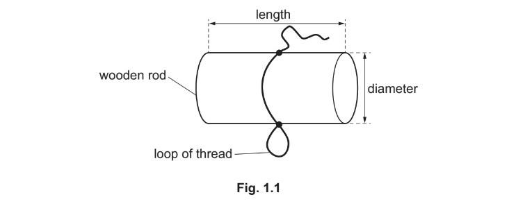

**Method 1**

The dimensions of the wooden rod are shown full size in Fig. 1.2.

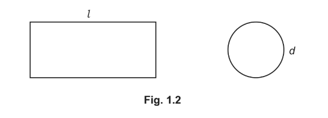

(i) Measure the length *l* and the diameter *d* of the wooden rod in Fig. 1.2.

*l* = ......................................................... cm

*d* = ......................................................... cm

[2]

(ii) Suggest an accurate method for measuring the diameter of the wooden rod in this experiment.

List any additional apparatus that might be required and briefly describe how you would determine the diameter.

You may draw a diagram if it helps to explain your answer.

[2]

*Source: 2020 0625/62 Q1A*

**Q1** [2 marks]

The student uses a balance to measure the mass m of the wooden rod as shown in Fig. 1.3.

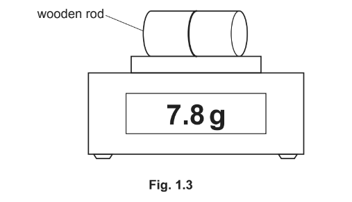

Record the mass *m* of the rod.

*m* = ............................................................g

Calculate a value ρ1 for the density of the wooden rod. Use the values *l* = 4.5 cm and *d* = 2.0 cm, the value of the mass, and the equation $ρ_{1}=\frac{4m}{πd^{2}l}$. Include a suitable unit.

*ρ*1 = ........................................................

*Source: 2020 0625/62 Q1B*

**Q1** [1 mark]

**Method 2**

The student pours water into a measuring cylinder as shown in Fig. 1.4. He then floats the wooden rod in the water as shown in Fig. 1.5.

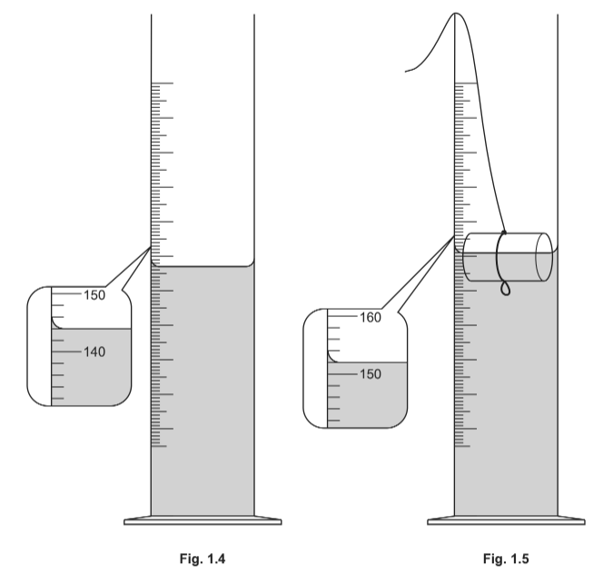

Record the reading V1 in cm3 of the water level in the measuring cylinder as shown in Fig. 1.4.

V1 = ........................................................cm3

Record the new reading V2 in cm3 of the water level in the measuring cylinder with the rod floating in the water as shown in Fig. 1.5.

V2 = ........................................................cm3

[1]

*Source: 2020 0625/62 Q1C*

**Q1** [2 marks]

**Extract:**

V₁ = 144 cm³
V₂ = 152 cm³
V₃ = 164 cm³
V₄ = 178 cm³
k = 1.0 g/cm³
Equation: ρ₂ = (V₂ - V₁) / (V₄ - V₃) × k

The student removes the rod and lowers a piece of modelling clay into the water as shown in Fig. 1.6.

He then hooks the rod to the modelling clay and lowers them into the water as shown in Fig. 1.7.

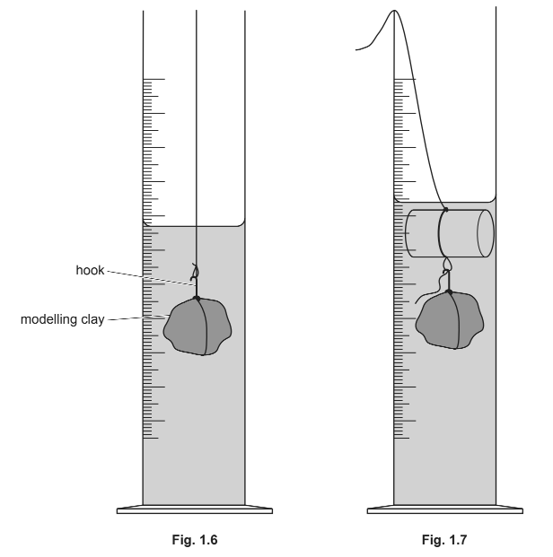

He records the new reading V3 of the water level in the measuring cylinder with the modelling clay.

He records the reading V4 of the water level in the measuring cylinder with the modelling clay and rod.

*V*3 = 164 cm3

*V*4 = 178 cm3

Calculate another value *ρ*2 for the density of the wooden rod. Use the values from **(c)** and **(d)** and the equation $ρ_{2}=\frac{V_{2}-V_{1}}{V_{4}-V_{3}}\timesk$ where *k *= 1.0 g/cm3.

*ρ*2 = ........................................................

*Source: 2020 0625/62 Q1D*

**Q1** [1 mark]

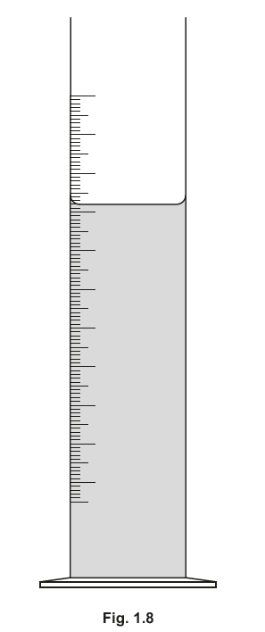

On Fig. 1.8, draw an arrow showing the correct line of sight for reading the volume of water in the measuring cylinder.

*Source: 2020 0625/62 Q1E*

**Q1** [1 mark]

**Extract:**

The student pours water into a measuring cylinder as shown in Fig. 1.4. He then floats the wooden rod in the water as shown in Fig. 1.5.

Record the reading V1 in cm^3 of the water level in the measuring cylinder as shown in Fig. 1.4.

Record the new reading V2 in cm^3 of the water level in the measuring cylinder with the rod floating in the water as shown in Fig. 1.5.

Suggest a possible source of inaccuracy in Method 2, even if it was carried out carefully.

*Source: 2020 0625/62 Q1F*

### Q2 — medium — 11 marks

**Q2** [2 marks]

**Extract:**

Marking is ratio-based because the figure's absolute size depends on the candidate's screen or printer. (i) Award the mark when the three measurements are in the ratio l : w : h of about 6 : 3 : 4 (width about half the length, height about two thirds of the length, each within 10%) regardless of absolute values; 6.0 / 3.0 / 4.0 cm are not required. (ii) Award by error carried forward when the stated volume equals the candidate's own l times w times h correctly evaluated (2 or 3 significant figures); do not award for wrong arithmetic. 72 cm³ is not required.

A student is determining the density of modelling clay.

He is using the block shown in Fig. 1.1 and Fig. 1.2.

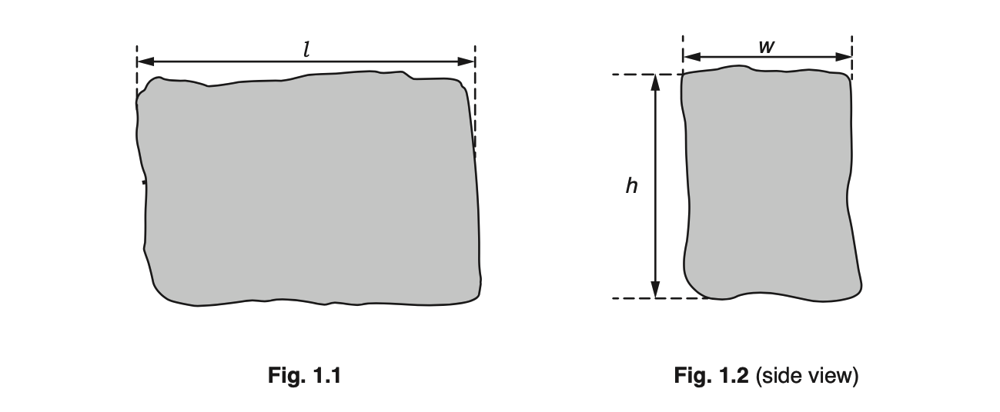

(i) Measure the dimensions of the block of modelling clay, as shown in Fig. 1.1 and Fig. 1.2.

length $l$ = ........................................................ cm

width $w$ = ........................................................ cm

height $h$ = ........................................................ cm

[1]

(ii) Calculate the volume *V*1 of the block, using your measurements from **(a)(i)** and the following equation:

$V_{1}=l\timesw\timesh$

$V_{1}$ = .................................................. cm3 [1]

*Source: Oct 2018 S2 0625/63 Q1*

**Q2** [2 marks]

**Extract:**

The student measures the dimensions of a block of modelling clay with a ruler. Expected source of inaccuracy: the block is not a perfect cuboid so its dimensions vary, or it is hard to line up the ruler (parallax). Expected improvement: measure each dimension in several places and take an average (repeat and average).

Suggest a possible source of inaccuracy in measuring the dimensions of the block and describe an improvement to the procedure that will produce more reliable measurements of the block.

*Source: oct 2018 S2 0625/63 Q1B*

**Q2** [1 mark]

**Extract:**

Expected reading 1.4 N. The unit N is printed on the answer line.

The student suspends the piece of modelling clay from a forcemeter, as shown in Fig. 1.3.

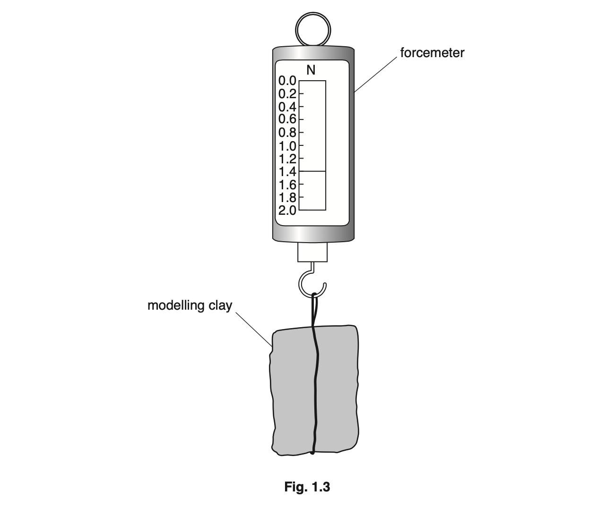

Record the weight *W* in Newtons, N, of the block of modelling clay shown in Fig. 1.3.

*W* = ..................................................... N

*Source: oct 2018 S2 0625/63 Q1C*

**Q2** [2 marks]

**Extract:**

V1 = 72 cm³ (from part (a)(ii)), W = 1.4 N (from part (c)), k = 100 g/N. Density = W times k divided by V1 = 1.944, expected answer 1.9 g/cm³. 1 mark for the value rounded to two significant figures (error carried forward from the candidate's own W and V1); 1 mark for the unit g/cm³. Do not accept 1.944 or 1.94 for the value mark.

Calculate a value *ρ*1 for the density of the modelling clay, using your results from **(a)(ii)** and **(c)** and the following equation:

$ρ_{1}=\frac{W\timesk}{V_{1}}$

Where *k* = 100 g/N.

*ρ*1 = .........................................................

*Source: oct 2018 S2 0625/63 Q1D*

**Q2** [2 marks]

**Extract:**

(i) Expected reading 160 cm³ (each small division is 5 cm³). (ii) Expected: line of sight perpendicular to the scale / read at eye level / read the bottom of the meniscus. A diagram showing the eye level with the meniscus is acceptable.

The student pours some water into a measuring cylinder, as shown in Fig. 1.4.

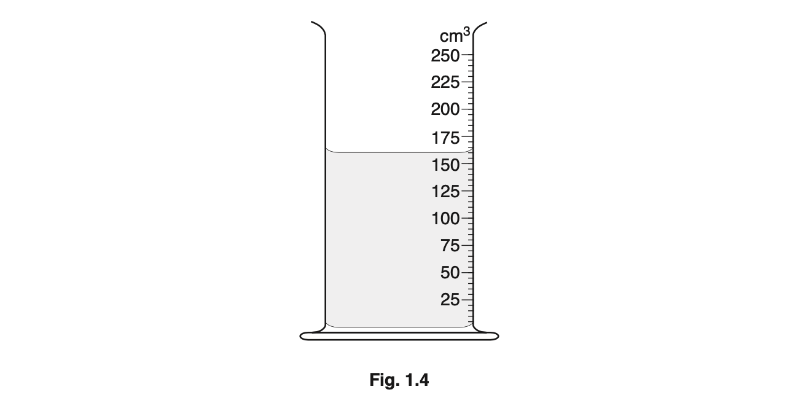

(i) Record the volume *V*2 of the water in the measuring cylinder shown in Fig. 1.4.

*V*2 = .................................................. cm3 [1]

(ii) Describe how a measuring cylinder is read to obtain an accurate value for the volume of water. You may draw a diagram to help you.

[1]

*Source: oct 2018 S2 0625/63 Q1E*

**Q2** [2 marks]

**Extract:**

V3 = 230 cm³; V2 = 160 cm³ (from part (e)(i)); W = 1.4 N (from part (c)); k = 100 g/N. Density = 1.4 times 100 divided by (230 minus 160) = 2.0 g/cm³; error carried forward from the candidate's own values. (ii) Any one: density 1 because the measuring cylinder is less precise than the ruler; density 1 because the string displaces extra water; density 2 because the volume is measured directly. The inverse arguments are accepted.

The student lowers the modelling clay into the water, as shown in Fig. 1.5.

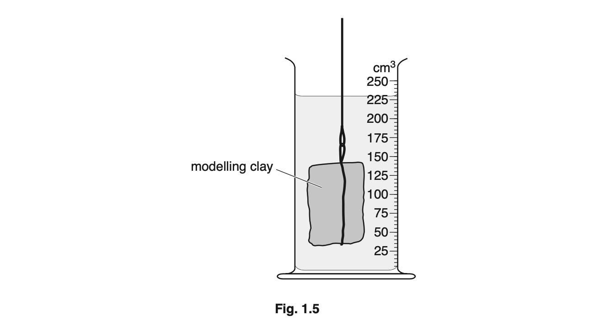

(i) Record the new reading *V*3 of the measuring cylinder Fig. 1.5, with the block of modelling clay in the water.

*V*3 = ....................................................... cm3

Calculate another value *ρ*2 for the density of modelling clay, using your value for *V*3, your readings from **(c)** and **(e)(i)** and the equation:

$\rho_{2} = \frac{W \times k}{( V_{3} - V_{2} )}$

where *k* = 100 g/N.

*ρ*2 = ..............................................................

[1]

(ii) Suggest which of *ρ*1 or *ρ*2 is likely to be the more accurate value for the density of the modelling clay.

Justify your answer by referring to the procedure.

[1]

*Source: oct 2018 S2 0625/63 Q1F*

## Multiple Choice Questions (41 questions)

### Q1 — medium — 1 marks

**Q1** [1 mark]

The table shows the mass and the volume of two objects, P and Q. The objects are placed in a tank of water which has a density of $1.0\text{g/cm}^{3}$.

| object | mass / g | volume / cm3 |
|---|---|---|
| P | 15 | 5 |
| Q | 15 | 20 |

Which statement is correct?

### Q2 — easy — 1 marks

**Q2** [1 mark]

An object has a mass of $4.0\text{kg}$ on Earth, where the acceleration of free fall is $9.8\text{m/s}^{2}$.

The object is taken to the Moon, where the acceleration of free fall is $1.6\text{m/s}^{2}$.

Which row gives the correct mass and weight of the object on the Moon?

|   | mass / kg | weight / N |
|---|---|---|
| **A** | 2.5 | 4.0 |
| **B** | 4.0 | 6.4 |
| **C** | 4.0 | 39 |
| **D** | 6.4 | 39 |

### Q3 — easy — 1 marks

**Q3** [1 mark]

A student determines the density of an irregularly shaped stone. The stone is slowly lowered into a measuring cylinder partly filled with water.

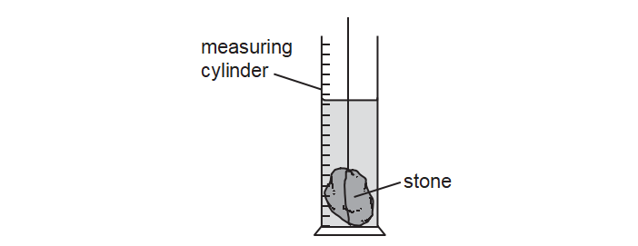

Which other apparatus does the student need to calculate the density of the irregularly shaped stone?

*Source: June 2023 0972/11 Q6*

### Q4 — easy — 1 marks

**Q4** [1 mark]

A shopkeeper pours rice into a dish that hangs from a spring balance. He records the reading.

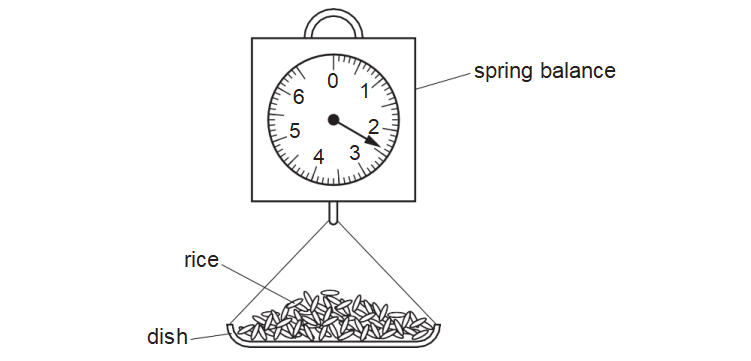

A customer buys some pasta. The shopkeeper notices that the reading on the spring balance, with just pasta in the dish, is the same as it was with just rice in the dish.

Which quantity **must **be the same for the rice and for the pasta?

*Source: June 2023 0972/11 Q5*

### Q5 — medium — 1 marks

**Q5** [1 mark]

A space rocket travels to the Moon.

The acceleration of free fall is greater on the Earth than it is on the Moon.

How do the mass and weight of the space rocket on the Moon compare with their values on the Earth?

|   | mass on the Moon | weight on the Moon |
|---|---|---|
| **A** | less than on the Earth | same as on the Earth |
| **B** | less than on the Earth | more than on the Earth |
| **C** | same as on the Earth | less than on the Earth |
| **D** | same as on the Earth | more than on the Earth |

*Source: June 2021 0972/11 Q4*

### Q6 — easy — 1 marks

**Q6** [1 mark]

Which unit is a unit of weight?

*Source: June 2023 0972/11 Q1*

### Q7 — hard — 1 marks

**Q7** [1 mark]

A spring balance operates by the compression of a spring. It has been calibrated on the Earth in grams.

A beam balance operates by balancing standard masses against the unknown mass to be measured.

The same unknown mass is measured with each balance on the Earth and on the Moon.

The gravitational field strength on the Earth is greater than that on the Moon.

How would the measurements on the Earth compare with those on the Moon?

| ** ** | **spring balance measurements** | **beam balance measurements** |
|---|---|---|
| **A** | larger on the Earth than on the Moon | larger on the Earth than on the Moon |
| **B** | larger on the Earth than on the Moon | same on the Earth as on the Moon |
| **C** | same on the Earth as on the Moon | larger on the Earth than on the Moon |
| **D** | same on the Earth as on the Moon | same on the Earth as on the Moon |

*Source: June 2022 paper 1 Q4*

### Q8 — medium — 1 marks

**Q8** [1 mark]

Two objects P and Q are placed in a beaker containing a liquid.

Object P floats in the liquid and object Q sinks.

Which row for the densities of object P, object Q and the liquid is possible?

| ** ** | **density of object P g/cm****3** | **density of object Q g/cm****3** | **density of liquid **  **g/cm****3** |
|---|---|---|---|
| **A** | 1.2 | 0.6 | 0.8 |
| **B** | 1.2 | 1.4 | 1.0 |
| **C** | 11.3 | 8.9 | 13.6 |
| **D** | 11.3 | 19.3 | 13.6 |

*Source: specimen 2023 paper 1 Q5*

### Q9 — medium — 1 marks

**Q9** [1 mark]

** **A measuring cylinder contains 30 cm3 of a liquid

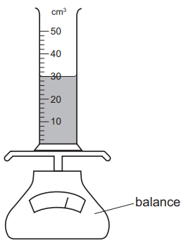

Some more of the liquid is added until the liquid level reaches the 50 cm3 mark.

The reading on the balance increases by 30 g.

What is the density of the liquid?

*Source: June 2022 paper 1 Q5*

### Q10 — medium — 1 marks

**Q10** [1 mark]

**Extended Tier Only**

On the Moon, all objects fall with the same acceleration.

Which statement explains this?

*Source: June 2022 paper 2 Q4*

### Q11 — easy — 1 marks

**Q11** [1 mark]

The gravitational field strength on the Moon is 1.6 N/kg.

An astronaut has a mass of 75 kg.

What is the weight of the astronaut on the Moon?

*Source: specimen 2023 paper 2 Q4*

### Q12 — easy — 1 marks

**Q12** [1 mark]

Which statement about the mass and the weight of an object is correct?

*Source: specimen 2023 paper 1 Q3*

### Q13 — easy — 1 marks

**Q13** [1 mark]

Which row in the table gives the correct units for mass and for weight?

|   | **Mass** | **Weight** |
|---|---|---|
| **A** | kg | kg |
| **B** | N | kg |
| **C** | N | N |
| **D** | kg | N |

### Q14 — easy — 1 marks

**Q14** [1 mark]

Which of the quantities below is weight an example of?

### Q15 — easy — 1 marks

**Q15** [1 mark]

**Extended tier only**

How is the weight of an object defined?

### Q16 — easy — 1 marks

**Q16** [1 mark]

A student is given four objects, a mass balance and a metre ruler.

Which of the objects can he determine the density of , using only the metre ruler and the mass balance?

### Q17 — easy — 1 marks

**Q17** [1 mark]

Which of the following statements about mass or weight is true?

### Q18 — easy — 1 marks

**Q18** [1 mark]

Which of the following quantities is measured in kilograms?

### Q19 — medium — 1 marks

**Q19** [1 mark]

A baker uses a balance to weigh out some ingredients to make bread. She weighs out some white flour, then she weighs out some wholemeal flour. She notices that the reading on the balance is the same for both types of flour.

The baker can conclude that the two flours have the same:

### Q20 — hard — 1 marks

**Q20** [1 mark]

A teacher has a hot cup of tea.

Some of the liquid in the cup evaporates.

Choose the line from the table below that correctly describes what happens to the mass and the weight of the tea in the cup.

|   | **Mass** | **Weight** |
|---|---|---|
| **A** | increases | decreases |
| **B** | increases | increases |
| **C** | decreases | decreases |
| **D** | decreases | increases |

### Q21 — medium — 1 marks

**Q21** [1 mark]

A lump of butter has a volume of 350 cm3 and a mass of 319 g.

What is the density of the butter?

### Q22 — hard — 1 marks

**Q22** [1 mark]

A cheesemonger uses a newton meter to measure the weight of a block of cheese.

The cheese has a weight of 5.0 N

What is the approximate mass of the cheese?

### Q23 — hard — 1 marks

**Q23** [1 mark]

The diagram shows a ball of bread dough before and after it has been compressed (squashed) so its volume decreases.

Assume no material leaves the dough during compression.

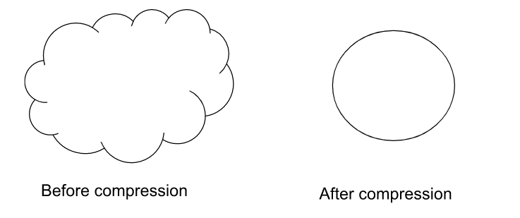

What happens to the mass and the weight of the dough when it is compressed?

|   | **Mass** | **Weight** |
|---|---|---|
| **A** | stays the same | decreases |
| **B** | stays the same | stays the same |
| **C** | decreases | decreases |
| **D** | decreases | stays the same |

### Q24 — medium — 1 marks

**Q24** [1 mark]

The density of a block of wood is 2.7 g/cm3 and a mass of 583.8 g.

What is its volume?

### Q25 — medium — 1 marks

**Q25** [1 mark]

Which piece of equipment is used to measure the mass of an object?

### Q26 — medium — 1 marks

**Q26** [1 mark]

A student wants to measure the density of a piece of rock. She starts by measuring its mass ,  and finds that it is 2500 g.

Next she puts 500 cm3 of water into a large measuring cylinder , then adds the rock. The level in the measuring cylinder rises to 800 cm3.

What is the density of the rock?

### Q27 — medium — 1 marks

**Q27** [1 mark]

The diagram shows a measuring cylinder containing a liquid , and that same measuring cylinder when it is empty.

What is the density of the liquid?

### Q28 — medium — 1 marks

**Q28** [1 mark]

The two diagrams below show a measuring cylinder.

In the diagram on the left, the measuring cylinder is empty. In the diagram on the right, the measuring cylinder contains a liquid.

What is the density of the liquid?

### Q29 — hard — 1 marks

**Q29** [1 mark]

A teacher wants to measure the density of a wooden cylinder.

She measures the radius, height and mass of the cylinder.

Which of the measurements that she has taken are required to calculate the density of the cylinder?

### Q30 — medium — 1 marks

**Q30** [1 mark]

An astronaut has a mass of 80 kg on the Earth.

The gravitational field strength on the Moon is 1.6 N/kg.

What is the weight of the astronaut on the Moon?

### Q31 — hard — 1 marks

**Q31** [1 mark]

A dummy, named Starman, dressed in a white racing suit, was launched into space by Elon Musk’s first Falcon Heavy rocket. Starman was sent on a journey towards Mars.

Compared with being on the Earth’s surface, how do Starman’s mass and weight change when he is on his journey to Mars?

|   | **Mass** | **Weight** |
|---|---|---|
| **A** | stays the same | decreases |
| **B** | stays the same | stays the same |
| **C** | decreases | decreases |
| **D** | decreases | stays the same |

### Q32 — hard — 1 marks

**Q32** [1 mark]

The masses and volumes of four different objects are given in the table.

Which of the objects has the lowest density?

|   | **Mass / g** | ** Volume / cm****3** |
|---|---|---|
| **A** | 100 | 100 |
| **B** | 150 | 50 |
| **C** | 85 | 17 |
| **D** | 10 | 20 |

### Q33 — medium — 1 marks

**Q33** [1 mark]

Two beams have the same rectangular cross section, but one is longer than the other.

Both beams are made from the same material.

Which quantity is the same in both beams?

### Q34 — medium — 1 marks

**Q34** [1 mark]

Some unknown liquid in a beaker has a mass of 200 g and a volume of 230 cm3.

The density of water is 1.0 g/cm3

How does the density of the unknown liquid compare with the density of water?

### Q35 — medium — 1 marks

**Q35** [1 mark]

A geologist wants to determine the density of the object shown below.

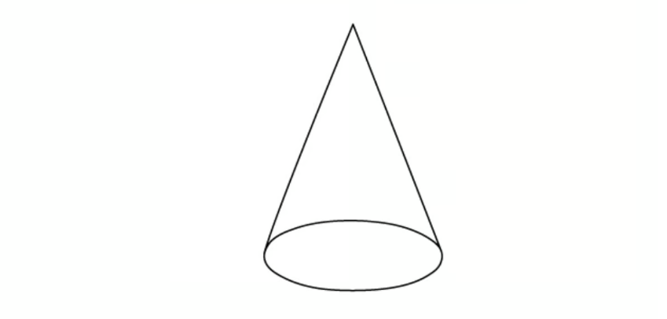

What needs to be known in order to calculate its density ?

### Q36 — medium — 1 marks

**Q36** [1 mark]

A cube of side length 5 cm is placed on a mass balance.

What is the density of the cube?

### Q37 — hard — 1 marks

**Q37** [1 mark]

A block is shown in the diagram. It has a mass of* m*.

Which expression, below, could be used to calculate the density of the block?

### Q38 — hard — 1 marks

**Q38** [1 mark]

An object is put on the left hand side of the balance, shown below, in order to determine its weight.

Masses are added to the right hand side until it balances.

The table below shows the effect of various weight combinations.

| **Masses on the right hand side** | **Effect** |
|---|---|
| 100g, 50g, 50g, 20g, 5g, 2g | Balance tips slightly to the right |
| 200g, 10g, 10g, 5g | Balance tips slightly to the left |

Which of the masses below is most likely to be the mass of the object?

### Q39 — hard — 1 marks

**Q39** [1 mark]

Four blocks, **W**,** X** , **Y** and **Z** are shown below.

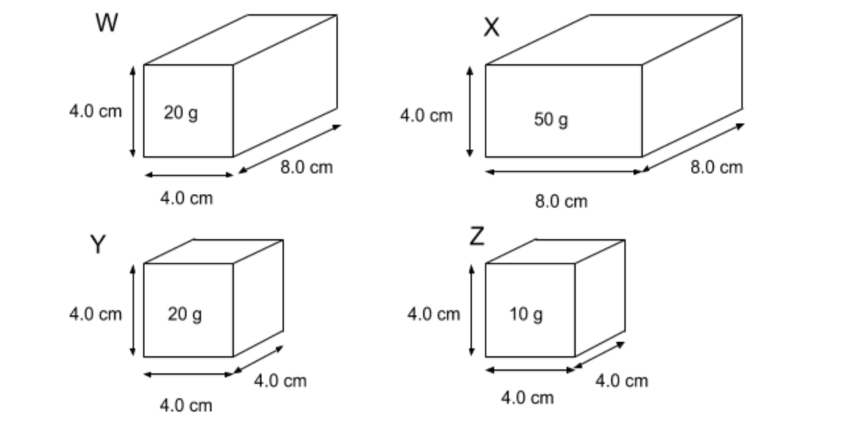

Which of the two blocks have the same density?

### Q40 — hard — 1 marks

**Q40** [1 mark]

An astronaut buys a 5.0 kg tin of Quality Street chocolates on Earth. She takes that 5.0 kg tin of Quality Street chocolate to the Moon. What is the mass of the tin of Quality Street chocolate on the Moon?

### Q41 — hard — 1 marks

**Q41** [1 mark]

A block of an unknown material is shown in the diagram.

It's mass is 500 g.

What is the density of the block?

## Theory Questions (18 questions)

### Q1 — easy — 8 marks

**Q1** [2 marks]

A student wishes to determine the density of a regular-shaped solid block, such as a cube.

State the **two** quantities the student must measure to find the density of the block.

**Q1** [4 marks]

The student then determines the density of an irregularly shaped stone.

To find the volume, the student lowers the stone into a measuring cylinder containing water.

Fig. 1.1 shows the water level in the measuring cylinder **before** the stone is added.

**Fig. 1.1**

(i) State the volume of water in the measuring cylinder shown in Fig. 1.1.

[1]

(ii) State the name of the curve formed by the water surface in Fig. 1.1.

[1]

(iii) The stone is lowered carefully into the water until it is fully covered.

The new volume reading is 46 cm3.

Calculate the volume of the stone.

[2]

**Q1** [2 marks]

**Extract:**

(iii) The stone is lowered carefully into the water until it is fully covered. 

The new volume reading is 46 cm3. 

Calculate the volume of the stone.

V = Vf - Vi
V = 46 - 22
V = 24 cm3

The mass of the stone is 6.5 g.

Calculate the density of the stone.

### Q2 — hard — 6 marks

**Q2** [2 marks]

Compare the arrangement and motion of the particles in ice and in liquid water.

*Source: 2023 specimen paper 4 Q5A*

**Q2** [4 marks]

**Extended Tier Only**

A lake has a layer of ice on its surface. The area of the lake is 1800 m2 . The ice has a thickness of 0.025 m. The density of ice is 920 kg/m3 .

(i) Calculate the mass of ice on the lake.

mass = .......................................................... [2]

(ii) At night, the temperature of the ice on the lake falls by 3.5 °C.

The specific heat capacity of ice is 2.1 $\times$ 103  J/kg °C.

Calculate the change in energy as the temperature falls.

energy = .......................................................  J [2]

*Source: specimen 2023 paper 4 Q5B*

### Q3 — medium — 10 marks

**Q3** [2 marks]

A piece of metal has an irregular shape. The weight of the metal is 3.0 N.

Calculate the mass of the metal.

mass = .....................................................kg

*Source: specimen 2023 paper 3 Q2A*

**Q3** [8 marks]

Fig. 2.1 shows the piece of metal, a measuring cylinder and a beaker containing water.

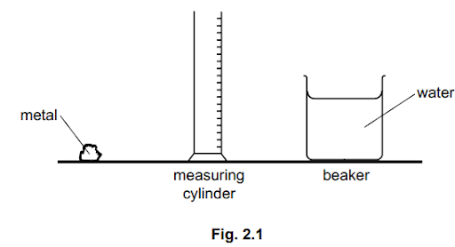

(i) Describe how to determine the volume of the piece of metal, using the equipment in Fig. 2.1.

[4]

(ii) Explain why the procedure in **(b)(i)** is not suitable for finding the volume of a piece of low-density wood that is a similar shape and size to the piece of metal.

[1]

(iii)** **The mass of another piece of metal is 405 g and its volume is 150 cm3. Calculate the density of this piece of metal.

density = ..............................................  g/cm3 [3]

*Source: specimen 2023 paper 3 Q2B*

### Q4 — medium — 4 marks

**Q4** [4 marks]

**Extract:**

(i) The face in contact with the ground is 12.0 cm by 2.0 cm; expected answer 24 cm². (ii) g = 9.8 N/kg; expected answer 8.232 N rounded to 8.2 N; accept 8.23 N; accept 8.4 N if g = 10 N/kg has been used. Award both marks in each sub-part for the correct answer alone.

Fig. 3.1 shows a metal block and its dimensions.

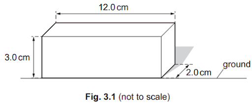

(i)** **Calculate the area of the metal block in contact with the ground.

area = .................................................. cm2  [2]

(ii) The mass of the metal block is 0.84kg.

Calculate the weight of the metal block.

weight = ..................................................... N [2]

*Source: June 2022 paper 3 Q3A*

### Q5 — easy — 7 marks

**Q5** [3 marks]

**Extract:**

Question stem:

- Eight logs, average mass of each log 65.0 kg
- The stem gives g = 9.8 N/kg

---

When marking this answer:

- A correct final answer of 5100 N or 5096 N with no working scores all three marks
- Accept any correct substitution for the second mark, for example 8 × 65.0 × 9.8, 637 × 8 or 520 × 9.8
- Only 5100 N (or 5.1 × 103 N) or 5096 N earns the final mark; 5090 N is not a correct rounding and does not earn it
- An answer of 5200 N (g = 10 N/kg used) earns the W = mg mark only, never the substitution or final mark
- The weight of one log only (637 N) earns the W = mg mark only

Fig. 2.1 shows a wooden raft. The raft is made from eight logs.

The logs are all of the same type of wood.

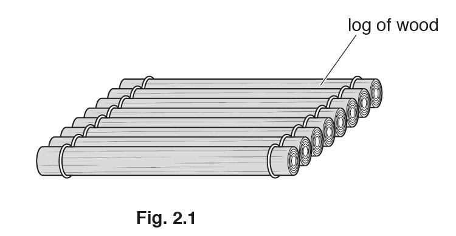

The average mass of each log is $65 . 0 \text{kg}$.

The gravitational field strength *g* is $9 . 8 \text{N/kg}$.

Calculate the total weight of the raft.

total weight of the raft = ....................................................... N

*Source: 2018 0625/32 Q2A*

**Q5** [4 marks]

**Extract:**

Question stem:

- One log: mass 66.0 kg, length 3.0 m, cross-sectional area 0.040 m2

---

When marking this answer:

- In part (i), a correct final answer of 550 kg/m3 with no working scores all three marks
- In part (i), award the final mark for a density correctly calculated from the candidate's own volume (ecf)

(i) The mass of one of the logs is $66 . 0 \text{kg}$. It is $3 . 0 \text{m}$ long and has a cross-sectional area of $0 . 040 \text{m}^{2}$.

Calculate the density of the wood in the log.

density = ............................................... kg/m3

[3]

(ii) Explain why the log in **(b)(i)** floats on water.

[1]

*Source: 2018 0625/32 Q2B*

### Q6 — medium — 10 marks

**Q6** [3 marks]

Fig. 1.1 shows a coil of wire.

A student measures the length of the coil using a ruler. His measurement is 3.8 cm.

There are 20 turns of wire in the coil. The student uses his measurement to calculate the average thickness of the wire.

(i) Show that the average thickness of the wire is about 0.2 cm.

average thickness of wire = .................................................. cm  [2]

(ii) The student’s measurement of 3.8 cm is inaccurate. Suggest one reason why the measurement is inaccurate.

[1]

*Source: 2020 0625/31 Q1A*

**Q6** [3 marks]

The volume of the wire in the coil is 16.6 cm3 and its mass is 148 g.

Calculate the density of the metal used for the wire in the coil.

density = ............................................. g/cm3

*Source: 2020 0625/31 Q1B*

**Q6** [4 marks]

The student has a measuring cylinder and a beaker of water, as shown in Fig. 1.2.

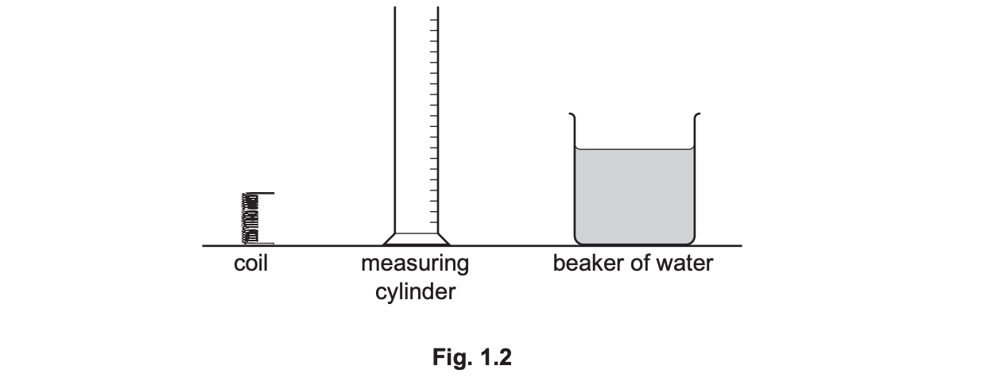

Describe how the student can determine the volume of the coil by using the equipment shown in Fig. 1.2.

*Source: 2020 0625/31 Q1C*

### Q7 — easy — 8 marks

**Q7** [1 mark]

An astronaut travels from Earth to the Moon.

Gravitational field strength on Earth = 9.8 N/kg

Gravitational field strength on the Moon = 1.6 N/kg

Identify the quantity that is the different for the astronaut on the Moon compared to the Earth.

Tick **one** box.

`square` mass

`square` weight

`square` density

**Q7** [3 marks]

**Extract:**

Gravitational field strength on Earth = 9.8 N/kg
Gravitational field strength on the Moon = 1.6 N/kg

The mass of the astronaut is 65 kg on Earth.

(i) Calculate the astronaut’s weight on Earth.

[2]

(ii) Calculate the astronaut’s weight on the Moon

[1]

**Q7** [3 marks]

**Extract:**

Gravitational field strength on Earth = 9.8 N/kg
Gravitational field strength on the Moon = 1.6 N/kg
The mass of the astronaut is 65 kg on Earth.
Weight on Earth: W = m × g_E = 65 × 9.8 = 640 N
Weight on the Moon: W = m × g_M = 65 × 1.6 = 100 N

Complete the following sentence.

The astronaut's weight on Earth is more than their weight on the Moon because, although their ..................... is the same, the .......................... force on Earth is ............................

**Q7** [1 mark]

State the piece of equipment that can be used to compare the mass and weight of the astronaut while they are still on Earth.

### Q8 — easy — 13 marks

**Q8** [4 marks]

Fig. 1.1 shows laboratory equipment used to find the density of an irregularly shaped solid.

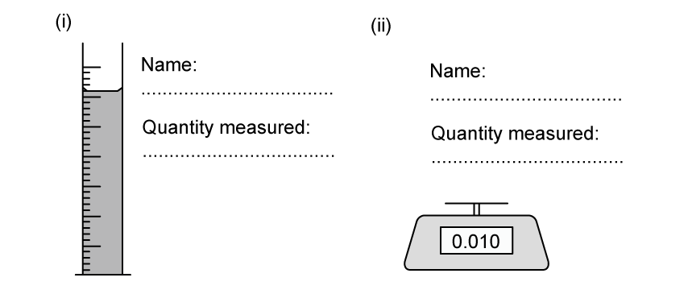

**Fig. 1.1**

For each piece of equipment add a label stating the name and the quantity measured.

**Q8** [4 marks]

**Extract:**

The equipment needed to find density is:

- Measuring cylinder (containing water); [1 mark]
- Volume; [1 mark]

- (Digital) balance / scales; [1 mark]
- Mass; [1 mark]

Explain how a student can find the volume of a piece of modelling clay of irregular shape using only the equipment in part (a)

**Q8** [1 mark]

**Extract:**

Fig. 1.1 shows laboratory equipment used to find the density of an irregularly shaped solid.

The volume of the modelling clay is found to be 64 cm3.

State the volume in m3.

**Q8** [4 marks]

**Extract:**

The volume of the modelling clay is found to be 64 cm^3.
To convert cm^3 to m^3:
...
Calculate the answer:
- 64 cm^3 = 64 × 10^-6 m^3
- Volume = 64 × 10^-6 m^3 OR 0.000064 m^3

The mass of the modelling clay is 60 g.

(i) Determine the mass in kg.

[1]

(ii) Calculate the density of the modelling clay, stating your answer in terms of S.I. units.

[3]

### Q9 — hard — 14 marks

**Q9** [3 marks]

In a car boot sale a student sees what the seller says is a model soldier made from copper. The student buys the model, hoping that it is really made from gold.

At Science Club the student is allowed to investigate their theory.

Describe how the volume of the model could be measured.

You may use a diagram if you wish.

**Q9** [4 marks]

**Extract:**

In a car boot sale a student sees what the seller says is a model soldier made from copper. The student buys the model, hoping that it is really made from gold.

At Science Club the student is allowed to investigate their theory.

The student used a force meter for the next stage of their investigation.

(i) Describe how the force meter is used to find mass.

[3]

(ii) Explain how the student reduces errors in their reading.

[1]

**Q9** [4 marks]

**Extract:**

In a car boot sale a student sees what the seller says is a model soldier made from copper. The student buys the model, hoping that it is really made from gold.

At Science Club the student is allowed to investigate their theory.

The mass of the model is 625 g and the volume is 72 cm3.

The densities of various metals commonly used in model-making are:

|   | brass | 8.73 g/cm3 |
|---|---|---|
|   | copper | 9.0 g/cm3 |
|   | gold | 19 g/cm3 |
|   | lead | 11 g/cm3 |

By comparison with values in the data table, discuss the student's findings and whether the model is made from either copper or gold.

**Q9** [3 marks]

**Extract:**

To find the volume of the model:

- Use a measuring cylinder (half-filled) with water AND record the (initial) volume of water; [1 mark]
- Add the model AND record the new volume; [1 mark]
- Subtract the initial volume of water from the final volume; [1 mark]

Another student decides to find the density of a table-tennis ball using the same apparatus.

Discuss a change the student have to make before making their measurements.

### Q10 — medium — 7 marks

**Q10** [1 mark]

Explain, in terms of their molecules, why the density of water is greater than that of oil.

**Q10** [1 mark]

State the difference between mass and weight.

**Q10** [3 marks]

The mass of a bucket is 1.2 kg.

When the bucket is filled with oil the total mass is found to be 14.1 kg.

Calculate the weight of the oil.

weight of oil =....................................................

**Q10** [2 marks]

**Extract:**

Mass of oil = total mass - mass of bucket = 14.1 − 1.2 kg = 12.9 kg

The volume of the oil in the bucket is 0.0163 m3.

Calculate the density of the oil.

density = ....................................................

### Q11 — easy — 10 marks

**Q11** [1 mark]

Identify the unit that is used for mass.

Tick **one** box.

`square` kg

`square` N

`square` m3

**Q11** [4 marks]

A student is asked to write definitions for mass and weight.

For each of their answers insert the missing word, selected from the list below.

**force   gravity   kilogram   mass   matter   newton   rest**

(i) Mass is a measure of the quantity of .................... in an object at .................. relative to an observer.

[2]

(ii) Weight is a gravitational ........................ on an object that has ...........................

[2]

**Q11** [3 marks]

A student needs to determine the density of a sample of oil.

They measure 0.001 m3 of oil and find it has a mass of 0.75 kg.

(i) State the equipment the student uses to find the mass of oil.

[1]

(ii) Calculate the density of the oil.

[2]

**Q11** [2 marks]

**Extract:**

They measure 0.001 m^3 of oil and find it has a mass of 0.75 kg.

Calculate the density of the oil.

- Mass, m = 0.75 kg
- Volume, V = 0.001 m^3
- Use the equation for density
- ρ = m / V
- ρ = 0.75 / 0.001 = 750 kg/m^3

**Extended tier only**

The oil in part (c) is poured into a beaker of water.

Assuming that the liquids do not mix, explain which liquid floats.

### Q12 — easy — 6 marks

**Q12** [1 mark]

**Extract:**

Expected answer: density (only one box should be ticked).

Fig. 1.1 shows a set of masses made from the same material.

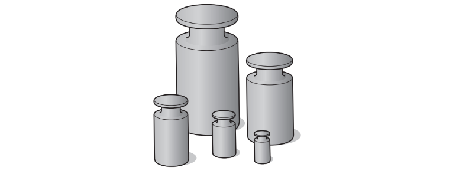

**Fig. 1.1**

Identify the quantity that is the same for all the masses.

Tick **one** box.

`square` density

`square` volume

`square` weight

*Source: 2019 0625/32 Q1A*

**Q12** [1 mark]

**Extract:**

Expected answer: 2500 g.

The largest mass is 2.5 kg.

State the number of grams in 2.5 kg.

2.5 kg = ...................................................... g

*Source: 2019 0625/32 Q1B*

**Q12** [4 marks]

**Extract:**

g = 9.8 N/kg is given in the stem. Combined mass 4.0 kg. Expected value 39.2 (accept 39). Accept 40 only if g = 10 N/kg has been used. The unit N (newtons) earns its own independent mark; a bare number scores the value mark but not the unit mark. Error carried forward from an incorrect combined mass.

The three largest masses are 2.5 kg, 1.0 kg and 0.5 kg.

The gravitational field strength *g* is 9.8 N/kg.

Calculate the combined weight of these three masses. Include the unit.

weight = .........................................................

*Source: 2019 0625/32 Q1C*

### Q13 — medium — 9 marks

**Q13** [4 marks]

A student has an irregularly shaped piece of metal, a beaker of water and a measuring cylinder, as shown in Fig. 2.1.

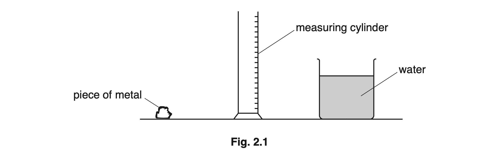

Describe how the student can accurately determine the volume of the piece of metal using the equipment provided.

*Source: Oct 2019 0625/32 Q2A*

**Q13** [5 marks]

The student measures the mass of the piece of metal. Its mass is 146 g.

(i) State the name of the instrument used to measure the mass.

[1]

(ii) The volume of the piece of metal is 20 cm3.

Calculate the density of the metal. State the unit.

density = ......................................................  [4]

*Source: Oct 2019 0625/32 Q2B*

### Q14 — hard — 9 marks

**Q14** [5 marks]

A student has a metal object.

(i) The student measures the mass of the object.

State the name of the equipment used to measure the mass.

[1]

(ii) The mass of the metal object is 1260 g. The volume of the metal is 150 cm3.

Calculate the density of the metal. Include the unit.

density = .............................................. [4]

(iii) The mass of the metal object is given in grams. State the mass in kg.

mass = .................................................... kg [1]

*Source: 2019 May/June 0972/31 Q1A*

**Q14** [4 marks]

A vase is placed on a table. Forces X and Y act on the vase, as shown in Fig. 1.1.   The mass of the vase is 0.25 kg. The vase is not moving.

Calculate the value of force X and the value of force Y.

*Source: 2019 May/June 0972/31 Q1B*

### Q15 — medium — 10 marks

**Q15** [6 marks]

A 250 cm3 beaker containing some liquid is shown in Fig. 2.1.

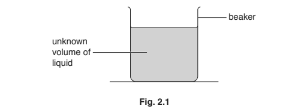

(i) A student has a measuring cylinder and a balance.

Describe an experiment to determine the density of the liquid.

[5]

(ii) Suggest the unit of density used by the student.

[1]

*Source: 2018 0625/31 Q2A*

**Q15** [4 marks]

Fig. 2.2 shows a block of polythene.

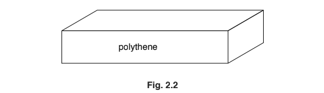

(i) Polythene floats in water. Explain why polythene floats.

[1]

(ii)

The weight of the polythene block is 0.84 N.

Calculate the mass of the block.

mass = ..................................................... kg [3]

*Source: 2018 0625/31 Q2B*

### Q16 — hard — 18 marks

**Q16** [5 marks]

A group of students are asked to find the volume of their Physics Laboratory.

Fig. 1.1 is a top view of the room and shows the measurements of each wall.

**Fig 1.1**

The lab has a ceiling which is at constant height, found to be 3.5 m.

(i) State an instrument that would be suitable to make these measurements.

[1]

(ii) Describe a method the students could use to reduce errors in their measurements.

[2]

(iii) Explain how they should ensure the results are reliable.

[2]

**Q16** [4 marks]

**Extract:**

The lab has a ceiling which is at constant height, found to be 3.5 m.

Divide the shape into rectangles and calculate the two areas:
(Area 1) = 38.5 / 38.48 AND (Area 2) = 12.6
Total area = 51.1(2) m^2^
Recall the height of the ceiling is 3.5 m (part (a)) and calculate the volume:
Volume = area × height = 51.12 × 3.5 = 178.92
Volume = 179 m^3^

Calculate the volume of air in the room.

**Q16** [3 marks]

**Extract:**

Volume of air = 179 m^3

The density of the air is 1.2 kg / m3. Calculate the mass of air in the room.

**Q16** [6 marks]

Describe a method the students could use to find the density of air. You do not need to include details of the calculation.

The students have been provided with the following equipment:

Balloon
Large measuring cylinder
Bucket
Water
Digital scales

### Q17 — medium — 6 marks

**Q17** [4 marks]

Fig. 2.1 shows a raft floating on water.

A force of 20 000 N acts on the raft in the direction of the arrow shown in Fig. 2.1.

(i) State the name given to the force shown in Fig. 2.1.

[1]

(ii) Calculate the mass of the raft.

mass = ......................................................kg [3]

*Source: Nov 2018 (S1) 0625/31 Q2A*

**Q17** [2 marks]

A sail is added to the raft, as shown in Fig. 2.2.

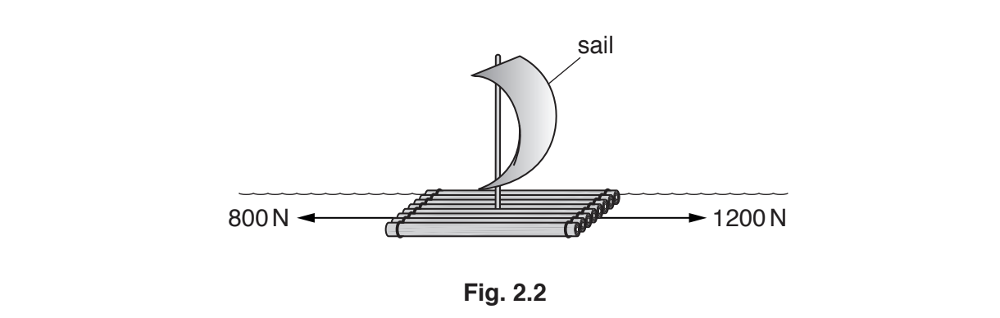

Fig. 2.2 shows the horizontal forces acting on the raft at one moment.

Calculate the resultant horizontal force acting on the raft and state the direction of this force.

force = ............................................................ N

direction = ...........................................................

*Source: Nov 2018 (S1) 0625/31 Q2B*

### Q18 — hard — 5 marks

**Q18** [3 marks]

Fig. 1.1 shows a plastic water barrel. The barrel is full of water.

The water barrel contains 0.050 m3 of pure water. The density of pure water is 1000 kg/m3.

Calculate the mass of pure water in the barrel.

mass of water = ...................................................... kg

*Source: Oct 2019 3 Q1A*

**Q18** [2 marks]

**Extract:**

The water barrel contains 0.050 m^3 of pure water. The density of pure water is 1000 kg/m^3. Calculate the mass of pure water in the barrel. mass of water = ...................................................... kg

The density of sea water is 1030kg/m3. The density of the plastic is 1000kg/m3. Use this information and the information in **(a)** to state and explain whether the full barrel will float in sea water.

*Source: Oct 2019 3 Q1B*

