# Mark Schemes — Effects of Forces
**1. Motion, Forces & Energy** · Cambridge (CIE) IGCSE physics (0625 & 0972)

## Alternative To Practical Questions (5 questions)

### Q1
Plan an experiment to investigate the force required to break different beams:

Identify the variable being tested:

- The distance between the supports / the length of beam **OR **
- The composition of the beam (proportion of sand / cement); **[1 mark]**

Describe a method for the investigation:

- Increase load (in steady increments) until the beam breaks **AND **record the maximum breaking load (force at which the beam breaks); **[1 mark]**
- Repeat for (at least 2 more) different lengths (if testing length) **OR**
- Repeat for (at least 2 more) different beams (if testing composition); **[1 mark]**

Plus any **one **from:

- Collect at least 5 sets of results; **[1 mark]**
- Carry out repeats of individual tests **AND **average the results; **[1 mark]**
- (Conduct a rough initial test then) add small loads until near the breaking load; **[1 mark]**
- Carefully place loads on the beam; **[1 mark]**

Identify the control variables:

**EITHER**

If testing length:

- The position of the load e.g. the centre of the beam **AND**
- The position of the supports
- **AND**
- The composition of the beam;** [1 mark]**

**OR **If testing composition:

- The position of the load e.g. the centre of the beam **AND**
- The distance between the supports **AND**
- The length of the beam; **[1 mark]**

Draw a table to show how to display the readings:

- Table drawn with a column for distance / length **OR **composition **AND**
- A column for (maximum) load **AND **
- Correct units for load (N) and distance / length (cm or m); **[1 mark]**

Explain how the readings can be used to reach a conclusion:

- Compare the maximum breaking load with the variable being tested **OR**
- Plot a graph of maximum breaking load against length; **[1 mark]**

**[Total: 7 marks]**

> *An example model answer might be:*

- *Test how the length of a beam affects the maximum load required to break it*
- *Control the position of the load by placing it at the centre of the beam each time,** **keep the supports in the same relative position for each beam length and use the same beam composition each time*
- *The method is:*

  - *Carry out an initial test to increase the load until the beam breaks and note this as the rough breaking load *
  - *Repeat, but carefully add loads (in steady increments) until close to the rough breaking load, then add smaller loads*
  - *Record the maximum breaking load (force at which the beam breaks)*
  - *Repeat for 5-6 different beam lengths *
- *Repeat this experiment 3 times for each length and calculate the average breaking load for each beam length*
- *Record this data in a table (as shown above) and plot a graph of maximum breaking load against length*

> *To score the mark about reaching a conclusion, you could make a prediction about the outcome of the experiment to illustrate your point, for example: *

- *If testing beam length, you might conclude: As the length of the beam increases, the maximum breaking load decreases*
- *If testing beam composition, you might conclude: As the proportion of cement in the beam increases, the maximum breaking load increases*

### Q2
(i) To find the unstretched length of the spring on Fig. 1.1:

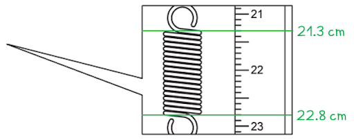

- Reading 1 = 21.3 cm** [1 mark]**
- Reading 2 = 22.8 cm **[1 mark]**
- $l_{0}$ = (22.8 − 21.3) = 1.5 cm **[1 mark]**

(ii) To obtain an accurate reading from the metre rule using a set square:

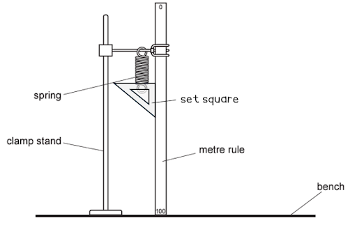

- Set square drawn correctly: vertical side aligned with metre rule and horizontal side aligned with scale; **[1 mark]**

**[Total: 4 marks]**
Calculate a value for the spring constant of the spring:

Calculate the value of extension $e_{1}$:

- $e_{1} = ( l_{1} - l_{0} )$

  - Where $l_{1}$ = 2.2 cm and $l_{0}$ = 1.5 cm
- $e_{1}$ = (2.2 − 1.5) = 0.7 cm

Calculate the value for the spring constant *k*:

- $k=\frac{P}{e_{1}}$

  - Where *P* = 1.0 N
- $k=\frac{1.0}{0.7}$
- $k$ = 1.4 **[1 mark]**
- Unit: N/cm **[1 mark]**

**[Total: 2 marks]**
Calculate the new value for the spring constant of the spring:

Calculate the value of extension $e_{5}$:

- $e_{5} = ( l_{5} - l_{0} )$

  - Where $l_{5}$ = 6.3 cm and $l_{0}$ = 1.5 cm
- $e_{1}$ = (6.3 − 1.5) = 4.8 cm **[1 mark]**

Calculate the value for the spring constant $k$:

- $k=\frac{P}{e_{5}}$

  - Where *P* = 5.0 N
- $k=\frac{5.0}{4.8}$
- $k$ = 1.0 N / cm (2 sig fig.) **[1 mark]**

**[Total: 2 marks]**

> *The question states you must give your answer to **two **significant figures, so you would not get the mark for stating **k** = 1.04 N / cm, as this is quoted to three significant figures.*
State and explain whether your two values of the spring constant $k$ can be considered equal within the limits of experimental accuracy:

- (The two values of the spring constant) <u>cannot</u> be considered equal

**AND**

- Because two quantities can only be considered equal within the limits of experimental accuracy if their values are within 10% of each other
- Calculation:

  - The difference between the $k$ values is (1.4 − 1.0) = 0.4
  - This is $( \frac{0.4}{1.0} \times 100 \% )$ 40% of 1.0
  - This is $( \frac{0.4}{1.4} \times 100 \% )$ 29% of 1.4
- Therefore, their values are not within 10% of each other;** [1 mark]**

**[Total: 1 mark]**

> *To get the mark here, your statement must match your results and your explanation must match your statement, so make sure you refer to the answers you calculated in (b) and (c).*
(i) To take additional sets of readings, the student would need to use:

- Additional load(s); **[1 mark]**

(ii) To use the additional results, the student would need to:

- Plot a graph (of load vs. extension) **OR** take an average (of the extension readings for each load); **[1 mark]**

**[Total: 2 marks]**

### Q3
Measure the unstretched length of the spring in mm:

- Measure $l_{0}$ as 2.2 cm and convert to mm
- $l_{0}=22\mathrm{mm}$ **[1 mark]**

**[Total: 1 mark]**

> *It isn't possible online to know how long your measurements are, since it depends on your printer or device. We suggest that you **print** the diagram and use a **ruler** to measure the distance as shown below: *

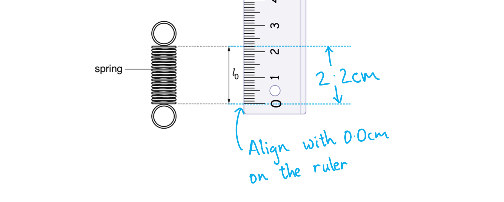

- *Align the bottom/**zero mark** of the ruler with the bottom of the arrow*
- *Identify the top of the arrow to the **nearest mm*

> *If you are unsure of your answer, check your measurement with a teacher or friend. In your real exam, all papers are the same size so the measurement you make on the paper will be correct. *
(i) Calculate the extension *e* of the spring:

List the known quantities:

- $l_{0}$ = 22 mm (from part (a))
- $l$ = 53 mm

Substitute the known quantities into the equation and calculate extension:

- $e=l-l_{0}$
- $e=53-22$
- *e* = 31 mm **[1 mark]**

**   **

(ii) Calculate a value for the spring constant *k* :

List the known quantities:

- Extension, *e* = 31 mm (from part (b)(i))
- Force, *F* = 3.0 N

Substitute the known quantities into the equation and calculate *k* :

- $k=\frac{F}{e}$
- $k=\frac{3.0}{31}$
- *k* = 0.09677...
- <u>*k*</u><u> = 0.097 N/mm</u> (2 significant figures) **[1 mark]**

**[Total: 2 marks]**

> *The examiners will apply something called "error carried forward" or ecf to these kinds of questions. If you have measured the length in the first question incorrectly (or in this case, if your screen size means that the spring shown is not 22mm long), you will not lose all the following marks that depend on that, as long as you use the value you obtained in the first part. *
(i) Record the time *t* taken for 10 complete oscillations:

Read the time from the stopwatch:

- *t* = 3.46 s **[1 mark]**

(ii) Calculate the time *T* taken for one complete oscillation and calculate *T** *2 :

Calculate *T* :

- 10 oscillations take 3.46 s
- 1 oscillation will take one tenth of this time
- $T=\frac{3.46}{10}$
- $T=0.346$

calculate *T *2 :

- $T^{2}=0.346^{2}$
- $T^{2}=0.120$

State the values of each quantity:

- T = 0.346 **AND** *T *2* *= 0.120 **[1 mark]**

Give the units for each quantity:

- *T *has units of <u>seconds</u> / <u>s</u> **AND** *T *2 has units of <u>seconds squared</u> / <u>s</u><u>2</u>** [1 mark]**

(iii) Calculate the spring constant *k* :

List the known quantities:

- mass, *m* = 0.300 kg
- *T *2 = 0.120

Substitute these quantities into the equation and calculate *k *:

- $k=\frac{0.040m}{T^{2}}$
- $k=\frac{0.040\times0.300}{0.120}$
- *k* = 0.10 N/mm **[1 mark]**

**[Total: 4 marks]**

> *Don't assume the units when reading from an instrument. It would be easy to glance at this stopwatch and see 3 minutes and 46 seconds, but the units are written on the diagram. Take care when reading from a diagram of an instrument, just like you would in a real experiment. *
State and explain whether your two values for *k* are the same within the limits of experimental accuracy:

- The two values of *k* **are** the same within the limits of experimental accuracy; **[1 mark]**

**AND**

- This is because the values are very close together; **[1 mark]**

**OR**

- The two values of *k* are **not** the same within the limits of experimental accuracy;** [1 mark]**

**AND**

- This is because the values are too far apart;** [1 mark].**

**[Total: 2 marks]**

> *The question is not testing whether you got the correct values of **k** in parts (a) and (b). The examiner wants to know if you can look at your two values of **k**, whatever they may be, and determine whether they are within the limits of experimental accuracy. *

> *The two values of 0.10 N/mm and 0.097 N/mm **are** the same within the limits of experimental error. The difference between the two is only 0.03 N/mm, which is a small fraction of the actual value of **k**. *

> *If you calculated incorrect values, you may still gain error carried forward marks if your answer to part (d) answer is in agreement with the values you obtained.*

> *For example, if you calculated **k** as 0.10 N/mm in one part and 0.50 N/mm in the other, you can still gain both marks in (d) by saying they are not the same within the limits of experimental error because the values are very different. *

> *As a rule of thumb, if there is more than a 10% difference between the two values, it is unlikely that they are the same within the limits of experimental error. *
Suggest additional values for the mass *m *:

- At least three additional values given; **[1 mark]**
- Values between 50 g and 600 g; **[1 mark]**

  - For example, 100 g, 200 g and 400 g

**[Total: 2 marks]**

*If the values of mass are too large, the spring may reach its elastic limit and the value of **k** will be changed. If the values of mass are too small, the extension will be small and difficult to measure, potentially leading to inaccurate values of **k**.*

> *It is good scientific practice to add masses in multiples of 50 g or 100 g. To obtain an accurate value of **k **it is best to add a wide range of masses. *

### Q4
Describe two precautions that could be taken when measuring the length of the stationary spring, to ensure an accurate reading:

**Any two from:**

- Make sure the ruler is close / parallel to the spring when the measurement is taken; **[1 mark]**
- Make sure the eye is perpendicular to the ruler and spring when the reading is taken; **[1 mark]**
- Clamp the ruler and hold the spring next to it; **[1 mark]**

**[Total: 1 mark]**
Calculate, and record in Table 3.1, the extension *e* of the spring for each load *L:*

A table scoring one mark should look like this:

| *L*/N | $l$/cm | *e*/cm |
|---|---|---|
| 1.0 | 6.3 | **Final answer:** **4.2** |
| 2.0 | 10.5 | **Final answer:** **8.4** |
| 3.0 | 14.7 | **Final answer:** **12.6** |

List the known values:

- $l_{0}$ = 2.1 cm

Substitute the known values into the equation to calculate:

For *L* = 1.0 N:

- $e = ( l - l_{0} )$
- $e = ( 6.3 - 2.1 ) = 4.2 cm$

**AND**

For *L* = 2.0 N:

- $e = ( 10.5 - 2.1 ) = 8.4 cm$

**AND**

For *L *= 3.0 N:

- $e = ( 14.7 - 2.1 ) = 12.6 cm$ **[1 mark]**

**[Total: 1 mark]**
Estimate the weight *W*X of object **X, **explaining how you obtained your answer:

List the known quantities:

- The stretched length of the spring, $l_{x}$ = 11.4 cm
- The unstretched length of the spring, $l_{0}$ = 2.1 cm

Calculate the extension of the spring:

- $e = ( l_{x} - l_{0} )$
- $e = ( 11.4 - 2.1 )$
- *e* = 9.3 cm

Compare this value to the table from part (b)):

| *L*/N | $l$/cm | *e*/cm |
|---|---|---|
| 1.0 | 6.3 | **Final answer:** **4.2** |
| 2.0 | 10.5 | **Final answer:** **8.4** |
| 3.0 | 14.7 | **Final answer:** **12.6** |

- The extension of spring  when loaded with object **X** is 9.3 cm

  - This is greater than 8.4 cm but less than 12.6 cm
  - Therefore, the weight of object **X** must be greater than 2.0 N but less than 3.0 N **[1 mark]**
- Hence, 2.0 N < *W*X < 3.0 N **[1 mark]**

**[Total: 2 marks]**

> *One mark is awarded here for the correct answer, and one mark is awarded for the logic used in obtaining the answer. *
Explain why the student's measurement of 4.532 N is not a suitable number of significant figures for this experiment:

- The student's measurement is to 4 significant figures but the data is only given to 2 or 3 significant figures (and the answer can only be as accurate as the least accurate piece of data in the calculation); **[1 mark]**

**[Total: 1 mark]**
(i) State whether the results support the student's suggestion that *e* is directly proportional to *L, *using values from the results in Table 3.1 to justify your statement:

Consider the results in table 3.1:

| *L*/N | $l$/cm | *e*/cm |
|---|---|---|
| 1.0 | 6.3 | **Final answer:** **4.2** |
| 2.0 | 10.5 | **Final answer:** **8.4** |
| 3.0 | 14.7 | **Final answer:** **12.6** |

Consider the pattern in the data:

- If e was directly proportional to L, then L would double as e doubles
- Two rows in the table are compared to show L would double as e doubles;** [1 mark]**

  - For example, when e = 4.2 cm, L is 1.0 N
  - and then e = 8.4 cm, L is 2.0 N
- So as e doubles, L also doubles; **[1 mark]**

** **

(ii) State how her graph line could show that *e* is directly proportional to *L*:

Consider the properties of a straight-line graph that show two quantities directly proportional to each other:

- If *e *and *L *were directly proportional then the graph will be a straight line**; ****[1 mark]**
- With a positive gradient (in the positive region of the axes);** [1 mark]**

**[Total: 4 marks]**

### Q5
To investigate the effect of air resistance on the swing of a pendulum.

State the additional apparatus:

Any one from:

- Stop watch; **[1 mark]**
- Meter rule; **[1 mark]**
- Protractor; **[1 mark]**

State a suitable method:

**Any one from:**

- Affix / secure / glue the card to the pendulum bob in order to provide air resistance; **[1 mark]**
- Allow the pendulum to swing; **[1 mark]**
- Measure the time taken **OR** the distance moved by the pendulum bob **OR** the angle the pendulum passes through; **[1 mark]**

Describe a way to obtain multiple results for comparison:

- Repeat (the experiment) for a different value of the independent variable, the <u>area of the card;</u> **[1 mark]**

List the control variables:

**Any one from:**

- Length of the pendulum; **[1 mark]**
- Angle of release; **[1 mark]**
- Mass of the bob; **[1 mark]**

Draw a suitable table:

| Area of the card/cm2 | Time period / s |   |   |
|---|---|---|---|
|   | Repeat 1 | Repeat 2 | Average |
|   |   |   |   |
|   |   |   |   |
|   |   |   |   |
|   |   |   |   |

**OR**

| Area of the card/cm2 | Distance moved by bob/cm |   |   |
|---|---|---|---|
|   | Repeat 1 | Repeat 2 | Average |
|   |   |   |   |
|   |   |   |   |
|   |   |   |   |
|   |   |   |   |

**OR**

| Area of the card/cm2 | Angle subtended by bob/cm |   |   |
|---|---|---|---|
|   | Repeat 1 | Repeat 2 | Average |
|   |   |   |   |
|   |   |   |   |
|   |   |   |   |
|   |   |   |   |

- Suitable table with clear headings and units; **[1 mark]**

Discuss how to analyse the results:

- Compare the readings to see if a change in air resistance produces change in dependent variable

  - e.g. see if a change in the area of card changes the time period of oscillation; **[1 mark]**

**OR**

- <u>Plot a graph</u> of the independent variable (x-axis) vs the dependent variable (y-axis) to see if there is a relationship; **[1 mark]**

Give a final additional point:

**Any one from:**

- Time 10 oscillations / swings (and calculate the period of one swing); **[1 mark]**
- Use a small angle of swing; **[1 mark]**
- Take at least 5 sets of data (5 values of the independent variable used); **[1 mark]**
- Repeat each measurement and take an average; **[1 mark]**
- Adjust the mass of the pendulum to compensate for changing the mass of card when area is removed, ensuring bob mass remains constant; **[1 mark]**
- Repeat with different length of pendulum / mass of bob; **[1 mark]**
- Measure the length to the centre of bob / centre of gravity of pendulum; **[1 mark]**
- Use a fiducial aid e.g. a marker for the midpoint of the swing; **[1 mark]**

**An example of an answer which would score 7 marks is:**

The student should attach a known area of the card to the bob using glue **[1 mark]**.

They should use a stopwatch **[1 mark] **to record the time period of 10 oscillations of the pendulum **[1 mark]** and calculate the time period for one swing.

The experiment should be repeated with a smaller area of card **[1 mark]**.

The length of the pendulum should be constant throughout the experiment **[1 mark]**.

The results should be recorded in the following table **[1 mark for a correct table]**

| Area of the card/cm2 | Time period / s |   |   |
|---|---|---|---|
|   | Repeat 1 | Repeat 2 | Average |
|   |   |   |   |
|   |   |   |   |
|   |   |   |   |
|   |   |   |   |

- The readings should be compared to see if a change in the area of card changes the time period of oscillation **[1 mark]**

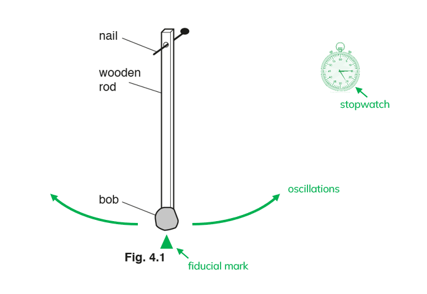

**[Total: 7 marks]**

> *The example above shows the kind of short descriptions which easily score full marks in the exam. *

> *The most common mistakes with the investigation question are;*

- *Saying what the result will be, rather than how to draw the conclusion;*
- *Forgetting that only one variable can change per investigation, and changing all of them;*
- *Showing repeat readings or the range in the table, but not mentioning them in the description (it seems unfair, but this won't get you the mark);*
- *Wasting time by inventing data for the table.*

> *If you find yourself doing one of these - **stop**!*

## Multiple Choice Questions (26 questions)

### Q1
**Final answer:** **The correct answer is C**

- A satellite moving in a circle is constantly changing direction, even though its speed is constant
- A change in direction means a change in velocity, so there must be a resultant force acting
- That force is always directed towards the centre of the orbit — this is the centripetal force

  - It is provided by the gravitational pull of the planet

**A** is incorrect because a constant speed does not mean no force. The force changes the direction of motion, not the speed.

**B** is incorrect because a force in the direction of motion would cause the satellite to speed up, not travel in a circle.

**D** is incorrect because a force directed away from the planet would push the satellite outward, causing it to spiral away rather than orbit.

### Q2
**Final answer:** **The correct answer is B**

- Point P is where the straight-line section of the graph ends and the line begins to curve
- This is the **limit of proportionality**: the point beyond which the extension is no longer directly proportional to the applied force
- Below point P, the graph is a straight line through the origin, meaning force and extension are directly proportional (Hooke's law applies)

**A **&** C **are incorrect because the maximum load and the maximum extension would be at the far right end of the graph, not where the curve begins.

**D** is incorrect because the spring constant is not a point on the graph. The spring constant is found from the gradient of the straight-line section (force per unit extension).

### Q3
**Final answer:** **The correct answer is B**

- At the start of the fall, the only downward force is weight, so the skydiver accelerates rapidly.
- As speed increases, air resistance increases

  - The resultant downward force decreases, so the acceleration decreases
- The curve, therefore, rises with a decreasing gradient
- Eventually, air resistance equals weight, the resultant force is zero, and speed stays constant — this is terminal velocity

  - The curve levels off

**A** is incorrect because a straight line means constant acceleration throughout, which would only happen if there were no air resistance.

**C** is incorrect because the skydiver starts from rest and speeds up during free fall — speed does not decrease.

**D** is incorrect because speed does not peak and then fall before the parachute opens. A decrease in speed would only occur after the parachute opens (which is not shown in this question).

### Q4
**Final answer:** **The correct answer is A**

- An object moving at a **constant speed** in a straight line has zero acceleration
- Newton’s first law states that an object will continue to move at a constant velocity unless acted upon by a resultant force
- Since the aeroplane is moving at a constant speed, and its direction is not changing, the horizontal forces (thrust and drag) and vertical forces (lift and weight) must be **balanced**
- Therefore, the resultant force on the aeroplane is zero

**B** is incorrect as a resultant force in the direction of travel would cause the aeroplane to accelerate and increase its speed.

**C** is incorrect as a resultant force in the opposite direction to travel would act as a braking force and cause the aeroplane to decelerate.

**D** is incorrect as a resultant force acting vertically downwards would cause the aeroplane to accelerate towards the Earth and change its vertical height.

### Q5
**Final answer:** **The correct answer is ****B**** because:**

- There is an unbalanced frictional force acting towards the right on the book
- This unbalanced force causes the book to accelerate to the right
- The table, and therefore the train, must be accelerating to the right to cause this force

Without the frictional force acting on the book it would slide off the table to the left as there would be no forces accelerating it to the right, even though the table is accelerating towards the right.

**A** is incorrect as this would produce a frictional force on the book towards the left.

**C** and **D** are incorrect as these movements would not cause any frictional force to act on the book.

### Q6
**Final answer:** **The correct answer is ****D**** because:**

- An object's weight is the gravitational force acting on it due to its mass
- When the mass is suspended from the spring on Earth, the spring will stretch by 5.0 cm due to the object's weight
- The weight of an object on the Moon is 6 times less than its weight on Earth because the gravitational field strength on the Moon is 6 times weaker
- So, to produce the same weight on the Moon, the object will need to have 6 times more mass
- Mass (on the Moon) = 6 × 3.0 kg = 18 kg

You could also answer this question using the Earth’s gravitational field strength (9.8 N/kg) to work out the size of the force acting on the spring, and then work out the Moon’s gravitational field strength and see which object would produce the same size force. However, it is simpler to think through the overall effect of the lower gravitational field strength as explained above.

### Q7
**Final answer:** **The correct answer is ****D****, because:**

- A resultant force of zero means an object is either at rest or moving at a constant speed in a straight line
- Since none of the objects are at rest, the only object with zero resultant force acting on it must be object **D**

Velocity and acceleration are both vectors: they have direction as well as a magnitude (size). Whenever the velocity of an object changes, it accelerates.

Acceleration does not just mean getting faster or slower; it also includes changes of direction of travel.

A bicycle travelling around a bend in the road might move at a constant speed, but it is accelerating because the direction of travel is changing. For it to be accelerating, a resultant force must be acting on it.

Therefore, when a resultant force acts on an object, its speed may increase or decrease, or its direction of motion may change.

**A** and **B** are incorrect because the object’s speed is changing. This means there is an acceleration and therefore a resultant force acting on the object.

**C** is incorrect because the object is changing its direction of motion, and so its velocity is changing. It is accelerating even though its speed is constant.

### Q8
**Final answer:** **The correct answer is A**

- Hooke’s law tells us that the extension of a spring is directly proportional to the force (load) applied to it
- The extension-load graph of a spring can be plotted using

  - a **clamp and stand** - to hang the spring from
  - a **newton meter** - to measure the force (load) applied to the spring when masses are added
  - a **ruler **- to measure the extension of the spring

**B** is incorrect because measurements of mass and time are not required, so neither a balance nor a stop-watch would be necessary

**C** is incorrect because the motion of the spring is not being measured, so a light gate would not be necessary

**D** is incorrect because no measurements of liquid volume are required, so a measuring cylinder would not be necessary

### Q9
**Final answer:** **The correct answer is B**

- When there is no load, the spring is not extended

  - Original length is 3.0 cm
  - This is unchanged under no load
  - Eliminate options **C** and **D**
- When the load is 2.0 N newtons, the total length is 6.0 cm

  - Original length is 3.0 cm
  - Extension = 6.0 − 3.0 = 3.0 cm
- When the load is 4.0 N newtons, the total length is 6.0 cm

  - Original length is 3.0 cm
  - Extension = 9.0 − 3.0 = 6.0 cm
  - Eliminate option **A**

Remember that extension is the length under load **minus** the original load. In the first image, there is no load so the spring is not being stretched. This means its extension is zero.

### Q10
**Final answer:** **The correct answer is A**

- For an object in circular motion, the resultant force is always directed **toward **the centre of the circle

  - This is shown by arrow **A**

**B** is incorrect because this does not correspond to the direction of any quantity involving circular motion

**C** is incorrect because this is the direction of the speed of the object

**D** is incorrect because this is the opposite direction of the resultant force on the object

### Q11
**Final answer:** **The correct answer is C**

- The object travelling at constant speed will have a resultant force of zero acting on it
- Consider the forces on object C

  - Upward forces = 5 N
  - Downward forces = (-3) + (-2) = -5 N
  - Resultant force on C = upward forces + downward forces
  - Resultant force on C = 5 + (− 5)  = 0 N
- Therefore, object C must be travelling at a constant speed

**A** is incorrect because there is an upward resultant force of 6 N acting on it

**B** is incorrect because there is a downward resultant force of 4 N acting on it

**D** is incorrect because there is a downward resultant force of 10 N acting on it

### Q12
**Final answer:** **The correct answer is**** D**** because:**

- This is a circular motion problem
- The resultant force always acts toward the centre of the circular path of an object

  - In the same direction as the acceleration
- Option **D** is the only answer that points toward the centre

### Q13
**Final answer:** **The correct answer is ****C**** because**

- This is a **circular motion question**.
- Velocity is defined as the speed in a given direction, if either the speed or the direction change, then the velocity changes.
- **Acceleration** is defined as the **rate of change of velocity**. If the velocity changes then there must be an acceleration.
- Since the direction changes, the velocity changes and the car is accelerating.

**A **is incorrect as the car *is* accelerating, but speed is just the size of the velocity, this is remaining constant. The *direction* is changing.

**B **is incorrect as the car *is* accelerating, as discussed above.

**D** is incorrect as by definition, if the velocity changes, the car accelerates.

### Q14
**Final answer:** **The correct answer is ****C**** because:**

- Objects which travel at a constant speed in a straight line need no resultant force.
- All the other objects are either changing speed, or direction, both of which require a resultant force.

**A** is incorrect as the motorbike is changing direction when going round a bend, this requires a resultant force.

**B** is incorrect as the rocket is accelerating, this requires a resultant force.

**D** is incorrect as the car is accelerating, this requires a resultant force.

### Q15
**Final answer:** **The correct answer is ****A**** because:**

- The car begins at rest and speeds up

  - Since velocity is increasing it is accelerating
- Therefore, a resultant force is acting on the car in the direction of motion

  - This discounts options **C** and **D**
- The question states that the car's speed increases rapidly
- Therefore, the resultant force will be relatively large

  - The only option that shows this is **A**

**B **is incorrect as the resultant force is not large enough to produce a rapid increase in speed

**C **is incorrect as the forces are balanced so there would be no change in motion

**D **is incorrect as the car is speeding up, therefore the resultant force must be in the direction of forward motion

### Q16
**Final answer:** **The correct answer is ****D**** because:**

- In order to move in a circular path, an object requires a force which acts at right angles to the direction of its velocity
- So, for an object in circular motion, the force is directed towards the centre of the circle

**A** is incorrect as if there were no force, the planet would move in a straight line, not a circle.

**B **is incorrect as, if the force were outwards, the planet would accelerate outwards

**C **is incorrect as if the force were in the direction the planet was moving, the planet’s orbit would get larger and larger

### Q17
**Final answer:** **The correct answer is ****C**** because:**

- If the acceleration is zero, the resultant force must also be zero.
- The acceleration is given by the gradient of a speed-time graph.
- In section C, the gradient is zero, therefore, the acceleration is zero and the resultant force is zero.

**A** is incorrect as the car is accelerating, therefore there is a resultant force.

**B** is incorrect as the car is accelerating, at a reducing rate, therefore there is a resultant force.

**D** is incorrect as the car is decelerating, therefore, there is a resultant force.

### Q18
**Final answer:** **The correct answer is ****B**** because:**

- The motorbike is travelling at a constant speed

  - This means that the resultant force on it must be 0 N
- The resultant force on the motorbike (before the third unknown force is added) is

  - 2000 - 800 = 1200 N forwards
- Therefore, a force of **1200 N backwards** is required to give a resultant force of 0 N

**A **is incorrect as this would give a resultant force of 4000 N forwards.

**C** is incorrect as this would give a resultant force of 2400 N forwards.

**D **is incorrect as this would give a resultant force of 1600 N backwards.

### Q19
**Final answer:** **The correct answer is ****D**** because:**

- The velocity is changing, therefore the car is accelerating (deceleration is negative acceleration)

  - So a resultant force must be acting on the car
- The car is slowing down, therefore the resultant force must be acting against the direction of motion

  - The only answer that shows this is **D**

### Q20
**Final answer:** **The correct answer is**** A**** because:**

- Using the acceleration equation,  $a=\frac{\Deltav}{t}$

  - $a=\frac{0-13.5}{22}=-0.61m/s^{2}$
- Using Newton's second law,  $F=ma$

  - $F=950\times-0.61=-579.5N$
- The force required to stop the car is −580 N

  - This is 580 N in the direction opposing the motion of the car

### Q21
**Final answer:** **The correct answer is**** C ****because:**

- Resultant force = mass x acceleration
- For** C** the resultant force is:

  - *F* = 10 N + 10 N = 20 N
  - $a=\frac{F}{m}$
  - $a=\frac{20}{5}$
  - $a=4.0m/s^{2}$
- This is the highest acceleration of the options given.

**A **is incorrect as acceleration = $\frac{20}{10}=2.0m/s^{2}$

**B **is incorrect as acceleration = $\frac{0}{2.0}=0m/s^{2}$

**D **is incorrect as acceleration = $\frac{25}{7.5}=3.3m/s^{2}$

### Q22
**Final answer:** **The correct answer is ****D**** because:**

- Acceleration is always in the direction of the resultant force, so we need the largest resultant force to the left to get the largest acceleration to the left.
- Resultant force = mass x acceleration
- For **D** the resultant force is: R = (35 + 30) - (50 + 40) = - 25 N
- This is the largest resultant force to the left in the question.

**A **is incorrect as resultant force = 20 - (20 + 20) = - 20 N to the left

**B **is incorrect as resultant force = 45 - (10 + 35) = 0 N

**C** is incorrect as resultant force = 0 - (10 + 10) = - 20 N to the left

### Q23
**Final answer:** **The correct answer is ****A ****because:**

- Newton's first law states that an object will remain at rest or moving with a constant velocity unless acted upon by a resultant force
- Therefore, the only correct sum**ma**ry is **A**

**B **is incorrect as objects can move with a constant velocity without a resultant force being applied

**C **is incorrect as an object may speed up if a resultant force is applied, but it can also slow down or change direction

**D **is incorrect as an object may change direction if a resultant force is applied, but it can also slow down or speed up

### Q24
**Final answer:** **The correct answer is ****A**** because:**

- To calculate the resultant force in this case you subtract all the upward forces from the downward force.
- 200 - (75 + 35) = 90 N downwards.

**B** is incorrect as the downward forces have not been considered

**C **is incorrect as the upward forces have not been considered

**D **is incorrect as the direction is wrong

### Q25
**Final answer:** **The correct answer is ****C**** because:**

- The skydiver continues to fall downwards.
- The parachute creates a very large force of air resistance when it is opened.
- This air resistance force is much larger than the skydiver’s weight (force downward) and so the resultant force is upward.
- Since Force = mass x acceleration, the acceleration is also upwards.
- This has the effect of slowing the skydiver down, **not** causing them to move upwards.

**A **is incorrect as the skydiver does not move upwards.

**B **is incorrect as the skydiver does not move upwards

**D** is incorrect as if the skydiver accelerated downwards, he would speed up.

### Q26
**Final answer:** **The correct answer is ****B**** because:**

- Resultant force = mass x acceleration
- $7000-D=2500\times1.2$
- $D=4000N$

## Theory Questions (18 questions)

### Q1
> **[mark-scheme]**
> - Change in velocity per unit time
> **OR**
> Rate of change of <u>velocity</u> **[1 mark]**
> 
> Accept: $\Deltav/\Deltat$ stated in words
> 
> Do not accept: "change in speed per unit time" (velocity is required for the full mark)

> **[exam-tip]**
> Avoid writing "rate of change of velocity per unit time". This is redundant as "rate" and "per unit time" mean the same thing.
> 
> Also, make sure you use "velocity" and not "speed" — acceleration is a vector quantity, so the definition must reference velocity (also a vector), not speed (a scalar).
> **[mark-scheme]**
> - The driving force is equal to the resistive force(s) / the forces are balanced **[1 mark]**
> - The resultant force is zero so there is no acceleration / the speed does not change **[1 mark]**
> 
> Accept: "forward force = backward force" or "thrust = drag + friction"
> 
> Do not accept: "there are no forces acting" — forces are present but balanced

> **[exam-tip]**
> When a question asks you to explain constant speed "in terms of forces", the examiner wants you to identify two things:
> 
> (1) the forces are balanced (driving force = resistive forces)
> 
> (2) this means the resultant force is zero, so there is no acceleration
> 
> A common mistake is to say "there are no forces acting" — the forces are still there, they just cancel out. Make sure you link balanced forces to zero resultant force and then to no change in speed.
To calculate the total distance travelled by the cyclist:

- Recall how to use the graph to determine distance:

distance = area under the speed–time graph **[1 mark]**

- Determine the area of each section:

area of triangle (0-8 s) $=\frac{1}{2}\times8.0\times12=48\text{m}$

area of rectangle (8-28 s) $=20\times12=240\text{m}$

area of triangle (28-32 s) $=\frac{1}{2}\times4.0\times12=24\text{m}$

**[1 mark]**

- Determine the total distance by adding the areas:

$\text{total distance}=48+240+24$

$\text{total distance}=$ $312m$ **[1 mark]**

> **[mark-scheme]**
> 1 mark for stating or implying that distance equals the area under the speed–time graph
> 
> - Accept distance = average speed × time taken
> 
> 1 mark for at least two correct area calculations **OR** correct average speed used
> 
> - Accept any valid method, e.g. area of a trapezium, average speed of each section, counting squares, etc.
> 
> 1 mark for a correct final answer of $312m$
> 
> Working must be shown to score full marks. Score 1 mark max for stating the correct answer alone with no working.
> **[mark-scheme]**
> - The headwind increases the resistive force / air resistance **OR** there is a greater backward force / drag / air resistnace **[1 mark]**
> - The resultant (forward) force is reduced so the cyclist accelerates less / reaches a lower top speed / takes longer to cover the same distance **[1 mark]**
> 
> Accept "lower constant speed because driving force = larger resistive force at a lower speed" for the second marking point
> 
> Do not accept "the wind slows the cyclist down" — this is too vague and must reference forces

### Q2
(i) Take scale readings from the metre rule:

top reading = 37.0 cm

bottom reading = 48.5 cm

**[1 mark]**

Calculate the unstretched length of the spring:

$L_{0}=\mathrm{bottom} \mathrm{reading}-\mathrm{top} \mathrm{reading}$

$L_{0}=48.5-37.0$

$L_{0}=$ $11.5\text{cm}$** ****[1 mark]**

> **[mark-scheme]**
> 1 mark for correct top and bottom readings within 0.1 cm
> 
> 1 mark for correctly calculating $L_{0}=\mathrm{bottom} \mathrm{reading}-\mathrm{top} \mathrm{reading}$
> 
> Accept answers for $L_{0}$ in range 11.3 to 11.7 cm.

> **[mark-scheme]**
> (ii) To obtain an accurate length reading, the student should:
> 
> Any **one **from:
> 
> - Use a set square to ensure the metre rule is vertical
> - Read the scale perpendicularly / at eye level to avoid parallax error
> - Ensure the spring is not oscillating before taking the reading
> 
> **[1 mark]**

> **[exam-tip]**
> When reading lengths from a ruler where the object does not start at zero, remember to subtract the starting position from the end position. Many students make errors by simply reading the bottom value without accounting for where the top of the spring is positioned.
> 
> For precautions relating to measurement accuracy, always think about parallax error and how to minimise it. Mentioning the use of a set square or reading at eye level demonstrates good practical technique.
Calculate the extension $e$ for each load $W$:

- Unstretched length, $L_{0}=11.5\text{cm}$ (from (a))

$e = ( L - L_{0} )$

- For $W=1.0\text{N}$:

$e=14.3-11.5=2.8\text{cm}$

Record the values of extension $e$ in the table:

| $W$ / N | $L$ / cm | $e$ / cm |
|---|---|---|
| 1.0 | 14.3 | **Final answer:** **2.8** |
| 2.0 | 16.7 | **Final answer:** **5.2** |
| 3.0 | 19.5 | **Final answer:** **8.0** |
| 4.0 | 22.1 | **Final answer:** **10.6** |
| 5.0 | 24.9 | **Final answer:** **13.4** |

**[1 mark]**

> **[mark-scheme]**
> 1 mark for correctly calculating each value of $e$ by subtracting the value of $L_{0}$ calculated in part (a) from $L$ in each row** AND** recording each value to 1 d.p.

> **[exam-tip]**
> Make sure you use your calculated value for the unstretched length $L_{0}$ from the previous part of the question. A common mistake is to use the wrong value or to subtract the values in the wrong order. Remember that extension is always the new length minus the original length, so your answer should be positive if the spring has stretched.
Plot a graph of load $W$ against extension $e$ and draw a best-fit line:

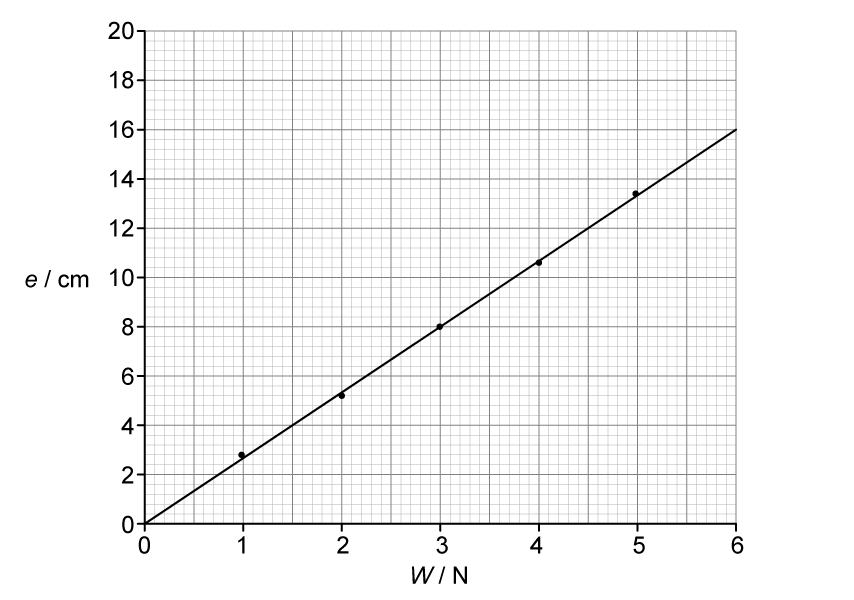

**[4 marks]**

> **[mark-scheme]**
> 1 mark for axes correctly labelled with quantity and unit, and right way around
> 
> 1 mark for suitable scales (plots occupy at least half the grid)
> 
> 1 mark for all points plotted correctly within half a small square
> 
> 1 mark for drawing a well-judged, thin, continuous best-fit line

> **[exam-tip]**
> When plotting graphs, always ensure your axes are clearly labelled with both the quantity and its unit (e.g. $W$ / N). Choose scales that allow your data points to spread across at least half of the available grid space — this makes it easier to draw an accurate best-fit line and reduces plotting errors. When drawing your best-fit line, use a sharp pencil and a ruler to create a thin, continuous line that passes as close as possible to all points, with roughly equal numbers of points above and below the line.
(i) Determine the gradient $G$ of your line:

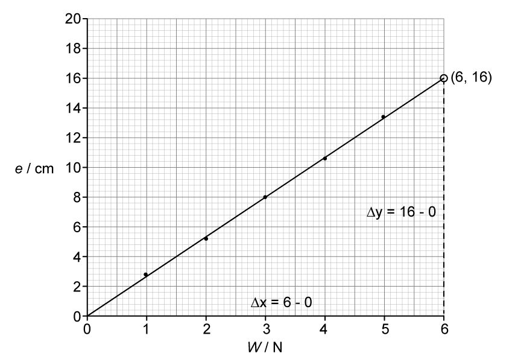

$G=\frac{\Deltay}{\Deltax}$

$G=\frac{16-0}{6-0}$

$G=$ $2.67$(3 s.f.)

**[1 mark]**

> **[mark-scheme]**
> Method clearly shown on graph, e.g. triangle drawn using at least half the line **AND **correct method used to calculate gradient i.e. $\frac{\Deltay}{\Deltax}$

(ii) Calculate a value for the spring constant $k$ of the spring:

- Substitute the value for gradient $G$ into the given equation:

$k=\frac{1}{G}$

$k=\frac{1}{2.67}$

$k=$ $0.375$(3 s.f.) **[1 mark]**

- Include the unit:

$\text{N/cm}$ **[1 mark]**

> **[mark-scheme]**
> Accept equivalent values and corresponding units, e.g. $37.5N/m$

> **[exam-tip]**
> When finding the gradient of a graph, always draw a large triangle that uses as much of the line as possible. This reduces the percentage error in your reading and gives a more accurate gradient. Make sure you clearly mark the triangle on the graph so the examiner can see how you obtained your values. Remember that the gradient has units derived from the y-axis unit divided by the x-axis unit.

### Q3
(i) The speed of the car is equal to:

- The gradient / slope (of the distance-time graph);** [1 mark]**

(ii) Using Fig. 1.1, determine the initial speed *v* of the car:

- The initial speed of the car is equal to the gradient of the graph at *t *= 0

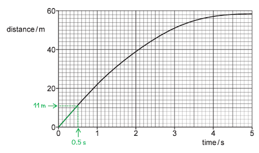

- Distance and time values correctly read from graph, e.g. (0.50, 11); **[1 mark]**
- $v=\frac{distance}{time}=\frac{11}{0.5}$ = 22 m/s **[1 mark]** *Acceptable values of v = 20.5 to 23.5 m/s*

**Total: [3 marks]**

> *The line on the graph is approximately straight up to about 1.0 s, so the speed is approximately constant during this time. This simplifies the question as you can simply read off the distance and time values up to this point, however, this means that you would not gain the first mark if you read the distance for a time later than 1.0 s.*
(i) The deceleration of the car is greater than $\frac{F}{m}$ because:

- A drag force / air resistance / air friction acts on the car (which decreases the resultant force); **[1 mark]**

(ii) The deceleration of the car is not constant because:

- The air resistance / drag force / resultant force changes with speed; **[1 mark]**
- As the car’s speed decreases, the air resistance / drag force / resultant force decreases (hence, the deceleration decreases); **[1 mark]**

**[Total: 3 marks]**

> *Understanding the relationship between force, acceleration and speed can be tricky when different quantities change and act in different directions.*

> *If you are struggling to visualise a situation, it’s always a good idea to sketch it out. By doing this, you can identify the forces acting and this can help you to relate the different quantities involved.*

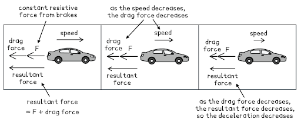

### Q4
Draw lines on the graph to determine the extension of spring A for a load of 10 N:

- Draw a line on the graph from the load of 10 N to the graph of spring A
- Draw a second line on the graph from this point on the graph of spring A to the horizontal axis (extension)

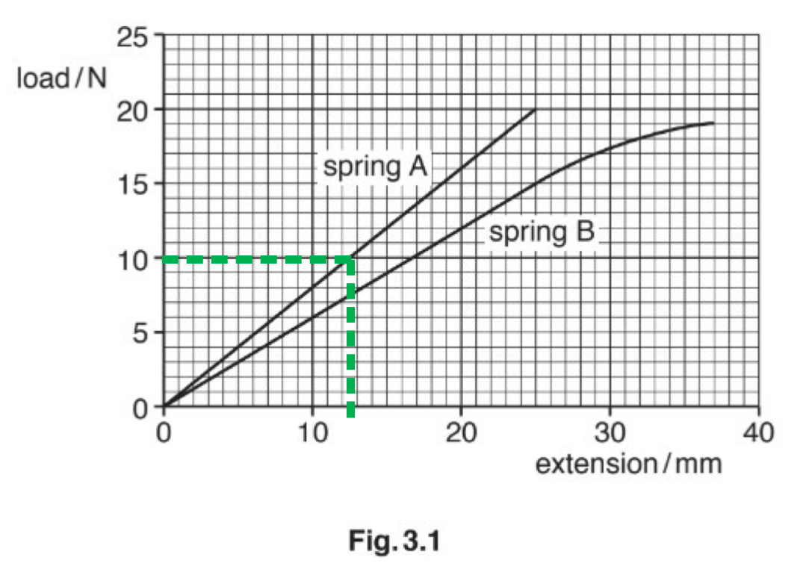

Read off the extension shown:

- 12.5 mm **[1 mark]**

  - *Allow 12.0 mm to 13.0 mm*

**[Total: 1 mark]**

> *A tolerance of ∓½ a small square is generally allowed when reading data from graphs.*

*You can answer this question by using your eyes / a ruler and not drawing the lines shown. However, this reduces the accuracy of your answer. Whilst it is one mark and drawing the lines take time, it means your answer is as accurate as possible*.
State which spring is easiest to stretch:

- Spring B; **[1 mark]**

Give a reason:

- When the same load is applied to springs A and B, spring B undergoes a greater extension than spring A; **[1 mark]**

**[Total: 2 marks]**

> *This question requires you to really understand what is happening to the spring when it is extended by force. A spring that is easier to stretch extends more with less force. Thinner elastic bands generally require less force to stretch than thicker ones. *
(i)

To calculate the extension of this spring for a load of 6.0 N:

List the known quantities:

- Natural length with no load = 19.7 cm
- New length with 6.0 N load = 43.9 cm

Subtract the natural length from the new length to obtain the extension:

- 43.9 − 19.7 = 24.2 cm **[1 mark]**

(ii)

To describe how a student could use the equipment in Fig. 3.2 to obtain accurate readings for a load-extension graph for this spring:

**Any two from:**

- Measure the extension for different (number of 1.0 N) loads; **[1 mark]**
- Repeat each reading (as each (1.0 N) load is removed)

**   ****AND**

- Calculate average extension for each load; **[1 mark]**
- Take reading from ruler with eye level with pin; **[1 mark]**

**[Total: 3 marks]**

> *Part (i) can be a little tricky to understand, as the natural length of the spring without the extension is given as 19.7 cm then when the load it added its new total length is 43.9 cm. The difference between these lengths is the amount of stretch/extension undergone by the spring. *

### Q5
(i) To calculate the density of the ball:

List the known quantities:

- mass of the ball = 120 g
- volume of the ball = 16.0 cm3

Recall the equation linking density, mass and volume:

- $Density=\frac{mass}{volume}$ **[1 mark]**

Substitute in values and calculate density:

- $Density=\frac{120}{16.0}$ **[1 mark]**
- Density = 7.50 g / cm3 **[1 mark]**

(ii) The acceleration of the ball at a time of 0.1 s is:

- 9.8 m / s2 **[1 mark]**

**[Total: 4 marks]**

> *It's really important to remember that, unless we are taking air resistance into account, acceleration is constant at a value of g, 9.8 m / s**2**.*
(i)The names given to each of the forces (in either order) are:

- Weight

**AND**

- Air resistance / drag; **[1 mark]**

(ii) To calculate the size of the resultant force on the ball:

- Resultant force, *R* = downwards force − upwards force
- *R* = 1.2 − 0.3 = 0.9 N **[1 mark]**

**[Total: 2 marks]**

> *You will only be asked to calculate resultant forces in a straight line. Forces at 90 degrees to each other have no effect on each other. When calculating a resultant force you may also be asked to give the direction of the resultant force.*

### Q6
To calculate the weight of one 50 g mass:

Recall the equation linking weight, mass and g:

- $g=\frac{W}{m}$  **OR**  $W=mg$ **[1 mark]**

Convert 50 g to kg:

- 1 g = 0.001 kg
- 50 g = 0.001 × 50 = 0.05 kg **[1 mark]**

Substitute in values and calculate *W*:

- *W *= 0.05 × 9.81 = 0.49 N **[1 mark]**

**[Total: 3 marks]**
To describe how the student could use the apparatus and ensure that the readings are accurate:

**Any four from:**

- Fix the ruler vertically; **[1 mark]**
- Add weight / hanger / masses to the spring; **[1 mark]**
- Fix a pin horizontally to the top or bottom of the weight hanger; **[1 mark]**
- Ensure eye is level with the pin to take readings; **[1 mark]**
- Ensure the pin is arranged so it is near the ruler scale; **[1 mark]**
- Ensure the load is stationary; **[1 mark]**
- Determine extension for a given load; **[1 mark]**
- Repeat for different loads; **[1 mark]**

**[Total: 4 marks]**

> *The use of the pin at eye level will help avoid parallax errors. Knowing the details of standard experimental procedures is really important. The marks are often for listing the correct steps, and although there are no marks for these being in order for this question, it is good practice to do so as other questions do have this requirement.*

### Q7
The truck does not accelerate even though it is on an incline because:

- The incline is very small / slight; **[1 mark]**
- So the force of friction is equal to the force acting down the slope **OR** the forces are balanced; **[1 mark]**

**[Total: 2 marks]**
When the incline is increased, the truck accelerates because:

- The forces (on the truck) are no longer balanced **OR** there is a resultant force; **[1 mark]**
- The force acting down the slope is now greater than the frictional force (opposing the motion); **[1 mark]**

**[Total: 2 marks]**
To calculate the resultant force on the truck:

List the known quantities:

- Mass, $m$ = 8.0 kg (from part (a))
- Acceleration, $a$ = 2.0 m/s2

Use Newton's second law to calculate the resultant force, *F*:

- $F=ma$ **[1 mark]**
- $F=8.0\times2.0=16N$ **[1 mark]**

**[Total: 2 marks]**

> *If you are missing values, make sure you look at previous subparts; either in the question information, or previous calculations you have made.*
To reduce the friction in this investigation, you could:

**Any one from:**

- Lubricate the wheels / surface; **[1 mark]**
- Use a smoother surface (for the incline); **[1 mark]**
- Use smoother wheels / tyres; **[1 mark]**

**[Total: 1 mark]**

### Q8
(i) The name of the force acting vertically downwards is:

- Weight; **[1 mark]**

(ii) The value of the force acting vertically downwards is:

List the known quantities:

- Force acting vertically upwards = 4.0 N

State the value of the force acting vertically downwards:

- 4.0 N **[1 mark]**

**[Total: 2 marks]**

> *The force vertically upwards = the force vertically downwards because the question states that the spring and the load are **stationary**. This means that all forces are balanced, and that there is no net force on the system.*
Calculate the resultant force on the load and state its direction.

List the known quantities:

- Force acting vertically upwards = 7.6 N
- Force acting vertically downwards = 2.8 N

Calculate the resultant force, *F*:

- $F=7.6--2.8$
- *F* = 4.8 N ** [1 mark]**

State its direction:

- Upwards;** [1 mark]**

**[Total: 2 marks]**

> *The resultant force is the **net** or **overall **force on an object. Here, there are two forces acting in opposite directions on the load, but it can only travel in one direction! *

> *The resultant force is a single force when combining all the forces. An object experience a resultant force if the forces are **unbalanced**. Forces acting in opposite directions are subtracted from one another, and in the same direction are added to one another. *

> *Forces are vectors so have a direction which is positive or negative. It doesn't matter in this case which direction you say is which because the overall force will still be upwards and the magnitude (size) of the force will still be the same (4.8 N).*

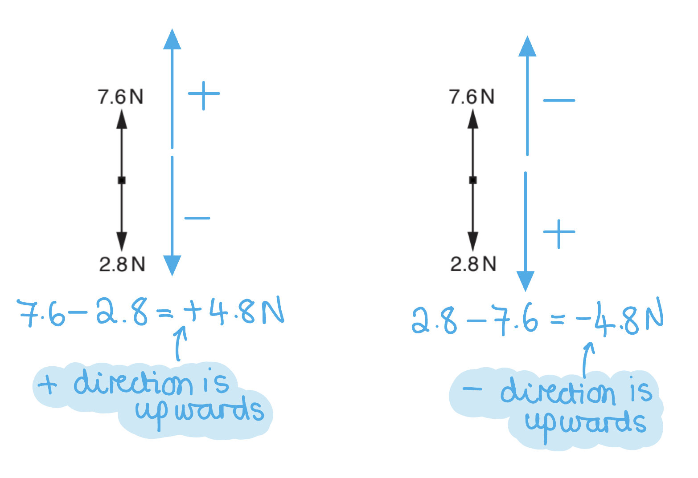
(i) The principle of conservation of energy is:

- Energy cannot be created or destroyed; **[1 mark]**

(ii) The load stops moving because:

- PE / KE / elastic energy store of load/spring decreases; **[1 mark]**
- As energy is dissipated to the thermal store of the surroundings; **[1 mark]**

**[Total: 3 marks]**

> *PE means 'potential energy' and KE means 'kinetic energy'. Remember to state **what** type of energy store this is transferred to (thermal).*

### Q9
It is incorrect to describe the circular motion as having constant velocity because:

- The direction of motion is changing **OR** constant velocity must be in a straight line; **[1 mark]**

**[Total: 1 mark]**
A force is required to maintain circular motion because:

- A resultant force is needed for an object to change direction **OR** without a resultant force the object would continue moving at a constant velocity in a straight line; **[1 mark]**
- The car is moving in a circle so it is changing direction, so the velocity is changing / the car is accelerating; **[1 mark]**

**[Total: 2 marks]**
For objects in circular motion, the force acts:

- Towards the centre of the circle **OR** at right angles to the motion; **[1 mark]**

**[Total: 1 mark]**

> *The force acting to the centre of the circle for an object in circular motion is always the resultant force.*
The name of the inward acting force for the car on the track is:

- Friction; **[1 mark]**

**[Total: 1 mark]**

> *Remember that the resultant force for an object in circular motion is **the force that keeps an object moving in a circle**.*

> *If there was no friction between the car tyres and the track, the car would not be able to move in a circle. The friction acts towards the centre in this situation.*

### Q10
Newton's first law of motion states:

- Objects will remain at rest, or move with a constant velocity unless acted upon by a resultant force; **[1 mark]**

**[Total: 1 mark]**
The equation which links acceleration, resultant force and mass is:

- *F = ma* **OR** resultant force = mass × acceleration; **[1 mark]**

**[Total: 1 mark]**
When a resultant force is applied in the opposite direction to the motion:

- The object slows down / decelerates; **[1 mark]**

**[Total: 1 mark]**
When a resultant force is applied in a perpendicular direction to the motion:

- The object changes direction; **[1 mark]**

**[Total: 1 mark]**

### Q11
Use the graph to determine:

(i) The length of the spring without a load is:

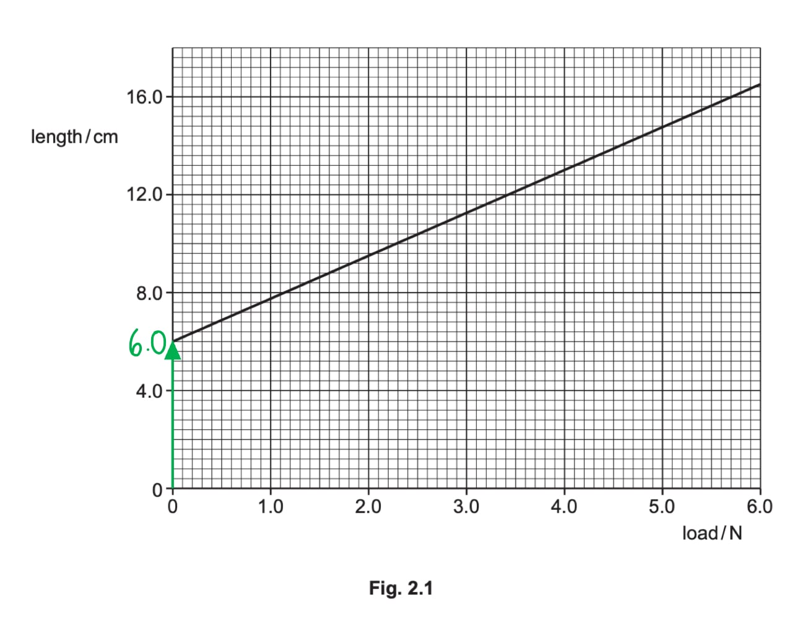

- 6.0 cm **[1 mark]**

  - *Allow 5.6 cm to 6.4 cm*

(ii) The length of the spring with a load of 4.0 N:

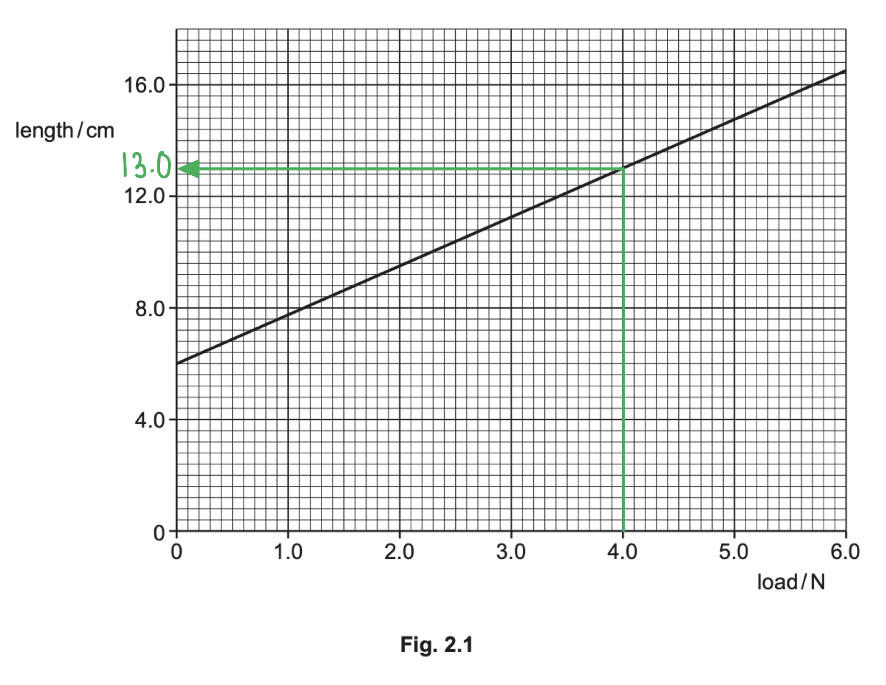

- 13.0 cm **[1 mark]**

  - *Allow 12.6 cm to 13.4 cm*

** **

(iii) The extension due to a 4.0 N load is:

- Extension = length of spring at 4.0 N – length of spring at 0 N
- 13.0 – 6.0 = 7.0 cm **[1 mark]**

**[Total: 3 marks]**

> *A tolerance of ∓½ a small square is allowed when reading data from graphs.*

> *Therefore, if you read the length of the spring to be 12.6 cm, and used that value correctly in your calculation, you would still get full marks.*

> *It is good practice to annotate your graph as much as possible when reading values from it. This scale is quite challenging to read, a foolproof way of reading any value is to work out **how much each small square equates to**. Then, you can read any value, and make sure to use a sharp pencil and ruler for straight lines just in case the value is **in between** squares like they are in part (ii).*

> *For example, for reading the length without a load (i.e. 0 N) you can do the following:*

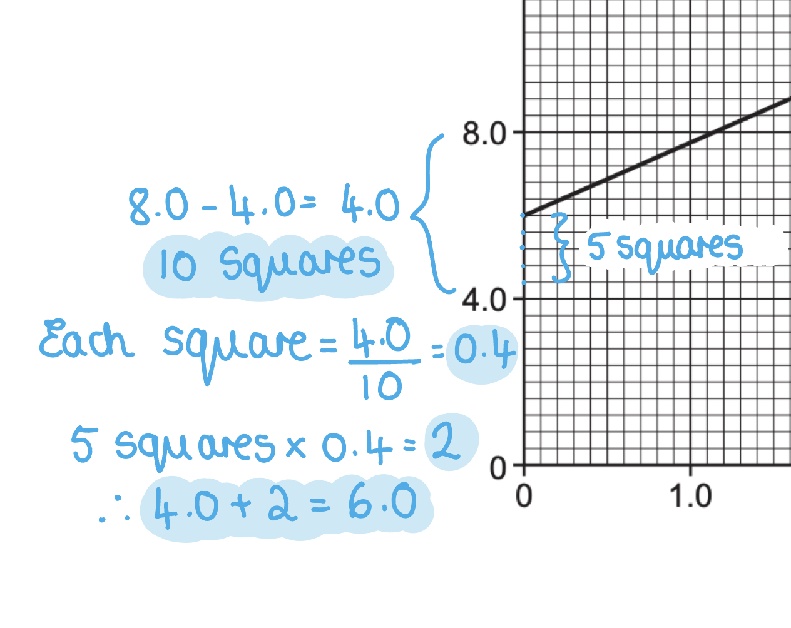
The complete sentence about effects of forces is:

- Stretching a spring with a load is an example of how a force can change the **shape ****[1 mark] **and the **size**** ****[1 mark] **of an object.

**[Total: 2 marks]**

### Q12
When a resultant force acts on object at rest, the acceleration will be:

- In the direction of the force applied; **[1 mark]**

**[Total: 1 mark]**
When a resultant force acts perpendicularly on a object traveling at a constant speed, the force will cause the object to:

- Change direction

**OR**

Travel in a circular path (assuming the force applied is constant); **[1 mark]**

**[Total: 1 mark]**
(i) State the value of the force exerted on the elevator by the man:

Use the equation for weight to calculate:

- $W=mg$
- $W=70\times9.8=686N$ **[1 mark]**

(ii) Calculate the force required to accelerate the man upwards at 1.6 m/s2:

Use Newton's second law to calculate:

- $F=ma$
- $F=70\times1.6=112N$ **[1 mark]**

** **

(iii) Explain why these values are different:

- The force required to accelerate the man / in part (ii) is the <u>resultant force</u>; **[1 mark]**
- The total force required to accelerate the man upwards is the weight plus the resultant force / 798 N; **[1 mark]**

**[Total: 4 marks]**

- *Drawing a diagram, when one is not given in the question, is a good way to get your head around the question. *

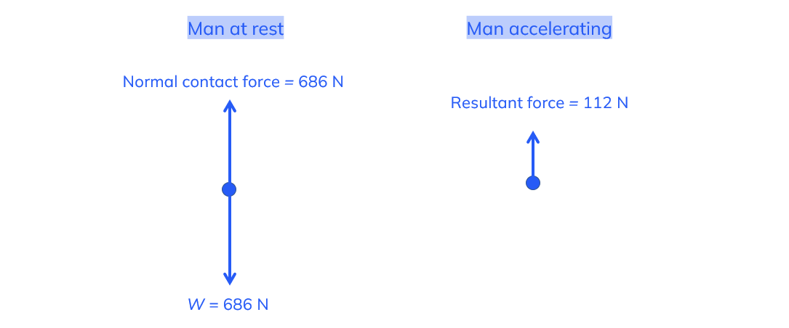

- *When the man is at rest, there is no change in his motion, therefore there is no resultant force acting on him. The forces are balanced. *
- *In order for the man to be accelerating (there is a change in his motion), there must be a resultant force acting on him.*

  - *This resultant force is the addition of an extra force applied to him, therefore the total force needed to accelerate him is the normal contact force equal to his weight, plus the resultant force.*

### Q13
(i) Calculate the size and direction of the resultant horizontal force on the swimmer:

- Subtract forces acting in the opposite direction
- $resultantforce=120-110$
- The larger force acts to the right / forwards

  - The resultant force acts to the right / forwards
- The resultant force is 10 N **AND** acts to the right / forwards; **[1 mark]**

(ii) State the name of the 110 N force on the swimmer:

**Any one from:**

- Friction; **[1 mark]**
- Water resistance; **[1 mark]**
- Drag; **[1 mark]**

**   **

(iii) Describe and explain the motion of the swimmer:

Describe the motion of the swimmer:

- The swimmer is now moving at <u>constant / steady speed</u>; **[1 mark]**

Explain this motion:

**Any one from:**

- The forces are (now) <u>balanced</u> / in <u>equilibrium</u>; **[1 mark]**
- Forward / right force = backward / left force; **[1 mark]**
- No resultant force; **[1 mark]**

**[Total: 4 marks]**

> *Questions like this are often the exam asking if you understand Newton's laws of motion. It goes a long way to know that a resultant force of zero means a constant speed and an object accelerates in the direction of a resultant force. *
To calculate the swimmer's weight:

List the known quantities:

- Weight (force), *F* = 700 N
- Perpendicular distance from the pivot, *d* = 3.5 m

Recall the equation for calculating the moment of a force:

- $m o m e n t = f o r c e \times ( p e r p e n d i c u l a r ) d i s t a n c e ( f r o m t h e p i v o t )$* ***[1 mark]**

**OR**

- $moment=F\timesd$* ***[1 mark]**

Substitute the known quantities:

- $moment=700\times3.5$**[1 mark]**

Calculate the moment of the force about the pivot:

- moment = 2450 Nm **[1 mark]**

**[Total: 3 marks]**

### Q14
Determine the size of the resultant horizontal force:

- $resultantforce=19.0-11.0=8.0N$

**AND**

Determine the direction of the resultant horizontal force:

- The resultant force acts to the <u>left / forward</u> (from the aircraft's perspective); **[1 mark]**

(ii) Describe the change in the motion of the model aircraft:

- The model aircraft is <u>accelerating</u>; **[1 mark]**
- To the left / forwards; **[1 mark]**

**[Total: 3 marks]**

> *The resultant force is calculated by subtracting forces acting in different directions and adding forces in the same direction. The horizontal forces act in **opposite** directions so if 19.0 N is positive, then 11.0 N is negative. Even if this was calculated as 11.0 – 19.0 = –8 N, the 8 N is still the size. *
Suggest how the horizontal forces acting on the model aircraft have changed:

- The drag / air resistance force increases; **[1 mark]**

**OR**

- The thrust decreases; **[1 mark]**

**[Total: 1 mark]**

> *Remember that "balanced forces" means the resultant force on the aircraft is **zero. **This means the forward force (thrust) = backward force (drag/air resistance).*

### Q15
List the known quantities:

- Initial speed = 0 m/s
- Final speed = 70 m/s
- Time taken, $t$ = 32 s
- Mass, $m$ = 3.1 × 106 kg

(i) Calculate the acceleration:

Use the equation for acceleration to calculate:

- $a=\frac{\Deltav}{t}$
- $a=\frac{70-0}{32}$ **[1 mark]**
- $a=2.2m/s^{2}$ **[1 mark]**

(ii) Calculate the resultant force:

Use Newton's second law to calculate:

- $F=ma$
- $F = ( 3.1 \times 10^{6} ) \times 2.2$ **[1 mark]**
- $F=6820000N$ **[1 mark]**

**[Total: 4 marks]**

- *Part (ii) is an error carried forward question, you will see this as 'ecf' on a mark scheme.*

  - *That means that if you calculate the acceleration incorrectly in part (i), you can still gain full marks for part (ii) as long as your calculation is correct for the value you used. *
- *Note that the answer mark in CIE can only be gained with the correct value **AND** the correct units*
Draw an arrow showing the resultant force on the aeroplane:

A diagram scoring 2 marks:

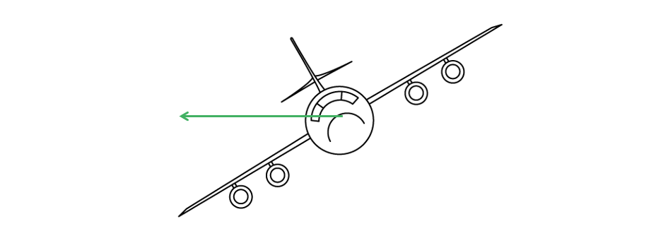

- Arrow drawn horizontal; **[1 mark]**
- Arrow drawn towards the centre of the turning circle (to the left); **[1 mark]**

Explain your answer:

- The resultant / centripetal force / acceleration acts towards the centre of the circle for objects in circular motion; **[1 mark]**

**[Total: 3 marks]**
The pilot could decrease the radius of the circular flight path whilst maintaining a constant speed by:

- Increasing the force (from the engine) **OR**
- Decreasing the mass (of the plane); **[1 mark]**

**[Total: 1 mark]**

> *Some students find 'suggest' questions tricky. To make sure you gain the marks, always stick to the physics!*

> *For objects in circular motion, the radius decreases if the force increases for a constant mass and speed. If the mass decreases, the force required to keep it in orbit decreases, therefore maintaining the force for a decreased mass has the same effect as increasing the force. *
The resultant force on the aeroplane is less upon landing that at take off because:

- The aeroplane has used some / most of its fuel;** [1 mark]**
- (Therefore) the mass (of the aeroplane) has decreased; **[1 mark]**
- *F = ma* **OR** force is proportional to mass; **[1 mark]**
- Therefore, the resultant force is less / smaller; **[1 mark]**

**[Total: 4 marks]**

### Q16
State what quantity is being measured:

**Any one from:**

- Measure length; **[1 mark]**
- Use a ruler; **[1 mark]**
- Ruler drawn on the diagram <u>upright and close to the spring</u>; **[1 mark]**

Compare the lengths of the spring:

- Measure the length of the spring without weights / load **AND** measure with weights / loads; **[1 mark]**

Calculate the extension:

- (Extension is) the difference between the two lengths / values; **[1 mark]**

**[Total: 3 marks]**

> *Although this question does not ask about it, a crucial control variable in this experiment is **where** we measure the length of the spring from.*

> *Whether this is from the top of the loop, or the top of the coils, is actually unimportant. The key is that you do this between the **same points** with the load and without the load.*
(i) Determine the extension produced by a load of 7.5 N:

Use the graph to find the extension with a load of 7.5 N:

- Draw a horizontal line along from 7.5 N to meet the line of the graph
- Read the X axis value of this point by drawing a vertical line down to the X axis

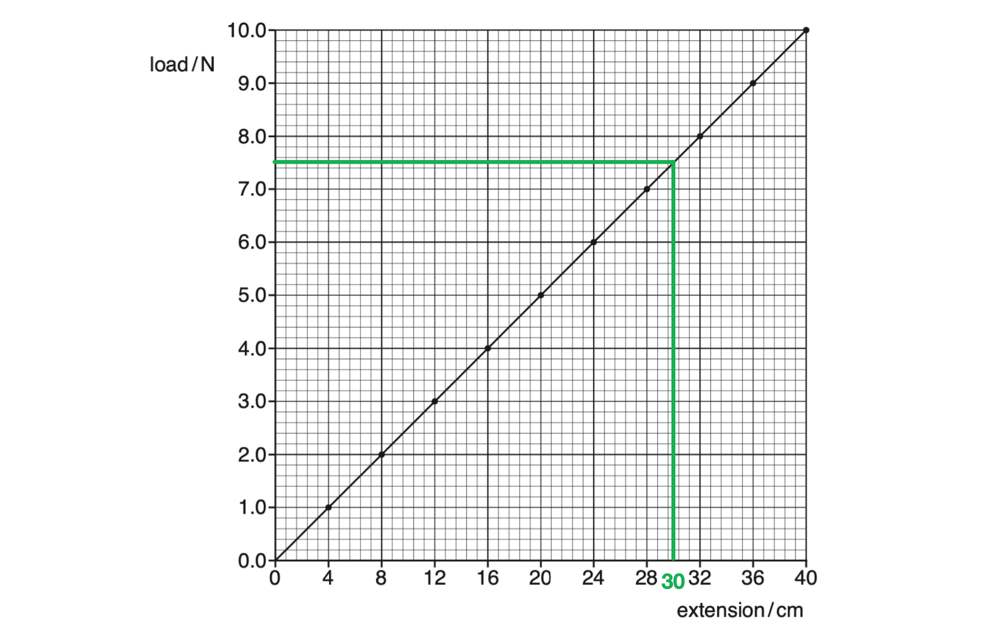

- The extension with a load of 7.5 N is <u>30 cm</u>; **[1 mark]**

(ii) Determine the load that would produce an extension of 10.0 cm:

Use the graph to find the load that causes an extension of 10 cm:

- Draw a vertical line up from 10 cm on the X axis to meet the line of the graph
- Read the Y axis value of this point by drawing a horizontal line across to the Y axis

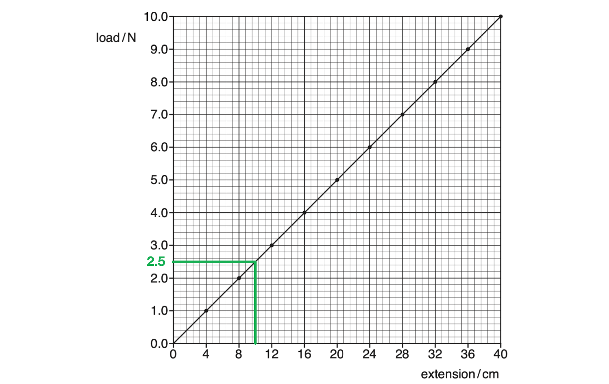

- The load that causes an extension of 10 cm is <u>2.5 N</u>; **[1 mark]**

When reading values from a line on a graph, always use a ruler. If just reading down from the line to the axis by eye, you can easily stray from a straight line and read the incorrect value on the axis.
List the known quantity:

- Weight = 6.0 N
- Gravitational field strength, *g* = 9.8 N / kg

Recall the equation linking mass and weight:

- *Weight *= *mass* × *acceleration due to gravity* **OR ***W *= *m* × *g ***[1 mark]**

Rearrange this equation by dividing both sides by *g*:

- *W *= *m* × *g*
- `W / g = (m x / g)/(/ g)`
- $m=\frac{W}{g}$

Substitute in the known values to calculate:

- $m=\frac{6}{9.8}$ **[1 mark]**
- *m *= 0.6 kg (1 s.f.) **[1 mark]**

Knowing that *g* = 9.8 m / s2 is essential for IGCSE physics. This comes up all the time and it's a pretty easy one to remember!

### Q17
The man must exert a force of:

- More than / greater than 46 N; **[1 mark]**

**[Total: 1 mark]**

> *Newton's first law states that an object will remain at rest (or move with a constant velocity) unless acted upon by a resultant force. Newton's second law tells us that a resultant force acting on an object with mass will undergo an acceleration (**F = ma**).*

> *Therefore, to move an object at rest (to make it accelerate), a resultant force must be applied. Fig. 1.1 shows that the force acting to the left is 46 N, so a force acting to the right of more than 46 N is required to make the sledge move.*
The force that opposing the motion of the sledge is:

- Friction; **[1 mark]**

**[Total: 1 mark]**

> *Avoid stating just 'drag' force. It is better to be specific to the situation e.g. in this situation, it is friction but for a ball flying through the air, the resistive force is air resistance.*
To calculate the resultant force:

List the known quantities:

- Mass, $m$ = 42 kg
- Acceleration = 0.75 m/s2

Use Newton's second law to calculate the resultant force:

- $F=ma$ **[1 mark]**
- $F=42\times0.75$ **[1 mark]**
- $F=31.5N$ **[1 mark]**

**[Total: 3 marks]**

> *Make sure to look at other subparts if you're missing values for the questions. The mass of 42 kg is stated in the question stem back in part (a)!*
Assuming that the force opposing the motion of the sledge is the same, calculate the total force acting down the hill:

List the known quantities:

- Resultant force = 31.5 N (from part (c))

A diagram scoring 2 marks:

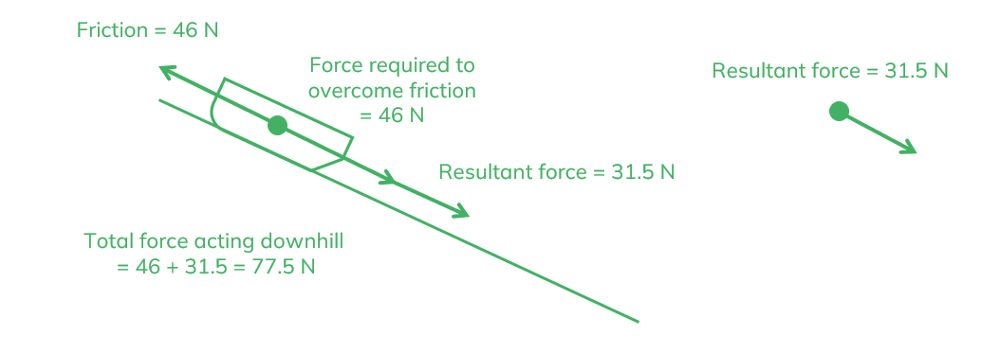

To calculate the total force acting down the hill:

- Force required to overcome friction = 46 N **[1 mark]**
- Resultant force = 31.5 N
- Total force acting downhill = 46 + 31.5 = 77.5 N **[1 mark]**

**[Total: 2 marks]**

> *Since the sledge is moving down the hill, the resultant force acts down the slope. This means*

> *resultant force = force acting down the hill – friction*

> *It is –friction because the friction acts in the opposite direction to the motion of the sledge (remember - forces are **vectors**)*

> *Therefore*

> *force acting down the hill = resultant force + friction*

### Q18
To calculate the resultant force:

Calculate the total downwards force:

- Downwards force = 43.0 + 2.4 = 45.4 N **[1 mark]**

Calculate the magnitude of the resultant force, *R*:

- Resultant force = upwards force − downwards force
- *R* = 74.2 − 45.4 = 28.8 N **[1 mark]**

State the direction of the resultant force:

- The resultant force acts <u>upwards</u>; **[1 mark]**

**[Total: 3 marks]**
A completed diagram which would score one mark would be:

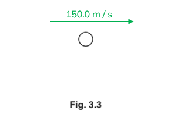

- A <u>straight horizontal line</u> labelled with <u>150.0 m/s</u>; **[1 mark]**

**[Total: 1 mark]**

> *The resultant force on the object is zero, therefore, due to Newton's first law there is no change in velocity.*
