# Exam Questions — Effects of Forces
**1. Motion, Forces & Energy** · Cambridge (CIE) IGCSE physics (0625 & 0972)
> Source: [https://www.savemyexams.com/igcse/physics/cie/23/topic-questions/](https://www.savemyexams.com/igcse/physics/cie/23/topic-questions/) · 49 questions across 3 sets

## Alternative To Practical Questions (5 questions)

### Q1 — medium — 7 marks

**Q1** [7 marks]

A student investigates the force required to break different beams made from a mixture of sand and cement. All the beams have the same cross‑section.

Plan an experiment to investigate the force required to break the beams.

Fig. 4.1 shows the set‑up.

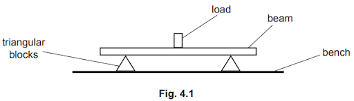

The following apparatus is available:

- a selection of beams made from different ratios of sand and cement and of various lengths
- triangular blocks to support the beams
- a metre rule
- a selection of loads.

You can also use other apparatus and materials that are usually available in a school laboratory.

The student takes all the necessary safety precautions. You are **not** required to write about safety precautions.

In your plan, you should:

- explain briefly how to carry out the investigation (you may add to the diagram if it helps your explanation)
- state the key variables to keep constant
- draw a table, or tables, with column headings, to show how to display your readings (you are **not** required to enter any readings in the table)
- explain how you would use the readings to reach a conclusion.

*Source: June 2022 paper 6 Q4A*

### Q2 — medium — 11 marks

**Q2** [4 marks]

A student investigates the stretching of a spring.

The apparatus is shown in Fig. 1.1.

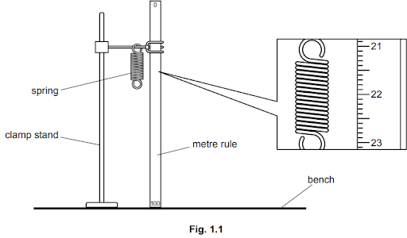

(i)  On Fig. 1.1, take two readings from the metre rule to determine the unstretched length $l_{0}$ of the coiled part of the spring.

reading 1 .......................................................... cm

reading 2 ......................................................... cm

$l_{0}$= .......................................................... cm  [3]

(ii) Draw a diagram to show clearly how you would use a set square to obtain an accurate reading from the metre rule.

[1]

*Source: June 2022 paper 6 Q1A*

**Q2** [2 marks]

**Extract:**

Reading 1 = 21.3 cm
Reading 2 = 22.8 cm
l₀ = (22.8 − 21.3) = 1.5 cm

**Extended Tier Only**

The student suspends a load of $P=1.0N$ from the spring.

He records the new length $l_{1}$ of the coiled part of the spring.

$l_{1}$ = .................2.2......................................... cm

Calculate the extension e1 using the equation $e_{1} = ( l_{1} - l_{0} )$

$e_{1}$ = .......................................................... cm

Calculate a value for the spring constant $k$ of the spring using the equation

$k=\frac{P}{e_{1}}$

Include the unit.

$k$ = ...............................................................

*Source: June 2022 paper 6 Q1B*

**Q2** [2 marks]

**Extract:**

Reading 1 = 21.3 cm
Reading 2 = 22.8 cm
l_0 = (22.8 − 21.3) = 1.5 cm

**Extended Tier Only**

The student suspends a load of $P=5.0N$ from the spring.

He records the new length $l_{5}$ of the coiled part of the spring.

$l_{5}$ = ......................6.3.................................... cm

Calculate the extension $e_{5}$ using the equation $e_{5} = ( l_{5} - l_{0} )$

$e_{5}$ = .......................................................... cm

Calculate a second value for the spring constant $k$ of the spring using the equation

$k=\frac{P}{e_{5}}$

Give your answer to two significant figures.

$k$ = ...............................................................

*Source: June 2022 paper 6 Q1C*

**Q2** [1 mark]

**Extract:**

From part b:
- The student suspends a load of P = 1.0 N from the spring.
- l_1 = 2.2 cm
- l_0 = 1.5 cm
- e_1 = (2.2 − 1.5) = 0.7 cm
- k = 1.4 N/cm

From part c:
- The student suspends a load of P = 5.0 N from the spring.
- l_5 = 6.3 cm
- l_0 = 1.5 cm
- e_5 = (6.3 − 1.5) = 4.8 cm
- k = 1.0 N/cm (2 sig fig.)

State whether your two values of the spring constant $k$ can be considered equal within the limits of experimental accuracy.

Explain your answer by referring to your results.

*Source: June 2022 paper 6 Q1D*

**Q2** [2 marks]

**Extract:**

A student investigates the stretching of a spring. The apparatus is shown in Fig. 1.1. (description and diagram of a spring attached to a clamp stand beside a metre rule on a bench). The student measures the length of the coiled part of the spring to determine its unstretched length, and then measures the length again after suspending loads from the spring to calculate the extension.

A student improves the experiment by taking additional sets of readings.

**(i) **Suggest the additional apparatus that the student uses

[1]

**(ii)** Suggest how the student uses the additional results.

[1]

*Source: June 2022 paper 6 Q1E*

### Q3 — medium — 11 marks

**Q3** [1 mark]

A student is determining the spring constant *k* of a spring by two methods.

Fig. 1.2 shows how the apparatus is used.

**Method 1   **

On Fig. 1.1, measure the unstretched length $l_{0}$ of the spring, in mm.

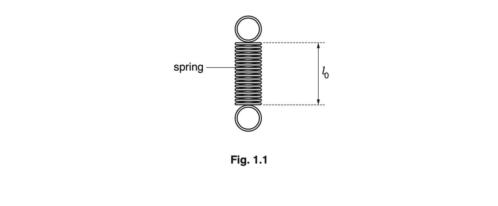

$l_{0}$ = ................................................. mm

*Source: OCt 2018 S1 0625/61 Q1A*

**Q3** [2 marks]

**Extract:**

- Unstretched length of the spring, l_0 = 22 mm (from part (a))
- New length of the spring with 300 g mass, l = 53 mm (from part (b))
- Force, F = 3.0 N (from part (b))

**Extended tier only**

The student attaches the spring to the clamp as shown in Fig. 1.2.

He hangs a 300 g mass on the spring.

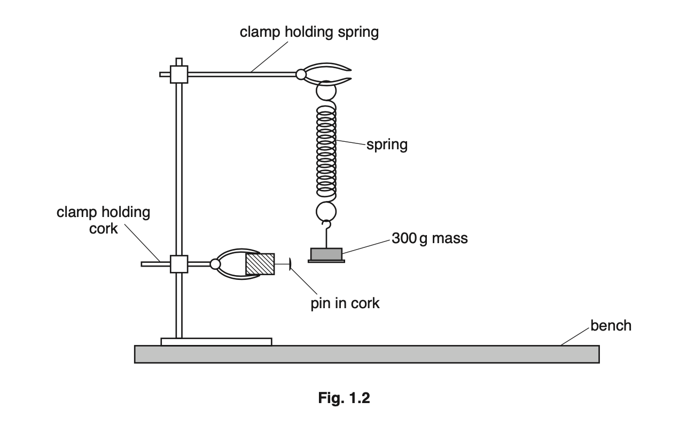

He measures the new length $l$ of the spring.

$l$ = 53 mm

(i) Calculate the extension *e* of the spring using the equation $e=l-l_{0}$.

*e* = ................................................. mm [1]

(ii) Calculate a value for the spring constant *k* using the following equation:

$k=\frac{F}{e}$ ,

where *F *= 3.0 N.

*k* = ............................................ N/mm [1]

*Source: Oct 2018 S1 0625/61 Q1B*

**Q3** [4 marks]

**Method 2**

The student pulls the mass down a short distance and releases it so that it oscillates up and down. Fig. 1.3 shows the time *t* taken for 10 complete oscillations.

(i) Record the time *t* taken for 10 complete oscillations.

*t* = ........................................................ [1]

(ii)

1.   Calculate the time *T* taken for one complete oscillation.

*T* = .............................................................

2.   Calculate *T** *2.

*T* 2 = .............................................................

[2]

(iii)

Calculate the spring constant *k* using the following equation:

$k=\frac{0.040m}{T^{2}}$,

where *m* = 0.300kg.

*k* = ............................................ N/mm [1]

*Source: Oct 2018 S2 0625/61 Q1C*

**Q3** [2 marks]

**Extract:**

(From part b)
(ii) Calculate a value for the spring constant k :
List the known quantities:
- Extension, e = 31 mm (from part (b)(i))
- Force, F = 3.0 N
Substitute the known quantities into the equation and calculate k :
- k = F / e
- k = 3.0 / 31
- k = 0.09677...
- k = 0.097 N/mm (2 significant figures)

(From part c)
(iii) Calculate the spring constant k :
List the known quantities:
- mass, m = 0.300 kg
- T^2 = 0.120
Substitute these quantities into the equation and calculate k :
- k = (0.040 × 0.300) / 0.120
- k = 0.10 N/mm

State and explain whether your two values for *k* are the same within the limits of experimental accuracy.

*Source: Oct 2018 S1 0625/61 Q1D*

**Q3** [2 marks]

**Extract:**

The student attaches the spring to the clamp as shown in Fig. 1.2. He hangs a 300 g mass on the spring. He measures the new length l of the spring. (Method 1 involves hanging a mass m on the spring and measuring the extension.)

A student states that repeating Method 1 with different masses would improve the reliability of the value obtained for *k*.

Suggest additional values for the mass *m* that you would use when repeating the experiment to improve the reliability.

*Source: Oct 2018 S1 0625/61 Q1E*

### Q4 — medium — 9 marks

**Q4** [2 marks]

The class is investigating the behaviour of a spring, and then using the spring to determine the weight of an object.

The apparatus is shown in Fig. 3.1.

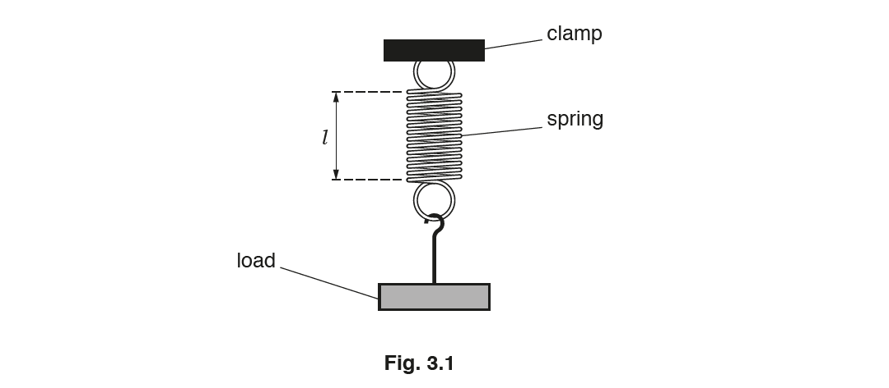

The stretched length $l$ of the spring, indicated in Fig. 3.1, is to be measured.

Describe two precautions that could be taken when measuring the length of the stationary spring, to ensure an accurate reading. You may draw a diagram.

*Source: 2019 (Series 3) 0625/63 Q3A*

**Q4** [1 mark]

A student measures the length $l_{0}$ of the spring without any load.

$l_{0}$ = 2.1 cm

Various loads *L* are hung on the spring. The stretched length $l$ of the spring for each load is recorded in Table 3.1.

**Table 3.1**

| *L*/N | $l$/cm | *e*/cm |
|---|---|---|
| 1.0 | 6.3 |   |
| 2.0 | 10.5 |   |
| 3.0 | 14.7 |   |

Calculate, and record in Table 3.1, the extension *e* of the spring for each load *L*. Use the equation $e = ( l - l_{0} )$

*Source: 2019 (Series 3) 0625/63 Q3B*

**Q4** [1 mark]

**Extract:**

The unstretched length of the spring, l₀ = 2.1 cm
Table of extensions for known weights:
| L/N | l/cm | e/cm |
| 1.0 | 6.3  | 4.2  |
| 2.0 | 10.5 | 8.4  |
| 3.0 | 14.7 | 12.6 |
The stretched length of the spring with object X, lₓ = 11.4 cm

The loads are removed and an object **X **is suspended from the spring.

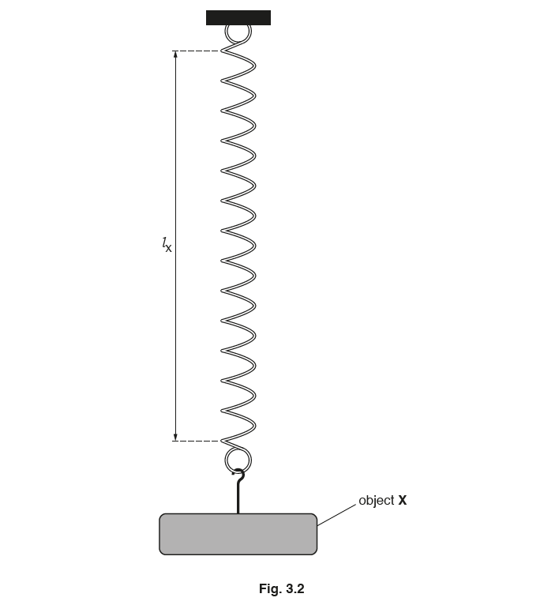

The unstretched length $l_{x}$ of the spring on Fig 3.2 is 11.4 cm

Estimate the weight *W*X of object **X**.

Explain how you obtained your answer.

*W*X = ........................................................... N

*Source: 2019 (Series 3) 0625/63 Q3C*

**Q4** [1 mark]

**Extract:**

The measured lengths and weights in the experiment are:
- l₀ = 2.1 cm
- l = 6.3 cm, 10.5 cm, 14.7 cm
- L = 1.0 N, 2.0 N, 3.0 N
- Calculated extensions: e = 4.2 cm, 8.4 cm, 12.6 cm
- The stretched length for object X: lₓ = 11.4 cm
- The calculated extension for X: e = 9.3 cm
- The estimated weight for X: 2.0 N < Wₓ < 3.0 N

All measurements and calculated values are given to 2 or 3 significant figures.

A student measures the weight of a different load using a similar method. He gives the weight as 4.532 N.

Explain why this is not a suitable number of significant figures for this experiment.

*Source: 2019 (Series 3) 0625/63 Q3D*

**Q4** [4 marks]

**Extract:**

| L/N | l/cm | e/cm |
| 1.0 | 6.3 | 4.2 |
| 2.0 | 10.5 | 8.4 |
| 3.0 | 14.7 | 12.6 |

(i) Another student suggests that* e* is directly proportional to *L*.

State whether the results support her suggestion.

Use values from the results in Table 3.1 to justify your statement.

[2]

(ii) The student wishes to plot a graph of *L* against *e* to test if the two quantities are directly proportional.

State how her graph line could show that *e* is directly proportional to *L*.

[2]

*Source: 2019 (Series 3) 0625/63 Q3E*

### Q5 — medium — 7 marks

**Q5** [7 marks]

A student wants to investigate the effect of air resistance on the swing of a pendulum.

Plan an experiment which will enable him to investigate how air resistance changes the way in which a pendulum swings.

The apparatus available includes:

- a light wooden rod, approximately 80cm long with a hole at one end, through which a nail will fit
- a piece of modelling clay to act as a pendulum bob, as shown in Fig. 4.1
- a sheet of thick card which will provide the air resistance when the pendulum swings.

In your plan, you should:

- list any additional apparatus needed
- explain briefly how you would carry out the experiment including exactly which measurements should be taken
- state the key variables that you would control
- draw a table, or tables, with column headings, to show how you would display your readings (you are **not** required to enter any readings in the table)
- explain how you would use your readings to reach a conclusion.

You may add to Fig. 4.1 or draw an additional diagram if it helps to explain your plan.

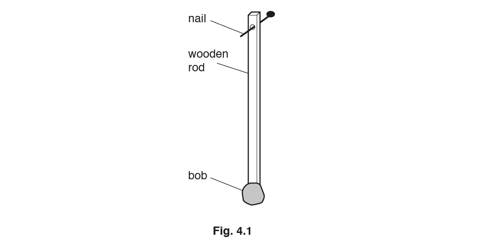

*Source: Feb 2019 0625/62 Q4*

## Multiple Choice Questions (26 questions)

### Q1 — medium — 1 marks

**Q1** [1 mark]

A satellite orbits a planet in a circular path at constant speed.

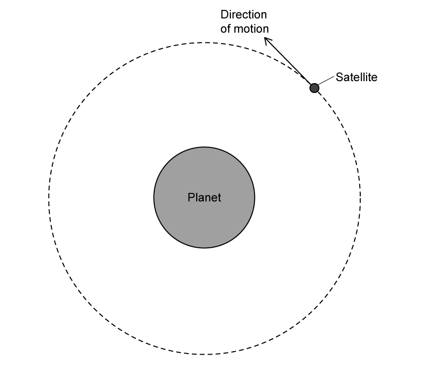

Which statement about the resultant force is correct?

### Q2 — easy — 1 marks

**Q2** [1 mark]

The graph shows the load-extension graph for a spring.

What does point P represent?

### Q3 — medium — 1 marks

**Q3** [1 mark]

A skydiver falls before opening her parachute.

Which graph correctly shows how her speed changes with time?

### Q4 — medium — 1 marks

**Q4** [1 mark]

An aeroplane flies horizontally at constant speed as shown.

Which statement about the resultant force on the aeroplane is correct?

### Q5 — medium — 1 marks

**Q5** [1 mark]

A train is travelling horizontally in a straight line. A book is on a table in the train. The diagram shows all the forces acting on the book.

How is the train moving?

*Source: June 2023 0972/21 Q7*

### Q6 — hard — 1 marks

**Q6** [1 mark]

On the Earth, a spring stretches by 5.0 cm when a mass of 3.0 kg is suspended from one end.

The gravitational field strength on the Moon is $\frac{1}{6}$ of that on the Earth.

Which mass, on the Moon, would stretch the spring by the same extension?

*Source: June 2023 0972/21 Q4*

### Q7 — medium — 1 marks

**Q7** [1 mark]

Four objects are moving.

Which object has a zero resultant force acting on it?

*Source: June 2023 0972/11 Q7*

### Q8 — medium — 1 marks

**Q8** [1 mark]

Which pieces of apparatus are the most appropriate for an experiment to plot an extension–load graph of a spring?

*Source: june 2022 paper 1 Q6*

### Q9 — medium — 1 marks

**Q9** [1 mark]

A student hangs different loads on a spring.

The diagrams show the lengths of the spring with different loads.

Which row gives the correct extensions of the spring?

|   | extension / cm when the load is 0 N | extension / cm when the load is 2.0 N | extension / cm when the load is 4.0 N |
|---|---|---|---|
| **A** | 0 | 3.0 | 3.0 |
| **B** | 0 | 3.0 | 6.0 |
| **C** | 3.0 | 3.0 | 3.0 |
| **D** | 3.0 | 6.0 | 9.0 |

*Source: 2023 specimen paper 1 Q6*

### Q10 — easy — 1 marks

**Q10** [1 mark]

**Extended Tier Only**

An object on the end of a string moves in a clockwise circular path at constant speed. The diagram shows the object as viewed from above.

What is the direction of the resultant force on the object when it is in the position shown?

*Source: June 2022 paper 2 Q6*

### Q11 — easy — 1 marks

**Q11** [1 mark]

** **The diagrams show the forces acting on four moving objects.

Which object is moving at a constant speed?

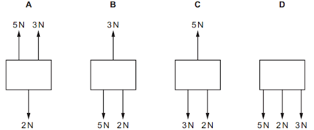

*Source: June 2022 paper 1 Q8*

### Q12 — easy — 1 marks

**Q12** [1 mark]

**Extended tier only**

The Moon orbits the Earth at a constant speed.

Which of the arrows on the diagram shows the direction of the resultant force on the Moon?

### Q13 — easy — 1 marks

**Q13** [1 mark]

**Extended tier only**

A car is driving around a circular track at a constant speed.

Which statement describes the motion of the car?

### Q14 — easy — 1 marks

**Q14** [1 mark]

In which of the following situations would no resultant force be required?

### Q15 — easy — 1 marks

**Q15** [1 mark]

A car starts from rest and rapidly increases speed.

There is a forward acting force on the car from the engine, and a backward acting force on the car from air resistance and friction.

Choose the force diagram and description that best describes the magnitude of the opposing forces.

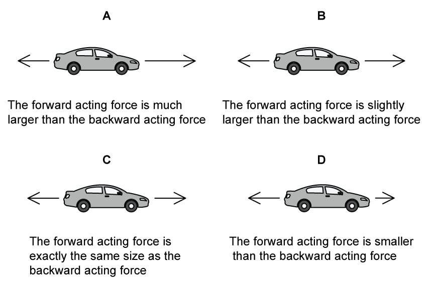

### Q16 — easy — 1 marks

**Q16** [1 mark]

**Extended tier only**

A planet orbits a star at a constant speed in a **circular** orbit.

Which of the statements below, about the force needed to maintain this motion, is correct?

### Q17 — hard — 1 marks

**Q17** [1 mark]

The graph below shows the journey of a truck along a straight, flat road.

During which part of the journey is the resultant force on the truck equal to zero?

### Q18 — medium — 1 marks

**Q18** [1 mark]

A motorbike travels at a constant speed along a flat road. Three horizontal forces act on the motorbike. Two of them are shown in the diagram below.

What is the size and direction of the third force?

### Q19 — hard — 1 marks

**Q19** [1 mark]

A car is driving on a motorway at a constant speed of 70 miles per hour.

The driver notices a queue of traffic up ahead and begins to slow down.

Which diagram best describes the resultant force acting on the car as it slows down?

### Q20 — medium — 1 marks

**Q20** [1 mark]

**Extended tier only**

A car slows down as it approaches a traffic light. The car was traveling at 13.5 m/s and it takes 22 s to come to a stop.

The mass of the car is 950 kg.

Calculate the force required to stop the car.

### Q21 — hard — 1 marks

**Q21** [1 mark]

The diagram shows four objects, each with a different mass. Each object is acted on by the forces shown.

Which object will experience the largest magnitude of acceleration?

### Q22 — medium — 1 marks

**Q22** [1 mark]

The diagram shows four objects, each with the same mass. Each object is acted on by the forces shown.

Which object will experience the largest acceleration to the left?

### Q23 — medium — 1 marks

**Q23** [1 mark]

Two students were discussing Newton's first law of motion.

Which statement correctly summarises this law?

### Q24 — medium — 1 marks

**Q24** [1 mark]

An object with three forces acting on it is shown below.

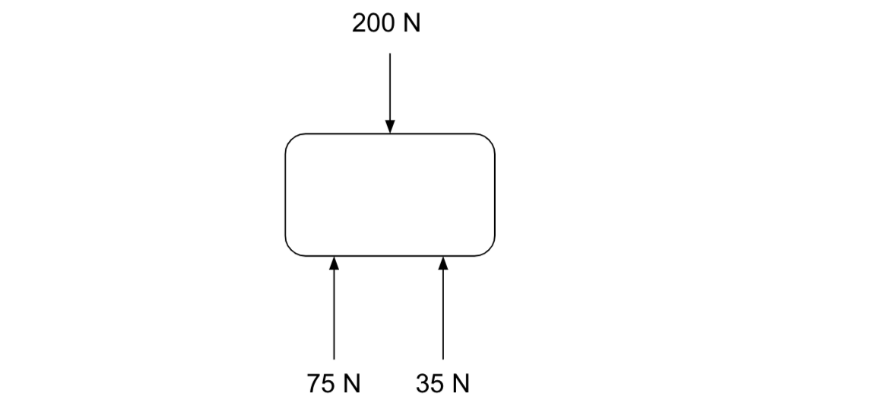

What is the resultant force acting on the object?

### Q25 — hard — 1 marks

**Q25** [1 mark]

**Extended tier only**

A skydiver is falling at terminal velocity. He has not yet opened his parachute.

He opens his parachute.

What is the direction of both the velocity of the skydiver, and his acceleration?

|   | **Direction of the skydiver’s velocity** | **Direction of the skydiver’s acceleration** |
|---|---|---|
| **A** | upwards | upwards |
| **B** | upwards | downwards |
| **C** | downwards | upwards |
| **D** | downwards | downwards |

### Q26 — hard — 1 marks

**Q26** [1 mark]

**Extended tier only**

A bus drives along a flat road. Its engine produces a forward driving force of 7000 N. Drag forces, *D* also act on the bus.

The bus has an acceleration of 1.2 m/s2 and a mass of 2500 kg.

What is the value of D?

## Theory Questions (18 questions)

### Q1 — hard — 8 marks

**Q1** [1 mark]

A cyclist starts from rest and accelerates along a straight, level road. The cyclist then travels at a constant speed before decelerating to a stop.

Fig. 1.1 shows the speed–time graph for the cyclist's journey.

**Fig. 1.1**

Define acceleration.

**Q1** [2 marks]

**Extract:**

A cyclist starts from rest and accelerates along a straight, level road. The cyclist then travels at a constant speed before decelerating to a stop.

Fig. 1.1 shows the speed–time graph for the cyclist's journey.

**Fig. 1.1**

Explain, in terms of forces, why the cyclist travels at a constant speed between 8.0 s and 28 s.

**Q1** [3 marks]

**Extract:**

A cyclist starts from rest and accelerates along a straight, level road. The cyclist then travels at a constant speed before decelerating to a stop.

Fig. 1.1 shows the speed–time graph for the cyclist's journey.

**Fig. 1.1**

Calculate the total distance travelled by the cyclist.

Show your working.

**Q1** [2 marks]

**Extract:**

A cyclist starts from rest and accelerates along a straight, level road. The cyclist then travels at a constant speed before decelerating to a stop.

The driving force is equal to the resistive force(s) / the forces are balanced. The resultant force is zero so there is no acceleration / the speed does not change.

On a different day, the cyclist makes the same journey, but there is a strong headwind. The cyclist pedals with the same driving force as before.

Explain why this leads to a longer journey time.

### Q2 — medium — 11 marks

**Q2** [3 marks]

A student investigates the stretching of a spring. The apparatus is shown in Fig. 1.1.

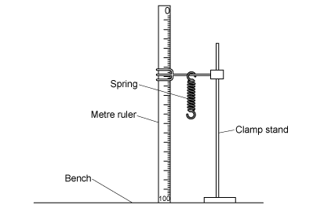

**Fig. 1.1**

The student measures the length $L_{0}$ of the unstretched spring. Fig. 1.2 shows the spring next to the metre rule.

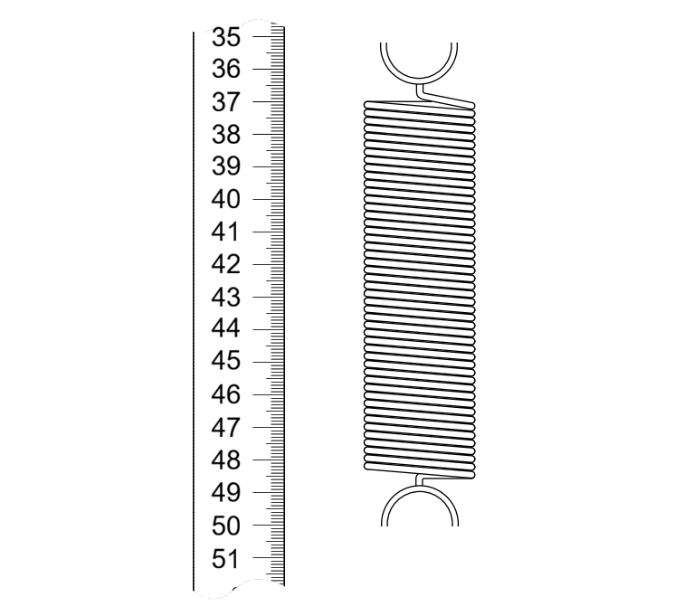

**Fig. 1.2**

(i) By taking scale readings from the metre rule in Fig. 1.2, calculate the unstretched length $L_{0}$ of the spring in cm.

[2]

(ii) State **one** precaution the student should take to obtain an accurate length reading.

[1]

**Q2** [1 mark]

**Extract:**

The student measures the length L₀ of the unstretched spring.

Calculate the unstretched length of the spring:
L₀ = bottom reading - top reading
L₀ = 48.5 - 37.0
L₀ = 11.5 cm

The student hangs various loads $W$ on the spring and measures the new length $L$ each time. The results are shown in Table 1.1.

**Table 1.1**

| $W$ / N | $L$ / cm | $e$ / cm |
|---|---|---|
| 1.0 | 14.3 |   |
| 2.0 | 16.7 |   |
| 3.0 | 19.5 |   |
| 4.0 | 22.1 |   |
| 5.0 | 24.9 |   |

Calculate, and record in Table 1.1, the extension $e$ of the spring for each load $W$. Use the equation $e = ( L - L_{0} )$.

**Q2** [4 marks]

**Extract:**

The student hangs various loads \[W\] on the spring and measures the new length \[L\] each time. The results are shown in Table 1.1.

**Table 1.1**

\[W\] / N

\[L\] / cm

\[e\] / cm

1.0

14.3

2.0

16.7

3.0

19.5

4.0

22.1

5.0

24.9

Calculate, and record in Table 1.1, the extension \[e\] of the spring for each load \[W\]. Use the equation \[e = \left(L - L_{0}\right)\].

Plot a graph of $e$ / cm (y-axis) against $W$ / N (x-axis). Start the axes at the origin (0,0).

Draw a best-fit straight line.

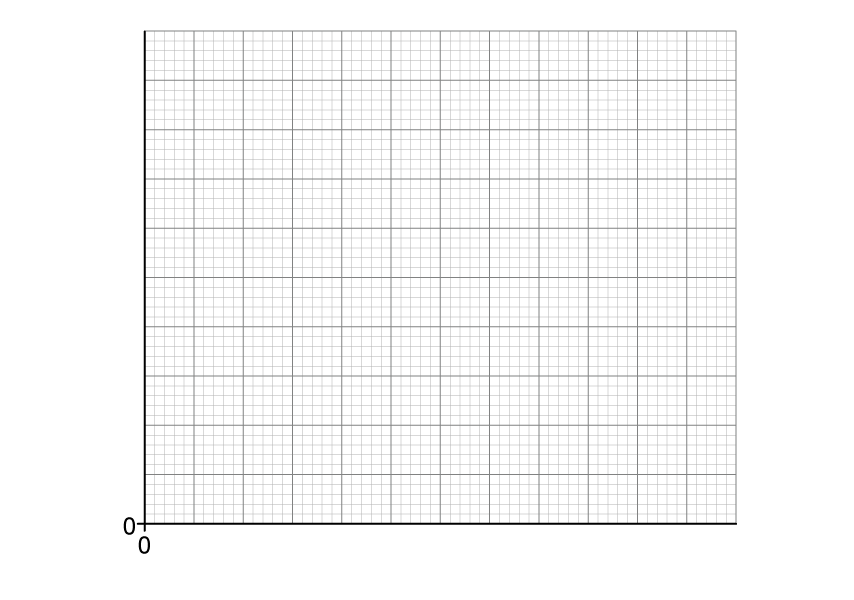

**Q2** [3 marks]

**Extract:**

Plot a graph of \[e\] / cm (y-axis) against \[W\] / N (x-axis). Start the axes at the origin (0,0).

Draw a best-fit straight line.

(i) Determine the gradient $G$ of your line. Show clearly on the graph how you obtained the value.

[1]

(ii) Calculate a value for the spring constant $k$ of the spring using the equation

$k=\frac{1}{G}$

Include the unit.

[2]

### Q3 — medium — 6 marks

**Q3** [3 marks]

** **Fig. 1.1 is the distance–time graph for the car from t = 0.

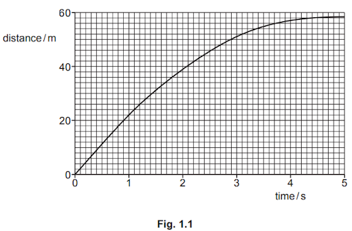

(i) State the property of a distance–time graph that corresponds to speed.

[1]

(ii) Using Fig. 1.1, determine the initial speed *v* of the car.

*v* = ......................................................... [2]

*Source: June 2022 paper 4 Q1C*

**Q3** [3 marks]

**Extended Tier Only**

When the car is decelerating, there is a constant resistive force F on the car due to the brakes.

The deceleration of the car is greater than $\frac{F}{m}$ and is **not** constant.

Explain why:

(i) the deceleration of the car is greater than $\frac{F}{m}$

[1]

(ii) the deceleration is **not **constant.

[2]

*Source: June 2022 paper 4 Q1D*

### Q4 — easy — 6 marks

**Q4** [1 mark]

Fig.3.1 shows the load-extension graphs for two springs, A and B.

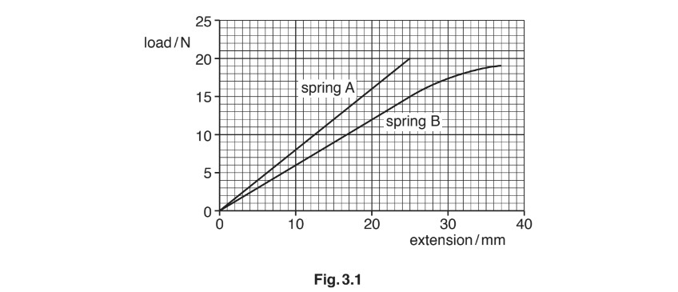

Determine the extension of spring A for a load of 10N.

extension = .................................................. mm

*Source: February/March 2018 0625/32 Q3A*

**Q4** [2 marks]

**Extract:**

Fig.3.1 shows the load-extension graphs for two springs, A and B.

**Extended tier only**

State which spring is easier to stretch and give a reason for your answer.

*Source: February/March 2018 0625/32 Q3B*

**Q4** [3 marks]

A different spring is suspended from the edge of a bench, as shown in Fig.3.2.

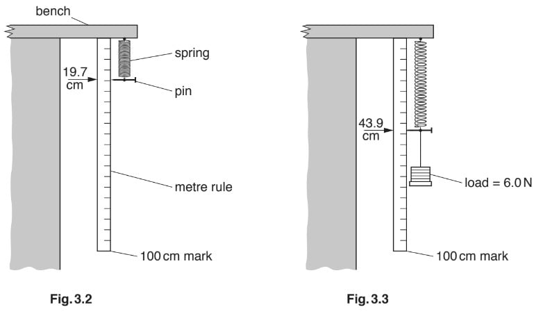

With no load on the spring, the pin points to 19.7 cm on the metre rule, as shown in Fig. 3.2.

When a load of 6.0N is attached to the spring, the pin points to 43.9 cm, as shown in Fig. 3.3.

(i) Calculate the extension of this spring for a load of 6.0 N.

extension = .................................................... cm [1]

(ii) Describe how a student could use the equipment in Fig. 3.2 to obtain accurate readings for a load-extension graph for this spring.

[2]

*Source: February/March 2018 0625/32 Q3C*

### Q5 — hard — 6 marks

**Q5** [4 marks]

The mass of a small steel ball is 120 g. The volume of the ball is 16.0 cm3.

(i) Calculate the density of the steel ball.

density = ............................................... g / cm3 [3]

(ii) The ball falls to the ground from rest. At a time of 0.2 s after it started to fall, its acceleration is 10 m / s2.

State the acceleration of the ball at a time of 0.1 s after it started to fall.

[1]

*Source: 2018 0625/33 Q3A*

**Q5** [2 marks]

Fig. 3.1 shows the vertical forces that act on a large plastic ball as it is falling.

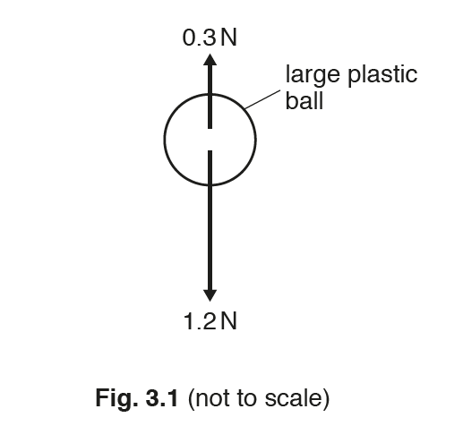

(i) State the name given to each of the forces shown in Fig. 3.1.

[1]

(ii) Calculate the size of the resultant force on the ball.

resultant force = ...................................................... N [1]

*Source: 2018 0625/33 Q3B*

### Q6 — hard — 7 marks

**Q6** [3 marks]

A student is using some 50 g masses.

Calculate the weight of one 50 g mass.

weight of 50 g mass = ...................................................... N

*Source: 2018 0625/33 Q2A*

**Q6** [4 marks]

The student uses the 50g masses as loads to stretch a spring.

Fig. 2.1 shows the apparatus the student uses to obtain readings for a load-extension graph.

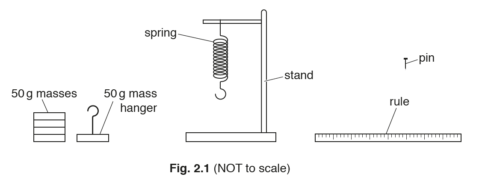

Describe how the student could use the apparatus and ensure that the readings are accurate.

*Source: 2018 0625/33 Q2B*

### Q7 — easy — 7 marks

**Q7** [2 marks]

A truck of mass 8.0 kg is rolling down a slight incline as shown in Fig. 1.1.

**Fig. 1.1**

The truck travels at a constant speed.

Explain why the truck does not accelerate, even though it is on an incline.

**Q7** [2 marks]

**Extract:**

A truck of mass 8.0 kg is rolling down a slight incline as shown in Fig. 1.1. The truck travels at a constant speed. The truck does not accelerate even though it is on an incline because: The incline is very small / slight; So the force of friction is equal to the force acting down the slope OR the forces are balanced.

The slope of the incline is increased. As a result of this, the truck now accelerates.

Explain why the truck now accelerates.

**Q7** [2 marks]

**Extract:**

A truck of mass 8.0 kg is rolling down a slight incline as shown in Fig. 1.1.

**Extended tier only**

The truck’s acceleration is 2.0 m/s2.

Calculate the resultant force on the truck.

resultant force = ....................................

**Q7** [1 mark]

**Extract:**

A truck of mass 8.0 kg is rolling down a slight incline as shown in Fig. 1.1. The truck travels at a constant speed.

The acceleration of the truck can be increased by reducing the force of friction.

Suggest a way of reducing the friction in this investigation.

### Q8 — hard — 7 marks

**Q8** [2 marks]

A load is attached to a spring, as shown in Fig. 3.1. Two arrows indicate the vertical forces acting on the load. The spring and the load are stationary.

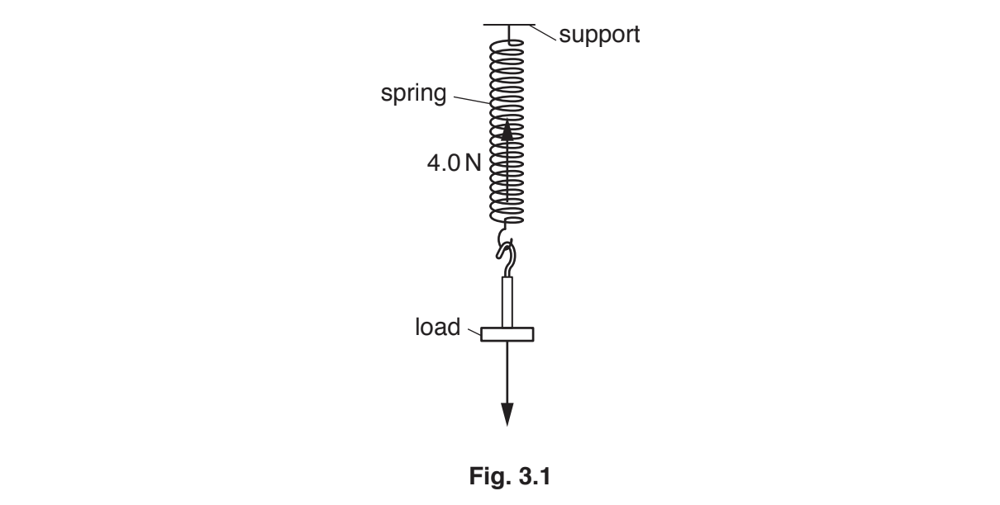

(i) State the name of the force acting vertically downwards.

[1]

(ii) The vertical force that acts upwards is 4.0 N.

State the value of the force acting vertically downwards.

force = ..................................................... N [1]

*Source: 2019 0625/32 Q3A*

**Q8** [2 marks]

**Extract:**

A load is attached to a spring, as shown in Fig. 3.1. Two arrows indicate the vertical forces acting on the load. The spring and the load are stationary.

The load is pulled downwards and then released. The load moves up and down.

Fig. 3.2 represents the vertical forces acting on the load at some time after it is released.

Calculate the resultant force on the load and state its direction.

resultant force = ........................................................... N

direction = ...............................................................

*Source: 2019 0625/32 Q3B*

**Q8** [3 marks]

**Extract:**

The load is pulled downwards and then released. The load moves up and down.

Fig. 3.2 represents the vertical forces acting on the load at some time after it is released.

(i) State the principle of conservation of energy.

[1]

(ii) Eventually the load stops moving up and down.

Describe and explain why the load stops moving. Use your ideas about conservation of energy.

[2]

*Source: 2019 0625/32 Q3C*

### Q9 — medium — 5 marks

**Q9** [1 mark]

**Extended tier only**

A car travels around a circular track at constant speed.

Explain why it is incorrect to describe the circular motion as having constant velocity.

**Q9** [2 marks]

**Extract:**

A car travels around a circular track at constant speed.

**Extended tier only**

A force is required for the car to maintain the circular motion.

Explain why a force is required.

**Q9** [1 mark]

**Extract:**

A force is required for the car to maintain the circular motion.

**Extended tier only**

State the direction in which the force acts for objects in circular motion.

**Q9** [1 mark]

**Extract:**

A force is required for the car to maintain the circular motion.

**Extended tier only**

State the name of this force for the car on the track.

### Q10 — easy — 4 marks

**Q10** [1 mark]

State Newton's first law of motion.

**Q10** [1 mark]

**Extended tier only**

Newton's second law describes the change in motion caused by a resultant force.

State the equation which links acceleration, resultant force and mass.

**Q10** [1 mark]

State what happens to the motion of a moving object when a resultant force is applied to it in the opposite direction to the motion.

**Q10** [1 mark]

**Extended tier only**

State what happens to the motion of a moving object when a resultant force is applied to it in a perpendicular direction to the motion.

### Q11 — medium — 5 marks

**Q11** [3 marks]

A student stretches a spring by adding different loads to it. She measures the length of the spring for each load. She plots a graph of the results.

Fig. 2.1 shows the graph of her results.

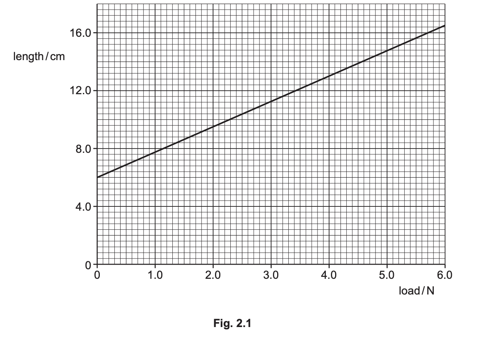

Use the graph to determine:

(i)  the length of the spring without a load

length = .................................................. cm [1]

(ii) the length of the spring with a load of 4.0 N

length = .................................................. cm [1]

(iii) the extension due to a 4.0 N load.

extension = .................................................. cm [1]

*Source: 2020 0625/31 Q2A*

**Q11** [2 marks]

Complete the sentence about effects of forces. Choose words from the box.

| colour      friction       pressure       shape       size       speed |
|---|

Stretching a spring with a load is an example of how a force can change the .................................... and the .................................... of an object.

*Source: 2020 0625/31 Q2B*

### Q12 — hard — 6 marks

**Q12** [1 mark]

A resultant force acts on an object at rest.

State the direction of the acceleration.

**Q12** [1 mark]

**Extended tier only**

A resultant force acts perpendicularly on a object traveling at a constant speed.

State the effect of the force on the object.

**Q12** [4 marks]

**Extended tier only**

A man with a mass of 70 kg steps into an elevator.

(i) State the value of the force exerted on the man by the elevator.

force = .................................... [1]

(ii) Calculate the force required to accelerate the man at 1.6 m/s2.

force = .................................... [1]

(iii) Explain why these values are different.

[2]

### Q13 — medium — 7 marks

**Q13** [4 marks]

Fig. 3.1 shows the horizontal forces acting on a swimmer.

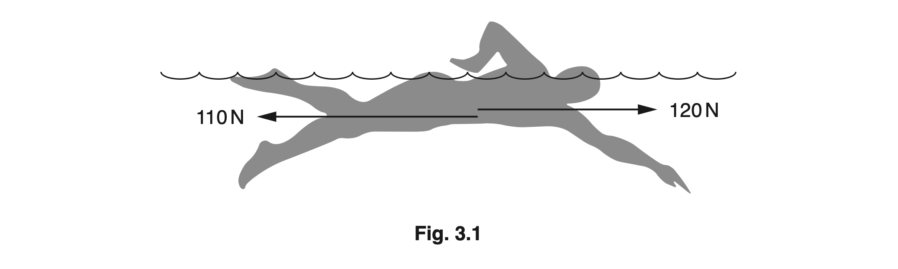

(i) Calculate the size and direction of the resultant horizontal force on the swimmer.

size of resultant horizontal force = ...................................................... N

direction of resultant horizontal force = ......................................................

[1]

(ii) State the name of the 110 N force on the swimmer.

[1]

(iii) Fig. 3.2 shows the horizontal forces acting on the swimmer as he moves forwards a short time later.

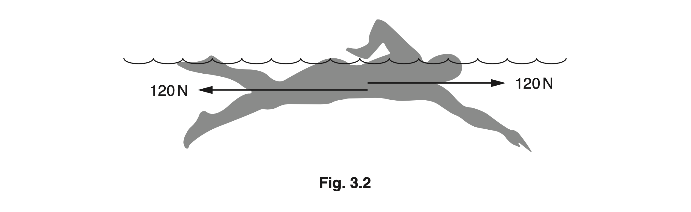

Describe and explain the motion of the swimmer.

[2]

*Source: Oct 2019 0625/32 Q3A*

**Q13** [3 marks]

**Extract:**

Fig. 3.1 shows the horizontal forces acting on a swimmer.

Another swimmer weighs 700N. He stands on a diving board, as shown in Fig. 3.3.

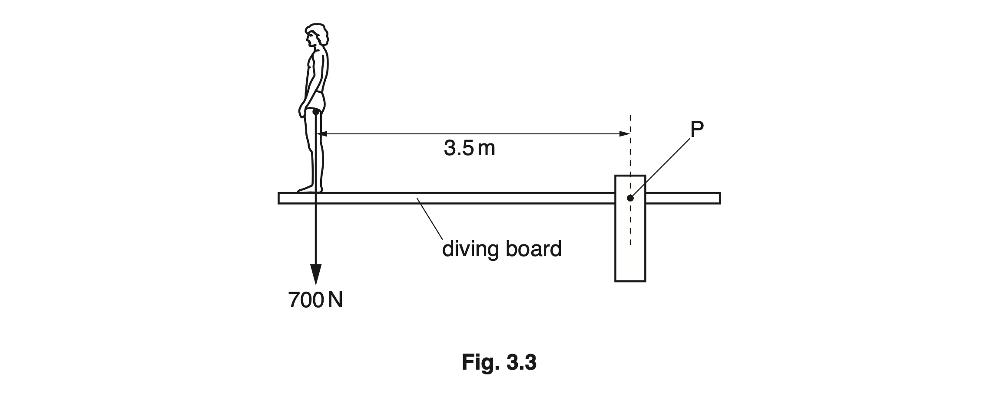

Calculate the moment of the swimmer’s weight about point P.

moment = ...................................................... N m

*Source: Oct 2019 0625/32 Q3B*

### Q14 — easy — 4 marks

**Q14** [3 marks]

A model aircraft is flying through air. Fig. 3.1 shows the forces acting on the model aircraft. The weight of the model aircraft is 15.0 N.

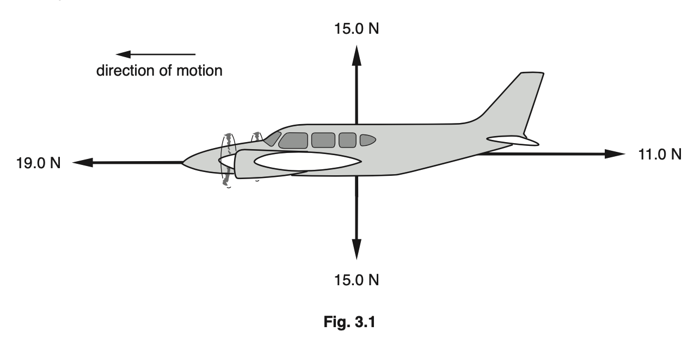

(i) Determine the size and direction of the resultant **horizontal **force acting on the model aircraft.

size of resultant horizontal force = ...................................................... N

direction of resultant horizontal force = ..........................................................

[1]

(ii) Describe the change in the motion of the model aircraft.

[2]

*Source: Oct 2019 0625/33 Q3A*

**Q14** [1 mark]

**Extract:**

A model aircraft is flying through air. Fig. 3.1 shows the forces acting on the model aircraft. The weight of the model aircraft is 15.0 N.

Determine the size of the resultant horizontal force:
- resultant force = 19.0 - 11.0 = 8.0 N

Determine the direction of the resultant horizontal force:
- The resultant force acts to the left / forward (from the aircraft's perspective);

The horizontal forces acting on the model aircraft become balanced.

Suggest how the horizontal forces acting on the model aircraft have changed.

*Source: Oct 2019 0625/33 Q3B*

### Q15 — hard — 12 marks

**Q15** [4 marks]

**Extended tier only**

Fig. 1.1 shows an aeroplane accelerating uniformly on a runway.

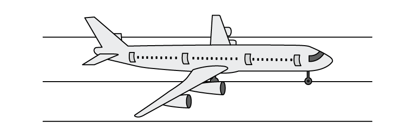

**Fig. 1.1**

The aeroplane has a mass of 3.1 × 106 kg.

From rest, the aeroplane reaches a speed of 70 m/s after 32 s.

Calculate the following quantities

(i) The acceleration of the aeroplane.

acceleration = .................................... [2]

(ii) The resultant force acting on the aeroplane.

resultant force = .................................... [2]

**Q15** [3 marks]

**Extract:**

Fig. 1.1 shows an aeroplane accelerating uniformly on a runway.

The aeroplane has a mass of 3.1 × 106 kg.

From rest, the aeroplane reaches a speed of 70 m/s after 32 s.

**Extended tier only**

When the aeroplane reaches its destination, air traffic control directs it to circle the airfield until there is a safe time to land.

Fig. 1.2 shows a head on view of the aeroplane flying at a constant speed in a circular horizontal path.

**Fig 1.2**

Draw an arrow showing the resultant force on the aeroplane.

Explain your answer.

**Q15** [1 mark]

**Extract:**

When the aeroplane reaches its destination, air traffic control directs it to circle the airfield until there is a safe time to land.

Fig. 1.2 shows a head on view of the aeroplane flying at a constant speed in a circular horizontal path.

**Extended tier only**

The pilot wants to decrease the radius of the circular flight path whilst maintaining a constant speed.

Suggest how the pilot could achieve this.

**Q15** [4 marks]

**Extract:**

The aeroplane has a mass of 3.1 × 10^6 kg.

Use Newton's second law to calculate:
- F = ma

The resultant force on the aeroplane is less upon landing than at take off because:
- The aeroplane has used some / most of its fuel;
- (Therefore) the mass (of the aeroplane) has decreased;
- F = ma OR force is proportional to mass;

**Extended tier only**

As the aeroplane lands on the runway, it decelerates from its top speed. The resultant force on the aeroplane is less than it was at take off.

Explain why this is the case.

### Q16 — medium — 8 marks

**Q16** [3 marks]

Fig. 3.1 shows a spring with no load attached. Fig. 3.2 shows the same spring with a load attached.

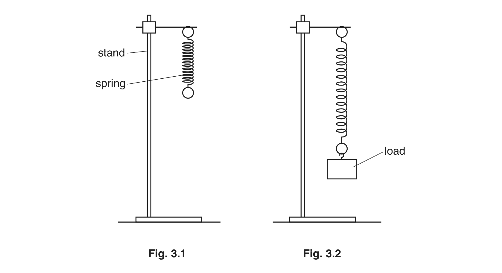

Describe how a student can determine the extension of the spring. You may draw on Fig. 3.1 and Fig. 3.2 as part of your answer.

*Source: Oct 2019 3 Q3A*

**Q16** [2 marks]

The student plots a graph of load against extension, as shown in Fig. 3.3.

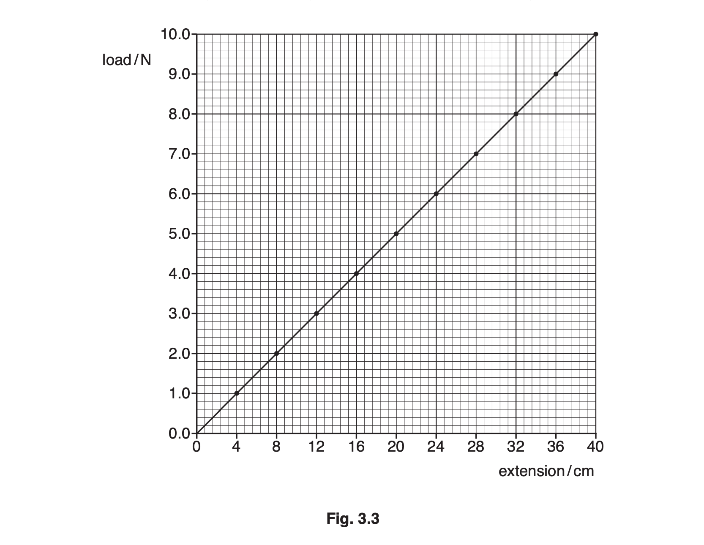

(i) Determine the extension produced by a load of 7.5 N.

extension = ...................................................... cm [1]

(ii) Determine the load that would produce an extension of 10.0 cm.

load = ...................................................... N [1]

*Source: Oct 2019 3 Q3B*

**Q16** [3 marks]

Calculate the mass that has a weight of 6.0 N.

mass = ...................................................... kg

*Source: Oct 2019 3 Q3C*

### Q17 — easy — 7 marks

**Q17** [1 mark]

Fig. 1.1 shows a man pulling a child on a sledge.

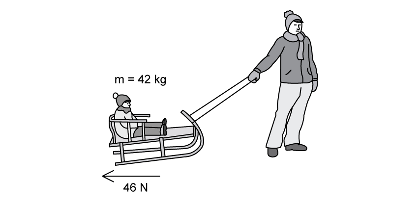

The mass of the child and the sledge is 42 kg.

The unbalanced force acting on the sledge is 46 N.

State the magnitude of the force that needs to be exerted by the man to make the sledge move.

**Q17** [1 mark]

**Extract:**

Fig. 1.1 shows a man pulling a child on a sledge. The mass of the child and the sledge is 42 kg. The unbalanced force acting on the sledge is 46 N.

Name the force that is opposing the motion of the sledge.

**Q17** [3 marks]

**Extract:**

The mass of the child and the sledge is 42 kg.

**Extended tier only**

The sledge is then placed at the top of a hill and accelerates down the hill at 0.75 m/s2 .

Calculate the resultant force acting on the sledge.

**Q17** [2 marks]

**Extract:**

The mass of the child and the sledge is 42 kg. The unbalanced force acting on the sledge is 46 N.

The sledge is then placed at the top of a hill and accelerates down the hill at 0.75 m/s^2^.

Resultant force = 31.5 N (from part (c))

Force required to overcome friction = 46 N

force acting down the hill = resultant force + friction

Assuming that the force opposing the motion of the sledge is the same, calculate the total force acting down the hill.

You may draw a diagram in your answer.

### Q18 — medium — 4 marks

**Q18** [3 marks]

Fig. 3.1 shows the vertical forces on a rocket.

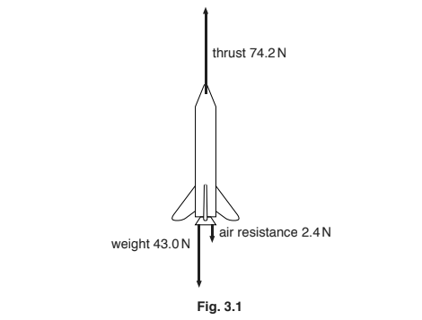

Calculate the resultant force on the rocket.

resultant force = ........................................................... N

direction = ...........................................................

*Source: 2018 0625/31 Q3A*

**Q18** [1 mark]

Fig. 3.2 shows the speed and direction of motion of an object at a point in time.

The resultant force on the object is zero for 10 seconds.

Deduce the speed and direction of motion after 5 seconds. Indicate the speed and direction of the object by drawing a labelled arrow next to the object in Fig. 3.3.

*Source: 2018 0625/31 Q3B*

