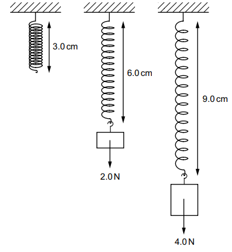
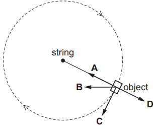
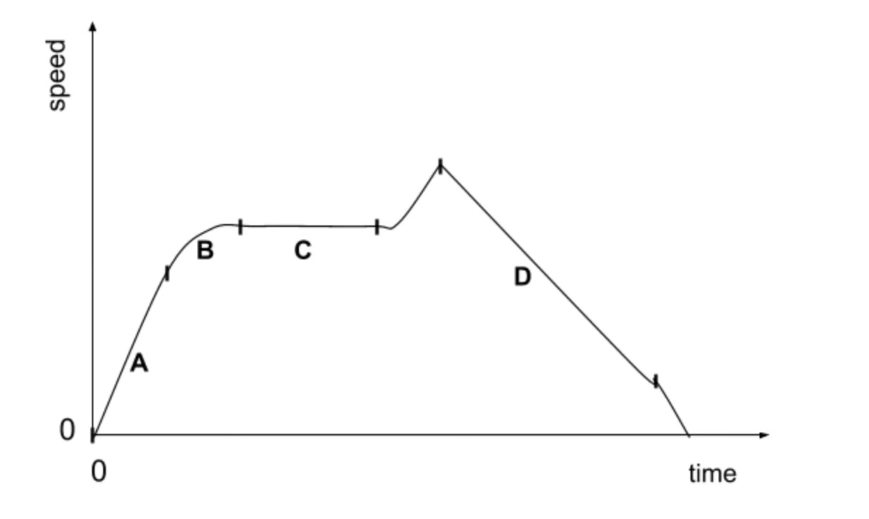

# Exam Questions — Effects of Forces
**1. Motion, Forces & Energy** · Cambridge (CIE) IGCSE physics (0625 & 0972)
> Source: [https://www.savemyexams.com/igcse/physics/cie/23/topic-questions/](https://www.savemyexams.com/igcse/physics/cie/23/topic-questions/) · 26 questions across 1 sets

## Multiple Choice Questions (26 questions)

### Q1 — medium — 1 marks

**Q1** [1 mark]

A satellite orbits a planet in a circular path at constant speed.

Which statement about the resultant force is correct?

### Q2 — easy — 1 marks

**Q2** [1 mark]

The graph shows the load-extension graph for a spring.

What does point P represent?

### Q3 — medium — 1 marks

**Q3** [1 mark]

A skydiver falls before opening her parachute.

Which graph correctly shows how her speed changes with time?

### Q4 — medium — 1 marks

**Q4** [1 mark]

An aeroplane flies horizontally at constant speed as shown.

Which statement about the resultant force on the aeroplane is correct?

### Q5 — medium — 1 marks

**Q5** [1 mark]

A train is travelling horizontally in a straight line. A book is on a table in the train. The diagram shows all the forces acting on the book.

How is the train moving?

*Source: June 2023 0972/21 Q7*

### Q6 — hard — 1 marks

**Q6** [1 mark]

On the Earth, a spring stretches by 5.0 cm when a mass of 3.0 kg is suspended from one end.

The gravitational field strength on the Moon is $\frac{1}{6}$ of that on the Earth.

Which mass, on the Moon, would stretch the spring by the same extension?

*Source: June 2023 0972/21 Q4*

### Q7 — medium — 1 marks

**Q7** [1 mark]

Four objects are moving.

Which object has a zero resultant force acting on it?

*Source: June 2023 0972/11 Q7*

### Q8 — medium — 1 marks

**Q8** [1 mark]

Which pieces of apparatus are the most appropriate for an experiment to plot an extension–load graph of a spring?

*Source: june 2022 paper 1 Q6*

### Q9 — medium — 1 marks

**Q9** [1 mark]

A student hangs different loads on a spring.

The diagrams show the lengths of the spring with different loads.

Which row gives the correct extensions of the spring?

|   | extension / cm when the load is 0 N | extension / cm when the load is 2.0 N | extension / cm when the load is 4.0 N |
|---|---|---|---|
| **A** | 0 | 3.0 | 3.0 |
| **B** | 0 | 3.0 | 6.0 |
| **C** | 3.0 | 3.0 | 3.0 |
| **D** | 3.0 | 6.0 | 9.0 |

*Source: 2023 specimen paper 1 Q6*

### Q10 — easy — 1 marks

**Q10** [1 mark]

**Extended Tier Only**

An object on the end of a string moves in a clockwise circular path at constant speed. The diagram shows the object as viewed from above.

What is the direction of the resultant force on the object when it is in the position shown?

*Source: June 2022 paper 2 Q6*

### Q11 — easy — 1 marks

**Q11** [1 mark]

** **The diagrams show the forces acting on four moving objects.

Which object is moving at a constant speed?

*Source: June 2022 paper 1 Q8*

### Q12 — easy — 1 marks

**Q12** [1 mark]

**Extended tier only**

The Moon orbits the Earth at a constant speed.

Which of the arrows on the diagram shows the direction of the resultant force on the Moon?

### Q13 — easy — 1 marks

**Q13** [1 mark]

**Extended tier only**

A car is driving around a circular track at a constant speed.

Which statement describes the motion of the car?

### Q14 — easy — 1 marks

**Q14** [1 mark]

In which of the following situations would no resultant force be required?

### Q15 — easy — 1 marks

**Q15** [1 mark]

A car starts from rest and rapidly increases speed.

There is a forward acting force on the car from the engine, and a backward acting force on the car from air resistance and friction.

Choose the force diagram and description that best describes the magnitude of the opposing forces.

### Q16 — easy — 1 marks

**Q16** [1 mark]

**Extended tier only**

A planet orbits a star at a constant speed in a **circular** orbit.

Which of the statements below, about the force needed to maintain this motion, is correct?

### Q17 — hard — 1 marks

**Q17** [1 mark]

The graph below shows the journey of a truck along a straight, flat road.

During which part of the journey is the resultant force on the truck equal to zero?

### Q18 — medium — 1 marks

**Q18** [1 mark]

A motorbike travels at a constant speed along a flat road. Three horizontal forces act on the motorbike. Two of them are shown in the diagram below.

What is the size and direction of the third force?

### Q19 — hard — 1 marks

**Q19** [1 mark]

A car is driving on a motorway at a constant speed of 70 miles per hour.

The driver notices a queue of traffic up ahead and begins to slow down.

Which diagram best describes the resultant force acting on the car as it slows down?

### Q20 — medium — 1 marks

**Q20** [1 mark]

**Extended tier only**

A car slows down as it approaches a traffic light. The car was traveling at 13.5 m/s and it takes 22 s to come to a stop.

The mass of the car is 950 kg.

Calculate the force required to stop the car.

### Q21 — hard — 1 marks

**Q21** [1 mark]

The diagram shows four objects, each with a different mass. Each object is acted on by the forces shown.

Which object will experience the largest magnitude of acceleration?

### Q22 — medium — 1 marks

**Q22** [1 mark]

The diagram shows four objects, each with the same mass. Each object is acted on by the forces shown.

Which object will experience the largest acceleration to the left?

### Q23 — medium — 1 marks

**Q23** [1 mark]

Two students were discussing Newton's first law of motion.

Which statement correctly summarises this law?

### Q24 — medium — 1 marks

**Q24** [1 mark]

An object with three forces acting on it is shown below.

What is the resultant force acting on the object?

### Q25 — hard — 1 marks

**Q25** [1 mark]

**Extended tier only**

A skydiver is falling at terminal velocity. He has not yet opened his parachute.

He opens his parachute.

What is the direction of both the velocity of the skydiver, and his acceleration?

|   | **Direction of the skydiver’s velocity** | **Direction of the skydiver’s acceleration** |
|---|---|---|
| **A** | upwards | upwards |
| **B** | upwards | downwards |
| **C** | downwards | upwards |
| **D** | downwards | downwards |

### Q26 — hard — 1 marks

**Q26** [1 mark]

**Extended tier only**

A bus drives along a flat road. Its engine produces a forward driving force of 7000 N. Drag forces, *D* also act on the bus.

The bus has an acceleration of 1.2 m/s2 and a mass of 2500 kg.

What is the value of D?
