# Mark Schemes — Moments
**1. Motion, Forces & Energy** · Cambridge (CIE) IGCSE physics (0625 & 0972)

## Alternative To Practical Questions (4 questions)

### Q1
The student could overcome the difficulty of placing the mass accurately at the 95.0 cm mark by:

**Any one from:**

- Measure the width of the mass and add ½ width to mark at the edge of the mass; **[1 mark]**
- Calculate a mean value of marks at both edges of the mass; **[1 mark]**
- Mark the centre line of the mass <u>and</u> edge of rule; **[1 mark]**
- Line up the mark through the gap in the slotted mass; **[1 mark]**

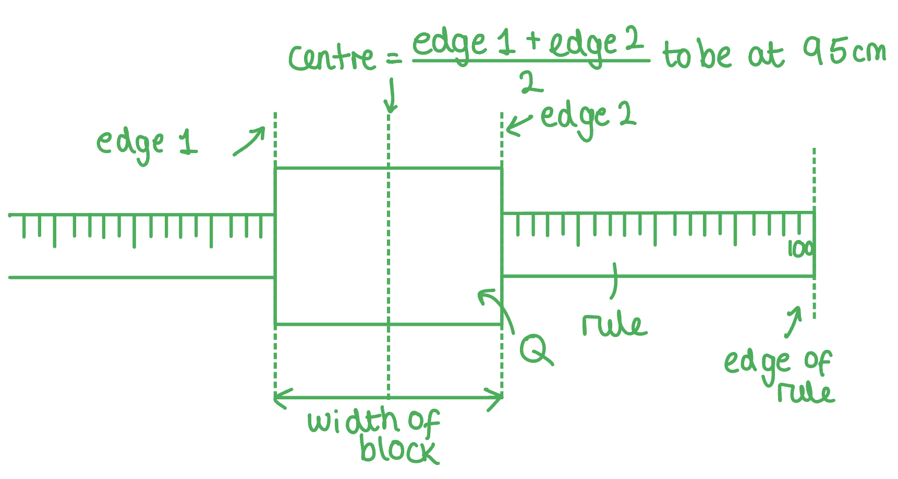

**[Total: 1 mark]**

> *Your explanations **need** to refer to the situation at hand. No marks will be given for vague answers such as 'measure the width and halve it' or 'mark the centre'. You must refer to the block of the rule. *

> *If you struggle with explanations it is always good to back up your answer with a diagram. The examiner is more likely to give you a mark for this. Remember that a diagram must be drawn neatly and **labelled**.*
A method to find the point at which the metre rule is as near to being balanced as possible is:

- (Move the rule to) to dind the point at which (the rule) just tips one way

**AND**

- Move the rule to find the point at which it just tips the other way; **[1 mark]**
- The balance point is between these, where rules tips either way; **[1 mark]**

**[Total: 2 marks]**

> *Remember to read the question carefully - it is the position of the **rule** that is moving **not** box **Q**! You could use the terms 'anti-clockwise' and 'clockwise' instead of one way and the other way:*

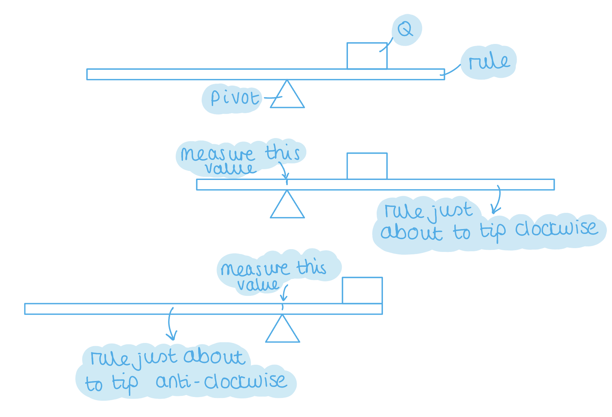
(i) Plot a graph of *a*/cm (*y*-axis) against *b*/cm (*x*-axis)

A graph that would score 4 marks should look like:

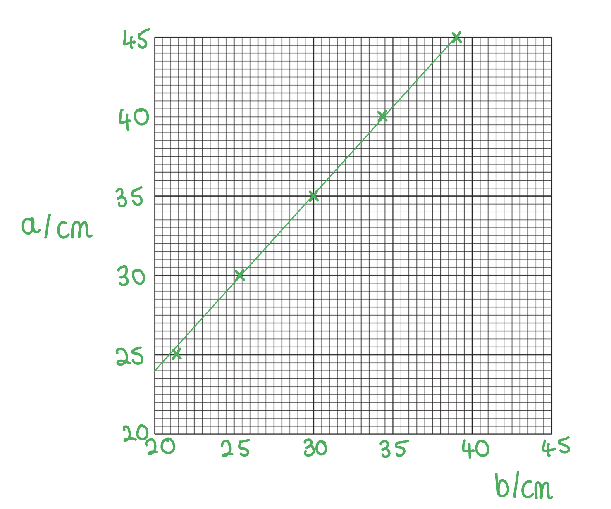

- Axes labelled with *a*/cm on the vertical (*y*) axis and *b*/cm on horizontal (*x*) axis (both quantity and unit)**; [1 mark]**
- Appropriate scales (multiples of 1,2 or 5) **AND** plot occupying at least ½ the grid**; [1 mark]**
- Plots all correct to ½ a small square **AND ****precise****; [1 mark]**
- **Well judged ****thin**** line of best fit; [1 mark]**

(ii) Determine the gradient *G* of your line. Show clearly on the graph how you obtained the necessary information

Draw gradient triangle on graph:

**AND**

Determine the gradient *G*:

- $G=\frac{Δa}{Δb}$
- $G=\frac{45-24}{39-20}=\frac{21}{19}$
- *G *= 1.105 **[1 mark]**

** **

(iii) Calculate the mass *M*R of the metre rule

List the known quantities:

- *M*R = 20 g
- *G *= 1.105

Substitute values into *M*R equation:

- $M_{R} = \frac{M}{( G - 1 )} = \frac{20}{( 1.105 - 1 )}$
- *M*R = 190.476 **[1 mark]**

State value to suitable number of significant figures:

- *M*R = 190 (2 s.f.) **AND **g / grams **[1 mark]**

**[Total: 7 marks]**

> *Avoid these **main mistakes** with graphs in Paper 6:*

- *Using a scale that doesn’t fit, particularly using multiples of three (this is always marked incorrect). Stick with multiples of 1,2 or 5.*
- *Using a pen then have trouble correcting errors. Use a pencil*
- *Marking the plotting points with either thick lines or large blobs (even one of these will lose the mark). Draw an ‘x’ with a pencil.*
- *Making the line of best fit too thick. This will make it harder to read values from.*
- *Joining the plots up instead of making a thin line down the middle of them for the line of best fit.*
- *Drawing a gradient triangle too small. Use a triangle that is > ½ the graph and use values from the line of best fit*

> *The key to this is **practice**. Try plotting graphs at home and compare your graph to our example. You can also ask your teacher to check your work. With practice, these are four very easy marks!*

> *The range of values of **M**R **are between 100 g to 400 g for this question.*
The larger values of *b* are likely to produce a:

- More accurate value (for the mass of the metre rule); **[1 mark]**
- Because the errors have less effect (with larger values) **OR **there is less percentage/% uncertainty; **[1 mark]**

**[Total: 2 marks]**

### Q2
(i) Use Fig. 1.2 to determine *d*, the distance between the mass and the pivot at balance, for each value of *m, *and record your results in Table 1.1:

A table that would score one mark should look like:

| m/g | *d*/cm | $\frac{1}{d}/\frac{1}{\mathrm{cm}}$ |
|---|---|---|
| 40 | **Final answer:** **30.0** |   |
| 50 | **Final answer:** **24.2** |   |
| 60 | **Final answer:** **19.8** |   |
| 70 | **Final answer:** **17.2** |   |
| 80 | **Final answer:** **15.0** |   |

- Ruler reading has been subtracted from 50 cm; **[1 mark]**
- At least two values of *d* correct to ±0.5 cm; **[1 mark]**
- All five values of d correct to ±0.2 cm; **[1 mark]**

(ii) For each value of *d*, calculate $\frac{1}{d}$ and record it in the table.

A table that would score 1 mark should look like:

| m/g | *d*/cm | $\frac{1}{d}/\frac{1}{\mathrm{cm}}$ |
|---|---|---|
| 40 | 30.0 | **Final answer:** **0.0333** |
| 50 | 24.2 | **Final answer:** **0.0413** |
| 60 | 19.8 | **Final answer:** **0.0505** |
| 70 | 17.2 | **Final answer:** **0.0581** |
| 80 | 15.0 | **Final answer:** **0.0667** |

- Values given are correct and to the same number of significant figures (at least 2); **[1 mark]**

**[Total: 4 marks]**

> *For part (i), you must read the question very carefully, then read it again to check that you have understood what it is asking you to do. *

> *In this question you must not only read the measurement from the ruler for each mass, but you must also subtract this reading from the 50 cm pivot point. There is a mark dedicated just to having realised this, even if all your answers were incorrect!*

> *This is done by reading the values from the ruler:*

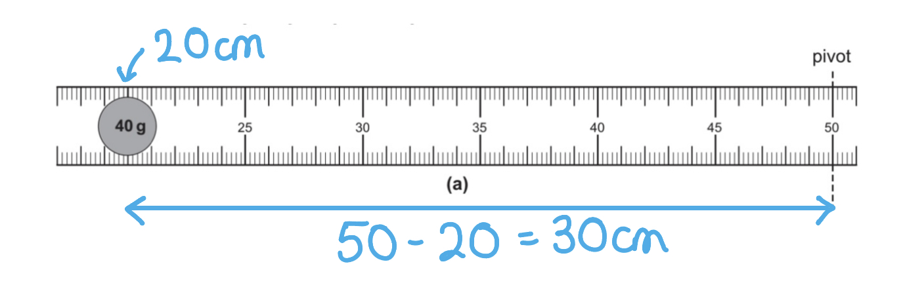

> *To gain the other two marks you needed to provide very precise measurements to within 0.2 cm or 2 mm. If you failed to do this, you can only access one of two remaining marks. As long as you have given at least two correct values to within 0.5 cm or 5 mm, you will gain this mark.*

> *Getting a precise reading is tricky, especially when the position of the mass is not central to the thicker black lines of the ruler.*

> *Level of precision required for 1 mark:*

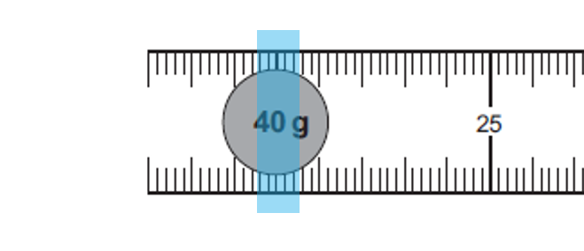

> *Level of precision required for 2 marks:*

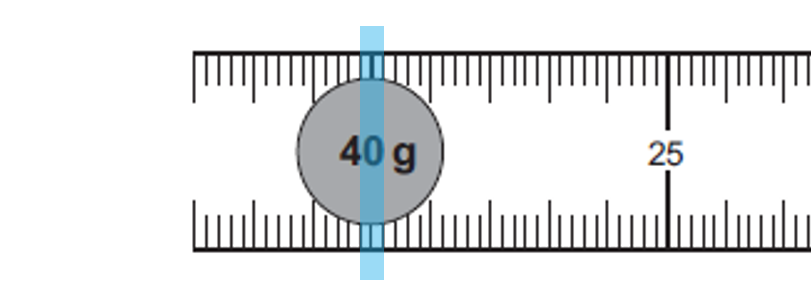

> *For part (ii), it doesn't matter if you give the readings to 2 s.f. or 3 s.f., but it does matter that you are **consistent**. All of your calculations must be given to the **same** number of significant figures to get the mark. *

> *Significant figures can be tricky if you don't know the rules, so make sure you learn them by heart! If you need a reminder:*

> *Zeros between significant non-zero digits are always significant*

> *Zeros that come before non-zero digits are never significant*

> *Zeros that come after non-zero digits are a little more complicated:*

- *If there is no decimal place, the zeros are not significant*

- *If the zeros are between the non-zero digits and the decimal place, the zeros are significant*

- *If the zeros come after the decimal place, the zeros are significant*

One difficulty the student might have when carrying out this experiment, and how he might overcome this is:

Any **one pair** from:

- Difficulty: It can be difficult to exactly balance the ruler on the pivot as the ruler tips one way and then the other; **[1 mark]**
- Solution: Allow the ruler to tip one way then the other and take an average; **[1 mark]**

- Difficulty: The mass obscures the markings on the ruler making it difficult to read; **[1 mark]**
- Solution: Mark the centre of the mass so it can be read against the ruler **OR** take the average of the right-hand and left-hand readings for the mass position; **[1 mark]**

- Difficulty: The mass can sometimes slide off the ruler **OR** the ruler can slide off the pivot; **[1 mark]**
- Solution: Use a suitable means for preventing the mass or ruler from sliding (e.g. blu-tack / sticky tab / cello-tape of negligible mass); **[1 mark]**

**[Total: 2 marks]**

> *Any reasonable difficulty will gain the first mark, and any reasonable suggestion to overcome it will gain the second mark. You must name the difficulty and how to overcome it to get both marks!*
Plot a graph of m/g (y-axis) against $\frac{1}{d}/\frac{1}{\mathrm{cm}}$ (x-axis):

A graph scoring 4 marks:

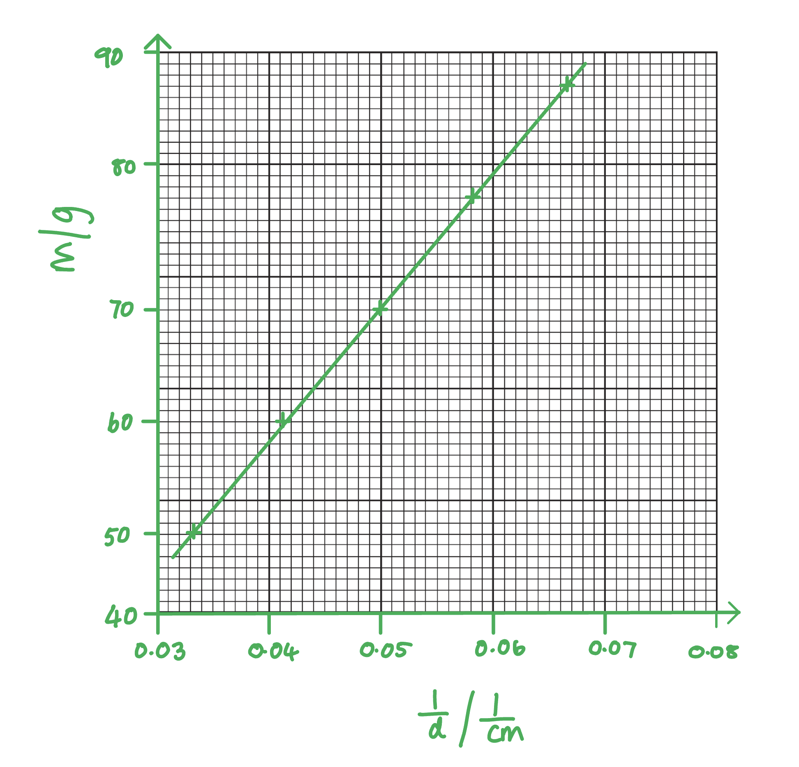

- $\frac{1}{d}$ on the x-axis and mass on the y-axis

**AND**

- Both axes are correctly labelled with units given;** [1 mark]**
- Axes are drawn with appropriate scales that use at least half the grid;** [1 mark]**
- All data points are plotted correctly to within half a (small) square; **[1 mark]**
- A thin line of best fit is drawn with roughly equal numbers of data points above and below; **[1 mark]**

**[Total: 4 marks]**

> *Lots of students find choosing an appropriate scale the most intimidating part of drawing a graph. *

> *Once you have decided which quantity goes on which axis, you just need look at the range of the data. Make sure that you can fit the highest value on your axis! *

> *The scale needs to be chosen so that each increment increases by the **same amount**. In this example the y-axis, *$\frac{1}{d}$* goes up in 0.1 *$\frac{1}{\mathrm{cm}}$*increments, and the x-axis, mass, goes up in increments of 10 g. You may have chosen a different scale to use and that is fine. As long as each axis takes up at least **half** of the width or height of the graph paper. Notice that in this question, the axes do start from (0, 0). This is so that the data points take up at least half the graph paper. You only need to start each axis from zero if the question explicitly tells you that you must.*

> *Also remember that** the line of best fit is an average**. Therefore, there should be roughly equal numbers of data points above as below the line. As long as you follow this rule, your line of best fit will get the mark. Never try to force the shape of the line of best fit. Your pattern of data points will show you if it needs to be a curve or a straight line. They will also show you whether your line of best fit should go through the origin or not. Never force it to do so.*

> *Remember to always use one of the following notations to plot your data points to ensure you get the marks:  +  ×*
`circled dot`*  *

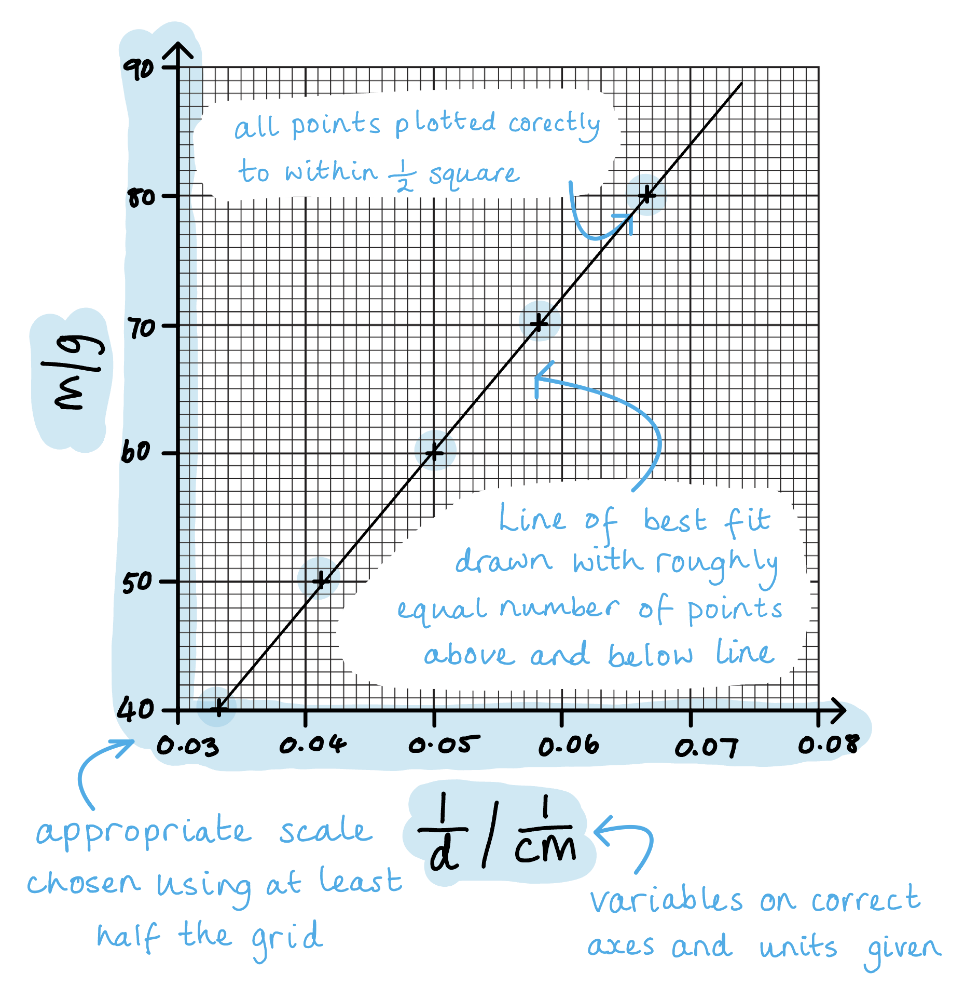
Determine the gradient *G* of the graph, showing clearly on the graph how you obtain the necessary information

A graph that would score 1 mark should look like:

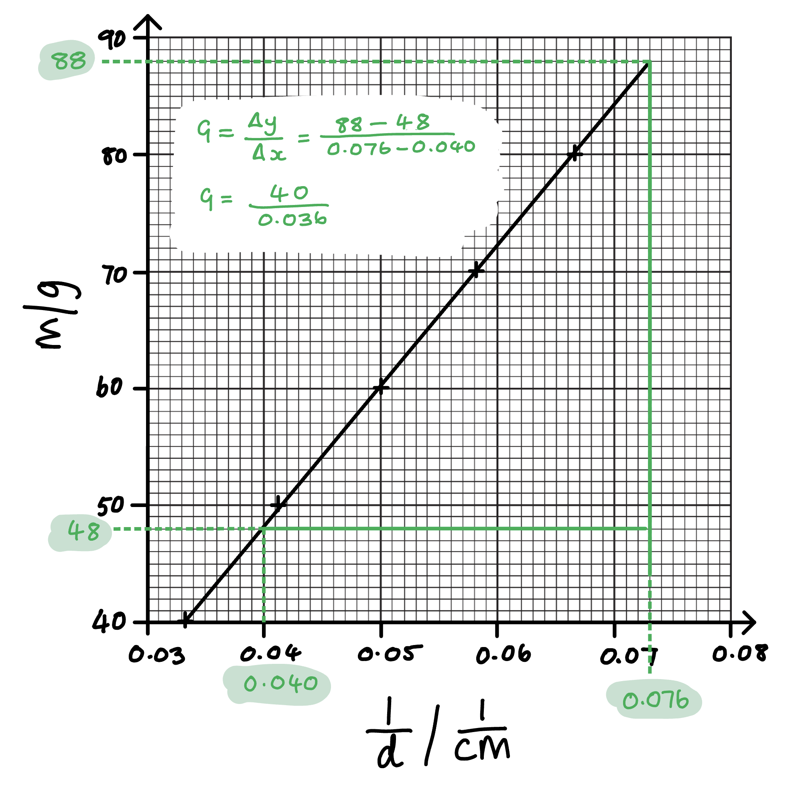

- Triangle method is clearly shown on the graph **AND** the hypotenuse is at least half the length of the line of best fit; **[1 mark]**

Use the triangle method to calculate the gradient:

- $G=\frac{\Deltay}{\Deltax}$
- $G=\frac{88-44}{0.076-0.040}$
- *G* = 1111 g/$\frac{1}{\mathrm{cm}}$

**[Total: 1 mark]**

> *Notice here that the marks are not awarded for the correct calculation of the gradient, but for using the triangle method correctly and indicating your working out **on the graph**!*

> *The following steps are how to use the triangle method:*

- *Choose two points on the line of best fit (this can be a point but it still has to be on the line of best fit)*
- *Track the points to each axis by drawing a line with a pencil and ruler*

  - $G=\frac{Δy}{Δx}$

> *Your triangle should be **as large as possible** to get the most accurate results. Try to choose two points where the line of best fit crosses the grid on two grid lines so that you can read a definite number from the graph rather than having to estimate a number that falls between two grid lines.*

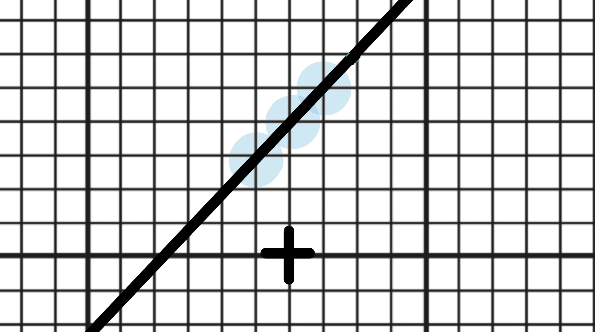
Determine the mass *μ*, in grams, of the load **X**:

List the known quantities:

- Gradient, *G* = 1111 g/$\frac{1}{\mathrm{cm}}$ (from part (d))

Substitute the known value into the equation to calculate:

- $μ=\frac{G}{40.0}$
- $μ=\frac{1111}{40.0}$
- $μ$ = 27.8 g (3 s.f.) **[1 mark]**

**[Total: 1 mark]**

> *An answer in the range of 27 - 33 g would gain the mark, as this is dependent on the value of your gradient from part (d).*

### Q3
Plot a graph of a/cm (y-axis) against b/cm (x-axis). You do **not** need to begin your axes at the origin (0,0):

A graph scoring four marks:

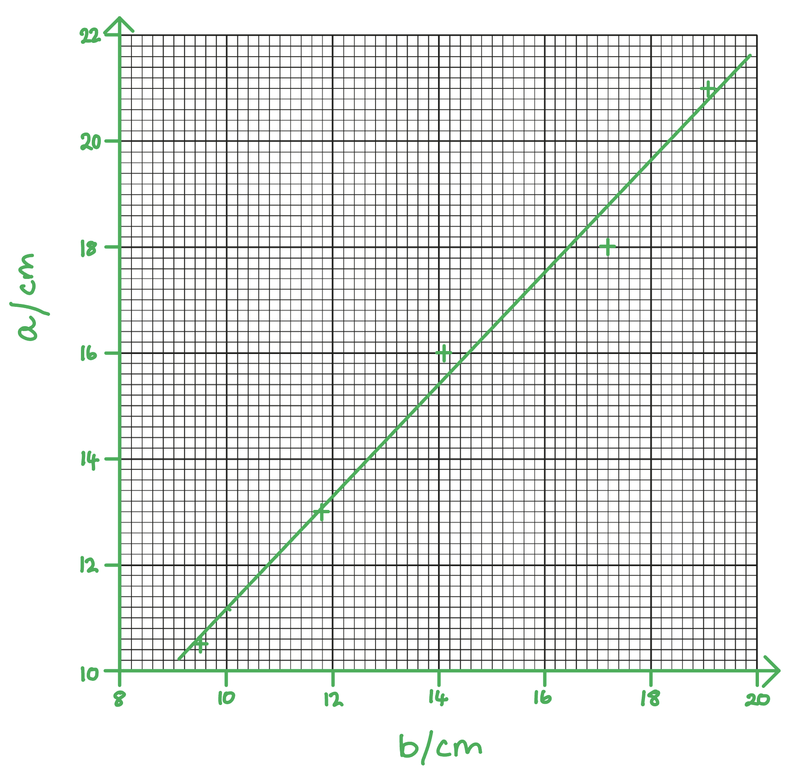

- *b* on the x-axis and *a* on the y-axis

**AND**

- Both axes are correctly labelled with units given;** [1 mark]**
- Axes are drawn with appropriate scales that use at least half the grid;** [1 mark]**
- All data points are plotted correctly to within half a (small) square; **[1 mark]**
- A thin line of best fit is drawn with roughly equal numbers of data points above as below; **[1 mark]**

**[Total: 4 marks]**

> *Lots of students find choosing an appropriate scale the most intimidating part of drawing a graph. *

> *Once you have decided which quantity goes on which axis, you just need took at the range of the data. Make sure that you can fit the highest value on your axis! *

> *The scale needs to be chosen so that each increment increases by the **same amount**. In this example the x-axis, **b**, goes up in 2 cm increments beginning from 8 cm, and the y-axis, **a**, goes up in increments of 2 cm beginning from 10. Usually, the axes should begin at 0, but in this question you were advised not to do that. You may have chosen a different scale to use and that is fine. As long as each axis takes up at least **half** of the width or height of the graph paper.*

> *Also remember that** the line of best fit is an average**. Therefore, there should be roughly equal numbers of data points above as below the line. As long as you follow this rule, your line of best fit will get the mark. Never try to force the shape of the line of best fit. Your pattern of data points will show you if it needs to be a curve or a straight line. They will also show you whether your line of best fit should go through the origin or not. Never force it to do so.*

> *Remember to always use on of the following notations to plot your data points to ensure you get the marks:  +  ×  *`circled dot`

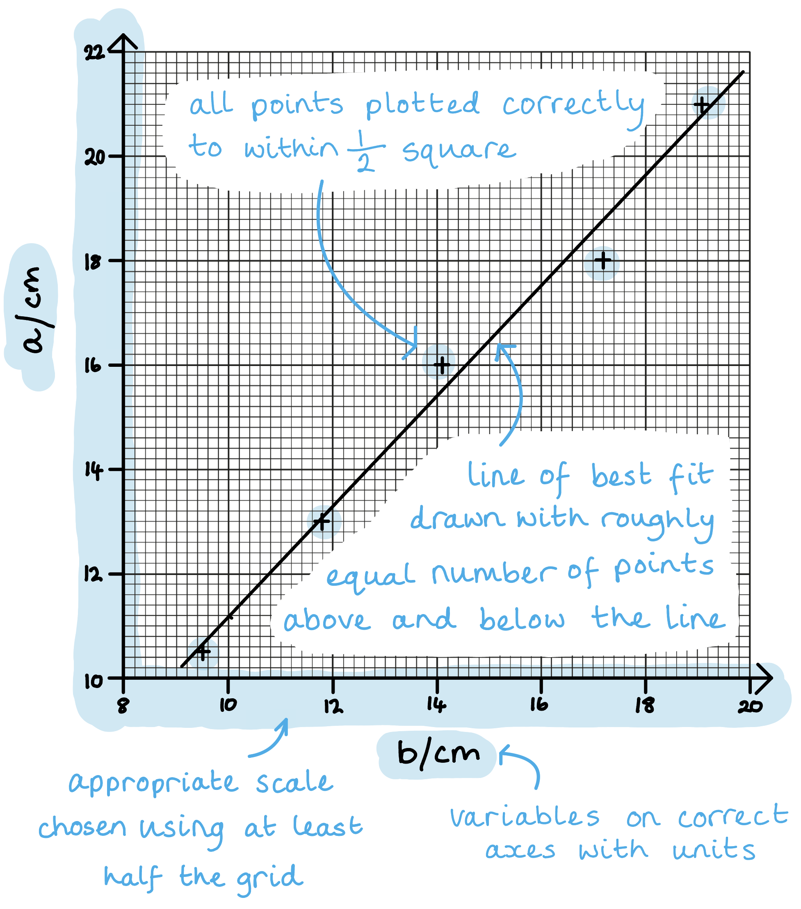
Determine the gradient *G* of the graph. Show clearly on the graph how you obtained the necessary information:

A graph scoring two marks:

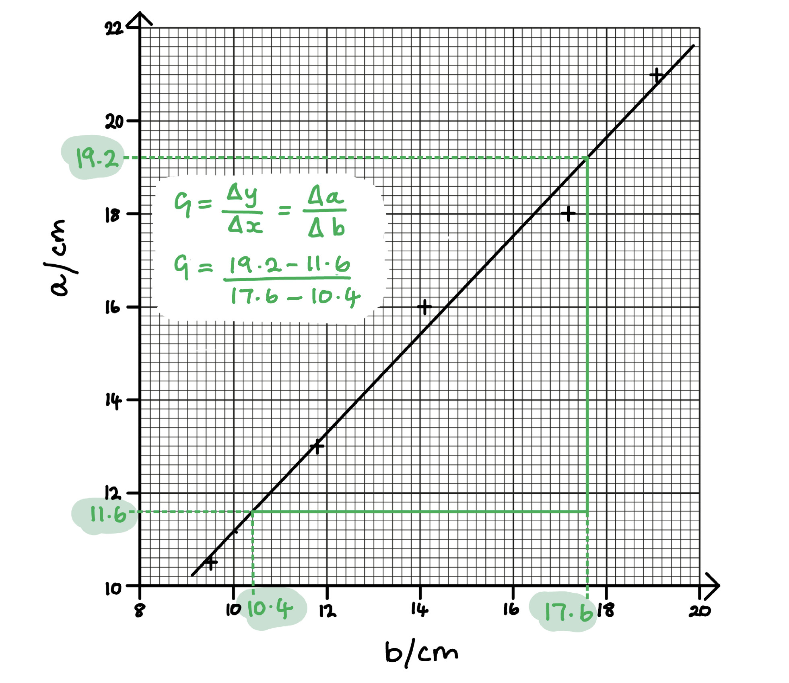

- The triangle method is shown clearly <u>on the graph</u>; **[1 mark]**
- The hypotenuse of the triangle is at least half of the line of best fit; **[1 mark]**

Use the triangle method to calculate the gradient:

- Choose two points on the line of best fit
- Track the points to each axis by drawing a line with a pencil and ruler
- Determine the values of each point on the x and y axes
- Use the gradient equation to calculate the gradient

  - $G=\frac{\Deltay}{\Deltax}=\frac{\Deltaa}{\Deltab}$
  - $G=\frac{19.2-11.6}{17.6-10.4}$
- *G* = 1.06

**[Total: 2 marks]**

> *Notice here that the marks are not awarded for the correct calculation of the gradient, but for using the triangle method correctly and indicating your working out **on the graph**!*

> *Your triangle should be **as large as possible** to get the most accurate results. Try to choose two points where the line of best fit crosses the grid on two grid lines so that you can read a definite number from the graph rather than having to estimate a number that falls between two grid lines.*

Calculate the weight *W*1 of the metre rule using the equation *W*1 = *G* × *P*, where *P* = 1.0 N:

List the known quantities:

- *G* = 1.06 (from part (b))

Substitute the known values into the equation to calculate:

- $W_{1}=G\timesP$
- $W_{1}=1.06\times1.0$
- *W*1 = 1.0 (2 s.f) **[1 mark]**

Give the unit:

- N **[1 mark]**

**[Total: 2 marks]**

> *When deciding how many significant figures your answer should have, use the rule that your answer can only be as accurate as the least accurate piece of data used in your calculation. *

> *So in this question, the data input into the calculation was** G** = 1.06 (3 s.f.) and **P** = 1.0 N (2 s.f.). The least accurate piece of data is **P** = 1.0 N because is it given to two significant figures, therefore your answer should only be given to two significant figures as well.*
Suggest **one **practical reason why it is difficult to obtain accurate readings for *a* and *b* in this type of experiment:

**Any one from:**

- It is difficult to get the meter rule to balance exactly; **[1 mark]**
- It can be difficult to accurately judge the centre of P; **[1 mark]**
- The load can slip easily; **[1 mark]**
- The top of the pivot may not be a sharp edge; **[1 mark]**

**[Total: 1 mark]**
Write down the mass *m* shown on the balance in Fig. 1.2 to the nearest gram:

- *m* = <u>113</u> g [**1 mark]**

**[Total: 1 mark]**
(i) Calculate the weight *W*2 of the metre rule using the equation *W*2 = *mg*, where *g* = 9.8 N/ kg:

List the known quantities:

- *m* = 113 g (from part (e))

Convert the mass into SI units:

- $113g\times\frac{1\mathrm{kg}}{1000g}$
- `113 / g x (1 kg)/(1000 / g)`
- *m* = 0.113 kg

Substitute the known values into the equation to calculate:

- $W_{2}=mg$
- $W_{2}=0.113\times9.8$
- *W*2 = 1.1 N (2 s.f.) **[1 mark]**

(ii) State and explain whether this value of *W*2 can be considered equal to the value of *W*1 obtained in part **(c)** within the limits of experimental accuracy:

- Yes, because *W*1 = 1.0 N is very close to *W*2 = 1.1 N; **[1 mark]**

**[Total: 2 marks]**

### Q4
A correctly completed table looks like:

| P/N | x/cm | $\frac{1}{x}/\frac{1}{cm}$ |
|---|---|---|
| 2.0 | 40.0 | **Final answer:** **0.025** |
| 3.0 | 27.0 | **Final answer:** **0.037** |
| 4.0 | 20.0 | **Final answer:** **0.050** |
| 5.0 | 15.9 | **Final answer:** **0.063** |
| 6.0 | 13.3 | **Final answer:** **0.075** |

- All answers are correct; **[1 mark]**
- All answers are given to the same number of significant figures; **[1 mark]**

**[Total: 2 marks]**

> *Always ensure that your answers are written to the same number of significant figures.*

> *An example of another table which scores two marks is this one.*

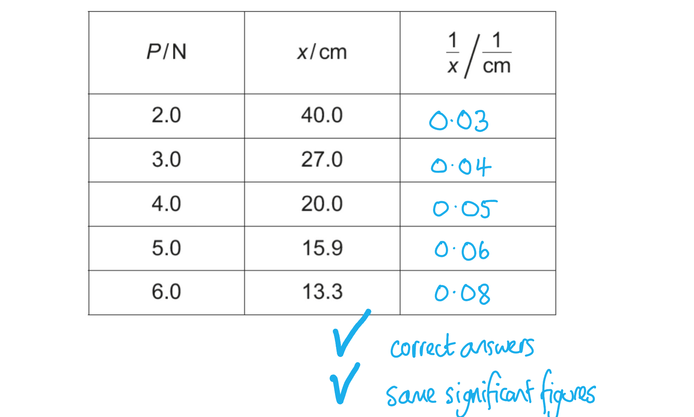

> *However, the table below would only get one mark, as the third answer should be 0.050.*

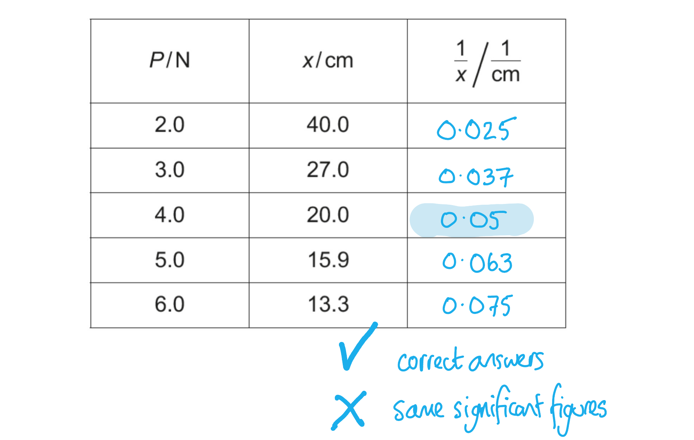
A correctly completed graph looks like:

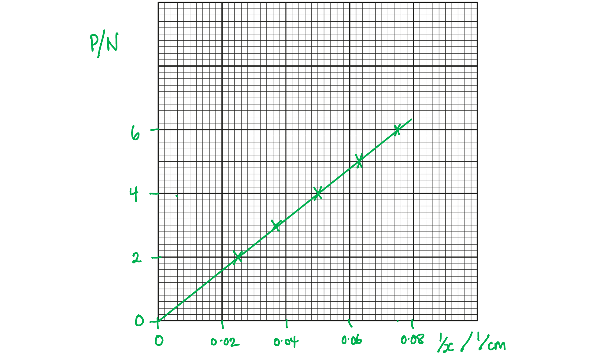

- Axes are correctly labelled with <u>both the variable and the unit</u> **AND **the right way round; **[1 mark]**
- An appropriate scale has been chosen with each axis using at least half of the grid; **[1 mark]**
- All data points are plotted correctly to within ½ small square; **[1 mark]**
- An appropriate line of best fit has been drawn as a** **<u>thin, continuous</u> line; **[1 mark]**

> *Avoid these **main mistakes** with graphs in Paper 6:*

- *Using a scale that doesn’t fit, particularly using multiples of three (this is always marked incorrect). Stick with multiples of 1, 2 or 5.*
- *Using a pen then having trouble correcting errors. Use a pencil.*
- *Marking the plotting points with either thick lines or large blobs (even one of these will lose the mark). Draw an ‘x’ with a pencil.*
- *Making the line of best fit too thick, which means the values can't be accurately read from it.*
- *Joining the plots instead of making a thin line down the middle for the line of best fit.*

> *Remember that the line of best fit is an average. There should be a roughly equal number of data points above and below the line. The pattern of the data points will show you if the line should be straight or a curve. Don't try to force it to be one or the other. Likewise your data points will show if the line should go through the origin (0, 0) or not. Never force it to do so.*

> *The key to this is **practice**. Try plotting graphs at home and compare your graph to our example. You can also ask your teacher to check your work. With practice, these are four very easy marks!*
Calculate $\frac{1}{x_{max}}$:

- $\frac{1}{50}=0.02$

Use the graph to determine the value of *P* associated with 0.02:

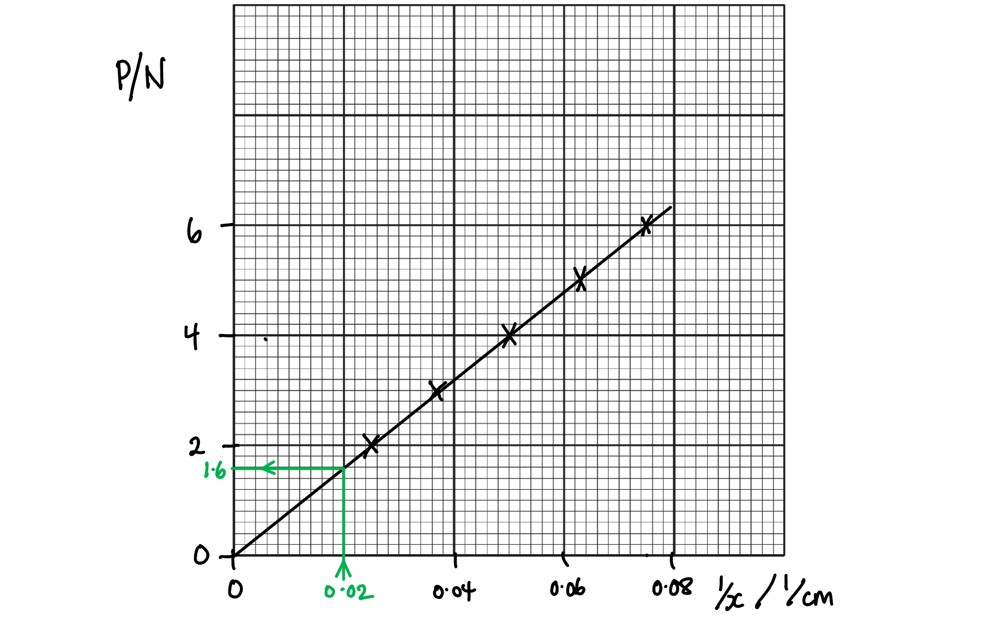

- The method used to obtain the values is clearly shown on the graph; **[1 mark]**
- The answer is <u>read correctly from the </u><u>*y*</u><u>-axis</u> to within half a small square (the answer on this graph is 1.6 N); **[1 mark]**

**[Total: 2 marks]**

> *We are showing you the answer that you should have got from your graph if it was correct. However if you made a mistake plotting your line but then found the correct value of **P** **for your graph**, you would be awarded this mark as error carried forward.*

> *Notice that the marks here are for **correctly applying the method and showing that you did so**. They are not for a specific answer. In fact, there is no mark at all for finding the value 0.02 as the question is testing graph skills, not calculations.*
To place the object accurately when the marks on the ruler are obscure:

- <u>Measure the width</u> of the object (using calipers) and <u>add half of this value</u> to the ruler markings; **[1 mark]**

A diagram which would explain this method looks like:

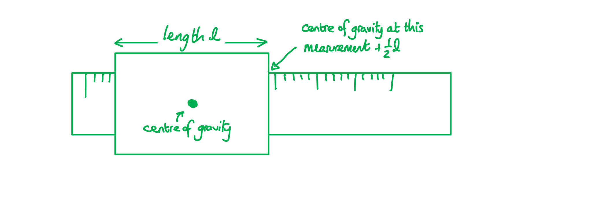

> *Read the question carefully. A common method to find the centre of an object is to draw an X onto it. But this won't help here, as the edges of the object are hanging over the edge of the ruler (the question states that **the width of object Q is slightly greater than the width of the metre rule**), so we can't see the scale.*
(i) To explain why it is difficult to determine the exact position for the load:

- It is difficult to make the metre rule balance **OR **to decide / agree when the ruler is balanced; **[1 mark]**

(ii) To find the best position of the load:

- Decide when the ruler is the closest to being balanced; **[1 mark]**

**[Total: 2 marks]**

> *Hopefully by the time you take your exams you will have tried common experiments like this one for yourself. Try to remember, what made it difficult? What compromises did you have to make to take readings? This is the answer, since the examiner in Paper 6 wants to see that you understand experimental methods.*

## Multiple Choice Questions (26 questions)

### Q1
**Final answer:** **The correct answer is A**

- By the principle of moments, the sum of anticlockwise moments about the pivot must equal the sum of clockwise moments

Anticlockwise moment = 6.0 × 20 = 120 N cm

Clockwise moment = $W \times 30$

- For the ruler to be balanced:

$W \times 30 = 120$

$W = \frac{120}{30} = 4 . 0 \text{N}$

**B** is incorrect as equal weights would only balance if they were at equal distances from the pivot, not at different distances.

**C** is obtained by incorrectly calculating $W = \frac{6.0\times30}{20}$, which swaps the distances in the moments equation.

**D** is incorrect and may result from an error in manipulating the moments equation.

### Q2
**Final answer:** **The correct answer is A**

- For a beam to be balanced (in equilibrium), the total clockwise moment must equal the total anticlockwise moment
- The moment of a force is calculated using the equation:

$\text{moment}=\text{force}\times\text{perpendicular distance from pivot}$

- There is an anticlockwise moment due to the force $F$ at a distance $x$ to the left of the pivot

$\mathrm{anticlockwise} \mathrm{moment}=F\timesx$

- Therefore, to balance the beam, there must be a clockwise moment due to the second force $2F$ at a distance $d$ to the right of the pivot

$\mathrm{clockwise} \mathrm{moment}=2F\timesd$

- Set these expressions equal to each other:

$2F\timesd=F\timesx$

- Rearrange the equation to make $d$ the subject and cancel the $F$ terms:

$d=\frac{F\timesx}{2F}$

$d=\frac{x}{2}$

- This is option** A**

### Q3
**Final answer:** **The correct answer is ****C**** because:**

- The principle of moments states that, for an object to be in equilibrium, the sum of the clockwise moments around any point must be equal to the sum of the anticlockwise moments
- The clockwise moments and the anticlockwise moments for beam **C** are not equal:

$\mathrm{moment}=\mathrm{force}\times\mathrm{perpendicular} \mathrm{distance} \mathrm{from} \mathrm{pivot}\,\,\mathrm{clockwise} \mathrm{moments}=2.0N\times2.0m=4.0Nm\,\,\mathrm{anticlockwise} \mathrm{moments}=3.0N\times2.0m=6.0Nm$

When answering questions involving moments, make sure that you find the total distance to the pivot correctly. For example, for beam **D** the 2.0 N force is 2.0 m away from the pivot, not 1.0 m.

**A** is incorrect because the moments are equal:
$\mathrm{clockwise} \mathrm{moments}=1.0N\times6.0Nm=6.0Nm$
$\mathrm{anticlockwise} \mathrm{moments}=2.0N\times3.0m=6.0Nm$

**B** is incorrect because the moments are equal: 
$\mathrm{clockwise} \mathrm{moments}=2.0N\times6.0m=12.0Nm$
$\mathrm{anticlockwise} \mathrm{moments}=2.0N\times6.0m=12.0Nm$

**D** is incorrect because the moments are equal: 
$\text{clockwise} \text{momemts} = ( 4.0 \mathrm{N} \times 1.0 \mathrm{m} ) + ( 2.0 \mathrm{N} \times 2.0 \mathrm{m} ) = 8.0 \mathrm{N} \mathrm{m}$
$\mathrm{anticlockwise} \mathrm{moments}=4.0N\times2.0m=8.0Nm$

### Q4
**Final answer:** **The correct answer is ****D****, because:**

- The centre of gravity of the object will be somewhere directly beneath the point of suspension, P, when it is in equilibrium
- That means it will be on the line between points P and Q. However, depending on the exact shape of the plate, it could be anywhere along that line
- To find the exact point of the centre of gravity, you would need to investigate further

You could find the centre of gravity as follows:

- Draw a vertical line on the plate connecting P and Q
- Hang the plate from another point and draw the vertical line from that point
- The centre of gravity will be at the point where the two lines cross

### Q5
**Final answer:** **The correct answer is ****D****, because:**

- The question states that the metre rule is in equilibrium
- This means that the clockwise moments (turning effects) are equal to the anticlockwise moments
- The size of a moment is found using:

moment = force × perpendicular distance from the pivot

- So, first find the anticlockwise moment caused by the hanging weight. It is 50 cm – 5 cm = 45 cm away from the pivot. It produces a downward force of 4.0 N. So: $\mathrm{anticlockwise} \mathrm{moments}=45\mathrm{cm}\times4.0N=180N\mathrm{cm}$
- To find the force in the string (let’s call it *F*), you should write an expression for the clockwise moments:* *

$\mathrm{clockwise} \mathrm{moments}=20\mathrm{cm}\timesF$

- The rule is in equilibrium and so: $\begin{gathered} \text{clockwise} \text{moments} & = \text{anticlockwise} \text{moments} \\ \\ 180 \mathrm{N} & = 20 \text{cm} \times \mathrm{F} \\ \\ \frac{180 \mathrm{N} cm}{20 cm} & = \mathrm{F} \\ \\ \mathrm{F} & = 9.0 \mathrm{N} \\ \end{gathered}$

* *In this question, the rule was balanced at its central point, so you do not need to involve its weight in any calculations as it has no turning effect. In some supplemental questions, you may need to include the weight of the rule as it may not be pivoted in the centre. You may also need to use multiple moments in both directions of rotation.

**A**, **B** and **C** show answers which could be found using incorrect distances on the rule.

### Q6
**Final answer:** **The correct answer is B because:**

- The beam is balanced, so the moment of *P* = the moment of *Q*
- To find potential values for loads *P* and *Q*, use the moments equation:

Moment = *F* $\times$ *d*

Moment of *P* = Moment of *Q*

*P* $\times$ 0.3 = *Q* $\times$ 0.7

- Consider the values in row **B**:

21 $\times$ 0.3 = 9 $\times$ 0.7 = 6.3 N m

- This satisfies the condition, therefore, **B** is correct

**A **is incorrect as 21 $\times$ 0.3 = 6.3 N m but 7$\times$ 0.7 = 4.9 N m

**C **is incorrect as 30 $\times$ 0.3 = 9.0 N m but 10 $\times$ 0.7 = 7.0 N m

**D **is incorrect as 30 $\times$ 0.3 = 9.0 N m but 70 $\times$ 0.7 = 49 N m

### Q7
**Final answer:** **The correct answer is D because:**

- The object has a uniform thickness

  - This means the centre of gravity lies at its centre of symmetry
  - This is point **D** for this square tile
- When an object is suspended from a point, the centre of gravity lies below that point

  - Point **D** is directly below the nail

The symmetry argument can only be used when you are told the object has a regular shape and is uniform.

This question tells you the tile is square and uniform, so the centre of gravity is the centre of the square.

### Q8
**Final answer:** **The correct answer is B because:**

- The rod is in equilibrium

  - Anticlockwise and clockwise moments are equal
  - The balloon’s moment is equal to the weight’s moment
- The mass produces an anticlockwise moment
- The balloon produces a clockwise moment
- Recall that moment is the product of force and perpendicular distance

$moment=Fd$

- Increasing perpendicular distance increases the moment by the same factor
- In option **B**:

  - The balloon’s perpendicular distance is decreased by a factor of 1.5
  - The clockwise moment decreases by a factor of 1.5
  - The mass’ perpendicular distance is decreased by a factor of 2
  - The anticlockwise moment decreases by a factor of 2
- The clockwise moment is now greater than the anticlockwise moment

  - This causes a clockwise rotation about P

**A **is incorrect as the clockwise moment increases by a factor of $\frac{4}{3}$ but the anticlockwise moment increases by a larger factor of $\frac{3}{2}$, so the system rotates anticlockwise

**C** and **D** are incorrect as the clockwise moment decreases but the anticlockwise moment increases, so the system rotates anticlockwise

### Q9
**Final answer:** **The correct answer is D because:**

- The equation for calculating the moment of a force is

$moment=force\timesperpendiculardis\mathrm{tan}cefrompivot$

- The principle of moments tells us that, for the beam to be balanced:

$totalclockwisemoments=totalanticlockwisemoments$

- The weight of the beam at X causes a clockwise moment about the pivot

$clockwisemoment=6.0\times40=240$ N cm

- To balance the beam, the 4.0 N force must be directed **vertically upwards** to cause an anticlockwise moment about the pivot

  - Therefore, options **A** and** B **can be eliminated
- When the 4.0 N is applied 20 cm to the **left **of X, the distance from the pivot is 20 cm, which would give a moment of:

$anticlockwisemoment=4.0\times20=80$ N cm

- This is **not **equal to the clockwise moment of X, therefore, option **C** can be eliminated
- When the 4.0 N is applied 20 cm to the **right **of X, the distance from the pivot is 60 cm, which would give a moment of:

$anticlockwisemoment=4.\times60=240$ N cm

- This is equal to the clockwise moment of X, therefore, option **D** is correct

### Q10
**Final answer:** **The correct answer is ****B**** because:**

- The experiment to show that resultant moment is zero uses a newtonmeter - also called a force meter
- To calculate the moment due to the instrument, the force of the instrument on the beam must be known - a force meter measures this force

A ruler is also needed to measure the distance to determine the moment caused by the instrument, but the instrument itself needs to be able to measure force. A ruler would not be placed where the instrument is mentioned in the diagram.

A similar experiment to this can be found in the revision notes.

Make sure you know your scientific instruments - a momentmeter is not a real instrument - hopefully you spotted this!

### Q11
**Final answer:** **The correct answer is ****B**** because**

- For equilibrium there must be:

  - **No resultant force**
  - **No resultant moment**
- Object B has equal forces acting in opposite directions, so its **resultant force is zero.**
- It also has the forces exactly in line, so they do not produce a turning force.

**A** is incorrect as this object would have both a resultant force and a moment

**C** is incorrect as this object would have no resultant force, but it would have a moment.

**D** is incorrect as this object would have no moment, but it would have a resultant force.

### Q12
**Final answer:** **The correct answer is ****D**** because:**

- The triangle's centre of gravity is at the central point of symmetry
- **D** is the only diagram where the centre of gravity of the triangle is not directly below the thread

When the centre of gravity is **not** below the line of the thread, there is a moment. The **weight** force of the shape is a **non-zero** **distance** from the pivot (where the thread is attached to the shape), so in the case of diagram **D**, the triangle will **rotate** clockwise.

### Q13
**Final answer:** **The correct answer is ****C**** because:**

- An object is stable while its centre of gravity is directly over its base..
- C has the widest base, so is the most stable.

**A** is incorrect as it has the joint narrowest base

**B** is incorrect as it does not have the widest base

**D** is incorrect as it has the joint narrowest base, and its centre of mass is high up. Both of these factors make it very unstable.

### Q14
**Final answer:** **The correct answer is ****C**** because:**

- The size of a moment is proportional to the **force** applied and the **distance** of that force from the pivot
- A larger force increases the moment and a greater distance increases the moment

  - Option **C** has both of these

The width of the screwdriver has nothing to do with the size of the moment applied. Often, questions will have option designed to "catch you out". Knowing the content will make these very easy to spot!

### Q15
**Final answer:** **The correct answer is ****A**** because**

- Moment = force x distance from pivot.
- The moment turning the handle clockwise is the largest, as the force is acting at the greatest distance from the pivot.

**B** is incorrect as the force turning the handle anticlockwise is closer to the pivot, therefore its moment will be smaller.

**C **is incorrect as the force pushing the handle to the left would be balanced by a force pushing back from the pivot, which is fixed in position.

**D** is incorrect as the handle will move as the clockwise moment is greater than the anticlockwise moment.

### Q16
**Final answer:** **The correct answer is ****D**** because:**

- If the beam is to rotate clockwise, the **clockwise moment must be greater than the anticlockwise moment.**
- Moment = force x distance from pivot
- The forces on the right of the beams turn them clockwise, while those on the left turn them anticlockwise.
- In no case is force x distance on the right greater than force x distance on the left.

**For X:**

- anticlockwise force = 3.0 m x 4.0 N = 12 N/m
- clockwise force = 2.0 m x 4.0 N = 8 N/m
- = turns anticlockwise (left)

**For Y:**

- anticlockwise force = 6.0 m x 4.0 N = 24 N/m
- clockwise force = 2.0 m x 8.0 N = 16 N/m
- = turns anticlockwise (left)

**For Z:**

- anticlockwise force = 3.0 m x 5.0 N = 15 N/m
- clockwise force = 6.0 m x 2.0 N = 12 N/m
- = turns anticlockwise (left)

- None of the beams rotate clockwise.

### Q17
**Final answer:** **The correct answer is ****D**** because**

- Buses are designed with a low centre of mass and a wide base, for maximum stability.
- Passengers standing on the top deck would raise that centre of mass.
- This would make the bus less stable and more prone to tipping over when going round corners.

**A** is incorrect as they probably can’t be trusted, but the driver has a mirror and a periscope so he can see what’s happening on the top deck.

**B **is incorrect as again true, but irrelevant.

**C** is incorrect as they actually would increase the GPE of the bus, but that doesn’t cause any ill effect at all.

### Q18
**Final answer:** **The correct answer is ****B**** because:**

- moment = force × perpendicular distance to pivot
- Clockwise moment from *m*2:

  - $F=m_{2}g$
  - $\mathrm{moment}_{2}=m_{2}g\timesd_{2}$
- Anticlockwise moment from *m*1:

  - $F=m_{1}g$
  - Perpendicular distance: $d_{1}^{2}=l_{1}^{2}-h_{1}^{2}$
  - $\mathrm{moment}_{1}=m_{1}g\times\sqrt{l_{1}^{2}-h_{1}^{2}}$
- Equilibrium means $\mathrm{moment}_{1}=\mathrm{moment}_{2}$

  - $m_{2} d_{2} \cancel{g} = m_{1} \cancel{g} \sqrt{l_{1}^{2} - h_{1}^{2}}$
  - $m_{2}d_{2}=m_{1}\sqrt{l_{1}^{2}-h_{1}^{2}}$
  - $d_{2}=\frac{m_{1}\sqrt{l_{1}^{2}-h_{1}^{2}}}{m_{2}}$

This question is testing how well you know the definition of a moment, as well as putting you through your paces with algebra! Y You must spot that you need the **perpendicular** distance for the anticlockwise moment, which can be determined using Pythagoras' theorem. The force (weight) is acting directly downwards, so the distance must be **perpendicular** to this.

*d*1 is not labelled on the diagram, but *l*1 and *h*1are - so you can use it to figure these out. Pythagoras' theorem is only relevant for **right-angled triangles**.

### Q19
**Final answer:** **The correct answer is ****B**** because:**

- For an object to be in equilibrium both the resultant force and the resultant moment acting on it must be zero.
- This is a basic definition question dressed up to look like a moments problem.

**A** is incorrect as if the upward force were larger than the downwards force, the beam would accelerate upwards. This is not equilibrium.

**C** is incorrect as if the resultant force were not zero, the beam would accelerate. It would not be in equilibrium.

**D** is incorrect as if this were the case, the upward force would be larger than the downwards force. The beam would not be in equilibrium.

### Q20
**Final answer:** **The correct answer is ****D**** because:**

- We are looking for the corkscrew with the greatest moment.
- In **D**, both forces are acting in an anticlockwise direction about the pivot.
- Both forces are the maximum distance away from the pivot (in the centre), which means the moment will be the maximum.

**A **is incorrect as the forces act in opposite directions (the topmost F is in the clockwise direction, the bottommost F is in the anticlockwise moment), so they cancel each other out.

**B **is incorrect as one of the forces is only halfway along the corkscrew handle and although both forces act in the anticlockwise direction about the pivot, because one of the moments is only halfway along the corkscrew, the combined moment in **B** is less than combined moments in corkscrew **D**.

**C **is incorrect as the forces act in opposite directions about the pivot, and so cancel each other out, even though they are as far from the pivot as they can be.

### Q21
**Final answer:** **The correct answer is ****C**** because:**

- Moment = force x distance from pivot
- Anticlockwise moments arise from the 10 N force from the pan

  - Anticlockwise moment = F × d = 10 × 0.15 = 1.5 N m
- Clockwise moments arise from the box on the right hand side

  - The beam is 65 cm long, so the box is 50 cm = 0.50 m from the pivot
  - Clockwise moment = F x d = F x 0.50

- If the beam is in equilibrium then the sum of the clockwise moments = the sum of the anticlockwise moments

  - F × 0.50 = 1.5 N m
  - F = $\frac{1.5}{0.5}$ = 3 N
- We, therefore, require six 0.5 N weights to balance the yardarm.

### Q22
**Final answer:** **The correct answer is ****C**** because:**

- The centre of gravity of an object is the point at which the weight of the object may be considered to act
- For symmetrical objects with uniform density, the centre of gravity is located at the point of symmetry

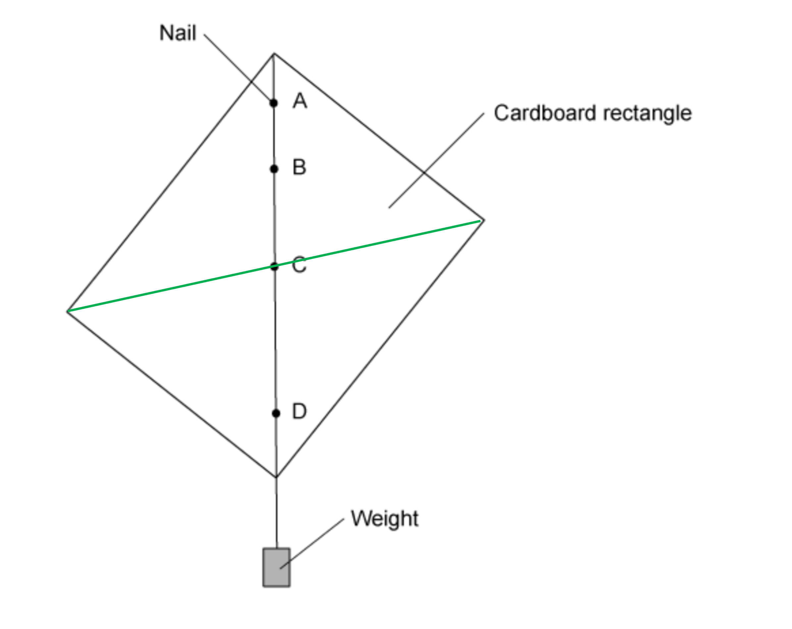

- Point **C** is located at the point of symmetry

### Q23
**Final answer:** **The correct answer is ****A**** because**

- If the beam is in equilibrium then the sum of the clockwise moments = the sum of the anticlockwise moments.
- Moment = force x distance from pivot.
- Clockwise moments arise from the 200 N force.
- Anticlockwise moments arise from the weight of the beam.
- We know that the weight always acts from the centre of mass of an object, and that the centre of mass of a uniform object is in the centre, in this case 1.5 m from the pivot.
- 200 x 0.5 = 1.5 x W
- W = 66.7 N

### Q24
**Final answer:** **The correct answer is**** D ****because**

- For equilibrium, the resultant force must be zero, and the resultant moment must be zero.
- The resultant force is zero, as the pivot will be providing an upwards reaction force (not shown) equal to the two downwards forces.
- The resultant moment is zero because the two forces are equal in size and the same distance either side of the pivot.

**A** is incorrect as the resultant force on the left hand side of the beam is zero, so the beam would rotate clockwise.

**B** is incorrect as the resultant moment is zero, but the beam would lift up off the pivot.

**C** is incorrect as the forces act in opposite directions, which would make the beam rotate clockwise.

### Q25
**Final answer:** **The correct answer is ****A**** because:**

- The beam is horizontal and stationary - this means the resultant moment is zero

  - $\mathrm{moment}=F\timesd$
- Calculate the anticlockwise (ACW) moment from the rope:

  - $moment_{ACW} = T \times ( \frac{L}{4} )$
- Calculate the total clockwise (CW) moment:

  - $moment_{CW} = ( M g ) \times ( \frac{L}{4} ) + ( m g ) \times ( \frac{3 L}{4} )$
- Equate the CW and ACW moments and rearrange for $M$:

  - $\frac{T \cancel{L} }{ \cancel{4} } = \frac{M g \cancel{L} }{ \cancel{4} } + \frac{3 m g \cancel{L} }{ \cancel{4} }$
  - $T=Mg+3mg\RightarrowMg=T-3mg$
  - $M=\frac{T}{g}-3m$

One major challenge of this question is that no diagram was provided, so you had to visualise the distances and positions of forces along the beam. Drawing your own diagram makes this much more manageable.

Additionally, you can only answer this question one you realise that the weight force (*Mg*) of the beam acts halfway across the beam length. This is because the beam is **uniform** so its centre of gravity is exactly in the middle. The beam length itself does not matter, as this cancels out when the moments are equated.

### Q26
**Final answer:** **The correct answer is ****C**** because:**

- For equilibrium, the resultant force must be zero, and the resultant moment must be zero.
- In this question, we need only deal with the resultant moment.
- The centre of mass is directly over the pivot point, so the distance of the weight from the pivot is zero, this means the moment is zero.
- Therefore, the wardrobe is in equilibrium (though a tiny force would tip it away from equilibrium)

**A** is incorrect as the weight makes an anticlockwise moment. The wardrobe would tip anticlockwise

**B** is incorrect as the weight makes a clockwise moment about the pivot. The wardrobe would tip clockwise.

**D** is incorrect as the weight makes a clockwise moment about the pivot. The wardrobe would tip clockwise.

## Theory Questions (19 questions)

### Q1
> **[mark-scheme]**
> (i) State the equation that links moment, force, and distance:
> 
> - Moment = Force × perpendicular distance **OR** $M=F\timess$ **[1 mark]**
> 
> The mark will also be awarded for the equation given in its correctly rearranged form.
> 
> (ii) State the unit for the moment of a force:
> 
> - Nm / Newton metre **[1 mark]**

> **[exam-tip]**
> Remember that the distance must be the perpendicular distance from the pivot to the line of action of the force.
> 
> Many students lose marks by forgetting to specify "perpendicular" when writing out the equation in words.
> 
> For the unit, make sure you write "Nm" (Newton metre) and not "nm" (nanometre).
> **[mark-scheme]**
> (i) State the distance from the pivot to the centre of gravity of the plank:
> 
> - 1.00 m **[1 mark]**
> 
> Accept 1 m.

> **[exam-tip]**
> Remember that the centre of gravity of a uniform plank is at its midpoint. You need to find the distance between this midpoint and the pivot position.

(ii) Calculate the moment of the plank's weight about the pivot:

$M=F\timess$

$M=80.0\times1.00$ **[1 mark]**

$p=$ $80.0\text{Nm}$ **[1 mark]**

> **[mark-scheme]**
> Accept 80 Nm.

> **[exam-tip]**
> Always show your working clearly when calculating moments.
> 
> The formula is moment = force × perpendicular distance from the pivot. Make sure you include the correct unit (Nm) in your final answer.
Calculate the minimum downward force the builder must apply to lift the block:

- The plank will be balanced when the builder applies just enough force to lift the block

Clockwise moments = Anticlockwise moments

- There are 3** **forces acting on the plank

  - Weight from block, providing an anticlockwise moment
  - Weight from plank, providing a clockwise moment
  - Push force from builder, providing a clockwise moment
- Calculate the anticlockwise moment:

Anticlockwise moment = Weight from block

Anticlockwise moment $=600.0\times1.00$

Anticlockwise moment $=600.0\mathrm{Nm}$ **[1 mark]**

- Determine the clockwise moment:

Clockwise moment = Weight from plank+ Push force from builder

Clockwise moment = $( 80.0 \times 1.00 ) + ( F \times 3 )$

Clockwise moment = $80.00+3F$ **[1 mark]**

Clockwise moments = Anticlockwise moments

$\text{80.0 + 3}\text{F}\text{= 600.0}$ **[1 mark]**

$3F=600.0-80.0$

$3F=520.0$

$F=\frac{520.0}{3}$ **[1 mark]**

$F=173.33..$

** **$F=$**173 N ****[1 mark]**

> **[exam-tip]**
> Many students forget to include the weight of the plank when calculating moments. Remember that all forces acting on the system must be considered, including the weight of the plank itself. Make sure you identify all the distances from the pivot correctly and include all relevant weights in your moment calculations.

### Q2
(i) To calculate the moment of the force about the centre of the bolt:

List the known quantities:

- Force = 80 N
- Distance from the centre of the bolt = 0.25 m

Recall the equation linking moment, force and distance:

- Moment = force × distance **[1 mark]**

Substitute in known values and calculate the moment:

- Moment = 80 × 0.25 **[1 mark]**
- Moment = 20 **[1 mark]**

State the unit:

- N m **[1 mark]**

(ii) State another example involving turning forces:

Any one from:

- A door handle; **[1 mark]**
- A steering wheel; **[1 mark]**
- A bottle opener; **[1 mark]**
- Using pliers to grip an object; **[1 mark]**

**OR**

- Any other sensible answer; **[1 mark]**

**[Total: 5 marks]**
To increase the turning effect without increasing the force:

- Increase the distance of the force from the centre of the bolt; **[1 mark]**

**[Total: 1 mark]**

### Q3
To calculate the moment of the force about the pivot:

- List the known quantities:

  - Force, $F = 1030 \text{N}$
  - Perpendicular distance from the pivot, $d = 120 \text{cm}$
- Write down the equation for the moment of a force:

$\text{moment} = \text{force} \times \text{perpendicular distance from pivot}$ **[1 mark]**

- Substitute the known values:

$\text{moment} = 1030 \times 120$ **[1 mark]**

- Calculate the answer:

$\text{moment} =$$\text{123 600 N cm}$ **[1 mark]**

> **[mark-scheme]**
> 1 mark for the moment equation in words or symbols
> 
> 1 mark for correct substitution, $1030 \times 120$
> 
> 1 mark for a correct final answer of 123 600 N cm
> 
> - Accept 124 000 N cm, $1 . 24 \times 10^{5} \text{N cm}$ or $1 . 236 \times 10^{5} \text{N cm}$
> - Accept 1236 N m only if the unit N m is written
> - All three marks can be scored for the correct answer alone

> **[exam-tip]**
> The answer line asks for N cm, so keep the distance in centimetres: converting to 1.2 m and giving 1236 N m is correct physics but not what was asked for. Checking the figure confirms the force acts at right angles to the beam. In Core questions, it always does, but write "perpendicular distance" in your equation anyway, because that is the wording the mark scheme looks for.
> **[mark-scheme]**
> - Apply the lifting force further from the pivot / increase the perpendicular distance between the force and the pivot **[1 mark]**
> 
> Accept "use a longer lever" or "lift at the far end of the beam"

> **[exam-tip]**
> Only one line of space is provided, so keep it simple. The turning effect of a force increases with distance from the pivot, so a smaller force is needed when it is applied further away.
> **[mark-scheme]**
> Any **one** from:
> 
> - The centre of gravity (of the beam in Fig. 2.3) is higher **[1 mark]**
> - The base / area in contact with the ground is smaller **[1 mark]**
> 
> Accept a comparison in either direction, e.g. "the beam in Fig. 2.1 has a lower centre of gravity"

> **[exam-tip]**
> This is a **state** question, so one clear reason is enough. Stability depends on how low the centre of gravity is and how wide the base is; either comparison scores, but make sure you compare the two positions rather than describing only one of them.

### Q4
Calculate the moment of the weight of load M about the pivot:

- Moment of force = force $\times$ perpendicular distance of force from pivot;** [1 mark]**

  - Where force = 2.5 N and perpendicular distance = 20 cm
- Moment of force = 2.5 $\times$ 20 **[1 mark]**
- Moment of force = 50 N cm **[1 mark]**

**[Total:3 marks]**

### Q5
(i) To calculate the moment about the pivot:

List the known quantities:

- Perpendicular distance from pivot to force = 0.50 m
- Force = 150 N

Recall the equation for moment:

- $\mathrm{moment}=\mathrm{force}\times\mathrm{perpendicular} \mathrm{distance}$ **[1 mark]**

Substitute the known quantities:

- $\mathrm{moment}=150\times0.50$ **[1 mark]**

Calculate the moment of the force:

- $\mathrm{moment}=75$** [1 mark]**

Give the unit:

- N m **[1 mark]**

(ii) Another example of a turning force may be:

Any **one** from:

- Turning a tap open or closed; **[1 mark]**
- Opening a tub of paint with a screwdriver; **[1 mark]**
- Tightening a bolt with a wrench / spanner / Allen key / hex key; **[1 mark]**
- Digging dirt with a shovel;** [1 mark]**
- Removing a nail with hammer claws; **[1 mark]**

**[Total: 5 marks]**
To increase the turning effect without changing force:

- Increase the distance (from the force to the pivot);** [1 mark]**

**[Total: 1 mark]**

> *Remember, the turning effect (or moment) of a force, is the product of force and distance, so if you cannot change the force, the only way to change it is by changing the distance.*

> *Any reasonable example of using a moment may gain a mark. If you do not see your example listed, check with a friend or teacher to see if you would gain a mark. It is a good idea to always have a few examples in your mind ready to use in an exam. *

### Q6
Explain why the bus begins to topple:

The bus begins to topple because:

- The line of action of the centre of gravity falls outside the base of the bus; **[1 mark]**

**   ****OR**

- The anticlockwise moment (of the bus) is greater than the clockwise moment; **[1 mark]**

**[Total: 1 mark]**
State how the stability of the bus is affected:

- The bus is more likely to fall over / topple / be less stable; **[1 mark]**
- (The line of action of) the centre of gravity may then fall outside the base of the bus; **[1 mark]**

**[Total: 2 marks]**
(i) Calculate the total mass of the bus, the driver and the 73 passengers:

List the known quantities:

- Mass of bus and driver = 16 000 kg
- Average mass of one passenger = 65 kg
- Number of passengers on bus = 73

Calculate the total mass of the passengers:

- $Totalmassofpassengers=numberofpassengers\timesaveragemassofonepassenger$
- $Totalmassofpassengers=65\times73=4700\mathrm{kg}$ **[1 mark]**

Calculate the total mass of the bus, the driver and the 73 passengers:

- $Totalmass=massofbusanddriver+totalmassofpassengers$
- $Totalmass=16000+4700$
- Total mass = 20 700 kg = 21 000 kg (2 s.f.) **[1 mark]**

** **

(ii) Calculate the resultant force on the bus during the acceleration:

List the known quantities:

- Initial speed, *u *= 0 m / s
- Final speed, *v *= 14 m / s
- Time to accelerate, *t *= 20 s
- Total mass, *m *= 21 000 kg (from part (c) (i))

Calculate the acceleration, *a *of the box:

- $a = \frac{( v - u )}{t}$
- $a = \frac{( 14 - 0 )}{20}$
- *a *= 0.7 m/s2

Recall Newton's second law:

- $F=ma$ **[1 mark]**

Substitute the known quantities into Newton's second law to calculate the resultant force, *F*:

- $F=21000\times0.7$
- *F *= 14 700 N = 15 000 N (2 s.f.) **[1 mark]**

**[Total: 4 marks]**

> *At the end of a long question like this, always go back and check it. *

### Q7
State which orientation, A or B, will allow the bolt to be tightened more easily and explain why

State the orientation that turns the bolt more easily:

- (Orientation) B; **[1 mark]**

Explain why:

- The length of the handle is greater in B **OR** the distance between the force and the pivot is greater in B; **[1 mark]**
- (Therefore) a larger moment can be produced; **[1 mark]**

**[Total: 3 marks]**

> *Since moment = force × perpendicular distance from the pivot, the bolt will tighten most easily if it requires the least force. Therefore, to still get the same moment, you must increase the distance from a pivot.*

> *Think of a door handle. It is placed on the opposite side of the door hinge for you to open it easily. If it was closer to the hinge, a much larger force would be required to open the door.*
(i) Calculate the moment when the Allen key is in orientation A:

List the known quantities:

- Force applied, $F$ = 150 N
- Perpendicular distance, $d$ = 1.0 cm

Convert the distance:

- $d=1.0\mathrm{cm}=0.01m$ **[1 mark]**

Recall the equation for moment:

- $moment=F\timesd$ **[1 mark]**

Calculate moment:

- $moment=150\times0.01$ **[1 mark]**
- $moment=1.5Nm$ **[1 mark]**

(ii) Calculate the moment when the Allen key is in orientation B:

List the known quantities:

- Force applied, $F$ = 150 N
- Perpendicular distance, $d$ = 4.3 cm

Convert the distance:

- $d=4.3\mathrm{cm}=0.043m$ **[1 mark]**

Calculate the moment:

- $moment=150\times0.043$ **[1 mark]**
- $moment=6.45Nm$ **[1 mark]**

**[Total: 7 marks]**

- *The marking point for **recalling** the equation is only awarded here **once*
- *Underline the units in **every** question in your paper so you don't forget to **convert** units to match those needed for the answer*
Calculate the minimum force *F*B the student must exert to lift the furniture:

List the known quantities:

- Weight of furniture, $W$ = 800 N
- $F_{A}$ is 30% of the furniture's weight
- Perpendicular distance from pivot to furniture, $d_{A}$ = 0.20 m
- Perpendicular distance from pivot to force from student, $d_{B}$ = 0.80 m

Calculate the force on the plank of wood from the furniture, *F*A:

- $F_{A}=0.3\times800=240N$ **[1 mark]**

Recall the equation to calculate the moment:

- $\mathrm{moment}=F\timesd$ **[1 mark]**

Calculate the moment about the pivot from the furniture, moment A:

- $\mathrm{moment}A=F_{A}\timesd_{A}=240\times0.20$ **[1 mark]**
- $\mathrm{moment}A=48Nm$ **[1 mark]**

Use the principle of moments:

- In equilibrium, moment A = moment B

Calculate the force exerted by the student at equilibrium, *F*B:

- $\mathrm{moment}B=F_{B}\timesd_{B}$
- $F_{B}=\frac{\mathrm{moment}B}{d_{B}}=\frac{48}{0.80}$ **[1 mark]**
- $F_{B}=60N$ **[1 mark]**

**[Total: 6 marks]**
Explain how this would affect the size of the force that the student must exert to lift the furniture:

- The centre of mass (of the plank of wood) is to the right of the pivot / on the same side as the pivot; **[1 mark]**
- It increases the clockwise moment; **[1 mark]**
- The minimum force (the student must exert) would be (slightly) smaller; **[1 mark]**

**[Total: 3 marks]**

> *The key wording is that the question states 'evenly distributed mass' which implies its centre of mass is at the centre of the plank.*

> *This centre of mass is where the **weight** of the plank acts, adding to the clockwise moment. This helps the plank turn clockwise, so less force is required by the student for this moment to equal to same total clockwise moment.*

### Q8
(i) Tick the box next to each correct quantity.

✓ distance

**AND**

✓ force; [1 mark]

`square` time

(ii) Draw a ring around the unit for work done from the list.

- Ring around 'joule'; **[1 mark]**

**[Total: 2 marks]**
Tick to the box to identify the quantities that determine the power of the truck:

✓** **energy transferred; **[1 mark]**

`square` temperature

**AND**

✓ time; **[1 mark]**

**[Total: 1 mark]**
Calculate the load:

List the known quantities:

- Load causing anticlockwise moment = 30 000 N
- Distance of 30 000 N from pivot = 1.5 m
- Distance of load from pivot = 1.0 m

State the principle of moments:

- $totalclockwisemoments=totalanticlockwisemoments$ **[1 mark]**

Substitute values into the principle of moments equation:

- $moment=force\timesperpendiculardistancefromthepivot$
- $load\times1.0=30000\times1.5$ **[1 mark]**

Rearrange for load and calculate its value:

- $load=\frac{30000\times1.5}{1.0}$
- load = 45 000 N **[1 mark]**

**[Total: 3 marks]**

> *Which forces are causing the clockwise and which the anticlockwise moments matters for when there are more forces at play. Look at the force in relation to the pivot, if the force was increased, which way would the beam tilt in?*

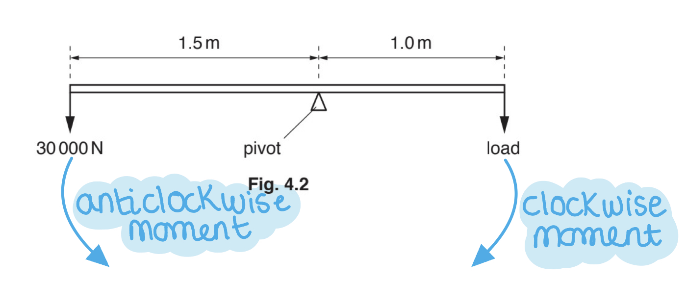
(i) On Fig. 4.3, draw a cross to indicate the centre of gravity of the pile of bricks.

A diagram that would score 1 mark should look like:

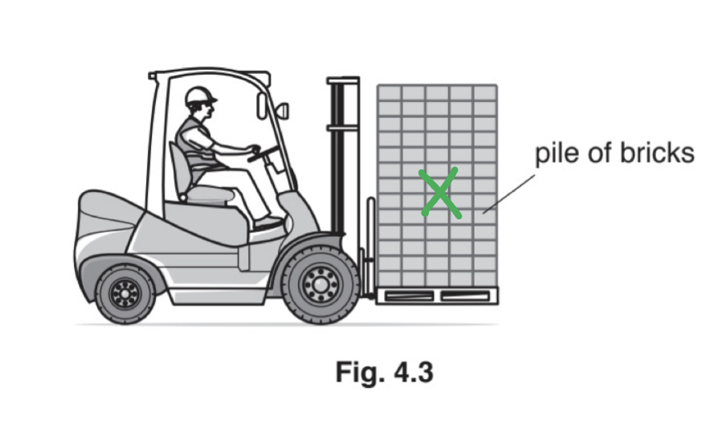

- X at the centre of the load; **[1 mark]**

(ii) Tilting the pile of bricks backwards makes the truck more stable because:

- The centre of gravity (moves) closer to pivot (point); **[1 mark]**

**[Total: 1 mark]**

> *For a regular object, its centre of gravity is at the centre of the object.*

> *Stability is all about how close a line drawn from an object's centre of gravity (CoG) is to its pivot. If a line from its centre of gravity is further ahead than the pivot, it is unstable. *

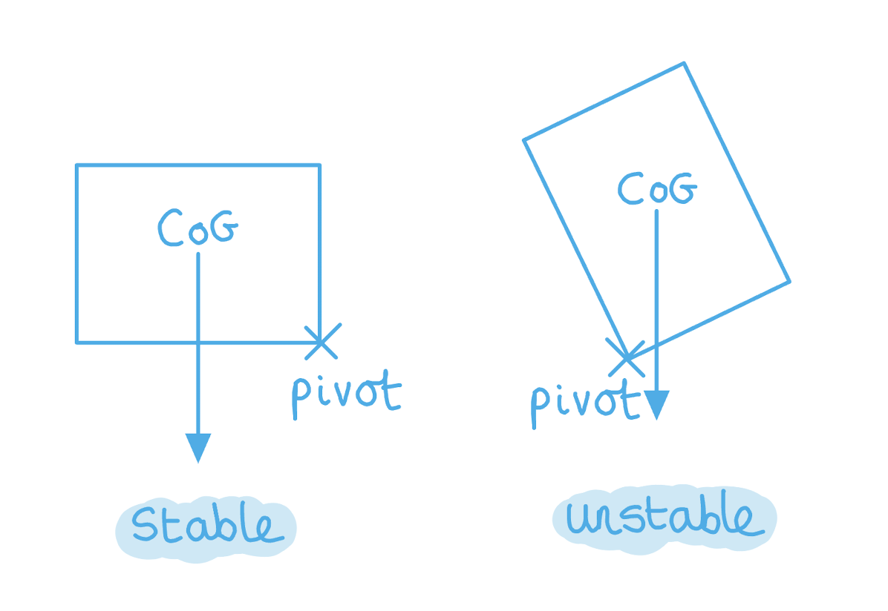

### Q9
Calculate the weight of each animal. You may assume the acceleration of free fall is 10 m/s2:

List the known quantities:

- Acceleration of free fall, $g$ = 10 m/s2
- Mass of toucan, $m_{t}$ = 600 g
- Mass of grass snake, $m_{g}$ = 250 g

Recall the equation linking mass and weight:

- $g=\frac{W}{m}$  **OR**  $W=m\timesg$ **[1 mark]**

Convert the masses to kg:

- $m_{t}=600g=0.60\mathrm{kg}$

**AND**

- $m_{g}=250g=0.25\mathrm{kg}$ **[1 mark]**

Calculate the weight of the toucan:

- $W_{t}=0.60\times10$
- $W_{t}=6.0N$ **[1 mark]**

Calculate the weight of the grass snake:

- $W_{g}=0.25\times10$
- $W_{g}=2.5N$ **[1 mark]**

**[Total: 4 marks]**
Using the information in Fig. 1.1, deduce whether the system is in equilibrium:

List the known quantities:

- Weight of the toucan, $W_{t}$ = 6.0 N
- Weight of the grass snake, $W_{g}$ = 2.5 N
- Distance of toucan from pivot, $d_{t}$ = 40 cm
- Distance of grass snake from pivot, $d_{g}$ = 90 cm

Convert the distances to metres:

- $d_{g}=90\mathrm{cm}=0.90m$

**AND**

- $d_{t}=40\mathrm{cm}=0.40m$ **[1 mark]**

Recall the equation for calculating a moment:

- $\mathrm{moment}=F\timesd$ **[1 mark]**

Calculate the clockwise moment from the snake, $\mathrm{moment}_{\mathrm{CW}}$:

- $\mathrm{moment}_{\mathrm{CW}}=2.5\times0.90$ **[1 mark]**
- $\mathrm{moment}_{\mathrm{CW}}=2.25Nm=2.3Nm$ (2 s.f.) **[1 mark]**

Calculate the anticlockwise moment from the toucan, $\mathrm{moment}_{\mathrm{ACW}}$:

- $\mathrm{moment}_{\mathrm{ACW}}=6.0\times0.40$
- $\mathrm{moment}_{\mathrm{ACW}}=2.4Nm$ (2 s.f.) **[1 mark]**

**[Total: 5 marks]**
State whether the system is in equilibrium or not:

- The system is <u>not</u> in equilibrium; **[1 mark]**

Explain your reasoning:

**Any one from:**

- The moments are not balanced; **[1 mark]**
- The anticlockwise moment is greater than the clockwise moment; **[1 mark]**
- There is a <u>non-zero</u> <u>resultant</u> / net moment; **[1 mark]**
- There is a resultant / net <u>anticlockwise</u> moment; **[1 mark]**

**[Total: 2 marks]**

- *If you are mentioning a **resultant** moment, **specify** that is not zero or state that it is in a particular direction*

  - *Systems in **equilibrium** still have a **resultant** moment, that resultant moment is just **zero*
- *Make sure to state that the 'resultant' moment is not zero and not just 'the moment is not zero'*

  - *Resultant / net means the 'overall' moment*
Suggest whether it is possible for the bearded dragon to bring the seesaw into equilibrium:

State whether it is possible:

- It is <u>not</u> possible (for the bearded dragon to balance the seesaw); **[1 mark]**

Use the principle of moments:

- (In order to balance the seesaw) the bearded dragon needs an <u>anticlockwise moment of 5.2 N m</u>; **[1 mark]**

Explain why this cannot happen:

- The seesaw is not long enough;

**OR**

- The weight of the bearded dragon is too small; **[1 mark]**

**[Total: 3 marks]**

- *It is important to review **all** the information in the question to answer this*

  - *The key fact is that the seesaw is two metres long, so the maximum distance the bearded dragon can have from the pivot is **only one metre** (the seesaw has one metre **either side** of the pivot)*
- *This means the bearded dragon can only have a **maximum** anticlockwise moment of 4.9 N × 1.0 m = **4.9 N m*

  - *You may have gained full marks by calculating this **and** stating that this is less than the required 5.2 N m **anticlockwise** moment*

### Q10
State, in terms of P, the moment of force P about B:

List the known quantities:

- Force, *F* = P
- Distance, *d* = 1.5 m

Recall the equation for the size of a moment:

- Moment = force × distance **OR** *M = Fd*

State the moment of force P in terms of P:

- P × 1.5 **[1 mark]**

**[Total: 1 mark]**

> *When the question says state the moment **in terms of P**, it means that P must be included somewhere in the equation. Since we don't have a numerical value for P, but we do know the distance from the pivot, we can express the moment, **M = Fd**, as 1.5P or P × 1.5*
(i) Calculate the moment of *W* about B:

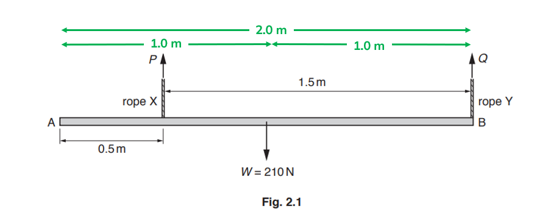

List the known quantities:

- Weight, *W* = 210 N
- Distance from pivot, *d* = 1.0 m

Substitute the known values into the moment equation to calculate:

- $M=F\timesd$
- $M=210\times1.0$
- *M* = 210 N m **[1 mark]**

(ii) Calculate the force *P*:

List the known quantities:

- Moment of *P* about *B* = *P* × 1.5 (from part (a))
- Anticlockwise moment = 210 N

Recall the principle of moments:

- The total clockwise moments = the total anticlockwise moments

Rearrange the moment equation to make P the subject:

- $M=Pd$
- $P=\frac{M}{d}$
- $P=\frac{210}{1.5}$ **[1 mark]**
- *P* = 140 N **[1 mark]**

(iii) Calculate the force *Q*:

Set up the equation using the known quantities:

- In equilibrium, the total upward forces equal the total downward forces
- $P+Q=W$

Rearrange to make Q the subject:

- $Q=W-P$

Substitute in the known values to calculate:

- $Q=210--140$ **[1 mark]**
- *Q* = 70 N **[1 mark]**

**[Total: 5 marks]**

> *The two rules you need to remember when rearranging equations are:*

1. * To undo an operation, do the **opposite** operation (to cancel a multiplication relationship, you need to divide, to cancel a minus you need to add and vice versa)*
2. *What ever you do to an equation, you need to do it to **both** **sides*

> *To rearrange the moment equation to make **F** the subject:*

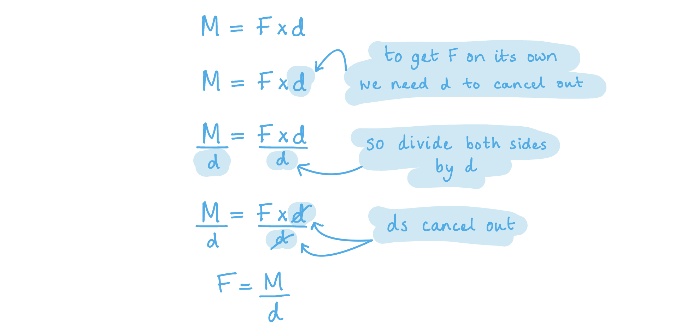

> *To rearrange **P** + **Q** = **W** to make **Q** the subject:*

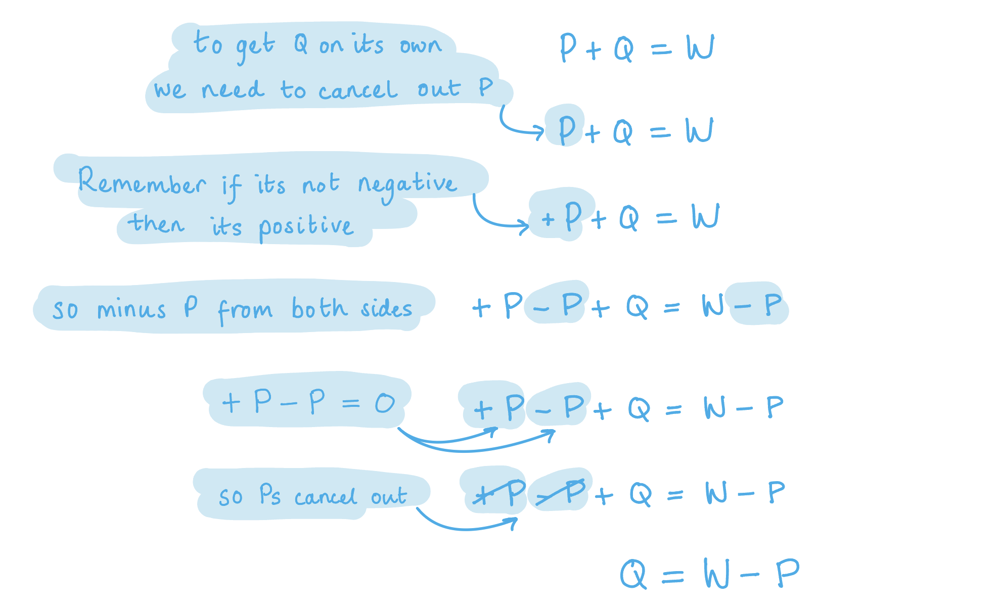

### Q11
Show that the moment of the 5.0 N force about the pivot is 200 N cm.

List the known quantities:

- Force = 5.0 N
- Distance from the pivot = 40 cm

State the equation linking moment, force and distance from the pivot;

- Moment = force × distance from the pivot; **[1 mark]**

Substitute values into the moment equation:

- Moment = 5.0 × 40 = 200 N cm **[1 mark]**

**[Total: 2 marks]**

> *There could often be multiple forces and distances on the diagram in the question. Make sure to use the correct distance from the pivot associated with the force you require the moment for.*
The size of force is calculated by:

List the known quantities:

- Moment of 5.0 N force = 200 N cm

State the principle of moments:

- Sum of the clockwise moments = sum of the anticlockwise moments; **[1 mark]**

Determine the clockwise moments:

- $momentdueto2.0N=2.0\times10=20N\mathrm{cm}$
- $m o m e n t d u e t o F = F \times ( 100 - 40 ) = 60 F \mathrm{N} \text{cm}$

Substitute values into the principle of moments equation:

- $20+60F=200$ **[1 mark]**

Rearrange for the force F:

- $60F=200--20=180$
- $F=\frac{180}{60}$**[1 mark]**
- *F* = 3.0 N **[1 mark]**

**[Total: 4 marks]**

> *Whether a moment is clockwise or anticlockwise is determined by its location about the pivot (to the right or left) and the direction of the force. You can find these by following the direction of the force, and imagining which way the rule would turn if that force was increased. *

> *Don't just blindly use all the distances given. The distance in the moment equation must be the distance **from the pivot**. This means the distance for force F is 100 – 40 = 60 cm and not the 100 cm.*

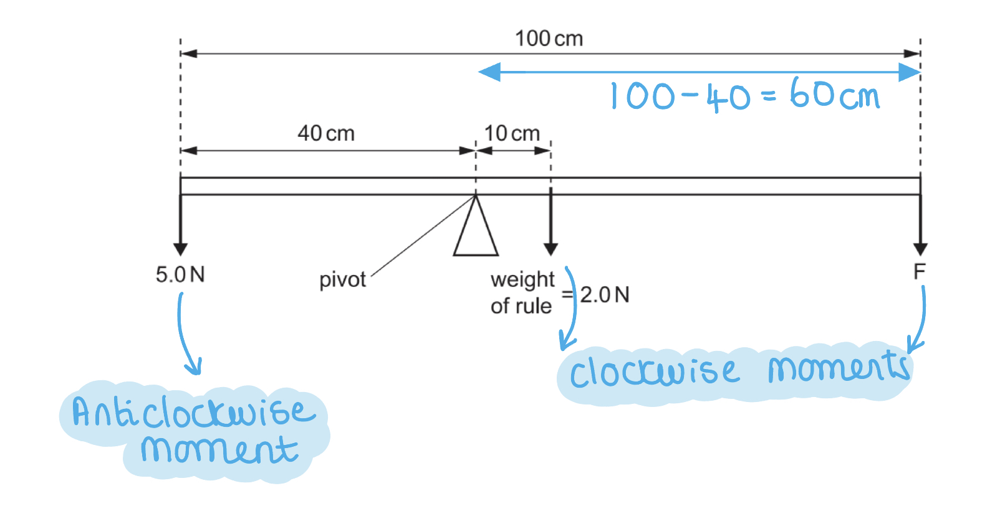

### Q12
(i) Explain why the heavy weight is needed:

Evaluate the moments acting on the tractor:

- The device produces a moment about the pivot
- The heavy weight produces a moment in the other direction about the pivot

Explain the effect of adding the heavy weight:

- (The heavy weight) stops the tractor from tipping over **OR **keeps the tractor level; **[1 mark]**

**   **

(ii) Calculate the moment of the weight of the device about the pivot:

List the known quantities:

- Distance between device and pivot = 2.1 m
- Weight of the device = 6000 N

Recall the equation relating moment, force and distance:

- *moment* = *force* × *(perpendicular) distance (between force and pivot) ***OR ** *moment *= *F *×* d ***[1 mark]**

Substitute the known quantities into this equation:

- *moment* = *F *×* d*
- *moment* = 6000 × 2.1 **[1 mark]**

Calculate the moment of the weight of the device about the pivot:

- *moment *= 12 600 **[1 mark]**
- Units are newton metres **OR ** N m **[1 mark]**

**Final answer:** ** **

**[Total: 5 marks]**
Explain why wide tyres are more suitable for the tractor on soft soil:

**Any three from:**

- (Wider tyres have a) greater area (in contact with the ground); **[1 mark]**
- $pressure=\frac{force}{area}$ **OR** $P=\frac{F}{A}$ **[1 mark]**
- A <u>larger area</u> results in a <u>smaller pressure;</u> **[1 mark]**
- (The tractor is) less likely to sink / become stuck (in soft ground); **[1 mark]**

** **

**[Total: 3 marks]**

> *Pressure and weight are not the same. A high pressure causes items to sink in a soft surface, not a large weight.*

> *Elephants and polar bears are good examples of this - both have a large weight but their feet also have large surface areas, meaning the pressure they exert is quite low on the ground, hence they do not sink in sand or snow. *

### Q13
Calculate the moment of the counterweight about the pivot, giving the unit:

List the known quantities:

- Force, *F* = 80 000 N
- Distance from pivot, *d* = 5.0 m

Recall the equation for moments:

- Moment = Force × distance **OR **$M=Fd$

Substitute in the known values to calculate:

- $M=80000\times5.0$ **[1 mark]**
- M = 400 000 **[1 mark]**

State the unit:

- N m / newton metres; **[1 mark]**

**[Total: 3 marks]**

> *Remember that when stating an equation, you will still get the marks if the equation is given in its rearranged form as long as the rearrangement is correct. *

> *Always set out the steps of your calculation clearly. Even if you do not get the final answer correct, marks can be awarded for the working out. The mark scheme here awards a mark for giving the correct equation if you did not get the mark for substituting in the known values.*
Calculate the weight of load W:

List the known quantities:

- Moment of load, *M* = 400 000 N (from part (a))
- Distance from pivot, *d* = 8.0 m

Recall the principle of moments and apply it to the situation:

- Clockwise moment = anticlockwise moment

**OR**

- Moment of load = moment of counterweight

**OR**

- 5.0 × 80 000 = load × 8.0 **[1 mark]**

Rearrange the equation to make the weight of the load the subject:

- $d_{load}\timesW_{load}=M_{counterweight}$
- $W_{load}=\frac{M_{counterweight}}{d_{load}}$

Substitute in the known values to calculate:

- $W_{load}=\frac{400000}{8.0}$ **[1 mark]**
- *W*load = 50 000 N **[1 mark]**

**[Total: 3 marks]**

> *In this question you have to unpack the principle of moments equation into the individual factors of the moment, force and the distance from the pivot. *

> *Therefore:*

- *clockwise moment = anticlockwise moment*

> *Becomes:*

- *Weight of load × distance of load from pivot = weight of counterweight × distance of counterweight from pivot*
- $W_{load}\timesd_{load}=W_{counterweight}\timesd_{counterweight}$
- $W_{l}\timesd_{l}=W_{c}\timesd_{c}$

> *Which makes the equation easier to rearrange.*

### Q14
Complete the sentence:

- The metal triangle will come to rest with its centre of gravity directly **below** the point of suspension; **[1 mark]**

**[Total: 1 mark]**
Complete the flow chart:

- *Three marks for all 4 correct*
- *Two marks for any three correct*
- *One mark for any two correct*

**[Total: 3 marks]**

> *This order of steps looks like the following method:*

1. *A small hole is made near one edge of the card.*
2. *A pin held in a clamp is put through the hole in the card.*
3. *The plumbline is attached to the pin.*
4. *A line is drawn on the card showing the position of the string.*
5. *The process is repeated using holes near the other two edges.*
6. *The centre of gravity is where the lines cross on the card.*

> *The weight of any object acts towards the centre of the Earth, so when the plumbline and the card are in the same place, the **direction** of their weight force is **identical**. When we draw a line on the card following the plumbline, we are really drawing a line in the direction of the card's weight force.*

> *Weight always acts from an object's centre of gravity, so by rotating the card and finding the point from which weight acts each time, we find the centre of gravity. *

### Q15
To calculate the moment:

List the known quantities:

- Force, *F* = 8.0 N

Recall the equation for a moment:

- moment = force × distance from pivot **OR **$M=Fd$ **[1 mark]**

Determine the distance *d* from force *F* to the pivot:

- From the diagram, distance *d* = 15 cm; **[1 mark]**

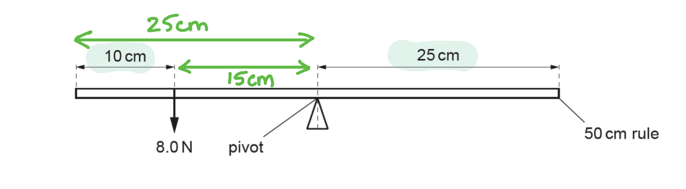

Substitute the values into the equation:

- $M=8.0\times15$; **[1 mark]**

Calculate the correct answer:

- *M* = 120; **[1 mark]**

Write the unit:

- unit = Ncm; **[1 mark]**

**[Total: 5 marks]**

> *You may have decided to write the distance in SI units, in which case your answer would be:*

- *Distance, **d **= 0.15 m*
- *Moment,** M** = 8 × 0.15*
- *M** = 1.2*
- *Units = Nm*

> *As long as the units and the quantities match up, then both answers are correct for full marks.*

> *You would also get the mark for the equation if you had written it with the values already included, like this, **M =  8.0 × 15**, but for your own sake, practice writing maths fully. It will help you later to have really embedded this habit, because the maths you do will get more complicated.*
An arrow to show the position and direction of the balancing force would look like:

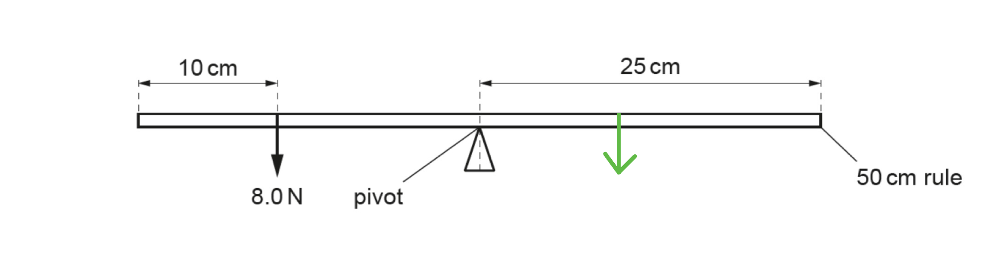

- Arrow marked on the right of the pivot (so it causes a clockwise moment); **[1 mark]**
- Arrow 10 cm from pivot (by eye); **[1 mark]**

**[Total: 2 marks]**

### Q16
The correct statement that would score two marks should look like this:

The moment of a force about a pivot is equal to **the force** multiplied by **it's **<u>**perpendicular**</u>** distance from the pivot / a point**; [1 mark]

**[Total: 1 mark]**

*Make sure you include the word **perpendicular **in your definition of a moment. If the force is not acting perpendicular then it affects the magnitude of the moment.*
(i) To state the name given to the point at which the weight of the rod acts:

- The point at which the rod acts is the <u>centre of gravity</u>; **[1 mark]**

** **

(ii) To calculate the mass of the rod:

List the known quantities:

- Weight of rod = 160 N

Recall the equation for weight, mass and gravity:

- Weight = mass × gravity

Rearrange the equation for weight to make mass the subject:

- $mass=\frac{weight}{gravity}$

Substitute the known quantities into the equation:

- $mass=\frac{160}{10}$

Calculate the mass of the rod:

- Mass of rod = 16 kg; **[1 mark]**

** **

(iii) To explain why the rod is in equilibrium:

**Any four from:**

- It is not moving up or down because there is <u>no resultant</u> / vertical force; **[1 mark]** **OR**
- <u>Upward force</u> acting on rod = <u>downward force</u> acting on rod **[1 mark]**
- 80 N (right hand side upward force) + 80 N (right hand side upward force) = 160 N (weight of rod) **[1 mark]**
- The rod is not rotating because there is <u>no resultant moment</u> about any point; **[1 mark]** **OR**
- The sum of <u>clockwise moments</u> = the sum of <u>anticlockwise moments</u> **[1 mark]**
- <u>Clockwise moment</u> about centre = 80 × 1.2 **[1 mark]**
- <u>Anticlockwise moment</u> about centre = 80 × 1.2 **[1 mark]**

**[Total: 6 marks]**

> *When explaining why an object is in equilibrium it is important to consider both:*

- *Clockwise and anti-clockwise moments*
- *Vertical / horizontal forces*

### Q17
A moment is:

- The <u>turning effect</u> of a force about a pivot; **[1 mark]**

**[Total: 1 mark]**
State the clockwise moment due to the box on the right:

- 150 N m **[1 mark]**

**[Total: 1 mark]**

- *The seesaw is in **equilibrium*
- *The clockwise and anticlockwise moments are equal - the **resultant** **moment** is **zero*
Calculate the weight *W* of the box on the right side of the seesaw:

List the known quantities:

- Clockwise moment = 150 N m (from part (b))
- Distance from the box to the pivot, $d$ = 1.5 m

Recall the equation for moment:

- $\mathrm{moment}=F\timesd$ **[1 mark]**

Rearrange the equation for force and calculate the weight:

- $F=\frac{\mathrm{moment}}{d}$
- $W=\frac{150}{1.5}$ **[1 mark]**
- $W=100N$ **[1 mark]**

**[Total: 3 marks]**

- *You must be confident with this type of simple **rearranging** in physics*

  - *In the above example, dividing **both** sides by **d** gave us force on its own*

- *Use your practice from **maths** to help you - check the revision notes from this course if you need*

  - *If you are still really struggling, equation triangles **may** help, but these are not very helpful once you get to more **complex** equations!*
The box on the left hand side of the seesaw is now removed. Explain the subsequent motion of the seesaw:

State the motion:

- (The seesaw will) rotate clockwise / the right side will drop; **[1 mark]**

Explain why this happens:

**Any one from:**

- The resultant / net moment is no longer zero; **[1 mark]**
- The seesaw is no longer in equilibrium; **[1 mark]**
- There is a resultant clockwise moment; **[1 mark]**
- There is only a clockwise moment; **[1 mark]**
- There is no anticlockwise moment; **[1 mark]**

**[Total: 2 marks]**

### Q18
The turning force is called:

- The <u>moment</u>;** [1 mark]**

**[Total: 1 mark]**
(i) To calculate the force exerted by the lever:

State the principle of moments:

- The sum of the <u>clockwise moments</u> = the sum of the <u>anticlockwise moments</u> (in equilibrium); **[1 mark]**

Recall the equation for a moment of a force:

- *M = Fd* / moment = force × distance

List the known values on a diagram:

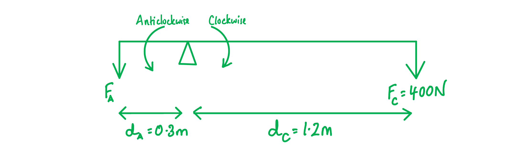

Calculate the value of *F*, the force on the log:

Recall that as the man starts to lift the log, the forces are in equilibrium:

- Therefore applying the principle of moments shows that *F**A** × d**A** = F**C** × d**C ***[1 mark]**

Substitute the values:

- *F**A** *× 0.3 = 400 × 1.2 **[1 mark]**

Rearrange the equation by dividing both sides by 0.3:

- $F_{A} = \frac{( 400 \times 1.2 )}{0.3}$

Calculate the answer:

- *F**A** *= 1600 N;** [1 mark]**

(ii) To use a smaller force to lift the heavy log:

- Use a longer lever / increase the distance from the pivot to the force **OR**** **move the pivot closer to the log;** [1 mark]**

**[Total: 4 marks]**

### Q19
To calculate the moment:

List the known quantities:

- (Perpendicular) distance from the pivot =  90.0 cm
- Force = 25.0 N

Recall the equation linking moment, force and distance:

- moment = force × (perpendicular) distance **[1 mark]**

**OPTION 1**

Substitute in known values and calculate the moment:

- moment = 25.0 × 90.0 **[1 mark]**
- moment = 2250 **[1 mark]**

State the unit:

- N cm **[1 mark]**

**OPTION 2**

Substitute in known values and calculate the moment:

- Convert cm to m:

  - 90.0 cm = 0.90 m
- moment = 25.0 × 0.90 **[1 mark]**
- moment = 22.5 **[1 mark]**

State the unit:

- N m **[1 mark]**

**[Total: 4 marks]**

> *Make sure you take care when completing calculations to convert to SI units where appropriate. This will depend on the question - you may be given expected units for the final answer, or you might be given a choice. In this case you can answer the question with a choice of units, depending on whether you want to do the conversion or not.*
