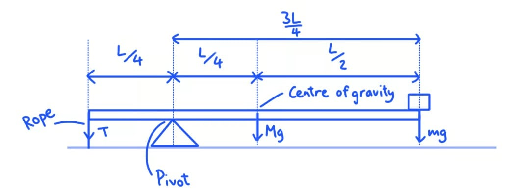

# Mark Schemes — Moments
**1. Motion, Forces & Energy** · Cambridge (CIE) IGCSE physics (0625 & 0972)

## Multiple Choice Questions (26 questions)

### Q1
**Final answer:** **The correct answer is A**

- By the principle of moments, the sum of anticlockwise moments about the pivot must equal the sum of clockwise moments

Anticlockwise moment = 6.0 × 20 = 120 N cm

Clockwise moment = $W \times 30$

- For the ruler to be balanced:

$W \times 30 = 120$

$W = \frac{120}{30} = 4 . 0 \text{N}$

**B** is incorrect as equal weights would only balance if they were at equal distances from the pivot, not at different distances.

**C** is obtained by incorrectly calculating $W = \frac{6.0\times30}{20}$, which swaps the distances in the moments equation.

**D** is incorrect and may result from an error in manipulating the moments equation.

### Q2
**Final answer:** **The correct answer is A**

- For a beam to be balanced (in equilibrium), the total clockwise moment must equal the total anticlockwise moment
- The moment of a force is calculated using the equation:

$\text{moment}=\text{force}\times\text{perpendicular distance from pivot}$

- There is an anticlockwise moment due to the force $F$ at a distance $x$ to the left of the pivot

$\mathrm{anticlockwise} \mathrm{moment}=F\timesx$

- Therefore, to balance the beam, there must be a clockwise moment due to the second force $2F$ at a distance $d$ to the right of the pivot

$\mathrm{clockwise} \mathrm{moment}=2F\timesd$

- Set these expressions equal to each other:

$2F\timesd=F\timesx$

- Rearrange the equation to make $d$ the subject and cancel the $F$ terms:

$d=\frac{F\timesx}{2F}$

$d=\frac{x}{2}$

- This is option** A**

### Q3
**Final answer:** **The correct answer is ****C**** because:**

- The principle of moments states that, for an object to be in equilibrium, the sum of the clockwise moments around any point must be equal to the sum of the anticlockwise moments
- The clockwise moments and the anticlockwise moments for beam **C** are not equal:

$\mathrm{moment}=\mathrm{force}\times\mathrm{perpendicular} \mathrm{distance} \mathrm{from} \mathrm{pivot}\,\,\mathrm{clockwise} \mathrm{moments}=2.0N\times2.0m=4.0Nm\,\,\mathrm{anticlockwise} \mathrm{moments}=3.0N\times2.0m=6.0Nm$

When answering questions involving moments, make sure that you find the total distance to the pivot correctly. For example, for beam **D** the 2.0 N force is 2.0 m away from the pivot, not 1.0 m.

**A** is incorrect because the moments are equal:
$\mathrm{clockwise} \mathrm{moments}=1.0N\times6.0Nm=6.0Nm$
$\mathrm{anticlockwise} \mathrm{moments}=2.0N\times3.0m=6.0Nm$

**B** is incorrect because the moments are equal: 
$\mathrm{clockwise} \mathrm{moments}=2.0N\times6.0m=12.0Nm$
$\mathrm{anticlockwise} \mathrm{moments}=2.0N\times6.0m=12.0Nm$

**D** is incorrect because the moments are equal: 
`clockwise space momemts space equals space open parentheses 4.0 space straight N space cross times 1.0 space straight m close parentheses space plus space open parentheses 2.0 space straight N space cross times space 2.0 space straight m close parentheses space equals space 8.0 space straight N space straight m`
$\mathrm{anticlockwise} \mathrm{moments}=4.0N\times2.0m=8.0Nm$

### Q4
**Final answer:** **The correct answer is ****D****, because:**

- The centre of gravity of the object will be somewhere directly beneath the point of suspension, P, when it is in equilibrium
- That means it will be on the line between points P and Q. However, depending on the exact shape of the plate, it could be anywhere along that line
- To find the exact point of the centre of gravity, you would need to investigate further

You could find the centre of gravity as follows:

- Draw a vertical line on the plate connecting P and Q
- Hang the plate from another point and draw the vertical line from that point
- The centre of gravity will be at the point where the two lines cross

### Q5
**Final answer:** **The correct answer is ****D****, because:**

- The question states that the metre rule is in equilibrium
- This means that the clockwise moments (turning effects) are equal to the anticlockwise moments
- The size of a moment is found using:

moment = force × perpendicular distance from the pivot

- So, first find the anticlockwise moment caused by the hanging weight. It is 50 cm – 5 cm = 45 cm away from the pivot. It produces a downward force of 4.0 N. So: $\mathrm{anticlockwise} \mathrm{moments}=45\mathrm{cm}\times4.0N=180N\mathrm{cm}$
- To find the force in the string (let’s call it *F*), you should write an expression for the clockwise moments:* *

$\mathrm{clockwise} \mathrm{moments}=20\mathrm{cm}\timesF$

- The rule is in equilibrium and so: `table row cell clockwise space moments space end cell equals cell space anticlockwise space moments end cell row blank blank blank row cell 180 space straight N space end cell equals cell space 20 space cm space cross times space straight F end cell row blank blank blank row cell fraction numerator 180 space straight N space cm over denominator 20 space cm end fraction space end cell equals cell space straight F end cell row blank blank blank row cell straight F space end cell equals cell space 9.0 space straight N end cell row blank blank blank end table`

* *In this question, the rule was balanced at its central point, so you do not need to involve its weight in any calculations as it has no turning effect. In some supplemental questions, you may need to include the weight of the rule as it may not be pivoted in the centre. You may also need to use multiple moments in both directions of rotation.

**A**, **B** and **C** show answers which could be found using incorrect distances on the rule.

### Q6
**Final answer:** **The correct answer is B because:**

- The beam is balanced, so the moment of *P* = the moment of *Q*
- To find potential values for loads *P* and *Q*, use the moments equation:

Moment = *F* $\times$ *d*

Moment of *P* = Moment of *Q*

*P* $\times$ 0.3 = *Q* $\times$ 0.7

- Consider the values in row **B**:

21 $\times$ 0.3 = 9 $\times$ 0.7 = 6.3 N m

- This satisfies the condition, therefore, **B** is correct

**A **is incorrect as 21 $\times$ 0.3 = 6.3 N m but 7$\times$ 0.7 = 4.9 N m

**C **is incorrect as 30 $\times$ 0.3 = 9.0 N m but 10 $\times$ 0.7 = 7.0 N m

**D **is incorrect as 30 $\times$ 0.3 = 9.0 N m but 70 $\times$ 0.7 = 49 N m

### Q7
**Final answer:** **The correct answer is D because:**

- The object has a uniform thickness

  - This means the centre of gravity lies at its centre of symmetry
  - This is point **D** for this square tile
- When an object is suspended from a point, the centre of gravity lies below that point

  - Point **D** is directly below the nail

The symmetry argument can only be used when you are told the object has a regular shape and is uniform.

This question tells you the tile is square and uniform, so the centre of gravity is the centre of the square.

### Q8
**Final answer:** **The correct answer is B because:**

- The rod is in equilibrium

  - Anticlockwise and clockwise moments are equal
  - The balloon’s moment is equal to the weight’s moment
- The mass produces an anticlockwise moment
- The balloon produces a clockwise moment
- Recall that moment is the product of force and perpendicular distance

$moment=Fd$

- Increasing perpendicular distance increases the moment by the same factor
- In option **B**:

  - The balloon’s perpendicular distance is decreased by a factor of 1.5
  - The clockwise moment decreases by a factor of 1.5
  - The mass’ perpendicular distance is decreased by a factor of 2
  - The anticlockwise moment decreases by a factor of 2
- The clockwise moment is now greater than the anticlockwise moment

  - This causes a clockwise rotation about P

**A **is incorrect as the clockwise moment increases by a factor of $\frac{4}{3}$ but the anticlockwise moment increases by a larger factor of $\frac{3}{2}$, so the system rotates anticlockwise

**C** and **D** are incorrect as the clockwise moment decreases but the anticlockwise moment increases, so the system rotates anticlockwise

### Q9
**Final answer:** **The correct answer is D because:**

- The equation for calculating the moment of a force is

$moment=force\timesperpendiculardis\mathrm{tan}cefrompivot$

- The principle of moments tells us that, for the beam to be balanced:

$totalclockwisemoments=totalanticlockwisemoments$

- The weight of the beam at X causes a clockwise moment about the pivot

$clockwisemoment=6.0\times40=240$ N cm

- To balance the beam, the 4.0 N force must be directed **vertically upwards** to cause an anticlockwise moment about the pivot

  - Therefore, options **A** and** B **can be eliminated
- When the 4.0 N is applied 20 cm to the **left **of X, the distance from the pivot is 20 cm, which would give a moment of:

$anticlockwisemoment=4.0\times20=80$ N cm

- This is **not **equal to the clockwise moment of X, therefore, option **C** can be eliminated
- When the 4.0 N is applied 20 cm to the **right **of X, the distance from the pivot is 60 cm, which would give a moment of:

$anticlockwisemoment=4.\times60=240$ N cm

- This is equal to the clockwise moment of X, therefore, option **D** is correct

### Q10
**Final answer:** **The correct answer is ****B**** because:**

- The experiment to show that resultant moment is zero uses a newtonmeter - also called a force meter
- To calculate the moment due to the instrument, the force of the instrument on the beam must be known - a force meter measures this force

A ruler is also needed to measure the distance to determine the moment caused by the instrument, but the instrument itself needs to be able to measure force. A ruler would not be placed where the instrument is mentioned in the diagram.

A similar experiment to this can be found in the revision notes.

Make sure you know your scientific instruments - a momentmeter is not a real instrument - hopefully you spotted this!

### Q11
**Final answer:** **The correct answer is ****B**** because**

- For equilibrium there must be:

  - **No resultant force**
  - **No resultant moment**
- Object B has equal forces acting in opposite directions, so its **resultant force is zero.**
- It also has the forces exactly in line, so they do not produce a turning force.

**A** is incorrect as this object would have both a resultant force and a moment

**C** is incorrect as this object would have no resultant force, but it would have a moment.

**D** is incorrect as this object would have no moment, but it would have a resultant force.

### Q12
**Final answer:** **The correct answer is ****D**** because:**

- The triangle's centre of gravity is at the central point of symmetry
- **D** is the only diagram where the centre of gravity of the triangle is not directly below the thread

When the centre of gravity is **not** below the line of the thread, there is a moment. The **weight** force of the shape is a **non-zero** **distance** from the pivot (where the thread is attached to the shape), so in the case of diagram **D**, the triangle will **rotate** clockwise.

### Q13
**Final answer:** **The correct answer is ****C**** because:**

- An object is stable while its centre of gravity is directly over its base..
- C has the widest base, so is the most stable.

**A** is incorrect as it has the joint narrowest base

**B** is incorrect as it does not have the widest base

**D** is incorrect as it has the joint narrowest base, and its centre of mass is high up. Both of these factors make it very unstable.

### Q14
**Final answer:** **The correct answer is ****C**** because:**

- The size of a moment is proportional to the **force** applied and the **distance** of that force from the pivot
- A larger force increases the moment and a greater distance increases the moment

  - Option **C** has both of these

The width of the screwdriver has nothing to do with the size of the moment applied. Often, questions will have option designed to "catch you out". Knowing the content will make these very easy to spot!

### Q15
**Final answer:** **The correct answer is ****A**** because**

- Moment = force x distance from pivot.
- The moment turning the handle clockwise is the largest, as the force is acting at the greatest distance from the pivot.

**B** is incorrect as the force turning the handle anticlockwise is closer to the pivot, therefore its moment will be smaller.

**C **is incorrect as the force pushing the handle to the left would be balanced by a force pushing back from the pivot, which is fixed in position.

**D** is incorrect as the handle will move as the clockwise moment is greater than the anticlockwise moment.

### Q16
**Final answer:** **The correct answer is ****D**** because:**

- If the beam is to rotate clockwise, the **clockwise moment must be greater than the anticlockwise moment.**
- Moment = force x distance from pivot
- The forces on the right of the beams turn them clockwise, while those on the left turn them anticlockwise.
- In no case is force x distance on the right greater than force x distance on the left.

**For X:**

- anticlockwise force = 3.0 m x 4.0 N = 12 N/m
- clockwise force = 2.0 m x 4.0 N = 8 N/m
- = turns anticlockwise (left)

**For Y:**

- anticlockwise force = 6.0 m x 4.0 N = 24 N/m
- clockwise force = 2.0 m x 8.0 N = 16 N/m
- = turns anticlockwise (left)

**For Z:**

- anticlockwise force = 3.0 m x 5.0 N = 15 N/m
- clockwise force = 6.0 m x 2.0 N = 12 N/m
- = turns anticlockwise (left)

- None of the beams rotate clockwise.

### Q17
**Final answer:** **The correct answer is ****D**** because**

- Buses are designed with a low centre of mass and a wide base, for maximum stability.
- Passengers standing on the top deck would raise that centre of mass.
- This would make the bus less stable and more prone to tipping over when going round corners.

**A** is incorrect as they probably can’t be trusted, but the driver has a mirror and a periscope so he can see what’s happening on the top deck.

**B **is incorrect as again true, but irrelevant.

**C** is incorrect as they actually would increase the GPE of the bus, but that doesn’t cause any ill effect at all.

### Q18
**Final answer:** **The correct answer is ****B**** because:**

- moment = force × perpendicular distance to pivot
- Clockwise moment from *m*2:

  - $F=m_{2}g$
  - $\mathrm{moment}_{2}=m_{2}g\timesd_{2}$
- Anticlockwise moment from *m*1:

  - $F=m_{1}g$
  - Perpendicular distance: $d_{1}^{2}=l_{1}^{2}-h_{1}^{2}$
  - $\mathrm{moment}_{1}=m_{1}g\times\sqrt{l_{1}^{2}-h_{1}^{2}}$
- Equilibrium means $\mathrm{moment}_{1}=\mathrm{moment}_{2}$

  - `m subscript 2 d subscript 2 up diagonal strike g space equals space m subscript 1 up diagonal strike g square root of l subscript 1 squared space minus space h subscript 1 squared end root`
  - $m_{2}d_{2}=m_{1}\sqrt{l_{1}^{2}-h_{1}^{2}}$
  - $d_{2}=\frac{m_{1}\sqrt{l_{1}^{2}-h_{1}^{2}}}{m_{2}}$

This question is testing how well you know the definition of a moment, as well as putting you through your paces with algebra! Y You must spot that you need the **perpendicular** distance for the anticlockwise moment, which can be determined using Pythagoras' theorem. The force (weight) is acting directly downwards, so the distance must be **perpendicular** to this.

*d*1 is not labelled on the diagram, but *l*1 and *h*1are - so you can use it to figure these out. Pythagoras' theorem is only relevant for **right-angled triangles**.

### Q19
**Final answer:** **The correct answer is ****B**** because:**

- For an object to be in equilibrium both the resultant force and the resultant moment acting on it must be zero.
- This is a basic definition question dressed up to look like a moments problem.

**A** is incorrect as if the upward force were larger than the downwards force, the beam would accelerate upwards. This is not equilibrium.

**C** is incorrect as if the resultant force were not zero, the beam would accelerate. It would not be in equilibrium.

**D** is incorrect as if this were the case, the upward force would be larger than the downwards force. The beam would not be in equilibrium.

### Q20
**Final answer:** **The correct answer is ****D**** because:**

- We are looking for the corkscrew with the greatest moment.
- In **D**, both forces are acting in an anticlockwise direction about the pivot.
- Both forces are the maximum distance away from the pivot (in the centre), which means the moment will be the maximum.

**A **is incorrect as the forces act in opposite directions (the topmost F is in the clockwise direction, the bottommost F is in the anticlockwise moment), so they cancel each other out.

**B **is incorrect as one of the forces is only halfway along the corkscrew handle and although both forces act in the anticlockwise direction about the pivot, because one of the moments is only halfway along the corkscrew, the combined moment in **B** is less than combined moments in corkscrew **D**.

**C **is incorrect as the forces act in opposite directions about the pivot, and so cancel each other out, even though they are as far from the pivot as they can be.

### Q21
**Final answer:** **The correct answer is ****C**** because:**

- Moment = force x distance from pivot
- Anticlockwise moments arise from the 10 N force from the pan

  - Anticlockwise moment = F × d = 10 × 0.15 = 1.5 N m
- Clockwise moments arise from the box on the right hand side

  - The beam is 65 cm long, so the box is 50 cm = 0.50 m from the pivot
  - Clockwise moment = F x d = F x 0.50

- If the beam is in equilibrium then the sum of the clockwise moments = the sum of the anticlockwise moments

  - F × 0.50 = 1.5 N m
  - F = $\frac{1.5}{0.5}$ = 3 N
- We, therefore, require six 0.5 N weights to balance the yardarm.

### Q22
**Final answer:** **The correct answer is ****C**** because:**

- The centre of gravity of an object is the point at which the weight of the object may be considered to act
- For symmetrical objects with uniform density, the centre of gravity is located at the point of symmetry

- Point **C** is located at the point of symmetry

### Q23
**Final answer:** **The correct answer is ****A**** because**

- If the beam is in equilibrium then the sum of the clockwise moments = the sum of the anticlockwise moments.
- Moment = force x distance from pivot.
- Clockwise moments arise from the 200 N force.
- Anticlockwise moments arise from the weight of the beam.
- We know that the weight always acts from the centre of mass of an object, and that the centre of mass of a uniform object is in the centre, in this case 1.5 m from the pivot.
- 200 x 0.5 = 1.5 x W
- W = 66.7 N

### Q24
**Final answer:** **The correct answer is**** D ****because**

- For equilibrium, the resultant force must be zero, and the resultant moment must be zero.
- The resultant force is zero, as the pivot will be providing an upwards reaction force (not shown) equal to the two downwards forces.
- The resultant moment is zero because the two forces are equal in size and the same distance either side of the pivot.

**A** is incorrect as the resultant force on the left hand side of the beam is zero, so the beam would rotate clockwise.

**B** is incorrect as the resultant moment is zero, but the beam would lift up off the pivot.

**C** is incorrect as the forces act in opposite directions, which would make the beam rotate clockwise.

### Q25
**Final answer:** **The correct answer is ****A**** because:**

- The beam is horizontal and stationary - this means the resultant moment is zero

  - $\mathrm{moment}=F\timesd$
- Calculate the anticlockwise (ACW) moment from the rope:

  - `moment subscript ACW space equals space T space cross times space open parentheses L over 4 close parentheses`
- Calculate the total clockwise (CW) moment:

  - `moment subscript CW space equals space open parentheses M g close parentheses space cross times space open parentheses L over 4 close parentheses space plus space open parentheses m g close parentheses space cross times space open parentheses fraction numerator 3 L over denominator 4 end fraction close parentheses`
- Equate the CW and ACW moments and rearrange for $M$:

  - `fraction numerator T up diagonal strike L over denominator up diagonal strike 4 end fraction space equals space fraction numerator M g up diagonal strike L over denominator up diagonal strike 4 end fraction space plus space fraction numerator 3 m g up diagonal strike L over denominator up diagonal strike 4 end fraction`
  - $T=Mg+3mg\RightarrowMg=T-3mg$
  - $M=\frac{T}{g}-3m$

One major challenge of this question is that no diagram was provided, so you had to visualise the distances and positions of forces along the beam. Drawing your own diagram makes this much more manageable.

Additionally, you can only answer this question one you realise that the weight force (*Mg*) of the beam acts halfway across the beam length. This is because the beam is **uniform** so its centre of gravity is exactly in the middle. The beam length itself does not matter, as this cancels out when the moments are equated.

### Q26
**Final answer:** **The correct answer is ****C**** because:**

- For equilibrium, the resultant force must be zero, and the resultant moment must be zero.
- In this question, we need only deal with the resultant moment.
- The centre of mass is directly over the pivot point, so the distance of the weight from the pivot is zero, this means the moment is zero.
- Therefore, the wardrobe is in equilibrium (though a tiny force would tip it away from equilibrium)

**A** is incorrect as the weight makes an anticlockwise moment. The wardrobe would tip anticlockwise

**B** is incorrect as the weight makes a clockwise moment about the pivot. The wardrobe would tip clockwise.

**D** is incorrect as the weight makes a clockwise moment about the pivot. The wardrobe would tip clockwise.
