# Exam Questions — Moments
**1. Motion, Forces & Energy** · Cambridge (CIE) IGCSE physics (0625 & 0972)
> Source: [https://www.savemyexams.com/igcse/physics/cie/23/topic-questions/](https://www.savemyexams.com/igcse/physics/cie/23/topic-questions/) · 49 questions across 3 sets

## Alternative To Practical Questions (4 questions)

### Q1 — medium — 12 marks

**Q1** [1 mark]

**Extended tier only**

A student is determining the mass of a metre rule by a balancing method.

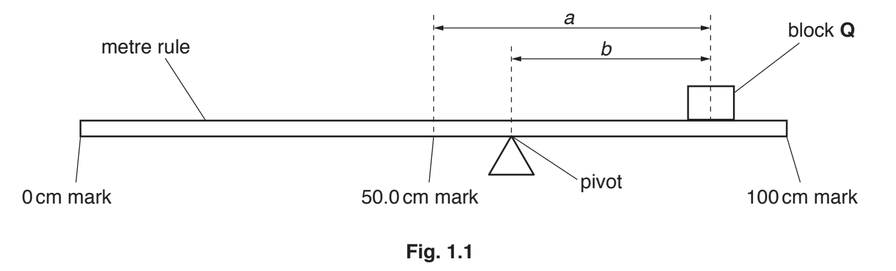

He is using the apparatus shown in Fig. 1.1.

He places the metre rule on the pivot and then places block Q with its centre at the 95.0 cm mark. The student stated that it is difficult to place the mass accurately at the 95.0 cm mark.

Explain how the student could overcome this. You may draw a diagram to help your explanation.

*Source: Feb 2018 0625/62 Q1A*

**Q1** [2 marks]

**Extract:**

A student is determining the mass of a metre rule by a balancing method.

He is using the apparatus shown in Fig. 1.1.

He places the metre rule on the pivot and then places block Q with its centre at the 95.0 cm mark. The student stated that it is difficult to place the mass accurately at the 95.0 cm mark.

The student keeps block **Q** at the 95.0 cm mark and adjusts the position of the metre rule on the pivot until the metre rule is as near to being balanced as possible.

Describe a method to find the point at which the metre rule is as near to being balanced as possible.

*Source: Feb 2018 0625/62 Q1B*

**Q1** [7 marks]

**Extract:**

A student is determining the mass of a metre rule by a balancing method.

He is using the apparatus shown in Fig. 1.1.

He places the metre rule on the pivot and then places block Q with its centre at the 95.0 cm mark. The student stated that it is difficult to place the mass accurately at the 95.0 cm mark.

The student determines the distance a between the centre of block **Q** and the 50.0 cm mark and also the distance b between the centre of block **Q** and the pivot.

He repeats the procedure for positions of block **Q** at the 90.0 cm, 85.0 cm, 80.0 cm and 75.0 cm marks. His results are shown in Table 1.1.

**Table 1.1**

| position of **Q**/cm | *a*/cm | *b*/cm |
|---|---|---|
| 95.0 | 45.0 | 39.0 |
| 90.0 | 40.0 | 34.3 |
| 85.0 | 35.0 | 30.0 |
| 80.0 | 30.0 | 25.2 |
| 75.0 | 25.0 | 21.4 |

(i) Plot a graph of *a*/cm (*y*-axis) against *b*/cm (*x*-axis). You do not need to start your axes at the origin (0,0).

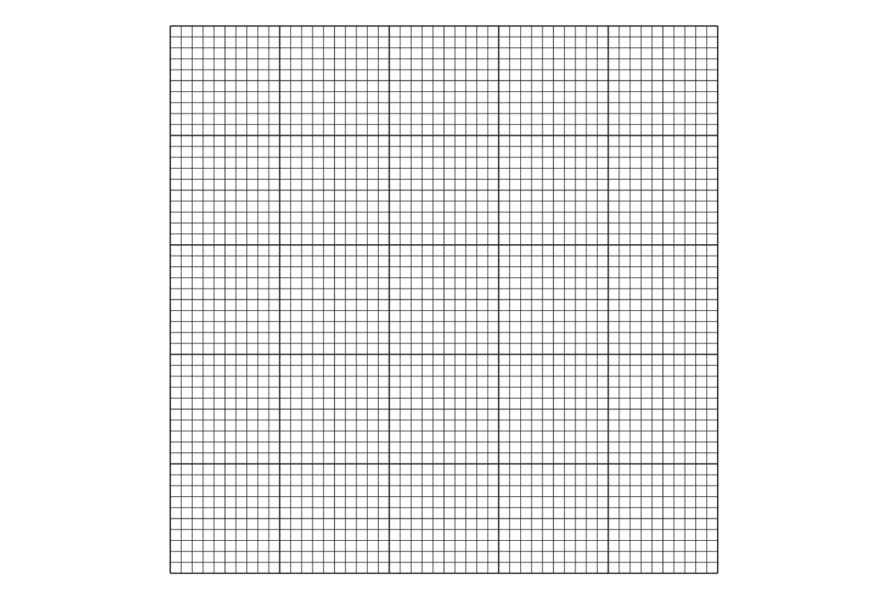

[4]

(ii) Determine the gradient *G* of your line. Show clearly on the graph how you obtained the necessary information.

G = ...........................................................[1]

(iii) Calculate the mass *M*R of the metre rule using the equation

$M_{R} = \frac{M}{( G - 1 )}$,

where *M* = 20 g. Record the value for *M*R to a suitable number of significant figures for this experiment.

*M*R = ...........................................................[2]

*Source: Feb 2018 0625/62 Q1C*

**Q1** [2 marks]

**Extract:**

The student determines the distance a between the centre of block Q and the 50.0 cm mark and also the distance b between the centre of block Q and the pivot. He repeats the procedure for positions of block Q at the 90.0 cm, 85.0 cm, 80.0 cm and 75.0 cm marks. His results are shown in Table 1.1. Table 1.1 | position of Q/cm | a/cm | b/cm | 95.0 | 45.0 | 39.0 | 90.0 | 40.0 | 34.3 | 85.0 | 35.0 | 30.0 | 80.0 | 30.0 | 25.2 | 75.0 | 25.0 | 21.4 | (i) Plot a graph of a/cm (y-axis) against b/cm (x-axis). (ii) Determine the gradient G of your line. (iii) Calculate the mass M_R of the metre rule using the equation M_R = M / (G - 1), where M = 20 g.

Two students carry out the experiment correctly but with different values for the mass of block **Q**. One student obtains values of *b* that are larger than those obtained by the other student.

State and explain whether the larger values of *b* are likely to produce a more accurate value for the mass of the metre rule.

*Source: Feb 2018 0625/62 Q1D*

### Q2 — medium — 12 marks

**Q2** [4 marks]

A student is determining the mass of a load using a balancing method.

Fig. 1.1 shows the apparatus.

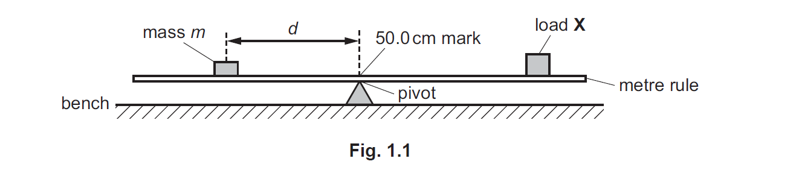

The load** X** has been taped to the metre rule so that its centre is exactly over the 90.0 cm mark. It is not moved during the experiment.

A mass *m* of 40 g is placed on the rule and its position adjusted so that the rule is as near as possible to being balanced with the 50.0 cm mark exactly over the pivot. Fig. 1.2(a) shows part of the rule when it is balanced.

The procedure is repeated for a range of masses. Fig. 1.2(b) – (e) shows the rule when balanced for values of *m* of 50 g, 60 g, 70 g and 80 g.

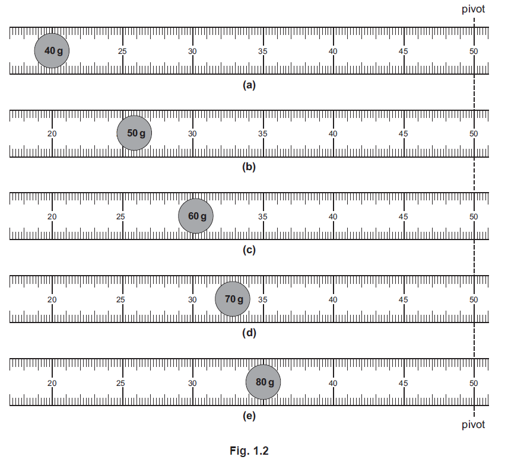

(i) Use Fig. 1.2 to determine *d*, the distance between the mass and the pivot at balance, for each value of m. Record your results in Table 1.1.

[3]

| m/g | *d*/cm | $\frac{1}{d}/\frac{1}{\mathrm{cm}}$ |
|---|---|---|
| 40 |   |   |
| 50 |   |   |
| 60 |   |   |
| 70 |   |   |
| 80 |   |   |

(ii) For each value of *d*, calculate $\frac{1}{d}$ and record it in the table.

[1]

*Source: 2020 Specimen 0625/06 Q1A*

**Q2** [2 marks]

**Extract:**

A student is determining the mass of a load using a balancing method.

Fig. 1.1 shows the apparatus.

The load X has been taped to the metre rule so that its centre is exactly over the 90.0 cm mark. It is not moved during the experiment.

A mass m of 40 g is placed on the rule and its position adjusted so that the rule is as near as possible to being balanced with the 50.0 cm mark exactly over the pivot. Fig. 1.2(a) shows part of the rule when it is balanced.

The procedure is repeated for a range of masses. Fig. 1.2(b) – (e) shows the rule when balanced for values of m of 50 g, 60 g, 70 g and 80 g.

Describe one difficulty the student might have when carrying out this experiment, and how he might overcome this difficulty.

*Source: 2020 Specimen 0625/06 Q1B*

**Q2** [4 marks]

**Extract:**

| m/g | d/cm | 1/d / 1/cm |
| 40 | 30.0 | 0.0333 |
| 50 | 24.2 | 0.0413 |
| 60 | 19.8 | 0.0505 |
| 70 | 17.2 | 0.0581 |
| 80 | 15.0 | 0.0667 |

Plot a graph of m/g (y-axis) against $\frac{1}{d}/\frac{1}{\mathrm{cm}}$ (x-axis).

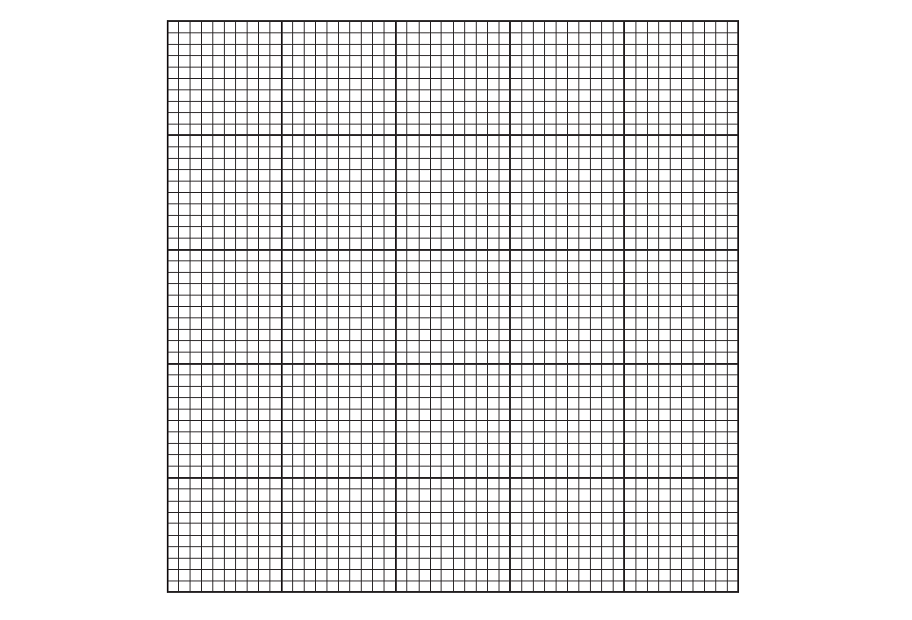

*Source: 2020 Specimen 0625/06 Q1C*

**Q2** [1 mark]

**Extract:**

Plot a graph of m/g (y-axis) against 1/d (1/cm) (x-axis).

Determine the gradient G of the graph. Show clearly on the graph how you obtained the necessary information.

*G* = ..........................................................

*Source: 2020 Specimen 0625/06 Q1D*

**Q2** [1 mark]

**Extract:**

Gradient, G = 1111 g/(1/cm) (from part (d))

μ = G / 40.0

Determine the mass *μ*, in grams, of the load **X**. Use the equation $μ=\frac{G}{40.0}$

*μ* = ....................................................... g

*Source: 2020 Specimen 0625/06 Q1E*

### Q3 — medium — 11 marks

**Q3** [4 marks]

**Extended tier only**

A student is determining the weight of a metre rule using a balancing method.

Fig. 1.1 shows the apparatus.

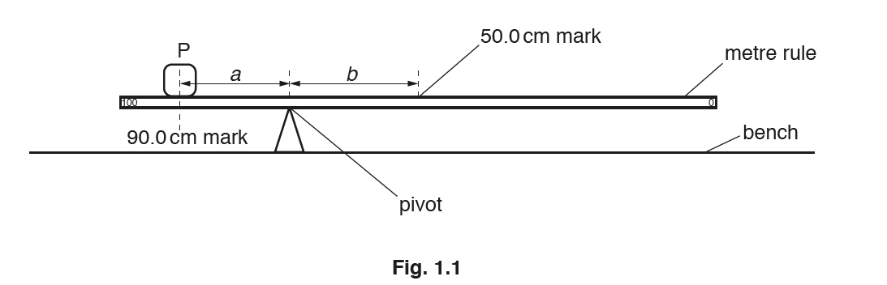

The student places the metre rule on the pivot. He places the load P on the metre rule at the 90.0 cm mark. Keeping load P at the 90.0 cm mark, he adjusts the position of the metre rule on the pivot so that the metre rule is as near as possible to being balanced.

He records the distance *a* from the 90.0 cm mark to the pivot.

He records the distance *b* from the pivot to the 50.0 cm mark.

He repeats the steps, placing the load P at the 85.0 cm, the 80.0 cm, the 75.0 cm and the 70.0 cm marks.

The readings are shown in Table 1.1.

**Table 1.1**

| *a*/cm | *b*/cm |
|---|---|
| 21.0 | 19.1 |
| 18.0 | 17.2 |
| 16.0 | 14.1 |
| 13.0 | 11.8 |
| 10.5 | 9.5 |

Plot a graph of a/cm (y-axis) against b/cm (x-axis). You do **not** need to begin your axes at the origin (0,0).

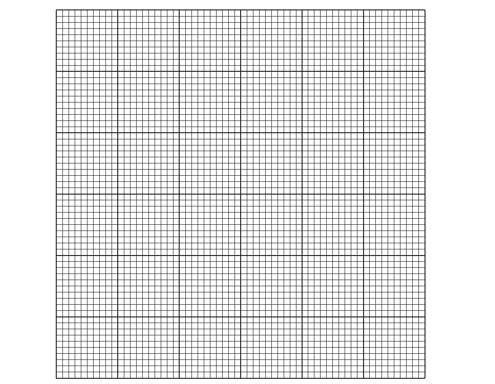

*Source: May 2019 0625/61 Q1A*

**Q3** [2 marks]

**Extract:**

A student is determining the weight of a metre rule using a balancing method.

Fig. 1.1 shows the apparatus.

The student places the metre rule on the pivot. He places the load P on the metre rule at the 90.0 cm mark. Keeping load P at the 90.0 cm mark, he adjusts the position of the metre rule on the pivot so that the metre rule is as near as possible to being balanced.

He records the distance a from the 90.0 cm mark to the pivot.

He records the distance b from the pivot to the 50.0 cm mark.

He repeats the steps, placing the load P at the 85.0 cm, the 80.0 cm, the 75.0 cm and the 70.0 cm marks.

The readings are shown in Table 1.1.

Table 1.1
| a/cm | b/cm |
| 21.0 | 19.1 |
| 18.0 | 17.2 |
| 16.0 | 14.1 |
| 13.0 | 11.8 |
| 10.5 | 9.5 |

Plot a graph of a/cm (y-axis) against b/cm (x-axis). You do not need to begin your axes at the origin (0,0).

Determine the gradient *G* of the graph. Show clearly on the graph how you obtained the necessary information.

*G* = ........................................................

*Source: May 2019 0625/61 Q1B*

**Q3** [2 marks]

**Extract:**

- G = 1.06 (from part (b))
- W1 = G × P, where P = 1.0 N

Calculate the weight *W*1 of the metre rule using the equation *W*1 = *G* × *P*, where *P* = 1.0 N.

*W*1 = ........................................................

*Source: May 2019 0625/61 Q1C*

**Q3** [1 mark]

**Extract:**

The student places the metre rule on the pivot. He places the load P on the metre rule at the 90.0 cm mark. Keeping load P at the 90.0 cm mark, he adjusts the position of the metre rule on the pivot so that the metre rule is as near as possible to being balanced. He records the distance a from the 90.0 cm mark to the pivot. He records the distance b from the pivot to the 50.0 cm mark. He repeats the steps, placing the load P at the 85.0 cm, the 80.0 cm, the 75.0 cm and the 70.0 cm marks. The readings are shown in Table 1.1.

| a/cm | b/cm |
| 21.0 | 19.1 |
| 18.0 | 17.2 |
| 16.0 | 14.1 |
| 13.0 | 11.8 |
| 10.5 | 9.5 |

**Extended tier only**

Suggest **one **practical reason why it is difficult to obtain accurate readings for *a* and *b* in this type of experiment.

*Source: May 2019 0625/61 Q1D*

**Q3** [1 mark]

The student measures the mass of the rule on a balance. Write down the mass *m* shown on the balance in Fig. 1.2 to the nearest gram.

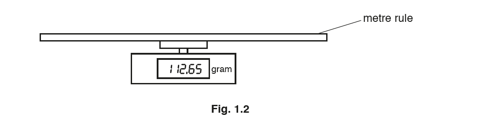

*m* = ..................................................... g

*Source: May 2019 0625/61 Q1E*

**Q3** [1 mark]

**Extract:**

m = 113 g
W1 = 1.0 N

(i) Calculate the weight *W*2 of the metre rule using the equation *W*2 = *mg*, where *g* = 9.8 N/ kg.

*W*2 = .................................................... N [1]

(ii) State and explain whether this value of *W*2 can be considered equal to the value of *W*1 obtained in part **(c)** within the limits of experimental accuracy.

[1]

*Source: May 2019 0625/61 Q1F*

### Q4 — medium — 11 marks

**Q4** [2 marks]

A student investigates the balancing of a metre rule.

Fig. 1.1 shows the arrangement.

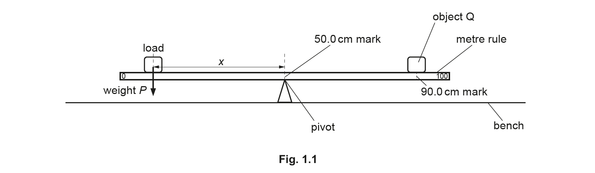

The student places the metre rule on the pivot at the 50.0 cm mark. He places an object Q on the metre rule with its centre at the 90.0 cm mark. He places a load of weight *P* = 2.0 N on the metre rule and adjusts the position of the load so that the metre rule is as near as possible to being balanced.

He measures the distance *x* from the centre of the load to the pivot.

He repeats the procedure using loads of weight *P* = 3.0 N, 4.0 N, 5.0 N and 6.0 N. All the values of *P* and *x* are recorded in Table 1.1.

| P/N | x/cm | $\frac{1}{x}/\frac{1}{cm}$ |
|---|---|---|
| 2.0 | 40.0 |   |
| 3.0 | 27.0 |   |
| 4.0 | 20.0 |   |
| 5.0 | 15.9 |   |
| 6.0 | 13.3 |   |

Calculate, and record in Table 1.1, the values of $\frac{1}{x}$

*Source: 2020 May/ June 0625/61 Q1A*

**Q4** [4 marks]

**Extract:**

| P/N | x/cm | 1/x (1/cm) |
| 2.0 | 40.0 | 0.025 |
| 3.0 | 27.0 | 0.037 |
| 4.0 | 20.0 | 0.050 |
| 5.0 | 15.9 | 0.063 |
| 6.0 | 13.3 | 0.075 |

Plot a graph of *P */ N (y-axis) against $\frac{1}{x}/\frac{1}{\mathrm{cm}}$ (x-axis). Start both axes at the origin (0,0).

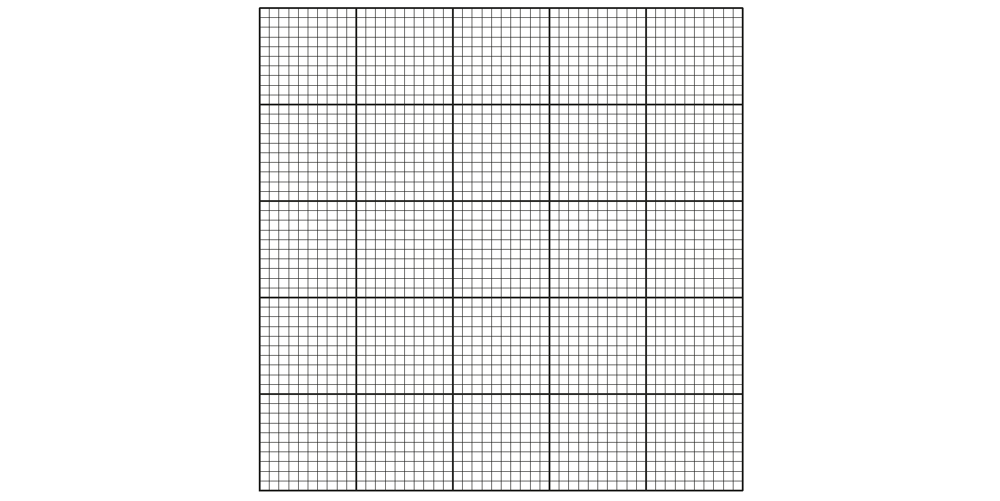

*Source: 2020 May/ June 0625/61 Q1B*

**Q4** [2 marks]

**Extract:**

A student investigates the balancing of a metre rule.

The student places the metre rule on the pivot at the 50.0 cm mark. He places an object Q on the metre rule with its centre at the 90.0 cm mark. He places a load of weight P on the metre rule and adjusts the position of the load so that the metre rule is as near as possible to being balanced.

He measures the distance x from the centre of the load to the pivot.

He repeats the procedure using loads of weight P = 2.0 N, 3.0 N, 4.0 N, 5.0 N and 6.0 N. All the values of P and x are recorded in Table 1.1.

Plot a graph of P / N (y-axis) against 1/x / (1/cm) (x-axis). Start both axes at the origin (0,0).

In this experiment, *x*max , the maximum possible value for *x* is 50.0cm. Calculate $\frac{1}{x_{max}}$.

$\frac{1}{x_{max}}$ = .................................................. $\frac{1}{\mathrm{cm}}$

Use the graph to determine the minimum value of *P* required to balance the metre rule in this experiment. Show clearly on the graph how you determined this value.

minimum value of* P* = .....................................................

*Source: 2020 May/ June 0625/61 Q1C*

**Q4** [1 mark]

**Extract:**

The student places the metre rule on the pivot at the 50.0 cm mark. He places an object Q on the metre rule with its centre at the 90.0 cm mark. ... the width of object Q is slightly greater than the width of the metre rule.

In this experiment, the width of object Q is slightly greater than the width of the metre rule. Explain briefly how you would place the object Q as accurately as possible on the 90.0 cm mark of the metre rule. You may draw a diagram.

*Source: 2020 May/ June 0625/61 Q1D*

**Q4** [2 marks]

**Extract:**

The student places the metre rule on the pivot at the 50.0 cm mark. He places an object Q on the metre rule with its centre at the 90.0 cm mark. He places a load of weight P = 2.0 N on the metre rule and adjusts the position of the load so that the metre rule is as near as possible to being balanced. He measures the distance x from the centre of the load to the pivot. He repeats the procedure using loads of weight P = 3.0 N, 4.0 N, 5.0 N and 6.0 N. All the values of P and x are recorded in Table 1.1.

**Extended tier only**

In this experiment, it is difficult to determine the exact position of the load that will make the metre rule balance.

(i) Explain briefly why this is difficult.

[1]

(ii) Explain briefly how you would find the best position of the load that will make the metre rule balance.

[1]

*Source: 2020 May/ June 0625/61 Q1E*

## Multiple Choice Questions (26 questions)

### Q1 — medium — 1 marks

**Q1** [1 mark]

A uniform ruler is pivoted at its centre. A weight of 6.0 N is placed on the ruler, 20 cm to the left of the pivot.

What weight must be placed 30 cm to the right of the pivot to balance the ruler?

### Q2 — hard — 1 marks

**Q2** [1 mark]

The diagram shows a uniform beam which is balanced on a pivot at its centre. A force $F$ is applied at a distance $x$ to the left of the pivot. A second force $2F$ is applied to the right of the pivot to keep the beam in equilibrium.

What is the distance of the second force from the pivot?

### Q3 — hard — 1 marks

**Q3** [1 mark]

The diagrams show four beams, each of negligible weight and freely pivoted.

Which beam is **not **in equilibrium?

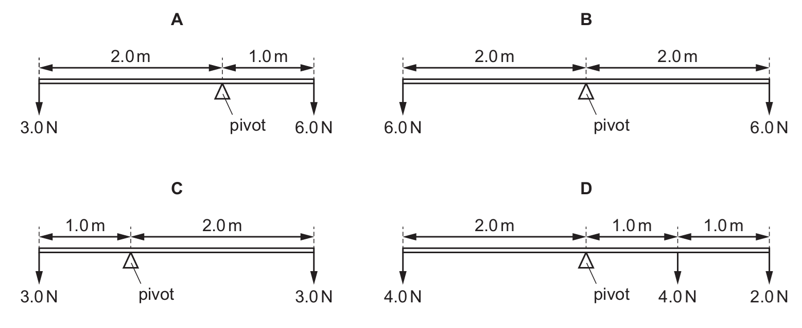

*Source: June 2023 0972/21 Q8*

### Q4 — medium — 1 marks

**Q4** [1 mark]

An irregularly shaped metal plate is freely suspended from a point P and is in equilibrium, as shown. Point Q is vertically below P.

Which statement about the position of the centre of gravity of the metal plate is correct?

*Source: June 2023 0972/11 Q9*

### Q5 — hard — 1 marks

**Q5** [1 mark]

The diagram shows a uniform metre rule. The rule is pivoted at its mid-point. A weight of 4.0 N is suspended from the rule at the 5 cm mark. The rule is held by a string at the 30 cm mark. The rule is in equilibrium.

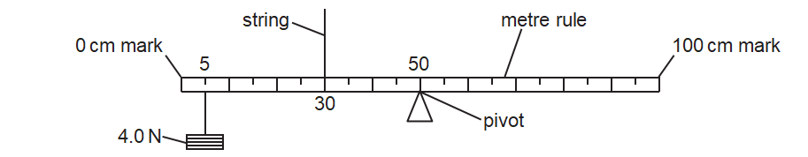

What is the upward force that the string exerts on the rule?

*Source: June 2023 0972/11 Q8*

### Q6 — medium — 1 marks

**Q6** [1 mark]

A beam on a pivot supports a load P at one end and a load Q at the other end.

The weight of the beam can be ignored.

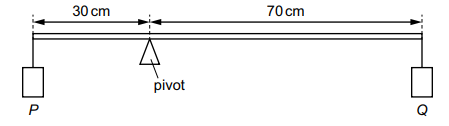

The beam is balanced.

Which row gives possible values for *P *and for *Q*?

| ** ** | ***P*****/N** | ***Q*****/N** |
|---|---|---|
| **A** | 21 | 7 |
| **B** | 21 | 9 |
| **C** | 30 | 10 |
| **D** | 30 | 70 |

*Source: 2023 specimen paper 1 Q7*

### Q7 — medium — 1 marks

**Q7** [1 mark]

A hole is made in a square tile of uniform thickness. The diagram shows the tile hanging loosely on a nail.

Where is the centre of gravity of the tile?

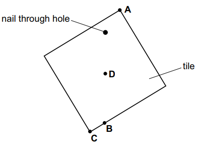

*Source: specimen 2023 paper 1 Q8*

### Q8 — medium — 1 marks

**Q8** [1 mark]

A balloon and a mass are attached to a rod that is pivoted at a fixed point P.

The balloon is filled with helium, which is a gas that is less dense than air.

The balloon filled with helium applies an upward force on the rod.

The rod is horizontal and in equilibrium.

Which action causes the rod to rotate clockwise?

*Source: specimen 2023 paper 2 Q7*

### Q9 — medium — 1 marks

**Q9** [1 mark]

** **A beam is pivoted at one end, as shown.**  **

The beam weighs 6.0 N and its weight acts at a point X 40 cm from the pivot.

A force of 4.0 N is applied to the beam causing it to balance horizontally.

In which direction and where is the 4.0 N force applied?

*Source: june 2022 paper 1 Q7*

### Q10 — easy — 1 marks

**Q10** [1 mark]

**Extended tier only**

In a classroom, a uniform beam with a pivot at its centre has a 15 N weight suspended from one end. An instrument fixed to the ceiling is attached to the same end.

What instrument must be used to show that the resultant moment on a system in equilibrium is zero?

### Q11 — easy — 1 marks

**Q11** [1 mark]

Four objects are shown below. Each is acted on by two forces.

Which of the objects is in equilibrium?

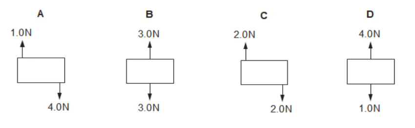

### Q12 — easy — 1 marks

**Q12** [1 mark]

A triangle with uniform density is suspended from a thread. Which diagram shows a system which is **not** in equilibrium?

### Q13 — easy — 1 marks

**Q13** [1 mark]

Four cuboids are shown in the diagram below. The position of their centre of gravity is also shown.

Which of the cuboids is the most stable?

### Q14 — easy — 1 marks

**Q14** [1 mark]

A woman is using a screwdriver to prise the lid off a cylindrical tub of paint.

Which row states how she would increase the moment applied by the greatest amount?

|   | Type of screwdriver | Force applied |
|---|---|---|
| **A** | Wider | Double |
| **B** | Wider | Half |
| **C** | Longer | Double |
| **D** | Longer | Half |

### Q15 — medium — 1 marks

**Q15** [1 mark]

**Extended tier only**

The diagram shows a door handle with three forces acting on it.

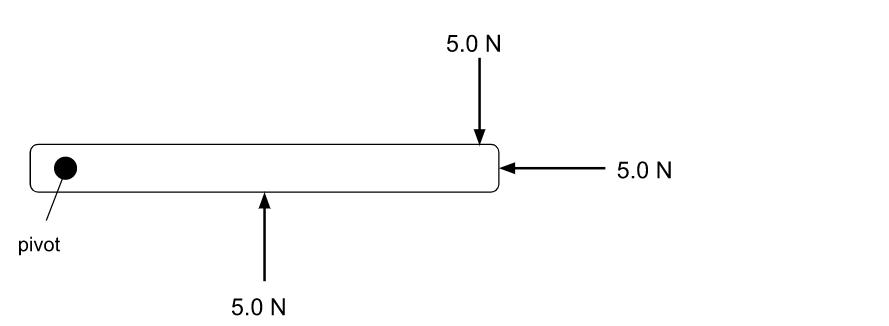

How will the door handle move?

### Q16 — medium — 1 marks

**Q16** [1 mark]

The diagrams below show three beams, each is pivoted at the centre. Each beam also has two forces acting on it, as shown.

Which of the beams will rotate clockwise?

### Q17 — medium — 1 marks

**Q17** [1 mark]

Why are passengers not allowed to stand up on the top deck of a double decker bus?

### Q18 — hard — 1 marks

**Q18** [1 mark]

**Extended tier only**

A "V" shaped object has a sphere attached to either end of the "V" and is balanced on its point. The length of the short arm of the object is $l_{1}$. The sphere of mass $m_{1}$ is a height $h_{1}$ off the ground. The sphere of mass $m_{2}$ is a horizontal distance of $d_{2}$ from the point of the shape.

The object is in equilibrium. Which expression for $d_{2}$ is correct?

### Q19 — medium — 1 marks

**Q19** [1 mark]

A plank rests on two supports, as shown in the diagram. The plank is in equilibrium. Three forces act on the plank.

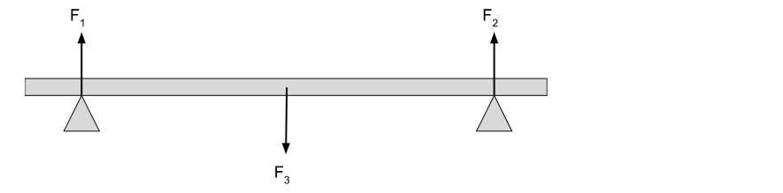

Which statement is true?

### Q20 — medium — 1 marks

**Q20** [1 mark]

A corkscrew is used to open a bottle of wine.

Two forces are applied at each of the positions shown below.

Which pair of forces produces the greatest turning force?

### Q21 — medium — 1 marks

**Q21** [1 mark]

A ‘yardarm’ is a stick, hung from a string, that is used to weigh goods. Goods are placed in the pan on the left, and weights are added to the box on the right side until it balances. The weight of the pan and the box are such that the weight of the yardarm itself is entirely balanced by the pan. The yardarm is 65 cm long.

How many 0.5 N weights need to be added to the box in order to balance the yardarm?

### Q22 — hard — 1 marks

**Q22** [1 mark]

A cardboard rectangle is hung from a nail as shown in the diagram.

A plumb line is also hung from the nail.

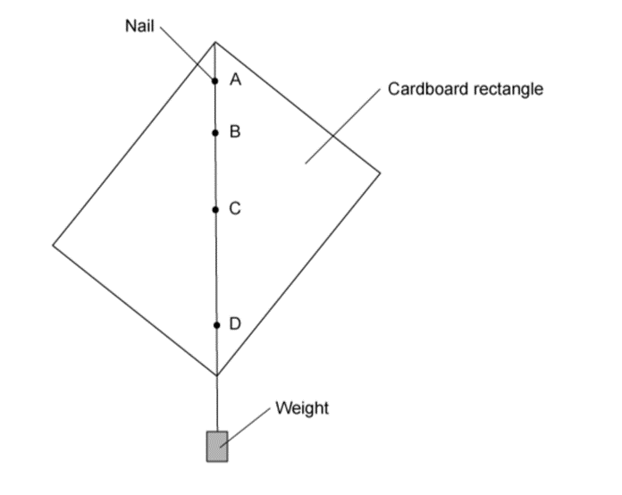

Which of the points labelled shows the centre of gravity of the cardboard rectangle?

### Q23 — hard — 1 marks

**Q23** [1 mark]

A uniform beam is pivoted at one end and suspended by a 200 N force as shown in the diagram.

The beam is in equilibrium.

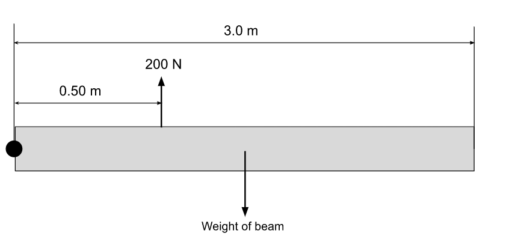

What is the weight of the beam?

### Q24 — medium — 1 marks

**Q24** [1 mark]

The diagrams each show a beam resting on a pivot and being acted on by some forces. The beam is not attached to the pivot. The pivot is in the centre of the rod in each case.

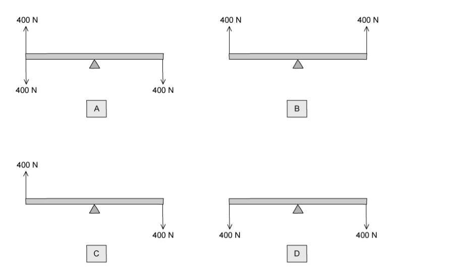

Which of the beams is in equilibrium?

### Q25 — hard — 1 marks

**Q25** [1 mark]

**Extended tier only**

A uniform beam of wood of mass $M$ rests on a pivot. The far left side of the wood is tied to a bolt in the floor with a length of rope with tension $T$, such that it lies completely horizontal. An object of mass $m$ is placed with its centre of gravity on the very end of the right hand side of the beam.

The perpendicular distance from the rope to the pivot is one quarter of the beam's length.

Which expression for the mass of the beam is correct?

### Q26 — medium — 1 marks

**Q26** [1 mark]

A wardrobe is shown tilted at a variety of angles.

In which position is the wardrobe in equilibrium?

## Theory Questions (19 questions)

### Q1 — hard — 8 marks

**Q1** [2 marks]

A builder uses a uniform wooden plank as a lever to lift a heavy concrete block.

Fig. 3.1 shows the arrangement.

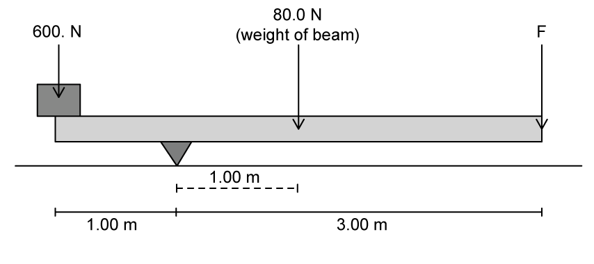

**Fig 3.1**

(i) State the equation that links moment, force, and distance.

[1]

(ii) State the unit for the moment of a force.

[1]

**Q1** [3 marks]

**Extract:**

A builder uses a uniform wooden plank as a lever to lift a heavy concrete block.

Fig. 3.1 shows the arrangement.

**Fig 3.1**

The weight of the uniform plank is 80.0 N.

(i) State the distance from the pivot to the centre of gravity of the plank.

[1]

(ii) Calculate the moment of the plank's weight about the pivot.

[2]

**Q1** [3 marks]

**Extract:**

A builder uses a uniform wooden plank as a lever to lift a heavy concrete block.

Fig. 3.1 shows the arrangement.

**Fig 3.1**

The weight of the uniform plank is 80.0 N.

The concrete block has a weight of 600.0 N and is placed at the left end of the plank, 1.00 m from the pivot.

Calculate the minimum downward force, *F*, the builder must apply to lift the block.

### Q2 — easy — 6 marks

**Q2** [5 marks]

A mechanic uses a spanner to loosen a bolt on a car engine.

(i) The mechanic applies a force of 80 N at a distance of 0.25 m from the centre of the bolt.

Calculate the moment of this force about the centre of the bolt. Include a unit.

moment = ........................................................... [4]

(ii) The force applied by the mechanic produces a turning effect (moment) about the centre of the bolt.

Describe another example of using the turning effect of a force.

[1]

**Q2** [1 mark]

The mechanic tries to use the same spanner to loosen another bolt on the car engine. He applies the same force of 80 N at a distance of 0.25 m from the centre of the bolt.

The turning effect produced is not enough to loosen this bolt.

Describe how the mechanic can increase the turning effect without increasing the force.

### Q3 — medium — 5 marks

**Q3** [3 marks]

**Extract:**

Force 1030 N at a perpendicular distance of 120 cm from the pivot. Expected answer 123 600 N cm; accept 124 000 N cm, 1.24 × 105 N cm or 1.236 × 105 N cm. Accept 1236 N m only if the unit N m is written. Award all three marks for the correct answer alone. Do not accept 120 000 N cm.

** **A builder starts to raise one end of the beam.

He uses a force of 1030 N at a perpendicular distance of 120 cm from the pivot. Fig. 2.2 shows the arrangement.

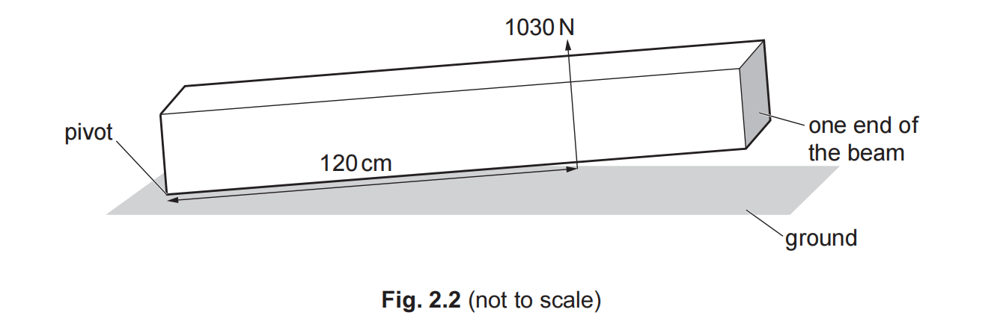

Calculate the moment of the 1030 N force about the pivot.

moment = ................................................ N cm

*Source: June 2023 0972/31 Q2B*

**Q3** [1 mark]

**Extract:**

Expected answer: apply the force further from the pivot (increase the perpendicular distance). Accept "longer lever" or "lift at the end of the beam".

** **Describe how the builder can use a smaller force to lift the beam.

*Source: June 2023 0972/31 Q2C*

**Q3** [1 mark]

**Extract:**

Expected answer, any one of: higher centre of gravity (in Fig. 2.3); smaller base or area in contact with the ground. Accept the comparison stated either way round.

**   **The builder positions the beam as shown in Fig. 2.3.

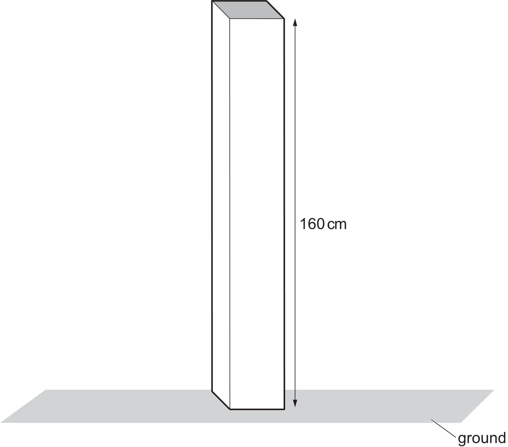

State why the beam shown in Fig. 2.3 is less stable than the beam shown in Fig. 2.1.

*Source: June 2023 0972/31 Q2D*

### Q4 — medium — 3 marks

**Q4** [3 marks]

Fig. 4.3 shows the force on a pulley from a load M.

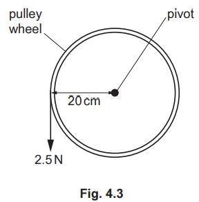

The weight of load M is 2.5 N and the weight acts at a distance of 20 cm from the pivot of the pulley wheel.

Calculate the moment of the weight of load M about the pivot.

moment = ................................................ N cm

*Source: June 2022 paper 3 Q4B*

### Q5 — medium — 6 marks

**Q5** [5 marks]

A man uses a metal bar to remove an iron nail from a piece of wood, as shown in Fig. 3.1.

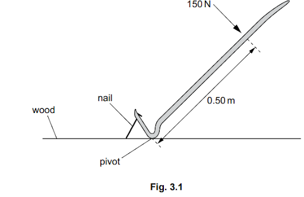

(i)** **The man applies a force of 150 N perpendicular to the bar and at a distance of 0.50 m from the pivot.

Calculate the moment of this force about the pivot. Give the unit.

moment = .......................................................... [4]

(ii) The force applied by the man produces a turning effect (moment) about the pivot.

Describe another example of using the turning effect of a force.

[1]

*Source: 2023 specimen paper 3 Q3A*

**Q5** [1 mark]

The man tries to use the metal bar to remove another nail from the piece of wood. He applies the same force of 150 N at a distance of 0.50 m from the pivot. The turning effect produced is not enough to remove this nail from the piece of wood.

Describe how the man can increase the turning effect without increasing the force.

*Source: 2023 Specimen paper 3 Q3B*

### Q6 — hard — 7 marks

**Q6** [1 mark]

In a double-decker bus there are two passenger compartments, one above the other.

Fig. 3.1 shows a double-decker bus on a tilted platform.

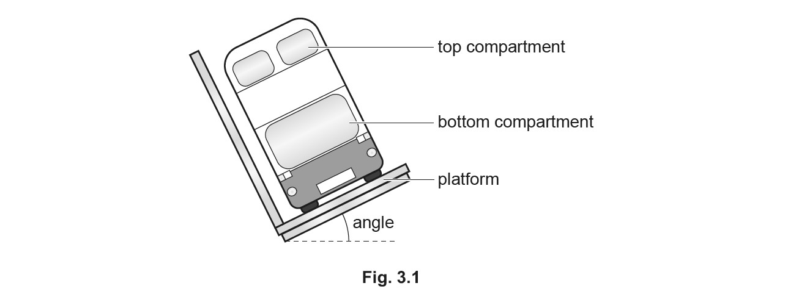

The platform is used to test the stability of the bus.

The angle the bus makes with the horizontal is gradually increased until the bus begins to topple to the left.

Explain why the bus begins to topple.

*Source: May/June 2020 (Series 3) 0625/43 Q3A*

**Q6** [2 marks]

**Extract:**

In a double-decker bus there are two passenger compartments, one above the other.

Fig. 3.1 shows a double-decker bus on a tilted platform.

The platform is used to test the stability of the bus.

The angle the bus makes with the horizontal is gradually increased until the bus begins to topple to the left.

There are 30 passengers in the upper compartment of a bus and 2 passengers in the bottom compartment.

State how this affects the stability of the bus and the reason for this.

*Source: May/June 2020 (Series 3) 0625/43 Q3B*

**Q6** [4 marks]

**Extended tier only**

A bus is travelling along a straight road. The bus and the driver have a combined mass of 16000 kg when there are no passengers in it. The bus has 73 passengers. The average mass of each of the passengers is 65 kg.

(i) Calculate the total mass of the bus, the driver and the 73 passengers.

mass = ......................................................... [2]

(ii) The fully loaded bus accelerates uniformly from rest to a speed of 14 m / s. The time taken to reach a speed of 14 m / s is 20 s.

Calculate the resultant force on the bus during the acceleration.

force = ......................................................... [2]

*Source: May/June 2020 (Series 3) 0625/43 Q3C*

### Q7 — hard — 19 marks

**Q7** [3 marks]

A university student is constructing some flat-pack furniture.

An Allen key has a hexagonal end and is used to tighten hexagonal bolts. An Allen key can be used with its longer end in the hexagonal bolt, or can be rotated to place the shorter end in the hexagonal bolt. This is shown in Fig. 1.1.

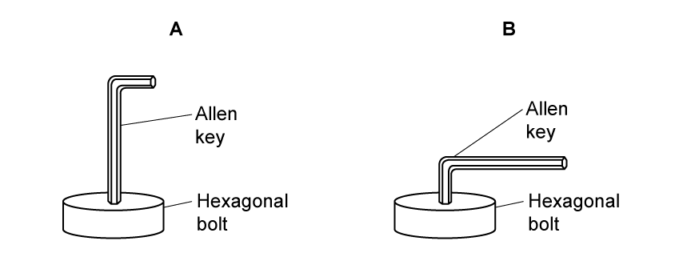

**Fig. 1.1**

State which orientation, A or B, will allow the bolt to be tightened more easily.

Explain why, referring to moments in your answer.

**Q7** [7 marks]

**Extract:**

A university student is constructing some flat-pack furniture.

An Allen key has a hexagonal end and is used to tighten hexagonal bolts. An Allen key can be used with its longer end in the hexagonal bolt, or can be rotated to place the shorter end in the hexagonal bolt. This is shown in Fig. 1.1.

The dimensions of the Allen key are shown in Fig. 1.2.

**Fig. 1.2**

The student building the furniture applies a force of 150 N to the Allen key.

(i) Calculate the moment when the Allen key is in orientation A.

moment in orientation A = ...................................................... N m [4]

(ii) Calculate the moment when the Allen key is in orientation B.

moment in orientation B = ...................................................... N m [3]

**Q7** [6 marks]

**Extract:**

Weight of furniture = 800 N
F_A is 30% of the furniture's weight
Perpendicular distance from pivot to furniture, d_A = 0.20 m
Perpendicular distance from pivot to force from student, d_B = 0.80 m
F_A = 0.3 × 800 = 240 N
Recall the equation to calculate the moment: moment = F × d
Use the principle of moments: In equilibrium, moment A = moment B

The student constructs the furniture but realises they need to lift it up to place a rug underneath.

The furniture has a weight of 800 N and is too heavy for the student to lift.

Remembering a lecture about the principle of moments, they use a pivot and a plank of wood to lift it. As shown in Fig. 1.3, the furniture exerts a perpendicular force *F*A on the plank, which is equal to 30% of the weight of the furniture.

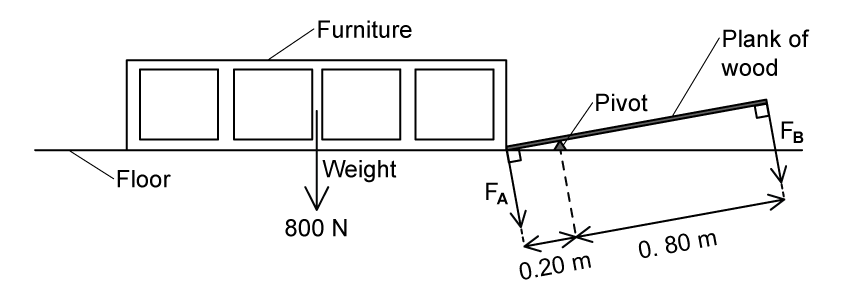

**Fig. 1.3**

Calculate the minimum force *F*B the student must exert to lift the furniture.

**Q7** [3 marks]

**Extract:**

The student constructs the furniture but realises they need to lift it up to place a rug underneath. 

The furniture has a weight of 800 N and is too heavy for the student to lift.

Remembering a lecture about the principle of moments, they use a pivot and a plank of wood to lift it. As shown in Fig. 1.3, the furniture exerts a perpendicular force F_A on the plank, which is equal to 30% of the weight of the furniture.

Calculate the minimum force F_B the student must exert to lift the furniture.

**Extended tier only**

The calculation in part (c) neglected the weight of the plank of wood.

Assuming the plank of wood has evenly distributed mass, explain how this would affect the size of the force that the student must exert to lift the furniture.

### Q8 — easy — 8 marks

**Q8** [2 marks]

Fig. 4.1 shows a truck lifting a heavy load.

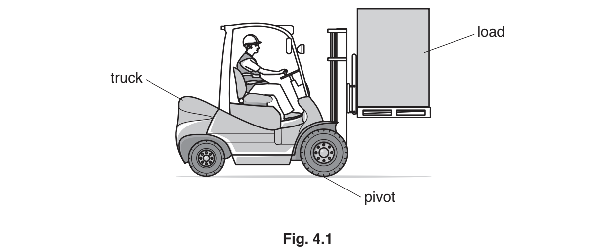

(i) The truck is stationary. Identify the quantities that determine the work done as it lifts the load.

Tick the box next to each correct quantity.

`square` distance

`square` force

`square` time

[1]

(ii) Draw a ring around the unit for work done from the list.

| joule  newton  pascal  watt |
|---|

[1]

*Source: 2019 0625/32 Q4A*

**Q8** [1 mark]

Identify the quantities that determine the power of the truck.

Tick the box next to each correct quantity.

`square` energy transferred

`square` temperature

`square` time

*Source: 2019 0625/32 Q4B*

**Q8** [3 marks]

**Extract:**

The truck has a pivot near the front wheel. Fig. 4.2 represents the pivot and the vertical forces acting on the truck.

The truck is in equilibrium.

- Load causing anticlockwise moment = 30 000 N
- Distance of 30 000 N from pivot = 1.5 m
- Distance of load from pivot = 1.0 m

State the principle of moments:

total clockwise moments equals total anticlockwise moments

moment = force × perpendicular distance from the pivot

load × 1.0 = 30 000 × 1.5

load = (30 000 × 1.5) / 1.0

load = 45 000 N

The truck has a pivot near the front wheel. Fig. 4.2 represents the pivot and the vertical forces acting on the truck.

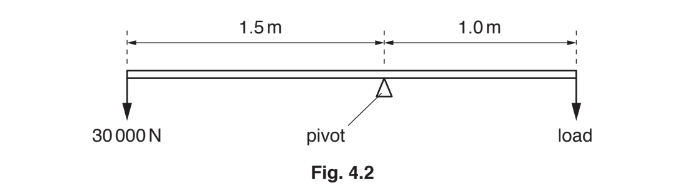

The truck is in equilibrium.

Calculate the load.

load = ..................................................... N

*Source: 2019 0625/32 Q3C*

**Q8** [2 marks]

**Extract:**

For a regular object, its centre of gravity is at the centre of the object.

Stability is all about how close a line drawn from an object's centre of gravity (CoG) is to its pivot. If a line from its centre of gravity is further ahead than the pivot, it is unstable.

Fig. 4.3 shows another truck lifting a pile of identical bricks.

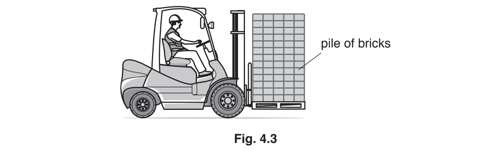

(i) On Fig. 4.3, draw a cross to indicate the centre of gravity of the pile of bricks.

[1]

(ii) The truck can tilt the pile of bricks backwards, as shown in Fig. 4.4.

Explain how tilting the pile of bricks backwards makes the truck more stable.

[1]

*Source: 2019 0625/32 Q4D*

### Q9 — medium — 14 marks

**Q9** [4 marks]

During a routine check of security camera footage at a zoo, it is discovered that a toucan and a grass snake have been escaping from their enclosures and performing experiments on a uniform 2 m long seesaw to study the principle of moments.

**Fig. 1.1**

Mass of a toucan = 600 g

Mass of a grass snake = 250 g

Calculate the weight of each animal in newtons. You may assume the acceleration of free fall is 10 m/s2.

**Q9** [5 marks]

**Extract:**

Weight of the toucan, W_t = 6.0 N
Weight of the grass snake, W_g = 2.5 N
Distance of toucan from pivot, d_t = 40 cm
Distance of grass snake from pivot, d_g = 90 cm
Convert the distances to metres:
d_g = 90 cm = 0.90 m
d_t = 40 cm = 0.40 m
Recall the equation for calculating a moment:
moment = F × d

For the system in Fig. 1.1, calculate the clockwise and anticlockwise moments separately.

clockwise moment = ...................................................... N m

anticlockwise moment = ...................................................... N m

**Q9** [2 marks]

**Extract:**

Weight of the toucan, W_t = 6.0 N
Weight of the grass snake, W_g = 2.5 N
Distance of toucan from pivot, d_t = 40 cm
Distance of grass snake from pivot, d_g = 90 cm
Convert the distances to metres:
d_g = 90 cm = 0.90 m
AND
d_t = 40 cm = 0.40 m
Recall the equation for calculating a moment:
moment = F × d
Calculate the clockwise moment from the snake, moment_CW:
moment_CW = 2.5 × 0.90
moment_CW = 2.25 N m = 2.3 N m (2 s.f.)
Calculate the anticlockwise moment from the toucan, moment_ACW:
moment_ACW = 6.0 × 0.40
moment_ACW = 2.4 N m (2 s.f.)

State whether the system is in equilibrium or not. Explain your reasoning.

**Q9** [3 marks]

**Extract:**

a uniform 2 m long seesaw

**Extended tier only**

On a different day, the toucan and the grass snake sit in new positions at different distances from the pivot. The same 2 metre long seesaw is not in equilibrium and has a resultant clockwise moment of 5.2 N m.

A bearded dragon climbs onto on the left side of the see saw. Suggest whether it is possible for the bearded dragon to bring the seesaw into equilibrium. Explain your answer using the principle of moments.

Average weight of a bearded dragon = 4.9 N

### Q10 — hard — 6 marks

**Q10** [1 mark]

**Extended tier only**

Fig. 2.1 shows a uniform plank AB of length 2.0 m suspended from two ropes X and Y.

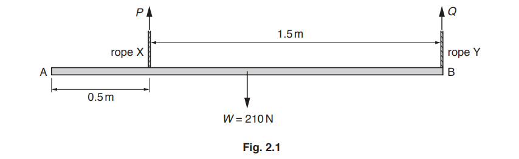

The weight W of the plank is 210 N. The force in rope X is P. The force in rope Y is Q.

State, in terms of P, the moment of force P about B.

*Source: 2018 (Series 1) 0625/41 Q2A*

**Q10** [5 marks]

**Extract:**

Fig. 2.1 shows a uniform plank AB of length 2.0 m suspended from two ropes X and Y. The weight W of the plank is 210 N. The force in rope X is P. The force in rope Y is Q. Distance from A to P is 1.0 m, from P to B is 1.0 m, from A to B is 2.0 m, and from P to B is 1.5 m. The moment of force P about B is P × 1.5. The equation for the size of a moment is Moment = force × distance OR M = Fd. The moment of W about B is W × 1.0. In equilibrium, the total upward forces equal the total downward forces: P + Q = W. To rearrange the moment equation to make F the subject: F = M/d. To rearrange P + Q = W to make Q the subject: Q = W – P. W = 210 N.

**Extended tier only**

Calculate:

(i) the moment of *W *about B

moment = ...........................................................[1]

(ii) the force *P*

force P = ...........................................................[2]

(iii) the force *Q*.

force Q = ...........................................................[2]

*Source: 2018 (Series 1) 0625/41 Q2B*

### Q11 — medium — 6 marks

**Q11** [2 marks]

A metre rule is balanced on a pivot by three vertical forces, as shown in Fig. 5.1.

Show that the moment of the 5.0 N force about the pivot is 200 N cm.

*Source: 2020 0625/31 Q5A*

**Q11** [4 marks]

**Extract:**

A metre rule is balanced on a pivot by three vertical forces, as shown in Fig. 5.1.

Diagram of a 100 cm lever with a pivot at 40 cm from the left-hand side. A 5.0 N force acts at 40 cm from the pivot on the left-hand side, and the 2.0 N weight of the rule acts at 10 cm from the pivot on the right-hand side (weight acts from the centre of the rule).

Force = 5.0 N
Distance from the pivot = 40 cm
Weight of rule = 2.0 N (acts at 10 cm from the pivot on the right-hand side)
Distance from pivot to F = 100 - 40 = 60 cm

Moment = force × distance from the pivot

The size of force is calculated by:
- Moment of 5.0 N force = 200 N cm
- Sum of the clockwise moments = sum of the anticlockwise moments
- Moment due to 2.0 N = 2.0 × 10 = 20 N cm
- Moment due to F = F × (100 – 40) = 60F N cm
- 20 + 60F = 200
- 60F = 200 – 20 = 180
- F = 180 / 60
- F = 3.0 N

**Extended tier only**

Calculate the size of force F.

F = .................................................... N

*Source: 2020 0625/31 Q5B*

### Q12 — hard — 8 marks

**Q12** [5 marks]

Fig. 4.1 shows a tractor fitted with a device for breaking up soil in a field.

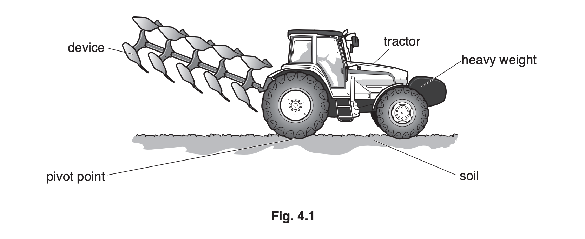

(i) The tractor has a heavy weight at the front. Explain why the heavy weight is needed.

[1]

(ii) Fig. 4.2 represents the weight of the device and its distance from the pivot.

Calculate the moment of the weight of the device about the pivot. State the unit.

moment = ......................................................  [4]

*Source: Oct 2019 3 Q4A*

**Q12** [3 marks]

Fig. 4.3 shows a tractor fitted with narrow tyres and the same tractor fitted with wide tyres.

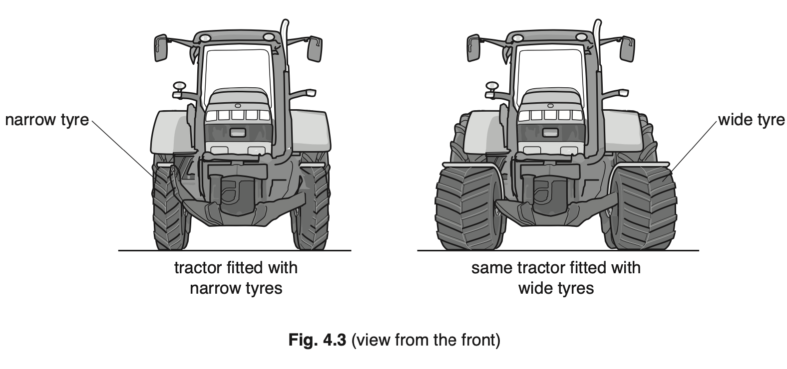

Explain why wide tyres are more suitable for the tractor on soft soil.

*Source: Oct 2019 3 Q4B*

### Q13 — hard — 6 marks

**Q13** [3 marks]

A tower crane has a load W, as shown in Fig. 3.1.

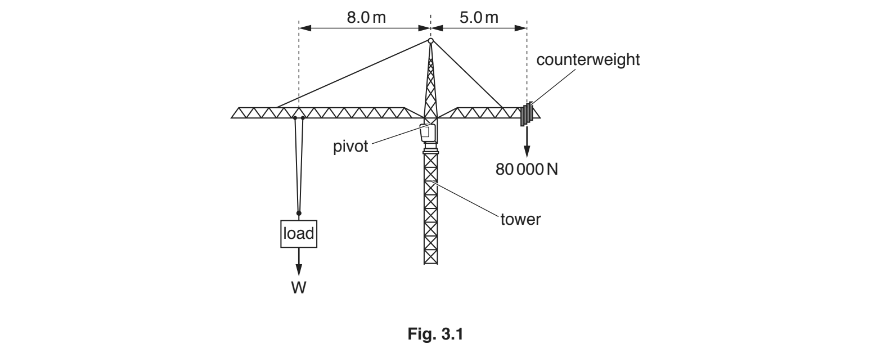

The counterweight has a weight of 80 000 N. This acts at a distance of 5.0 m from the pivot, as shown in Fig. 3.1.

Calculate the moment of the counterweight about the pivot. Give the unit.

moment = ...........................................................

*Source: Nov 2018 (S1) 0625/31 Q3A*

**Q13** [3 marks]

**Extract:**

The counterweight has a weight of 80 000 N. This acts at a distance of 5.0 m from the pivot, as shown in Fig. 3.1.

Force, F = 80 000 N
Distance from pivot, d = 5.0 m

Moment = Force × distance

M = 400 000 N m

The tower crane in Fig. 3.1 balances horizontally when holding the load W.

Calculate the weight of load W.

weight = ....................................................... N

*Source: Nov 2018 (S1) 0625/31 Q3B*

### Q14 — easy — 4 marks

**Q14** [1 mark]

Fig. 4.1 shows a metal triangle suspended from a thread.

Complete the sentence. Choose the correct word or phrase from the box.

The metal triangle will come to rest with its centre of gravity directly ................................. the point of suspension.

*Source: Oct 2019 0625/32 Q4A*

**Q14** [3 marks]

A student finds the centre of gravity of a shape made of thin card. Fig. 4.2 shows the equipment.

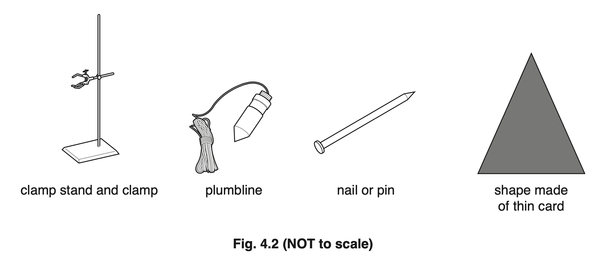

Describe how the student finds the centre of gravity of the card. Choose from these sentences.

1. A line is drawn on the card showing the position of the string.
2. A pin held in a clamp is put through the hole in the card.
3. The centre of gravity is where the lines cross on the card.
4. The process is repeated using holes near the other two edges.

Complete the flow chart. Write the letter for the correct sentence in each box.

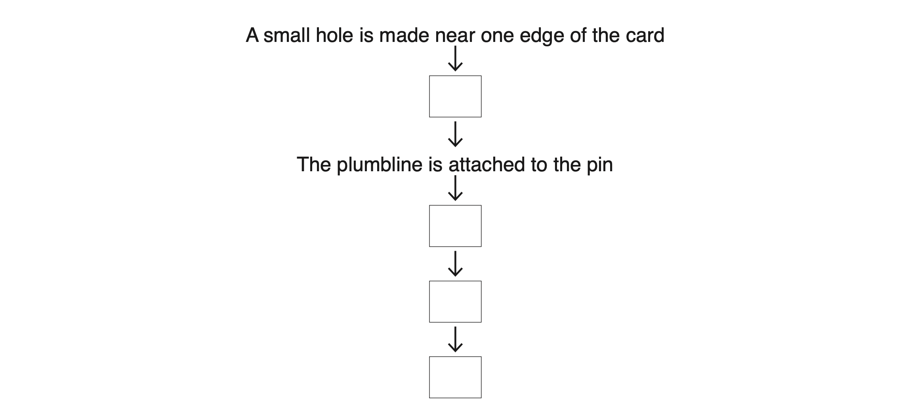

*Source: Oct 2019 0625/32 Q4B*

### Q15 — medium — 7 marks

**Q15** [5 marks]

A 50 cm rule is balanced at its mid-point. A force of 8.0 N acts at a distance of 10 cm from one end of the rule.

Fig. 2.1 shows the arrangement.

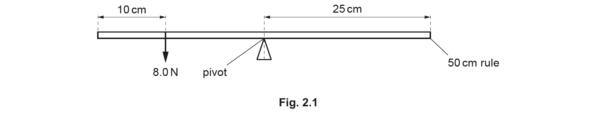

Calculate the moment of the 8.0 N force about the pivot. Give the unit.

moment = ............................ unit = ............................

*Source: 2020 Feb/March 0625/32 Q2A*

**Q15** [2 marks]

**Extract:**

A 50 cm rule is balanced at its mid-point. A force of 8.0 N acts at a distance of 10 cm from one end of the rule.

Fig. 2.1 shows the arrangement.

[diagram: 8.0 N force acting 10 cm from one end, pivot at mid-point, 50 cm rule]

Another force acts at a point 10 cm from the pivot. It makes the rule balance.

On Fig. 2.1, draw an arrow to show the position and direction of this force.

*Source: 2020 Feb/March 0625/32 Q2B*

### Q16 — medium — 7 marks

**Q16** [1 mark]

Complete the statement by writing in the blank spaces.

The moment of a force about a pivot is equal to ............ multiplied by ............

*Source: February/March 2018 0625/42 Q3A*

**Q16** [6 marks]

Fig. 3.1 shows a horizontal rod of length 2.4 m and weight 160 N. The weight of the rod acts at its centre. The rod is suspended by two vertical ropes X and Y. The tension in each rope is 80 N.

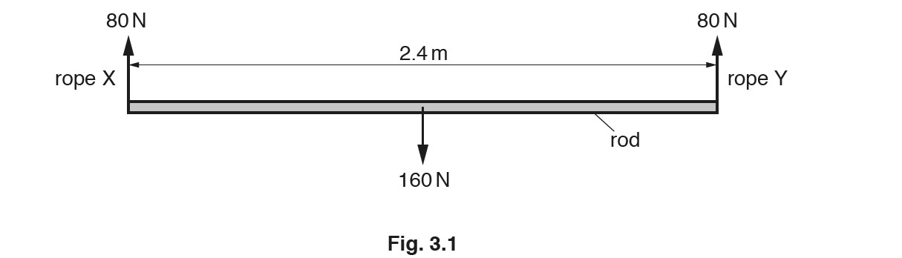

(i) State the name given to the point at which the weight of the rod acts.

[1]

(ii) Calculate the mass of the rod.

mass = ......................................................... [1]

(iii) The rod is in equilibrium.

Using data from Fig. 3.1, explain why.

[4]

*Source: February/March 2018 0625/42 Q3B*

### Q17 — easy — 7 marks

**Q17** [1 mark]

Define the term *moment*.

**Q17** [1 mark]

A uniform seesaw is in equilibrium with a box placed on each side.

The box on the left has an anticlockwise moment of 150 N m about the pivot.

The box on the right has weight *W*.

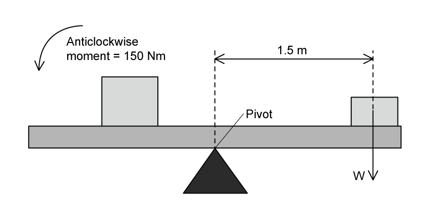

**Fig. 1.1**

State the clockwise moment due to the box on the right.

**Q17** [3 marks]

**Extract:**

The box on the left has an anticlockwise moment of 150 N m about the pivot. The box on the right has weight W. State the clockwise moment due to the box on the right:
- 150 N m [1 mark]
Distance from the box to the pivot, d = 1.5 m

Calculate the weight *W* of the box on the right side of the seesaw.

**Q17** [2 marks]

**Extract:**

A uniform seesaw is in equilibrium with a box placed on each side. The box on the left has an anticlockwise moment of 150 N m about the pivot. The box on the right has weight W. The seesaw is in equilibrium. The clockwise and anticlockwise moments are equal - the resultant moment is zero.

The box on the left hand side of the seesaw is now removed. Explain the subsequent motion of the seesaw.

### Q18 — medium — 5 marks

**Q18** [1 mark]

Fig. 2.1 shows a man pushing down on a lever to lift one end of a heavy log.

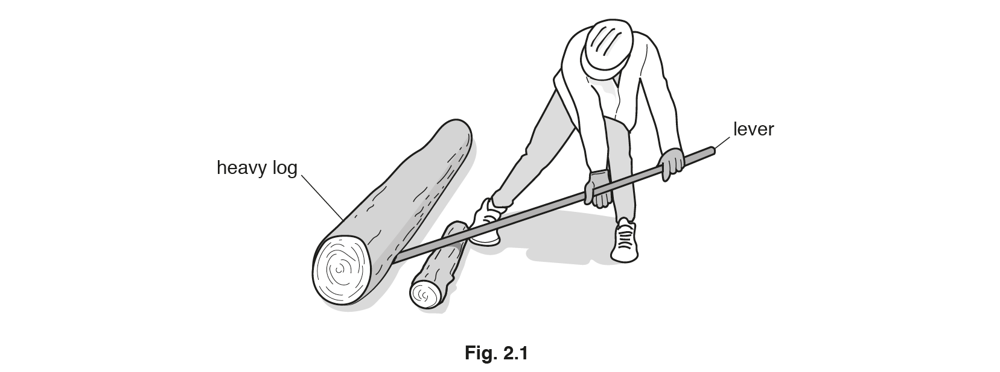

State the term used to describe the turning force exerted by the man.

*Source: 2019 May/June 0972/31 Q2A*

**Q18** [4 marks]

**Extract:**

Fig. 2.1 shows a man pushing down on a lever to lift one end of a heavy log.

(i) Fig. 2.2 shows the forces acting as the man starts to lift the heavy log.

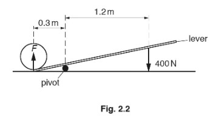

Calculate the force F, exerted by the lever on the heavy log.

force = ..................................................... N [3]

(ii) Describe how the man can use a smaller force to lift the heavy log.

[1]

*Source: 2019 May/June 0972/31 Q2B*

### Q19 — easy — 4 marks

**Q19** [4 marks]

A lamp is attached to a wall, as shown in Fig. 4.1.

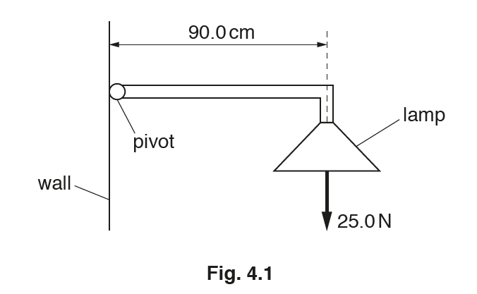

Calculate the moment of the lamp about the pivot. Give the unit.

moment = ..........................................................

*Source: 2018 0625/33 Q4*

