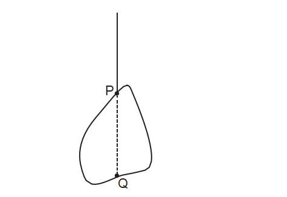
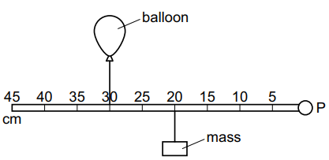
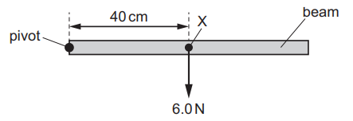
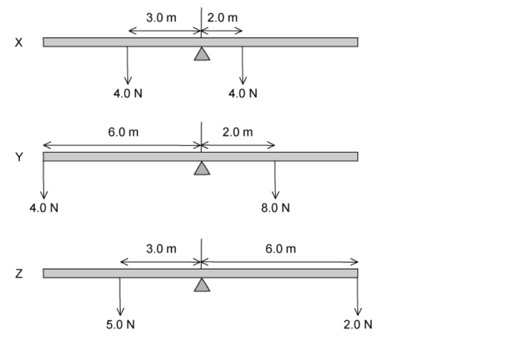
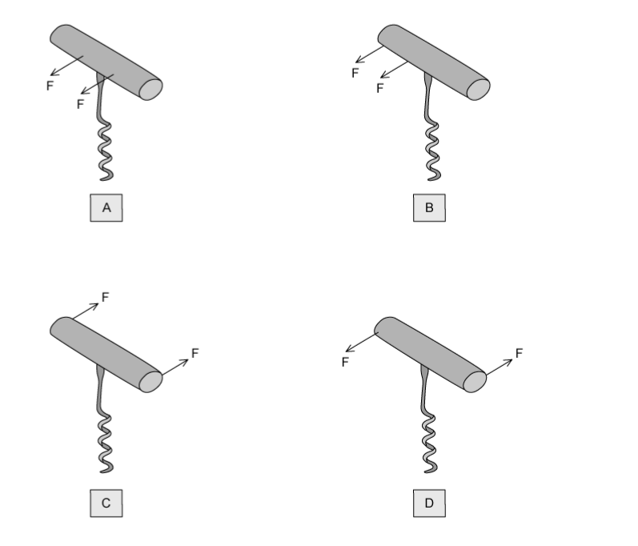
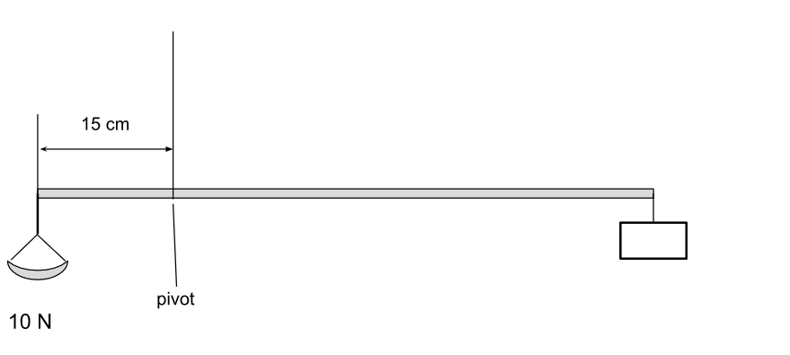
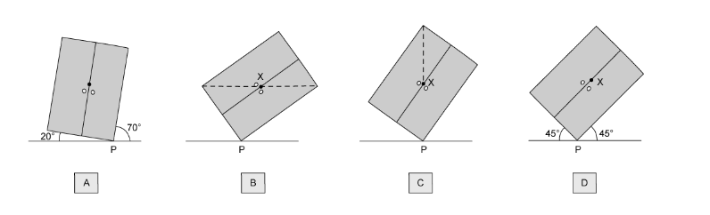

# Exam Questions — Moments
**1. Motion, Forces & Energy** · Cambridge (CIE) IGCSE physics (0625 & 0972)
> Source: [https://www.savemyexams.com/igcse/physics/cie/23/topic-questions/](https://www.savemyexams.com/igcse/physics/cie/23/topic-questions/) · 26 questions across 1 sets

## Multiple Choice Questions (26 questions)

### Q1 — medium — 1 marks

**Q1** [1 mark]

A uniform ruler is pivoted at its centre. A weight of 6.0 N is placed on the ruler, 20 cm to the left of the pivot.

What weight must be placed 30 cm to the right of the pivot to balance the ruler?

### Q2 — hard — 1 marks

**Q2** [1 mark]

The diagram shows a uniform beam which is balanced on a pivot at its centre. A force $F$ is applied at a distance $x$ to the left of the pivot. A second force $2F$ is applied to the right of the pivot to keep the beam in equilibrium.

What is the distance of the second force from the pivot?

### Q3 — hard — 1 marks

**Q3** [1 mark]

The diagrams show four beams, each of negligible weight and freely pivoted.

Which beam is **not **in equilibrium?

*Source: June 2023 0972/21 Q8*

### Q4 — medium — 1 marks

**Q4** [1 mark]

An irregularly shaped metal plate is freely suspended from a point P and is in equilibrium, as shown. Point Q is vertically below P.

Which statement about the position of the centre of gravity of the metal plate is correct?

*Source: June 2023 0972/11 Q9*

### Q5 — hard — 1 marks

**Q5** [1 mark]

The diagram shows a uniform metre rule. The rule is pivoted at its mid-point. A weight of 4.0 N is suspended from the rule at the 5 cm mark. The rule is held by a string at the 30 cm mark. The rule is in equilibrium.

What is the upward force that the string exerts on the rule?

*Source: June 2023 0972/11 Q8*

### Q6 — medium — 1 marks

**Q6** [1 mark]

A beam on a pivot supports a load P at one end and a load Q at the other end.

The weight of the beam can be ignored.

The beam is balanced.

Which row gives possible values for *P *and for *Q*?

| ** ** | ***P*****/N** | ***Q*****/N** |
|---|---|---|
| **A** | 21 | 7 |
| **B** | 21 | 9 |
| **C** | 30 | 10 |
| **D** | 30 | 70 |

*Source: 2023 specimen paper 1 Q7*

### Q7 — medium — 1 marks

**Q7** [1 mark]

A hole is made in a square tile of uniform thickness. The diagram shows the tile hanging loosely on a nail.

Where is the centre of gravity of the tile?

*Source: specimen 2023 paper 1 Q8*

### Q8 — medium — 1 marks

**Q8** [1 mark]

A balloon and a mass are attached to a rod that is pivoted at a fixed point P.

The balloon is filled with helium, which is a gas that is less dense than air.

The balloon filled with helium applies an upward force on the rod.

The rod is horizontal and in equilibrium.

Which action causes the rod to rotate clockwise?

*Source: specimen 2023 paper 2 Q7*

### Q9 — medium — 1 marks

**Q9** [1 mark]

** **A beam is pivoted at one end, as shown.**  **

The beam weighs 6.0 N and its weight acts at a point X 40 cm from the pivot.

A force of 4.0 N is applied to the beam causing it to balance horizontally.

In which direction and where is the 4.0 N force applied?

*Source: june 2022 paper 1 Q7*

### Q10 — easy — 1 marks

**Q10** [1 mark]

**Extended tier only**

In a classroom, a uniform beam with a pivot at its centre has a 15 N weight suspended from one end. An instrument fixed to the ceiling is attached to the same end.

What instrument must be used to show that the resultant moment on a system in equilibrium is zero?

### Q11 — easy — 1 marks

**Q11** [1 mark]

Four objects are shown below. Each is acted on by two forces.

Which of the objects is in equilibrium?

### Q12 — easy — 1 marks

**Q12** [1 mark]

A triangle with uniform density is suspended from a thread. Which diagram shows a system which is **not** in equilibrium?

### Q13 — easy — 1 marks

**Q13** [1 mark]

Four cuboids are shown in the diagram below. The position of their centre of gravity is also shown.

Which of the cuboids is the most stable?

### Q14 — easy — 1 marks

**Q14** [1 mark]

A woman is using a screwdriver to prise the lid off a cylindrical tub of paint.

Which row states how she would increase the moment applied by the greatest amount?

|   | Type of screwdriver | Force applied |
|---|---|---|
| **A** | Wider | Double |
| **B** | Wider | Half |
| **C** | Longer | Double |
| **D** | Longer | Half |

### Q15 — medium — 1 marks

**Q15** [1 mark]

**Extended tier only**

The diagram shows a door handle with three forces acting on it.

How will the door handle move?

### Q16 — medium — 1 marks

**Q16** [1 mark]

The diagrams below show three beams, each is pivoted at the centre. Each beam also has two forces acting on it, as shown.

Which of the beams will rotate clockwise?

### Q17 — medium — 1 marks

**Q17** [1 mark]

Why are passengers not allowed to stand up on the top deck of a double decker bus?

### Q18 — hard — 1 marks

**Q18** [1 mark]

**Extended tier only**

A "V" shaped object has a sphere attached to either end of the "V" and is balanced on its point. The length of the short arm of the object is $l_{1}$. The sphere of mass $m_{1}$ is a height $h_{1}$ off the ground. The sphere of mass $m_{2}$ is a horizontal distance of $d_{2}$ from the point of the shape.

The object is in equilibrium. Which expression for $d_{2}$ is correct?

### Q19 — medium — 1 marks

**Q19** [1 mark]

A plank rests on two supports, as shown in the diagram. The plank is in equilibrium. Three forces act on the plank.

Which statement is true?

### Q20 — medium — 1 marks

**Q20** [1 mark]

A corkscrew is used to open a bottle of wine.

Two forces are applied at each of the positions shown below.

Which pair of forces produces the greatest turning force?

### Q21 — medium — 1 marks

**Q21** [1 mark]

A ‘yardarm’ is a stick, hung from a string, that is used to weigh goods. Goods are placed in the pan on the left, and weights are added to the box on the right side until it balances. The weight of the pan and the box are such that the weight of the yardarm itself is entirely balanced by the pan. The yardarm is 65 cm long.

How many 0.5 N weights need to be added to the box in order to balance the yardarm?

### Q22 — hard — 1 marks

**Q22** [1 mark]

A cardboard rectangle is hung from a nail as shown in the diagram.

A plumb line is also hung from the nail.

Which of the points labelled shows the centre of gravity of the cardboard rectangle?

### Q23 — hard — 1 marks

**Q23** [1 mark]

A uniform beam is pivoted at one end and suspended by a 200 N force as shown in the diagram.

The beam is in equilibrium.

What is the weight of the beam?

### Q24 — medium — 1 marks

**Q24** [1 mark]

The diagrams each show a beam resting on a pivot and being acted on by some forces. The beam is not attached to the pivot. The pivot is in the centre of the rod in each case.

Which of the beams is in equilibrium?

### Q25 — hard — 1 marks

**Q25** [1 mark]

**Extended tier only**

A uniform beam of wood of mass $M$ rests on a pivot. The far left side of the wood is tied to a bolt in the floor with a length of rope with tension $T$, such that it lies completely horizontal. An object of mass $m$ is placed with its centre of gravity on the very end of the right hand side of the beam.

The perpendicular distance from the rope to the pivot is one quarter of the beam's length.

Which expression for the mass of the beam is correct?

### Q26 — medium — 1 marks

**Q26** [1 mark]

A wardrobe is shown tilted at a variety of angles.

In which position is the wardrobe in equilibrium?
