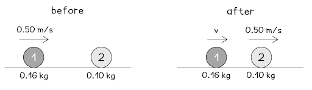

# Mark Schemes — Momentum
**1. Motion, Forces & Energy** · Cambridge (CIE) IGCSE physics (0625 & 0972)

## Multiple Choice Questions (20 questions)

### Q1
**Final answer:** **The correct answer is C**

- The area under a force-time graph gives the **impulse** (change in momentum)
- The area is a rectangle:

$\text{impulse}=F\timest$

$\text{impulse}=6.0\times3.0=18\text{N s}$

- Since the object starts from rest, the impulse equals the final momentum:

$\text{impulse}=m\timesv=18$

$v=\frac{18}{2.0}=9.0\text{m/s}$

### Q2
**Final answer:** **The correct answer is ****A**** because:**

- The momentum of an object is given by:

$\mathrm{momentum}=\mathrm{mass}\times\mathrm{velocity}$  or $p=mv$

- The change in the momentum of the object `open parentheses increment p close parentheses` can be found using:

`table row cell change space in space momentum space end cell equals cell space final space momentum space minus space initial space momentum end cell end table`  or  `table row cell increment p space end cell equals cell space p subscript final space minus space p subscript initial end cell end table`

`table row cell space p subscript initial space end subscript end cell equals cell space 1.2 space kg space cross times space 2.0 space straight m divided by straight s space equals space 2.4 space kg space straight m divided by straight s end cell end table`

`table row cell italic space p subscript final space end subscript end cell equals cell space 1.2 space kg space cross times space 5.0 space straight m divided by straight s space equals space 6.0 space kg space straight m divided by straight s end cell end table`

`table row cell increment p space end cell equals cell space p subscript final space minus space p subscript initial space equals space 6.0 space minus space 2.4 space equals space 3.6 space kg space straight m divided by straight s end cell end table`

- This allows the impulse equation to be used:

`table row cell impulse space end cell equals cell space F increment t space equals space increment open parentheses m v close parentheses space equals space increment p space end cell end table`

`table row cell increment t space end cell equals cell space fraction numerator increment p over denominator F end fraction end cell end table`

`table row cell increment t space end cell equals cell space fraction numerator 3.6 space kg space straight m divided by straight s over denominator 4.0 space straight N end fraction space equals space 0.90 space straight s end cell end table`

Since the mass of the object does not change, the answer can be found more quickly by rearranging the impulse equation directly to $\Deltat=\frac{m\Deltav}{F}$ . The change in velocity $\Deltav$ is 3.0 m/s (5.0 m/s – 2.0 m/s). If you are confident in manipulating equations, use this method.

**B**, **C** and **D** are all incorrect answers, where the equations have not been used correctly.

### Q3
**Final answer:** **The correct answer is B**

- The equation for calculating the momentum of an object is

$p=mv$

- The principle of conservation of momentum tells us that for a collision:

total momentum before=total momentum after

- Using the information in the question, draw a diagram of the collision

- The total momentum before the collision is:

`p subscript b e f o r e end subscript space equals space open parentheses 0.16 space cross times space 0.50 close parentheses space plus space open parentheses 0.10 space cross times space 0 close parentheses space equals space 0.08 space kg space straight m divided by straight s`

- The total momentum after the collision is

`p subscript a f t e r end subscript space equals space open parentheses 0.16 v close parentheses space plus space open parentheses 0.10 space cross times space 0.50 close parentheses space equals space 0.16 v space plus space 0.05 space kg space straight m divided by straight s`

- Apply conservation of momentum and rearrange for the unknown velocity, v:

$0.08=0.16v+0.05$

$0.16v=0.03$

$v=\frac{0.03}{0.16}=0.1875m/s$

- This is closest to 0.19 m/s, which is option **B**

### Q4
**Final answer:** **The correct answer is B**

- Momentum is the product of mass and velocity
- From the conservation of momentum:

  - The total initial momentum of both objects is equal to the total final momentum of both objects

$p_{i1}+p_{i2}=p_{f1}+p_{f2}$

$m_{1}u_{1}+m_{2}u_{2}=m_{1}v_{1}+m_{2}v_{2}$

- The first object, 1, has a mass of 0.16 kg and an initial velocity of 0.50 m/s
- The second object, 2, has a mass of 0.10 kg, an initial velocity of 0 m/s and a final velocity of 0.50 m/s

  - Here, forward is taken as the positive direction
  - Substitute in the known quantities and simplify

`open parentheses 0.16 space cross times space 0.50 close parentheses space plus space open parentheses 0.10 space cross times space 0 close parentheses space equals space open parentheses 0.16 v subscript 1 close parentheses space plus space open parentheses 0.10 space plus space 0.50 close parentheses`

$0.08=0.16v_{1}+0.05$

- Rearrange for the final velocity of the first object

$0.16v_{1}=0.03$

$v_{1}=0.1875m/s$

Rounding this value to two significant figures gives option **B**

### Q5
**Final answer:** **The correct answer is D**

- The momentum of an object depends on

  - the object’s mass
  - the object’s velocity
- Therefore, when an object **decelerates**, its velocity changes, so its momentum changes
- When an object experiences an **impulse**:

  - it has a resultant force acting on it
  - its momentum changes

Therefore, the momentum of the object changes in **all three** situations

### Q6
**Final answer:** **The correct answer is A**

- Average force is the rate of change of momentum
- Recall that momentum is the product of mass and velocity

$p=mv$

`increment p space equals space m open parentheses v subscript f space minus space v subscript i close parentheses`

`increment p space equals space 0.12 open parentheses 5.0 space minus space 0 close parentheses`

$\Deltap=0.60\mathrm{kg}m/s$

- This change in momentum occurs over 0.60 s

$F=\frac{\Deltap}{\Deltat}$

$F=\frac{0.60}{0.60}$

$F=1.0N$

- This is option **A**

### Q7
**Final answer:** **The correct answer is D because:**

- The law of conservation of momentum states that the total momentum before a collision must be equal to the total momentum after the collision.
- Since the sum of the moments before = 30 kg m/s then the sum of the moments after must also be 30 kg m/s

### Q8
**Final answer:** **The correct answer is ****B**** because:**

- The equation for impulse is $I=Ft$
- For the ball $I=1500N\times1.4s=2100\mathrm{Ns}$

### Q9
**Final answer:** **The correct answer is ****D**** because momentum is defined by the equation:**

- Momentum (p) = mass (m) x velocity (v)
- Therefore the correct unit is kg m/s (the units of mass multiplied by the units of velocity).

### Q10
**Final answer:** **The correct answer is ****C**** because:**

- The equation for momentum states that momentum $p=mv$,
- For the ball $p=5.0\mathrm{kg}\times3.0m/s=15\mathrm{kg}m/s$ ball

### Q11
**Final answer:** **The correct answer is ****B**** because:**

- Impulse is defined as 'change in momentum'.
- Impulse, *I*, can be calculated using $I=Ft$

  - Where *F* = force and *t* = time

**A and C** are incorrect as force and change in momentum are related by the equation $F=\frac{Δp}{Δt}$

**D** is incorrect as this is not a valid equation for calculating impulse

There is a second equation for calculating impulse  $I=m(v-u)$, where *m *= mass, *v* = final velocity and *u* = initial velocity.

### Q12
**Final answer:** **The correct answer is ****A ****because:**

- Impulse  = change in momentum
- Impulse  = mv - mu = m(v - u)
- Impulse  = 150 x (10 - 5) = 150 x 5
- Impulse  = 750 Ns

**B **is incorrect as the initial speed (5m/s) has not been considered.

**C **is incorrect as the speeds have been added together.

**D **is incorrect as all the numbers have been, incorrectly, multiplied together.

### Q13
**Final answer:** **The correct answer is ****C**** because:**

- Impulse is equal to change in momentum

  - Impulse = `increment p space equals space m increment v space equals space m open parentheses v space minus space u close parentheses`
- So the impulse on the passenger is:

  - Impulse = $90\mathrm{kg}\times12m/s=1080\mathrm{kg}m/s$
- Impulse is also equal to force × time, so kg m/s and N s are equivalent units

  - Impulse = $1100Ns$ (2 s.f.)

**A **is incorrect as this has calculated $90/12=7.5Ns$

**B** is incorrect as this has calculated $90\times12\times0.2=216\approx220Ns$

**D** is incorrect as this has calculated `90 cross times open parentheses 12 divided by 0.2 close parentheses space equals space 5400 space straight N space straight s`

### Q14
**Final answer:** **The correct answer is ****C**** because:**

- The question is specifically asking why a shorter deceleration benefits the passenger.
- Since F = ma, decreasing the value of *a* will subsequently decrease the force of the impact.

**A **is incorrect as although factually correct, this statement does not answer the question.

**B **is incorrect as a short collision time is the whole reason there is a large impact force since impulse = F x t, the shorter the collision time, the larger the impact force - the passenger will certainly always feel something!

**D **is incorrect as although factually correct, it does not answer the question

### Q15
**Final answer:** **The correct answer is ****A ****because:**

- Impulse is given by $\mathrm{Ft}=\mathrm{mΔv}$
- Rearranging gives $F=\frac{m\Deltav}{t}$
- Convert 150g to kg: 150 x 10-3 kg
- `F space equals space fraction numerator 150 cross times 10 blank to the power of negative 3 end exponent space cross times space 220 over denominator 0.025 end fraction space equals space 1320 space straight N space equals space 1.3 space cross times 10 cubed space straight N space open parentheses 2 space straight s. straight f. close parentheses`

**B** is incorrect as this is 150 x 10-3 x 220, the time has not been considered.

**C** is incorrect as the mass has not been converted into kg.

**D** is incorrect as this is 150 x 220, neither the time or mass conversion have been considered.

### Q16
**Final answer:** **The correct answer is ****C ****because:**

- The total momentum of the bullet and gun before shooting = the total momentum of the bullet and gun after shooting.
- Before shooting the bullet and the gun are stationary so overall the total momentum will be zero.

**A** is incorrect as the velocities of the bullet and the gun will be different due to their different masses. However, they will move in opposite directions.

**B** is incorrect as the bullet will actually move faster due to having a smaller mass.

**D** is incorrect as the law of conservation of momentum states that momentum will always be constant before and after a collision.

### Q17
**Final answer:** **The correct answer is ****B ****because: **

Airbags are designed to increase the time taken for the momentum of the head to reduce to zero which subsequently reduces the force exerted on the head.

### Q18
**Final answer:** **The correct answer is ****C ****because:**

- Compare the mass and velocity of each rollercoaster:

  - The first rollercoaster has mass *m* and velocity *v*
  - The second rollercoaster has mass ½*m* and velocity 4*v*
- Momentum = mass x velocity, or p = *m* x *v*

  - The momentum of the first rollercoaster is *p* = *m* x *v* = *mv*
  - The momentum of the second rollercoaster is *p* = (½*m*) x (4*v*) = 2*mv*
- Therefore, the momentum of the second rollercoaster will be **twice **that of the first rollercoaster's momentum

### Q19
**Final answer:** **The correct answer is ****D ****because:**

- The question states the kinetic energy is unchanged, therefore the molecule will rebound the same speed
- However, the question asks for the velocity, meaning the direction must be taken into consideration
- Since the molecule rebounds in the opposite direction, the final velocity is -200 m/s

### Q20
**Final answer:** **The correct answer is**** A:**

- Consider impulse, which is equal to change in momentum = force x time.
- A padded dashboard will absorb some of the energy from the collision with the passenger’s head. This in turn reduces the force encountered by the passenger and since the change in momentum is determined by the car crash, and hence stays the same, the passenger will experience a lengthened contact time with the dashboard.

**B **is incorrect as this is the opposite of what would happen

**C **and** D** are incorrect as momentum and impulse are determined by the mass of the car and speed it is travelling before the collision so padding on the dashboard is not going to influence these values.
