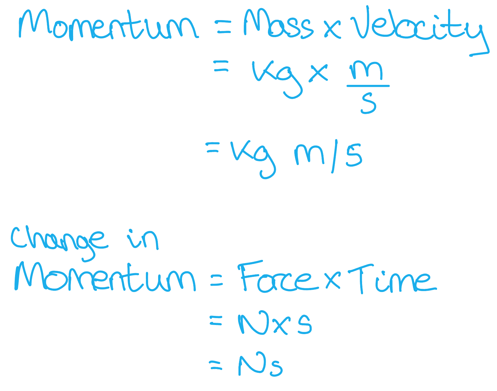

# Mark Schemes — Momentum
**1. Motion, Forces & Energy** · Cambridge (CIE) IGCSE physics (0625 & 0972)

## Multiple Choice Questions (20 questions)

### Q1
**Final answer:** **The correct answer is C**

- The area under a force-time graph gives the **impulse** (change in momentum)
- The area is a rectangle:

$\text{impulse}=F\timest$

$\text{impulse}=6.0\times3.0=18\text{N s}$

- Since the object starts from rest, the impulse equals the final momentum:

$\text{impulse}=m\timesv=18$

$v=\frac{18}{2.0}=9.0\text{m/s}$

### Q2
**Final answer:** **The correct answer is ****A**** because:**

- The momentum of an object is given by:

$\mathrm{momentum}=\mathrm{mass}\times\mathrm{velocity}$  or $p=mv$

- The change in the momentum of the object $( \Delta p )$ can be found using:

$\begin{array}{ccc} \text{change} in \text{momentum} & = & \text{final} \text{momentum} - \text{initial} \text{momentum} \end{array}$  or  $\begin{gathered} \Delta p & = p_{final} - p_{initial} \end{gathered}$

$\begin{gathered} p_{initial } & = 1.2 \text{kg} \times 2.0 \mathrm{m} \div \mathrm{s} = 2.4 \text{kg} \mathrm{m} \div \mathrm{s} \end{gathered}$

$\begin{gathered} p_{final } & = 1.2 \text{kg} \times 5.0 \mathrm{m} \div \mathrm{s} = 6.0 \text{kg} \mathrm{m} \div \mathrm{s} \end{gathered}$

$\begin{gathered} \Delta p & = p_{final} - p_{initial} = 6.0 - 2.4 = 3.6 \text{kg} \mathrm{m} \div \mathrm{s} \end{gathered}$

- This allows the impulse equation to be used:

$\begin{gathered} \text{impulse} & = F \Delta t = \Delta ( m v ) = \Delta p \end{gathered}$

$\begin{gathered} \Delta t & = \frac{\Delta p}{F} \end{gathered}$

$\begin{gathered} \Delta t & = \frac{3.6 \text{kg} \mathrm{m} \div \mathrm{s} }{4.0 \mathrm{N} } = 0.90 \mathrm{s} \end{gathered}$

Since the mass of the object does not change, the answer can be found more quickly by rearranging the impulse equation directly to $\Deltat=\frac{m\Deltav}{F}$ . The change in velocity $\Deltav$ is 3.0 m/s (5.0 m/s – 2.0 m/s). If you are confident in manipulating equations, use this method.

**B**, **C** and **D** are all incorrect answers, where the equations have not been used correctly.

### Q3
**Final answer:** **The correct answer is B**

- The equation for calculating the momentum of an object is

$p=mv$

- The principle of conservation of momentum tells us that for a collision:

total momentum before=total momentum after

- Using the information in the question, draw a diagram of the collision

- The total momentum before the collision is:

$p_{b e f o r e} = ( 0.16 \times 0.50 ) + ( 0.10 \times 0 ) = 0.08 \text{kg} \mathrm{m} \div \mathrm{s}$

- The total momentum after the collision is

$p_{a f t e r} = ( 0.16 v ) + ( 0.10 \times 0.50 ) = 0.16 v + 0.05 \text{kg} \mathrm{m} \div \mathrm{s}$

- Apply conservation of momentum and rearrange for the unknown velocity, v:

$0.08=0.16v+0.05$

$0.16v=0.03$

$v=\frac{0.03}{0.16}=0.1875m/s$

- This is closest to 0.19 m/s, which is option **B**

### Q4
**Final answer:** **The correct answer is B**

- Momentum is the product of mass and velocity
- From the conservation of momentum:

  - The total initial momentum of both objects is equal to the total final momentum of both objects

$p_{i1}+p_{i2}=p_{f1}+p_{f2}$

$m_{1}u_{1}+m_{2}u_{2}=m_{1}v_{1}+m_{2}v_{2}$

- The first object, 1, has a mass of 0.16 kg and an initial velocity of 0.50 m/s
- The second object, 2, has a mass of 0.10 kg, an initial velocity of 0 m/s and a final velocity of 0.50 m/s

  - Here, forward is taken as the positive direction
  - Substitute in the known quantities and simplify

$( 0.16 \times 0.50 ) + ( 0.10 \times 0 ) = ( 0.16 v_{1} ) + ( 0.10 + 0.50 )$

$0.08=0.16v_{1}+0.05$

- Rearrange for the final velocity of the first object

$0.16v_{1}=0.03$

$v_{1}=0.1875m/s$

Rounding this value to two significant figures gives option **B**

### Q5
**Final answer:** **The correct answer is D**

- The momentum of an object depends on

  - the object’s mass
  - the object’s velocity
- Therefore, when an object **decelerates**, its velocity changes, so its momentum changes
- When an object experiences an **impulse**:

  - it has a resultant force acting on it
  - its momentum changes

Therefore, the momentum of the object changes in **all three** situations

### Q6
**Final answer:** **The correct answer is A**

- Average force is the rate of change of momentum
- Recall that momentum is the product of mass and velocity

$p=mv$

$\Delta p = m ( v_{f} - v_{i} )$

$\Delta p = 0.12 ( 5.0 - 0 )$

$\Deltap=0.60\mathrm{kg}m/s$

- This change in momentum occurs over 0.60 s

$F=\frac{\Deltap}{\Deltat}$

$F=\frac{0.60}{0.60}$

$F=1.0N$

- This is option **A**

### Q7
**Final answer:** **The correct answer is D because:**

- The law of conservation of momentum states that the total momentum before a collision must be equal to the total momentum after the collision.
- Since the sum of the moments before = 30 kg m/s then the sum of the moments after must also be 30 kg m/s

### Q8
**Final answer:** **The correct answer is ****B**** because:**

- The equation for impulse is $I=Ft$
- For the ball $I=1500N\times1.4s=2100\mathrm{Ns}$

### Q9
**Final answer:** **The correct answer is ****D**** because momentum is defined by the equation:**

- Momentum (p) = mass (m) x velocity (v)
- Therefore the correct unit is kg m/s (the units of mass multiplied by the units of velocity).

### Q10
**Final answer:** **The correct answer is ****C**** because:**

- The equation for momentum states that momentum $p=mv$,
- For the ball $p=5.0\mathrm{kg}\times3.0m/s=15\mathrm{kg}m/s$ ball

### Q11
**Final answer:** **The correct answer is ****B**** because:**

- Impulse is defined as 'change in momentum'.
- Impulse, *I*, can be calculated using $I=Ft$

  - Where *F* = force and *t* = time

**A and C** are incorrect as force and change in momentum are related by the equation $F=\frac{Δp}{Δt}$

**D** is incorrect as this is not a valid equation for calculating impulse

There is a second equation for calculating impulse  $I=m(v-u)$, where *m *= mass, *v* = final velocity and *u* = initial velocity.

### Q12
**Final answer:** **The correct answer is ****A ****because:**

- Impulse  = change in momentum
- Impulse  = mv - mu = m(v - u)
- Impulse  = 150 x (10 - 5) = 150 x 5
- Impulse  = 750 Ns

**B **is incorrect as the initial speed (5m/s) has not been considered.

**C **is incorrect as the speeds have been added together.

**D **is incorrect as all the numbers have been, incorrectly, multiplied together.

### Q13
**Final answer:** **The correct answer is ****C**** because:**

- Impulse is equal to change in momentum

  - Impulse = $\Delta p = m \Delta v = m ( v - u )$
- So the impulse on the passenger is:

  - Impulse = $90\mathrm{kg}\times12m/s=1080\mathrm{kg}m/s$
- Impulse is also equal to force × time, so kg m/s and N s are equivalent units

  - Impulse = $1100Ns$ (2 s.f.)

**A **is incorrect as this has calculated $90/12=7.5Ns$

**B** is incorrect as this has calculated $90\times12\times0.2=216\approx220Ns$

**D** is incorrect as this has calculated $90 \times ( 12 \div 0.2 ) = 5400 \mathrm{N} \mathrm{s}$

### Q14
**Final answer:** **The correct answer is ****C**** because:**

- The question is specifically asking why a shorter deceleration benefits the passenger.
- Since F = ma, decreasing the value of *a* will subsequently decrease the force of the impact.

**A **is incorrect as although factually correct, this statement does not answer the question.

**B **is incorrect as a short collision time is the whole reason there is a large impact force since impulse = F x t, the shorter the collision time, the larger the impact force - the passenger will certainly always feel something!

**D **is incorrect as although factually correct, it does not answer the question

### Q15
**Final answer:** **The correct answer is ****A ****because:**

- Impulse is given by $\mathrm{Ft}=\mathrm{mΔv}$
- Rearranging gives $F=\frac{m\Deltav}{t}$
- Convert 150g to kg: 150 x 10-3 kg
- $F = \frac{150 \times 10^{- 3} \times 220}{0.025} = 1320 \mathrm{N} = 1.3 \times 10^{3} \mathrm{N} ( 2 \mathrm{s} . \mathrm{f} . )$

**B** is incorrect as this is 150 x 10-3 x 220, the time has not been considered.

**C** is incorrect as the mass has not been converted into kg.

**D** is incorrect as this is 150 x 220, neither the time or mass conversion have been considered.

### Q16
**Final answer:** **The correct answer is ****C ****because:**

- The total momentum of the bullet and gun before shooting = the total momentum of the bullet and gun after shooting.
- Before shooting the bullet and the gun are stationary so overall the total momentum will be zero.

**A** is incorrect as the velocities of the bullet and the gun will be different due to their different masses. However, they will move in opposite directions.

**B** is incorrect as the bullet will actually move faster due to having a smaller mass.

**D** is incorrect as the law of conservation of momentum states that momentum will always be constant before and after a collision.

### Q17
**Final answer:** **The correct answer is ****B ****because: **

Airbags are designed to increase the time taken for the momentum of the head to reduce to zero which subsequently reduces the force exerted on the head.

### Q18
**Final answer:** **The correct answer is ****C ****because:**

- Compare the mass and velocity of each rollercoaster:

  - The first rollercoaster has mass *m* and velocity *v*
  - The second rollercoaster has mass ½*m* and velocity 4*v*
- Momentum = mass x velocity, or p = *m* x *v*

  - The momentum of the first rollercoaster is *p* = *m* x *v* = *mv*
  - The momentum of the second rollercoaster is *p* = (½*m*) x (4*v*) = 2*mv*
- Therefore, the momentum of the second rollercoaster will be **twice **that of the first rollercoaster's momentum

### Q19
**Final answer:** **The correct answer is ****D ****because:**

- The question states the kinetic energy is unchanged, therefore the molecule will rebound the same speed
- However, the question asks for the velocity, meaning the direction must be taken into consideration
- Since the molecule rebounds in the opposite direction, the final velocity is -200 m/s

### Q20
**Final answer:** **The correct answer is**** A:**

- Consider impulse, which is equal to change in momentum = force x time.
- A padded dashboard will absorb some of the energy from the collision with the passenger’s head. This in turn reduces the force encountered by the passenger and since the change in momentum is determined by the car crash, and hence stays the same, the passenger will experience a lengthened contact time with the dashboard.

**B **is incorrect as this is the opposite of what would happen

**C **and** D** are incorrect as momentum and impulse are determined by the mass of the car and speed it is travelling before the collision so padding on the dashboard is not going to influence these values.

## Theory Questions (17 questions)

### Q1
> **[mark-scheme]**
> - Trolley A, because trolley B has zero velocity / is not moving / has zero momentum **[1 mark]**
> 
> Both the identification (trolley A) and the explanation (trolley B has zero momentum) are required for the mark
To calculate the velocity of the trolleys after the collision:

- List the known quantities:

  - Mass of trolley A, $m_{A}=1.2\mathrm{kg}$
  - Mass of trolley B, $m_{B}=0.80\mathrm{kg}$
  - Velocity of A before collision, $u_{A}=0.15m/s$
  - Velocity of B before collision, $u_{B}=0$
- Recall the principle of conservation of momentum:

$\text{total momentum before}=\text{total momentum after}$ **[1 mark]**

- Apply the principle of conservation of momentum:

$(1.2\times0.15)+(0.80\times0)=(1.2+0.80)\timesv$ **[1 mark]**

$0.18=2.0\timesv$

$v=\frac{0.18}{2.0}$

$v=$ $0.09\text{m/s}$ **[1 mark]**

> **[mark-scheme]**
> 1 mark for stating or applying conservation of momentum, e.g. momentum before (collision) = momentum after (collision)
> 
> 1 mark for correct substitution, e.g. momentum before collision = (1.2 × 0.15) **OR** momentum after collision = (1.2 + 0.80) × v
> 
> 1 mark for a correct final answer of $0.09m/s$
> 
> Full marks can be scored for the correct answer alone

> **[exam-tip]**
> Always start a conservation of momentum question by writing "momentum before = momentum after". This earns a method mark even if you make an arithmetic error later. Remember that trolley B is stationary, so its momentum before the collision is zero — but you must use the combined mass of both trolleys on the right-hand side, since they move together after the collision.
To calculate the average force exerted on the trolleys:

- List the known quantities:

  - Mass of trolleys, $m=1.2+0.8=2.0\mathrm{kg}$
  - Velocity of trolleys, $v=0.09m/s$ (from (b))
  - Time of collision, $\Deltat=0.50s$
- Recall the equation relating force and change in momentum:

$F=\frac{\Deltap}{\Deltat}$ **[1 mark]**

- Substitute the known quantities into the equation:

$F=\frac{m\Deltav}{\Deltat}$

$F=\frac{2.0\times0.09}{0.50}$

$F=$ $0.36\text{N}$ **[1 mark]**

> **[mark-scheme]**
> 1 mark for the correct equation **OR** correct substitution
> 
> - Accept $F=\frac{\Deltap}{\Deltat}$ **OR** $\frac{2.0\times0.090}{0.50}$ **OR** $\frac{0.18}{0.50}$
> 
> 1 mark for a correct final answer of $0.36N$
> 
> Both marks can be scored for the correct answer alone
> 
> Allow error carried forward from part (b)

> **[exam-tip]**
> The trolleys are now moving together (from part (b)), so make sure you use the combined mass and the velocity from part (b). Since they are brought to rest, the change in velocity is $\Deltav=0.09-0=0.09\text{m/s}$.
> **[mark-scheme]**
> - Crumple zone increases the time of the collision **[1 mark]**
> - For the same change in momentum $\Delta ( m v )$, an increased time leads to less force on passenger as $F \Delta t = \Delta ( m v )$ (so less injury) **[1 mark]**
> 
> For the second mark: accept use of $F \Delta t = \Delta ( m v )$ **OR** $F\propto1/\Deltat$

> **[exam-tip]**
> To score both marks, you must explicitly link the crumple zone to increased time and reduced force using the relationship $F=\Deltap/\Deltat$. Since the car comes to rest as a result of the collision, the change in momentum is the same regardless of whether it has a crumple zone or not. Therefore, the only way to reduce the force on the passengers is to increase the time it takes for the collision to occur.

### Q2
Complete the definitions by giving the name of each quantity:

From Newton’s second law:

- <u>Force</u> (= mass × acceleration); **[1 mark]**

From the impulse equation:

- <u>Impulse</u> (= force × time); **[1 mark]**

**[Total: 2 marks]**
(i) To calculate final momentum:

List the known quantities:

- Final velocity, *v* = 65 m/s
- Mass of ball, *m* = 0.046 kg

Recall the equation for momentum, *p*:

- *p = mv* **[1 mark]**

Substitute the known quantities:

- *p* = 0.046 × 65
- *p* = 3.0 kg m/s **[1 mark]**

(ii) To calculate the average resultant force:

List the known quantities:

- Initial velocity, *u* = 0 m/s
- Final velocity, *v* = 65 m/s
- Mass of ball, *m* = 0.046 kg
- Time of contact with club, *t* = 5.0 × 10–4 s

Recall the equation for force in terms of mass, velocity and time:

- $F = \frac{m ( v - u )}{t}$ **[1 mark]**

Substitute the known quantities:

- $F = \frac{0.046 \times ( 65 - 0 )}{5.0 \times 10^{- 4} }$
- $F$ = 5980 = 6000 N **[1 mark]**

(iii) The energy stored in the ball is:

- Elastic (energy); **[1 mark]**

**[Total: 5 marks]**

> *Part (ii) can also be answered by calculating acceleration and then multiplying the value by mass. The answer to part (ii) has to be given to two significant figures, as all the values in the question are given to two significant figures.*

> *The clue to part (iii) is that the ball is ‘compressed’. Whenever compression or extension occurs, elastic energy is stored in the object.*

### Q3
The word from the list which completes the sentence is:

- Momentum is a property of a moving object making it difficult for it to change **direction**; **[1 mark]**

**[Total: 1 mark]**
Calculate the momentum of the ball

List the known quantities:

- Mass, *m* = 5.0 kg
- Velocity, *v* = 10 m/s

State the equation for momentum and calculate:

- $p=mv$ **[1 mark]**
- $p=5.0\times10$ **[1 mark]**
- $p=50\mathrm{kg}m/s$ **[1 mark]**

**[Total: 3 marks]**
The momentum of the ball in part (b) after it rebounds is:

- − **[1 mark]** 50 **[1 mark]** (kg m/s)

**[Total: 2 marks]**

> *In this answer you are being awarded one mark for knowing the new value has a negative sign in front of it, and the second mark for having the same magnitude (number) as your answer to part (b).*

> *If you got a different answer for (b) but used it correctly here, you can still get both marks.*
The answer is − 50 kg m/s because:

- Momentum is a vector; **[1 mark]**
- When it changes direction the sign changes (from positive to negative);** [1 mark]**
- Magnitude is the same because velocity (and mass) did not change;** [1 mark]**

**[Total: 3 marks]**

### Q4
Calculate the initial momentum of trolley **X**

List the known quantities:

- Mass, *m* = 4.0 kg
- Velocity, *v* = 2.0 m/s

State the equation for momentum and calculate:

- $p=mv$ **[1 mark]**
- $p=4.0\times2.0$ **[1 mark]**
- $p=8.0\mathrm{kg}m/s$ **[1 mark]**

**[Total: 3 marks]**
The combined momentum after the collision is:

- Momentum before the collision = momentum after the collision
- Therefore combined momentum = 8.0 kg m/s **[1 mark]**

**[Total: 1 mark]**

> *Virtually every momentum exam question ever written asks you to apply conservation of momentum in this way, so be ready for it!*
Calculate the velocity of the two trucks after the collision:

List the known quantities:

- Momentum of the combined trucks, *p* = 8.0 kg m/s

Determine the new mass when the trucks are stuck together:

- Mass after collision = (4.0 + 8.0) = 12.0 kg **[1 mark]**

Use the equation for momentum, rearranging to make velocity the subject:

- $p=mv$
- $v=\frac{p}{m}$ **[1 mark]**

Substitute the values and calculate:

- $v=\frac{8.0}{12.0}$ **[1 mark]**

Write the answer to two sig figs and include the unit:

- $v=0.67m/s$ **[1 mark]**

**[Total: 3 marks]**
To state and explain the direction the trolleys will move in:

- (Trolleys will move in) the same direction / to the right; **[1 mark]**
- The final velocity / momentum is a <u>positive</u> value (so the direction is the same); **[1 mark]**

**[Total: 2 marks]**

> *Since velocity is a vector, and so is momentum, the positive or negative sign tells you its direction. In this scenario, the initial direction of trolley **X** has been taken as positive. Since the final momentum is positive, this implies the trucks are moving in the same direction as trolley **X** at the beginning. *

### Q5
To calculate average force:

List the known quantities:

- Number of times ball hits the wall = 20
- Time, *t *= 60 s
- Change in momentum / Impulse = 4.2 kg m / s

Recall the equation for change in momentum / impulse:

- $f o r c e , F = \frac{( m v - m u )}{t}$ **OR **$impulse=mv-mu$ **[1 mark]**

Combine the expressions to obtain an expression for impulse, time and force:

- $impulse=force\timestime$

Rearrange the equation to make force the subject:

- $force=\frac{impulse}{time}$

Substitute the known quantities into the equation:

- $force=\frac{4.2}{60}$

Consider the number of times the ball hits the wall:

- The ball hits the wall 20 times
- $totalforce=20\times\frac{4.2}{60}$ **[1 mark]**

Calculate the total force:

- Total force = 1.4 N **[1 mark]**

**[Total: 3 marks]**

> *Don't forget to multiply your answer by 20, as the ball hits the wall 20 times. *

### Q6
List the known quantities:

- Initial velocity, *u* = 10.0 m/s
- Final velocity, *v* = 4.0 m/s
- Mass, *m* = 71 kg

Recall the definition of impulse:

- Impulse = change in momentum **[1 mark]**

Recall the equation for momentum:

- momentum = mass × velocity

Substitute the values and calculate:

- $I = m ( v - u )$
- $I = 71 \times ( 4 - 10 )$ **[1 mark]**

Write the final answer with units:

- Impulse = −426 N s
- Impulse = −<u>430 N s</u> (2 s.f.) **[1 mark]**

**[Total: 3 marks]**

> *Since the units were not provided in the question, you must write them in your answer.*

> *Examiners are told to **deduct one mark for each incorrect or missing unit from an answer that would otherwise gain all the marks available for that answer**.*

> *Make sure you don't lose these marks after all your hard work!*
(i) To define impulse:

- $Impulse=force\timestime$** ****OR**** **$I=Ft$**[1 mark]**

(ii) To calculate average resultant force: List the known values:

- Impulse, *I *= −430 N s (from part (a))
- Time, *t* = 1.2 s

Rearrange the equation from part (i):

- $F=\frac{I}{t}$ **[1 mark]**

Substitute the values and calculate:

- $F=\frac{-430}{1.2}$
- Average force, *F* = −360 N **[1 mark] **

**[Total: 3 marks]**
To calculate the force required to accelerate a mass:

List the known quantities:

- Mass, *m* = 71 kg
- Acceleration, *a* = 6.4 m/s2

Recall the equation for Newton's Law:

- *F = ma ***[1 mark]**

Substitute the values and calculate, including the units:

- $F=ma=71\times6.4\,$* *
- *F* = 450 N** [1 mark]**

**    **

**[Total: 2 marks]**

### Q7
To calculate the speed of the joined trucks immediately after the collision:

List the known quantities, taking the direction of **A** as the positive direction:

- Mass of **A**, *m*A = 27 000 kg
- Mass of **B**, *m*B = 22 000 kg
- Velocity of **A**, *v*A = 3.6 m s–1
- Velocity of **B**, *v*B = − 2.4 m s–1

Apply the principle of conservation of momentum:

- Momentum before collision = Momentum after collision **OR**
$m_{A v_{A} + m_{B} v_{B} = ( m_{A} + m_{B} ) v_{A} B}$** ****[1 mark]** ** ** Rearrange the equation for conservation of momentum to make *v*AB the subject:
- $v_{A B} = \frac{m_{A} v_{A} + m_{B} v_{B} }{( m_{A} + m_{B} )}$ **[1 mark]**

Substitute the values and calculate:

- $v_{A B} = \frac{( 27 000 \times 3.6 ) - ( 22 000 \times 2.4 )}{( 27 000 + 22 000 )}$ **[1 mark]**
- $v_{AB}=0.906$ m/s

Round the answer to two sig figs and include the units:

- Velocity of the joined trucks, *v*AB = 0.91 m/s **[1 mark]**

**[Total: 4 marks]**

Remember—momentum and velocity are **vector **quantities. Therefore, when two objects move towards each other, the velocity of one must be positive and the other  must be negative. This is important in calculations, as forgetting to define the directions can lead to incorrect answers!
(i) Calculating impulse:

Use the equation for impulse:

- Impulse = change in momentum = *m *Δ*v *

For Truck **A**:

- $I=27000\times(3.6--0.906)=7.27\times10^{4}$ **[1 mark]**

For Truck **B**:

- $I=22000\times(2.4+0.906)=7.27\times10^{4}$* ***[1 mark]**

(ii) State two possible units for impulse:

- N s **[1 mark]**
- kg m/s **[1 mark]**

**[Total: 4 marks]**

> *Remember that the impulse acts on **each** truck during the collision.*
(i) To calculate the deceleration of the joined trucks:

List the known quantities:

- Initial velocity, *u* = 0.91 m/s
- Final velocity, *v* = 0 m/s
- Time, *t *= 3.0 minutes = (3 × 60) = 180 s

Use the equation for acceleration:

- $a=\frac{v-u}{t}=\frac{0-0.91}{180}=-5.1\times10^{-3}m/s^{2}$ **[1 mark]**

State the deceleration:

- Deceleration = 5.1 × 10−3 m/s2 **[1 mark]**

**[Total: 2 marks]**

> *A negative acceleration is a deceleration - so make sure to put your answer for **deceleration** as **positive**!*
The two trucks on rail tracks stop moving due to:

- Friction; **[1 mark]**
- Between the <u>wheels</u> and the <u>track</u>; **[1 mark]**

**[Total: 2 marks]**

> *Avoid saying just 'drag force'. Make sure to specify the **type** of drag (e.g air resistance, friction, water resistance etc.).*

### Q8
Complete Fig. 2.1 by writing in the right-hand column the name of the quantity given by the product in the left-hand column:

**One mark for each correct answer:**

| product | quantity |
|---|---|
| mass × acceleration | **Final answer:** **Force ** |
| force × time | **Final answer:** **Impulse** |

**Fig 2.1**

**[Total: 2 marks]**

> *You need to memorise these equations, as they will not be given to you in your examination.*
(i) 1. Calculate the momentum of the ball:

List the known quantities:

- Mass of golf ball, *m *= 0.046 kg
- Speed of golf ball, *v *= 65 m/s

Recall the equation for momentum and substitute in the known quantities:

- $p=mv$
- $p=0.046\times65$ **[1 mark]**

Calculate the momentum of the golf ball:

- *p *= 2.99 kg m/s = 3.0 kg m/s (2 s.f.) **[1 mark]**

**   ****OR**** **

- *p *= 2.99 N s = 3.0 N s (2 s.f.) **[1 mark]**

(i) 2. Calculate the average resultant force:

List the known quantities:

- Mass of golf ball, *m *= 0.046 kg
- Initial speed of golf ball, *u *= 0 m/s
- Final speed of golf ball, *v *= 65 m/s
- Time of impact between club and golf ball, *t *= 5.0 × 10−4 s

Recall the equation for change in momentum:

- $\Deltap=Ft=mv-mu$

Rearrange to make force* *the subject:

- $F t = m ( v - u )$
- $F = \frac{m ( v - u )}{t}$

Substitute the known quantities to calculate the force:

- $F = \frac{0.046 \times ( 65 - 0 )}{( 5.0 \times 10^{- 4} )}$ **[1 mark]**

Calculate the force, *F* on the golf ball:

- *F *= 5980 N = 6000 N (2 s.f.)** [1 mark]**

**Final answer:** **  **

(ii) Name the energy store being filled whilst the ball is in contact with the golf club:

- Elastic **OR** Elastic potential (energy store); **[1 mark]**

**[Total: 5 marks]**

> *It is important to recognise that the units of momentum can be both kg m/s and N s. This is because:*

> *The force can also be calculated by finding the acceleration first and then substituting this into Newton's second law. *

> *Acceleration: *$a=\frac{v-u}{t}$

$a = \frac{65 - 0}{( 5.4 \times 10^{- 4} )}$

> *a **= 120370 m/s**2*

> *Newton's Second Law *$F=ma$

$F=0.046\times120370$

> *F **= 5537 N = 6000 N (2 s.f.)*

### Q9
Define *impulse *:

- $i m p u l s e = f o r c e \times t i m e ( f o r w h i c h t h e f o r c e a c t s )$ **[1 mark]**

**[Total: 1 mark]**
(i) Determine the speed with which the pellet leaves the rifle:

List the known quantities:

- Impulse, *I* = 0.019 Ns
- Mass of the pellet, *m* = 1.1 × 10–4 kg

Recall the equation linking impulse and momentum:

- $\mathrm{impulse}=\mathrm{change} \mathrm{in} \mathrm{momentum}$ (or $\mathrm{impulse}=m\timesΔv$)

  - The bullet stops when it hits the target, so the change in speed is the difference between the initial speed, *v* and zero.
- $\mathrm{impulse}=m\timesv$* ***[1 mark]**

Rearrange the equation to make *u* the subject by dividing both sides by *m* :

- $v=\frac{\mathrm{impulse}}{m}$

Substitute the known quantities and calculate the initial speed:

- $v = \frac{0.019}{( 1.1 \times 10^{- 4} )}$
- $v=172.73m/s$

Write the initial speed to two significant figures and give units:

- *v* = 170 m/s **[1 mark]**

(ii) Determine the kinetic energy of the pellet as it leaves the rifle:

List the known quantities:

- Mass of the pellet, *m *= 1.1 × 10–4 kg
- Initial speed of the pellet, *v* = 173 m/s (3 s.f.) **OR** 170 m/s (2 s.f.)

Recall the equation for kinetic energy:

- $E_{k}=\frac{1}{2}mv^{2}$ **[1 mark]**

Substitute the known quantities into the equation and calculate kinetic energy:

- $E_{k} = 1 \frac{1}{2} \times ( 1.1 \times 10^{- 4} ) \times ( 173 )^{2}$ **[1 mark]**
- $E_{k}=1.646J$

Write the kinetic energy to two significant figures and give the units:

- $E_{k}=1.6J$  **[1 mark]**

**[Total: 5 marks]**

> *The value of a final answer can sometimes depend on whether you calculated it using a quantity that was rounded or not. In this case you may have used a speed of 170 m/s or of 173 m/s. In this particular question, both give answers which round to 1.6 J.*

> *You will not lose marks for doing one or the other. Generally speaking, it is best practice not to round values until you give your final answer. When calculating the kinetic energy, it is best to use a value of speed that has not been rounded so much (i.e. three significant figures rather than two).*
Describe how the molecular structure of the liquid metal differs from that of the solid metal:

- (The molecules in a liquid) have an irregular / random arrangement; **[1 mark]**
- (The molecules in a liquid) are further apart (on average); **[1 mark]**
- (The molecules in a liquid) are not fixed in place; **[1 mark]**

**[Total: 3 marks]**

> *You could have answered the other way, talking about how the structure of a solid differs from a liquid, but you** must** be clear that you are talking about a solid., If you just say "the molecules have a regular arrangement and are very close together", the examiner won't assume you're talking about the solid, not the liquid. *

### Q10
State the equation for impulse:

- Impulse, $I = m ( v - u )$ **OR  **$I=mv-mu$ **[1 mark]**

Define the variables used:

- *m* = mass

**AND**

- *u* = initial velocity

**AND**

- *v* = final velocity; **[1 mark]**

**[Total: 2 marks]**

*Although impulse can be written as Δ**p** (change in momentum), the question states 'in terms of **velocity**' so you **must **write the equation as is done in the mark scheme*.
(i) Calculate the impulse on the ball:

List the known quantities:

- Average force on the ball, *F *= 200 N
- Time in contact with the ball, *t *= 11 ms

Convert the units for time from ms into s:

- 11 ms = 11 × 10−3 s **[1 mark]**

Recall the equation to calculate impulse:

- Impulse, $I=F\timest$**[1 mark]**

Substitute the known quantities to calculate the impulse on the tennis ball:

- $I = 200 \mathrm{N} \times ( 11 \times 10^{- 3} ) \mathrm{s}$
- $I=2.2Ns$ **[1 mark]**

(ii) Calculate the speed with which the ball moves off from being hit by the mallet:

List the known quantities:

- Impulse, *I* = 2.2 N s (from part (i))
- Mass of ball, *m *= 0.450 kg

Use the equation relating impulse and change in momentum:

- $I = m ( v - u )$ **OR  **$I=mv-mu$ **[1 mark]**

Substitute the known quantities into the equation and rearrange to calculate the final velocity, *v* of the ball:

- $I m p u l s e = m ( v - u )$
- $I m p u l s e = 0.450 \times ( v - 0 )$
- $2.2=0.450\timesv$
- $v=\frac{2.2}{0.450}$
- *v *= 4.9 m/s  (2 s.f.) **[1 mark]**

**[Total: 5 marks]**

> *The question states the ball is **initially at rest**, this means that **u** = 0. Make sure to look out for this wording in questions.*
To calculate the velocity of the mallet at the moment it hits the ball:

List the known quantities:

- Mass of ball, *m*b = 0.450 kg
- Velocity of ball before collision, *u*b = 0 m/s
- Velocity of ball after collision, *v*b = 4.9 m/s
- Mass of mallet, *m*m = 1.36 kg (from part (b))
- Velocity of mallet after contact, *v*b = 0 m/s

Apply the principle of conservation of momentum:

- momentum before the collision = momentum after the collision
- $m_{m}u_{m}+m_{b}u_{b}=m_{b}v_{b}+m_{m}v_{m}$ **[1 mark]**

Rearrange to make *v*m the subject and substitute the quantities:

- $m_{m}u_{m}=m_{b}v_{b}$

- $u_{m}=\frac{m_{b}v_{b}}{m_{m}}=\frac{0.45\times4.9}{1.36}$ **[1 mark]**

Calculate the answer, writing it to two sig figs and stating the unit:

- $u_{m}=1.6m/s$ **[1 mark]**

**[Total: 3 marks]**

> *Always write your final answer to the lowest number of significant figures of the values used in your calculation. In this case, **v**b** is to 2 s.f. so the final answer for **u**m** must be rounded to 2 s.f..*
State the energy transfers that takes place:

(i) As the ball changes shape during the contact between the mallet and the ball:

- Energy is transferred to the <u>elastic potential </u>energy store of the ball; **[1 mark]**

(ii)  As the ball leaves the mallet:

- Energy is transferred to <u>kinetic</u> store of the ball; **[1 mark]**

**[Total: 2 marks]**

### Q11
State the change in momentum of the object:

- $Changeofmomentum=\Deltap=mv-mu$**OR**** **$mu-mv$ **[1 mark]**

**[Total: 1 mark]**
(i) Calculate the impulse on the tennis ball:

List the known quantities:

- Average force on the ball, *F *= 400 N
- Time in contact with the ball, *t *= 6.0 ms

Convert the units for time from ms into s:

- There are 1000 ms in 1 second
- So, in 6 ms there are 6 ÷ 1000 = 6 × 10−3 s

Recall the equation to calculate impulse:

- $Impulse=Ft$**[1 mark]**

Substitute the known quantities to calculate the impulse on the tennis ball:

- $I m p u l s e = 400 \times ( 6 \times 10^{- 3} )$
- Impulse = 2.4 Ns **[1 mark]**

(ii) Calculate the speed with which the ball leaves the racquet:

List the known quantities:

- Average force on the ball, *F *= 400 N (from part (i))
- Time in contact with the ball, *t *= 6.0 ms (from part (i))
- Mass of ball, *m *= 0.056 kg

Relate the equations for impulse and change in momentum:

- $Impulse=changeinmomentum$
- $Impulse=mv-mu$ **[1 mark]**

Substitute the known quantities into the equation and rearrange to calculate the final velocity, *v* of the ball:

- $I m p u l s e = m ( v - u )$
- $I m p u l s e = 0.056 \times ( v - 0 )$
- $2.4=0.056v$
- $v=\frac{2.4}{0.056}$
- *v *= 42.85 m/s = 43 m/s (2 s.f.) **[1 mark]**

(iii) State the energy transfer that takes place:

1. The <u>kinetic energy</u> stored in the racquet undergoes a <u>mechanical energy transfer to elastic energy</u> stored in the ball / strings; **[1 mark]**

2. The <u>elastic energy</u> stored in the ball undergoes a <u>mechanical energy transfer into the kinetic energy</u> stored in the ball; **[1 mark]**

**[Total: 6 marks]**

> *Use the tables in the revision notes to clarify the differences between energy stores and transfers. *

### Q12
Calculate the impulse applied to the train as it slows down:

List the known quantities:

- Total mass, *m *= 750 000 kg
- Initial speed of train, *u *= 84 m/s
- Final speed of train, *v* =  42 m/s
- Time, *t *= 80 s

Recall the equation for impulse / change in momentum;

- $i m p u l s e = m ( v - u )$ **OR **$\Delta p = m ( v - u )$** ****[1 mark]**

Substitute the known quantities into the equation:

- $i m p u l s e = 750 000 \times ( 42 - 84 )$**[1 mark]**
- impulse = −3.2 × 107 N s (**OR ****kg m/s)**  **[1 mark]**

**[Total: 3 marks]**

> *You must learn from the revision notes the equations for impulse / change in momentum, momentum and force.*

> *There are two different units for momentum, you can state either in your answer.*
Calculate the average resultant force applied to the train as it slows down:

List the known quantities:

- Time, *t *= 80 s
- Impulse, Δ*p* = −3.2 × 107 N s

Recall the equation for impulse / change in momentum involving force:

- $impulse=force\timestime$**OR**** **$F=\frac{Δp}{t}$**[1 mark]**

Substitute the known quantities into the equation and calculate the force:

- $force=\frac{-3.2\times10^{7}}{80}=-4.0\times10^{5}N$ **[1 mark]**

**[Total: 2 marks]**

Part (b) leads on nicely from part (a), so use what you have already calculated to find this answer.

The equation for impulse or force can be accepted in many forms, or rearranged. Just make sure to say it's the **change** in momentum! A few examples are:

- $F=\frac{Impulse}{t}$
- $F=\frac{\Deltap}{t}$
- $f o r c e = \frac{c h a n g e i n m o m e n t u m}{t i m e ( t a k e n )}$
(c) Suggest how the shape of a modern electric train helps it to travel at high speeds:

- It is designed to reduce the amount of drag / air resistance experienced by the train; **[1 mark]**

**   OR **

- It is designed to make the train more streamlined; **[1 mark]**

**[Total: 1 mark]**

> *For something to travel at **higher speeds** it must either have **more force pushing it forwards** (for example a more powerful engine) or **less force holding it back**.*

> *In this case streamlining means less force holding it back.*
Explain why the train takes more than 80 s to reduce its speed from 42 m/s to zero:

- The train experiences less drag / air resistance at slower speeds; **[1 mark]**

**[Total: 1 mark]**

> *At higher speeds, objects experience more air resistance than at lower speeds. The object is travelling faster, so moving through **more air** every second. Hence, it encounters more air particles per second which creates more friction/drag. *
Suggest a reason that on a wet day, the train travels a greater distance before it stops along the same track:

- The train travels a greater distance because the maximum frictional force between the rails and the train is reduced, so the train may slide; **[1 mark]**

**[Total: 1 mark]**

> *The water **reduces** the force/effects of friction. Hence, you slide faster on water slides than on normal slides. *

### Q13
Calculate the momentum of the ball after being hit with the putter

List the known quantities:

- Mass, *m* = 0.05 kg
- Velocity, *v* = 2.0 m/s

State the equation for momentum and calculate:

- $p=mv$ **[1 mark]**
- $p=0.05\times2.0$ **[1 mark]**
- $p=0.1\mathrm{kg}m/s$ **[1 mark]**

**[Total: 3 marks]**
Calculate the velocity of the putter at the moment it hit the ball

List the known quantities:

- Mass of ball, *m*b = 0.05 kg
- Velocity of ball, *v*b = 2.0 m/s
- Mass of putter, *m*p = 0.5 kg

Apply the principle of conservation of momentum:

- momentum before the collision = momentum after the collision
- $m_{p}\timesv_{p}=m_{b}\timesv_{b}$ **[1 mark]**

Rearrange to make *v*p the subject and substitute the quantities:

- $v_{p}=\frac{m_{b}\timesv_{b}}{m_{p}}=\frac{0.05\times2.0}{0.5}$ **[1 mark]**

Calculate the answer, writing it to two sig figs and stating the unit:

- $v_{p}=0.2m/s$ **[1 mark]**

**[Total: 3 marks]**

> *You must separate the mass and velocity of the putter and the ball. It is good practice to use subscripts such as **m**p** like is used in this mark scheme, so you are not substituting in the wrong mass in your rearranged equation - this is a very common mistake!*
Use the equation for impulse:

- Impulse = change in momentum / Δ*p*  **[1 mark]**

Determine the change in momentum of the ball:

- Initially velocity = 0 so momentum = 0
- Therefore change in momentum = final momentum
- Change in momentum = impulse = 0.1 kg m/s **[1 mark]**

**[Total: 2 marks]**
To calculate the force exerted on the putter on the ball;

List the known quantities:

- Impulse = 0.1 kg m/s (from part (c))
- time = 0.6 s

Use the equation for impulse and force:

- $\mathrm{impulse}=F\timest$

Rearrange to make force, *F*, the subject and calculate:

- $F=\frac{\mathrm{impulse}}{t}$ **[1 mark]**
- $F=\frac{0.1}{0.6}$
- $F=0.1\overset{.}{6}$ **[1 mark]**

Round the answer to two sig figs and include the unit:

- $F=0.17N$ **[1 mark]**

**[Total: 3 marks]**

> *Many students write answers using the recurring number symbol, which in your Maths exam is a great idea.*

> *However in Physics we are concerned with numbers we could measure, so recurring numbers are not allowed. Always round up (if in doubt, 2 s.f).*

> *If you are not confident with significant figures, it is worth revisiting these in the revision notes and practising rounding!*

### Q14
Crumple zones protect a driver from series injury because:

Any **six** from:

- Injuries are caused by forces (to the body); **[1 mark]**
- A <u>moving</u> car / driver has momentum; **[1 mark]**
- When the car stops, momentum is reduced to zero; **[1 mark]**
- In a sudden impact / collision, the momentum is reduced to zero in a very <u>short</u> period of <u>time</u> / <u>more</u> quickly / in <u>less</u> time; **[1 mark]**
- In both the impulse / change in momentum is the <u>same</u>; **[1 mark]**
- $I = m ( v - u )$**[1 mark]**
- $F=\frac{I}{t}$ ; **[1 mark]**
- Force is inversely proportional to time;** [1 mark]**
- Crumple zones <u>increase the time</u> to stop / reduce momentum to zero; **[1 mark]**
- <u>Reduces the force</u> on the driver; **[1 mark]**

**[Total: 6 marks]**

> *An example of an answer which scores six marks:*

> *In an accident, the injuries are caused by forces to the body, [1] so reducing the force will reduce the injuries. Force is inversely proportional to the time [1] it takes for momentum to fall to zero, because *$F=\frac{I}{t}$*. [1] Therefore, anything which makes it take longer for the car to stop will reduce injuries.*

> *The change in momentum is the same however long it takes to stop, [1] since **p **=** mv** and since **I = m**(**v - u**) [1] then the impulse is also the same. *

> *As the car is crumpling it is also stopping but taking more time to do so. [1] This reduces the force and the injuries. [1]*

> *In long written answers you may make more points worth one mark than there are marks available. It's better to write more and still only score six, than to write less, and only score three!*
Calculate the forces which would be experienced by the cars due to the impact.

List the known quantities:

- Mass of car **A**, *m**A** *= 1200 kg
- Mass of car **B**, *m**B** *= 1500 kg
- Mass of each driver, *m* = 70 kg
- Initial speed of both cars, *v* = 30 m/s
- Time for car **A** to stop, *t*A = 0.3 s
- Time for car **B** to stop, *t*B = 0.7 s

Recall the relevant equations:

- Momentum, $p=mv$
- Impulse, $I=Δp=mΔv$
- Force, $F=\frac{I}{t}=\frac{mΔv}{t}$

(i) Calculate the force on car **A**, *F*A:

- Momentum after the crash = 0
- Momentum before the crash, $p_{A} = ( m_{A} + m ) \times v$ **[1 mark]**
- Change in momentum, `capital delta p _ A = ( 1200 + 70 ) x 30 = 38 100 kg m / s` **[1 mark]**
- Force on **A**, $F_{A}=\frac{mΔv}{t}=\frac{38100}{0.3}=127000N$ **[1 mark]**

(ii) Calculate the force on car **B**, *F*B:

- Momentum after the crash = 0
- Momentum before the crash, $p_{B} = ( m_{B} + m ) \times v$
- Change in momentum, `capital delta p _ B = ( 1500 + 70 ) x 30 = 47 100 kg m / s` **[1 mark]**
- Force on **B**, $F_{B}=\frac{mΔv}{t}=\frac{47100}{0.7}=67000N$ **[1 mark]**

**[Total: 5 marks]**

> *If you see two similar calculations attracting different marks, as they do here, don't be put off.*

> *Since you are repeating the same skills, the examiner will often only apply the 'easiest' mark once (in this case, recalling the equations). *

### Q15
The total momentum of the rifle and the bullet before being fired is:

- Momentum,* p* = <u>0 kg m/s</u> **[1 mark]**

Because:

- (Before the rifle is fired both) <u>rifle and bullet</u> are stationary / velocity = 0; **[1 mark]**

**[Total: 2 marks]**

> *Make sure to always state quantities with their **units** to get full marks. Get into the habit of this now as this will be expected if you study physics at a higher level.*
Calculate the velocity of the shell just after the rifle is fired

List the known quantities:

- Mass of shell, *m*s = 30 g = 0.03 kg **[1 mark]**
- Momentum of shell after being fired, *p* = 36 kg m/s

Calculate the velocity of the shell using the momentum equation:

- $p=mv$ **[1 mark]**
- $v=\frac{p}{m}=\frac{36}{0.03}$
- $v=1200m/s$ **[1 mark]**

**[Total: 3 marks]**

> *For the velocity to be in m/s, the momentum must be in kg m/s and the mass in **kg **- unit conversions are very common in harder questions, don't let these catch you out!*
(i) The total momentum of the rifle and the shell after the rifle is fired is:

- Total momentum before the rifle is fired = total momentum after the rifle is fired **OR  **$p_{initial}+p_{final}=0$ **[1 mark]**
- Total momentum = 0 kg m/s **[1 mark]**

(ii) Calculate the recoil momentum of the rifle:

List the known quantities:

- Total final momentum of the rifle and shell, *p*f = 0 **[1 mark]**
- Momentum of the shell after being fired, *p*s* *= 36 kg m/s (from part (b))

Decide on the positive direction:

- Since *p*s* *= 36 kg m/s then the motion of the shell gives the positive direction
- Therefore the recoil will have a negative value** OR **$p_{s}=-p_{r}$** ****[1 mark]**

Calculate:

- Therefore $p_{s}=-p_{r}=36$ **[1 mark]**
- $p_{r}=-36\mathrm{kg}m/s$ **[1 mark]**

**[Total: 6 marks]**

> *You may have chosen the recoil of the rifle to represent the **positive** direction. In this case, your values should be the same as ours, but the negative and positive signs will be reversed.*
Calculate the average force needed to stop the bullet

List the known quantities:

- Momentum of shell before hitting target, *p**s* = 9.8 kg m/s
- Time taken for shell to stop, ∆*t* = 4.5 ms = 0.0045 s **[1 mark]**

Determine the change in momentum, ∆(mv), as the bullet is stopped by target:

- Initial momentum = 9.8 kg m/s
- The shell comes to rest, therefore final momentum = 0
- ∆(mv) = 9.8 kg m/s **[1 mark]**

Use the equation for impulse:

- $I=F\Deltat=\Delta(mv)$

Calculate the average force needed to stop the bullet, F:

- $F=\frac{I}{Δt}=\frac{9.8}{0.0045}$  **[1 mark]**
- $F = 2177.8 = 2 200 \mathrm{N} ( 2 \mathrm{s} . \mathrm{f} . )$ **[1 mark]**

**[Total: 4 marks]**

> *Calculations like this one are usually given what examiners call 'error carried forward' (you will see it written 'ecf' in mark schemes).*

> *This means that, for example, if you forgot to convert ms to s (using 4.5 s rather than 0.0045) then you could still get the other three marks, as long as your final answer was 2.2 N.*

> *However, if you did get this then your 'sanity check' at the end should have seen you looking at this number and realising it must be wrong, since it suggests that being shot by a rifle feels similar to having someone pat you lightly on the back!*

### Q16
Calculate the momentum of the ball at the start, before it hits the wall.

List the known quantities:

- Mass, *m* = 0.025 kg
- Velocity, *v* = 44 m/s

State the equation for momentum and calculate:

- $p=mv$ **[1 mark]**
- $p=0.025\times44$ **[1 mark]**
- $p=1.1\mathrm{kg}m/s$ **[1 mark]**

**[Total: 3 marks]**
Calculate the momentum of the ball at the end of the motion, after the impact with the wall

List the known quantities:

- Mass, *m* = 0.025 kg
- Velocity, *v* = −42 m/s

State the equation for momentum and calculate:

- $p=mv$ **[1 mark]**
- $p = 0.025 \times ( - 42 )$ **[1 mark]**
- $p=-1.05\mathrm{kg}m/s$ **[1 mark]**

**[Total: 3 marks]**

> *The question reminds you to think about direction, since momentum is a vector quantity and direction therefore changes the sign on the value.*

> *In your exam you won't get this extra support and you will need to remember and apply the negative sign for yourself.*
List the known quantities:

- Initial momentum, $p_{i}=1.1\mathrm{kg}m/s$
- Final momentum, $p_{f}=-1.05\mathrm{kg}m/s$

(i) To calculate change in momentum:

- $\Deltap=p_{f}-p_{i}$**[1 mark]**
- $\Delta p = ( - 1.05 ) - 1.1$ **[1 mark]**
- $\Deltap=-2.15\mathrm{kg}m/s$ **[1 mark]**

(ii) The impulse of the ball is:

- Impulse = $\Deltap$
- Impulse = -2.15 kg m/s **[1 mark]**

**[Total: 4 marks]**

> *Part (ii) is only 1 mark, so this is a clue that you don't have to do any extra calculations.*
Calculate the force exerted on the ball by the wall

List the known quantities:

- Impulse = 2.15 kg m/s (from part (c))
- Time = 0.1 s (from part (b))

Use the equation for impulse and force:

- $I=F\timest$

Rearrange to make force, *F*, the subject and calculate:

- $F=\frac{I}{t}$ **[1 mark]**
- $F=\frac{2.15}{0.1}$
- $F=21.5$ **[1 mark]**

Round the answer to two sig figs and include the unit:

- $F=22N$ **[1 mark]**

**[Total: 3 marks]**

### Q17
The equation for momentum is

- Momentum = mass × velocity  **OR  **$p=mv$ **[1 mark]**

**[Total: 1 mark]**
The units of each variable are:

- *p* (momentum): kg m/s; **[1 mark]**
- *m* (mass): kg; **[1 mark]**
- *v* (velocity): m/s; **[1 mark]**

**[Total: 3 marks]**
The momentum of an object at rest:

- Is zero; **[1 mark]**
- Because velocity is zero; **[1 mark]**

**[Total: 2 marks]**
The principle of conservation of momentum says that:

- In a closed system, the total momentum **before**** **an event **[1 mark]**
- Is **equal**** **to the total momentum after the event; **[1 mark]**

**[Total: 2 marks]**
