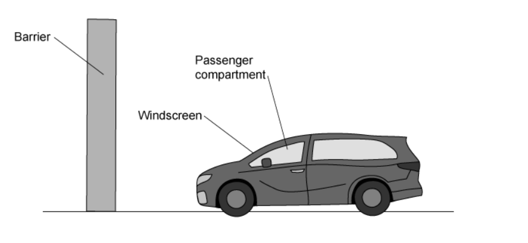
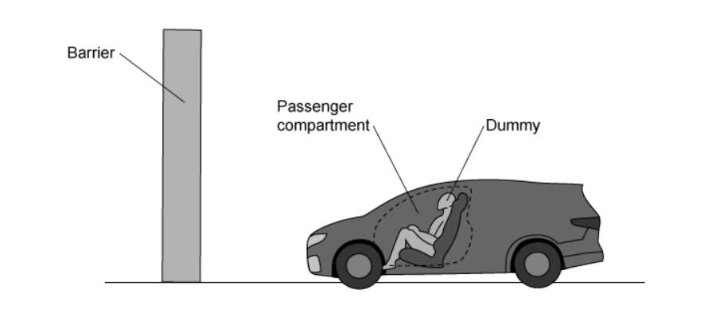
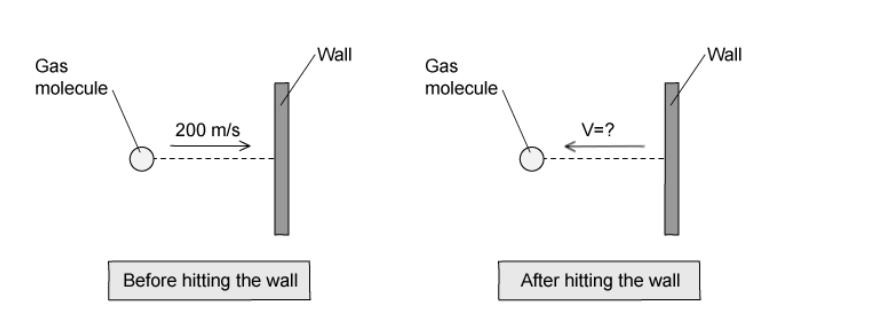

# Exam Questions — Momentum
**1. Motion, Forces & Energy** · Cambridge (CIE) IGCSE physics (0625 & 0972)
> Source: [https://www.savemyexams.com/igcse/physics/cie/23/topic-questions/](https://www.savemyexams.com/igcse/physics/cie/23/topic-questions/) · 20 questions across 1 sets

## Multiple Choice Questions (20 questions)

### Q1 — medium — 1 marks

**Q1** [1 mark]

A constant force acts on a stationary object of mass 2.0 kg. The force-time graph for the object is shown.

What is the speed of the object at 3.0 s?

### Q2 — medium — 1 marks

**Q2** [1 mark]

**Extended tier only**

An object of mass $1.2\mathrm{kg}$ is moving with a velocity of $2.0m/s$ when it is acted on by a force of $4.0N$. The velocity of the object increases to $5.0m/s$ in the same direction.

For which period of time does the force act on the object?

*Source: June 2023 0972/21 Q9*

### Q3 — hard — 1 marks

**Q3** [1 mark]

**Extended Tier Only**

A ball of mass 0.16 kg is moving forwards at a speed of 0.50 m/s. A second ball of mass 0.10 kg is stationary. The first ball strikes the second ball. The second ball moves forwards at a speed of 0.50 m/s.

What is the speed of the first ball after the collision?

*Source: June 2022 paper 2 Q10*

### Q4 — medium — 1 marks

**Q4** [1 mark]

**Extended Tier Only**

An object of mass 0.16 kg is moving forwards at a speed of 0.50 m/s.

A second object of mass 0.10 kg is at rest.

The first object strikes the second object.

After the collision, the second object moves forwards at a speed of 0.50 m/s.

What is the speed of the first object after the collision?

*Source: 2023 specimen paper 2 Q9*

### Q5 — medium — 1 marks

**Q5** [1 mark]

**Extended Tier Only**

** **Three situations are listed.

1. An object has a resultant force acting on it.
2. A moving object experiences an impulse.
3. An object is decelerating.

In which situations is the momentum of the object changing?

*Source: June 2022 paper 2 Q9*

### Q6 — medium — 1 marks

**Q6** [1 mark]

**Extended Tier Only**

A ball of mass 0.12 kg is hit by a tennis player.

The velocity of the ball changes from 0 m/s to 5.0 m/s in 0.60 s.

What is the average resultant force acting on the ball while it is being hit?

*Source: specimen 2023 paper 2 Q6*

### Q7 — easy — 1 marks

**Q7** [1 mark]

**Extended tier only**

A ball with has momentum = 30 kg m/s hits a stationary ball with momentum = 0  kg m/s so that they both move off.

What is the total momentum of the two balls following the collision?

### Q8 — easy — 1 marks

**Q8** [1 mark]

**Extended tier only**

A footballer kicks a ball with a force of 1500 N. Her foot is in contact with the ball for 1.4 seconds.

What is the impulse on the ball?

### Q9 — easy — 1 marks

**Q9** [1 mark]

**Extended tier only**

Which of these is the correct definition for momentum and its unit?

|   | **Definition** | **Unit** |
|---|---|---|
| **A** | p = m ÷ v | N/m |
| **B** | v = p × m | kg m/s |
| **C** | v = p ÷ m | N/kg |
| **D** | p = m × v | kg m/s |

### Q10 — easy — 1 marks

**Q10** [1 mark]

**Extended tier only**

A ball with mass of 5.0 kg is moving with a velocity of 3.0 m/s.

What is the momentum of the ball?

### Q11 — easy — 1 marks

**Q11** [1 mark]

**Extended tier only**

Which of the following terms and equations are equivalent to the change in an object's momentum?

| ** ** | **Term** | **Equation** |
|---|---|---|
| **A.** | Force | $F=\frac{I}{t}$ |
| **B.** | Impulse | $I=Ft$ |
| **C.** | Force | $F=ma$ |
| **D.** | Impulse | $I=\frac{\Deltap}{t}$ |

### Q12 — hard — 1 marks

**Q12** [1 mark]

**Extended tier only**

An object of mass 150 kg accelerates from a velocity of 5 m/s to a velocity of 10 m/s in the same direction.

What is the impulse provided to cause this acceleration?

### Q13 — hard — 1 marks

**Q13** [1 mark]

**Extended tier only**

A passenger of mass 90 kg is involved in a minor car crash.

The car approaches a solid barrier at 12 m/s. It crashes into the barrier and stops in 0.2 s.

What is the impulse on the passenger to bring them to rest?

### Q14 — hard — 1 marks

**Q14** [1 mark]

**Extended tier only**

A dummy is used in a crash test to investigate the safety of a new car. The deceleration of the dummy and the passenger compartment is measured.

The deceleration of the dummy is less than the deceleration of the passenger compartment.

Why is this of benefit for the safety of the passenger?

### Q15 — hard — 1 marks

**Q15** [1 mark]

**Extended tier only**

During a paintball fight, a paint pellet of mass 150g hits a stationary target with a speed of 220m/s. It takes 0.025s from the moment the pellet comes into contact with the wall until it flattens onto the wall.

What is the force exerted as a result of the paintball “splat”?

### Q16 — medium — 1 marks

**Q16** [1 mark]

**Extended tier only**

A bullet is shot from a gun. The bullet moves forward and the gun moves in the opposite direction. Which of the following statements is true?

### Q17 — medium — 1 marks

**Q17** [1 mark]

**Extended tier only**

After a car crash the car driver's airbag inflates. The airbag then deflates when it is hit by the driver’s head.

How does an airbag reduce the risk of injury?

### Q18 — medium — 1 marks

**Q18** [1 mark]

**Extended tier only**

A rollercoaster moving along a track has a large momentum.

A second rollercoaster has half the mass of the first rollercoaster and travels at four times the speed.

What is the momentum of the second rollercoaster compared to the first?

### Q19 — medium — 1 marks

**Q19** [1 mark]

**Extended tier only**

A gas molecule strikes the wall of a container with a speed of 200m/s. It rebounds with the same kinetic energy as it had before striking the wall.

What is its final velocity?

### Q20 — medium — 1 marks

**Q20** [1 mark]

**Extended tier only**

Padded dashboards in cars are safer in an accident than non-padded ones because a passenger hitting the dashboard would experience
