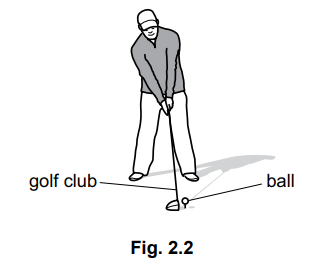
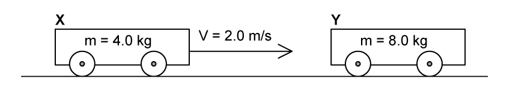
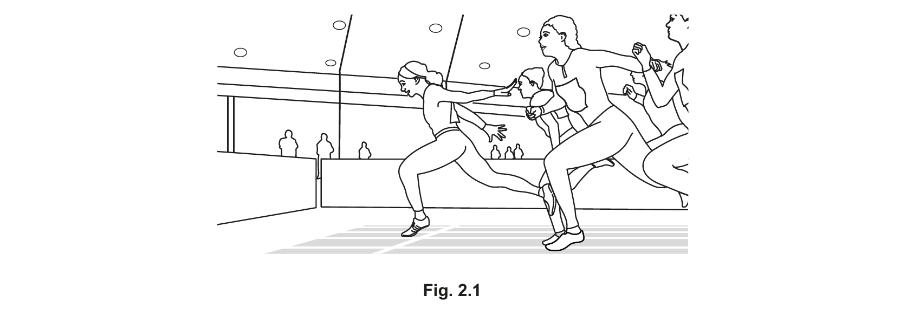
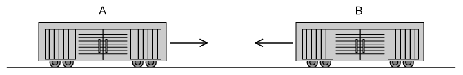
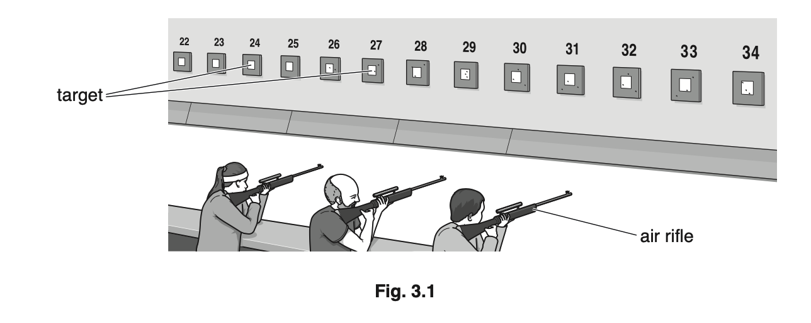
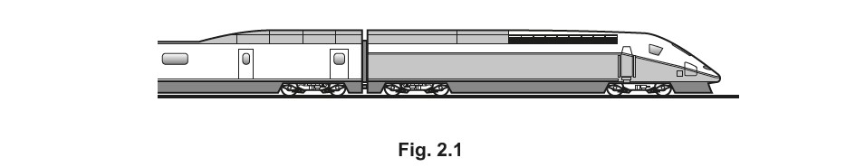
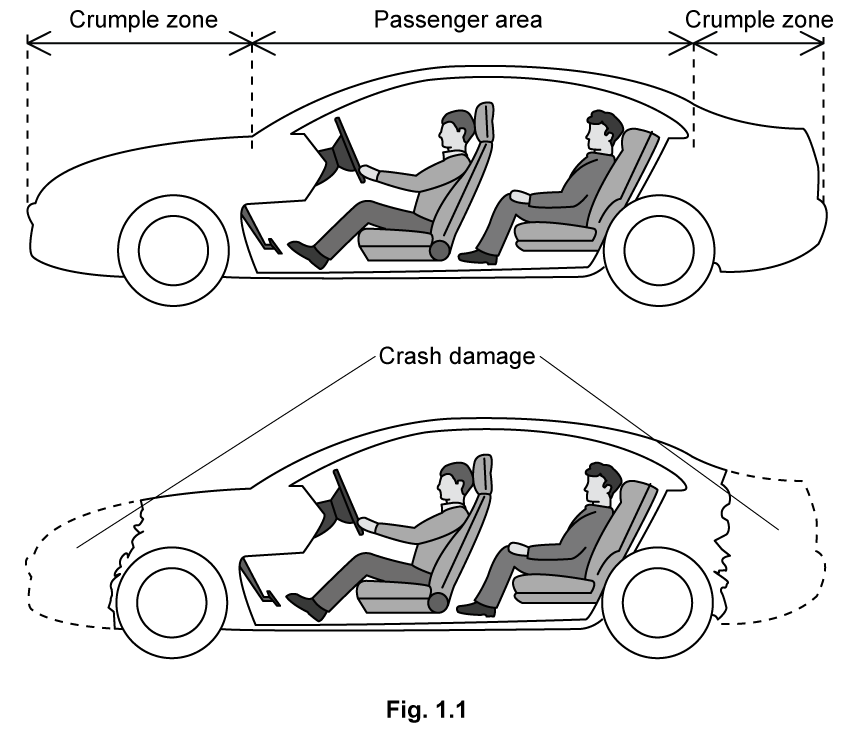
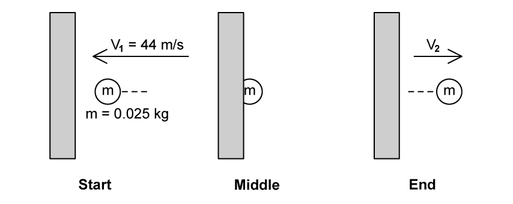

# Exam Questions — Momentum
**1. Motion, Forces & Energy** · Cambridge (CIE) IGCSE physics (0625 & 0972)
> Source: [https://www.savemyexams.com/igcse/physics/cie/23/topic-questions/](https://www.savemyexams.com/igcse/physics/cie/23/topic-questions/) · 37 questions across 2 sets

## Multiple Choice Questions (20 questions)

### Q1 — medium — 1 marks

**Q1** [1 mark]

A constant force acts on a stationary object of mass 2.0 kg. The force-time graph for the object is shown.

What is the speed of the object at 3.0 s?

### Q2 — medium — 1 marks

**Q2** [1 mark]

**Extended tier only**

An object of mass $1.2\mathrm{kg}$ is moving with a velocity of $2.0m/s$ when it is acted on by a force of $4.0N$. The velocity of the object increases to $5.0m/s$ in the same direction.

For which period of time does the force act on the object?

*Source: June 2023 0972/21 Q9*

### Q3 — hard — 1 marks

**Q3** [1 mark]

**Extended Tier Only**

A ball of mass 0.16 kg is moving forwards at a speed of 0.50 m/s. A second ball of mass 0.10 kg is stationary. The first ball strikes the second ball. The second ball moves forwards at a speed of 0.50 m/s.

What is the speed of the first ball after the collision?

*Source: June 2022 paper 2 Q10*

### Q4 — medium — 1 marks

**Q4** [1 mark]

**Extended Tier Only**

An object of mass 0.16 kg is moving forwards at a speed of 0.50 m/s.

A second object of mass 0.10 kg is at rest.

The first object strikes the second object.

After the collision, the second object moves forwards at a speed of 0.50 m/s.

What is the speed of the first object after the collision?

*Source: 2023 specimen paper 2 Q9*

### Q5 — medium — 1 marks

**Q5** [1 mark]

**Extended Tier Only**

** **Three situations are listed.

1. An object has a resultant force acting on it.
2. A moving object experiences an impulse.
3. An object is decelerating.

In which situations is the momentum of the object changing?

*Source: June 2022 paper 2 Q9*

### Q6 — medium — 1 marks

**Q6** [1 mark]

**Extended Tier Only**

A ball of mass 0.12 kg is hit by a tennis player.

The velocity of the ball changes from 0 m/s to 5.0 m/s in 0.60 s.

What is the average resultant force acting on the ball while it is being hit?

*Source: specimen 2023 paper 2 Q6*

### Q7 — easy — 1 marks

**Q7** [1 mark]

**Extended tier only**

A ball with has momentum = 30 kg m/s hits a stationary ball with momentum = 0  kg m/s so that they both move off.

What is the total momentum of the two balls following the collision?

### Q8 — easy — 1 marks

**Q8** [1 mark]

**Extended tier only**

A footballer kicks a ball with a force of 1500 N. Her foot is in contact with the ball for 1.4 seconds.

What is the impulse on the ball?

### Q9 — easy — 1 marks

**Q9** [1 mark]

**Extended tier only**

Which of these is the correct definition for momentum and its unit?

|   | **Definition** | **Unit** |
|---|---|---|
| **A** | p = m ÷ v | N/m |
| **B** | v = p × m | kg m/s |
| **C** | v = p ÷ m | N/kg |
| **D** | p = m × v | kg m/s |

### Q10 — easy — 1 marks

**Q10** [1 mark]

**Extended tier only**

A ball with mass of 5.0 kg is moving with a velocity of 3.0 m/s.

What is the momentum of the ball?

### Q11 — easy — 1 marks

**Q11** [1 mark]

**Extended tier only**

Which of the following terms and equations are equivalent to the change in an object's momentum?

| ** ** | **Term** | **Equation** |
|---|---|---|
| **A.** | Force | $F=\frac{I}{t}$ |
| **B.** | Impulse | $I=Ft$ |
| **C.** | Force | $F=ma$ |
| **D.** | Impulse | $I=\frac{\Deltap}{t}$ |

### Q12 — hard — 1 marks

**Q12** [1 mark]

**Extended tier only**

An object of mass 150 kg accelerates from a velocity of 5 m/s to a velocity of 10 m/s in the same direction.

What is the impulse provided to cause this acceleration?

### Q13 — hard — 1 marks

**Q13** [1 mark]

**Extended tier only**

A passenger of mass 90 kg is involved in a minor car crash.

The car approaches a solid barrier at 12 m/s. It crashes into the barrier and stops in 0.2 s.

What is the impulse on the passenger to bring them to rest?

### Q14 — hard — 1 marks

**Q14** [1 mark]

**Extended tier only**

A dummy is used in a crash test to investigate the safety of a new car. The deceleration of the dummy and the passenger compartment is measured.

The deceleration of the dummy is less than the deceleration of the passenger compartment.

Why is this of benefit for the safety of the passenger?

### Q15 — hard — 1 marks

**Q15** [1 mark]

**Extended tier only**

During a paintball fight, a paint pellet of mass 150g hits a stationary target with a speed of 220m/s. It takes 0.025s from the moment the pellet comes into contact with the wall until it flattens onto the wall.

What is the force exerted as a result of the paintball “splat”?

### Q16 — medium — 1 marks

**Q16** [1 mark]

**Extended tier only**

A bullet is shot from a gun. The bullet moves forward and the gun moves in the opposite direction. Which of the following statements is true?

### Q17 — medium — 1 marks

**Q17** [1 mark]

**Extended tier only**

After a car crash the car driver's airbag inflates. The airbag then deflates when it is hit by the driver’s head.

How does an airbag reduce the risk of injury?

### Q18 — medium — 1 marks

**Q18** [1 mark]

**Extended tier only**

A rollercoaster moving along a track has a large momentum.

A second rollercoaster has half the mass of the first rollercoaster and travels at four times the speed.

What is the momentum of the second rollercoaster compared to the first?

### Q19 — medium — 1 marks

**Q19** [1 mark]

**Extended tier only**

A gas molecule strikes the wall of a container with a speed of 200m/s. It rebounds with the same kinetic energy as it had before striking the wall.

What is its final velocity?

### Q20 — medium — 1 marks

**Q20** [1 mark]

**Extended tier only**

Padded dashboards in cars are safer in an accident than non-padded ones because a passenger hitting the dashboard would experience

## Theory Questions (17 questions)

### Q1 — medium — 8 marks

**Q1** [1 mark]

Trolley A and trolley B are on a horizontal, frictionless bench. Trolley A moves to the right with a constant velocity of $0.15m/s$. Trolley B is stationary.

Fig. 2.1 shows trolley A before it collides with trolley B.

**Fig. 2.1**

State which trolley has the greater momentum. Explain your answer.

**Q1** [3 marks]

**Extract:**

Trolley A and trolley B are on a horizontal, frictionless bench. Trolley A moves to the right with a constant velocity of 0.15 m/s. Trolley B is stationary.

After the collision, the two trolleys move together with a constant velocity $v$ to the right. The mass of trolley A is $1.2\mathrm{kg}$, and the mass of trolley B is $0.80\mathrm{kg}$.

Calculate $v$.

**Q1** [2 marks]

**Extract:**

After the collision, the two trolleys move together with a constant velocity v to the right. The mass of trolley A is 1.2 kg, and the mass of trolley B is 0.80 kg.

v = 0.09 m/s

The trolleys are brought to rest in $0.50s$ when they collide with the wall.

Calculate the average force exerted on the trolleys during the collision with the wall.

**Q1** [2 marks]

In a car collision, crumple zones at the front of the car deform during the impact.

Explain how crumple zones reduce injury to the passengers during a collision.

### Q2 — hard — 7 marks

**Q2** [2 marks]

**Extended Tier Only**

Complete the definitions by giving the name of each quantity.

mass × acceleration = ........................................................

force × time = ........................................................

*Source: 2023 specimen paper 4 Q2A*

**Q2** [5 marks]

**Extended Tier Only**

Fig. 2.2 shows a man using a golf club to hit a ball

The ball has a mass of 0.046 kg. The golf club is in contact with the ball for a duration of 5.0 × 10–4 s and the ball leaves the golf club at a speed of 65 m/s.

(i) Calculate the momentum of the ball as it leaves the golf club.

[2]

(ii)** **Calculate the average resultant force acting on the ball while it is in contact with the golf club.

[2]

(iii) While the golf club is in contact with the ball, the ball becomes compressed and changes shape.

State the type of energy stored in the ball during its contact with the golf club.

[1]

*Source: 2023 Specimen paper 4 Q2B*

### Q3 — easy — 9 marks

**Q3** [1 mark]

**Extended tier only**

Choose the word from the list which completes the sentence:

Momentum is a property of a moving object making it difficult for it to change ....................

**direction      mass      speed      weight**

**Q3** [3 marks]

**Extended tier only**

A ball with mass 5.0 kg is moving with velocity of 10 m/s.

Calculate the momentum of the ball.

**Q3** [2 marks]

**Extract:**

A ball with mass 5.0 kg is moving with velocity of 10 m/s.

List the known quantities:
- Mass, m = 5.0 kg
- Velocity, v = 10 m/s

State the equation for momentum and calculate:
- p = m v
- p = 5.0 × 10
- p = 50 kg m/s

**Extended tier only**

The ball in part (b) hits a wall and rebounds in the opposite direction. The speed of the ball does not change.

Without further calculation, state the momentum of the ball in part (b) after it rebounds.

**Q3** [3 marks]

**Extract:**

A ball with mass 5.0 kg is moving with velocity of 10 m/s.

The momentum of the ball in part (b) after it rebounds is:
- − 50 (kg m/s)

The speed of the ball does not change, but it rebounds in the opposite direction.

**Extended tier only**

Explain your answer to part (c).

### Q4 — easy — 9 marks

**Q4** [3 marks]

**Extended tier only**

A trolley **X** with mass of 4.0 kg is moving on a track with velocity of 2.0 m/s towards a stationary trolley **Y** with mass of 8.0 kg as shown in Fig. 1.

**Fig. 1**

Calculate the initial momentum of trolley **X**.

**Q4** [1 mark]

**Extract:**

A trolley X with mass of 4.0 kg is moving on a track with velocity of 2.0 m/s towards a stationary trolley Y with mass of 8.0 kg.

Mass, m = 4.0 kg
Velocity, v = 2.0 m/s

p = m × v
p = 4.0 × 2.0
p = 8.0 kg m/s

**Extended tier only**

Trolley **X** collides with trolley **Y**.

If the two trolleys stick together, calculate their combined momentum after the collision.

**Q4** [3 marks]

**Extract:**

A trolley X with mass of 4.0 kg is moving on a track with velocity of 2.0 m/s towards a stationary trolley Y with mass of 8.0 kg as shown in Fig. 1.

Calculate the initial momentum of trolley X.

The combined momentum after the collision is:
- Momentum before the collision = momentum after the collision
- Therefore combined momentum = 8.0 kg m/s

**Extended tier only**

Calculate the velocity of the two trucks after the collision.

**Q4** [2 marks]

**Extract:**

Momentum of the combined trucks, p = 8.0 kg m/s
Mass after collision = (4.0 + 8.0) = 12.0 kg
v = p / m
v = 8.0 / 12.0
v = 0.67 m/s (to two sig figs, with unit)

(The positive value of velocity indicates the direction is the same as the initial direction of trolley X.)

**Extended tier only**

State the direction the trolleys will move in, and explain your answer.

### Q5 — medium — 3 marks

**Q5** [3 marks]

**Extended tier only**

A tennis player is practicing by hitting a ball many times against a wall.   The ball hits the wall 20 times in 60 s.

The average change in momentum for each collision with the wall is 4.2 kg m/s.

Calculate the average force that the ball exerts on the wall.

*Source: February/March 2018 0625/42 Q5B*

### Q6 — hard — 8 marks

**Q6** [3 marks]

**Extended tier only**

Fig. 2.1 shows an athlete crossing the finishing line in a race. As she crosses the finishing line, her speed is 10.0 m/s. She slows down to a speed of 4.0 m/s.

The mass of the athlete is 71 kg. Calculate the impulse applied to her as she slows down. Give your answer to 2 significant figures.

impulse = ...............................................

*Source: 2020 Feb/March 0625/42 Q2A*

**Q6** [3 marks]

**Extract:**

Initial velocity, u = 10.0 m/s
Final velocity, v = 4.0 m/s
Mass, m = 71 kg
Impulse = −430 N s (2 s.f.)

**Extended tier only**

(i) Define impulse in terms of force and time.

[1]

(ii) The athlete takes 1.2 s to slow down from a speed of 10.0 m/s to a speed of 4.0 m/s.

Calculate the average resultant force applied to the athlete as she slows down.

force = ........................................................ [2]

*Source: 2020 Feb/March 0625/42 Q2B*

**Q6** [2 marks]

**Extended tier only**

Calculate the force required to give a mass of 71 kg an acceleration of 6.4 m/s2.

force = ........................................................

*Source: 2020 Feb/March 0625/42 Q2C*

### Q7 — hard — 9 marks

**Q7** [4 marks]

**Extended tier only**

Fig. 1 shows two railway trucks **A** and **B** travelling towards each other on the same railway line which is straight and horizontal.

**Fig. 1 **

The trucks are involved in a collision. They join when they collide and then move together.

Truck **A **has a total mass of 27 000 kg and truck **B **has a total mass of 22 000 kg.

Just before the collision, truck **A** was moving at a speed of 3.6 m s–1 and truck **B** was moving at a speed of 2.4 m s–1.

Calculate the speed of the joined trucks immediately after the collision.

**Q7** [1 mark]

**Extract:**

Truck A has a total mass of 27 000 kg and truck B has a total mass of 22 000 kg. Just before the collision, truck A was moving at a speed of 3.6 m s^–1 and truck B was moving at a speed of 2.4 m s^–1. The velocity of the joined trucks immediately after the collision is 0.91 m/s.

**Extended tier only**

During the collision each truck experiences an impulse acting on it.

(i)  Calculate the impulse that acts on each truck during the collision.

[2]

(ii) State two possible units for your answer.

[2]

**Q7** [2 marks]

**Extract:**

Truck A has a total mass of 27 000 kg and truck B has a total mass of 22 000 kg. Just before the collision, truck A was moving at a speed of 3.6 m s^–1^ and truck B was moving at a speed of 2.4 m s^–1^.

Velocity of the joined trucks, v_AB = 0.91 m/s

**Extended tier only**

The trucks come to a stop after 3.0 minutes.

Calculate the deceleration of the joined trucks.

**Q7** [2 marks]

**Extract:**

The trucks come to a stop after 3.0 minutes.

Explain why two trucks on rail tracks stop moving after they have collided.

### Q8 — medium — 7 marks

**Q8** [2 marks]

**Extended tier only**

Complete Fig. 2.1 by writing in the right-hand column the name of the quantity given by the product in the left-hand column.

| product | quantity |
|---|---|
| mass × acceleration |   |
| force × time |   |

**Fig 2.1**

*Source: Oct/Nov2018  (Series 3) 0625/43 Q2A*

**Q8** [5 marks]

**Extended tier only**

Fig. 2.2 shows a man hitting a ball with a golf club.

The ball has a mass of 0.046 kg. The golf club is in contact with the ball for 5.0 × 10–4 s and the ball leaves the golf club at a speed of 65 m/s.

(i) Calculate:

1. the momentum of the ball as it leaves the golf club

momentum = ...........................................................[2]

2. the average resultant force acting on the ball while it is in contact with the golf club.

average force = ...........................................................[2]

(ii) While the golf club is in contact with the ball, the ball becomes compressed and changes shape.

Name the energy store being filled whilst the ball is in contact with the golf club.

[1]

*Source: Oct/Nov2018  (Series 3) 0625/43 Q2B*

### Q9 — medium — 9 marks

**Q9** [1 mark]

**Extended tier only**

Fig. 3.1 shows a shooting competition, where air rifles fire soft metal pellets at distant targets.

When an air rifle is fired, it exerts an impulse of 0.019 N s on the pellet.

Define *impulse*.

*Source: Oct 2019 0625/41 Q3A*

**Q9** [5 marks]

**Extract:**

When an air rifle is fired, it exerts an impulse of 0.019 N s on the pellet.

The pellet has a mass of 1.1 × 10^–4 kg.

**Extended tier only**

The pellet has a mass of 1.1 × 10–4 kg.

Determine:

(i) the speed with which the pellet leaves the rifle

speed = ........................................................ [2]

(ii) the kinetic energy of the pellet as it leaves the rifle.

kinetic energy = ........................................................ [3]

*Source: Oct 2019 0625/41 Q3B*

**Q9** [3 marks]

The pellet melts when it strikes the target.

Describe how the molecular structure of the liquid metal differs from that of the solid metal.

*Source: Oct 2019 0625/41 Q3C*

### Q10 — medium — 12 marks

**Q10** [2 marks]

**Extended tier only**

State the equation for impulse in terms of the velocity of an object. Define the variables used.

**Q10** [5 marks]

**Extended tier only**

In a game of croquet, a player hits a ball which was initially at rest with a mallet.

The mallet has mass of 1.36 kg.

(i) The mallet is in contact with the ball for 11 ms. The average force on the ball during this time is 200 N.

Calculate the impulse on the croquet ball.

impulse = ...........................................................[3]

(ii) The mass of the ball is 0.450 kg.

Calculate the speed with which the ball leaves the mallet.

speed = ...........................................................[2]

**Q10** [3 marks]

**Extract:**

The mallet has mass of 1.36 kg.
The mass of the ball is 0.450 kg.
The ball is initially at rest.
The speed with which the ball leaves the mallet is 4.9 m/s (2 s.f.).
After making contact with the ball the mallet stops moving.

**Extended tier only**

After making contact with the ball the mallet stops moving.

Calculate the velocity of the mallet at the moment it hit the ball.

Give your answer to 2 significant figures and state the unit.

**Q10** [2 marks]

**Extract:**

In a game of croquet, a player hits a ball which was initially at rest with a mallet.

The mallet has mass of 1.36 kg.

(i) The mallet is in contact with the ball for 11 ms. The average force on the ball during this time is 200 N.

(ii) The mass of the ball is 0.450 kg.

State the energy transfer that takes place:

(i) As the ball changes shape during the contact between the mallet and the ball.

[1]

(ii) As the ball leaves the mallet.

[1]

### Q11 — medium — 7 marks

**Q11** [1 mark]

**Extended tier only**

The velocity of an object of mass *m* increases from *u* to *v*.

State, in terms of *m*, *u* and* v*, the change of momentum of the object.

*Source: Oct/Nov2018  (Series 2) 0625/42 Q3A*

**Q11** [6 marks]

**Extended tier only**

In a game of tennis, a player hits a stationary ball with his racquet.

(i) The racquet is in contact with the ball for 6.0 ms. The average force on the ball during this time is 400 N.

Calculate the impulse on the tennis ball.

impulse = ...........................................................[2]

(ii) The mass of the ball is 0.056 kg.

Calculate the speed with which the ball leaves the racquet.

speed = ...........................................................[2]

(iii) State the energy transfer that takes place:

1. as the ball changes shape during the contact between the racquet and the ball

2. as the ball leaves the racquet.

[2]

*Source: Oct/Nov2018  (Series 2) 0625/42 Q3B*

### Q12 — hard — 8 marks

**Q12** [3 marks]

**Extended tier only**

Fig. 2.1 shows a train.

The total mass of the train and its passengers is 750 000 kg. The train is travelling at a speed of 84 m/s. The driver applies the brakes and the train takes 80 s to slow down to a speed of 42 m/s.

Calculate the impulse applied to the train as it slows down.

impulse = .........................................................

*Source: May/June 2020 (Series 2) 0625/42 Q2A*

**Q12** [2 marks]

**Extract:**

Total mass, m = 750 000 kg
Initial speed of train, u = 84 m/s
Final speed of train, v =  42 m/s
Time, t = 80 s
impulse = −3.2 × 10^7 N s (OR kg m/s)

**Extended tier only**

Calculate the average resultant force applied to the train as it slows down.

force = .........................................................

*Source: May/June 2020 (Series 2) 0625/42 Q2B*

**Q12** [1 mark]

Suggest how the shape of a modern electric train helps it to travel at high speeds.

*Source: May/June 2020 (Series 2) 0625/42 Q2C*

**Q12** [1 mark]

**Extract:**

The total mass of the train and its passengers is 750 000 kg. The train is travelling at a speed of 84 m/s. The driver applies the brakes and the train takes 80 s to slow down to a speed of 42 m/s.

The train took 80 s to reduce its speed from 84 m/s to 42 m/s. Explain why, with the same braking force, the train takes more than 80 s to reduce its speed from 42 m/s to zero.

*Source: May/June 2020 (Series 2) 0625/42 Q2D*

**Q12** [1 mark]

On a wet day, the train travels a greater distance before it stops along the same track. The train has the same speed of 84 m / s before the brakes are applied.

Suggest a reason for this.

*Source: May/June 2020 (Series 2) 0625/42 Q2E*

### Q13 — easy — 11 marks

**Q13** [3 marks]

**Extended tier only**

A golf ball with mass 0.05 kg is at rest on the grass as shown in Fig. 1.

**Fig. 1**

The ball is hit with a putter so that the ball moves off with velocity of 2.0 m/s

Calculate the momentum of the ball after being hit with the putter.

**Q13** [3 marks]

**Extract:**

A golf ball with mass 0.05 kg is at rest on the grass as shown in Fig. 1. The ball is hit with a putter so that the ball moves off with velocity of 2.0 m/s.

**Extended tier only**

After hitting the golf ball the putter immediately stops moving. The mass of the putter is 0.5 kg.

Calculate the velocity of the putter at the moment it hit the ball.

**Q13** [2 marks]

**Extract:**

A golf ball with mass 0.05 kg is at rest on the grass as shown in Fig. 1. The ball is hit with a putter so that the ball moves off with velocity of 2.0 m/s

List the known quantities:
- Mass, m = 0.05 kg
- Velocity, v = 2.0 m/s

State the equation for momentum and calculate:
- p = m × v
- p = 0.05 × 2.0
- p = 0.1 kg m/s

**Extended tier only**

For the golf ball in part (a) state the impulse exerted on the ball by the putter.

**Q13** [3 marks]

**Extract:**

Use the equation for impulse:

- Impulse = change in momentum / Δp  [1 mark]

Determine the change in momentum of the ball:

- Initially velocity = 0 so momentum = 0
- Therefore change in momentum = final momentum
- Change in momentum = impulse = 0.1 kg m/s [1 mark]

**Extended tier only**

The putter is in contact with the ball for 0.6 seconds.

Calculate the force exerted on the ball by the putter.

### Q14 — hard — 11 marks

**Q14** [6 marks]

**Extended tier only**

Until the second half of the 20th century, cars were designed as strong rigid boxes, which designers thought would protect passengers in accidents. In fact, although average speeds were much slower than today, passengers were often very badly injured.

Modern cars are designed with safety features including 'crumple zones'. The crumple zones are at the front and rear of the car but do not include the passenger section. In a crash, the crumple zone is designed so that it deforms and bends. This is shown in Fig. 1.1.

The use of crumple zones explains why the front and rear of cars are badly damaged during accidents.

Use your knowledge of momentum and impulse forces to suggest why a car with a crumple zone protects the driver and passengers from serious injury better than one which is a strong, rigid box.

**Q14** [5 marks]

**Extended tier only**

Two cars are crash-tested, with crash test dummy 'drivers' wearing seatbelts, to assess the force reduction that crumple zones provide in a road-traffic accident.

Car **A **has a mass of 1200 kg and car **B** has a mass of 1500 kg.

**Both** cars have a driver of mass 70 kg and they **both **crash to a stop from an initial speed of 30 m/s.

At the moment of impact, the front ends of the cars crumple, taking different amounts of time to come to a stop. Car **A** takes 0.3 seconds to stop, while car **B** takes 0.7 seconds to stop.

Using this information, calculate the forces which would be experienced by the **cars **due to the impact.

(i) For car **A**

Force = .................................... N [3]

(ii)

For car **B**

Force = .................................... N [2]

### Q15 — hard — 15 marks

**Q15** [2 marks]

**Extended tier only**

A shell, of mass 30 g, is fired from the barrel of a rifle, of mass 1.9 kg, with a momentum 36 kg m/s.

State the total momentum of the rifle and the bullet before the rifle is fired and give a reason for your answer.

**Q15** [3 marks]

**Extract:**

A shell, of mass 30 g, is fired from the barrel of a rifle, of mass 1.9 kg, with a momentum 36 kg m/s.

**Extended tier only**

Calculate the velocity of the shell just after the rifle is fired.

**Q15** [6 marks]

**Extract:**

A shell, of mass 30 g, is fired from the barrel of a rifle, of mass 1.9 kg, with a momentum 36 kg m/s.
The total momentum of the rifle and the bullet before being fired is:
- Momentum,* p* = 0 kg m/s
Because:
- (Before the rifle is fired both) rifle and bullet are stationary / velocity = 0;

Mass of shell, m_s = 30 g = 0.03 kg
Momentum of shell after being fired, p = 36 kg m/s
Calculate the velocity of the shell using the momentum equation:
- p = m v
- v = p / m = 36 / 0.03
- v = 1200 m/s

**Extended tier only**

Continue to calculate for the moment just after the rifle has been fired.

(i) Use the principle of conservation of momentum, and your answer to part (a), to state the total momentum of the rifle and the shell.

[2]

(ii) Calculate the recoil momentum of the rifle.

[4]

**Q15** [4 marks]

**Extended tier only**

The shell has a momentum of 9.8 kg m/s just before it hits a target.

It takes 4.5 ms for the bullet to the stopped by the target.

Calculate the average force needed to stop the bullet.

### Q16 — easy — 9 marks

**Q16** [3 marks]

**Extended tier only**

A squash ball is hit towards a wall at a velocity of 44 m/s. The ball has mass 0.025 kg.

The motion of the ball is shown in Fig. 1.

**Fig. 1.**

Calculate the momentum of the ball at the start, before it hits the wall.

**Q16** [1 mark]

**Extract:**

Mass, m = 0.025 kg

**Extended tier only**

The ball is in contact with the wall for 0.1 s and then rebounds with velocity 42 m/s

Calculate the momentum of the ball at the end of the motion, after the impact with the wall.

Consider the direction of motion in your answer.

**Q16** [4 marks]

**Extract:**

Mass, m = 0.025 kg
Velocity before hitting the wall, v = 44 m/s
Momentum before hitting the wall: p = 1.1 kg m/s
Velocity after rebounding, v = −42 m/s
Momentum after rebounding: p = −1.05 kg m/s

**Extended tier only**

For the initial and final motion of the ball

(i) Calculate the change in momentum.

[3]

(ii) State the impulse on the ball.

[1]

**Q16** [1 mark]

**Extract:**

Impulse = 2.15 kg m/s (from part (c))
Time = 0.1 s (from part (b))

**Extended tier only**

Calculate the force exerted on the ball by the wall.

### Q17 — easy — 8 marks

**Q17** [1 mark]

**Extended tier only**

State the equation for momentum.

**Q17** [3 marks]

**Extract:**

The equation for momentum is

- Momentum = mass × velocity  OR  p = m v

**Extended tier only**

For the momentum equation in part (a) state the units of each variable.

**Q17** [2 marks]

**Extract:**

Momentum = mass × velocity  OR  p = m v

**Extended tier only**

Without calculation, state the momentum of an object at rest and explain your answer.

**Q17** [2 marks]

**Extended tier only**

Complete the sentence to state the principle of conservation of momentum.

**In a closed system, the total momentum ........... an event is ........... to the total momentum after the event**
