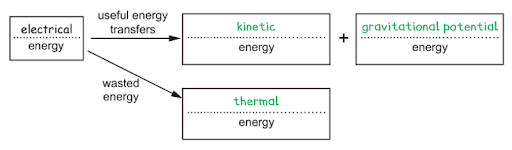
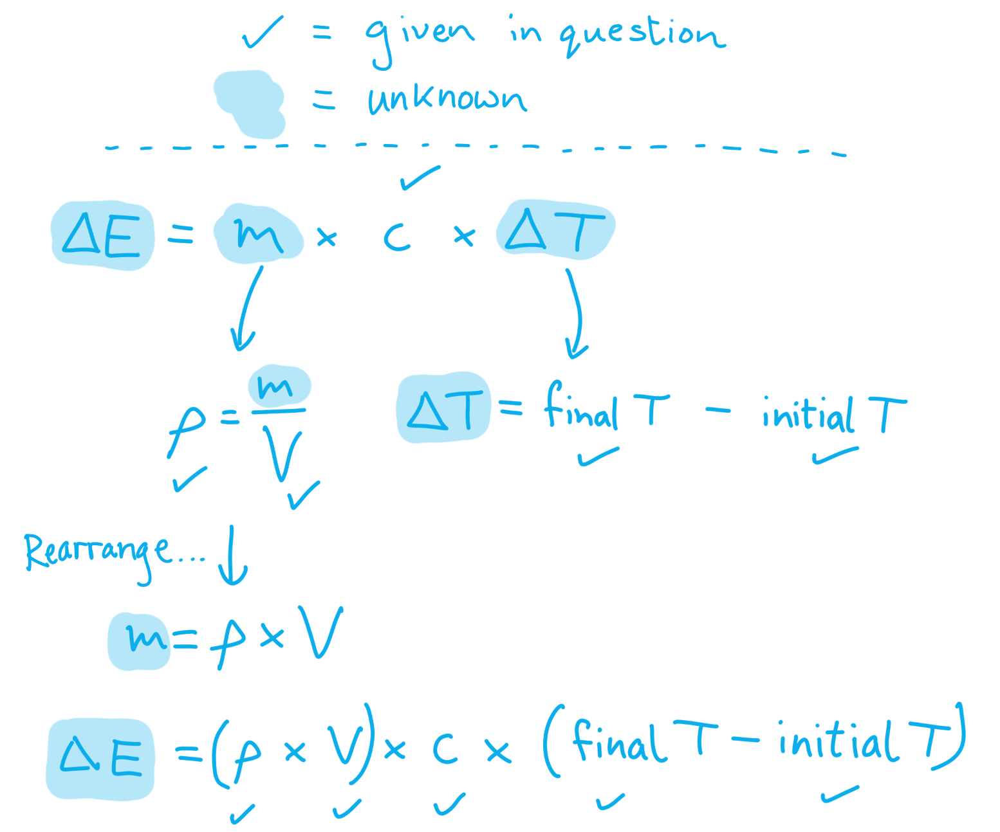
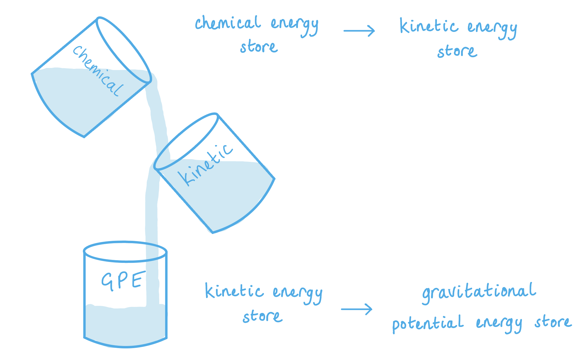
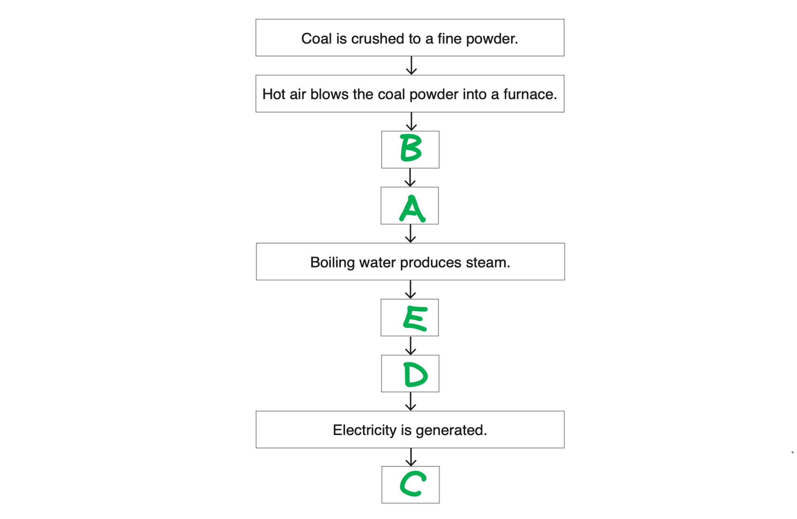

# Mark Schemes — Energy, Work & Power
**1. Motion, Forces & Energy** · Cambridge (CIE) IGCSE physics (0625 & 0972)

## Alternative To Practical Questions (1 questions)

### Q1
To investigate how the work required to pull the box up the slope depends on the mass of the box and its contents:

List any other apparatus that you would use:

- Forcemeter / newtonmeter

**OR**

- Pully and weights; **[1 mark]**

Outline the method:

- Pull the box up the slope and measure the force and the distance moved; **[1 mark]**
- Repeat with different masses in the box; **[1 mark]**

List the control variables:

- The angle of the slope / height of the blocks; **[1 mark]**
- The distanced moved up the slope; **[1 mark]**

Design a results table:

A table scoring one mark:

| Mass/kg |   |   |   |   |   |
|---|---|---|---|---|---|
| Force/N |   |   |   |   |   |

- A table drawn with columns for force / N and mass / kg with units given; **[1 mark]**

Explain how you would use the results to reach a conclusion:

**Any one from:**

- Calculate the work done and compare it for the different masses; **[1 mark]**
- Plot a graph of work done against mass; **[1 mark]**

**[Total: 7 marks]**

> *The instruction to list any other equipment needed, can be done as a labelled diagram or by annotating the diagram provided on the exam paper. *

> *Control variables should only be factors that would affect the results, make sure you chose ones that are contextually relevant!*

> *Remember that you do **not **need to waste time making up data to put in your results table!*

> *The mark scheme shows the kind of short descriptions which easily score full marks in the exam.*

> *The most common mistakes with investigation questions are;*

- *Saying what the result will be, rather than how to draw the conclusion;*
- *Forgetting that only one variable can change, and changing all of them;*
- *Showing repeat readings or the range in the table, but not mentioning them in the description (it seems unfair, but this won't get you the mark);*
- *Wasting time by inventing data for the table.*

> *If you find yourself doing one of these - stop!*

> *And finally, the examiner will award marks for the diagram, so anything which is explained there will count. *

## Multiple Choice Questions (29 questions)

### Q1
**Final answer:** **The correct answer is B**

- Calculate the useful energy output (work done against gravity):

$W = F \times d$

$W = 500 \times 3 . 0 = 1500 \text{J}$

- Calculate the efficiency:

`\text{efficiency} = \frac{\text{useful energy output}}{\text{total energy input}} \times 100\%`

`\text{efficiency} = \frac{1500}{2250} \times 100 = 67\%`

**A** is incorrect because 33% could result from halving the useful energy output (e.g. using 750 J instead of 1500 J).

**C** is incorrect because 75% could result from using an incorrect value for the total energy input.

**D** is incorrect because 85% could result from dividing the total energy input by the sum of the input and the load force, rather than calculating work done.

### Q2
**Final answer:** **The correct answer is D**

- As the ball falls, it loses height, and therefore the energy in its gravitational potential store decreases
- The ball speeds up, so the energy in its kinetic store increases
- Therefore, the main transfer between energy stores is:

gravitational potential energy → kinetic energy

**A** is incorrect because chemical energy is not involved in a falling ball. Chemical energy is stored in fuels, food and batteries.

**B** is incorrect because elastic energy is only relevant if the ball deforms (e.g. on impact with the ground), not during free fall through air.

**C** is incorrect because this describes the energy transfer for the opposite motion, i.e. a ball being thrown upwards into the air.

### Q3
**Final answer:** **The correct answer is B**

- As the students climb the stairs, they do work against gravity
- The work done by each student is equal to the energy transferred to the gravitational potential store, which depends on

  - their weight $( W = m g )$
  - the vertical height climbed
- Since both students climb the same vertical height, the student with the smaller weight (student Y) does less work
- Power is defined as the rate of doing work:

$\text{power}=\frac{\text{work done}}{\text{time}}$

- For the same average power, a smaller amount of work done results in a shorter time to reach the top of the stairs

**A** is incorrect as student X does more work and will therefore take more time to reach the top given the same power output.

**C** is incorrect because time depends on both power and the amount of work to be done; since the work values are different, the times cannot be the same.

**D** is incorrect as student Y actually transfers less energy to their gravitational potential store because they have a smaller weight than student X.

### Q4
**Final answer:** **The correct answer is ****C**** because:**

- The kinetic energy equation is:

$E_{k}=\frac{1}{2}mv^{2}$

- Which can be rearranged to give:

$v^{2}=\frac{2E_{k}}{m}$

- Substitution in the values from the question gives:

$v^{2}=\frac{2\times81J}{50kg}=3.24\,v=\sqrt{3.24}=1.8m/s$

### Q5
**Final answer:** **The correct answer is ****A****, because:**

- The power of a system (or child) is given by the relationship:

$\mathrm{power}=\frac{\mathrm{work} \mathrm{done}}{\mathrm{time} \mathrm{taken}}\mathrm{or}P=\frac{W}{t}$

- The work done (*W*) is exactly the same each time the child runs up the stairs, so the maximum power (*P*) is greatest when the time (*t*) is shortest

To answer the question, you need to understand the factors that affect power, but you do not need to calculate it. Power is work done per unit time, or how much work is done per second.

The work done cannot be calculated, as there is not enough information. Power will depend on the height of the stairs and the mass of the child, neither of which was given. However, these remain constant as the stairs are always the same height and the child always has the same mass. Therefore, only the time is important.

### Q6
**Final answer:** **The correct answer is ****B****, because:**

- The gravitational potential energy store of the rock decreases as its height above the ground decreases

  - Therefore, options **C** and **D** can be eliminated
- This change in energy can be calculated using the equation:

$W=F\timesd$

- The force acting is the weight of the rock (50 N), the distance moved is -7.0 m
- The correct calculation is then: $W=50N\times7.0m=350J$ You should be careful when thinking about the direction of movement of objects in gravitational fields. If an object rises, its gravitational potential energy increases as work is done lifting it. If the object falls, its gravitational potential energy decreases. Answers **C** and **D** are incorrect because the gravitational potential energy decreases as the rock falls.

### Q7
**Final answer:** **The correct answer is ****A**** because:**

- Increasing the **height **of an object in a gravitational field will increase the energy in its **gravitational potential store**
- Therefore, when water is pumped up to a greater height, the energy in its gravitational potential store** **must **increase**

To answer questions like this, you need to read the information provided in the question carefully. Do not make any other assumptions about the movement of the substances.

You should also know which factors affect the energy stores of objects or substances. For example, the amount of energy in an object’s kinetic energy store depends on mass and velocity, and so kinetic energy would increase if the mass increased or if the velocity increased.

**B** is incorrect because the water would need to be moving at a lower speed to have less kinetic energy. The information in the table does not say that the water moves more slowly when it is pumped upwards.

**C** is incorrect because the air has not been moved upwards (or downwards) and so there is no change in its gravitational potential energy store.

**D** is incorrect because the speed of the air would decrease as it passed through the turbine and so the kinetic energy of the air would decrease.

### Q8
**Final answer:** **The correct answer is C because:**

- As the car decelerates, the work done by the brakes is equal to the car’s change in kinetic energy
- The car comes to rest, so the final kinetic energy is zero

$\DeltaE_{k}=W=620000J$

- The work done by the brakes to stop the car is equal to

$\DeltaE_{k}=W=Fd$

- Rearrange for the average braking force F and calculate:

$F=\frac{W}{d}=\frac{620000}{91}=6813$ N

- This is closest to 6800 N, which is option **C**

### Q9
**Final answer:** **The correct answer is A because:**

- Consider the motion of the mass and spring:

  - When the mass is raised to point P, it gains **gravitational potential energy **
  - When the mass is released, that gravitational potential energy is transferred into **kinetic energy**
  - When the spring begins to stretch, the kinetic energy is transferred into **elastic energy** until it reaches the lower point Q
  - As the mass moves back up to point P, the same energy changes occur in reverse
- Therefore, as the mass oscillates repeatedly between P and Q, energy changes between gravitational potential, kinetic and elastic types

**B** is incorrect because elastic energy is stored in the stretched spring

**C** & **D** are incorrect because internal energy is related to the molecules in a substance rather than its motion

### Q10
**Final answer:** **The correct answer is C because:**

- The man’s goal is to ascend the ladder
- His work done in moving upwards is therefore the ‘useful’ energy in this scenario

  - The work done is the product of his weight and vertical distance
  - Both are needed to calculate useful energy
  - Eliminate option **A**
- The equation for calculating power is:

power = $\frac{energytransferred}{timetaken}$

- Therefore, useful power is equal to the useful energy divided by the time taken

  - Both work done and time taken must be known
  - Eliminate options **B** and **D**

To calculate useful power, work done and time must both be known. Work done is the product of weight and vertical distance.

**A **is incorrect as work done cannot be calculated without vertical distance

**B **is incorrect as work done can be calculated, but without time power cannot be calculated

**D **is incorrect as work done is given, but without time power cannot be calculated

### Q11
**Final answer:** **The correct answer is B because:**

- At the top of the hill, the ball has only gravitational potential energy
- As it rolls, this is converted to kinetic energy
- Upon hitting the wall, the ball compresses and heats slightly

  - The kinetic energy is transferred to the internal store of the ball

This question can also be answered by a process of elimination. At the end, the ball has come to a stop, so the final change cannot be to kinetic energy. The ball has also rolled to the bottom of the hill, so the final store cannot be gravitational potential energy.

This leaves options **B** and **C**, and it is clear to see that the ball starts with gravitational potential energy as it is at the top of the hill.

### Q12
**Final answer:** **The correct answer is C because:**

- When a force *F* acts on an object and moves it a distance *d* in the direction of the force, the work done is equal to:

$\mathrm{work} \mathrm{done}=\mathrm{force}\times\mathrm{distance}=F\timesd$

- This is option **C**

### Q13
**Final answer:** **The correct answer is ****C**** because:**

- It is incorrect to say that energy is **used up**
- Energy can be transferred from object to object, but it can also be transferred from store to store within the same object

### Q14
**Final answer:** **The correct answer is ****A ****because: **

- When objects are moving they have energy
- This energy is their kinetic store

**B** is incorrect as a box sitting on a high shelf has energy in its **gravitational store**

**C **is incorrect as** **compression of springs in a car's suspension causes energy to be in their** elastic store**

**D **is incorrect as the nuclei of uranium atoms have energy in their **nuclear store**

### Q15
**Final answer:** **The correct answer is ****C**** because:**

- Energy is stored in the **chemical energy store of the log**

  - It is transferred by heating and radiation to the **thermal energy store of the surroundings **as heat and light

Answers **A**, **B** and **D** are incorrect because to release energy from the nuclear store, nuclei have to be fused together (fusion) or split apart (fission). No nuclear reactions take place in the burning of a log.

### Q16
**Final answer:** **The correct answer is ****A ****because:**

- A force acting over a distance is **work done**
- All the other answer options correctly describe power

### Q17
**Final answer:** **The correct answer is ****C**** because:**

- Energy is transferred by heating from the thermal store of the heating element of the kettle to the thermal store of the water

Sometimes energy will be transferred from store to store within an object. Other times, energy will be transferred from object to object. To work out the correct energy transfer taking place, it is important to define or identify the system. In this case, it is the process of heating or boiling the water.

### Q18
**Final answer:** **The correct answer is ****D**** because:**

$efficiency=\frac{usefuloutputpower}{totalinputpower}$

- The total input power is **8.0 W**
- The useful output power is light, not heat, and so is** 7.5 W**

**A is incorrect because it gives  **$\frac{totalinputpower}{wastedpower}$

**B is incorrect because it gives **$\frac{usefuloutputpower}{wastedpower}$

**C is incorrect because it gives **$\frac{wastedpower}{totalinputpower}$

### Q19
**Final answer:** **The correct answer is ****D**** because:**

- The most efficient energy transfer is the one that produces the greatest percentage of useful energy output, which is the same as saying the lowest percentage of wasted energy output
- Answer **D** has a wasted energy output of **25%**

  - Therefore, it has a useful energy output of **75%**
- Answer **D** has the greatest percentage of useful energy output

  - Therefore, it is the most efficient energy transfer

### Q20
**Final answer:** **The correct answer is ****B**** because:**

- Kinetic energy =  $\frac{1}{2}$= mass × velocity2

  - $E_{K}=\frac{1}{2}mv^{2}$
- If the wind speed is reduced by half then:

  - $E_{K} = 1 \frac{1}{2} m ( \frac{v}{2} )^{2}$
  - $E_{K}=\frac{1}{2}m\frac{v^{2}}{2^{2}}$
  - $E_{K}=\frac{1}{2}m\frac{v^{2}}{4}$
  - $E_{K} = 1 \frac{1}{4} ( 1 \frac{1}{2} m v^{2} )$

If the wind speed is reduced by half, then the kinetic energy is reduced by a factor of 4

- Or $\frac{1}{4}$ of the original *E*K
- This is answer** B**

This is really a proportionality question, you need to be familiar with how to solve proportionality questions like this to achieve the top grades at IGCSE.

### Q21
**Final answer:** **The correct answer is ****D**** because:**

- Work done = force x distance moved in the direction of the force
- Work done = 70 x 4.0 = 280 J. This is the smallest amount of work in the table.

**A** is incorrect as 20 x 20 = 400 J

**B** is incorrect as 40 x 10 = 400 J

**C** is incorrect as 50 x 6.0 = 300 J

### Q22
**Final answer:** **The correct answer is ****B**** because:**

- Work done = force x distance moved in the direction of the force.
- Since the force is pushing in the same direction as distance *y*, the correct answer is *y*.

**A **is incorrect as x is the vertical distance. This *would* be correct if the force given were the weight, which acts straight down.

**C** is incorrect  as z is the horizontal distance, it is not the direction the force is acting in.

**D** is incorrect as x + z are two different directions, this is not how to answer a work done question.

### Q23
**Final answer:** **The correct answer is ****B**** because:**

$power=\frac{workdone}{timetaken}$

And

$workdone=force\timesdistance$

Therefore, lifting the box the furthest vertical distance in the smallest time requires the greatest power.

**A** is incorrect as the time taken is longer.

**C** is incorrect as the distance is less.

**D** is incorrect as the distance is less.

### Q24
**Final answer:** **The correct answer is ****A**** because:**

- Nuclear energy is released during nuclear reactions which generally only take place in stars, or large-scale nuclear reactors
- There are no nuclear reactions taking place in the boiler

  - This discounts answers **B**, **C** & **D**
- Energy is stored in the the chemical store of the fuel

  - This energy is transferred by heating and radiation to the thermal energy store of the water
  - So the energy in the chemical store of the fuel decreases
- Energy is transferred to the thermal store of the water as the water heats up
- Energy is also transferred to the surroundings by heating as the radiators and pipes heats the air around them

  - Therefore energy in these stores increase
  - This is answer option **A**

Make sure you learn all the **energy stores** and **transfer pathways** and are comfortable in using the **terminology **associated with this topic. The exam boards have recently **changed the model **we use to describe energy transfers. Any textbooks or videos that talk about energy types, or transforming energy from one type to another, or that mention energy stores other than the ones on this list are now out of date:

**Energy stores**:

- Kinetic
- Gravitational
- Elastic
- Electrostatic
- Magnetic
- Chemical
- Nuclear
- Thermal

### Q25
**Final answer:** **The correct answer is**** D**** because: **

$power=\frac{workdone}{timetaken}$

$power=\frac{2000}{1}=2000W$

This is the highest power in the table.

**A** is incorrect as $power=\frac{10000}{20}=500W$

**B** is incorrect  as $power=\frac{20000}{40}=500W$

**C** is incorrect as $power=\frac{400000}{400}=1000W$

### Q26
**Final answer:** **The correct answer is ****C**** because:**

- Two equations are at work here:

  - Gravitational potential energy (GPE) = mass x gravitational field strength x height (mgh)
  - Kinetic energy = ½ x mass x velocity2 (½ mv2)
- The GPE at the top of the tower is converted into both work done **and** kinetic energy on the way down, so mgh = Work + ½ mv2
- Rearranging for work done gives: Work done = mgh - ½ mv2

**A** is incorrect as ½ mv2 is the kinetic energy only

**B** is incorrect as the plus sign should be a minus sign.

**D** is incorrect as mgh is the gravitational potential energy only.

### Q27
**Final answer:** **The correct answer is ****C**** because **

this question needs two equations:

- **work done = force × distance**
- **power = work done / time taken**
- work done per pallet = 5 000 × 30 = 150 000 J
- There are four pallets, so work done = 150 000 × 4 = 600 000 J
- don't forget to convert time to seconds!
- power = $\frac{600 000}{( 4 \times 60 )}$ = 2500 W ( or J/s)

### Q28
**Final answer:** **The correct answer is ****A**** because **

the equation: kinetic energy = ½ x mass x velocity2 applies here:

$E_{ktruck}=\frac{1}{2}\times5000\times5.0^{2}=62500J$

$E_{kmotorbike}=62500J\mathrm{so}62500=\frac{1}{2}\times200\timesv^{2}$

$v^{2}=\frac{62500}{0.5\times200}\mathrm{so}v^{2}=625$

$v=\sqrt{625}=25m/s$

### Q29
**Final answer:** **The correct answer is**** A ****because:**

- Total energy in = total energy out

  - The total energy transferred into a system will be equal to the total energy transferred away from a system
- Energy transferred away from a system will be the sum of the useful and wasted energy

  - Therefore, the useful energy and wasted energy transferred away from a system must be equal to the total energy transferred into the system
  - This is answer **A**

## Theory Questions (21 questions)

### Q1
> **[mark-scheme]**
> - Energy is transferred by radiation from the Sun to the electrical store (of the pump) **OR **the kinetic energy store (of the pump/water) **[1 mark]**
> - (Then) to the gravitational potential energy store (of the water) **[1 mark]**
> 
> Do not accept "heat energy from the Sun" — the useful energy transfer is by radiation, not heating

> **[exam-tip]**
> When describing energy transfer processes, you must be able to distinguish between the energy **stores **and the **transfers **between stores. In this case, the energy is transferred **by** radiation (electromagnetic waves) from the Sun. The energy stores at each stage are: electrical store of pump → kinetic store of water →  gravitational potential store of water.
To determine the gravitational potential energy gained by the water:

- List the known quantities:

  - Mass of water, $m=50\mathrm{kg}$
  - Height raised, $\Deltah=12m$
  - $g=9.8m/s^{2}$
- Write down the equation for gravitational potential energy:

$\DeltaE_{p}=mg\Deltah$ **[1 mark]**

- Substitute the values into the equation:

$\DeltaE_{p}=50\times9.8\times12$ **[1 mark]**

$\DeltaE_{p}=5880\approx5900\text{J}$

> **[mark-scheme]**
> 1 mark for the correct equation $\DeltaE_{p}=mg\Deltah$
> 
> 1 mark for correct substitution $50 \times 9 . 8 \times 12$ leading to a final answer of $5880\text{J}$

> **[exam-tip]**
> In a "show that" question, you must show every step of your working. Avoid just multiplying the given numbers until they arrive at the target answer. Always write down the equation first - this demonstrates to the examiner that you have an understanding of the physics. Then substitute the values, and calculate the answer, making sure you write down the unrounded answer.
To calculate the total energy input from the solar panel:

- List the known quantities:

  - Useful energy output = $5880J$ (from (b))
  - Efficiency = 18%
- Write down the equation for efficiency

$\text{efficiency} = \frac{ \text{useful \text{energy} output} }{ \text{total \text{energy} input} } \times 100 \%$ **[1 mark]**

- Rearrange the equation and substitute in the values:

$\text{total energy input}=\frac{5880\times100}{18}$

$\text{total energy input}=$ $32700\text{J}$ **[1 mark]**

> **[mark-scheme]**
> 1 mark for the correct equation **OR** correct substitution/rearrangement
> 
> - Accept $\frac{\text{useful energy output}}{\text{total energy input}}$ **OR** $\frac{5880}{0.18}$ **OR** $\frac{5880\times100}{18}$
> 
> 1 mark for a correct final answer of $32700J$
> 
> - Accept $33000J$ or $32800J$ (from use of 5900 J)
> 
> Allow error carried forward from (b)
> **[mark-scheme]**
> Any **two **from:
> 
> - Solar energy is renewable / will not run out (whereas diesel is non-renewable/finite)
> - No pollution / no carbon dioxide emissions / no greenhouse gases during operation
> - No fuel costs / free energy source (after initial installation)
> - Quiet / no noise pollution (diesel generators are noisy)
> - Low maintenance (no moving parts in a solar panel)
> 
> **[2 marks]**
> 
> Accept "does not contribute to global warming" or "environmentally friendly" if linked to emissions
> 
> Do not accept "cheaper" alone — must specify that the energy source is free or that there are no fuel costs
> 
> Do not accept "better for the environment" without a specific reason

> **[exam-tip]**
> "Suggest" questions require you to apply your knowledge to a given context. For energy resource comparisons, the two safest answers are:
> 
> (1) solar is renewable while diesel is non-renewable
> 
> (2) solar does not produce pollution or CO2 emissions, while diesel does
> 
> Make sure your advantages are clearly comparative — state what solar does better than diesel, not just a general property of solar energy.

### Q2
> **[mark-scheme]**
> (i) State the energy store that is full before the ball is dropped:
> 
> - Gravitational potential **[1 mark]**
> 
> (ii) State the name of the energy store that the energy from part (i) is transferred into:
> 
> - Kinetic **[1 mark]**
> **[mark-scheme]**
> - Energy cannot be created or destroyed (only transferred) **[1 mark]**
(i) Calculate the work done by the motor:

- State the relevant equation:

$W=F\timesd$

- Substitute in the known values to calculate:

$W=550\times12$ **[1 mark]**

$W=$ $6600\text{J}$ (2 s.f.) **[1 mark]**

> **[exam-tip]**
> Always write out the formula first before substituting values. This shows the examiner your method and can earn you marks even if you make an arithmetic error. Remember that work done is measured in joules (J).

(ii) Calculate the power of the motor:

- State the relevant equation:

$P=\frac{W}{t}$

- Substitute in the known values to calculate:

$P=\frac{6600}{25}$ **[1 mark]**

$P=$ $264W$

$P=$ $260W$ (2 s.f.) **[1 mark]**

### Q3
(i)

List the known quantities:

- Force = 25 N
- Distance = 2.0 m

Identify and write down the correct equation for work done:

- $\mathrm{work} \mathrm{done}=\mathrm{force}\times\mathrm{distance}$**  [1 mark]**

Substitute the values given into the question and calculate the answer:

- $\mathrm{work} \mathrm{done}=25\times2.0$ **[1 mark]**
- $\mathrm{work} \mathrm{done} \mathrm{on} \mathrm{the} \mathrm{load}=50J$ **[1 mark]**

(ii)

Since the energy gained by the load is equal to the work done on it by the motor:

- useful energy output = 50 J **OR** same answer given in (a)(i); **[1 mark]**

(iii)

The useful energy output is less than the energy input because:

- Some energy is lost to the surroundings as thermal energy; **[1 mark]**

**[Total: 6 marks]**

> **[exam-tip]**
> In (ii), the question asks you to **state** something. That means you should not need to calculate anything else; the answer must be something you already know. If you are not sure what this is, look back at any previous calculations, as the answer is probably linked to them. In this case, it is the value for work done from part (i).
> 
> In (iii), the question asks for an **explanation**; you need to give a clear reason. Energy is always conserved, so the total energy output is the same as the total energy input. However, not all the energy output is useful energy. You need to describe where energy is being transferred in a non-useful way. Electrical devices heat up when used, and this is the wasteful process, so you need to say that energy is lost to the surroundings (dissipated) due to heating.
> 
> Be specific when you describe energy transfers, making sure to use the correct terms from the specification. You should know about thermal energy, kinetic energy, gravitational potential energy and so on.
List the known quantities:

- Work done = 80 J
- Time = 5.0 s

State the equation linking power, work done and time taken:

- $\mathrm{power}=\frac{\mathrm{work} \mathrm{done}}{\mathrm{time} \mathrm{taken}}$  **OR ** $P=\frac{W}{t}$ **[1 mark]**

Substitute the values provided in the question and complete the calculation:

- $\mathrm{power}=\frac{80}{5.0}$ **[1 mark]**
- $\mathrm{power}=16W$**[1 mark]**

**[Total: 3 marks]**

### Q4
The form of the energy stored in the water in the reservoir is:

- Gravitational potential energy;** [1 mark]**

**[Total:1 mark]**

> *Remember, anything that is located at a **height **above the Earth’s surface possesses gravitational potential energy.*

### Q5
Calculate the kinetic energy of the magnet at the bottom of the tube:

List the known quantities:

- Time for the magnet to fall, *t* = 0.67 s
- Mass of the magnet, *m* = 0.012 kg
- Acceleration due to gravity, *g* = 10 m/s2

Calculate the speed of the magnet at the bottom of the tube

- Acceleration is the rate of change of velocity, or $a=\frac{v}{t}$

  - Where *a* = *g* (as the magnet falls under gravity only)
- *v* = *gt ***[1 mark]**
- *v* = 10 × 0.67 = 6.7 m/s **[1 mark]**

Calculate the kinetic energy of the magnet:

- Kinetic energy = $\frac{1}{2}mv^{2}$ **[1 mark]**
- Kinetic energy = $\frac{1}{2}\times0.012\times6.7^{2}$
- Kinetic energy = 0.27 J **[1 mark]**

**[Total:4 marks]**

### Q6
The correct labels on Fig 4.2 are:

When the motor lifts the load, the useful energy transfers are:

- Kinetic (energy);** [1 mark]**
- Gravitational potential (energy); **[1 mark]**

The wasted energy transfer is:

- Thermal (energy); **[1 mark]**

**[Total: 3 marks]**

### Q7
The store that energy is usefully transferred from by the batteries is the:

- <u>Chemical</u> energy store; **[1 mark]**

**[Total: 1 mark]**

> *A common error is to forget the names of the different energy stores! Make sure you learn them all and can apply them to different scenarios.*
(i) To calculate the energy transferred to the gravitational potential energy store:

List the known quantities:

- Mass = 32 kg
- Distance lifted = 2.5 m
- Time = 5.4 s

Recall the equation for change in gravitational potential energy:

- $E_{p}=m\timesg\timesΔh$ **[1 mark]**

Substitute in values and calculate *E**p*:

- $E_{p}=32\times9.81\times2.5$
- *E**p** *= 785 J **[1 mark]**

(ii) To calculate the input power:

List the known quantities:

- Time = 5.4 s
- Efficiency = 0.65
- Ep = 785 J

Calculate output power:

- $power,P=\frac{energytransferred}{time}$
- $P=\frac{785}{5.4}$
- *P* = 145 W **[1 mark]**

Recall the equation linking efficiency, output power and input power, and substitute in values:

- $efficiency=\frac{outputpower}{inputpower}$
- $inputpower=\frac{outputpower}{efficiency}=\frac{145}{0.65}$ **[1 mark]**

Calculate output power:

- Output power = 223 W **[1 mark]**

**[Total: 5 marks]**

> *Sometimes you will need to use more than one equation in a calculation. The key to getting maximum marks is to lay everything out clearly to help avoid errors.*
State an advantage:

- Not dependent on weather / wind blowing

**OR**

- Always available; **[1 mark]**

State a disadvantage:

**Any one from:**

- Power station emits polluting gases; **[1 mark]**
- Power station emits CO2 / SO2 / greenhouse gases; **[1 mark]**
- This leads to global warming; **[1 mark]**
- The oil must be transported (from the source to the power station); **[1 mark]**
- Oil is a non-renewable source (of energy); **[1 mark]**
- Oil will run out / be used up; **[1 mark]**

**[Total: 2 marks]**

> *It is important to learn the advantages and disadvantages of each type of electricity generation method. A very common question is to compare 2 or more methods. *

### Q8
State what is meant by the principle of conservation of energy:

Any **one **from:

- Energy cannot be created or destroyed; **[1 mark]**
- Energy can only be transferred from one store to another; **[1 mark]**
- The total energy (in a closed system) remains constant; **[1 mark]**

**[Total: 1 mark]**
(i)

The energy transfers that take place are:

- Energy in the <u>chemical</u> energy store (of the girl) is transferred to the <u>kinetic</u> energy store (of the girl as she moves her arm / of the ball as she releases it); **[1 mark]**

**Any one from:**

- Energy in the <u>kinetic</u> store of the girl is transferred (mechanically) to the <u>gravitational potential</u> energy store of the ball (as the girl lifts the ball); **[1 mark]**
- Energy in the <u>gravitational potential</u> energy store of the ball is transferred (mechanically) to the <u>kinetic</u> energy store of the ball (as the ball falls to the ground); **[1 mark]**
- Energy in the <u>kinetic</u> energy store of the ball is dissipated / transferred to the <u>thermal</u> store of the surroundings (as sound and friction); **[1 mark]**

(ii)

1. Calculate the momentum of the ball on leaving the girl’s hand:

List the known quantities:

- Mass, *m* = 4.0 kg
- Velocity of the ball as it leaves her hand, *v* = 12 m/s

Recall the momentum equation:

- $p=mv$

Substitute the known values into the equation to calculate:

- $p=4.0\times12$* ***[1 mark]**
- *p* = 48 kg m/s **OR** 48 N s **[1 mark]**

2. Calculate the average resultant force exerted on the ball:

List the known quantities:

- Initial speed of the ball, *u* = 0 m/s
- Time, *t* = 0.6 s

Recall the equation for average force in terms of momentum:

- $\mathrm{average} \mathrm{force}=\frac{\mathrm{change} \mathrm{in} \mathrm{momentum}}{\mathrm{time}}$ **OR**
- $F = \frac{ m ( v - u )}{t}$ **[1 mark]**

Substitute in the known values to calculate:

- $F = \frac{4.0 ( 12 - 0 )}{0.60} = \frac{4.0 \times 12}{0.60} = \frac{48}{0.60}$
- F = 80 N **[1 mark]**

**[Total: 6 marks]**

> *In order to be able to answer questions about energy transfers, you need to learn all the energy **stores** and **transfer pathways** by heart, and practice applying them to different contexts. *

> *For part (ii) 2., the mark scheme here will also score the equation mark for substituting the known values into the correct equation, even if you did not write out the equation before hand. However, often separate marks are awarded for writing out the equation, so it is always best to do this for all questions, and it makes your working out much clearer by showing the examiner which equation you used. *

### Q9
(i) To calculate the speed of the air:

List the known quantities:

- Kinetic energy, $E_{k}$ = 240 J
- Mass of air, *m* = 7.5 kg

Recall the equation for kinetic energy:

- $E_{k}=\frac{1}{2}mv^{2}$ **[1 mark]**

Rearrange the equation:

- $2E_{k}=mv^{2}$
- $\frac{2E_{k}}{m}=v^{2}$
- $\sqrt{\frac{2E_{k}}{m}}=v$

Substitute the values and calculate:

- $v=\sqrt{\frac{2\times240}{7.5}}$; **[1 mark]**
- *v *= 8.0 m / s; **[1 mark]**

(ii) State the input power:

- Recall that power = the energy per second
- Therefore input power = kinetic energy
- *P* = 240 W; **[1 mark]**

**[Total: 4 marks]**

> *When rearranging, the number one rule is "whatever you do to one side, you must do to the other". For example, to go from*

$E_{k}=\frac{1}{2}mv^{2}$

> *to*

$2E_{k}=mv^{2}$,

> *we have multiplied the right hand side by 2 to cancel out the fraction. We must also multiply the left side by 2, following the rule above for rearranging. The same applies for each step.*

> *Here, you must choose operations to perform on each side that get you closer to making **v** the subject. On the right hand side, we want to get rid of the factor of **m**, the factor of ½ and the fact that **v** is squared. We can do this by dividing both sides by **m**, so the **m** on the right is cancelled out:*

$2E_{k}=mv^{2}$

$\frac{2E_{k}}{m}=\frac{mv^{2}}{m}$

`(2 E _ k)/(m) = (/ m v ^2)/(/ m)`

> *This leaves us with:*

$\frac{2E_{k}}{m}=v^{2}$

> *The final step is achieved by square-rooting both sides, which cancels out the square term on **v **:*

$\sqrt{\frac{2E_{k}}{m}}=\sqrt{v^{2}}$

$\sqrt{\frac{2E_{k}}{m}}=v$
(i) The output power of the generator:

List the known quantities:

- Current, *I* = 2.0 A
- Potential difference, *V* = 11 V

Recall the equation for power:

- *P = VI*

Substitute the values:

- *P* = 11 × 2 **[1 mark]**

Calculate:

- *P* = 22 W **[1 mark]**

**    **

(ii) The efficiency of the wind turbine:

List the known quantities:

- Total input power, *P**i* = 240 W
- Useful output power, *P**o* = 22 W

Recall the equation for efficiency:

- $efficiency=\frac{usefuloutputpower}{totalinputpower}\times100$ **OR**** **$efficiency=\frac{P_{o}}{P_{i}}\times100$

Substitute the values:

- $efficiency=\frac{22}{240}\times100$ **[1 mark]**

Calculate:

- Efficiency = 9.2 % **[1 mark]**

**    **

**[Total: 4 marks]**

> *Often with simple calculation questions, a mark will be awarded either for stating the equation or writing the equation with the values already substituted in. However, it is always worth writing the equation first - you can still gain marks for this in case you make a mistake with your substitution. *
To calculate the volume of air per second:

List the known quantities:

- Density of air, *ρ* = 1.3 kg / m3
- Mass of air, *m* = 7.5 kg (from part (a))

Recall the equation for density:

- $ρ=\frac{m}{V}$ **[1 mark]**

Rearrange the equation to make volume the subject:

- $V=\frac{m}{ρ}$

Substitute the values:

- $V=\frac{7.5}{1.3}$

Calculate the final answer:

- Volume, *V* = 5.8 m3 **[1 mark]**

**   **

**[Total: 2 marks]**

### Q10
(i) To calculate the energy:

List the known quantities:

- Mass of bullet = 0.020 kg
- Initial speed = 350 m/s

Recall the equation for kinetic energy:

- $E_{k}=\frac{1}{2}mv^{2}$ **[1 mark]**

Substitute in known values to calculate:

- $E_{k}=\frac{1}{2}\times0.020\times350^{2}$ **[1 mark]**
- $E_{k}$ = 1200 J **[1 mark]**

(ii) To calculate the maximum height:

List the known quantities:

- Mass of bullet, *m* = 0.020 kg
- Initial speed = 350 m/s

Recall the equation for gravitational potential energy:

- $E_{p}=mgh$

Recall the link between $E_{k}$* *and $E_{p}$:

- **All** the energy will be transferred from the kinetic store to the gravitational potential store at maximum height
- $E_{k}=E_{p}=mgh$

Substitute in known values:

- $h=\frac{E_{k}}{mg}=\frac{1200}{0.020\times9.81}$**[1 mark]**

Calculate* h*:

- *h* = 6000 m (1.s.f) **[1 mark]**

**[Total: 5 marks]**

> *An object fired upwards will reach a maximum height where velocity will momentarily be 0. This point occurs when all the energy has been transferred from the kinetic store of the bullet to the gravitational potential store. *

> *The transfer of energy between the kinetic and gravitational potential stores are very common.*

- *When an object is lifted, energy is transferred from the kinetic store to the gravitational potential store*
- *When a object is falling, energy is being transferred from the gravitational potential store to the kinetic store*
(i) To explain why the maximum height is less than that calculated in **(a)(ii)**:

- The (force of) air resistance acts downwards; **[1 mark]**

**Any one from:**

- This adds to gravitational force; **[1 mark]**
- The resultant force increases; **[1 mark]**
- Deceleration increases; **[1 mark]**
- Deceleration is greater than *g*; **[1 mark]**

(ii) To state what happens to the energy:

- (Most of the) energy from the kinetic store is transferred to the gravitational potential store; **[1 mark]**
- (Some of the) energy from the kinetic store is transferred to the thermal store of the surroundings; **[1 mark]** ** **

**[Total: 4 marks]**

> *We usually discount air resistance when doing calculations, but it is important to understand its effects.*

### Q11
Calculate the energy supplied to the kettle by the electricity supply:

List the known quantities:

- Power, *P* = 3.0 kW
- Time, *t* = 3.5 minutes

Convert the units to standard units:

- 1 kW is 1000 W

  - $P=3.0\mathrm{kW}=3000W$
- 1 minute is 60 seconds

  - $t = 3.5 \text{minutes} = ( 3.5 \times 60 ) \mathrm{s} = 210 \mathrm{s}$

Recall the power equation:

- $P=\frac{E}{t}$ **[1 mark]**

Rearrange this by multiplying both sides by *t* to make energy, *E*, the subject:

- $E=P\timest$

Substitute in the known values in standard units and calculate energy:

- $E=3000\times210$ **[1 mark]**
- *E* = 630 000 J **OR** 630 kJ **[1 mark]**

**[Total: 3 marks]**

> *Underline your units before starting any calculation question and ask yourself "are these the units I want to use in my calculation?". You are expected to know the meaning of the prefixes to units, make sure you do before going into your exam. *
Calculate the energy gained by the water:

List the known quantities:

- Initial temperature = 19 °C
- Final temperature = 100 °C
- Volume of water, *V* = 1700 cm3
- Density of water, *ρ *= 1.0 g/cm3
- Specific heat capacity of water, *c* = 4200 J/kg °C

Recall the equation for the change in energy associated with a temperature change:

- $ΔE=m\timesc\timesΔT$ **[1 mark]**
- The value of the mass term, *m*, is not yet known

Recall the equation relating mass, volume and density:

- $ρ=\frac{m}{V}$

Rearrange this equation for *m* by multiplying both sides by *V *:

- $m=ρ\timesV$

Substitute in the known quantities and calculate *m* :

- $m=1.0\times1700$
- $m=1700g$

  - Note that mass has units grams because the density has units of g/cm3

Convert *m* to kg:

- $1000g=1.0\mathrm{kg}$
- $m=\frac{1700}{1000}=1.7\mathrm{kg}$ **[1 mark]**

Determine the temperature difference:

- $ΔT=finalT-initialT$
- $ΔT=100-19=81^{\circ}C$ **[1 mark]**

Substitute the known values into the equation and calculate the change in energy:

- $ΔE=m\timesc\timesΔT$
- $ΔE=1.7\times4200\times81$ **[1 mark]**
- Δ*E* = 580 000 J **[1 mark]**

**[Total: 5 marks]**

> *The specific heat capacity of water is given with units of J/kg °C, so the value of mass used in the energy change equation must be in units of kg. Make sure your units match when answering a calculation question. *

> *This one has multiple steps. To calculate the change in energy, we need to know mass, specific heat capacity and change in temperature. Some of these quantities are unknown, so we need to use other quantities given in the question to figure these out before we can calculate the change in energy. *

> *All that is left is to substitute in the known quantities. In the model answer, we just did this but step by step to avoid a complicated looking equation for Δ**E**.*
Calculate the efficiency of the kettle:

List the known quantities:

- Energy transferred to the water's thermal store = 580 000 J (from part (b))
- Energy transferred electrically to the kettle = 630 000 J

Recall the equation for efficiency:

- $efficiency=\frac{usefulenergyoutput}{totalenergyinput}$ **[1 mark]**

Substitute the known quantities into the equation and calculate efficiency:

- The useful energy output of a kettle is the energy transferred to water's thermal store
- The total energy input is the energy transferred to the kettle by the electricity supply
- $efficiency=\frac{580000}{630000}$
- *efficiency* = 0.92 **OR** 92% **[1 mark]**

**[Total: 2 marks]**

### Q12
Two energy transfer pathways for the energy emitted by the filament lamp are:

- Radiation; **[1 mark]**
- Heating; **[1 mark]**

**[Total: 2 marks]**

> **[exam-tip]**
> Give the pathways by which the lamp emits energy, not the energy stores involved, and not the electrical working that carries energy from the battery to the lamp.
> 
> Name the pathway itself, heating, rather than the mechanisms, conduction and convection, that sit within it.
The store of energy decreasing in the battery is:

- Chemical; **[1 mark]**

**[Total: 1 mark]**

> *Where energy stores and transfers are concerned it is simply a case of sitting down and memorising the list. Sometimes learning by rote is the only way!*
To explain how the principle of conservation of energy applies to this circuit:

Recall the principle of conservation of energy:

- Energy cannot be created or destroyed - it can only be transferred from one store to another

Apply the principle to the answers to parts (a) and (b):

- energy lost from the chemical store of the cell = energy dissipated by the lamp; **[1 mark]**

**[Total: 1 mark]**

### Q13
As the drone rises into the air, the sequence of useful energy transfers is:

**chemical** store  →  kinetic store  →  **gravitational potential **store

> **[mark-scheme]**
> - chemical **[1 mark]**
> - gravitational potential **[1 mark]**

> **[exam-tip]**
> It is helpful to think of energy stores and transfers like pouring water between beakers. The water is the energy and the beakers are the energy stores. There is a finite amount of energy (or water) in the system, but it can be transferred between different stores (or beakers).
> 
> 
> **[mark-scheme]**
> - The drone will be hovering / moving slowly **[1 mark]**
> - At its maximum height **[1 mark]**

> **[exam-tip]**
> The drone has a large amount of energy in its gravitational potential store, so it is high off the ground, and a small amount of energy in its kinetic store, so it is not moving very much. From this, we can deduce that most of the energy is in the gravitational potential store. Therefore, the drone will be at maximum height, and it will be hovering there or moving slowly.
> **[mark-scheme]**
> - The wasted energy is dissipated / transferred to the thermal store / as heat / thermal energy **[1 mark]**
> - Of the surroundings / environment / air **[1 mark]**
> 
> 'Dissipated' or 'transferred' to the surroundings scores; 'lost', 'used up' or 'destroyed' does not, because energy is conserved

> **[exam-tip]**
> No system in reality will have totally efficient energy transfers. In practice, there will always be wasted energy. This energy is transferred to the thermal store of the surroundings, usually by sound, air resistance, etc which causes the particles in the surroundings (the air, walls, floor, etc) to vibrate. This vibration causes small amounts of heating, so we call it the thermal store of the surroundings. When we refer to this type of energy transfer, we say the energy is dissipated to the surroundings. Dissipated just means spread out, but you must use the correct terminology in your exams. Always name a destination for the wasted energy, e.g. the surroundings, rather than just saying it is 'lost' or 'released'.
> 
> To add this energy transfer to the beaker of water analogy, you can think of the thermal store of the surroundings as a larger, wider beaker (or trough) that catches all the wasted energy.
> 
> 

### Q14
The energy in the gravitational potential store of the object increases because g.p.e. is:

Any **one **from:

- The work done by the force (against the gravitational field); **[1 mark]**
- Force multiplied by the distance that the object rises; **[1 mark]**
- Equal to mgh, and the height is greater; **[1 mark]**

**[Total: 1 mark]**

> *In addition to learning the equations for g.p.e. and k.e., you must also understand how they can be increased or decreased.*
List the known quantities:

- Number of passengers = 80
- Mass of each passenger = 65
- Height, $h$ = 1600 m
- Acceleration of free fall, $g$* *= 9.8 m / s2

Calculate the total mass of the passengers, $m$:

- $m$* *= number of passengers × mass of each passenger
- $m$* *= 80 × 65 = 5200 kg

State the equation for gravitational potential energy:

- $E_{p}=mg\Deltah$* ***[1 mark]**

Calculate the increase in gravitational potential energy of the passengers:

- $E_{p}$ = 5200 × 9.8 × 1600
- $E_{p}$ = 81 500 000 J = 8.2 × 107 J **[1 mark]**

**[Total: 2 marks]**

> *The mass of the train has not been included in the question because it asks about the increase in energy in the gravitational potential store of the **passengers **only. *

> *Remember that **g** = 9.8 m/s**2**. *
List the known quantities:

- Power of train engine, *P *= 1500 kW
- Time, *t *= 30 minutes
- Gravitational potential energy of the passengers, *g.p.e. *= 8.2 × 107 J

Convert power from kW to W:

- There are 1000 W in 1 kW
- So, 1500 kW = 1500 × 1000 W = 1500 × 103 W

Convert time from minutes to seconds:

- There are 60 seconds in 1 minute
- So, 30 minutes = 30 × 60 = 1800 seconds

**METHOD 1: Calculate the efficiency of the work output and input**

State the equation for work done, power,* *and time:

- Work done = power × time **OR**
- $W=Pt$ **[1 mark]**

Calculate the work input:

- Work input = (1500 × 103) × 1800
- Work input = 2.7 × 109 J **[1 mark]**

State the equation for the efficiency of the work:

- $\text{efficiency} = \frac{work output}{work input} ( \times 100 \% )$ **[1 mark]**

Calculate the work efficiency:

- $\mathrm{efficiency}=\frac{8.2\times10^{7}}{2.7\times10^{9}}$
- efficiency = 0.031 **OR** 3.1% **[1 mark]**

**METHOD 2: Calculate the efficiency of the power output and input**

Recall the equation for power, energy,* *and time:

- $\mathrm{power}=\frac{\mathrm{energy}}{\mathrm{time}}$
**OR**
- $P=\frac{E}{t}$* ***[1 mark]**

Calculate the power output:

- Power output = $\frac{8.2\times10^{7}}{1800}$
- Power output = 45 555 W **[1 mark]**

State the equation for the efficiency of the power:

- $\text{efficiency} = \frac{power output}{power input} ( \times 100 \% )$ **[1 mark]**

Calculate the power efficiency:

- $\mathrm{efficiency}=\frac{45555}{1500\times10^{3}}$
- efficiency = 0.031 **OR** 3.1% **[1 mark]**

**[Total: 4 marks]**

> *Before you do any calculations, make sure you remove the unit prefixes such as 'k' for 'kW' and convert the time into seconds. *

> *This is a long question, so make sure you check it all carefully at the end. Both methods are equally as easy as each other. *

### Q15
To calculate the work done in raising the student:

- List the known quantities:

  - Mass, $m = 54 \text{kg}$
  - Vertical height, $h = 1 . 8 \text{m}$
  - Gravitational field strength, $g = 9 . 8 \text{N/kg}$
- Write down the equation for work done:

$W = F d$

- The force needed is equal to the student's weight, $F = m g$, and the distance moved is the vertical height, so:

$W = m g h$

- Substitute the known values:

$W = 54 \times 9 . 8 \times 1 . 8$ **[1 mark]**

- Calculate the answer:

$W = 953 \text{J} =$$950 \text{J}$ **[1 mark]**

> **[mark-scheme]**
> 1 mark for correct substitution into $W = m g h$ (accept $W = F d$ with $F = 54 \times 9 . 8$ shown)
> 
> 1 mark for a correct final answer of $950 \text{J}$
> 
> - Accept 953 J or 952.56 J
> - Accept $970 \text{J}$ (972 J) if $g = 10 \text{N/kg}$ is used
> - Accept N m as the unit

> **[exam-tip]**
> The work done against gravity is the same as the gain in gravitational potential energy, so $W = m g h$ and $\Delta E_{p} = m g h$ give the same answer — use whichever you remember. Do not divide by the time here: that gives power, which is asked for in the next part.
To calculate the power output:

- List the known quantities:

  - Work done, $W = 953 \text{J}$ (from part (a))
  - Time taken, $t = 15 \text{s}$
- Write down the equation for power:

$P = \frac{W}{t}$

- Substitute the known values:

$P = \frac{953}{15}$ **[1 mark]**

- Calculate the answer:

$P = 63 . 5 \text{W} =$$64 \text{W}$ **[1 mark]**

> **[mark-scheme]**
> 1 mark for correct substitution into $P = \frac{W}{t}$ (accept $\frac{950}{15}$ or $\frac{972}{15}$)
> 
> 1 mark for a correct final answer of $64 \text{W}$
> 
> - Accept 63.5 W
> - Accept 63 W (from 950 J) or 65 W (from 972 J)
> - ecf from an incorrect answer to part (a)

> **[exam-tip]**
> Carry the unrounded value from part (a) into this calculation where you can. Using 950 J instead of 953 J still scores here, but rounding twice can push an answer outside the accepted range in other questions. Power is measured in watts (joules per second), so a bare number or a unit of J loses the final mark.
To calculate the total power input:

- List the known quantities:

  - Useful power output, $P_{out} = 64 \text{W}$ (from part (b))
  - Efficiency = 17% = 0.17
- Write down the efficiency equation:

$\text{efficiency} = \frac{\text{useful power output}}{\text{total power input}}$

- Rearrange to make total power input the subject:

$\text{total power input} = \frac{\text{useful power output}}{\text{efficiency}}$ **[1 mark]**

- Substitute the known values:

$\text{total power input} = \frac{64}{0.17}$ **[1 mark]**

- Calculate the answer:

$\text{total power input} = 376 \text{W} =$$380 \text{W}$ **[1 mark]**

> **[mark-scheme]**
> 1 mark for the efficiency equation, or its rearrangement, in words or symbols (accept efficiency written as a percentage: $\text{efficiency} = \frac{\text{useful power output}}{\text{total power input}} \times 100$)
> 
> 1 mark for correct substitution (accept $\frac{64}{0.17}$, $\frac{64\times100}{17}$, $\frac{63.5}{0.17}$ or $\frac{63}{0.17}$)
> 
> 1 mark for a correct final answer of $380 \text{W}$
> 
> - Accept 376 W, 374 W (from 63.5 W) or 370 W (from 63 W)
> - ecf from an incorrect answer to part (b)

> **[exam-tip]**
> Convert the percentage to a decimal (17% = 0.17) or keep the × 100 in the equation, but not both. A quick sanity check: the total input must be larger than the useful output, so if your answer comes out smaller than 64 W you have divided the wrong way round.
> **[mark-scheme]**
> - Energy is transferred from the chemical store (of the student's muscles) **[1 mark]**
> - To the gravitational potential store (of the student) **[1 mark]**
> 
> Accept "chemical energy to gravitational potential energy"
> 
> Accept the kinetic store as an intermediate step (chemical → kinetic → gravitational potential), but both named stores above are needed for two marks
> 
> Accept a reference to energy also being transferred to the thermal store of the surroundings, but not instead of the gravitational potential store

> **[exam-tip]**
> Name the stores, not the pathway: chemical and gravitational potential are stores, whereas mechanical working is the pathway between them. During a steady climb the student's speed hardly changes, so the kinetic store is not where the useful energy ends up.

### Q16
The unit for energy is:

- J (joule); **[1 mark]**

**[Total: 1 mark]**
Describe the link between work done is and energy transferred:

- Work done is equal to energy transferred; **[1 mark]**
- 1 N m = 1 J; **[1 mark]**

**[Total: 2 marks]**

> *This is a really important bit of Physics to understand! Work done mathematically connects energy and forces. When a force is applied to an object, energy is transferred.*

> *Exam questions will often look at forces and energy. The key to these questions is knowing that energy transferred = work done*
Calculate the work done to lift the crate:

Use the equation for work done:

- $W=Fd=450\times3.9$** [1 mark]**
- $W=1755Nm$ **[1 mark]**

**[Total: 2 marks]**
Calculate the efficiency of the fork-lift truck:

- Work done = energy transferred
- Therefore, the useful energy output = 1755 J **[1 mark]**

Use the efficiency equation:

- $\text{efficiency} = \frac{useful \text{energy} output}{total \text{energy} input} ( \times 100 \% )$
- $\text{efficiency} = \frac{1755}{2500} ( \times 100 )$ **[1 mark]**
- efficiency = 0.7 / 70% **[1 mark]**

**[Total: 3 marks]**

### Q17
To calculate the energy in the kinetic store of the aircraft at take off:

List the known quantities:

- Mass of the aircraft = 9500 kg
- Take off speed = 75 m/s

Recall the equation for kinetic energy:

- $E_{k}=\frac{1}{2}mv^{2}$ **[1 mark]**

Substitute in known values and calculate KE:

- $E_{k}=\frac{1}{2}\times9500\times75^{2}$ **[1 mark]**
- $E_{k}$ = 2.672 × 107 J = 2.7 × 107 J (2 s.f.) **[1 mark]**

**[Total: 3 marks]**
To calculate the resultant force on the aircraft:

List the known quantities:

- Length,* l* = 150 m
- Kinetic energy, $E_{k}$ = 2.7 × 107 J
- Mass of the aircraft, *m* = 9500 kg

Recall the equation for work done and combine with kinetic energy:

- $workdone=force\timesdistance$
- $E_{k}=Fl$ **[1 mark]**

Substitute in known values and calculate *F*:

- $F=\frac{E_{k}}{l}=\frac{2.7\times10^{7}}{150}$
- *F* = 1.8 × 105 N **[1 mark]**

**[Total: 2 marks]**

### Q18
Determine whether the salmon can make the height required for the jump:

Determine the gravitational potential energy required:

- $\DeltaE_{P}=mg\Deltah$
- $\DeltaE_{P}=1.84\times9.8\times0.36$** [1 mark]**
- $\DeltaE_{P}=6.49J$ **[1 mark]**

Determine the kinetic energy of the salmon as it leaves the water:

- $E_{K}=\frac{1}{2}mv^{2}$
- $E_{K}=\frac{1}{2}\times1.84\times3.2^{2}$ ** [1 mark]**

- $E_{K}=9.42J$ ** [1 mark]**

State whether the salmon can make the jump:

- 9.42 J is greater than the 6.49 J required (to reach the height of the waterfall); **[1 mark]**
- The salmon will be able to reach the height required for the jump; **[1 mark]**

**[Total: 6 marks]**
Calculate the minimum speed with which a salmon of mass 2.2 kg would have to leave the water in order to reach the height required:

Calculate the gravitational potential energy for the new mass:

- $\DeltaE_{P}=mg\Deltah$
- $\DeltaE_{P}=2.2\times9.8\times0.36$
- $\DeltaE_{P}=7.76J$ **[1 mark]**

Using the kinetic energy equation:

- $E_{K}=\frac{1}{2}mv^{2}$
- Rearrange to make $v$ the subject
- $v=\sqrt{\frac{2E_{K}}{m}}$ **[1 mark]**
- The minimum $E_{K}$ required = $E_{P}$ = 7.76 J
- $v=\sqrt{\frac{2\times7.76}{2.2}}$ **[1 mark]**
- $v_{min}=2.65m/s$ **[1 mark]**

**[Total: 4 marks]**
Discuss whether the speed of entry into the water is greater than, less than or equal to the speed with which it leaves the water, ignoring air resistance:

- The speed is the same; **[1 mark]**
- The loss in gravitational potential energy is the same as the kinetic energy gained

**OR**

The acceleration is the same **AND** the distance fallen is the same; **[1 mark]**

**[Total: 2 marks]**
The temperature of the water at the bottom of a water fall is greater than the temperature of the water at the top because:

- (Some of) the energy in the <u>kinetic</u> store of the falling water is dissipated / transferred to the surrounding water (at the bottom of the waterfall); **[1 mark]**

**[Total: 1 mark]**

### Q19
(i) Name the energy store of the bag that energy is usefully transferred to as the bag is lifted at constant speed:

- Energy is transferred to the <u>gravitational potential</u> energy store as it is lifted; **[1 mark]**

(ii) Explain which of the two bags the man does more work on, the 100 N bag or the 150 N:

- The man does more work on <u>the second bag / the 150 N bag</u>

**AND**

- Because it has a <u>greater weight / force</u> (moved through the same distance); **[1 mark]**

**   **

(iii) State the two other quantities he needs to know to determine his useful power:

- The man needs to know <u>distance</u> travelled by the bag to determine work done; **[1 mark]**
- The man needs to know <u>time</u> taken to determine power; **[1 mark]**

**[Total: 4 marks]**

> *For part (iii), the two quantities needed to determine power can be found from the definition of **power**, and subsequently the definition of **work done.*

- *Power is energy transferred / work done per unit time (*$power=\frac{workdone}{time}$)
- *Work is done when a force is used to move an object a distance (*$force\timesdistance$*)*

> *Combining these gives *$power=\frac{force\timesdistance}{time}$

> *Therefore, otherwise than weight (the force), the distance and time is needed to determine the power*
Complete the flow chart explaining how the power station works:

A flow chart that would score 3 marks should look like:

- 3 *marks for all ****five**** letters in the correct spaces*
- 2* marks for ****three**** letters in the correct spaces*
- 1* mark for ****two**** letters in the correct spaces*

**[Total: 3 marks]**

> *Written out in full, the correct process is:*

> *Coal is crushed to a fine powder*

> *Hot air blows the coal powder in to a furnace*

> *Coal burns releasing energy from its chemical store*

> *Energy is transferred to the thermal store of the water*

> *Boiling water produces steam*

> *Steam turns a turbine*

> *A turbine turns a coil in a magnetic field*

> *Electricity is generated*

> *Energy is transferred electrically via the national grid*

> *Like many other processes, this involves many different areas of physics such as generating electricity, changes of state and energy transfers. *

### Q20
(i) The energy transfer taking place when the ball is falling towards the floor is:

- **Gravitational potential** energy store → kinetic energy store; **[1 mark]**

(ii) The energy transfer taking place when the ball hits the floor and deforms is:

- kinetic energy store → **elastic potential*** *energy store; **[1 mark]**

**[Total: 2 marks]**
Calculate the energy in the gravitational potential store of the ball just before it is dropped:

List the known quantities:

- Mass, $m$ = 0.07 kg
- Gravitational field strength, $g$ = 9.8 N/kg
- Height, $\Deltah$ = 1.65 m

Using the equation for gravitational potential energy:

- $\DeltaE_{P}=mg\Deltah$
- $E_{P}=0.07\times9.8\times1.65$ **[1 mark]**
- $E_{P}=1.13J$ **[1 mark]**

**[Total: 2 marks]**
Calculate the speed at which the bouncy ball hits the floor assuming there is no air resistance:

- All the energy from the gravitational potential store (of the ball) is transferred to the kinetic store  **OR**  $E_{P}=E_{K}$  **[1 mark]**

Using the equation for kinetic energy:

- $E_{K}=\frac{1}{2}mv^{2}$ **[1 mark]**
- Rearrange to make $v$ the subject
- $v=\sqrt{\frac{2E_{K}}{m}}=\sqrt{\frac{2\times1.13}{0.07}}$ **[1 mark]**
- $v=5.68m/s$ **[1 mark]**

**[Total: 4 marks]**
The bounce height is smaller than the height the ball was dropped from because:

- Some of the energy is dissipated to the surroundings; **[1 mark]**
- (When falling) due to air resistance; **[1 mark]**
- (Upon impact) due to sound; **[1 mark]**

**[Total: 3 marks]**

### Q21
The definition of power is:

- Work done per unit time
**OR**
Energy transferred per unit time; **[1 mark]**

**[Total: 1 mark]**

> *For define questions, you need to use words. If you include the equations, make sure you explain what each of the terms means.*
List the quantities they must measure and the instrument used for measuring them:

***One**** mark for each correct row:*

|   | quantity to be measured | instrument used for measurement |
|---|---|---|
| 1. | **distance / height** | **tape measure / metre rule** |
| 2. | **weight / load / force** | **newtonmeter** |
| 3. | **time** | **stopwatch / timer** |

**[Total: 3 marks]**
(i) Calculate the power rating of the man:

Calculate the weight of the load:

- $W=mg=30\times9.8$
- $W=294N$ **[1 mark]**

Determine the work done:

- $Work=Fd=Wd=294\times1.3$
- $Work=382.2Nm$ **[1 mark]**

Calculate the power:

- $P=\frac{Work}{t}=\frac{382.2}{1.2}$ **[1 mark]**
- $P=318.5W$ **[1 mark]**

(ii) Suggest a reason for the discrepancy:

Any **one** from:

- The calculation could be rounded to 1 significant figure; **[1 mark]**
- (Cumulative) rounding errors;** [1 mark]**
- The equipment may not be very accurate; **[1 mark]**
- 1.2 s is a very small time to measure accurately; **[1 mark]**

**[Total: 5 marks]**

> *For part (ii), any reasonable suggestion would be awarded the mark. If in doubt, ask a friend or teacher if your answer seems reasonable.*
Calculate the total energy used by the man:

List the known quantities:

- Work done = 382.2 N m (from part (c))

Using the equation for efficiency:

- $efficiency=\frac{usefulenergyoutput}{totalenergyinput}$

Rearrange to make total energy input the subject

- $totalenergyinput=\frac{usefulenergyoutput}{efficiency}$
- Useful energy output = work done
- Therefore, $totalenergyinput=\frac{382.2}{0.19}$ **[1 mark]**
- Total energy used = 2012 J **[1 mark]**

**[Total: 2 marks]**
